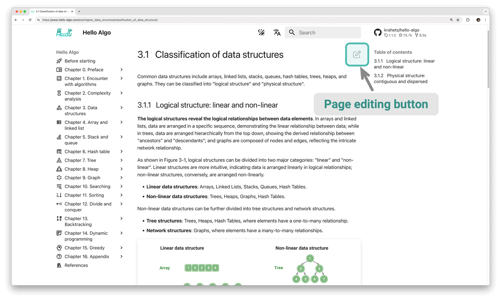

# Contribute to the book

Despite the author's best efforts, this book may contain omissions and errors. Thank you for your understanding. If you find typos, broken links, missing content, ambiguous wording, unclear explanations, or poorly organized passages, please help us correct them so that we can provide a better learning resource.

To thank everyone for their generous contributions to the open-source community, the GitHub IDs of all [contributors](https://github.com/krahets/hello-algo/graphs/contributors) are displayed on the home pages of the book's repository, website, and PDF edition.

!!! success "The beauty of open source"

    Printed books often have long intervals between print runs, making their content difficult to update.
    
    In this open-source book, updates can be made within days or even hours.

### Small edits

As shown in the figure below, each page has an edit icon in its upper-right corner. Follow these steps to edit text or code.

1. Click the edit icon. If you are prompted to fork the repository, agree to do so.
2. Edit the Markdown source file, check that the content is correct, and keep the formatting as consistent as possible.
3. Enter a description of your changes at the bottom of the page, then click "Propose file change". On the next page, click "Create pull request" to submit your pull request.



Images cannot be edited directly. Please describe the problem in a new [issue](https://github.com/krahets/hello-algo/issues) or a comment, and we will redraw and replace the image as soon as possible.

### Creating content

If you would like to contribute to this open-source project, for example by translating code into another programming language or expanding an article, follow this pull request workflow.

1. Sign in to GitHub and fork the book's [code repository](https://github.com/krahets/hello-algo) to your own account.
2. Open your fork's repository page and use `git clone` to clone it to your computer.
3. Create your content locally and test it thoroughly to verify that the code is correct.
4. Commit your local changes, then push them to your remote repository.
5. Refresh the repository page and click "Create pull request" to submit your pull request.

### Deploying with Docker

Run the following Docker command in the `hello-algo` root directory to access the English edition at `http://localhost:8000/en/`:

```shell
docker-compose up -d
```

Use the following command to remove the deployment:

```shell
docker-compose down
```
