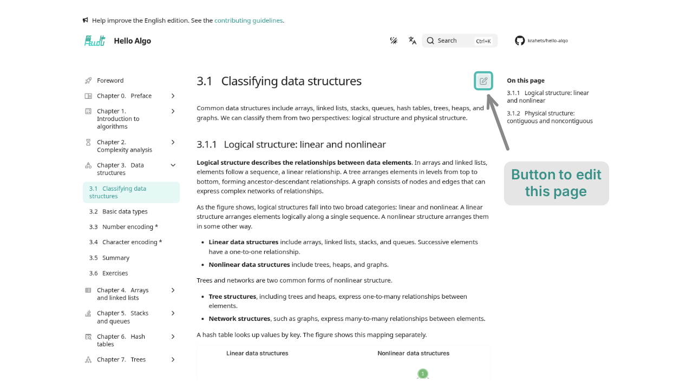

# 16.2 &nbsp; Contributing to the book

Even with my best efforts, this book has its share of errors and omissions. Thank you for bearing with me. If you spot a typo, a broken link, missing material, ambiguous wording, an unclear explanation, or a passage that is hard to follow because of how it is organized, please help us fix it so readers can learn more easily.

To thank everyone who contributes their time to the open-source community, we list the GitHub username of every [contributor](https://github.com/krahets/hello-algo/graphs/contributors) on the repository home page, the website’s home page, and the opening page of the PDF.

!!! success "The appeal of open source"

    Print books often go a long time between printings, which makes them difficult to update.
    
    With this open-source book, an update can reach readers in days or even hours.

### 1. &nbsp; Making small edits

Each page has an edit icon in the upper-right corner, as shown below. To edit text or code, follow these steps.

1. Click the edit icon. If GitHub prompts you to fork the repository, accept the prompt.
2. Edit the Markdown source file, check your changes for accuracy, and try to keep the formatting consistent.
3. At the bottom of the page, describe your changes and click “Propose file change.” On the next page, click “Create pull request” to open a pull request.

{ class="animation-figure" }

 Figure 16-3 &nbsp; Edit button in the upper-right corner of the page 

Images cannot be edited directly. Open an [issue](https://github.com/krahets/hello-algo/issues) or leave a comment describing the problem, and we will redraw and replace the image as soon as we can.

### 2. &nbsp; Contributing new material

To contribute to this open-source project, for example by translating code into another programming language or expanding a section of the book, follow these steps to submit a pull request.

1. Sign in to GitHub and fork the book’s [repository](https://github.com/krahets/hello-algo) to your personal account.
2. Go to your fork on GitHub and use `git clone` to clone it to your computer.
3. Create the new material locally and test the code thoroughly to verify that it works correctly.
4. Commit your changes locally, then push them to your remote repository.
5. Refresh the repository page and click “Create pull request” to open a pull request.
