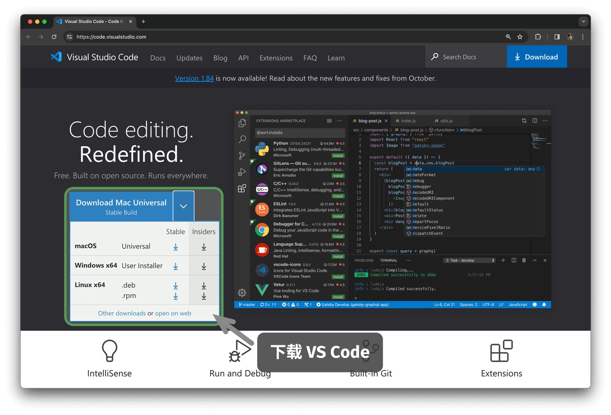

# Setting up a programming environment

## Install an IDE

We recommend VS Code, a lightweight, open-source integrated development environment (IDE). Visit the [VS Code website](https://code.visualstudio.com/), then download and install the version for your operating system.

VS Code has an extensive ecosystem of extensions that support running and debugging code in most programming languages. For example, installing the Python Extension Pack lets you debug Python code. The installation steps are shown in the figure below.

## Install a language environment

### Python

1. Download and install [Miniconda3](https://docs.conda.io/en/latest/miniconda.html). Python 3.10 or later is required.
2. Search for `python` in the VS Code Extensions Marketplace and install Python Extension Pack.
3. (Optional) Run `pip install black` in a terminal to install a code formatter.

### C/C++

1. On Windows, install [MinGW](https://sourceforge.net/projects/mingw-w64/files/) ([setup guide](https://blog.csdn.net/qq_33698226/article/details/129031241)). macOS comes with Clang, so no installation is needed.
2. Search for `c++` in the VS Code Extensions Marketplace and install C/C++ Extension Pack.
3. (Optional) Open Settings, search for the `Clang_format_fallback Style` formatting option, and set it to `{ BasedOnStyle: Microsoft, BreakBeforeBraces: Attach }`.

### Java

1. Download and install [OpenJDK](https://jdk.java.net/18/) (a version later than JDK 9 is required).
2. Search for `java` in the VS Code Extensions Marketplace and install Extension Pack for Java.

### C\#

1. Download and install [.NET 8.0](https://dotnet.microsoft.com/en-us/download).
2. Search for `C# Dev Kit` in the VS Code Extensions Marketplace and install C# Dev Kit ([setup guide](https://code.visualstudio.com/docs/csharp/get-started)).
3. You can also use Visual Studio ([installation guide](https://learn.microsoft.com/en-us/visualstudio/install/install-visual-studio?view=vs-2022)).

### Go

1. Download and install [Go](https://go.dev/dl/).
2. Search for `go` in the VS Code Extensions Marketplace and install Go.
3. Press `Ctrl + Shift + P` to open the Command Palette, enter go, select `Go: Install/Update Tools`, then select and install all the tools.

### Swift

1. Download and install [Swift](https://www.swift.org/download/).
2. Search for `swift` in the VS Code Extensions Marketplace and install [Swift for Visual Studio Code](https://marketplace.visualstudio.com/items?itemName=sswg.swift-lang).

### JavaScript

1. Download and install [Node.js](https://nodejs.org/en/).
2. (Optional) Search for `Prettier` in the VS Code Extensions Marketplace and install this code formatter.

### TypeScript

1. Follow the JavaScript environment setup steps.
2. Install [TypeScript Execute (tsx)](https://github.com/privatenumber/tsx?tab=readme-ov-file#global-installation).
3. Search for `typescript` in the VS Code Extensions Marketplace and install [Pretty TypeScript Errors](https://marketplace.visualstudio.com/items?itemName=yoavbls.pretty-ts-errors).

### Dart

1. Download and install [Dart](https://dart.dev/get-dart).
2. Search for `dart` in the VS Code Extensions Marketplace and install [Dart](https://marketplace.visualstudio.com/items?itemName=Dart-Code.dart-code).

### Rust

1. Download and install [Rust](https://www.rust-lang.org/tools/install).
2. Search for `rust` in the VS Code Extensions Marketplace and install [rust-analyzer](https://marketplace.visualstudio.com/items?itemName=rust-lang.rust-analyzer).
