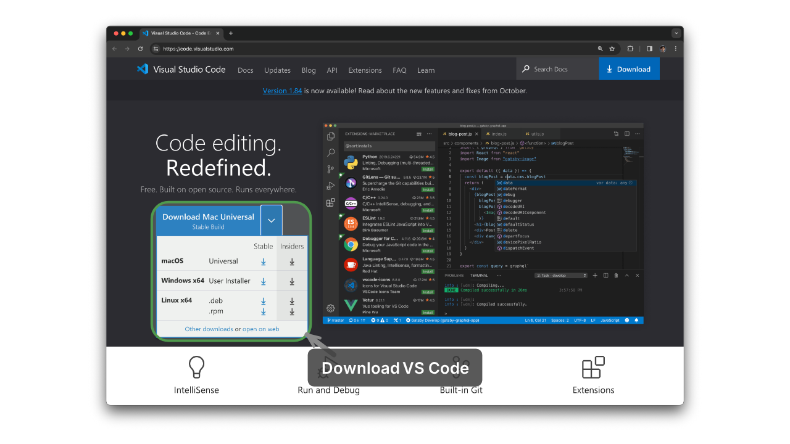
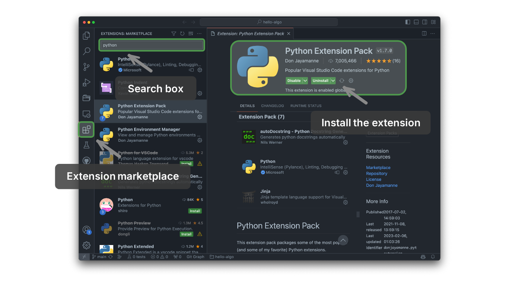

# 16.1 &nbsp; Setting up a programming environment

## 16.1.1 &nbsp; Installing an IDE

We recommend VS Code, a lightweight, open-source integrated development environment (IDE), for working on your computer. Visit the [VS Code website](https://code.visualstudio.com/) to download and install the version for your operating system.

{ class="animation-figure" }

 Figure 16-1 &nbsp; Downloading VS Code from the official website 

VS Code has a large collection of extensions that let you run and debug code in most programming languages. For example, installing the Python Extension Pack lets you debug Python code. Figure 16-2 shows how to install the pack.

{ class="animation-figure" }

 Figure 16-2 &nbsp; Installing an extension pack in VS Code 

## 16.1.2 &nbsp; Setting up your language tools

### 1. &nbsp; Python

1. Download and install [Miniconda3](https://docs.conda.io/en/latest/miniconda.html). You need Python 3.10 or later.
2. Search for `python` in the VS Code Extensions Marketplace and install the Python Extension Pack.
3. (Optional) Run `pip install black` at the command line to install the code formatter.

### 2. &nbsp; C/C++

1. On Windows, install [MinGW](https://sourceforge.net/projects/mingw-w64/files/) (see the [setup guide in Chinese](https://blog.csdn.net/qq_33698226/article/details/129031241)). On macOS, Clang is already included.
2. Search for `c++` in the VS Code Extensions Marketplace and install the C/C++ Extension Pack.
3. (Optional) Open Settings, search for the `Clang_format_fallback Style` formatting option, and set it to `{ BasedOnStyle: Microsoft, BreakBeforeBraces: Attach }`.

### 3. &nbsp; Java

1. Download and install a version of [OpenJDK](https://jdk.java.net/18/) newer than JDK 9.
2. Search for `java` in the VS Code Extensions Marketplace and install the Extension Pack for Java.

### 4. &nbsp; C#

1. Download and install [.NET 8.0](https://dotnet.microsoft.com/en-us/download).
2. Search for `C# Dev Kit` in the VS Code Extensions Marketplace and install C# Dev Kit (see the [setup guide](https://code.visualstudio.com/docs/csharp/get-started)).
3. You can also use Visual Studio (see the [installation guide](https://learn.microsoft.com/en-us/visualstudio/install/install-visual-studio?view=vs-2022)).

### 5. &nbsp; Go

1. Download and install [Go](https://go.dev/dl/).
2. Search for `go` in the VS Code Extensions Marketplace and install the Go extension.
3. Press `Ctrl + Shift + P` to open the Command Palette, type go, and choose `Go: Install/Update Tools`. Select all the tools and install them.

### 6. &nbsp; Swift

1. Download and install [Swift](https://www.swift.org/download/).
2. Search for `swift` in the VS Code Extensions Marketplace and install [Swift for Visual Studio Code](https://marketplace.visualstudio.com/items?itemName=sswg.swift-lang).

### 7. &nbsp; JavaScript

1. Download and install [Node.js](https://nodejs.org/en/).
2. (Optional) Search for `Prettier` in the VS Code Extensions Marketplace and install the code formatter.

### 8. &nbsp; TypeScript

1. Follow the steps for setting up JavaScript.
2. Install [TypeScript Execute (tsx)](https://github.com/privatenumber/tsx?tab=readme-ov-file#global-installation).
3. Search for `typescript` in the VS Code Extensions Marketplace and install [Pretty TypeScript Errors](https://marketplace.visualstudio.com/items?itemName=yoavbls.pretty-ts-errors).

### 9. &nbsp; Dart

1. Download and install [Dart](https://dart.dev/get-dart).
2. Search for `dart` in the VS Code Extensions Marketplace and install the [Dart](https://marketplace.visualstudio.com/items?itemName=Dart-Code.dart-code) extension.

### 10. &nbsp; Rust

1. Download and install [Rust](https://www.rust-lang.org/tools/install).
2. Search for `rust` in the VS Code Extensions Marketplace and install [rust-analyzer](https://marketplace.visualstudio.com/items?itemName=rust-lang.rust-analyzer).
