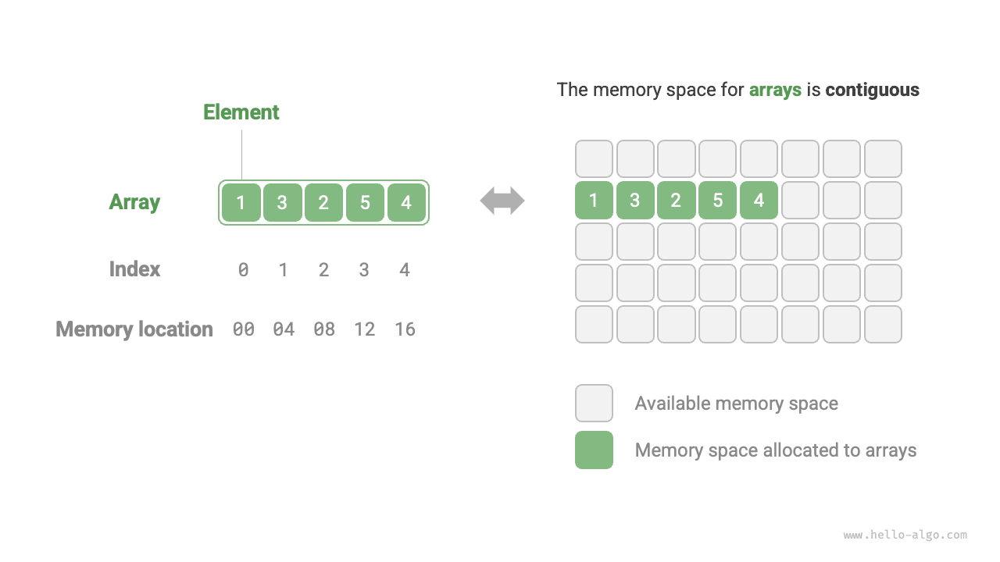

# Arrays

An <u>array</u> is a linear data structure that stores elements of the same type in contiguous memory. An element's position in the array is its <u>index</u>. The figure below shows the main concepts and storage layout.



## Common array operations

### Initializing an array

We can initialize an array with or without explicit values. When values are not specified, most programming languages initialize the elements to $0$:

=== "Python"

    ```python title="array.py"
    # Initialize arrays
    arr: list[int] = [0] * 5  # [ 0, 0, 0, 0, 0 ]
    nums: list[int] = [1, 3, 2, 5, 4]
    ```

=== "C++"

    ```cpp title="array.cpp"
    /* Initialize arrays */
    // Stored on the stack
    int arr[5] = {};
    int nums[5] = { 1, 3, 2, 5, 4 };
    // Stored on the heap (memory must be freed manually)
    int* arr1 = new int[5] {};
    int* nums1 = new int[5] { 1, 3, 2, 5, 4 };
    ```

=== "Java"

    ```java title="array.java"
    /* Initialize arrays */
    int[] arr = new int[5]; // { 0, 0, 0, 0, 0 }
    int[] nums = { 1, 3, 2, 5, 4 };
    ```

=== "C#"

    ```csharp title="array.cs"
    /* Initialize arrays */
    int[] arr = new int[5]; // [ 0, 0, 0, 0, 0 ]
    int[] nums = [1, 3, 2, 5, 4];
    ```

=== "Go"

    ```go title="array.go"
    /* Initialize arrays */
    var arr [5]int
    // In Go, [5]int is an array with a specified length; []int is a slice
    // Go array lengths are determined at compile time and must be constants
    // To make extend() easier to implement, we treat slices as arrays below
    nums := []int{1, 3, 2, 5, 4}
    ```

=== "Swift"

    ```swift title="array.swift"
    /* Initialize arrays */
    let arr = Array(repeating: 0, count: 5) // [0, 0, 0, 0, 0]
    let nums = [1, 3, 2, 5, 4]
    ```

=== "JS"

    ```javascript title="array.js"
    /* Initialize arrays */
    var arr = new Array(5).fill(0);
    var nums = [1, 3, 2, 5, 4];
    ```

=== "TS"

    ```typescript title="array.ts"
    /* Initialize arrays */
    let arr: number[] = new Array(5).fill(0);
    let nums: number[] = [1, 3, 2, 5, 4];
    ```

=== "Dart"

    ```dart title="array.dart"
    /* Initialize arrays */
    List<int> arr = List.filled(5, 0); // [0, 0, 0, 0, 0]
    List<int> nums = [1, 3, 2, 5, 4];
    ```

=== "Rust"

    ```rust title="array.rs"
    /* Initialize arrays */
    let arr: [i32; 5] = [0; 5]; // [0, 0, 0, 0, 0]
    let slice: &[i32] = &[0; 5];
    // In Rust, [i32; 5] is an array with a specified length; &[i32] is a slice
    // Rust array lengths are determined at compile time and must be constants
    // Vector is Rust's usual dynamic array type
    // To make extend() easier to implement, we treat a vector as an array below
    let nums: Vec<i32> = vec![1, 3, 2, 5, 4];
    ```

=== "C"

    ```c title="array.c"
    /* Initialize arrays */
    int arr[5] = { 0 }; // { 0, 0, 0, 0, 0 }
    int nums[5] = { 1, 3, 2, 5, 4 };
    ```

=== "Kotlin"

    ```kotlin title="array.kt"
    /* Initialize arrays */
    var arr = IntArray(5) // { 0, 0, 0, 0, 0 }
    var nums = intArrayOf(1, 3, 2, 5, 4)
    ```

=== "Ruby"

    ```ruby title="array.rb"
    # Initialize arrays
    arr = Array.new(5, 0)
    nums = [1, 3, 2, 5, 4]
    ```

??? pythontutor "Visualize execution"

    https://pythontutor.com/render.html#code=%23%20Initialize%20arrays%0Aarr%20%3D%20%5B0%5D%20%2A%205%20%20%23%20%5B%200%2C%200%2C%200%2C%200%2C%200%20%5D%0Anums%20%3D%20%5B1%2C%203%2C%202%2C%205%2C%204%5D&cumulative=false&curInstr=0&heapPrimitives=nevernest&mode=display&origin=opt-frontend.js&py=311&rawInputLstJSON=%5B%5D&textReferences=false

### Accessing an element

Because array elements occupy contiguous memory, their addresses are easy to calculate. Given the array's address (the address of its first element) and an index, the formula in the figure below gives the element's address, allowing direct access.


The first element has index $0$, which may seem unintuitive because counting from $1$ feels more natural. However, **an index essentially describes an offset from the starting memory address**. The first element's offset is $0$, so index $0$ makes sense.

Array access is very efficient: any element can be accessed directly in $O(1)$ time.

```src
[file]{array}-[class]{}-[func]{random_access}
```

### Inserting an element

Array elements sit next to one another, with no room between them for more data. As shown in the figure below, inserting into the middle requires shifting every element at or after the insertion point one position toward the end, then assigning the new element at the desired index.


Because an array's length is fixed, inserting an element causes the last element to be lost. We will discuss the solution in the section on lists.

```src
[file]{array}-[class]{}-[func]{insert}
```

### Removing an element

Similarly, as shown in the figure below, removing the element at index $i$ requires shifting every element after $i$ one position toward the beginning.


After removal, the old final entry is no longer meaningful, so we do not need to change it explicitly.

```src
[file]{array}-[class]{}-[func]{remove}
```

Overall, inserting and removing array elements have these drawbacks.

- **High time complexity**: Both operations take $O(n)$ time on average, where $n$ is the array length.
- **Lost elements**: Since the length is fixed, insertion loses any element pushed beyond the array's bounds.
- **Wasted memory**: We can allocate a longer array and use only its beginning, so any final entries lost during insertion are unused. However, this leaves some memory wasted.

### Traversing an array

Most programming languages let us traverse an array either by index or by visiting its elements directly:

```src
[file]{array}-[class]{}-[func]{traverse}
```

### Finding an element

To find a specified element, traverse the array and compare each value with the target. Return the index when a match is found.

Because an array is a linear data structure, this is called linear search.

```src
[file]{array}-[class]{}-[func]{find}
```

### Expanding an array

In a complex system, a program cannot ensure that memory immediately after an array is available, so extending it in place is unsafe. Therefore, in most programming languages, **an array's length is fixed**.

To expand an array, create a larger one and copy every element into it. This takes $O(n)$ time and can be expensive for a large array. The code is as follows:

```src
[file]{array}-[class]{}-[func]{extend}
```

## Strengths and limitations of arrays

An array stores elements of one type in contiguous memory. These known properties give the system opportunities to optimize operations.

- **Space efficiency**: Data occupies a contiguous block with no extra structural overhead.
- **Random access**: Any element can be accessed in $O(1)$ time.
- **Cache locality**: Accessing an element loads not only that element but also nearby data into the cache, speeding up later operations.

Contiguous storage also has limitations.

- **Slow insertion and deletion**: With many elements, these operations require substantial shifting.
- **Fixed length**: Once initialized, an array cannot change length; expansion requires copying all data into a new array.
- **Wasted space**: Any allocated space beyond actual needs is unused.

## Typical applications of arrays

Arrays are fundamental, widely used data structures. They appear throughout algorithms and underpin more complex structures.

- **Random access**: To draw random samples, store data in an array and generate random indices to select elements.
- **Sorting and searching**: Arrays are the most common structures for these algorithms. Quick sort, merge sort, and binary search operate primarily on arrays.
- **Lookup tables**: An array can provide fast access to an element or a mapping. For example, a character-to-ASCII mapping can use a character's ASCII value as an index and store its corresponding element there.
- **Machine learning**: Neural networks make extensive use of linear algebra on vectors, matrices, and tensors, all built from arrays. Arrays are the most common data structure in neural network programming.
- **Implementing data structures**: Arrays can implement stacks, queues, hash tables, heaps, graphs, and more. A graph's adjacency matrix, for example, is a two-dimensional array.
