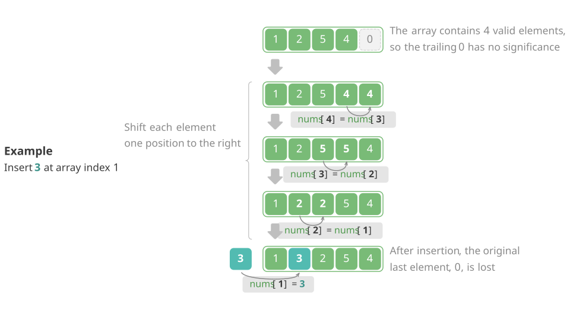
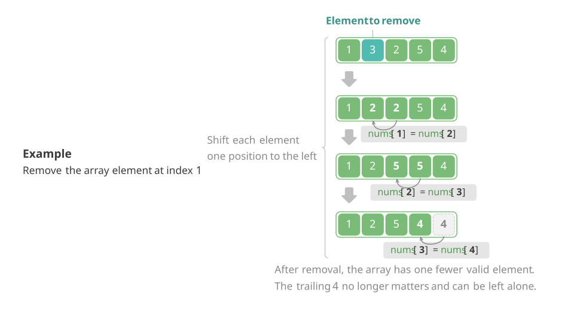

# Arrays

An <u>array</u> is a linear data structure that stores elements of the same type in contiguous memory. An element's position in the array is its <u>index</u>. The figure below shows how the elements are indexed and stored.


## Common array operations

### Initializing an array

Depending on what we need, we can create an array with or without specifying initial values. When no initial values are supplied, most programming languages initialize the elements to $0$:

```snippet
init_array
```

??? pythontutor "Visualize execution"

    @tutor init_array_tutor

### Accessing an element

Because array elements occupy contiguous memory, their addresses are easy to calculate. Given the base address of the array (the address of its first element) and the index of an element, we can use the formula below to calculate that element's address and access it directly.


In the figure, the first element has index $0$. That may seem surprising if counting from $1$ feels more natural. The address formula explains why: **an index is essentially an offset from the base address, measured in elements**. The first element's offset is $0$, so its index is naturally $0$.

Array access is efficient. We can access any element at random in $O(1)$ time.

```src
[file]{array}-[class]{}-[func]{random_access}
```

### Inserting an element

Array elements sit right next to one another in memory, with no room between them for additional data. To insert an element in the middle, shift the elements from the insertion point onward one position to the right, then write the new element at the desired index, as shown below.



Because the array has a fixed length, inserting an element this way necessarily “loses” the element previously in its last slot. We will discuss a solution in the section on lists.

```src
[file]{array}-[class]{}-[func]{insert}
```

### Removing an element

Similarly, to remove the element at index $i$, shift every element after $i$ one position to the left, as shown below.



After removal, the value left in the last slot is no longer meaningful, so there is no need to change it explicitly.

```src
[file]{array}-[class]{}-[func]{remove}
```

Insertion and removal in an array have the following drawbacks.

- **High time complexity.** Insertion and removal both take $O(n)$ time on average, where $n$ is the array length.
- **Loss of elements.** Because an array's length is fixed, insertion loses any element shifted beyond its bounds.
- **Wasted memory.** We can allocate a longer array and use only its first few slots. Then any trailing values lost during insertion are insignificant, but the unused slots waste memory.

### Traversing an array

Most programming languages let us traverse an array by index or iterate directly over its elements:

```src
[file]{array}-[class]{}-[func]{traverse}
```

### Finding an element

To find a given element, traverse the array and compare each value to the target. When a value matches, report its index.

Because an array is a linear data structure, this search is called a linear search.

```src
[file]{array}-[class]{}-[func]{find}
```

### Growing an array

In a complex system, a program can rarely guarantee that the memory immediately after an array is available, so it cannot safely extend the array in place. In most programming languages, **an array has a fixed length**.

To grow an array, create a larger one and copy the original elements into it in order. This takes $O(n)$ time and can be slow for very large arrays. Here is the code:

```src
[file]{array}-[class]{}-[func]{extend}
```

## Advantages and limitations of arrays

An array's elements occupy contiguous memory and have the same type. Knowing these properties in advance lets the system optimize operations on the data.

- **Space efficiency.** An array allocates a contiguous block of memory for its data, without extra structural overhead.
- **Random access.** An array provides access to any element in $O(1)$ time.
- **Cache locality.** When the computer accesses an array element, it also caches nearby data. Later operations on those elements can run faster by using the cache.

Contiguous storage also has limitations.

- **Costly insertion and removal.** When an array holds many elements, inserting or removing one can require shifting many others.
- **Fixed length.** An array's length is fixed at initialization. Growing it requires copying all its data into a new array, which is expensive.
- **Wasted space.** If an array is larger than needed, the extra space goes unused.

## Common uses of arrays

Arrays are a fundamental, widely used data structure. Many algorithms operate on them, and many more complex data structures are built from them.

- **Random access.** To draw random samples, store the data in an array and generate a sequence of random indices to select the samples.
- **Sorting and searching.** Arrays are the most common data structure for sorting and searching. Quicksort, merge sort, and binary search, for example, operate primarily on arrays.
- **Lookup tables.** An array can serve as a lookup table when we need to find an element or its associated value quickly. For example, to map characters to ASCII codes, use the character's ASCII value as the index and store the associated element at that position.
- **Machine learning.** Neural networks rely heavily on linear algebra operations involving vectors, matrices, and tensors, all of which are represented as arrays. Arrays are the most widely used data structure in neural network programming.
- **Implementing data structures.** Arrays can implement stacks, queues, hash tables, heaps, graphs, and more. For example, the adjacency matrix of a graph is a two-dimensional array.
