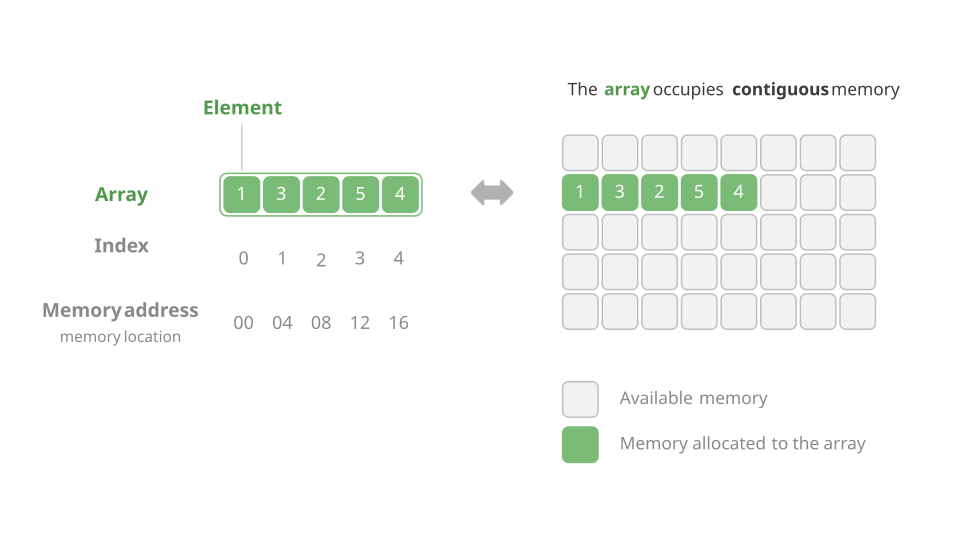
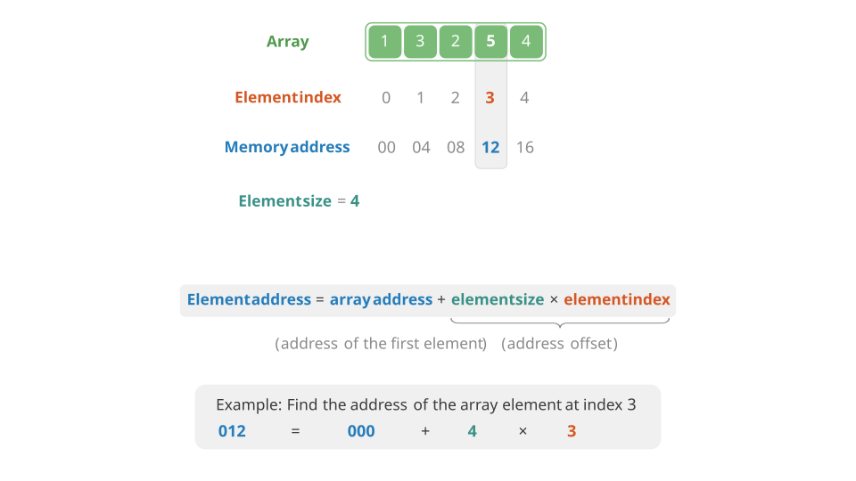

# 4.1 &nbsp; Arrays

An <u>array</u> is a linear data structure that stores elements of the same type in contiguous memory. An element's position in the array is its <u>index</u>. Figure 4-1 shows how the elements are indexed and stored.

{ class="animation-figure" }

<p align="center"> Figure 4-1 &nbsp; An array and its memory layout </p>

## 4.1.1 &nbsp; Common array operations

### 1. &nbsp; Initializing an array

Depending on what we need, we can create an array with or without specifying initial values. When no initial values are supplied, most programming languages initialize the elements to $0$:

=== "Python"

    ```python title="array.py"
    # Initialize the array
    arr: list[int] = [0] * 5  # [ 0, 0, 0, 0, 0 ]
    nums: list[int] = [1, 3, 2, 5, 4]
    ```

=== "C++"

    ```cpp title="array.cpp"
    /* Initialize the array */
    // Stored on the stack
    int arr[5] = {};
    int nums[5] = {1, 3, 2, 5, 4};
    // Stored on the heap (must be freed manually)
    int *arr1 = new int[5]{};
    int *nums1 = new int[5]{1, 3, 2, 5, 4};
    ```

=== "Java"

    ```java title="array.java"
    /* Initialize the array */
    int[] arr = new int[5]; // { 0, 0, 0, 0, 0 }
    int[] nums = { 1, 3, 2, 5, 4 };
    ```

=== "C#"

    ```csharp title="array.cs"
    // Initialize the array
    int[] arr = new int[5]; // [ 0, 0, 0, 0, 0 ]
    int[] nums = [1, 3, 2, 5, 4];
    ```

=== "Go"

    ```go title="array.go"
    /* Initialize the array */
    var arr [5]int
    // In Go, specifying the length ([5]int) gives an array, while omitting it ([]int) gives a slice
    // Go fixes array lengths at compile time, so the length must be a constant
    // To simplify the extend() function for extending an array, we use a slice as the array below
    nums := []int{1, 3, 2, 5, 4}
    ```

=== "Swift"

    ```swift title="array.swift"
    /* Initialize the array */
    let arr = Array(repeating: 0, count: 5) // [0, 0, 0, 0, 0]
    var nums = [1, 3, 2, 5, 4]
    ```

=== "JS"

    ```javascript title="array.js"
    /* Initialize the array */
    const arr = new Array(5).fill(0);
    let nums = [1, 3, 2, 5, 4];
    ```

=== "TS"

    ```typescript title="array.ts"
    /* Initialize the array */
    const arr: number[] = new Array(5).fill(0);
    let nums: number[] = [1, 3, 2, 5, 4];
    ```

=== "Dart"

    ```dart title="array.dart"
    /* Initialize the array */
    var arr = List.filled(5, 0); // [0, 0, 0, 0, 0]
    List<int> nums = [1, 3, 2, 5, 4];
    ```

=== "Rust"

    ```rust title="array.rs"
    /* Initialize the array */
    let arr: [i32; 5] = [0; 5]; // [0, 0, 0, 0, 0]
    // In Rust, specifying the length ([i32; 5]) gives an array, while &[i32] borrows a slice of unspecified length
    // Rust fixes array lengths at compile time, so the length must be a constant
    // A vector is the usual dynamic array type in Rust
    // To simplify the extend() method for extending an array, we use a vector as the array below
    let nums: Vec<i32> = vec![1, 3, 2, 5, 4];
    ```

=== "C"

    ```c title="array.c"
    /* Initialize the array */
    int arr[5] = {0}; // { 0, 0, 0, 0, 0 }
    int nums[] = {1, 3, 2, 5, 4};
    ```

=== "Kotlin"

    ```kotlin title="array.kt"
    /* Initialize the array */
    val arr = IntArray(5) // { 0, 0, 0, 0, 0 }
    var nums = intArrayOf(1, 3, 2, 5, 4)
    ```

=== "Ruby"

    ```ruby title="array.rb"
    # Initialize the array
    arr = Array.new(5, 0)
    nums = [1, 3, 2, 5, 4]
    ```

??? pythontutor "Visualize execution"

    <div style="height: 243px; width: 100%;"><iframe class="pythontutor-iframe" title="Visualize execution" src="https://pythontutor.com/iframe-embed.html#code=%23%20Initialize%20the%20arrays%0Aarr%20%3D%20%5B0%5D%20%2A%205%20%20%23%20%5B%200,%200,%200,%200,%200%20%5D%0Anums%20%3D%20%5B1,%203,%202,%205,%204%5D&codeDivHeight=472&codeDivWidth=350&cumulative=false&curInstr=0&heapPrimitives=nevernest&origin=opt-frontend.js&py=311&rawInputLstJSON=%5B%5D&textReferences=false"> </iframe></div>
    <div style="margin-top: 5px;"><a href="https://pythontutor.com/iframe-embed.html#code=%23%20Initialize%20the%20arrays%0Aarr%20%3D%20%5B0%5D%20%2A%205%20%20%23%20%5B%200,%200,%200,%200,%200%20%5D%0Anums%20%3D%20%5B1,%203,%202,%205,%204%5D&codeDivHeight=800&codeDivWidth=600&cumulative=false&curInstr=0&heapPrimitives=nevernest&origin=opt-frontend.js&py=311&rawInputLstJSON=%5B%5D&textReferences=false" target="_blank" rel="noopener noreferrer">View full screen ></a></div>

### 2. &nbsp; Accessing an element

Because array elements occupy contiguous memory, their addresses are easy to calculate. Given the base address of the array (the address of its first element) and the index of an element, we can use the formula below to calculate that element's address and access it directly.

{ class="animation-figure" }

<p align="center"> Figure 4-2 &nbsp; Calculating the memory address of an array element </p>

In the figure, the first element has index $0$. That may seem surprising if counting from $1$ feels more natural. The address formula explains why: **an index is essentially an offset from the base address, measured in elements**. The first element's offset is $0$, so its index is naturally $0$.

Array access is efficient. We can access any element at random in $O(1)$ time.

=== "Python"

    ```python title="array.py"
    def random_access(nums: list[int]) -> int:
        """Access a random element"""
        # Pick a random index in [0, len(nums)-1]
        random_index = random.randint(0, len(nums) - 1)
        # Get and return the element at that index
        random_num = nums[random_index]
        return random_num
    ```

=== "C++"

    ```cpp title="array.cpp"
    /* Access a random element */
    int randomAccess(int *nums, int size) {
        // Pick a random index in [0, size)
        int randomIndex = rand() % size;
        // Get and return the element at that index
        int randomNum = nums[randomIndex];
        return randomNum;
    }
    ```

=== "Java"

    ```java title="array.java"
    /* Access a random element */
    int randomAccess(int[] nums) {
        // Pick a random index in [0, nums.length)
        int randomIndex = ThreadLocalRandom.current().nextInt(0, nums.length);
        // Get and return the element at that index
        int randomNum = nums[randomIndex];
        return randomNum;
    }
    ```

=== "C#"

    ```csharp title="array.cs"
    /* Access a random element */
    int RandomAccess(int[] nums) {
        Random random = new();
        // Pick a random index in [0, nums.Length)
        int randomIndex = random.Next(nums.Length);
        // Get and return the element at that index
        int randomNum = nums[randomIndex];
        return randomNum;
    }
    ```

=== "Go"

    ```go title="array.go"
    /* Access a random element */
    func randomAccess(nums []int) (randomNum int) {
        // Pick a random index in [0, nums.length)
        randomIndex := rand.Intn(len(nums))
        // Get and return the element at that index
        randomNum = nums[randomIndex]
        return
    }
    ```

=== "Swift"

    ```swift title="array.swift"
    /* Access a random element */
    func randomAccess(nums: [Int]) -> Int {
        // Pick a random index in [0, nums.count)
        let randomIndex = nums.indices.randomElement()!
        // Get and return the element at that index
        let randomNum = nums[randomIndex]
        return randomNum
    }
    ```

=== "JS"

    ```javascript title="array.js"
    /* Access a random element */
    function randomAccess(nums) {
        // Pick a random index in [0, nums.length)
        const random_index = Math.floor(Math.random() * nums.length);
        // Get and return the element at that index
        const random_num = nums[random_index];
        return random_num;
    }
    ```

=== "TS"

    ```typescript title="array.ts"
    /* Access a random element */
    function randomAccess(nums: number[]): number {
        // Pick a random index in [0, nums.length)
        const random_index = Math.floor(Math.random() * nums.length);
        // Get and return the element at that index
        const random_num = nums[random_index];
        return random_num;
    }
    ```

=== "Dart"

    ```dart title="array.dart"
    /* Access a random element */
    int randomAccess(List<int> nums) {
      // Pick a random index in [0, nums.length)
      int randomIndex = Random().nextInt(nums.length);
      // Get and return the element at that index
      int randomNum = nums[randomIndex];
      return randomNum;
    }
    ```

=== "Rust"

    ```rust title="array.rs"
    /* Access a random element */
    fn random_access(nums: &[i32]) -> i32 {
        // Pick a random index in [0, nums.len())
        let random_index = rand::thread_rng().gen_range(0..nums.len());
        // Get and return the element at that index
        let random_num = nums[random_index];
        random_num
    }
    ```

=== "C"

    ```c title="array.c"
    /* Access a random element */
    int randomAccess(int *nums, int size) {
        // Pick a random index in [0, size)
        int randomIndex = rand() % size;
        // Get and return the element at that index
        int randomNum = nums[randomIndex];
        return randomNum;
    }
    ```

=== "Kotlin"

    ```kotlin title="array.kt"
    /* Access a random element */
    fun randomAccess(nums: IntArray): Int {
        // Pick a random index in [0, nums.size)
        val randomIndex = ThreadLocalRandom.current().nextInt(0, nums.size)
        // Get and return the element at that index
        val randomNum = nums[randomIndex]
        return randomNum
    }
    ```

=== "Ruby"

    ```ruby title="array.rb"
    ### Access a random element ###
    def random_access(nums)
      # Pick a random index in [0, nums.length)
      random_index = Random.rand(0...nums.length)

      # Get and return the element at that index
      nums[random_index]
    end
    ```

??? pythontutor "Visualize execution"

    <div style="height: 531px; width: 100%;"><iframe class="pythontutor-iframe" title="Visualize execution" src="https://pythontutor.com/iframe-embed.html#code=import%20random%0A%0Adef%20random_access%28nums%3A%20list%5Bint%5D%29%20-%3E%20int%3A%0A%20%20%20%20%22%22%22Access%20a%20random%20element%22%22%22%0A%20%20%20%20%23%20Pick%20a%20random%20index%20in%20%5B0,%20len%28nums%29-1%5D%0A%20%20%20%20random_index%20%3D%20random.randint%280,%20len%28nums%29%20-%201%29%0A%20%20%20%20%23%20Get%20and%20return%20the%20element%20at%20that%20index%0A%20%20%20%20random_num%20%3D%20nums%5Brandom_index%5D%0A%20%20%20%20return%20random_num%0A%0A%22%22%22Driver%20Code%22%22%22%0Aif%20__name__%20%3D%3D%20%22__main__%22%3A%0A%20%20%20%20%23%20Initialize%20the%20array%0A%20%20%20%20nums%20%3D%20%5B1,%203,%202,%205,%204%5D%0A%20%20%20%20print%28%22Array%20nums%20%3D%22,%20nums%29%0A%0A%20%20%20%20%23%20Random%20access%0A%20%20%20%20random_num%3A%20int%20%3D%20random_access%28nums%29%0A%20%20%20%20print%28%22Random%20element%20from%20nums%3A%22,%20random_num%29%0A&codeDivHeight=472&codeDivWidth=350&cumulative=false&curInstr=7&heapPrimitives=nevernest&origin=opt-frontend.js&py=311&rawInputLstJSON=%5B%5D&textReferences=false"> </iframe></div>
    <div style="margin-top: 5px;"><a href="https://pythontutor.com/iframe-embed.html#code=import%20random%0A%0Adef%20random_access%28nums%3A%20list%5Bint%5D%29%20-%3E%20int%3A%0A%20%20%20%20%22%22%22Access%20a%20random%20element%22%22%22%0A%20%20%20%20%23%20Pick%20a%20random%20index%20in%20%5B0,%20len%28nums%29-1%5D%0A%20%20%20%20random_index%20%3D%20random.randint%280,%20len%28nums%29%20-%201%29%0A%20%20%20%20%23%20Get%20and%20return%20the%20element%20at%20that%20index%0A%20%20%20%20random_num%20%3D%20nums%5Brandom_index%5D%0A%20%20%20%20return%20random_num%0A%0A%22%22%22Driver%20Code%22%22%22%0Aif%20__name__%20%3D%3D%20%22__main__%22%3A%0A%20%20%20%20%23%20Initialize%20the%20array%0A%20%20%20%20nums%20%3D%20%5B1,%203,%202,%205,%204%5D%0A%20%20%20%20print%28%22Array%20nums%20%3D%22,%20nums%29%0A%0A%20%20%20%20%23%20Random%20access%0A%20%20%20%20random_num%3A%20int%20%3D%20random_access%28nums%29%0A%20%20%20%20print%28%22Random%20element%20from%20nums%3A%22,%20random_num%29%0A&codeDivHeight=800&codeDivWidth=600&cumulative=false&curInstr=7&heapPrimitives=nevernest&origin=opt-frontend.js&py=311&rawInputLstJSON=%5B%5D&textReferences=false" target="_blank" rel="noopener noreferrer">View full screen ></a></div>

### 3. &nbsp; Inserting an element

Array elements sit right next to one another in memory, with no room between them for additional data. To insert an element in the middle, shift the elements from the insertion point onward one position to the right, then write the new element at the desired index, as shown below.

{ class="animation-figure" }

<p align="center"> Figure 4-3 &nbsp; Inserting an element into an array </p>

Because the array has a fixed length, inserting an element this way necessarily “loses” the element previously in its last slot. We will discuss a solution in the section on lists.

=== "Python"

    ```python title="array.py"
    def insert(nums: list[int], num: int, index: int):
        """Insert num at the specified array index"""
        # Shift the elements from index onward one position to the right
        for i in range(len(nums) - 1, index, -1):
            nums[i] = nums[i - 1]
        # Store num at the specified index
        nums[index] = num
    ```

=== "C++"

    ```cpp title="array.cpp"
    /* Insert num at the specified array index */
    void insert(int *nums, int size, int num, int index) {
        // Shift the elements from index onward one position to the right
        for (int i = size - 1; i > index; i--) {
            nums[i] = nums[i - 1];
        }
        // Store num at the specified index
        nums[index] = num;
    }
    ```

=== "Java"

    ```java title="array.java"
    /* Insert num at the specified array index */
    void insert(int[] nums, int num, int index) {
        // Shift the elements from index onward one position to the right
        for (int i = nums.length - 1; i > index; i--) {
            nums[i] = nums[i - 1];
        }
        // Store num at the specified index
        nums[index] = num;
    }
    ```

=== "C#"

    ```csharp title="array.cs"
    /* Insert num at the specified array index */
    void Insert(int[] nums, int num, int index) {
        // Shift the elements from index onward one position to the right
        for (int i = nums.Length - 1; i > index; i--) {
            nums[i] = nums[i - 1];
        }
        // Store num at the specified index
        nums[index] = num;
    }
    ```

=== "Go"

    ```go title="array.go"
    /* Insert num at the specified array index */
    func insert(nums []int, num int, index int) {
        // Shift the elements from index onward one position to the right
        for i := len(nums) - 1; i > index; i-- {
            nums[i] = nums[i-1]
        }
        // Store num at the specified index
        nums[index] = num
    }
    ```

=== "Swift"

    ```swift title="array.swift"
    /* Insert num at the specified array index */
    func insert(nums: inout [Int], num: Int, index: Int) {
        // Shift the elements from index onward one position to the right
        for i in stride(from: nums.count - 1, to: index, by: -1) {
            nums[i] = nums[i - 1]
        }
        // Store num at the specified index
        nums[index] = num
    }
    ```

=== "JS"

    ```javascript title="array.js"
    /* Insert num at the specified array index */
    function insert(nums, num, index) {
        // Shift the elements from index onward one position to the right
        for (let i = nums.length - 1; i > index; i--) {
            nums[i] = nums[i - 1];
        }
        // Store num at the specified index
        nums[index] = num;
    }
    ```

=== "TS"

    ```typescript title="array.ts"
    /* Insert num at the specified array index */
    function insert(nums: number[], num: number, index: number): void {
        // Shift the elements from index onward one position to the right
        for (let i = nums.length - 1; i > index; i--) {
            nums[i] = nums[i - 1];
        }
        // Store num at the specified index
        nums[index] = num;
    }
    ```

=== "Dart"

    ```dart title="array.dart"
    /* Insert _num at the specified array index */
    void insert(List<int> nums, int _num, int index) {
      // Shift the elements from index onward one position to the right
      for (var i = nums.length - 1; i > index; i--) {
        nums[i] = nums[i - 1];
      }
      // Store _num at the specified index
      nums[index] = _num;
    }
    ```

=== "Rust"

    ```rust title="array.rs"
    /* Insert num at the specified array index */
    fn insert(nums: &mut [i32], num: i32, index: usize) {
        // Shift the elements from index onward one position to the right
        for i in (index + 1..nums.len()).rev() {
            nums[i] = nums[i - 1];
        }
        // Store num at the specified index
        nums[index] = num;
    }
    ```

=== "C"

    ```c title="array.c"
    /* Insert num at the specified array index */
    void insert(int *nums, int size, int num, int index) {
        // Shift the elements from index onward one position to the right
        for (int i = size - 1; i > index; i--) {
            nums[i] = nums[i - 1];
        }
        // Store num at the specified index
        nums[index] = num;
    }
    ```

=== "Kotlin"

    ```kotlin title="array.kt"
    /* Insert num at the specified array index */
    fun insert(nums: IntArray, num: Int, index: Int) {
        // Shift the elements from index onward one position to the right
        for (i in nums.size - 1 downTo index + 1) {
            nums[i] = nums[i - 1]
        }
        // Store num at the specified index
        nums[index] = num
    }
    ```

=== "Ruby"

    ```ruby title="array.rb"
    ### Insert num at the specified array index ###
    def insert(nums, num, index)
      # Shift the elements from index onward one position to the right
      for i in (nums.length - 1).downto(index + 1)
        nums[i] = nums[i - 1]
      end

      # Store num at the specified index
      nums[index] = num
    end
    ```

??? pythontutor "Visualize execution"

    <div style="height: 495px; width: 100%;"><iframe class="pythontutor-iframe" title="Visualize execution" src="https://pythontutor.com/iframe-embed.html#code=def%20insert%28nums%3A%20list%5Bint%5D,%20num%3A%20int,%20index%3A%20int%29%3A%0A%20%20%20%20%22%22%22Insert%20num%20at%20the%20specified%20array%20index%22%22%22%0A%20%20%20%20%23%20Shift%20the%20elements%20from%20index%20onward%20one%20position%20to%20the%20right%0A%20%20%20%20for%20i%20in%20range%28len%28nums%29%20-%201,%20index,%20-1%29%3A%0A%20%20%20%20%20%20%20%20nums%5Bi%5D%20%3D%20nums%5Bi%20-%201%5D%0A%20%20%20%20%23%20Store%20num%20at%20the%20specified%20index%0A%20%20%20%20nums%5Bindex%5D%20%3D%20num%0A%0A%22%22%22Driver%20Code%22%22%22%0Aif%20__name__%20%3D%3D%20%22__main__%22%3A%0A%20%20%20%20%23%20Initialize%20the%20array%0A%20%20%20%20nums%20%3D%20%5B1,%203,%202,%205,%204%5D%0A%20%20%20%20print%28%22Array%20nums%20%3D%22,%20nums%29%0A%0A%20%20%20%20%23%20Insert%20an%20element%0A%20%20%20%20insert%28nums,%206,%203%29%0A%20%20%20%20print%28%22After%20inserting%206%20at%20index%203,%20nums%20%3D%22,%20nums%29&codeDivHeight=472&codeDivWidth=350&cumulative=false&curInstr=6&heapPrimitives=nevernest&origin=opt-frontend.js&py=311&rawInputLstJSON=%5B%5D&textReferences=false"> </iframe></div>
    <div style="margin-top: 5px;"><a href="https://pythontutor.com/iframe-embed.html#code=def%20insert%28nums%3A%20list%5Bint%5D,%20num%3A%20int,%20index%3A%20int%29%3A%0A%20%20%20%20%22%22%22Insert%20num%20at%20the%20specified%20array%20index%22%22%22%0A%20%20%20%20%23%20Shift%20the%20elements%20from%20index%20onward%20one%20position%20to%20the%20right%0A%20%20%20%20for%20i%20in%20range%28len%28nums%29%20-%201,%20index,%20-1%29%3A%0A%20%20%20%20%20%20%20%20nums%5Bi%5D%20%3D%20nums%5Bi%20-%201%5D%0A%20%20%20%20%23%20Store%20num%20at%20the%20specified%20index%0A%20%20%20%20nums%5Bindex%5D%20%3D%20num%0A%0A%22%22%22Driver%20Code%22%22%22%0Aif%20__name__%20%3D%3D%20%22__main__%22%3A%0A%20%20%20%20%23%20Initialize%20the%20array%0A%20%20%20%20nums%20%3D%20%5B1,%203,%202,%205,%204%5D%0A%20%20%20%20print%28%22Array%20nums%20%3D%22,%20nums%29%0A%0A%20%20%20%20%23%20Insert%20an%20element%0A%20%20%20%20insert%28nums,%206,%203%29%0A%20%20%20%20print%28%22After%20inserting%206%20at%20index%203,%20nums%20%3D%22,%20nums%29&codeDivHeight=800&codeDivWidth=600&cumulative=false&curInstr=6&heapPrimitives=nevernest&origin=opt-frontend.js&py=311&rawInputLstJSON=%5B%5D&textReferences=false" target="_blank" rel="noopener noreferrer">View full screen ></a></div>

### 4. &nbsp; Removing an element

Similarly, to remove the element at index $i$, shift every element after $i$ one position to the left, as shown below.

{ class="animation-figure" }

<p align="center"> Figure 4-4 &nbsp; Removing an element from an array </p>

After removal, the value left in the last slot is no longer meaningful, so there is no need to change it explicitly.

=== "Python"

    ```python title="array.py"
    def remove(nums: list[int], index: int):
        """Remove the element at the specified index"""
        # Shift all elements after index one position to the left
        for i in range(index, len(nums) - 1):
            nums[i] = nums[i + 1]
    ```

=== "C++"

    ```cpp title="array.cpp"
    /* Remove the element at the specified index */
    void remove(int *nums, int size, int index) {
        // Shift all elements after index one position to the left
        for (int i = index; i < size - 1; i++) {
            nums[i] = nums[i + 1];
        }
    }
    ```

=== "Java"

    ```java title="array.java"
    /* Remove the element at the specified index */
    void remove(int[] nums, int index) {
        // Shift all elements after index one position to the left
        for (int i = index; i < nums.length - 1; i++) {
            nums[i] = nums[i + 1];
        }
    }
    ```

=== "C#"

    ```csharp title="array.cs"
    /* Remove the element at the specified index */
    void Remove(int[] nums, int index) {
        // Shift all elements after index one position to the left
        for (int i = index; i < nums.Length - 1; i++) {
            nums[i] = nums[i + 1];
        }
    }
    ```

=== "Go"

    ```go title="array.go"
    /* Remove the element at the specified index */
    func remove(nums []int, index int) {
        // Shift all elements after index one position to the left
        for i := index; i < len(nums)-1; i++ {
            nums[i] = nums[i+1]
        }
    }
    ```

=== "Swift"

    ```swift title="array.swift"
    /* Remove the element at the specified index */
    func remove(nums: inout [Int], index: Int) {
        // Shift all elements after index one position to the left
        for i in nums.indices.dropFirst(index).dropLast() {
            nums[i] = nums[i + 1]
        }
    }
    ```

=== "JS"

    ```javascript title="array.js"
    /* Remove the element at the specified index */
    function remove(nums, index) {
        // Shift all elements after index one position to the left
        for (let i = index; i < nums.length - 1; i++) {
            nums[i] = nums[i + 1];
        }
    }
    ```

=== "TS"

    ```typescript title="array.ts"
    /* Remove the element at the specified index */
    function remove(nums: number[], index: number): void {
        // Shift all elements after index one position to the left
        for (let i = index; i < nums.length - 1; i++) {
            nums[i] = nums[i + 1];
        }
    }
    ```

=== "Dart"

    ```dart title="array.dart"
    /* Remove the element at the specified index */
    void remove(List<int> nums, int index) {
      // Shift all elements after index one position to the left
      for (var i = index; i < nums.length - 1; i++) {
        nums[i] = nums[i + 1];
      }
    }
    ```

=== "Rust"

    ```rust title="array.rs"
    /* Remove the element at the specified index */
    fn remove(nums: &mut [i32], index: usize) {
        // Shift all elements after index one position to the left
        for i in index..nums.len() - 1 {
            nums[i] = nums[i + 1];
        }
    }
    ```

=== "C"

    ```c title="array.c"
    /* Remove the element at the specified index */
    // Note: stdio.h already uses the name remove
    void removeItem(int *nums, int size, int index) {
        // Shift all elements after index one position to the left
        for (int i = index; i < size - 1; i++) {
            nums[i] = nums[i + 1];
        }
    }
    ```

=== "Kotlin"

    ```kotlin title="array.kt"
    /* Remove the element at the specified index */
    fun remove(nums: IntArray, index: Int) {
        // Shift all elements after index one position to the left
        for (i in index..<nums.size - 1) {
            nums[i] = nums[i + 1]
        }
    }
    ```

=== "Ruby"

    ```ruby title="array.rb"
    ### Remove the element at the specified index ###
    def remove(nums, index)
      # Shift all elements after index one position to the left
      for i in index...(nums.length - 1)
        nums[i] = nums[i + 1]
      end
    end
    ```

??? pythontutor "Visualize execution"

    <div style="height: 459px; width: 100%;"><iframe class="pythontutor-iframe" title="Visualize execution" src="https://pythontutor.com/iframe-embed.html#code=def%20remove%28nums%3A%20list%5Bint%5D,%20index%3A%20int%29%3A%0A%20%20%20%20%22%22%22Remove%20the%20element%20at%20the%20specified%20index%22%22%22%0A%20%20%20%20%23%20Shift%20all%20elements%20after%20index%20one%20position%20to%20the%20left%0A%20%20%20%20for%20i%20in%20range%28index,%20len%28nums%29%20-%201%29%3A%0A%20%20%20%20%20%20%20%20nums%5Bi%5D%20%3D%20nums%5Bi%20%2B%201%5D%0A%0A%22%22%22Driver%20Code%22%22%22%0Aif%20__name__%20%3D%3D%20%22__main__%22%3A%0A%20%20%20%20%23%20Initialize%20the%20array%0A%20%20%20%20nums%20%3D%20%5B1,%203,%202,%205,%204%5D%0A%20%20%20%20print%28%22Array%20nums%20%3D%22,%20nums%29%0A%0A%20%20%20%20%23%20Remove%20an%20element%0A%20%20%20%20remove%28nums,%202%29%0A%20%20%20%20print%28%22After%20removing%20the%20element%20at%20index%202,%20nums%20%3D%22,%20nums%29&codeDivHeight=472&codeDivWidth=350&cumulative=false&curInstr=6&heapPrimitives=nevernest&origin=opt-frontend.js&py=311&rawInputLstJSON=%5B%5D&textReferences=false"> </iframe></div>
    <div style="margin-top: 5px;"><a href="https://pythontutor.com/iframe-embed.html#code=def%20remove%28nums%3A%20list%5Bint%5D,%20index%3A%20int%29%3A%0A%20%20%20%20%22%22%22Remove%20the%20element%20at%20the%20specified%20index%22%22%22%0A%20%20%20%20%23%20Shift%20all%20elements%20after%20index%20one%20position%20to%20the%20left%0A%20%20%20%20for%20i%20in%20range%28index,%20len%28nums%29%20-%201%29%3A%0A%20%20%20%20%20%20%20%20nums%5Bi%5D%20%3D%20nums%5Bi%20%2B%201%5D%0A%0A%22%22%22Driver%20Code%22%22%22%0Aif%20__name__%20%3D%3D%20%22__main__%22%3A%0A%20%20%20%20%23%20Initialize%20the%20array%0A%20%20%20%20nums%20%3D%20%5B1,%203,%202,%205,%204%5D%0A%20%20%20%20print%28%22Array%20nums%20%3D%22,%20nums%29%0A%0A%20%20%20%20%23%20Remove%20an%20element%0A%20%20%20%20remove%28nums,%202%29%0A%20%20%20%20print%28%22After%20removing%20the%20element%20at%20index%202,%20nums%20%3D%22,%20nums%29&codeDivHeight=800&codeDivWidth=600&cumulative=false&curInstr=6&heapPrimitives=nevernest&origin=opt-frontend.js&py=311&rawInputLstJSON=%5B%5D&textReferences=false" target="_blank" rel="noopener noreferrer">View full screen ></a></div>

Insertion and removal in an array have the following drawbacks.

- **High time complexity.** Insertion and removal both take $O(n)$ time on average, where $n$ is the array length.
- **Loss of elements.** Because an array's length is fixed, insertion loses any element shifted beyond its bounds.
- **Wasted memory.** We can allocate a longer array and use only its first few slots. Then any trailing values lost during insertion are insignificant, but the unused slots waste memory.

### 5. &nbsp; Traversing an array

Most programming languages let us traverse an array by index or iterate directly over its elements:

=== "Python"

    ```python title="array.py"
    def traverse(nums: list[int]):
        """Traverse the array"""
        count = 0
        # Traverse the array by index
        for i in range(len(nums)):
            count += nums[i]
        # Iterate directly over the array elements
        for num in nums:
            count += num
        # Iterate over indices and elements together
        for i, num in enumerate(nums):
            count += nums[i]
            count += num
    ```

=== "C++"

    ```cpp title="array.cpp"
    /* Traverse the array */
    void traverse(int *nums, int size) {
        int count = 0;
        // Traverse the array by index
        for (int i = 0; i < size; i++) {
            count += nums[i];
        }
    }
    ```

=== "Java"

    ```java title="array.java"
    /* Traverse the array */
    void traverse(int[] nums) {
        int count = 0;
        // Traverse the array by index
        for (int i = 0; i < nums.length; i++) {
            count += nums[i];
        }
        // Iterate directly over the array elements
        for (int num : nums) {
            count += num;
        }
    }
    ```

=== "C#"

    ```csharp title="array.cs"
    /* Traverse the array */
    void Traverse(int[] nums) {
        int count = 0;
        // Traverse the array by index
        for (int i = 0; i < nums.Length; i++) {
            count += nums[i];
        }
        // Iterate directly over the array elements
        foreach (int num in nums) {
            count += num;
        }
    }
    ```

=== "Go"

    ```go title="array.go"
    /* Traverse the array */
    func traverse(nums []int) {
        count := 0
        // Traverse the array by index
        for i := 0; i < len(nums); i++ {
            count += nums[i]
        }
        count = 0
        // Iterate directly over the array elements
        for _, num := range nums {
            count += num
        }
        // Iterate over indices and elements together
        for i, num := range nums {
            count += nums[i]
            count += num
        }
    }
    ```

=== "Swift"

    ```swift title="array.swift"
    /* Traverse the array */
    func traverse(nums: [Int]) {
        var count = 0
        // Traverse the array by index
        for i in nums.indices {
            count += nums[i]
        }
        // Iterate directly over the array elements
        for num in nums {
            count += num
        }
        // Iterate over indices and elements together
        for (i, num) in nums.enumerated() {
            count += nums[i]
            count += num
        }
    }
    ```

=== "JS"

    ```javascript title="array.js"
    /* Traverse the array */
    function traverse(nums) {
        let count = 0;
        // Traverse the array by index
        for (let i = 0; i < nums.length; i++) {
            count += nums[i];
        }
        // Iterate directly over the array elements
        for (const num of nums) {
            count += num;
        }
    }
    ```

=== "TS"

    ```typescript title="array.ts"
    /* Traverse the array */
    function traverse(nums: number[]): void {
        let count = 0;
        // Traverse the array by index
        for (let i = 0; i < nums.length; i++) {
            count += nums[i];
        }
        // Iterate directly over the array elements
        for (const num of nums) {
            count += num;
        }
    }
    ```

=== "Dart"

    ```dart title="array.dart"
    /* Traverse the array elements */
    void traverse(List<int> nums) {
      int count = 0;
      // Traverse the array by index
      for (var i = 0; i < nums.length; i++) {
        count += nums[i];
      }
      // Iterate directly over the array elements
      for (int _num in nums) {
        count += _num;
      }
      // Use forEach to traverse the array
      nums.forEach((_num) {
        count += _num;
      });
    }
    ```

=== "Rust"

    ```rust title="array.rs"
    /* Traverse the array */
    fn traverse(nums: &[i32]) {
        let mut _count = 0;
        // Traverse the array by index
        for i in 0..nums.len() {
            _count += nums[i];
        }
        // Iterate directly over the array elements
        _count = 0;
        for &num in nums {
            _count += num;
        }
    }
    ```

=== "C"

    ```c title="array.c"
    /* Traverse the array */
    void traverse(int *nums, int size) {
        int count = 0;
        // Traverse the array by index
        for (int i = 0; i < size; i++) {
            count += nums[i];
        }
    }
    ```

=== "Kotlin"

    ```kotlin title="array.kt"
    /* Traverse the array */
    fun traverse(nums: IntArray) {
        var count = 0
        // Traverse the array by index
        for (i in nums.indices) {
            count += nums[i]
        }
        // Iterate directly over the array elements
        for (j in nums) {
            count += j
        }
    }
    ```

=== "Ruby"

    ```ruby title="array.rb"
    ### Traverse the array ###
    def traverse(nums)
      count = 0

      # Traverse the array by index
      for i in 0...nums.length
        count += nums[i]
      end

      # Iterate directly over the array elements
      for num in nums
        count += num
      end
    end
    ```

??? pythontutor "Visualize execution"

    <div style="height: 549px; width: 100%;"><iframe class="pythontutor-iframe" title="Visualize execution" src="https://pythontutor.com/iframe-embed.html#code=def%20traverse%28nums%3A%20list%5Bint%5D%29%3A%0A%20%20%20%20%22%22%22Traverse%20the%20array%22%22%22%0A%20%20%20%20count%20%3D%200%0A%20%20%20%20%23%20Traverse%20the%20array%20by%20index%0A%20%20%20%20for%20i%20in%20range%28len%28nums%29%29%3A%0A%20%20%20%20%20%20%20%20count%20%2B%3D%20nums%5Bi%5D%0A%20%20%20%20%23%20Iterate%20directly%20over%20the%20array%20elements%0A%20%20%20%20for%20num%20in%20nums%3A%0A%20%20%20%20%20%20%20%20count%20%2B%3D%20num%0A%20%20%20%20%23%20Iterate%20over%20indices%20and%20elements%20together%0A%20%20%20%20for%20i,%20num%20in%20enumerate%28nums%29%3A%0A%20%20%20%20%20%20%20%20count%20%2B%3D%20nums%5Bi%5D%0A%20%20%20%20%20%20%20%20count%20%2B%3D%20num%0A%0A%22%22%22Driver%20Code%22%22%22%0Aif%20__name__%20%3D%3D%20%22__main__%22%3A%0A%20%20%20%20%23%20Initialize%20the%20array%0A%20%20%20%20nums%20%3D%20%5B1,%203,%202,%205,%204%5D%0A%20%20%20%20print%28%22Array%20nums%20%3D%22,%20nums%29%0A%0A%20%20%20%20%23%20Traverse%20the%20array%0A%20%20%20%20traverse%28nums%29&codeDivHeight=472&codeDivWidth=350&cumulative=false&curInstr=6&heapPrimitives=nevernest&origin=opt-frontend.js&py=311&rawInputLstJSON=%5B%5D&textReferences=false"> </iframe></div>
    <div style="margin-top: 5px;"><a href="https://pythontutor.com/iframe-embed.html#code=def%20traverse%28nums%3A%20list%5Bint%5D%29%3A%0A%20%20%20%20%22%22%22Traverse%20the%20array%22%22%22%0A%20%20%20%20count%20%3D%200%0A%20%20%20%20%23%20Traverse%20the%20array%20by%20index%0A%20%20%20%20for%20i%20in%20range%28len%28nums%29%29%3A%0A%20%20%20%20%20%20%20%20count%20%2B%3D%20nums%5Bi%5D%0A%20%20%20%20%23%20Iterate%20directly%20over%20the%20array%20elements%0A%20%20%20%20for%20num%20in%20nums%3A%0A%20%20%20%20%20%20%20%20count%20%2B%3D%20num%0A%20%20%20%20%23%20Iterate%20over%20indices%20and%20elements%20together%0A%20%20%20%20for%20i,%20num%20in%20enumerate%28nums%29%3A%0A%20%20%20%20%20%20%20%20count%20%2B%3D%20nums%5Bi%5D%0A%20%20%20%20%20%20%20%20count%20%2B%3D%20num%0A%0A%22%22%22Driver%20Code%22%22%22%0Aif%20__name__%20%3D%3D%20%22__main__%22%3A%0A%20%20%20%20%23%20Initialize%20the%20array%0A%20%20%20%20nums%20%3D%20%5B1,%203,%202,%205,%204%5D%0A%20%20%20%20print%28%22Array%20nums%20%3D%22,%20nums%29%0A%0A%20%20%20%20%23%20Traverse%20the%20array%0A%20%20%20%20traverse%28nums%29&codeDivHeight=800&codeDivWidth=600&cumulative=false&curInstr=6&heapPrimitives=nevernest&origin=opt-frontend.js&py=311&rawInputLstJSON=%5B%5D&textReferences=false" target="_blank" rel="noopener noreferrer">View full screen ></a></div>

### 6. &nbsp; Finding an element

To find a given element, traverse the array and compare each value to the target. When a value matches, report its index.

Because an array is a linear data structure, this search is called a linear search.

=== "Python"

    ```python title="array.py"
    def find(nums: list[int], target: int) -> int:
        """Find a given element in the array"""
        for i in range(len(nums)):
            if nums[i] == target:
                return i
        return -1
    ```

=== "C++"

    ```cpp title="array.cpp"
    /* Find a given element in the array */
    int find(int *nums, int size, int target) {
        for (int i = 0; i < size; i++) {
            if (nums[i] == target)
                return i;
        }
        return -1;
    }
    ```

=== "Java"

    ```java title="array.java"
    /* Find a given element in the array */
    int find(int[] nums, int target) {
        for (int i = 0; i < nums.length; i++) {
            if (nums[i] == target)
                return i;
        }
        return -1;
    }
    ```

=== "C#"

    ```csharp title="array.cs"
    /* Find a given element in the array */
    int Find(int[] nums, int target) {
        for (int i = 0; i < nums.Length; i++) {
            if (nums[i] == target)
                return i;
        }
        return -1;
    }
    ```

=== "Go"

    ```go title="array.go"
    /* Find a given element in the array */
    func find(nums []int, target int) (index int) {
        index = -1
        for i := 0; i < len(nums); i++ {
            if nums[i] == target {
                index = i
                break
            }
        }
        return
    }
    ```

=== "Swift"

    ```swift title="array.swift"
    /* Find a given element in the array */
    func find(nums: [Int], target: Int) -> Int {
        for i in nums.indices {
            if nums[i] == target {
                return i
            }
        }
        return -1
    }
    ```

=== "JS"

    ```javascript title="array.js"
    /* Find a given element in the array */
    function find(nums, target) {
        for (let i = 0; i < nums.length; i++) {
            if (nums[i] === target) return i;
        }
        return -1;
    }
    ```

=== "TS"

    ```typescript title="array.ts"
    /* Find a given element in the array */
    function find(nums: number[], target: number): number {
        for (let i = 0; i < nums.length; i++) {
            if (nums[i] === target) {
                return i;
            }
        }
        return -1;
    }
    ```

=== "Dart"

    ```dart title="array.dart"
    /* Find a given element in the array */
    int find(List<int> nums, int target) {
      for (var i = 0; i < nums.length; i++) {
        if (nums[i] == target) return i;
      }
      return -1;
    }
    ```

=== "Rust"

    ```rust title="array.rs"
    /* Find a given element in the array */
    fn find(nums: &[i32], target: i32) -> Option<usize> {
        for i in 0..nums.len() {
            if nums[i] == target {
                return Some(i);
            }
        }
        None
    }
    ```

=== "C"

    ```c title="array.c"
    /* Find a given element in the array */
    int find(int *nums, int size, int target) {
        for (int i = 0; i < size; i++) {
            if (nums[i] == target)
                return i;
        }
        return -1;
    }
    ```

=== "Kotlin"

    ```kotlin title="array.kt"
    /* Find a given element in the array */
    fun find(nums: IntArray, target: Int): Int {
        for (i in nums.indices) {
            if (nums[i] == target)
                return i
        }
        return -1
    }
    ```

=== "Ruby"

    ```ruby title="array.rb"
    ### Find a given element in the array ###
    def find(nums, target)
      for i in 0...nums.length
        return i if nums[i] == target
      end

      -1
    end
    ```

??? pythontutor "Visualize execution"

    <div style="height: 477px; width: 100%;"><iframe class="pythontutor-iframe" title="Visualize execution" src="https://pythontutor.com/iframe-embed.html#code=def%20find%28nums%3A%20list%5Bint%5D,%20target%3A%20int%29%20-%3E%20int%3A%0A%20%20%20%20%22%22%22Find%20a%20given%20element%20in%20the%20array%22%22%22%0A%20%20%20%20for%20i%20in%20range%28len%28nums%29%29%3A%0A%20%20%20%20%20%20%20%20if%20nums%5Bi%5D%20%3D%3D%20target%3A%0A%20%20%20%20%20%20%20%20%20%20%20%20return%20i%0A%20%20%20%20return%20-1%0A%0A%22%22%22Driver%20Code%22%22%22%0Aif%20__name__%20%3D%3D%20%22__main__%22%3A%0A%20%20%20%20%23%20Initialize%20the%20array%0A%20%20%20%20nums%20%3D%20%5B1,%203,%202,%205,%204%5D%0A%20%20%20%20print%28%22Array%20nums%20%3D%22,%20nums%29%0A%0A%20%20%20%20%23%20Find%20an%20element%0A%20%20%20%20index%3A%20int%20%3D%20find%28nums,%203%29%0A%20%20%20%20print%28%22Index%20of%203%20in%20nums%20%3D%22,%20index%29&codeDivHeight=472&codeDivWidth=350&cumulative=false&curInstr=6&heapPrimitives=nevernest&origin=opt-frontend.js&py=311&rawInputLstJSON=%5B%5D&textReferences=false"> </iframe></div>
    <div style="margin-top: 5px;"><a href="https://pythontutor.com/iframe-embed.html#code=def%20find%28nums%3A%20list%5Bint%5D,%20target%3A%20int%29%20-%3E%20int%3A%0A%20%20%20%20%22%22%22Find%20a%20given%20element%20in%20the%20array%22%22%22%0A%20%20%20%20for%20i%20in%20range%28len%28nums%29%29%3A%0A%20%20%20%20%20%20%20%20if%20nums%5Bi%5D%20%3D%3D%20target%3A%0A%20%20%20%20%20%20%20%20%20%20%20%20return%20i%0A%20%20%20%20return%20-1%0A%0A%22%22%22Driver%20Code%22%22%22%0Aif%20__name__%20%3D%3D%20%22__main__%22%3A%0A%20%20%20%20%23%20Initialize%20the%20array%0A%20%20%20%20nums%20%3D%20%5B1,%203,%202,%205,%204%5D%0A%20%20%20%20print%28%22Array%20nums%20%3D%22,%20nums%29%0A%0A%20%20%20%20%23%20Find%20an%20element%0A%20%20%20%20index%3A%20int%20%3D%20find%28nums,%203%29%0A%20%20%20%20print%28%22Index%20of%203%20in%20nums%20%3D%22,%20index%29&codeDivHeight=800&codeDivWidth=600&cumulative=false&curInstr=6&heapPrimitives=nevernest&origin=opt-frontend.js&py=311&rawInputLstJSON=%5B%5D&textReferences=false" target="_blank" rel="noopener noreferrer">View full screen ></a></div>

### 7. &nbsp; Growing an array

In a complex system, a program can rarely guarantee that the memory immediately after an array is available, so it cannot safely extend the array in place. In most programming languages, **an array has a fixed length**.

To grow an array, create a larger one and copy the original elements into it in order. This takes $O(n)$ time and can be slow for very large arrays. Here is the code:

=== "Python"

    ```python title="array.py"
    def extend(nums: list[int], enlarge: int) -> list[int]:
        """Extend the array"""
        # Initialize an array with the new length
        res = [0] * (len(nums) + enlarge)
        # Copy all elements from the original array into the new array
        for i in range(len(nums)):
            res[i] = nums[i]
        # Return the new, longer array
        return res
    ```

=== "C++"

    ```cpp title="array.cpp"
    /* Extend the array */
    int *extend(int *nums, int size, int enlarge) {
        // Initialize an array with the new length
        int *res = new int[size + enlarge]{};
        // Copy all elements from the original array into the new array
        for (int i = 0; i < size; i++) {
            res[i] = nums[i];
        }
        // Free memory
        delete[] nums;
        // Return the new, longer array
        return res;
    }
    ```

=== "Java"

    ```java title="array.java"
    /* Extend the array */
    int[] extend(int[] nums, int enlarge) {
        // Initialize an array with the new length
        int[] res = new int[nums.length + enlarge];
        // Copy all elements from the original array into the new array
        for (int i = 0; i < nums.length; i++) {
            res[i] = nums[i];
        }
        // Return the new, longer array
        return res;
    }
    ```

=== "C#"

    ```csharp title="array.cs"
    /* Extend the array */
    int[] Extend(int[] nums, int enlarge) {
        // Initialize an array with the new length
        int[] res = new int[nums.Length + enlarge];
        // Copy all elements from the original array into the new array
        for (int i = 0; i < nums.Length; i++) {
            res[i] = nums[i];
        }
        // Return the new, longer array
        return res;
    }
    ```

=== "Go"

    ```go title="array.go"
    /* Extend the array */
    func extend(nums []int, enlarge int) []int {
        // Initialize an array with the new length
        res := make([]int, len(nums)+enlarge)
        // Copy all elements from the original array into the new array
        for i, num := range nums {
            res[i] = num
        }
        // Return the new, longer array
        return res
    }
    ```

=== "Swift"

    ```swift title="array.swift"
    /* Extend the array */
    func extend(nums: [Int], enlarge: Int) -> [Int] {
        // Initialize an array with the new length
        var res = Array(repeating: 0, count: nums.count + enlarge)
        // Copy all elements from the original array into the new array
        for i in nums.indices {
            res[i] = nums[i]
        }
        // Return the new, longer array
        return res
    }
    ```

=== "JS"

    ```javascript title="array.js"
    /* Extend the array */
    // A JavaScript Array is dynamic and can grow directly
    // For this example, treat Array as a fixed-length array
    function extend(nums, enlarge) {
        // Initialize an array with the new length
        const res = new Array(nums.length + enlarge).fill(0);
        // Copy all elements from the original array into the new array
        for (let i = 0; i < nums.length; i++) {
            res[i] = nums[i];
        }
        // Return the new, longer array
        return res;
    }
    ```

=== "TS"

    ```typescript title="array.ts"
    /* Extend the array */
    // A TypeScript Array is dynamic and can grow directly
    // For this example, treat Array as a fixed-length array
    function extend(nums: number[], enlarge: number): number[] {
        // Initialize an array with the new length
        const res = new Array(nums.length + enlarge).fill(0);
        // Copy all elements from the original array into the new array
        for (let i = 0; i < nums.length; i++) {
            res[i] = nums[i];
        }
        // Return the new, longer array
        return res;
    }
    ```

=== "Dart"

    ```dart title="array.dart"
    /* Extend the array */
    List<int> extend(List<int> nums, int enlarge) {
      // Initialize an array with the new length
      List<int> res = List.filled(nums.length + enlarge, 0);
      // Copy all elements from the original array into the new array
      for (var i = 0; i < nums.length; i++) {
        res[i] = nums[i];
      }
      // Return the new, longer array
      return res;
    }
    ```

=== "Rust"

    ```rust title="array.rs"
    /* Extend the array */
    fn extend(nums: &[i32], enlarge: usize) -> Vec<i32> {
        // Initialize an array with the new length
        let mut res: Vec<i32> = vec![0; nums.len() + enlarge];
        // Copy all elements from the original array into the new array
        res[0..nums.len()].copy_from_slice(nums);

        // Return the new, longer array
        res
    }
    ```

=== "C"

    ```c title="array.c"
    /* Extend the array */
    int *extend(int *nums, int size, int enlarge) {
        // Initialize an array with the new length
        int *res = (int *)malloc(sizeof(int) * (size + enlarge));
        // Copy all elements from the original array into the new array
        for (int i = 0; i < size; i++) {
            res[i] = nums[i];
        }
        // Initialize the extra space
        for (int i = size; i < size + enlarge; i++) {
            res[i] = 0;
        }
        // Return the new, longer array
        return res;
    }
    ```

=== "Kotlin"

    ```kotlin title="array.kt"
    /* Extend the array */
    fun extend(nums: IntArray, enlarge: Int): IntArray {
        // Initialize an array with the new length
        val res = IntArray(nums.size + enlarge)
        // Copy all elements from the original array into the new array
        for (i in nums.indices) {
            res[i] = nums[i]
        }
        // Return the new, longer array
        return res
    }
    ```

=== "Ruby"

    ```ruby title="array.rb"
    ### Extend the array ###
    # A Ruby Array is dynamic and can grow directly
    # For this example, treat Array as a fixed-length array
    def extend(nums, enlarge)
      # Initialize an array with the new length
      res = Array.new(nums.length + enlarge, 0)

      # Copy all elements from the original array into the new array
      for i in 0...nums.length
        res[i] = nums[i]
      end

      # Return the new, longer array
      res
    end
    ```

??? pythontutor "Visualize execution"

    <div style="height: 549px; width: 100%;"><iframe class="pythontutor-iframe" title="Visualize execution" src="https://pythontutor.com/iframe-embed.html#code=%23%20A%20Python%20list%20is%20a%20dynamic%20array%20and%20can%20grow%20directly%0A%23%20For%20this%20example,%20treat%20list%20as%20a%20fixed-length%20array%0Adef%20extend%28nums%3A%20list%5Bint%5D,%20enlarge%3A%20int%29%20-%3E%20list%5Bint%5D%3A%0A%20%20%20%20%22%22%22Extend%20the%20array%22%22%22%0A%20%20%20%20%23%20Initialize%20an%20array%20with%20the%20new%20length%0A%20%20%20%20res%20%3D%20%5B0%5D%20%2A%20%28len%28nums%29%20%2B%20enlarge%29%0A%20%20%20%20%23%20Copy%20all%20elements%20from%20the%20original%20array%20into%20the%20new%20array%0A%20%20%20%20for%20i%20in%20range%28len%28nums%29%29%3A%0A%20%20%20%20%20%20%20%20res%5Bi%5D%20%3D%20nums%5Bi%5D%0A%20%20%20%20%23%20Return%20the%20new,%20longer%20array%0A%20%20%20%20return%20res%0A%0A%22%22%22Driver%20Code%22%22%22%0Aif%20__name__%20%3D%3D%20%22__main__%22%3A%0A%20%20%20%20%23%20Initialize%20the%20array%0A%20%20%20%20nums%20%3D%20%5B1,%203,%202,%205,%204%5D%0A%20%20%20%20print%28%22Array%20nums%20%3D%22,%20nums%29%0A%0A%20%20%20%20%23%20Extend%20the%20array%0A%20%20%20%20nums%20%3D%20extend%28nums,%203%29%0A%20%20%20%20print%28%22After%20extending%20the%20array%20to%20length%208,%20nums%20%3D%22,%20nums%29&codeDivHeight=472&codeDivWidth=350&cumulative=false&curInstr=6&heapPrimitives=nevernest&origin=opt-frontend.js&py=311&rawInputLstJSON=%5B%5D&textReferences=false"> </iframe></div>
    <div style="margin-top: 5px;"><a href="https://pythontutor.com/iframe-embed.html#code=%23%20A%20Python%20list%20is%20a%20dynamic%20array%20and%20can%20grow%20directly%0A%23%20For%20this%20example,%20treat%20list%20as%20a%20fixed-length%20array%0Adef%20extend%28nums%3A%20list%5Bint%5D,%20enlarge%3A%20int%29%20-%3E%20list%5Bint%5D%3A%0A%20%20%20%20%22%22%22Extend%20the%20array%22%22%22%0A%20%20%20%20%23%20Initialize%20an%20array%20with%20the%20new%20length%0A%20%20%20%20res%20%3D%20%5B0%5D%20%2A%20%28len%28nums%29%20%2B%20enlarge%29%0A%20%20%20%20%23%20Copy%20all%20elements%20from%20the%20original%20array%20into%20the%20new%20array%0A%20%20%20%20for%20i%20in%20range%28len%28nums%29%29%3A%0A%20%20%20%20%20%20%20%20res%5Bi%5D%20%3D%20nums%5Bi%5D%0A%20%20%20%20%23%20Return%20the%20new,%20longer%20array%0A%20%20%20%20return%20res%0A%0A%22%22%22Driver%20Code%22%22%22%0Aif%20__name__%20%3D%3D%20%22__main__%22%3A%0A%20%20%20%20%23%20Initialize%20the%20array%0A%20%20%20%20nums%20%3D%20%5B1,%203,%202,%205,%204%5D%0A%20%20%20%20print%28%22Array%20nums%20%3D%22,%20nums%29%0A%0A%20%20%20%20%23%20Extend%20the%20array%0A%20%20%20%20nums%20%3D%20extend%28nums,%203%29%0A%20%20%20%20print%28%22After%20extending%20the%20array%20to%20length%208,%20nums%20%3D%22,%20nums%29&codeDivHeight=800&codeDivWidth=600&cumulative=false&curInstr=6&heapPrimitives=nevernest&origin=opt-frontend.js&py=311&rawInputLstJSON=%5B%5D&textReferences=false" target="_blank" rel="noopener noreferrer">View full screen ></a></div>

## 4.1.2 &nbsp; Advantages and limitations of arrays

An array's elements occupy contiguous memory and have the same type. Knowing these properties in advance lets the system optimize operations on the data.

- **Space efficiency.** An array allocates a contiguous block of memory for its data, without extra structural overhead.
- **Random access.** An array provides access to any element in $O(1)$ time.
- **Cache locality.** When the computer accesses an array element, it also caches nearby data. Later operations on those elements can run faster by using the cache.

Contiguous storage also has limitations.

- **Costly insertion and removal.** When an array holds many elements, inserting or removing one can require shifting many others.
- **Fixed length.** An array's length is fixed at initialization. Growing it requires copying all its data into a new array, which is expensive.
- **Wasted space.** If an array is larger than needed, the extra space goes unused.

## 4.1.3 &nbsp; Common uses of arrays

Arrays are a fundamental, widely used data structure. Many algorithms operate on them, and many more complex data structures are built from them.

- **Random access.** To draw random samples, store the data in an array and generate a sequence of random indices to select the samples.
- **Sorting and searching.** Arrays are the most common data structure for sorting and searching. Quicksort, merge sort, and binary search, for example, operate primarily on arrays.
- **Lookup tables.** An array can serve as a lookup table when we need to find an element or its associated value quickly. For example, to map characters to ASCII codes, use the character's ASCII value as the index and store the associated element at that position.
- **Machine learning.** Neural networks rely heavily on linear algebra operations involving vectors, matrices, and tensors, all of which are represented as arrays. Arrays are the most widely used data structure in neural network programming.
- **Implementing data structures.** Arrays can implement stacks, queues, hash tables, heaps, graphs, and more. For example, the adjacency matrix of a graph is a two-dimensional array.
