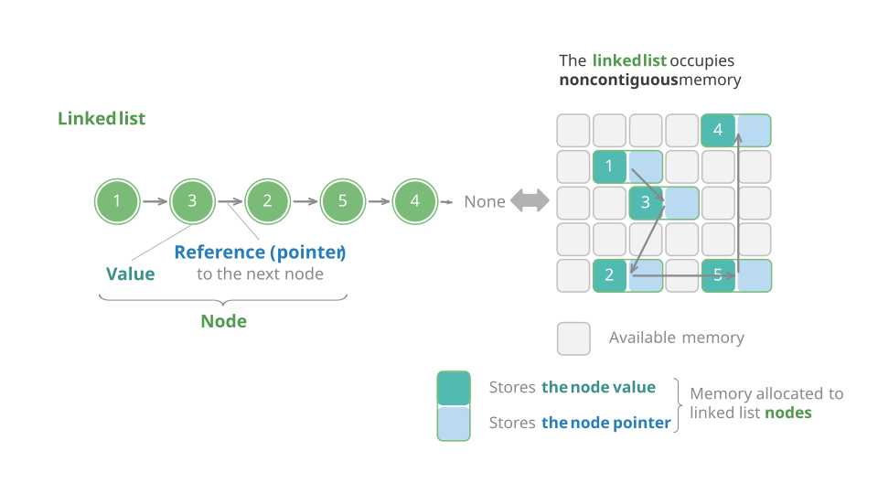

# 4.2 &nbsp; Linked lists

Programs share memory, and in a complex system, free space may be scattered throughout it. An array needs contiguous storage, and a sufficiently large contiguous block may be unavailable for a very large array. This is where the flexibility of a linked list pays off.

A <u>linked list</u> is a linear data structure in which each element is a node object. References connect the nodes. A reference records the address of the next node, letting us reach it from the current one.

With this design, nodes can be scattered throughout memory. Their addresses do not need to be contiguous.

{ class="animation-figure" }

<p align="center"> Figure 4-5 &nbsp; A linked list and its memory layout </p>

As the figure shows, a linked list is made up of <u>node</u> objects. Each node contains two pieces of data: its value and a reference to the next node.

- The first node is called the head, and the last node is called the tail.
- The tail points to nothing, represented by `null` in Java, `nullptr` in C++, and `None` in Python.
- In languages that support pointers, such as C, C++, Go, and Rust, the links described above as references can be expressed as pointers.

As the following code shows, a `ListNode` node stores an extra reference (pointer) alongside its value. For the same amount of data, **a linked list therefore occupies more memory than an array**.

=== "Python"

    ```python title=""
    class ListNode:
        """Linked list node class"""

        def __init__(self, val: int):
            self.val: int = val  # Node value
            self.next: ListNode | None = None  # Reference to the next node
    ```

=== "C++"

    ```cpp title=""
    /* Linked list node */
    struct ListNode {
        int val;        // Node value
        ListNode *next; // Pointer to the next node
        ListNode(int x) : val(x), next(nullptr) {
        }
    };
    ```

=== "Java"

    ```java title=""
    /* Linked list node */
    public class ListNode {
        public int val;       // Node value
        public ListNode next; // Reference to the next node

        public ListNode(int x) {
            val = x;
        }
    }
    ```

=== "C#"

    ```csharp title=""
    /* Linked list node */
    public class ListNode(int x) {
        public int val = x;    // Node value
        public ListNode? next; // Reference to the next node
    }
    ```

=== "Go"

    ```go title=""
    // ListNode represents a linked list node
    type ListNode struct {
        Val  int       // Node value
        Next *ListNode // Pointer to the next node
    }

    // NewListNode constructs a linked list node
    func NewListNode(v int) *ListNode {
        return &ListNode{
            Val:  v,
            Next: nil,
        }
    }
    ```

=== "Swift"

    ```swift title=""
    /* Linked list node class */
    class ListNode {
        var val: Int // Node value
        var next: ListNode? // Reference to the next node

        init(x: Int) { // Constructor
            val = x
        }
    }
    ```

=== "JS"

    ```javascript title=""
    /* Linked list node */
    class ListNode {
        val; // Node value
        next; // Reference (pointer) to the next node
        constructor(val, next) {
            this.val = val === undefined ? 0 : val;
            this.next = next === undefined ? null : next;
        }
    }
    ```

=== "TS"

    ```typescript title=""
    /* Linked list node */
    class ListNode {
        val: number; // Node value
        next: ListNode | null; // Reference to the next node
        constructor(val?: number, next?: ListNode | null) {
            this.val = val === undefined ? 0 : val;
            this.next = next === undefined ? null : next;
        }
    }
    ```

=== "Dart"

    ```dart title=""
    /* Linked list node */
    class ListNode {
      int val; // Node value
      ListNode? next; // Reference to the next node

      ListNode(this.val, [this.next]); // Constructor
    }
    ```

=== "Rust"

    ```rust title=""
    use std::cell::RefCell;
    use std::rc::Rc;

    /* Linked list node */
    #[derive(Debug)]
    pub struct ListNode<T> {
        pub val: T, // Node value
        pub next: Option<Rc<RefCell<ListNode<T>>>>, // Pointer to the next node
    }

    impl<T> ListNode<T> {
        pub fn new(val: T) -> Rc<RefCell<ListNode<T>>> {
            Rc::new(RefCell::new(ListNode { val, next: None }))
        }
    }
    ```

=== "C"

    ```c title=""
    /* Linked list node structure */
    typedef struct ListNode {
        int val;               // Node value
        struct ListNode *next; // Pointer to the next node
    } ListNode;

    /* Constructor that initializes a new node */
    ListNode *newListNode(int val) {
        ListNode *node;
        node = (ListNode *)malloc(sizeof(ListNode));
        node->val = val;
        node->next = NULL;
        return node;
    }
    ```

=== "Kotlin"

    ```kotlin title=""
    /* Linked list node */
    class ListNode(var _val: Int) {
        var next: ListNode? = null // Reference to the next node
    }
    ```

=== "Ruby"

    ```ruby title=""
    ### Linked list node class ###
    class ListNode
      attr_accessor :val  # Node value
      attr_accessor :next # Reference to the next node

      def initialize(val=0, next_node=nil)
        @val = val
        @next = next_node
      end
    end
    ```

## 4.2.1 &nbsp; Common linked list operations

### 1. &nbsp; Initializing a linked list

Building a linked list takes two steps. First initialize the individual nodes, then set up the references between them. Once the list is initialized, we can visit every node in order by starting at the head and following the `next` references.

=== "Python"

    ```python title="linked_list.py"
    # Initialize the linked list 1 -> 3 -> 2 -> 5 -> 4
    # Initialize the nodes
    n0 = ListNode(1)
    n1 = ListNode(3)
    n2 = ListNode(2)
    n3 = ListNode(5)
    n4 = ListNode(4)
    # Link the nodes together
    n0.next = n1
    n1.next = n2
    n2.next = n3
    n3.next = n4
    ```

=== "C++"

    ```cpp title="linked_list.cpp"
    /* Initialize the linked list 1 -> 3 -> 2 -> 5 -> 4 */
    // Initialize the nodes
    ListNode *n0 = new ListNode(1);
    ListNode *n1 = new ListNode(3);
    ListNode *n2 = new ListNode(2);
    ListNode *n3 = new ListNode(5);
    ListNode *n4 = new ListNode(4);
    // Link the nodes together
    n0->next = n1;
    n1->next = n2;
    n2->next = n3;
    n3->next = n4;
    ```

=== "Java"

    ```java title="linked_list.java"
    /* Initialize the linked list 1 -> 3 -> 2 -> 5 -> 4 */
    // Initialize the nodes
    ListNode n0 = new ListNode(1);
    ListNode n1 = new ListNode(3);
    ListNode n2 = new ListNode(2);
    ListNode n3 = new ListNode(5);
    ListNode n4 = new ListNode(4);
    // Link the nodes together
    n0.next = n1;
    n1.next = n2;
    n2.next = n3;
    n3.next = n4;
    ```

=== "C#"

    ```csharp title="linked_list.cs"
    // Initialize the linked list 1 -> 3 -> 2 -> 5 -> 4
    // Initialize the nodes
    ListNode n0 = new(1);
    ListNode n1 = new(3);
    ListNode n2 = new(2);
    ListNode n3 = new(5);
    ListNode n4 = new(4);
    // Link the nodes together
    n0.next = n1;
    n1.next = n2;
    n2.next = n3;
    n3.next = n4;
    ```

=== "Go"

    ```go title="linked_list.go"
    /* Initialize the linked list 1 -> 3 -> 2 -> 5 -> 4 */
    // Initialize the nodes
    n0 := NewListNode(1)
    n1 := NewListNode(3)
    n2 := NewListNode(2)
    n3 := NewListNode(5)
    n4 := NewListNode(4)

    // Link the nodes together
    n0.Next = n1
    n1.Next = n2
    n2.Next = n3
    n3.Next = n4
    ```

=== "Swift"

    ```swift title="linked_list.swift"
    /* Initialize the linked list 1 -> 3 -> 2 -> 5 -> 4 */
    // Initialize the nodes
    let n0 = ListNode(x: 1)
    let n1 = ListNode(x: 3)
    let n2 = ListNode(x: 2)
    let n3 = ListNode(x: 5)
    let n4 = ListNode(x: 4)
    // Link the nodes together
    n0.next = n1
    n1.next = n2
    n2.next = n3
    n3.next = n4
    ```

=== "JS"

    ```javascript title="linked_list.js"
    /* Initialize the linked list 1 -> 3 -> 2 -> 5 -> 4 */
    // Initialize the nodes
    const n0 = new ListNode(1);
    const n1 = new ListNode(3);
    const n2 = new ListNode(2);
    const n3 = new ListNode(5);
    const n4 = new ListNode(4);
    // Link the nodes together
    n0.next = n1;
    n1.next = n2;
    n2.next = n3;
    n3.next = n4;
    ```

=== "TS"

    ```typescript title="linked_list.ts"
    /* Initialize the linked list 1 -> 3 -> 2 -> 5 -> 4 */
    // Initialize the nodes
    const n0 = new ListNode(1);
    const n1 = new ListNode(3);
    const n2 = new ListNode(2);
    const n3 = new ListNode(5);
    const n4 = new ListNode(4);
    // Link the nodes together
    n0.next = n1;
    n1.next = n2;
    n2.next = n3;
    n3.next = n4;
    ```

=== "Dart"

    ```dart title="linked_list.dart"
    // Initialize the linked list 1 -> 3 -> 2 -> 5 -> 4
    // Initialize the nodes
    ListNode n0 = ListNode(1);
    ListNode n1 = ListNode(3);
    ListNode n2 = ListNode(2);
    ListNode n3 = ListNode(5);
    ListNode n4 = ListNode(4);
    // Link the nodes together
    n0.next = n1;
    n1.next = n2;
    n2.next = n3;
    n3.next = n4;
    ```

=== "Rust"

    ```rust title="linked_list.rs"
    /* Initialize the linked list 1 -> 3 -> 2 -> 5 -> 4 */
    // Initialize the nodes
    let n0 = ListNode::new(1);
    let n1 = ListNode::new(3);
    let n2 = ListNode::new(2);
    let n3 = ListNode::new(5);
    let n4 = ListNode::new(4);

    // Link the nodes together
    n0.borrow_mut().next = Some(n1.clone());
    n1.borrow_mut().next = Some(n2.clone());
    n2.borrow_mut().next = Some(n3.clone());
    n3.borrow_mut().next = Some(n4.clone());
    ```

=== "C"

    ```c title="linked_list.c"
    /* Initialize the linked list 1 -> 3 -> 2 -> 5 -> 4 */
    // Initialize the nodes
    ListNode *n0 = newListNode(1);
    ListNode *n1 = newListNode(3);
    ListNode *n2 = newListNode(2);
    ListNode *n3 = newListNode(5);
    ListNode *n4 = newListNode(4);
    // Link the nodes together
    n0->next = n1;
    n1->next = n2;
    n2->next = n3;
    n3->next = n4;
    ```

=== "Kotlin"

    ```kotlin title="linked_list.kt"
    /* Initialize the linked list 1 -> 3 -> 2 -> 5 -> 4 */
    // Initialize the nodes
    val n0 = ListNode(1)
    val n1 = ListNode(3)
    val n2 = ListNode(2)
    val n3 = ListNode(5)
    val n4 = ListNode(4)

    // Link the nodes together
    n0.next = n1
    n1.next = n2
    n2.next = n3
    n3.next = n4
    ```

=== "Ruby"

    ```ruby title="linked_list.rb"
    # Initialize the linked list 1 -> 3 -> 2 -> 5 -> 4
    # Initialize the nodes
    n0 = ListNode.new(1)
    n1 = ListNode.new(3)
    n2 = ListNode.new(2)
    n3 = ListNode.new(5)
    n4 = ListNode.new(4)
    # Link the nodes together
    n0.next = n1
    n1.next = n2
    n2.next = n3
    n3.next = n4
    ```

??? pythontutor "Visualize execution"

    <div style="height: 549px; width: 100%;"><iframe class="pythontutor-iframe" title="Visualize execution" src="https://pythontutor.com/iframe-embed.html#code=class%20ListNode%3A%0A%20%20%20%20%22%22%22Linked%20list%20node%20class%22%22%22%0A%20%20%20%20def%20__init__%28self,%20val%3A%20int%29%3A%0A%20%20%20%20%20%20%20%20self.val%3A%20int%20%3D%20val%20%20%23%20Node%20value%0A%20%20%20%20%20%20%20%20self.next%3A%20ListNode%20%7C%20None%20%3D%20None%20%20%23%20Reference%20to%20the%20next%20node%0A%0A%22%22%22Driver%20Code%22%22%22%0Aif%20__name__%20%3D%3D%20%22__main__%22%3A%0A%20%20%20%20%23%20Initialize%20the%20linked%20list%201%20-%3E%203%20-%3E%202%20-%3E%205%20-%3E%204%0A%20%20%20%20%23%20Initialize%20each%20node%0A%20%20%20%20n0%20%3D%20ListNode%281%29%0A%20%20%20%20n1%20%3D%20ListNode%283%29%0A%20%20%20%20n2%20%3D%20ListNode%282%29%0A%20%20%20%20n3%20%3D%20ListNode%285%29%0A%20%20%20%20n4%20%3D%20ListNode%284%29%0A%20%20%20%20%23%20Link%20each%20node%20to%20the%20next%0A%20%20%20%20n0.next%20%3D%20n1%0A%20%20%20%20n1.next%20%3D%20n2%0A%20%20%20%20n2.next%20%3D%20n3%0A%20%20%20%20n3.next%20%3D%20n4&codeDivHeight=472&codeDivWidth=350&cumulative=false&curInstr=3&heapPrimitives=nevernest&origin=opt-frontend.js&py=311&rawInputLstJSON=%5B%5D&textReferences=false"> </iframe></div>
    <div style="margin-top: 5px;"><a href="https://pythontutor.com/iframe-embed.html#code=class%20ListNode%3A%0A%20%20%20%20%22%22%22Linked%20list%20node%20class%22%22%22%0A%20%20%20%20def%20__init__%28self,%20val%3A%20int%29%3A%0A%20%20%20%20%20%20%20%20self.val%3A%20int%20%3D%20val%20%20%23%20Node%20value%0A%20%20%20%20%20%20%20%20self.next%3A%20ListNode%20%7C%20None%20%3D%20None%20%20%23%20Reference%20to%20the%20next%20node%0A%0A%22%22%22Driver%20Code%22%22%22%0Aif%20__name__%20%3D%3D%20%22__main__%22%3A%0A%20%20%20%20%23%20Initialize%20the%20linked%20list%201%20-%3E%203%20-%3E%202%20-%3E%205%20-%3E%204%0A%20%20%20%20%23%20Initialize%20each%20node%0A%20%20%20%20n0%20%3D%20ListNode%281%29%0A%20%20%20%20n1%20%3D%20ListNode%283%29%0A%20%20%20%20n2%20%3D%20ListNode%282%29%0A%20%20%20%20n3%20%3D%20ListNode%285%29%0A%20%20%20%20n4%20%3D%20ListNode%284%29%0A%20%20%20%20%23%20Link%20each%20node%20to%20the%20next%0A%20%20%20%20n0.next%20%3D%20n1%0A%20%20%20%20n1.next%20%3D%20n2%0A%20%20%20%20n2.next%20%3D%20n3%0A%20%20%20%20n3.next%20%3D%20n4&codeDivHeight=800&codeDivWidth=600&cumulative=false&curInstr=3&heapPrimitives=nevernest&origin=opt-frontend.js&py=311&rawInputLstJSON=%5B%5D&textReferences=false" target="_blank" rel="noopener noreferrer">View full screen ></a></div>

A single variable represents an entire array. For example, the array `nums` contains elements such as `nums[0]` and `nums[1]`. A linked list, however, consists of independent node objects. **We usually refer to the whole list by its head node**. For example, we can call the list in the preceding code the list `n0`.

### 2. &nbsp; Inserting a node

Inserting a node into a linked list is straightforward. To insert a new node `P` between adjacent nodes `n0` and `n1` as shown below, **change just two node references (pointers)**. This takes $O(1)$ time.

In comparison, inserting an element into an array takes $O(n)$ time and is less efficient for large amounts of data.

{ class="animation-figure" }

<p align="center"> Figure 4-6 &nbsp; Inserting a node into a linked list </p>

=== "Python"

    ```python title="linked_list.py"
    def insert(n0: ListNode, P: ListNode):
        """Insert node P after node n0 in the linked list"""
        n1 = n0.next
        P.next = n1
        n0.next = P
    ```

=== "C++"

    ```cpp title="linked_list.cpp"
    /* Insert node P after node n0 in the linked list */
    void insert(ListNode *n0, ListNode *P) {
        ListNode *n1 = n0->next;
        P->next = n1;
        n0->next = P;
    }
    ```

=== "Java"

    ```java title="linked_list.java"
    /* Insert node P after node n0 in the linked list */
    void insert(ListNode n0, ListNode P) {
        ListNode n1 = n0.next;
        P.next = n1;
        n0.next = P;
    }
    ```

=== "C#"

    ```csharp title="linked_list.cs"
    /* Insert node P after node n0 in the linked list */
    void Insert(ListNode n0, ListNode P) {
        ListNode? n1 = n0.next;
        P.next = n1;
        n0.next = P;
    }
    ```

=== "Go"

    ```go title="linked_list.go"
    /* Insert node P after node n0 in the linked list */
    func insertNode(n0 *ListNode, P *ListNode) {
        n1 := n0.Next
        P.Next = n1
        n0.Next = P
    }
    ```

=== "Swift"

    ```swift title="linked_list.swift"
    /* Insert node P after node n0 in the linked list */
    func insert(n0: ListNode, P: ListNode) {
        let n1 = n0.next
        P.next = n1
        n0.next = P
    }
    ```

=== "JS"

    ```javascript title="linked_list.js"
    /* Insert node P after node n0 in the linked list */
    function insert(n0, P) {
        const n1 = n0.next;
        P.next = n1;
        n0.next = P;
    }
    ```

=== "TS"

    ```typescript title="linked_list.ts"
    /* Insert node P after node n0 in the linked list */
    function insert(n0: ListNode, P: ListNode): void {
        const n1 = n0.next;
        P.next = n1;
        n0.next = P;
    }
    ```

=== "Dart"

    ```dart title="linked_list.dart"
    /* Insert node P after node n0 in the linked list */
    void insert(ListNode n0, ListNode P) {
      ListNode? n1 = n0.next;
      P.next = n1;
      n0.next = P;
    }
    ```

=== "Rust"

    ```rust title="linked_list.rs"
    /* Insert node P after node n0 in the linked list */
    #[allow(non_snake_case)]
    pub fn insert<T>(n0: &Rc<RefCell<ListNode<T>>>, P: Rc<RefCell<ListNode<T>>>) {
        let n1 = n0.borrow_mut().next.take();
        P.borrow_mut().next = n1;
        n0.borrow_mut().next = Some(P);
    }
    ```

=== "C"

    ```c title="linked_list.c"
    /* Insert node P after node n0 in the linked list */
    void insert(ListNode *n0, ListNode *P) {
        ListNode *n1 = n0->next;
        P->next = n1;
        n0->next = P;
    }
    ```

=== "Kotlin"

    ```kotlin title="linked_list.kt"
    /* Insert node P after node n0 in the linked list */
    fun insert(n0: ListNode?, p: ListNode?) {
        val n1 = n0?.next
        p?.next = n1
        n0?.next = p
    }
    ```

=== "Ruby"

    ```ruby title="linked_list.rb"
    ### Insert node _p after node n0 in the linked list ###
    # In Ruby, `p` is a built-in method and `P` is a constant, so use `_p` instead
    def insert(n0, _p)
      n1 = n0.next
      _p.next = n1
      n0.next = _p
    end
    ```

??? pythontutor "Visualize execution"

    <div style="height: 549px; width: 100%;"><iframe class="pythontutor-iframe" title="Visualize execution" src="https://pythontutor.com/iframe-embed.html#code=class%20ListNode%3A%0A%20%20%20%20%22%22%22Linked%20list%20node%20class%22%22%22%0A%20%20%20%20def%20__init__%28self,%20val%3A%20int%29%3A%0A%20%20%20%20%20%20%20%20self.val%3A%20int%20%3D%20val%20%20%23%20Node%20value%0A%20%20%20%20%20%20%20%20self.next%3A%20ListNode%20%7C%20None%20%3D%20None%20%20%23%20Reference%20to%20the%20next%20node%0A%0Adef%20insert%28n0%3A%20ListNode,%20P%3A%20ListNode%29%3A%0A%20%20%20%20%22%22%22Insert%20node%20P%20after%20node%20n0%20in%20the%20linked%20list%22%22%22%0A%20%20%20%20n1%20%3D%20n0.next%0A%20%20%20%20P.next%20%3D%20n1%0A%20%20%20%20n0.next%20%3D%20P%0A%0A%22%22%22Driver%20Code%22%22%22%0Aif%20__name__%20%3D%3D%20%22__main__%22%3A%0A%20%20%20%20%23%20Initialize%20the%20linked%20list%0A%20%20%20%20%23%20Initialize%20the%20nodes%0A%20%20%20%20n0%20%3D%20ListNode%281%29%0A%20%20%20%20n1%20%3D%20ListNode%283%29%0A%20%20%20%20n2%20%3D%20ListNode%282%29%0A%20%20%20%20n3%20%3D%20ListNode%285%29%0A%20%20%20%20n4%20%3D%20ListNode%284%29%0A%20%20%20%20%23%20Link%20the%20nodes%20together%0A%20%20%20%20n0.next%20%3D%20n1%0A%20%20%20%20n1.next%20%3D%20n2%0A%20%20%20%20n2.next%20%3D%20n3%0A%20%20%20%20n3.next%20%3D%20n4%0A%0A%20%20%20%20%23%20Insert%20a%20node%0A%20%20%20%20p%20%3D%20ListNode%280%29%0A%20%20%20%20insert%28n0,%20p%29&codeDivHeight=472&codeDivWidth=350&cumulative=false&curInstr=39&heapPrimitives=nevernest&origin=opt-frontend.js&py=311&rawInputLstJSON=%5B%5D&textReferences=false"> </iframe></div>
    <div style="margin-top: 5px;"><a href="https://pythontutor.com/iframe-embed.html#code=class%20ListNode%3A%0A%20%20%20%20%22%22%22Linked%20list%20node%20class%22%22%22%0A%20%20%20%20def%20__init__%28self,%20val%3A%20int%29%3A%0A%20%20%20%20%20%20%20%20self.val%3A%20int%20%3D%20val%20%20%23%20Node%20value%0A%20%20%20%20%20%20%20%20self.next%3A%20ListNode%20%7C%20None%20%3D%20None%20%20%23%20Reference%20to%20the%20next%20node%0A%0Adef%20insert%28n0%3A%20ListNode,%20P%3A%20ListNode%29%3A%0A%20%20%20%20%22%22%22Insert%20node%20P%20after%20node%20n0%20in%20the%20linked%20list%22%22%22%0A%20%20%20%20n1%20%3D%20n0.next%0A%20%20%20%20P.next%20%3D%20n1%0A%20%20%20%20n0.next%20%3D%20P%0A%0A%22%22%22Driver%20Code%22%22%22%0Aif%20__name__%20%3D%3D%20%22__main__%22%3A%0A%20%20%20%20%23%20Initialize%20the%20linked%20list%0A%20%20%20%20%23%20Initialize%20the%20nodes%0A%20%20%20%20n0%20%3D%20ListNode%281%29%0A%20%20%20%20n1%20%3D%20ListNode%283%29%0A%20%20%20%20n2%20%3D%20ListNode%282%29%0A%20%20%20%20n3%20%3D%20ListNode%285%29%0A%20%20%20%20n4%20%3D%20ListNode%284%29%0A%20%20%20%20%23%20Link%20the%20nodes%20together%0A%20%20%20%20n0.next%20%3D%20n1%0A%20%20%20%20n1.next%20%3D%20n2%0A%20%20%20%20n2.next%20%3D%20n3%0A%20%20%20%20n3.next%20%3D%20n4%0A%0A%20%20%20%20%23%20Insert%20a%20node%0A%20%20%20%20p%20%3D%20ListNode%280%29%0A%20%20%20%20insert%28n0,%20p%29&codeDivHeight=800&codeDivWidth=600&cumulative=false&curInstr=39&heapPrimitives=nevernest&origin=opt-frontend.js&py=311&rawInputLstJSON=%5B%5D&textReferences=false" target="_blank" rel="noopener noreferrer">View full screen ></a></div>

### 3. &nbsp; Removing a node

Removing a node is straightforward as well. As the figure shows, **only one node reference (pointer) needs to change**.

After removal, node `P` still points to `n1`. However, traversing the list can no longer reach `P`, so `P` no longer belongs to the list.

{ class="animation-figure" }

<p align="center"> Figure 4-7 &nbsp; Removing a node from a linked list </p>

=== "Python"

    ```python title="linked_list.py"
    def remove(n0: ListNode):
        """Remove the node immediately after n0 in the linked list"""
        if not n0.next:
            return
        # n0 -> P -> n1
        P = n0.next
        n1 = P.next
        n0.next = n1
    ```

=== "C++"

    ```cpp title="linked_list.cpp"
    /* Remove the node immediately after n0 in the linked list */
    void remove(ListNode *n0) {
        if (n0->next == nullptr)
            return;
        // n0 -> P -> n1
        ListNode *P = n0->next;
        ListNode *n1 = P->next;
        n0->next = n1;
        // Free memory
        delete P;
    }
    ```

=== "Java"

    ```java title="linked_list.java"
    /* Remove the node immediately after n0 in the linked list */
    void remove(ListNode n0) {
        if (n0.next == null)
            return;
        // n0 -> P -> n1
        ListNode P = n0.next;
        ListNode n1 = P.next;
        n0.next = n1;
    }
    ```

=== "C#"

    ```csharp title="linked_list.cs"
    /* Remove the node immediately after n0 in the linked list */
    void Remove(ListNode n0) {
        if (n0.next == null)
            return;
        // n0 -> P -> n1
        ListNode P = n0.next;
        ListNode? n1 = P.next;
        n0.next = n1;
    }
    ```

=== "Go"

    ```go title="linked_list.go"
    /* Remove the node immediately after n0 in the linked list */
    func removeItem(n0 *ListNode) {
        if n0.Next == nil {
            return
        }
        // n0 -> P -> n1
        P := n0.Next
        n1 := P.Next
        n0.Next = n1
    }
    ```

=== "Swift"

    ```swift title="linked_list.swift"
    /* Remove the node immediately after n0 in the linked list */
    func remove(n0: ListNode) {
        if n0.next == nil {
            return
        }
        // n0 -> P -> n1
        let P = n0.next
        let n1 = P?.next
        n0.next = n1
    }
    ```

=== "JS"

    ```javascript title="linked_list.js"
    /* Remove the node immediately after n0 in the linked list */
    function remove(n0) {
        if (!n0.next) return;
        // n0 -> P -> n1
        const P = n0.next;
        const n1 = P.next;
        n0.next = n1;
    }
    ```

=== "TS"

    ```typescript title="linked_list.ts"
    /* Remove the node immediately after n0 in the linked list */
    function remove(n0: ListNode): void {
        if (!n0.next) {
            return;
        }
        // n0 -> P -> n1
        const P = n0.next;
        const n1 = P.next;
        n0.next = n1;
    }
    ```

=== "Dart"

    ```dart title="linked_list.dart"
    /* Remove the node immediately after n0 in the linked list */
    void remove(ListNode n0) {
      if (n0.next == null) return;
      // n0 -> P -> n1
      ListNode P = n0.next!;
      ListNode? n1 = P.next;
      n0.next = n1;
    }
    ```

=== "Rust"

    ```rust title="linked_list.rs"
    /* Remove the node immediately after n0 in the linked list */
    #[allow(non_snake_case)]
    pub fn remove<T>(n0: &Rc<RefCell<ListNode<T>>>) {
        // n0 -> P -> n1
        let P = n0.borrow_mut().next.take();
        if let Some(node) = P {
            let n1 = node.borrow_mut().next.take();
            n0.borrow_mut().next = n1;
        }
    }
    ```

=== "C"

    ```c title="linked_list.c"
    /* Remove the node immediately after n0 in the linked list */
    // Note: stdio.h already uses the name remove
    void removeItem(ListNode *n0) {
        if (!n0->next)
            return;
        // n0 -> P -> n1
        ListNode *P = n0->next;
        ListNode *n1 = P->next;
        n0->next = n1;
        // Free memory
        free(P);
    }
    ```

=== "Kotlin"

    ```kotlin title="linked_list.kt"
    /* Remove the node immediately after n0 in the linked list */
    fun remove(n0: ListNode?) {
        if (n0?.next == null)
            return
        // n0 -> P -> n1
        val p = n0.next
        val n1 = p?.next
        n0.next = n1
    }
    ```

=== "Ruby"

    ```ruby title="linked_list.rb"
    ### Remove the node immediately after n0 in the linked list ###
    def remove(n0)
      return if n0.next.nil?

      # n0 -> remove_node -> n1
      remove_node = n0.next
      n1 = remove_node.next
      n0.next = n1
    end
    ```

??? pythontutor "Visualize execution"

    <div style="height: 549px; width: 100%;"><iframe class="pythontutor-iframe" title="Visualize execution" src="https://pythontutor.com/iframe-embed.html#code=class%20ListNode%3A%0A%20%20%20%20%22%22%22Linked%20list%20node%20class%22%22%22%0A%20%20%20%20def%20__init__%28self,%20val%3A%20int%29%3A%0A%20%20%20%20%20%20%20%20self.val%3A%20int%20%3D%20val%20%20%23%20Node%20value%0A%20%20%20%20%20%20%20%20self.next%3A%20ListNode%20%7C%20None%20%3D%20None%20%20%23%20Reference%20to%20the%20next%20node%0A%0Adef%20remove%28n0%3A%20ListNode%29%3A%0A%20%20%20%20%22%22%22Remove%20the%20node%20immediately%20after%20n0%20in%20the%20linked%20list%22%22%22%0A%20%20%20%20if%20not%20n0.next%3A%0A%20%20%20%20%20%20%20%20return%0A%20%20%20%20%23%20n0%20-%3E%20P%20-%3E%20n1%0A%20%20%20%20P%20%3D%20n0.next%0A%20%20%20%20n1%20%3D%20P.next%0A%20%20%20%20n0.next%20%3D%20n1%0A%0A%22%22%22Driver%20Code%22%22%22%0Aif%20__name__%20%3D%3D%20%22__main__%22%3A%0A%20%20%20%20%23%20Initialize%20the%20linked%20list%0A%20%20%20%20%23%20Initialize%20the%20nodes%0A%20%20%20%20n0%20%3D%20ListNode%281%29%0A%20%20%20%20n1%20%3D%20ListNode%283%29%0A%20%20%20%20n2%20%3D%20ListNode%282%29%0A%20%20%20%20n3%20%3D%20ListNode%285%29%0A%20%20%20%20n4%20%3D%20ListNode%284%29%0A%20%20%20%20%23%20Link%20the%20nodes%20together%0A%20%20%20%20n0.next%20%3D%20n1%0A%20%20%20%20n1.next%20%3D%20n2%0A%20%20%20%20n2.next%20%3D%20n3%0A%20%20%20%20n3.next%20%3D%20n4%0A%0A%20%20%20%20%23%20Remove%20a%20node%0A%20%20%20%20remove%28n0%29&codeDivHeight=472&codeDivWidth=350&cumulative=false&curInstr=34&heapPrimitives=nevernest&origin=opt-frontend.js&py=311&rawInputLstJSON=%5B%5D&textReferences=false"> </iframe></div>
    <div style="margin-top: 5px;"><a href="https://pythontutor.com/iframe-embed.html#code=class%20ListNode%3A%0A%20%20%20%20%22%22%22Linked%20list%20node%20class%22%22%22%0A%20%20%20%20def%20__init__%28self,%20val%3A%20int%29%3A%0A%20%20%20%20%20%20%20%20self.val%3A%20int%20%3D%20val%20%20%23%20Node%20value%0A%20%20%20%20%20%20%20%20self.next%3A%20ListNode%20%7C%20None%20%3D%20None%20%20%23%20Reference%20to%20the%20next%20node%0A%0Adef%20remove%28n0%3A%20ListNode%29%3A%0A%20%20%20%20%22%22%22Remove%20the%20node%20immediately%20after%20n0%20in%20the%20linked%20list%22%22%22%0A%20%20%20%20if%20not%20n0.next%3A%0A%20%20%20%20%20%20%20%20return%0A%20%20%20%20%23%20n0%20-%3E%20P%20-%3E%20n1%0A%20%20%20%20P%20%3D%20n0.next%0A%20%20%20%20n1%20%3D%20P.next%0A%20%20%20%20n0.next%20%3D%20n1%0A%0A%22%22%22Driver%20Code%22%22%22%0Aif%20__name__%20%3D%3D%20%22__main__%22%3A%0A%20%20%20%20%23%20Initialize%20the%20linked%20list%0A%20%20%20%20%23%20Initialize%20the%20nodes%0A%20%20%20%20n0%20%3D%20ListNode%281%29%0A%20%20%20%20n1%20%3D%20ListNode%283%29%0A%20%20%20%20n2%20%3D%20ListNode%282%29%0A%20%20%20%20n3%20%3D%20ListNode%285%29%0A%20%20%20%20n4%20%3D%20ListNode%284%29%0A%20%20%20%20%23%20Link%20the%20nodes%20together%0A%20%20%20%20n0.next%20%3D%20n1%0A%20%20%20%20n1.next%20%3D%20n2%0A%20%20%20%20n2.next%20%3D%20n3%0A%20%20%20%20n3.next%20%3D%20n4%0A%0A%20%20%20%20%23%20Remove%20a%20node%0A%20%20%20%20remove%28n0%29&codeDivHeight=800&codeDivWidth=600&cumulative=false&curInstr=34&heapPrimitives=nevernest&origin=opt-frontend.js&py=311&rawInputLstJSON=%5B%5D&textReferences=false" target="_blank" rel="noopener noreferrer">View full screen ></a></div>

### 4. &nbsp; Accessing a node

**Accessing a node by position in a linked list is relatively slow**. As we saw in the previous section, any array element can be accessed in $O(1)$ time. In a linked list, the program must start at the head and visit nodes one by one until it reaches the desired node. Reaching the $i$-th node thus takes $i - 1$ iterations, for a time complexity of $O(n)$.

=== "Python"

    ```python title="linked_list.py"
    def access(head: ListNode, index: int) -> ListNode | None:
        """Access the linked list node at the specified index"""
        for _ in range(index):
            if not head:
                return None
            head = head.next
        return head
    ```

=== "C++"

    ```cpp title="linked_list.cpp"
    /* Access the linked list node at the specified index */
    ListNode *access(ListNode *head, int index) {
        for (int i = 0; i < index; i++) {
            if (head == nullptr)
                return nullptr;
            head = head->next;
        }
        return head;
    }
    ```

=== "Java"

    ```java title="linked_list.java"
    /* Access the linked list node at the specified index */
    ListNode access(ListNode head, int index) {
        for (int i = 0; i < index; i++) {
            if (head == null)
                return null;
            head = head.next;
        }
        return head;
    }
    ```

=== "C#"

    ```csharp title="linked_list.cs"
    /* Access the linked list node at the specified index */
    ListNode? Access(ListNode? head, int index) {
        for (int i = 0; i < index; i++) {
            if (head == null)
                return null;
            head = head.next;
        }
        return head;
    }
    ```

=== "Go"

    ```go title="linked_list.go"
    /* Access the linked list node at the specified index */
    func access(head *ListNode, index int) *ListNode {
        for i := 0; i < index; i++ {
            if head == nil {
                return nil
            }
            head = head.Next
        }
        return head
    }
    ```

=== "Swift"

    ```swift title="linked_list.swift"
    /* Access the linked list node at the specified index */
    func access(head: ListNode, index: Int) -> ListNode? {
        var head: ListNode? = head
        for _ in 0 ..< index {
            if head == nil {
                return nil
            }
            head = head?.next
        }
        return head
    }
    ```

=== "JS"

    ```javascript title="linked_list.js"
    /* Access the linked list node at the specified index */
    function access(head, index) {
        for (let i = 0; i < index; i++) {
            if (!head) {
                return null;
            }
            head = head.next;
        }
        return head;
    }
    ```

=== "TS"

    ```typescript title="linked_list.ts"
    /* Access the linked list node at the specified index */
    function access(head: ListNode | null, index: number): ListNode | null {
        for (let i = 0; i < index; i++) {
            if (!head) {
                return null;
            }
            head = head.next;
        }
        return head;
    }
    ```

=== "Dart"

    ```dart title="linked_list.dart"
    /* Access the linked list node at the specified index */
    ListNode? access(ListNode? head, int index) {
      for (var i = 0; i < index; i++) {
        if (head == null) return null;
        head = head.next;
      }
      return head;
    }
    ```

=== "Rust"

    ```rust title="linked_list.rs"
    /* Access the linked list node at the specified index */
    pub fn access<T>(head: Rc<RefCell<ListNode<T>>>, index: i32) -> Option<Rc<RefCell<ListNode<T>>>> {
        fn dfs<T>(
            head: Option<&Rc<RefCell<ListNode<T>>>>,
            index: i32,
        ) -> Option<Rc<RefCell<ListNode<T>>>> {
            if index <= 0 {
                return head.cloned();
            }

            if let Some(node) = head {
                dfs(node.borrow().next.as_ref(), index - 1)
            } else {
                None
            }
        }

        dfs(Some(head).as_ref(), index)
    }
    ```

=== "C"

    ```c title="linked_list.c"
    /* Access the linked list node at the specified index */
    ListNode *access(ListNode *head, int index) {
        for (int i = 0; i < index; i++) {
            if (head == NULL)
                return NULL;
            head = head->next;
        }
        return head;
    }
    ```

=== "Kotlin"

    ```kotlin title="linked_list.kt"
    /* Access the linked list node at the specified index */
    fun access(head: ListNode?, index: Int): ListNode? {
        var h = head
        for (i in 0..<index) {
            if (h == null)
                return null
            h = h.next
        }
        return h
    }
    ```

=== "Ruby"

    ```ruby title="linked_list.rb"
    ### Access the linked list node at the specified index ###
    def access(head, index)
      for i in 0...index
        return nil if head.nil?
        head = head.next
      end

      head
    end
    ```

??? pythontutor "Visualize execution"

    <div style="height: 549px; width: 100%;"><iframe class="pythontutor-iframe" title="Visualize execution" src="https://pythontutor.com/iframe-embed.html#code=class%20ListNode%3A%0A%20%20%20%20%22%22%22Linked%20list%20node%20class%22%22%22%0A%20%20%20%20def%20__init__%28self,%20val%3A%20int%29%3A%0A%20%20%20%20%20%20%20%20self.val%3A%20int%20%3D%20val%20%20%23%20Node%20value%0A%20%20%20%20%20%20%20%20self.next%3A%20ListNode%20%7C%20None%20%3D%20None%20%20%23%20Reference%20to%20the%20next%20node%0A%0Adef%20access%28head%3A%20ListNode,%20index%3A%20int%29%20-%3E%20ListNode%20%7C%20None%3A%0A%20%20%20%20%22%22%22Access%20the%20linked%20list%20node%20at%20the%20specified%20index%22%22%22%0A%20%20%20%20for%20_%20in%20range%28index%29%3A%0A%20%20%20%20%20%20%20%20if%20not%20head%3A%0A%20%20%20%20%20%20%20%20%20%20%20%20return%20None%0A%20%20%20%20%20%20%20%20head%20%3D%20head.next%0A%20%20%20%20return%20head%0A%0A%22%22%22Driver%20Code%22%22%22%0Aif%20__name__%20%3D%3D%20%22__main__%22%3A%0A%20%20%20%20%23%20Initialize%20the%20linked%20list%0A%20%20%20%20%23%20Initialize%20the%20nodes%0A%20%20%20%20n0%20%3D%20ListNode%281%29%0A%20%20%20%20n1%20%3D%20ListNode%283%29%0A%20%20%20%20n2%20%3D%20ListNode%282%29%0A%20%20%20%20n3%20%3D%20ListNode%285%29%0A%20%20%20%20n4%20%3D%20ListNode%284%29%0A%20%20%20%20%23%20Link%20the%20nodes%20together%0A%20%20%20%20n0.next%20%3D%20n1%0A%20%20%20%20n1.next%20%3D%20n2%0A%20%20%20%20n2.next%20%3D%20n3%0A%20%20%20%20n3.next%20%3D%20n4%0A%0A%20%20%20%20%23%20Access%20a%20node%0A%20%20%20%20node%20%3D%20access%28n0,%203%29%0A%20%20%20%20print%28%22Value%20of%20the%20node%20at%20index%203%20%3D%20%7B%7D%22.format%28node.val%29%29&codeDivHeight=472&codeDivWidth=350&cumulative=false&curInstr=34&heapPrimitives=nevernest&origin=opt-frontend.js&py=311&rawInputLstJSON=%5B%5D&textReferences=false"> </iframe></div>
    <div style="margin-top: 5px;"><a href="https://pythontutor.com/iframe-embed.html#code=class%20ListNode%3A%0A%20%20%20%20%22%22%22Linked%20list%20node%20class%22%22%22%0A%20%20%20%20def%20__init__%28self,%20val%3A%20int%29%3A%0A%20%20%20%20%20%20%20%20self.val%3A%20int%20%3D%20val%20%20%23%20Node%20value%0A%20%20%20%20%20%20%20%20self.next%3A%20ListNode%20%7C%20None%20%3D%20None%20%20%23%20Reference%20to%20the%20next%20node%0A%0Adef%20access%28head%3A%20ListNode,%20index%3A%20int%29%20-%3E%20ListNode%20%7C%20None%3A%0A%20%20%20%20%22%22%22Access%20the%20linked%20list%20node%20at%20the%20specified%20index%22%22%22%0A%20%20%20%20for%20_%20in%20range%28index%29%3A%0A%20%20%20%20%20%20%20%20if%20not%20head%3A%0A%20%20%20%20%20%20%20%20%20%20%20%20return%20None%0A%20%20%20%20%20%20%20%20head%20%3D%20head.next%0A%20%20%20%20return%20head%0A%0A%22%22%22Driver%20Code%22%22%22%0Aif%20__name__%20%3D%3D%20%22__main__%22%3A%0A%20%20%20%20%23%20Initialize%20the%20linked%20list%0A%20%20%20%20%23%20Initialize%20the%20nodes%0A%20%20%20%20n0%20%3D%20ListNode%281%29%0A%20%20%20%20n1%20%3D%20ListNode%283%29%0A%20%20%20%20n2%20%3D%20ListNode%282%29%0A%20%20%20%20n3%20%3D%20ListNode%285%29%0A%20%20%20%20n4%20%3D%20ListNode%284%29%0A%20%20%20%20%23%20Link%20the%20nodes%20together%0A%20%20%20%20n0.next%20%3D%20n1%0A%20%20%20%20n1.next%20%3D%20n2%0A%20%20%20%20n2.next%20%3D%20n3%0A%20%20%20%20n3.next%20%3D%20n4%0A%0A%20%20%20%20%23%20Access%20a%20node%0A%20%20%20%20node%20%3D%20access%28n0,%203%29%0A%20%20%20%20print%28%22Value%20of%20the%20node%20at%20index%203%20%3D%20%7B%7D%22.format%28node.val%29%29&codeDivHeight=800&codeDivWidth=600&cumulative=false&curInstr=34&heapPrimitives=nevernest&origin=opt-frontend.js&py=311&rawInputLstJSON=%5B%5D&textReferences=false" target="_blank" rel="noopener noreferrer">View full screen ></a></div>

### 5. &nbsp; Finding a node

Traverse the list to find a node whose value is `target` and report its index. This is another linear search. Here is the code:

=== "Python"

    ```python title="linked_list.py"
    def find(head: ListNode, target: int) -> int:
        """Find the first node with value target in the linked list"""
        index = 0
        while head:
            if head.val == target:
                return index
            head = head.next
            index += 1
        return -1
    ```

=== "C++"

    ```cpp title="linked_list.cpp"
    /* Find the first node with value target in the linked list */
    int find(ListNode *head, int target) {
        int index = 0;
        while (head != nullptr) {
            if (head->val == target)
                return index;
            head = head->next;
            index++;
        }
        return -1;
    }
    ```

=== "Java"

    ```java title="linked_list.java"
    /* Find the first node with value target in the linked list */
    int find(ListNode head, int target) {
        int index = 0;
        while (head != null) {
            if (head.val == target)
                return index;
            head = head.next;
            index++;
        }
        return -1;
    }
    ```

=== "C#"

    ```csharp title="linked_list.cs"
    /* Find the first node with value target in the linked list */
    int Find(ListNode? head, int target) {
        int index = 0;
        while (head != null) {
            if (head.val == target)
                return index;
            head = head.next;
            index++;
        }
        return -1;
    }
    ```

=== "Go"

    ```go title="linked_list.go"
    /* Find the first node with value target in the linked list */
    func findNode(head *ListNode, target int) int {
        index := 0
        for head != nil {
            if head.Val == target {
                return index
            }
            head = head.Next
            index++
        }
        return -1
    }
    ```

=== "Swift"

    ```swift title="linked_list.swift"
    /* Find the first node with value target in the linked list */
    func find(head: ListNode, target: Int) -> Int {
        var head: ListNode? = head
        var index = 0
        while head != nil {
            if head?.val == target {
                return index
            }
            head = head?.next
            index += 1
        }
        return -1
    }
    ```

=== "JS"

    ```javascript title="linked_list.js"
    /* Find the first node with value target in the linked list */
    function find(head, target) {
        let index = 0;
        while (head !== null) {
            if (head.val === target) {
                return index;
            }
            head = head.next;
            index += 1;
        }
        return -1;
    }
    ```

=== "TS"

    ```typescript title="linked_list.ts"
    /* Find the first node with value target in the linked list */
    function find(head: ListNode | null, target: number): number {
        let index = 0;
        while (head !== null) {
            if (head.val === target) {
                return index;
            }
            head = head.next;
            index += 1;
        }
        return -1;
    }
    ```

=== "Dart"

    ```dart title="linked_list.dart"
    /* Find the first node with value target in the linked list */
    int find(ListNode? head, int target) {
      int index = 0;
      while (head != null) {
        if (head.val == target) {
          return index;
        }
        head = head.next;
        index++;
      }
      return -1;
    }
    ```

=== "Rust"

    ```rust title="linked_list.rs"
    /* Find the first node with value target in the linked list */
    pub fn find<T: PartialEq>(head: Rc<RefCell<ListNode<T>>>, target: T) -> i32 {
        fn find<T: PartialEq>(head: Option<&Rc<RefCell<ListNode<T>>>>, target: T, idx: i32) -> i32 {
            if let Some(node) = head {
                if node.borrow().val == target {
                    return idx;
                }
                return find(node.borrow().next.as_ref(), target, idx + 1);
            } else {
                -1
            }
        }

        find(Some(head).as_ref(), target, 0)
    }
    ```

=== "C"

    ```c title="linked_list.c"
    /* Find the first node with value target in the linked list */
    int find(ListNode *head, int target) {
        int index = 0;
        while (head) {
            if (head->val == target)
                return index;
            head = head->next;
            index++;
        }
        return -1;
    }
    ```

=== "Kotlin"

    ```kotlin title="linked_list.kt"
    /* Find the first node with value target in the linked list */
    fun find(head: ListNode?, target: Int): Int {
        var index = 0
        var h = head
        while (h != null) {
            if (h._val == target)
                return index
            h = h.next
            index++
        }
        return -1
    }
    ```

=== "Ruby"

    ```ruby title="linked_list.rb"
    ### Find the first node with value target in the linked list ###
    def find(head, target)
      index = 0
      while head
        return index if head.val == target
        head = head.next
        index += 1
      end

      -1
    end
    ```

??? pythontutor "Visualize execution"

    <div style="height: 549px; width: 100%;"><iframe class="pythontutor-iframe" title="Visualize execution" src="https://pythontutor.com/iframe-embed.html#code=class%20ListNode%3A%0A%20%20%20%20%22%22%22Linked%20list%20node%20class%22%22%22%0A%20%20%20%20def%20__init__%28self,%20val%3A%20int%29%3A%0A%20%20%20%20%20%20%20%20self.val%3A%20int%20%3D%20val%20%20%23%20Node%20value%0A%20%20%20%20%20%20%20%20self.next%3A%20ListNode%20%7C%20None%20%3D%20None%20%20%23%20Reference%20to%20the%20next%20node%0A%0Adef%20find%28head%3A%20ListNode,%20target%3A%20int%29%20-%3E%20int%3A%0A%20%20%20%20%22%22%22Find%20the%20first%20node%20with%20value%20target%20in%20the%20linked%20list%22%22%22%0A%20%20%20%20index%20%3D%200%0A%20%20%20%20while%20head%3A%0A%20%20%20%20%20%20%20%20if%20head.val%20%3D%3D%20target%3A%0A%20%20%20%20%20%20%20%20%20%20%20%20return%20index%0A%20%20%20%20%20%20%20%20head%20%3D%20head.next%0A%20%20%20%20%20%20%20%20index%20%2B%3D%201%0A%20%20%20%20return%20-1%0A%0A%22%22%22Driver%20Code%22%22%22%0Aif%20__name__%20%3D%3D%20%22__main__%22%3A%0A%20%20%20%20%23%20Initialize%20the%20linked%20list%0A%20%20%20%20%23%20Initialize%20the%20nodes%0A%20%20%20%20n0%20%3D%20ListNode%281%29%0A%20%20%20%20n1%20%3D%20ListNode%283%29%0A%20%20%20%20n2%20%3D%20ListNode%282%29%0A%20%20%20%20n3%20%3D%20ListNode%285%29%0A%20%20%20%20n4%20%3D%20ListNode%284%29%0A%20%20%20%20%23%20Link%20the%20nodes%20together%0A%20%20%20%20n0.next%20%3D%20n1%0A%20%20%20%20n1.next%20%3D%20n2%0A%20%20%20%20n2.next%20%3D%20n3%0A%20%20%20%20n3.next%20%3D%20n4%0A%0A%20%20%20%20%23%20Find%20a%20node%0A%20%20%20%20index%20%3D%20find%28n0,%202%29%0A%20%20%20%20print%28%22Index%20of%20the%20node%20with%20value%202%20%3D%20%7B%7D%22.format%28index%29%29&codeDivHeight=472&codeDivWidth=350&cumulative=false&curInstr=34&heapPrimitives=nevernest&origin=opt-frontend.js&py=311&rawInputLstJSON=%5B%5D&textReferences=false"> </iframe></div>
    <div style="margin-top: 5px;"><a href="https://pythontutor.com/iframe-embed.html#code=class%20ListNode%3A%0A%20%20%20%20%22%22%22Linked%20list%20node%20class%22%22%22%0A%20%20%20%20def%20__init__%28self,%20val%3A%20int%29%3A%0A%20%20%20%20%20%20%20%20self.val%3A%20int%20%3D%20val%20%20%23%20Node%20value%0A%20%20%20%20%20%20%20%20self.next%3A%20ListNode%20%7C%20None%20%3D%20None%20%20%23%20Reference%20to%20the%20next%20node%0A%0Adef%20find%28head%3A%20ListNode,%20target%3A%20int%29%20-%3E%20int%3A%0A%20%20%20%20%22%22%22Find%20the%20first%20node%20with%20value%20target%20in%20the%20linked%20list%22%22%22%0A%20%20%20%20index%20%3D%200%0A%20%20%20%20while%20head%3A%0A%20%20%20%20%20%20%20%20if%20head.val%20%3D%3D%20target%3A%0A%20%20%20%20%20%20%20%20%20%20%20%20return%20index%0A%20%20%20%20%20%20%20%20head%20%3D%20head.next%0A%20%20%20%20%20%20%20%20index%20%2B%3D%201%0A%20%20%20%20return%20-1%0A%0A%22%22%22Driver%20Code%22%22%22%0Aif%20__name__%20%3D%3D%20%22__main__%22%3A%0A%20%20%20%20%23%20Initialize%20the%20linked%20list%0A%20%20%20%20%23%20Initialize%20the%20nodes%0A%20%20%20%20n0%20%3D%20ListNode%281%29%0A%20%20%20%20n1%20%3D%20ListNode%283%29%0A%20%20%20%20n2%20%3D%20ListNode%282%29%0A%20%20%20%20n3%20%3D%20ListNode%285%29%0A%20%20%20%20n4%20%3D%20ListNode%284%29%0A%20%20%20%20%23%20Link%20the%20nodes%20together%0A%20%20%20%20n0.next%20%3D%20n1%0A%20%20%20%20n1.next%20%3D%20n2%0A%20%20%20%20n2.next%20%3D%20n3%0A%20%20%20%20n3.next%20%3D%20n4%0A%0A%20%20%20%20%23%20Find%20a%20node%0A%20%20%20%20index%20%3D%20find%28n0,%202%29%0A%20%20%20%20print%28%22Index%20of%20the%20node%20with%20value%202%20%3D%20%7B%7D%22.format%28index%29%29&codeDivHeight=800&codeDivWidth=600&cumulative=false&curInstr=34&heapPrimitives=nevernest&origin=opt-frontend.js&py=311&rawInputLstJSON=%5B%5D&textReferences=false" target="_blank" rel="noopener noreferrer">View full screen ></a></div>

## 4.2.2 &nbsp; Arrays vs. linked lists

The table below compares the properties of arrays and linked lists and the efficiency of their operations. Their contrasting storage strategies lead to different strengths and weaknesses.

<p align="center">Table <id> &nbsp; Comparing the efficiency of arrays and linked lists</p>

<div class="center-table" markdown>

|          | Arrays                           | Linked lists           |
| -------- | ------------------------------ | -------------- |
| Storage layout | Contiguous memory                   | Noncontiguous memory   |
| Capacity growth | Fixed length                     | Can grow as needed     |
| Memory efficiency | Less memory per element, but unused slots can waste space | More memory per element |
| Accessing an element | $O(1)$                         | $O(n)$         |
| Adding an element | $O(n)$                         | $O(1)$         |
| Removing an element | $O(n)$                         | $O(1)$         |

</div>

## 4.2.3 &nbsp; Common types of linked lists

Figure 4-8 shows three common types of linked lists.

- **Singly linked list.** This is the list introduced above. Each node contains a value and a reference to the next node. The first node is the head, and the last node is the tail. The tail points to `None`.
- **Circular linked list.** Point the tail of a singly linked list back to its head to form a circular linked list. Any node in the circle can serve as the head.
- **Doubly linked list.** Unlike a singly linked list, a doubly linked list records references in both directions. Each node holds a reference (pointer) to its successor (the next node) and to its predecessor (the previous node). This allows more flexible traversal in either direction, at the cost of additional memory.

=== "Python"

    ```python title=""
    class ListNode:
        """Doubly linked list node"""

        def __init__(self, val: int):
            """Constructor"""
            self.val: int = val  # Node value
            self.next: ListNode | None = None  # Reference to the next node
            self.prev: ListNode | None = None  # Reference to the previous node
    ```

=== "C++"

    ```cpp title=""
    /* Doubly linked list node */
    struct DoublyListNode {
        int val;              // Node value
        DoublyListNode *next; // Pointer to the next node
        DoublyListNode *prev; // Pointer to the previous node
        DoublyListNode(int val) : val(val), prev(nullptr), next(nullptr) {
        }
    };
    ```

=== "Java"

    ```java title=""
    /* Doubly linked list node */
    class ListNode {
        int val;       // Node value
        ListNode next; // Reference to the next node
        ListNode prev; // Reference to the previous node

        ListNode(int val) {
            this.val = val;
            prev = next = null;
        }
    }
    ```

=== "C#"

    ```csharp title=""
    /* Doubly linked list node */
    public class ListNode(int val) {
        public int val = val;         // Node value
        public ListNode? next = null; // Reference to the next node
        public ListNode? prev = null; // Reference to the previous node
    }
    ```

=== "Go"

    ```go title=""
    /* Doubly linked list node structure */
    type DoublyListNode struct {
        Val  int             // Node value
        Next *DoublyListNode // Pointer to the next node
        Prev *DoublyListNode // Pointer to the previous node
    }

    // NewDoublyListNode initializes a node
    func NewDoublyListNode(val int) *DoublyListNode {
        return &DoublyListNode{
            Val:  val,
            Next: nil,
            Prev: nil,
        }
    }
    ```

=== "Swift"

    ```swift title=""
    /* Doubly linked list node */
    class ListNode {
        var val: Int // Node value
        var next: ListNode? // Reference to the next node
        weak var prev: ListNode? // Reference to the previous node

        init(val: Int) {
            self.val = val
        }
    }
    ```

=== "JS"

    ```javascript title=""
    /* Doubly linked list node */
    class ListNode {
        prev; // Reference (pointer) to the previous node
        next; // Reference (pointer) to the next node
        val; // Node value

        constructor(val) {
            this.val = val;
            this.next = null;
            this.prev = null;
        }
    }
    ```

=== "TS"

    ```typescript title=""
    /* Doubly linked list node */
    class ListNode {
        prev: ListNode | null; // Reference (pointer) to the previous node
        next: ListNode | null; // Reference (pointer) to the next node
        val: number; // Node value

        constructor(val: number) {
            this.val = val;
            this.next = null;
            this.prev = null;
        }
    }
    ```

=== "Dart"

    ```dart title=""
    /* Doubly linked list node */
    class ListNode {
      int val; // Node value
      ListNode? next; // Reference to the next node
      ListNode? prev; // Reference to the previous node

      ListNode(this.val, {this.next, this.prev});
    }
    ```

=== "Rust"

    ```rust title=""
    use std::cell::RefCell;
    use std::rc::Rc;

    /* Doubly linked list node */
    pub struct ListNode<T> {
        pub val: T,                                 // Node value
        pub next: Option<Rc<RefCell<ListNode<T>>>>, // Pointer to the next node
        pub prev: Option<Rc<RefCell<ListNode<T>>>>, // Pointer to the previous node
    }

    impl<T> ListNode<T> {
        pub fn new(val: T) -> Rc<RefCell<ListNode<T>>> {
            Rc::new(RefCell::new(ListNode {
                val,
                next: None,
                prev: None,
            }))
        }
    }
    ```

=== "C"

    ```c title=""
    /* Doubly linked list node */
    typedef struct DoublyListNode {
        int val;                     // Node value
        struct DoublyListNode *next; // Pointer to the next node
        struct DoublyListNode *prev; // Pointer to the previous node
    } DoublyListNode;

    /* Constructor */
    DoublyListNode *newDoublyListNode(int num) {
        DoublyListNode *new = (DoublyListNode *)malloc(sizeof(DoublyListNode));
        new->val = num;
        new->next = NULL;
        new->prev = NULL;
        return new;
    }
    ```

=== "Kotlin"

    ```kotlin title=""
    /* Doubly linked list node */
    class ListNode(
        var _val: Int // Node value
    ) {
        var next: ListNode? = null // Reference to the next node
        var prev: ListNode? = null // Reference to the previous node
    }
    ```

=== "Ruby"

    ```ruby title=""
    ### Doubly linked list node ###
    class ListNode
      attr_accessor :val  # Node value
      attr_accessor :next # Reference to the next node
      attr_accessor :prev # Reference to the previous node

      ### Constructor ###
      def initialize(val)
        @val = val
      end
    end
    ```

{ class="animation-figure" }

<p align="center"> Figure 4-8 &nbsp; Common types of linked lists </p>

## 4.2.4 &nbsp; Common uses of linked lists

Singly linked lists are often used to implement stacks, queues, hash tables, and graphs.

- **Stacks and queues.** Inserting and removing at the same end of a linked list gives last-in, first-out behavior, as in a stack. Inserting at one end and removing at the other gives first-in, first-out behavior, as in a queue.
- **Hash tables.** Separate chaining is a common way to resolve hash collisions. It stores all elements that collide in the same linked list.
- **Graphs.** An adjacency list is a common representation of a graph. Each vertex has an associated list whose elements represent the other vertices connected to it.

Doubly linked lists are useful when we need quick access to both the previous and the next element.

- **Advanced data structures.** In red-black trees and B-trees, for example, we need to access a node's parent. A node can store a reference back to its parent, much like a backward link in a doubly linked list.
- **Browser history.** When a user clicks Forward or Back, the browser needs to know which page comes next or came before in the browsing history. A doubly linked list makes these operations straightforward.
- **LRU cache eviction.** A least recently used (LRU) eviction algorithm needs to locate the least recently used data quickly and to add and remove nodes efficiently. A doubly linked list is well suited to these operations.

Circular linked lists are useful when operations repeat in cycles, as in operating system resource scheduling.

- **Round-robin scheduling.** In this common CPU scheduling algorithm, the operating system cycles through a set of processes. Each process gets a time slice. When it expires, the CPU switches to the next process. A circular linked list can implement this rotation.
- **Data buffers.** Some buffers use circular linked lists. For instance, an audio or video player might divide its data stream into buffer blocks and place them in a circular linked list for seamless playback.
