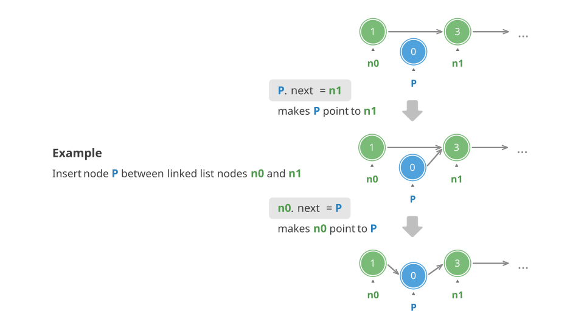

# Linked lists

Memory is a resource used by all programs, and in a complex system, free space may be scattered throughout it. An array requires contiguous storage, which may be unavailable for a very large array. This is where a linked list's flexibility helps.

A <u>linked list</u> is a linear data structure whose elements are node objects connected by references. Each reference stores the next node's memory address, allowing us to reach it from the current node.

This design lets nodes occupy scattered memory locations; their addresses need not be contiguous.


As shown above, the basic unit of a linked list is a <u>node</u> object. Each node holds a value and a reference to the next node.

- The first node is called the head, and the last is called the tail.
- The tail points to a null value: `null` in Java, `nullptr` in C++, and `None` in Python.
- In languages supporting pointers, such as C, C++, Go, and Rust, these references are expressed as pointers.

As the code below shows, each `ListNode` stores a reference (pointer) in addition to its value. Thus, **a linked list uses more memory than an array for the same amount of data**.

```snippet
list_node_class
```

## Common linked list operations

### Initializing a linked list

Building a linked list takes two steps: initialize the node objects, then connect them with references. Afterward, start at the head and follow `next` references to visit every node in order.

```snippet
init_linked_list
```

??? pythontutor "Visualize execution"

    @tutor init_linked_list_tutor

An array is a single variable, such as `nums`, containing entries `nums[0]`, `nums[1]`, and so on. A linked list consists of separate node objects. **We usually refer to the list by its head node**; for example, the list above can be called `n0`.

### Inserting a node

Inserting a node is straightforward. As shown in the figure below, inserting a new node `P` between adjacent nodes `n0` and `n1` **requires changing only two references (pointers)**, taking $O(1)$ time.

In contrast, inserting an array element takes $O(n)$ time and is slower for large datasets.



```src
[file]{linked_list}-[class]{}-[func]{insert}
```

### Removing a node

Removing a node is also straightforward: as shown in the figure below, **only one reference (pointer) needs to change**.

Although `P` still points to `n1` after removal, traversing the list can no longer reach `P`. It therefore no longer belongs to the list.


```src
[file]{linked_list}-[class]{}-[func]{remove}
```

### Accessing a node

**Accessing a node in a linked list is relatively slow**. An array provides access to any element in $O(1)$ time, but a linked list must be traversed from its head until the desired node is reached. Accessing the $i$-th node requires $i - 1$ iterations, giving $O(n)$ time complexity.

```src
[file]{linked_list}-[class]{}-[func]{access}
```

### Finding a node

Traverse the list to find a node with value `target`, then return its index. This is also linear search. The code is as follows:

```src
[file]{linked_list}-[class]{}-[func]{find}
```

## Arrays versus linked lists

The table below compares their properties and operation costs. Their contrasting storage strategies give them contrasting strengths.

<p align="center"> Table <id> &nbsp; Comparing array and linked list efficiency </p>

|          | Array                           | Linked list           |
| -------- | ------------------------------ | -------------- |
| Storage | Contiguous memory                   | Scattered memory   |
| Expansion | Fixed length                     | Flexible expansion     |
| Memory efficiency | Less memory per element, but may waste space | More memory per element |
| Access an element | $O(1)$                         | $O(n)$         |
| Add an element | $O(n)$                         | $O(1)$         |
| Remove an element | $O(n)$                         | $O(1)$         |

## Common types of linked lists

The figure below shows three common types.

- **Singly linked list**: The ordinary linked list introduced above. Each node stores a value and a reference to the next node. The first and last nodes are the head and tail, and the tail points to `None`.
- **Circular linked list**: Connecting a singly linked list's tail to its head forms a circular list. Any node can then be treated as the head.
- **Doubly linked list**: Each node stores references (pointers) in both directions, to its successor and predecessor. This makes it more flexible and allows traversal in either direction, at the cost of additional memory.

```snippet
doubly_list_node_class
```


## Typical applications of linked lists

Singly linked lists commonly implement stacks, queues, hash tables, and graphs.

- **Stacks and queues**: Inserting and removing at the same end gives last-in, first-out behavior, forming a stack. Inserting at one end and removing at the other gives first-in, first-out behavior, forming a queue.
- **Hash tables**: Separate chaining is a common collision-handling strategy that places colliding elements in a linked list.
- **Graphs**: An adjacency list associates each vertex with a linked list whose elements represent the other vertices connected to it.

Doubly linked lists are useful when both the previous and next elements must be found quickly.

- **Advanced data structures**: In structures such as red-black trees and B-trees, a node may need access to its parent. Storing a parent reference is similar to the backward link in a doubly linked list.
- **Browser history**: The forward and back buttons require access to the next and previous visited pages. A doubly linked list makes this straightforward.
- **LRU caching**: Least recently used eviction needs fast access to the least recently used data and efficient insertion and removal, making doubly linked lists a good fit.

Circular linked lists suit cyclic operations, such as operating-system resource scheduling.

- **Round-robin scheduling**: This common CPU scheduling algorithm cycles through processes, giving each a time slice before moving to the next. A circular linked list can implement this cycle.
- **Data buffers**: Some buffers use circular linked lists. Audio and video players, for example, may divide a stream into buffer blocks arranged in a circular list for seamless playback.
