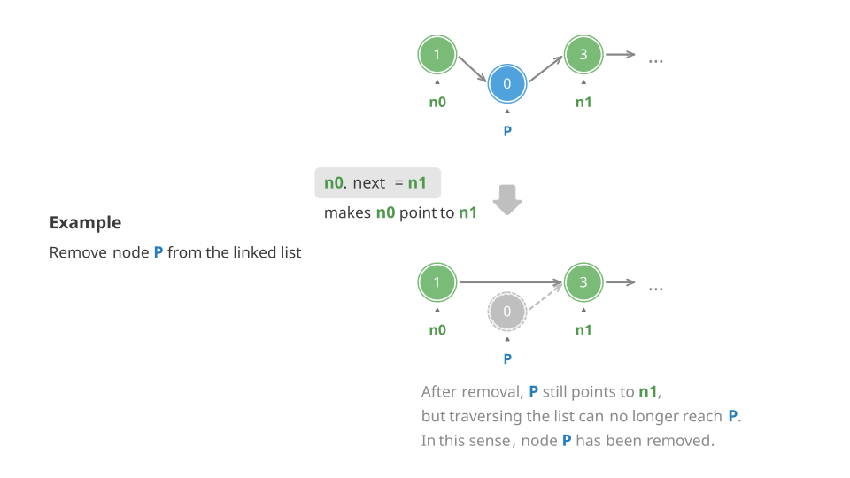
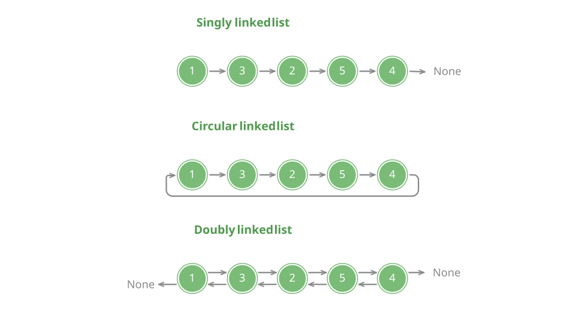

# Linked lists

Programs share memory, and in a complex system, free space may be scattered throughout it. An array needs contiguous storage, and a sufficiently large contiguous block may be unavailable for a very large array. This is where the flexibility of a linked list pays off.

A <u>linked list</u> is a linear data structure in which each element is a node object. References connect the nodes. A reference records the address of the next node, letting us reach it from the current one.

With this design, nodes can be scattered throughout memory. Their addresses do not need to be contiguous.


As the figure shows, a linked list is made up of <u>node</u> objects. Each node contains two pieces of data: its value and a reference to the next node.

- The first node is called the head, and the last node is called the tail.
- The tail points to nothing, represented by `null` in Java, `nullptr` in C++, and `None` in Python.
- In languages that support pointers, such as C, C++, Go, and Rust, the links described above as references can be expressed as pointers.

As the following code shows, a `ListNode` node stores an extra reference (pointer) alongside its value. For the same amount of data, **a linked list therefore occupies more memory than an array**.

```snippet
list_node_class
```

## Common linked list operations

### Initializing a linked list

Building a linked list takes two steps. First initialize the individual nodes, then set up the references between them. Once the list is initialized, we can visit every node in order by starting at the head and following the `next` references.

```snippet
init_linked_list
```

??? pythontutor "Visualize execution"

    @tutor init_linked_list_tutor

A single variable represents an entire array. For example, the array `nums` contains elements such as `nums[0]` and `nums[1]`. A linked list, however, consists of independent node objects. **We usually refer to the whole list by its head node**. For example, we can call the list in the preceding code the list `n0`.

### Inserting a node

Inserting a node into a linked list is straightforward. To insert a new node `P` between adjacent nodes `n0` and `n1` as shown below, **change just two node references (pointers)**. This takes $O(1)$ time.

In comparison, inserting an element into an array takes $O(n)$ time and is less efficient for large amounts of data.


```src
[file]{linked_list}-[class]{}-[func]{insert}
```

### Removing a node

Removing a node is straightforward as well. As the figure shows, **only one node reference (pointer) needs to change**.

After removal, node `P` still points to `n1`. However, traversing the list can no longer reach `P`, so `P` no longer belongs to the list.



```src
[file]{linked_list}-[class]{}-[func]{remove}
```

### Accessing a node

**Accessing a node by position in a linked list is relatively slow**. As we saw in the previous section, any array element can be accessed in $O(1)$ time. In a linked list, the program must start at the head and visit nodes one by one until it reaches the desired node. Reaching the $i$-th node thus takes $i - 1$ iterations, for a time complexity of $O(n)$.

```src
[file]{linked_list}-[class]{}-[func]{access}
```

### Finding a node

Traverse the list to find a node whose value is `target` and report its index. This is another linear search. Here is the code:

```src
[file]{linked_list}-[class]{}-[func]{find}
```

## Arrays vs. linked lists

The table below compares the properties of arrays and linked lists and the efficiency of their operations. Their contrasting storage strategies lead to different strengths and weaknesses.

<p align="center">Table <id> &nbsp; Comparing the efficiency of arrays and linked lists</p>

|          | Arrays                           | Linked lists           |
| -------- | ------------------------------ | -------------- |
| Storage layout | Contiguous memory                   | Noncontiguous memory   |
| Capacity growth | Fixed length                     | Can grow as needed     |
| Memory efficiency | Less memory per element, but unused slots can waste space | More memory per element |
| Accessing an element | $O(1)$                         | $O(n)$         |
| Adding an element | $O(n)$                         | $O(1)$         |
| Removing an element | $O(n)$                         | $O(1)$         |

## Common types of linked lists

The figure below shows three common types of linked lists.

- **Singly linked list.** This is the list introduced above. Each node contains a value and a reference to the next node. The first node is the head, and the last node is the tail. The tail points to `None`.
- **Circular linked list.** Point the tail of a singly linked list back to its head to form a circular linked list. Any node in the circle can serve as the head.
- **Doubly linked list.** Unlike a singly linked list, a doubly linked list records references in both directions. Each node holds a reference (pointer) to its successor (the next node) and to its predecessor (the previous node). This allows more flexible traversal in either direction, at the cost of additional memory.

```snippet
doubly_list_node_class
```



## Common uses of linked lists

Singly linked lists are often used to implement stacks, queues, hash tables, and graphs.

- **Stacks and queues.** Inserting and removing at the same end of a linked list gives last-in, first-out behavior, as in a stack. Inserting at one end and removing at the other gives first-in, first-out behavior, as in a queue.
- **Hash tables.** Separate chaining is a common way to resolve hash collisions. It stores all elements that collide in the same linked list.
- **Graphs.** An adjacency list is a common representation of a graph. Each vertex has an associated list whose elements represent the other vertices connected to it.

Doubly linked lists are useful when we need quick access to both the previous and the next element.

- **Advanced data structures.** In red-black trees and B-trees, for example, we need to access a node's parent. A node can store a reference back to its parent, much like a backward link in a doubly linked list.
- **Browser history.** When a user clicks Forward or Back, the browser needs to know which page comes next or came before in the browsing history. A doubly linked list makes these operations straightforward.
- **LRU cache eviction.** A least recently used (LRU) eviction algorithm needs to locate the least recently used data quickly and to add and remove nodes efficiently. A doubly linked list is well suited to these operations.

Circular linked lists are useful when operations repeat in cycles, as in operating system resource scheduling.

- **Round-robin scheduling.** In this common CPU scheduling algorithm, the operating system cycles through a set of processes. Each process gets a time slice. When it expires, the CPU switches to the next process. A circular linked list can implement this rotation.
- **Data buffers.** Some buffers use circular linked lists. For instance, an audio or video player might divide its data stream into buffer blocks and place them in a circular linked list for seamless playback.
