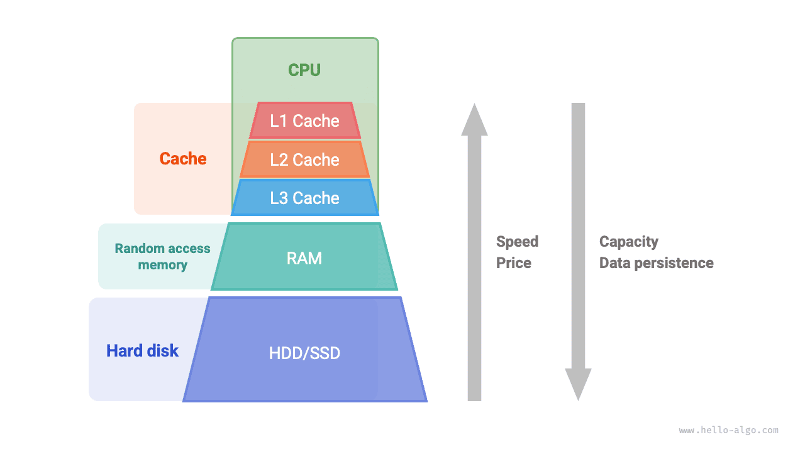
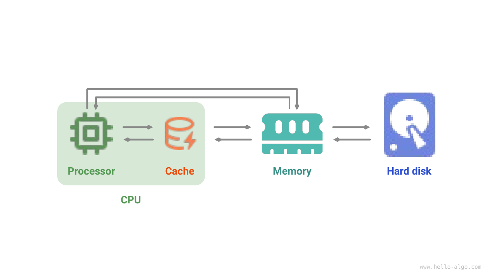

# 4.4 &nbsp; Memory and cache *

The first two sections of this chapter introduced arrays and linked lists, two fundamental structures representing contiguous and scattered storage, respectively.

**Physical structure largely determines how efficiently a program uses memory and cache**, affecting its overall performance.

## 4.4.1 &nbsp; Computer storage devices

Computers have three types of storage: <u>disk storage</u>, <u>random-access memory (RAM)</u>, and <u>cache memory</u>. Table 4-2 compares their roles and performance characteristics.

 Table 4-2 &nbsp; Computer storage devices 

|                | Disk storage                                     | RAM                                   | Cache                                              |
| -------------- | ---------------------------------------- | -------------------------------------- | ------------------------------------------------- |
| Purpose           | Long-term storage of the operating system, programs, files, and other data | Temporary storage of running programs and data being processed | Stores frequently accessed data and instructions to reduce CPU accesses to RAM |
| Volatility         | Retains data without power                       | Loses data without power                       | Loses data without power                                  |
| Capacity           | Large, on the TB scale                            | Smaller, on the GB scale                          | Very small, on the MB scale                                   |
| Speed           | Slower, hundreds to thousands of MB/s                    | Faster, tens of GB/s                        | Very fast, tens to hundreds of GB/s                           |
| Price (Chinese yuan) | Inexpensive, fractions of a yuan to several yuan per GB                  | More expensive, tens to hundreds of yuan per GB                | Very expensive, priced as part of the CPU                           |

We can picture computer storage as the pyramid in Figure 4-9. Nearer the top, storage is faster, smaller, and more expensive. This hierarchy is a deliberate design by computer scientists and engineers.

- **RAM cannot readily replace disk storage**. It loses data when power is removed, making it unsuitable for long-term storage. It also costs tens of times more than disk storage, making such a replacement impractical for consumers.
- **Cache capacity and speed are difficult to maximize together**. From L1 to L2 to L3, increasing capacity means greater physical size and distance from the CPU core, increasing transfer time and access latency. With current technology, a multilevel cache offers the best balance of capacity, speed, and cost.

{ class="animation-figure" }

 Figure 4-9 &nbsp; Computer storage hierarchy 

!!! tip

    The storage hierarchy balances speed, capacity, and cost. Such tradeoffs occur throughout industry, requiring us to find the best balance among competing strengths and limitations.

In general, **disks store large amounts of data long term, RAM temporarily holds data being processed, and caches hold frequently accessed data and instructions** to speed up execution. The three work together to keep the computer efficient.

As shown in Figure 4-10, a running program reads data from disk into RAM for the CPU to process. The cache can be viewed as part of the CPU: **it intelligently loads data from RAM** and provides faster access, improving execution speed and reducing dependence on slower memory.

{ class="animation-figure" }

 Figure 4-10 &nbsp; Data flow between disk, RAM, and cache 

## 4.4.2 &nbsp; Memory efficiency of data structures

Arrays and linked lists each have strengths and limitations in memory use.

On one hand, **memory is finite, and the same region cannot be shared by multiple programs**, so data structures should use it efficiently. Arrays pack elements tightly without extra references (pointers) between nodes, making them more space-efficient. However, they require a sufficiently large contiguous allocation, which can waste memory, and expansion costs extra time and space. Linked lists instead allocate and reclaim memory node by node, providing greater flexibility.

On the other hand, **repeated allocation and deallocation increasingly fragment free memory**, reducing its usability. Arrays' contiguous storage is less prone to causing fragmentation. Linked lists store elements in scattered locations, so frequent insertions and deletions are more likely to fragment memory.

## 4.4.3 &nbsp; Cache efficiency of data structures

A cache is much smaller than RAM but far faster, making it crucial to execution speed. Its limited capacity holds only a small portion of frequently accessed data. If the CPU requests data not in the cache, a <u>cache miss</u> occurs, and the data must be fetched from slower RAM.

Clearly, **fewer cache misses mean more efficient CPU reads and writes** and better program performance. The fraction of accesses successfully served by the cache is the <u>cache hit rate</u>, a common measure of cache efficiency.

Caches use the following mechanisms to improve efficiency.

- **Cache lines**: Data is stored and loaded in cache-line units rather than one byte at a time, making transfers more efficient.
- **Prefetching**: The processor tries to predict access patterns, such as sequential access or fixed strides, and loads matching data into the cache to improve the hit rate.
- **Spatial locality**: Accessing data suggests that nearby data may soon be needed, so the cache loads neighboring data as well.
- **Temporal locality**: Recently accessed data is likely to be accessed again soon, so keeping it in the cache improves the hit rate.

**Arrays and linked lists use the cache differently**, mainly in the following ways.

- **Storage size**: Linked list elements require more space, leaving less room for useful data in the cache.
- **Cache lines**: Linked list data is scattered, so loading a whole cache line brings in a larger proportion of unneeded data.
- **Prefetching**: Array access patterns are more predictable, making it easier to anticipate the next data needed.
- **Spatial locality**: Array elements are stored together, so data near a loaded element is more likely to be accessed soon.

Overall, **arrays have higher cache hit rates and usually faster operations than linked lists**. This makes array-based structures popular for algorithmic problems.

However, **better cache efficiency does not make arrays superior in every situation**. Choose a structure based on the requirements. Both arrays and linked lists can implement a stack, discussed in the next chapter, but suit different situations.

- For algorithm exercises, an array-based stack is often preferable because of faster operations and random access, at the cost of allocating some memory in advance.
- If the dataset is very large, changes frequently, and the stack's size is hard to predict, a linked-list-based stack may be more suitable. It can distribute data throughout memory and avoid the extra cost of array expansion.
