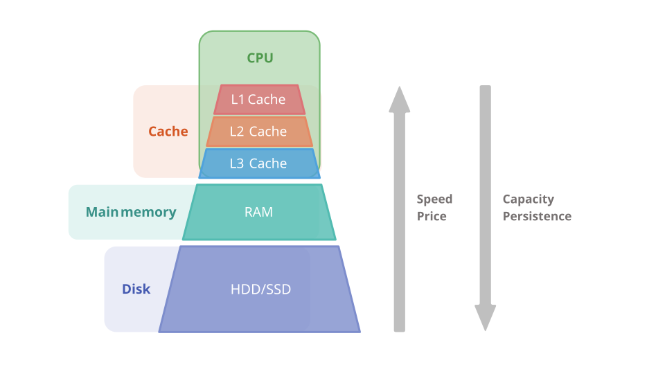
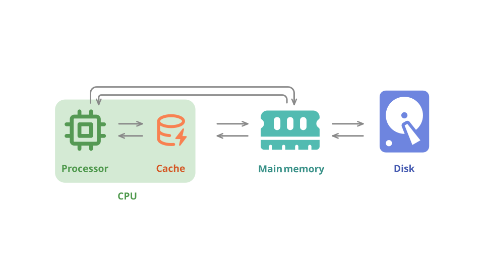

# Memory and cache *

In the first two sections of this chapter, we explored two fundamental data structures, arrays and linked lists. They illustrate two physical layouts: contiguous and noncontiguous storage.

In fact, **the physical layout largely determines how efficiently a program uses memory and cache**, which in turn affects the overall performance of an algorithm's implementation.

## Computer memory and storage devices

A computer has three types of storage: <u>disk</u>, <u>main memory (random-access memory, RAM)</u>, and <u>cache memory</u>. The table compares their roles and performance characteristics.

Table <id> &nbsp; Computer memory and storage devices

|                | Disk                                     | Main memory                                   | Cache                                              |
| -------------- | ---------------------------------------- | -------------------------------------- | ------------------------------------------------- |
| Purpose           | Long-term storage for data, including the operating system, programs, and files | Temporary storage for running programs and the data being processed | Stores frequently accessed data and instructions to reduce CPU accesses to main memory |
| Volatility         | Retains data when power is lost                       | Loses data when power is lost                       | Loses data when power is lost                                  |
| Capacity           | Large, on the order of terabytes                            | Smaller, on the order of gigabytes                          | Very small, on the order of megabytes                                   |
| Speed           | Slower, hundreds to thousands of MB/s                    | Faster, tens of GB/s                        | Very fast, tens to hundreds of GB/s                           |
| Price (Chinese yuan) | Relatively inexpensive, a fraction of a yuan to a few yuan per GB                  | More expensive, tens to hundreds of yuan per GB                | Very expensive, priced as part of the CPU                           |

Picture the computer's memory and storage system as the pyramid below. The closer a device is to the top, the faster, smaller, and more expensive it is. Computer scientists and engineers designed this hierarchy deliberately.

- **Main memory is unlikely to replace disks.** First, main memory loses its data when power is lost, making it unsuitable for long-term storage. Second, it costs tens of times as much as disk storage, which makes it difficult to adopt widely as a replacement in the consumer market.
- **Large capacity and high speed are difficult to achieve in the same cache.** From L1 to L2 to L3, caches increase in capacity and physical size and sit farther from the CPU core. Data takes longer to travel, increasing access latency. With current technology, a hierarchy of caches offers the best balance of capacity, speed, and cost.

!!! tip

    The computer memory hierarchy strikes a careful balance among speed, capacity, and cost. Designers face similar trade-offs across industries, where they must weigh competing advantages and limitations.

In short, **disks store large amounts of data for the long term, main memory temporarily holds data that running programs are processing, and cache holds frequently accessed data and instructions** to speed up execution. The three work together to keep the system running efficiently.

As the figure shows, when a program runs, data is read from disk into main memory for the CPU to process. The cache can be viewed as part of the CPU. **By selectively loading data from main memory**, it gives the CPU fast access to that data, significantly improving program performance and reducing reliance on slower main memory.

## Memory efficiency of data structures

Arrays and linked lists each have advantages and limitations in how they use memory.

First, **memory is limited, and a block allocated for one program's private use is unavailable to others**, so we want our data structures to use space efficiently. Array elements are packed together without the extra references (pointers) that link list nodes, making arrays more space-efficient. However, an array needs a sufficiently large contiguous block all at once. Some of it may go unused, and growing the array costs extra time and space. A linked list offers more flexibility by allocating and reclaiming memory one node at a time.

Second, **repeatedly allocating and freeing memory as a program runs leaves free memory increasingly fragmented**, reducing how efficiently it can be used. Arrays occupy contiguous storage and are relatively unlikely to cause fragmentation. Linked list elements are scattered, making fragmentation more likely when insertions and removals are frequent.

## Cache efficiency of data structures

A cache holds far less data than main memory but is much faster, so it plays a crucial role in execution speed. Its limited capacity holds only a small portion of frequently used data. When the CPU requests data that is absent from the cache, a <u>cache miss</u> occurs, and the CPU must load it from slower main memory.

**Fewer cache misses mean more efficient CPU reads and writes** and better program performance. The fraction of accesses for which the CPU successfully obtains the data from cache is the <u>cache hit rate</u>, a common measure of cache efficiency.

To work as efficiently as possible, caches use the following mechanisms when loading data.

- **Cache lines.** A cache stores and loads data a line at a time. Transferring a whole cache line is more efficient than transferring individual bytes.
- **Prefetching.** The processor tries to predict access patterns, such as sequential access or jumps at a fixed stride. It loads data into the cache based on these patterns to increase the hit rate.
- **Spatial locality.** When a program accesses an item, it may soon access nearby data. Loading the neighboring data along with the requested item improves the hit rate.
- **Temporal locality.** A program that accesses an item is likely to access it again soon. The cache takes advantage of this by retaining recently accessed data to improve the hit rate.

**Arrays and linked lists use the cache with different degrees of efficiency** for several reasons.

- **Space requirements.** Linked list elements occupy more space than array elements, leaving room for less useful data in the cache.
- **Cache lines.** Linked list nodes are scattered throughout memory. Because the cache loads whole lines, a higher proportion of the data it loads goes unused.
- **Prefetching.** An array's access pattern is more predictable than a linked list's, so the system can more easily anticipate which data it will need next.
- **Spatial locality.** An array occupies a contiguous block of memory, making it more likely that data near a loaded element will be accessed soon.

Overall, **arrays have higher cache hit rates, so operations on them are usually more efficient than operations on linked lists**. This helps explain why array-backed data structures are often preferred for algorithm problems.

Still, **high cache efficiency does not make arrays better than linked lists in every situation**. The choice depends on the requirements. For example, both can implement a stack (covered in the next chapter), but the two implementations suit different situations.

- For algorithm problems, we tend to choose an array-backed stack because it offers efficient operations and random access. The trade-off is that some memory must be allocated for the array in advance.
- A linked-list stack is a better fit when the data volume is very large, changes greatly, and the expected stack size is hard to estimate. The nodes can occupy different parts of memory, avoiding the extra overhead of growing an array.
