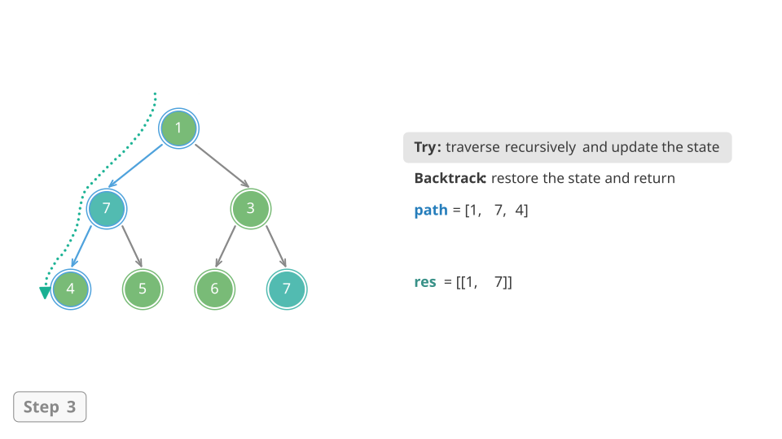
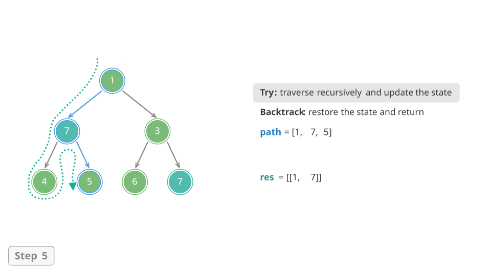
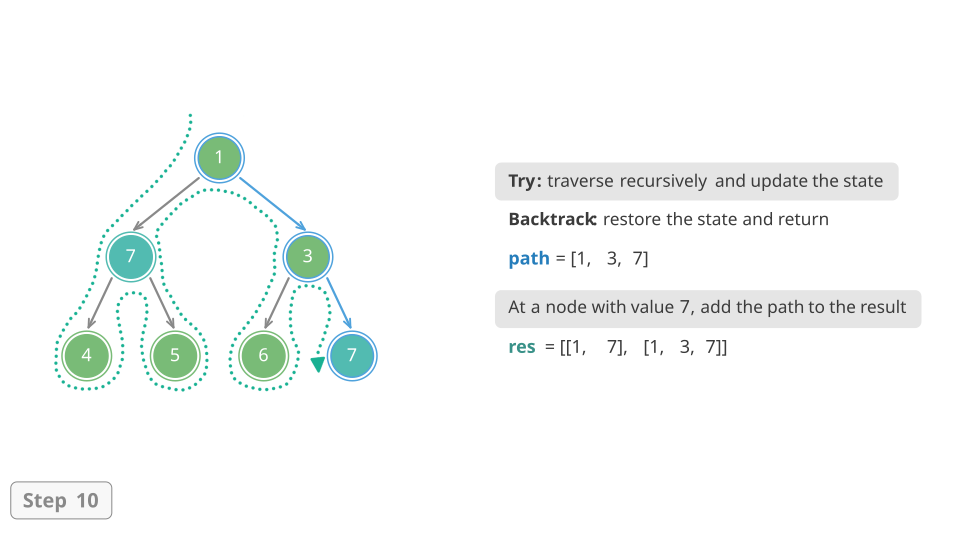
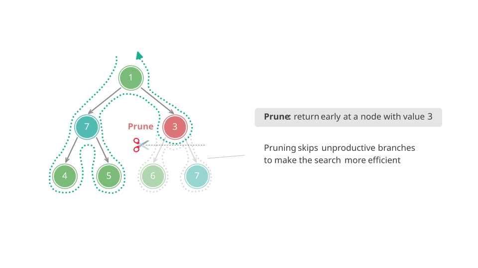
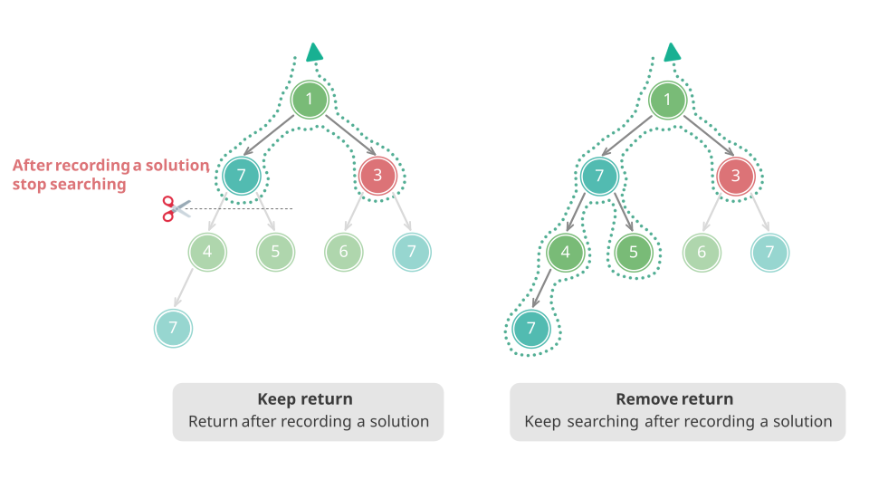

# Backtracking

A <u>backtracking algorithm</u> solves a problem by exhaustive search. Starting from an initial state, it explores possible solutions and records each valid solution it finds. The search can stop when it finds the solution it needs or when it has tried every choice without success.

Backtracking usually explores the solution space using depth-first search. In the chapter on binary trees, we saw three forms of depth-first search: preorder, inorder, and postorder traversal. Let’s build a backtracking problem around preorder traversal to see how the algorithm works.

!!! question "Example 1"

    Given a binary tree, find every node with value $7$ and return the list of matching nodes.

Traverse the tree in preorder and check whether the current node’s value is $7$. If it is, add the node’s value to the result list `res`. The figure and code below show the process:

```src
[file]{preorder_traversal_i_compact}-[class]{}-[func]{pre_order}
```


## Trying a choice and backtracking

**Backtracking gets its name from the way it tries choices and then retraces its steps as it explores the solution space**. Whenever the search reaches a state from which it cannot proceed or produce a valid solution, it undoes the last choice, returns to the previous state, and tries another choice.

In example 1, each node visit is an attempt. A `return` after stepping past a leaf or when going back to a parent is a backtracking step.

However, **backtracking can involve more than returning from a function**. A small extension of example 1 illustrates this point.

!!! question "Example 2"

    Find all nodes with value $7$ in a binary tree and **return the paths from the root to those nodes**.

Extend the code from example 1 with a list `path` that tracks the nodes along the current path. When a node has value $7$, copy `path` and append the copy to the result list `res`. Once traversal ends, `res` holds all solutions. Here is the code:

```src
[file]{preorder_traversal_ii_compact}-[class]{}-[func]{pre_order}
```

When trying a choice, append the current node to `path` to record the path. Before returning, pop that node from `path` to **restore the state from before the attempt**.

In the figure below, **trying a choice is a step forward and backtracking undoes that step**. The two operations are inverses.

=== "<1>"
    

=== "<2>"
    

=== "<3>"
    

=== "<4>"
    

=== "<5>"
    

=== "<6>"
    

=== "<7>"
    

=== "<8>"
    

=== "<9>"
    

=== "<10>"
    

=== "<11>"
    

## Pruning

More complex backtracking problems typically have one or more constraints. **These constraints often let us prune the search**.

!!! question "Example 3"

    Find all nodes with value $7$ in a binary tree and return the paths from the root to those nodes, **excluding any path that contains a node with value $3$**.

To enforce this constraint, **add a pruning step**. When the search encounters a node with value $3$, return immediately and stop exploring that branch. Here is the code:

```src
[file]{preorder_traversal_iii_compact}-[class]{}-[func]{pre_order}
```

The image of pruning a tree fits the operation well. As the figure shows, **we cut off search branches that violate the constraint**. This saves fruitless attempts and makes the search more efficient.



## A backtracking framework

We can make the code more widely applicable by extracting the steps that backtracking problems share: try a choice, undo it, and prune invalid branches.

In the framework below, `state` describes the current state of the problem, and `choices` contains the choices available in that state:

```snippet
backtrack_framework
```

We can now use this framework to solve example 3. The state `state` is the current path of nodes, the choices `choices` are the current node’s left and right children, and the result `res` is a list of paths:

```src
[file]{preorder_traversal_iii_template}-[class]{}-[func]{backtrack}
```

The problem requires us to keep searching after reaching a node with value $7$, so **remove the `return` statement that follows the step that records a solution**. The figure compares the search with and without `return`.



The framework takes more code than the preorder implementation, but it applies more broadly. In fact, **many backtracking problems fit this framework**. For each problem, define `state` and `choices` and implement the individual methods accordingly.

## Common terms

The table summarizes common backtracking terms and illustrates each one using example 3. These terms will help us describe algorithms more precisely.

<p align="center"> Table <id> &nbsp; Common backtracking terms </p>

| Term                   | Definition                                                                       | Example 3                                                               |
| ---------------------- | -------------------------------------------------------------------------- | -------------------------------------------------------------------- |
| Solution         | An answer that satisfies the problem’s conditions. A problem may have one or more solutions.                               | All paths from the root to a node with value $7$ that satisfy the constraint                            |
| Constraint | A condition that limits which solutions are valid. Constraints often help prune the search.                         | The path must contain no node with value $3$                                                 |
| State          | The situation at a particular point in the search, including choices already made                           | The current path of visited nodes, stored in the list `path`                             |
| Attempt        | Exploring the solution space by making an available choice, updating the state, and checking for a solution | Recursively visit the left or right child, add it to `path`, and check whether its value is $7$ |
| Backtracking   | Undoing a previous choice and returning to the preceding state when the current state violates a constraint       | Stop searching and return when the traversal passes a leaf, finishes visiting a node, or encounters a node with value $3$  |
| Pruning        | Using the problem’s properties and constraints to skip unproductive search paths and improve efficiency     | Stop exploring a branch upon reaching a node with value $3$                              |

!!! tip

    Concepts such as problems, solutions, and states also appear in divide and conquer, dynamic programming, and greedy algorithms.

## Advantages and limitations

Backtracking is essentially a depth-first search. It tries possible solutions until it finds one that meets the requirements. It can find every solution and can be highly efficient with well-chosen pruning rules.

For large or complex problems, however, **backtracking may be prohibitively expensive**.

- **Time**: Backtracking often has to explore every possibility in the state space. Its time complexity can be exponential or even factorial.
- **Space**: Recursive calls must preserve the current state, such as the path and auxiliary variables used for pruning. Deep recursion can require considerable space.

Even so, **backtracking remains the best approach for some search and constraint satisfaction problems**. When we cannot predict which choices will lead to a valid solution, we must explore every possibility. The question then becomes **how to make the search more efficient**. Two common approaches follow.

- **Pruning**: Skip paths that cannot produce a solution to save time and space.
- **Heuristic search**: Use a strategy or estimate to explore the most promising paths first.

## Typical backtracking problems

Backtracking can solve many search, constraint satisfaction, and combinatorial optimization problems.

**Search problems** ask for solutions that meet specified conditions.

- Permutations: Given a set, find every possible ordering of its elements.
- Subset sum: Given a set and a target sum, find all subsets whose elements add up to the target.
- Tower of Hanoi: Given three pegs and disks of different sizes, move all disks from one peg to another. Move only one disk at a time and never place a larger disk on a smaller one.

**Constraint satisfaction problems** ask for solutions that satisfy every constraint.

- $n$-queens: On an $n \times n$ board, place $n$ queens so that no two attack each other.
- Sudoku: Fill a $9 \times 9$ grid with the digits $1$ through $9$ so that no digit repeats in any row, column, or $3 \times 3$ box.
- Graph coloring: Given an undirected graph, color its vertices using as few colors as possible while giving adjacent vertices different colors.

**Combinatorial optimization problems** ask for the best combination that satisfies specified conditions.

- 0-1 knapsack: Given items with specified values and weights, choose the items of greatest total value that fit within a knapsack’s weight capacity.
- Traveling salesperson: Find the shortest route in a graph that starts at one vertex, visits every other vertex exactly once, and returns to the start.
- Maximum clique: Given an undirected graph, find its largest complete subgraph, one in which every pair of vertices is connected by an edge.

For many combinatorial optimization problems, other approaches are preferable to backtracking.

- Dynamic programming usually solves the 0-1 knapsack problem more efficiently.
- The traveling salesperson problem is a well-known NP-hard problem. Common approaches include genetic algorithms and ant colony optimization.
- The maximum clique problem is a classic problem in graph theory. Heuristics such as greedy algorithms can be used to tackle it.
