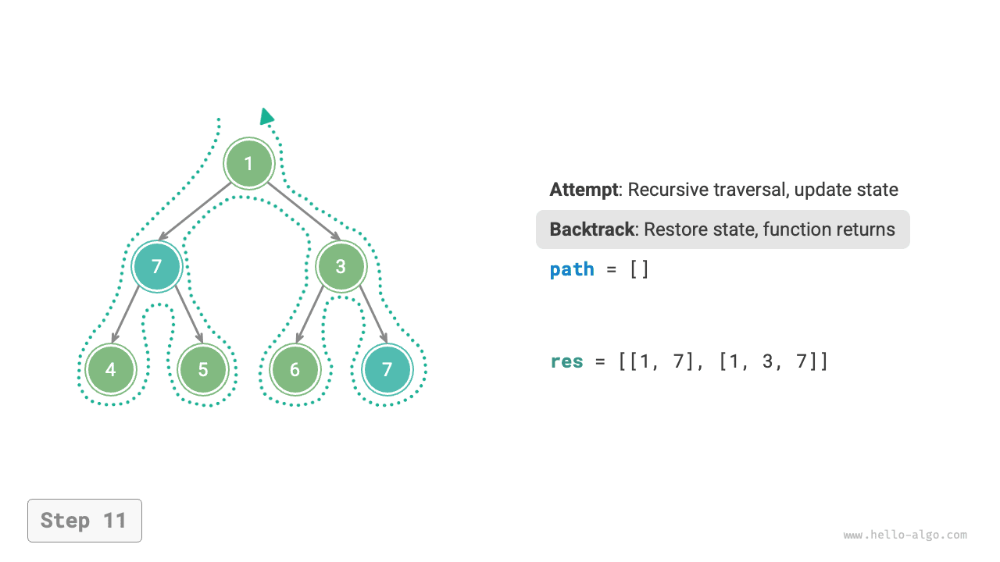

# Backtracking algorithms

A <u>backtracking algorithm</u> solves a problem through exhaustive search. Starting from an initial state, it explores possible solutions by brute force, recording valid solutions as it finds them, until a solution is found or every possible choice has been tried without success.

Backtracking usually traverses the solution space through depth-first search. In the binary tree chapter, we learned that preorder, inorder, and postorder traversal are all forms of depth-first search. We will use preorder traversal to build a backtracking problem and explore the approach step by step.

!!! question "Example 1"

    Given a binary tree, find and record every node with value $7$. Return a list of these nodes.

Traverse the tree in preorder and check whether the current node's value is $7$. If so, add that node's value to the result list `res`. The code and figure below show the process:

```src
[file]{preorder_traversal_i_compact}-[class]{}-[func]{pre_order}
```


## Trying choices and backtracking

**Backtracking gets its name from its pattern of trying choices and undoing them while searching the solution space**. When the search reaches a state that cannot advance or lead to a valid solution, it undoes the last choice, returns to the previous state, and tries other possibilities.

In Example 1, visiting a node is a trial, while a `return` after passing a leaf or returning to a parent is backtracking.

**Backtracking involves more than returning from a function**. To see why, let's extend Example 1.

!!! question "Example 2"

    Find every node with value $7$ in a binary tree, and **return the paths from the root to those nodes**.

Extend the first solution with a list `path` recording the current path of visited nodes. When a node with value $7$ is reached, append a copy of `path` to the result list `res`. After traversal, `res` contains all solutions. The code is as follows:

```src
[file]{preorder_traversal_ii_compact}-[class]{}-[func]{pre_order}
```

Each time we try a node, append it to `path`. Before backtracking, pop that node from `path` **to restore the state from before the trial**.

As the figure below illustrates, **trying a choice and backtracking are like moving forward and undoing that move**: they are inverse operations.

=== "<1>"
    

=== "<2>"
    

=== "<3>"
    

=== "<4>"
    

=== "<5>"
    

=== "<6>"
    

=== "<7>"
    

=== "<8>"
    

=== "<9>"
    

=== "<10>"
    

=== "<11>"
    

## Pruning

Complex backtracking problems usually have one or more constraints, **which can often be used for pruning**.

!!! question "Example 3"

    Find every node with value $7$ in a binary tree and return the paths from the root to those nodes, **requiring that no path contain a node with value $3$**.

To enforce this constraint, **add a pruning step**: when a node with value $3$ is encountered, return immediately without searching farther. The code is as follows:

```src
[file]{preorder_traversal_iii_compact}-[class]{}-[func]{pre_order}
```

Pruning is an apt name. As shown in the figure below, **we cut off search branches that violate the constraints**, avoiding pointless trials and improving efficiency.


## A code template

We will now extract the core pattern of trying, undoing, and pruning into a more general backtracking template.

In the following template, `state` is the current problem state, and `choices` contains the choices available from that state:

=== "Python"

    ```python title=""
    def backtrack(state: State, choices: list[choice], res: list[state]):
        """Backtracking template"""
        # Check whether the state is a solution
        if is_solution(state):
            # Record the solution
            record_solution(state, res)
            # Stop searching this branch
            return
        # Try every choice
        for choice in choices:
            # Prune: check whether the choice is valid
            if is_valid(state, choice):
                # Try: make the choice and update the state
                make_choice(state, choice)
                backtrack(state, choices, res)
                # Backtrack: undo the choice and restore the previous state
                undo_choice(state, choice)
    ```

=== "C++"

    ```cpp title=""
    /* Backtracking template */
    void backtrack(State *state, vector<Choice *> &choices, vector<State *> &res) {
        // Check whether the state is a solution
        if (isSolution(state)) {
            // Record the solution
            recordSolution(state, res);
            // Stop searching this branch
            return;
        }
        // Try every choice
        for (Choice choice : choices) {
            // Prune: check whether the choice is valid
            if (isValid(state, choice)) {
                // Try: make the choice and update the state
                makeChoice(state, choice);
                backtrack(state, choices, res);
                // Backtrack: undo the choice and restore the previous state
                undoChoice(state, choice);
            }
        }
    }
    ```

=== "Java"

    ```java title=""
    /* Backtracking template */
    void backtrack(State state, List<Choice> choices, List<State> res) {
        // Check whether the state is a solution
        if (isSolution(state)) {
            // Record the solution
            recordSolution(state, res);
            // Stop searching this branch
            return;
        }
        // Try every choice
        for (Choice choice : choices) {
            // Prune: check whether the choice is valid
            if (isValid(state, choice)) {
                // Try: make the choice and update the state
                makeChoice(state, choice);
                backtrack(state, choices, res);
                // Backtrack: undo the choice and restore the previous state
                undoChoice(state, choice);
            }
        }
    }
    ```

=== "C#"

    ```csharp title=""
    /* Backtracking template */
    void Backtrack(State state, List<Choice> choices, List<State> res) {
        // Check whether the state is a solution
        if (IsSolution(state)) {
            // Record the solution
            RecordSolution(state, res);
            // Stop searching this branch
            return;
        }
        // Try every choice
        foreach (Choice choice in choices) {
            // Prune: check whether the choice is valid
            if (IsValid(state, choice)) {
                // Try: make the choice and update the state
                MakeChoice(state, choice);
                Backtrack(state, choices, res);
                // Backtrack: undo the choice and restore the previous state
                UndoChoice(state, choice);
            }
        }
    }
    ```

=== "Go"

    ```go title=""
    /* Backtracking template */
    func backtrack(state *State, choices []Choice, res *[]State) {
        // Check whether the state is a solution
        if isSolution(state) {
            // Record the solution
            recordSolution(state, res)
            // Stop searching this branch
            return
        }
        // Try every choice
        for _, choice := range choices {
            // Prune: check whether the choice is valid
            if isValid(state, choice) {
                // Try: make the choice and update the state
                makeChoice(state, choice)
                backtrack(state, choices, res)
                // Backtrack: undo the choice and restore the previous state
                undoChoice(state, choice)
            }
        }
    }
    ```

=== "Swift"

    ```swift title=""
    /* Backtracking template */
    func backtrack(state: inout State, choices: [Choice], res: inout [State]) {
        // Check whether the state is a solution
        if isSolution(state: state) {
            // Record the solution
            recordSolution(state: state, res: &res)
            // Stop searching this branch
            return
        }
        // Try every choice
        for choice in choices {
            // Prune: check whether the choice is valid
            if isValid(state: state, choice: choice) {
                // Try: make the choice and update the state
                makeChoice(state: &state, choice: choice)
                backtrack(state: &state, choices: choices, res: &res)
                // Backtrack: undo the choice and restore the previous state
                undoChoice(state: &state, choice: choice)
            }
        }
    }
    ```

=== "JS"

    ```javascript title=""
    /* Backtracking template */
    function backtrack(state, choices, res) {
        // Check whether the state is a solution
        if (isSolution(state)) {
            // Record the solution
            recordSolution(state, res);
            // Stop searching this branch
            return;
        }
        // Try every choice
        for (let choice of choices) {
            // Prune: check whether the choice is valid
            if (isValid(state, choice)) {
                // Try: make the choice and update the state
                makeChoice(state, choice);
                backtrack(state, choices, res);
                // Backtrack: undo the choice and restore the previous state
                undoChoice(state, choice);
            }
        }
    }
    ```

=== "TS"

    ```typescript title=""
    /* Backtracking template */
    function backtrack(state: State, choices: Choice[], res: State[]): void {
        // Check whether the state is a solution
        if (isSolution(state)) {
            // Record the solution
            recordSolution(state, res);
            // Stop searching this branch
            return;
        }
        // Try every choice
        for (let choice of choices) {
            // Prune: check whether the choice is valid
            if (isValid(state, choice)) {
                // Try: make the choice and update the state
                makeChoice(state, choice);
                backtrack(state, choices, res);
                // Backtrack: undo the choice and restore the previous state
                undoChoice(state, choice);
            }
        }
    }
    ```

=== "Dart"

    ```dart title=""
    /* Backtracking template */
    void backtrack(State state, List<Choice>, List<State> res) {
      // Check whether the state is a solution
      if (isSolution(state)) {
        // Record the solution
        recordSolution(state, res);
        // Stop searching this branch
        return;
      }
      // Try every choice
      for (Choice choice in choices) {
        // Prune: check whether the choice is valid
        if (isValid(state, choice)) {
          // Try: make the choice and update the state
          makeChoice(state, choice);
          backtrack(state, choices, res);
          // Backtrack: undo the choice and restore the previous state
          undoChoice(state, choice);
        }
      }
    }
    ```

=== "Rust"

    ```rust title=""
    /* Backtracking template */
    fn backtrack(state: &mut State, choices: &Vec<Choice>, res: &mut Vec<State>) {
        // Check whether the state is a solution
        if is_solution(state) {
            // Record the solution
            record_solution(state, res);
            // Stop searching this branch
            return;
        }
        // Try every choice
        for choice in choices {
            // Prune: check whether the choice is valid
            if is_valid(state, choice) {
                // Try: make the choice and update the state
                make_choice(state, choice);
                backtrack(state, choices, res);
                // Backtrack: undo the choice and restore the previous state
                undo_choice(state, choice);
            }
        }
    }
    ```

=== "C"

    ```c title=""
    /* Backtracking template */
    void backtrack(State *state, Choice *choices, int numChoices, State *res, int numRes) {
        // Check whether the state is a solution
        if (isSolution(state)) {
            // Record the solution
            recordSolution(state, res, numRes);
            // Stop searching this branch
            return;
        }
        // Try every choice
        for (int i = 0; i < numChoices; i++) {
            // Prune: check whether the choice is valid
            if (isValid(state, &choices[i])) {
                // Try: make the choice and update the state
                makeChoice(state, &choices[i]);
                backtrack(state, choices, numChoices, res, numRes);
                // Backtrack: undo the choice and restore the previous state
                undoChoice(state, &choices[i]);
            }
        }
    }
    ```

=== "Kotlin"

    ```kotlin title=""
    /* Backtracking template */
    fun backtrack(state: State?, choices: List<Choice?>, res: List<State?>?) {
        // Check whether the state is a solution
        if (isSolution(state)) {
            // Record the solution
            recordSolution(state, res)
            // Stop searching this branch
            return
        }
        // Try every choice
        for (choice in choices) {
            // Prune: check whether the choice is valid
            if (isValid(state, choice)) {
                // Try: make the choice and update the state
                makeChoice(state, choice)
                backtrack(state, choices, res)
                // Backtrack: undo the choice and restore the previous state
                undoChoice(state, choice)
            }
        }
    }
    ```

=== "Ruby"

    ```ruby title=""
    ### Backtracking template ###
    def backtrack(state, choices, res)
        # Check whether the state is a solution
        if is_solution?(state)
            # Record the solution
            record_solution(state, res)
            return
        end

        # Try every choice
        for choice in choices
            # Prune: check whether the choice is valid
            if is_valid?(state, choice)
                # Try: make the choice and update the state
                make_choice(state, choice)
                backtrack(state, choices, res)
                # Backtrack: undo the choice and restore the previous state
                undo_choice(state, choice)
            end
        end
    end
    ```

Now apply this template to Example 3. The `state` is the current path of visited nodes, `choices` consists of the current node's left and right children, and `res` is the list of paths:

```src
[file]{preorder_traversal_iii_template}-[class]{}-[func]{backtrack}
```

The problem requires us to keep searching after finding a node with value $7$, **so remove the `return` after recording a solution**. The figure below compares the searches with and without that `return`.


The template-based implementation is more verbose than the preorder version, but more general. **Many backtracking problems can be solved within this template**: define `state` and `choices` for the problem, then implement each helper method.

## Common terminology

The table below summarizes common backtracking terms and illustrates them with Example 3, helping us analyze problems more clearly.

<p align="center"> Table <id> &nbsp; Common backtracking terminology </p>

| Term                   | Definition                                                                       | Example 3                                                               |
| ---------------------- | -------------------------------------------------------------------------- | -------------------------------------------------------------------- |
| Solution         | An answer satisfying the problem's conditions; there may be one or more                               | All paths from the root to a node valued $7$ that satisfy the constraint                            |
| Constraint | A condition restricting which solutions are feasible, often used for pruning                         | The path contains no node valued $3$                                                 |
| State          | The situation at a particular point, including the choices already made                           | The current path of visited nodes, stored in `path`                             |
| Trial        | Exploring the solution space by making a choice, updating the state, and checking for a solution | Recursively visit a left or right child, append it to `path`, and check whether its value is $7$ |
| Backtracking   | Undoing an earlier choice and returning to the previous state when a constraint cannot be met       | Stop searching and return after passing a leaf, finishing a node, or encountering value $3$  |
| Pruning        | Using problem properties and constraints to avoid pointless search paths and improve efficiency     | Stop searching when a node valued $3$ is encountered                              |

!!! tip

    Concepts such as problems, solutions, and states are shared by divide and conquer, backtracking, dynamic programming, greedy algorithms, and other approaches.

## Strengths and limitations

Backtracking is fundamentally a depth-first search that tries possible solutions until it finds ones meeting the conditions. It can find all possible solutions and can be highly efficient with effective pruning.

However, for large or complex problems, **backtracking may be unacceptably slow**.

- **Time**: Backtracking often explores every possibility in the state space, leading to exponential or factorial time complexity.
- **Space**: Recursive calls must preserve state, such as the path and auxiliary pruning variables. Deep recursion can therefore require substantial space.

Even so, **backtracking remains the best approach for some search and constraint satisfaction problems**. When we cannot predict which choices lead to valid solutions, we must explore every possibility. **The key is then to improve efficiency**, commonly through two techniques.

- **Pruning**: Avoid paths that cannot produce a solution, saving time and space.
- **Heuristic search**: Use strategies or estimates to explore paths most likely to yield valid solutions first.

## Typical backtracking problems

Backtracking can solve many search, constraint satisfaction, and combinatorial optimization problems.

**Search problems** seek solutions satisfying specified conditions.

- Permutations: Given a collection, find every possible ordering of its elements.
- Subset sum: Given a collection and a target sum, find every subset whose sum equals the target.
- Tower of Hanoi: Given three rods and disks of different sizes, move all disks from one rod to another, moving only one at a time and never placing a larger disk on a smaller one.

**Constraint satisfaction problems** seek solutions meeting all constraints.

- $n$-queens: Place $n$ queens on an $n \times n$ chessboard so that no two attack each other.
- Sudoku: Fill a $9 \times 9$ grid with digits $1$ ~ $9$ so that no digit repeats in any row, column, or $3 \times 3$ subgrid.
- Graph coloring: Color an undirected graph's vertices with as few colors as possible, ensuring adjacent vertices have different colors.

**Combinatorial optimization problems** seek an optimal solution satisfying conditions within a space of combinations.

- 0-1 knapsack: Given items with values and weights and a knapsack, choose items to maximize total value within the capacity limit.
- Traveling salesperson: Starting at a vertex in a graph, visit every other vertex exactly once and return to the start along the shortest possible route.
- Maximum clique: Given an undirected graph, find its largest complete subgraph, in which every pair of vertices is connected by an edge.

For many combinatorial optimization problems, backtracking is not the best approach.

- 0-1 knapsack is usually solved more efficiently with dynamic programming.
- The traveling salesperson problem is a well-known NP-hard problem. Common approaches include genetic algorithms and ant colony algorithms.
- Maximum clique is a classic graph theory problem that can be approached with heuristics such as greedy algorithms.
