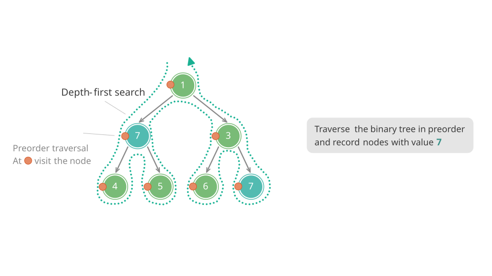
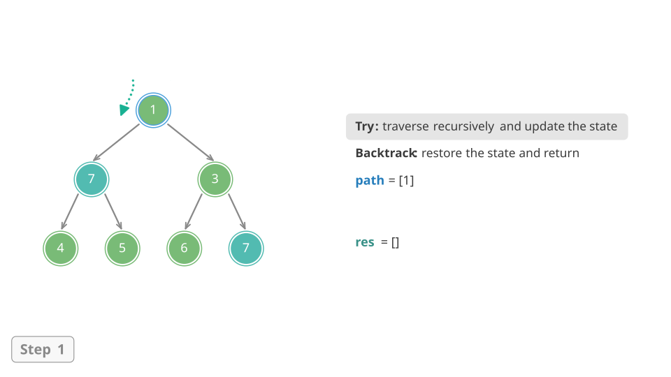
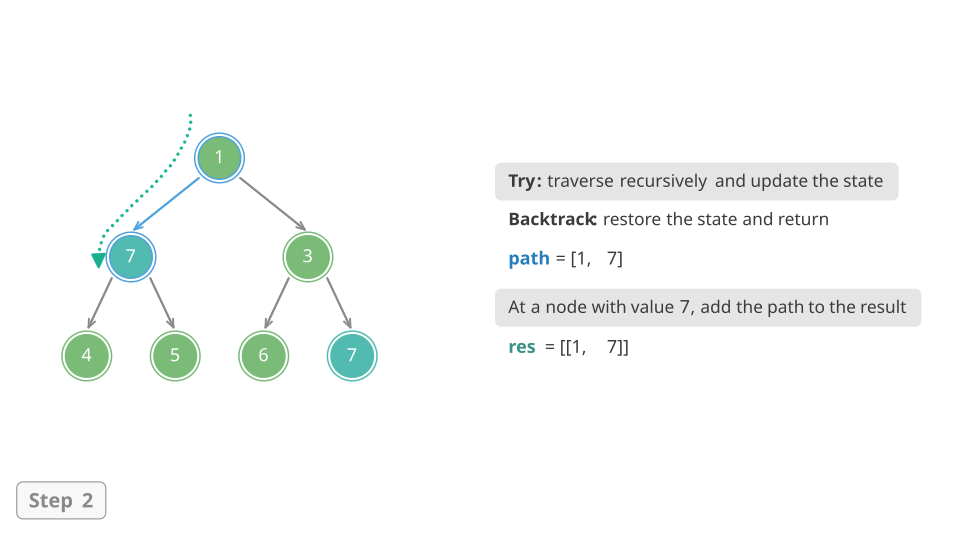
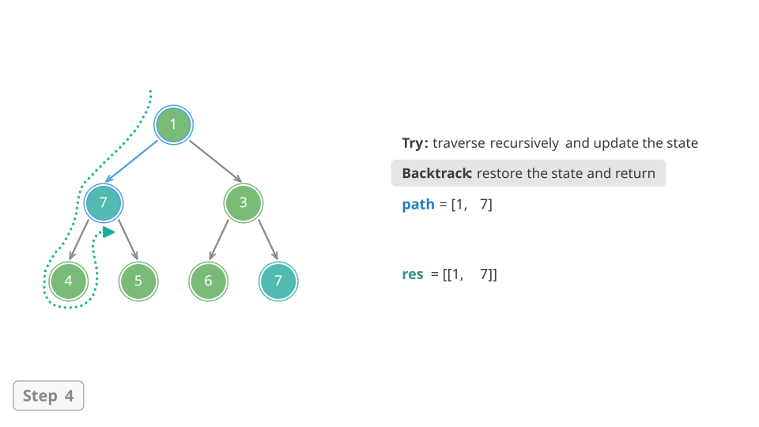
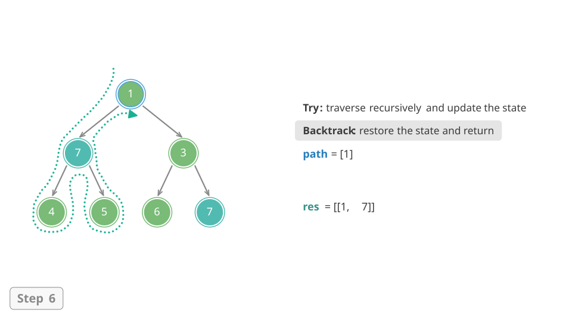
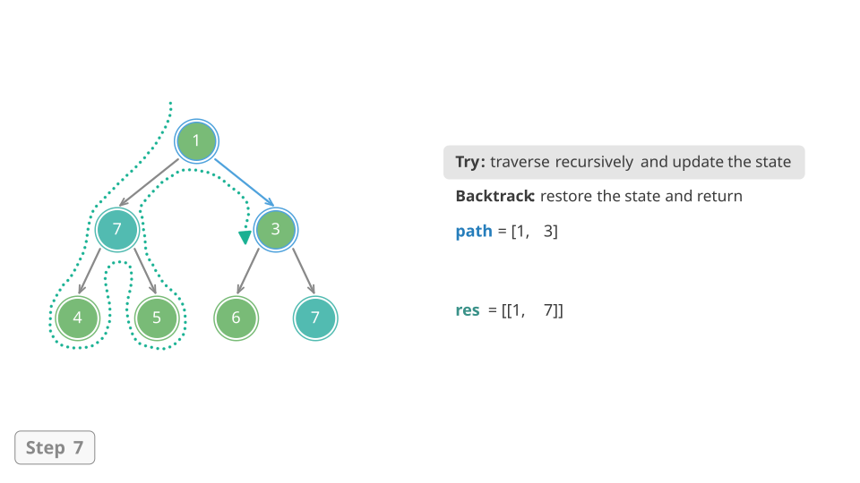
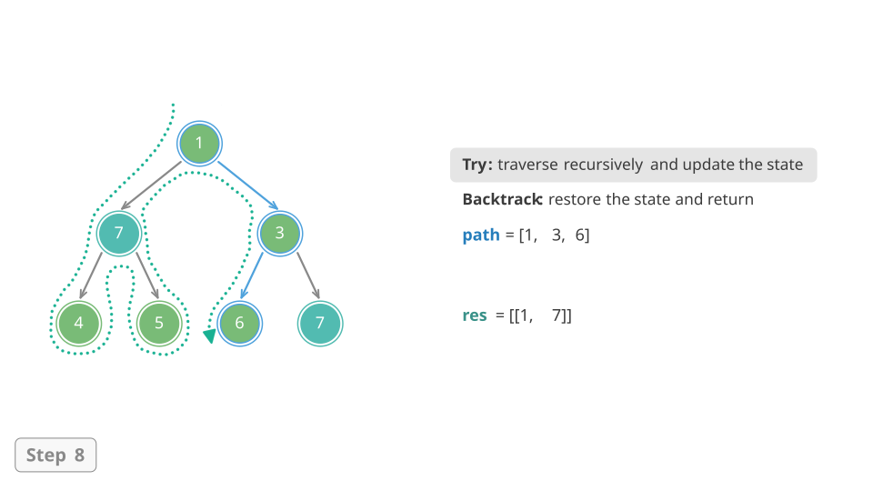
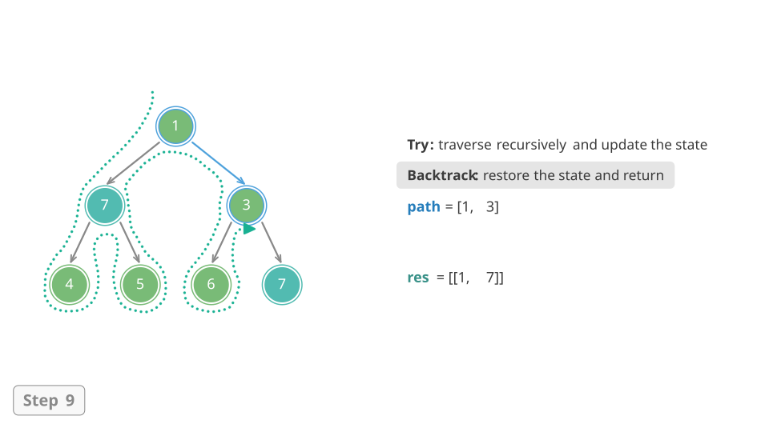
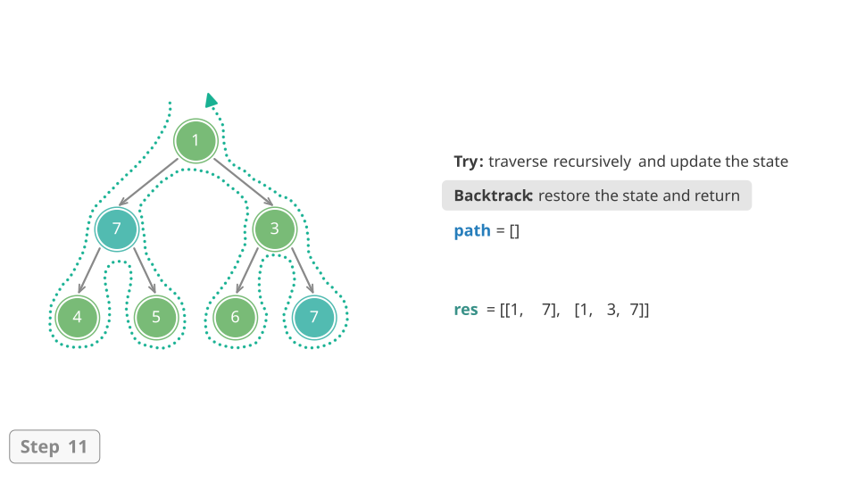

# 13.1 &nbsp; Backtracking

A <u>backtracking algorithm</u> solves a problem by exhaustive search. Starting from an initial state, it explores possible solutions and records each valid solution it finds. The search can stop when it finds the solution it needs or when it has tried every choice without success.

Backtracking usually explores the solution space using depth-first search. In the chapter on binary trees, we saw three forms of depth-first search: preorder, inorder, and postorder traversal. Let’s build a backtracking problem around preorder traversal to see how the algorithm works.

!!! question "Example 1"

    Given a binary tree, find every node with value $7$ and return the list of matching nodes.

Traverse the tree in preorder and check whether the current node’s value is $7$. If it is, add the node’s value to the result list `res`. The figure and code below show the process:

=== "Python"

    ```python title="preorder_traversal_i_compact.py"
    def pre_order(root: TreeNode):
        """Preorder traversal: example 1"""
        if root is None:
            return
        if root.val == 7:
            # Record the solution
            res.append(root)
        pre_order(root.left)
        pre_order(root.right)
    ```

=== "C++"

    ```cpp title="preorder_traversal_i_compact.cpp"
    /* Preorder traversal: example 1 */
    void preOrder(TreeNode *root) {
        if (root == nullptr) {
            return;
        }
        if (root->val == 7) {
            // Record the solution
            res.push_back(root);
        }
        preOrder(root->left);
        preOrder(root->right);
    }
    ```

=== "Java"

    ```java title="preorder_traversal_i_compact.java"
    /* Preorder traversal: example 1 */
    void preOrder(TreeNode root) {
        if (root == null) {
            return;
        }
        if (root.val == 7) {
            // Record the solution
            res.add(root);
        }
        preOrder(root.left);
        preOrder(root.right);
    }
    ```

=== "C#"

    ```csharp title="preorder_traversal_i_compact.cs"
    /* Preorder traversal: example 1 */
    void PreOrder(TreeNode? root) {
        if (root == null) {
            return;
        }
        if (root.val == 7) {
            // Record the solution
            res.Add(root);
        }
        PreOrder(root.left);
        PreOrder(root.right);
    }
    ```

=== "Go"

    ```go title="preorder_traversal_i_compact.go"
    /* Preorder traversal: example 1 */
    func preOrderI(root *TreeNode, res *[]*TreeNode) {
        if root == nil {
            return
        }
        if (root.Val).(int) == 7 {
            // Record the solution
            *res = append(*res, root)
        }
        preOrderI(root.Left, res)
        preOrderI(root.Right, res)
    }
    ```

=== "Swift"

    ```swift title="preorder_traversal_i_compact.swift"
    /* Preorder traversal: example 1 */
    func preOrder(root: TreeNode?) {
        guard let root = root else {
            return
        }
        if root.val == 7 {
            // Record the solution
            res.append(root)
        }
        preOrder(root: root.left)
        preOrder(root: root.right)
    }
    ```

=== "JS"

    ```javascript title="preorder_traversal_i_compact.js"
    /* Preorder traversal: example 1 */
    function preOrder(root, res) {
        if (root === null) {
            return;
        }
        if (root.val === 7) {
            // Record the solution
            res.push(root);
        }
        preOrder(root.left, res);
        preOrder(root.right, res);
    }
    ```

=== "TS"

    ```typescript title="preorder_traversal_i_compact.ts"
    /* Preorder traversal: example 1 */
    function preOrder(root: TreeNode | null, res: TreeNode[]): void {
        if (root === null) {
            return;
        }
        if (root.val === 7) {
            // Record the solution
            res.push(root);
        }
        preOrder(root.left, res);
        preOrder(root.right, res);
    }
    ```

=== "Dart"

    ```dart title="preorder_traversal_i_compact.dart"
    /* Preorder traversal: example 1 */
    void preOrder(TreeNode? root, List<TreeNode> res) {
      if (root == null) {
        return;
      }
      if (root.val == 7) {
        // Record the solution
        res.add(root);
      }
      preOrder(root.left, res);
      preOrder(root.right, res);
    }
    ```

=== "Rust"

    ```rust title="preorder_traversal_i_compact.rs"
    /* Preorder traversal: example 1 */
    fn pre_order(res: &mut Vec<Rc<RefCell<TreeNode>>>, root: Option<&Rc<RefCell<TreeNode>>>) {
        if root.is_none() {
            return;
        }
        if let Some(node) = root {
            if node.borrow().val == 7 {
                // Record the solution
                res.push(node.clone());
            }
            pre_order(res, node.borrow().left.as_ref());
            pre_order(res, node.borrow().right.as_ref());
        }
    }
    ```

=== "C"

    ```c title="preorder_traversal_i_compact.c"
    /* Preorder traversal: example 1 */
    void preOrder(TreeNode *root) {
        if (root == NULL) {
            return;
        }
        if (root->val == 7) {
            // Record the solution
            res[resSize++] = root;
        }
        preOrder(root->left);
        preOrder(root->right);
    }
    ```

=== "Kotlin"

    ```kotlin title="preorder_traversal_i_compact.kt"
    /* Preorder traversal: example 1 */
    fun preOrder(root: TreeNode?) {
        if (root == null) {
            return
        }
        if (root._val == 7) {
            // Record the solution
            res!!.add(root)
        }
        preOrder(root.left)
        preOrder(root.right)
    }
    ```

=== "Ruby"

    ```ruby title="preorder_traversal_i_compact.rb"
    ### Preorder traversal: example 1 ###
    def pre_order(root)
      return unless root

      # Record the solution
      $res << root if root.val == 7

      pre_order(root.left)
      pre_order(root.right)
    end
    ```

??? pythontutor "Visualize execution"

    <div style="height: 549px; width: 100%;"><iframe class="pythontutor-iframe" title="Visualize execution" src="https://pythontutor.com/iframe-embed.html#code=class%20TreeNode%3A%0A%20%20%20%20%22%22%22Binary%20tree%20node%22%22%22%0A%0A%20%20%20%20def%20__init__%28self,%20val%3A%20int%20%3D%200%29%3A%0A%20%20%20%20%20%20%20%20self.val%3A%20int%20%3D%20val%20%20%23%20Node%20value%0A%20%20%20%20%20%20%20%20self.left%3A%20TreeNode%20%7C%20None%20%3D%20None%20%20%23%20Left%20child%20reference%0A%20%20%20%20%20%20%20%20self.right%3A%20TreeNode%20%7C%20None%20%3D%20None%20%20%23%20Right%20child%20reference%0A%0Adef%20list_to_tree_dfs%28arr%3A%20list%5Bint%5D,%20i%3A%20int%29%20-%3E%20TreeNode%20%7C%20None%3A%0A%20%20%20%20%22%22%22Deserialize%20a%20list%20into%20a%20binary%20tree%20recursively%22%22%22%0A%20%20%20%20%23%20Return%20None%20for%20an%20out-of-range%20index%20or%20a%20None%20element%0A%20%20%20%20if%20i%20%3C%200%20or%20i%20%3E%3D%20len%28arr%29%20or%20arr%5Bi%5D%20is%20None%3A%0A%20%20%20%20%20%20%20%20return%20None%0A%20%20%20%20%23%20Build%20the%20current%20node%0A%20%20%20%20root%20%3D%20TreeNode%28arr%5Bi%5D%29%0A%20%20%20%20%23%20Build%20both%20subtrees%20recursively%0A%20%20%20%20root.left%20%3D%20list_to_tree_dfs%28arr,%202%20%2A%20i%20%2B%201%29%0A%20%20%20%20root.right%20%3D%20list_to_tree_dfs%28arr,%202%20%2A%20i%20%2B%202%29%0A%20%20%20%20return%20root%0A%0Adef%20list_to_tree%28arr%3A%20list%5Bint%5D%29%20-%3E%20TreeNode%20%7C%20None%3A%0A%20%20%20%20%22%22%22Deserialize%20a%20list%20into%20a%20binary%20tree%22%22%22%0A%20%20%20%20return%20list_to_tree_dfs%28arr,%200%29%0A%0A%0Adef%20pre_order%28root%3A%20TreeNode%29%3A%0A%20%20%20%20%22%22%22Preorder%20traversal%3A%20example%201%22%22%22%0A%20%20%20%20if%20root%20is%20None%3A%0A%20%20%20%20%20%20%20%20return%0A%20%20%20%20if%20root.val%20%3D%3D%207%3A%0A%20%20%20%20%20%20%20%20%23%20Record%20the%20solution%0A%20%20%20%20%20%20%20%20res.append%28root%29%0A%20%20%20%20pre_order%28root.left%29%0A%20%20%20%20pre_order%28root.right%29%0A%0A%0A%22%22%22Driver%20Code%22%22%22%0Aif%20__name__%20%3D%3D%20%22__main__%22%3A%0A%20%20%20%20root%20%3D%20list_to_tree%28%5B1,%207,%203,%204,%205,%206,%207%5D%29%0A%0A%20%20%20%20%23%20Preorder%20traversal%0A%20%20%20%20res%20%3D%20list%5BTreeNode%5D%28%29%0A%20%20%20%20pre_order%28root%29%0A%0A%20%20%20%20print%28%22%5CnPrint%20all%20nodes%20with%20value%207%22%29%0A%20%20%20%20print%28%5Bnode.val%20for%20node%20in%20res%5D%29&codeDivHeight=472&codeDivWidth=350&cumulative=false&curInstr=126&heapPrimitives=nevernest&origin=opt-frontend.js&py=311&rawInputLstJSON=%5B%5D&textReferences=false"> </iframe></div>
    <div style="margin-top: 5px;"><a href="https://pythontutor.com/iframe-embed.html#code=class%20TreeNode%3A%0A%20%20%20%20%22%22%22Binary%20tree%20node%22%22%22%0A%0A%20%20%20%20def%20__init__%28self,%20val%3A%20int%20%3D%200%29%3A%0A%20%20%20%20%20%20%20%20self.val%3A%20int%20%3D%20val%20%20%23%20Node%20value%0A%20%20%20%20%20%20%20%20self.left%3A%20TreeNode%20%7C%20None%20%3D%20None%20%20%23%20Left%20child%20reference%0A%20%20%20%20%20%20%20%20self.right%3A%20TreeNode%20%7C%20None%20%3D%20None%20%20%23%20Right%20child%20reference%0A%0Adef%20list_to_tree_dfs%28arr%3A%20list%5Bint%5D,%20i%3A%20int%29%20-%3E%20TreeNode%20%7C%20None%3A%0A%20%20%20%20%22%22%22Deserialize%20a%20list%20into%20a%20binary%20tree%20recursively%22%22%22%0A%20%20%20%20%23%20Return%20None%20for%20an%20out-of-range%20index%20or%20a%20None%20element%0A%20%20%20%20if%20i%20%3C%200%20or%20i%20%3E%3D%20len%28arr%29%20or%20arr%5Bi%5D%20is%20None%3A%0A%20%20%20%20%20%20%20%20return%20None%0A%20%20%20%20%23%20Build%20the%20current%20node%0A%20%20%20%20root%20%3D%20TreeNode%28arr%5Bi%5D%29%0A%20%20%20%20%23%20Build%20both%20subtrees%20recursively%0A%20%20%20%20root.left%20%3D%20list_to_tree_dfs%28arr,%202%20%2A%20i%20%2B%201%29%0A%20%20%20%20root.right%20%3D%20list_to_tree_dfs%28arr,%202%20%2A%20i%20%2B%202%29%0A%20%20%20%20return%20root%0A%0Adef%20list_to_tree%28arr%3A%20list%5Bint%5D%29%20-%3E%20TreeNode%20%7C%20None%3A%0A%20%20%20%20%22%22%22Deserialize%20a%20list%20into%20a%20binary%20tree%22%22%22%0A%20%20%20%20return%20list_to_tree_dfs%28arr,%200%29%0A%0A%0Adef%20pre_order%28root%3A%20TreeNode%29%3A%0A%20%20%20%20%22%22%22Preorder%20traversal%3A%20example%201%22%22%22%0A%20%20%20%20if%20root%20is%20None%3A%0A%20%20%20%20%20%20%20%20return%0A%20%20%20%20if%20root.val%20%3D%3D%207%3A%0A%20%20%20%20%20%20%20%20%23%20Record%20the%20solution%0A%20%20%20%20%20%20%20%20res.append%28root%29%0A%20%20%20%20pre_order%28root.left%29%0A%20%20%20%20pre_order%28root.right%29%0A%0A%0A%22%22%22Driver%20Code%22%22%22%0Aif%20__name__%20%3D%3D%20%22__main__%22%3A%0A%20%20%20%20root%20%3D%20list_to_tree%28%5B1,%207,%203,%204,%205,%206,%207%5D%29%0A%0A%20%20%20%20%23%20Preorder%20traversal%0A%20%20%20%20res%20%3D%20list%5BTreeNode%5D%28%29%0A%20%20%20%20pre_order%28root%29%0A%0A%20%20%20%20print%28%22%5CnPrint%20all%20nodes%20with%20value%207%22%29%0A%20%20%20%20print%28%5Bnode.val%20for%20node%20in%20res%5D%29&codeDivHeight=800&codeDivWidth=600&cumulative=false&curInstr=126&heapPrimitives=nevernest&origin=opt-frontend.js&py=311&rawInputLstJSON=%5B%5D&textReferences=false" target="_blank" rel="noopener noreferrer">View full screen ></a></div>

{ class="animation-figure" }

<p align="center"> Figure 13-1 &nbsp; Searching for nodes during preorder traversal </p>

## 13.1.1 &nbsp; Trying a choice and backtracking

**Backtracking gets its name from the way it tries choices and then retraces its steps as it explores the solution space**. Whenever the search reaches a state from which it cannot proceed or produce a valid solution, it undoes the last choice, returns to the previous state, and tries another choice.

In example 1, each node visit is an attempt. A `return` after stepping past a leaf or when going back to a parent is a backtracking step.

However, **backtracking can involve more than returning from a function**. A small extension of example 1 illustrates this point.

!!! question "Example 2"

    Find all nodes with value $7$ in a binary tree and **return the paths from the root to those nodes**.

Extend the code from example 1 with a list `path` that tracks the nodes along the current path. When a node has value $7$, copy `path` and append the copy to the result list `res`. Once traversal ends, `res` holds all solutions. Here is the code:

=== "Python"

    ```python title="preorder_traversal_ii_compact.py"
    def pre_order(root: TreeNode):
        """Preorder traversal: example 2"""
        if root is None:
            return
        # Try a choice
        path.append(root)
        if root.val == 7:
            # Record the solution
            res.append(list(path))
        pre_order(root.left)
        pre_order(root.right)
        # Backtrack
        path.pop()
    ```

=== "C++"

    ```cpp title="preorder_traversal_ii_compact.cpp"
    /* Preorder traversal: example 2 */
    void preOrder(TreeNode *root) {
        if (root == nullptr) {
            return;
        }
        // Try a choice
        path.push_back(root);
        if (root->val == 7) {
            // Record the solution
            res.push_back(path);
        }
        preOrder(root->left);
        preOrder(root->right);
        // Backtrack
        path.pop_back();
    }
    ```

=== "Java"

    ```java title="preorder_traversal_ii_compact.java"
    /* Preorder traversal: example 2 */
    void preOrder(TreeNode root) {
        if (root == null) {
            return;
        }
        // Try a choice
        path.add(root);
        if (root.val == 7) {
            // Record the solution
            res.add(new ArrayList<>(path));
        }
        preOrder(root.left);
        preOrder(root.right);
        // Backtrack
        path.remove(path.size() - 1);
    }
    ```

=== "C#"

    ```csharp title="preorder_traversal_ii_compact.cs"
    /* Preorder traversal: example 2 */
    void PreOrder(TreeNode? root) {
        if (root == null) {
            return;
        }
        // Try a choice
        path.Add(root);
        if (root.val == 7) {
            // Record the solution
            res.Add(new List<TreeNode>(path));
        }
        PreOrder(root.left);
        PreOrder(root.right);
        // Backtrack
        path.RemoveAt(path.Count - 1);
    }
    ```

=== "Go"

    ```go title="preorder_traversal_ii_compact.go"
    /* Preorder traversal: example 2 */
    func preOrderII(root *TreeNode, res *[][]*TreeNode, path *[]*TreeNode) {
        if root == nil {
            return
        }
        // Try a choice
        *path = append(*path, root)
        if root.Val.(int) == 7 {
            // Record the solution
            *res = append(*res, append([]*TreeNode{}, *path...))
        }
        preOrderII(root.Left, res, path)
        preOrderII(root.Right, res, path)
        // Backtrack
        *path = (*path)[:len(*path)-1]
    }
    ```

=== "Swift"

    ```swift title="preorder_traversal_ii_compact.swift"
    /* Preorder traversal: example 2 */
    func preOrder(root: TreeNode?) {
        guard let root = root else {
            return
        }
        // Try a choice
        path.append(root)
        if root.val == 7 {
            // Record the solution
            res.append(path)
        }
        preOrder(root: root.left)
        preOrder(root: root.right)
        // Backtrack
        path.removeLast()
    }
    ```

=== "JS"

    ```javascript title="preorder_traversal_ii_compact.js"
    /* Preorder traversal: example 2 */
    function preOrder(root, path, res) {
        if (root === null) {
            return;
        }
        // Try a choice
        path.push(root);
        if (root.val === 7) {
            // Record the solution
            res.push([...path]);
        }
        preOrder(root.left, path, res);
        preOrder(root.right, path, res);
        // Backtrack
        path.pop();
    }
    ```

=== "TS"

    ```typescript title="preorder_traversal_ii_compact.ts"
    /* Preorder traversal: example 2 */
    function preOrder(
        root: TreeNode | null,
        path: TreeNode[],
        res: TreeNode[][]
    ): void {
        if (root === null) {
            return;
        }
        // Try a choice
        path.push(root);
        if (root.val === 7) {
            // Record the solution
            res.push([...path]);
        }
        preOrder(root.left, path, res);
        preOrder(root.right, path, res);
        // Backtrack
        path.pop();
    }
    ```

=== "Dart"

    ```dart title="preorder_traversal_ii_compact.dart"
    /* Preorder traversal: example 2 */
    void preOrder(
      TreeNode? root,
      List<TreeNode> path,
      List<List<TreeNode>> res,
    ) {
      if (root == null) {
        return;
      }

      // Try a choice
      path.add(root);
      if (root.val == 7) {
        // Record the solution
        res.add(List.from(path));
      }
      preOrder(root.left, path, res);
      preOrder(root.right, path, res);
      // Backtrack
      path.removeLast();
    }
    ```

=== "Rust"

    ```rust title="preorder_traversal_ii_compact.rs"
    /* Preorder traversal: example 2 */
    fn pre_order(
        res: &mut Vec<Vec<Rc<RefCell<TreeNode>>>>,
        path: &mut Vec<Rc<RefCell<TreeNode>>>,
        root: Option<&Rc<RefCell<TreeNode>>>,
    ) {
        if root.is_none() {
            return;
        }
        if let Some(node) = root {
            // Try a choice
            path.push(node.clone());
            if node.borrow().val == 7 {
                // Record the solution
                res.push(path.clone());
            }
            pre_order(res, path, node.borrow().left.as_ref());
            pre_order(res, path, node.borrow().right.as_ref());
            // Backtrack
            path.pop();
        }
    }
    ```

=== "C"

    ```c title="preorder_traversal_ii_compact.c"
    /* Preorder traversal: example 2 */
    void preOrder(TreeNode *root) {
        if (root == NULL) {
            return;
        }
        // Try a choice
        path[pathSize++] = root;
        if (root->val == 7) {
            // Record the solution
            for (int i = 0; i < pathSize; ++i) {
                res[resSize][i] = path[i];
            }
            resSize++;
        }
        preOrder(root->left);
        preOrder(root->right);
        // Backtrack
        pathSize--;
    }
    ```

=== "Kotlin"

    ```kotlin title="preorder_traversal_ii_compact.kt"
    /* Preorder traversal: example 2 */
    fun preOrder(root: TreeNode?) {
        if (root == null) {
            return
        }
        // Try a choice
        path!!.add(root)
        if (root._val == 7) {
            // Record the solution
            res!!.add(path!!.toMutableList())
        }
        preOrder(root.left)
        preOrder(root.right)
        // Backtrack
        path!!.removeAt(path!!.size - 1)
    }
    ```

=== "Ruby"

    ```ruby title="preorder_traversal_ii_compact.rb"
    ### Preorder traversal: example 2 ###
    def pre_order(root)
      return unless root

      # Try a choice
      $path << root

      # Record the solution
      $res << $path.dup if root.val == 7

      pre_order(root.left)
      pre_order(root.right)

      # Backtrack
      $path.pop
    end
    ```

??? pythontutor "Visualize execution"

    <div style="height: 549px; width: 100%;"><iframe class="pythontutor-iframe" title="Visualize execution" src="https://pythontutor.com/iframe-embed.html#code=class%20TreeNode%3A%0A%20%20%20%20%22%22%22Binary%20tree%20node%22%22%22%0A%0A%20%20%20%20def%20__init__%28self,%20val%3A%20int%20%3D%200%29%3A%0A%20%20%20%20%20%20%20%20self.val%3A%20int%20%3D%20val%20%20%23%20Node%20value%0A%20%20%20%20%20%20%20%20self.left%3A%20TreeNode%20%7C%20None%20%3D%20None%20%20%23%20Left%20child%20reference%0A%20%20%20%20%20%20%20%20self.right%3A%20TreeNode%20%7C%20None%20%3D%20None%20%20%23%20Right%20child%20reference%0A%0Adef%20list_to_tree_dfs%28arr%3A%20list%5Bint%5D,%20i%3A%20int%29%20-%3E%20TreeNode%20%7C%20None%3A%0A%20%20%20%20%22%22%22Deserialize%20a%20list%20into%20a%20binary%20tree%20recursively%22%22%22%0A%20%20%20%20%23%20Return%20None%20for%20an%20out-of-range%20index%20or%20a%20None%20element%0A%20%20%20%20if%20i%20%3C%200%20or%20i%20%3E%3D%20len%28arr%29%20or%20arr%5Bi%5D%20is%20None%3A%0A%20%20%20%20%20%20%20%20return%20None%0A%20%20%20%20%23%20Build%20the%20current%20node%0A%20%20%20%20root%20%3D%20TreeNode%28arr%5Bi%5D%29%0A%20%20%20%20%23%20Build%20both%20subtrees%20recursively%0A%20%20%20%20root.left%20%3D%20list_to_tree_dfs%28arr,%202%20%2A%20i%20%2B%201%29%0A%20%20%20%20root.right%20%3D%20list_to_tree_dfs%28arr,%202%20%2A%20i%20%2B%202%29%0A%20%20%20%20return%20root%0A%0Adef%20list_to_tree%28arr%3A%20list%5Bint%5D%29%20-%3E%20TreeNode%20%7C%20None%3A%0A%20%20%20%20%22%22%22Deserialize%20a%20list%20into%20a%20binary%20tree%22%22%22%0A%20%20%20%20return%20list_to_tree_dfs%28arr,%200%29%0A%0A%0Adef%20pre_order%28root%3A%20TreeNode%29%3A%0A%20%20%20%20%22%22%22Preorder%20traversal%3A%20example%202%22%22%22%0A%20%20%20%20if%20root%20is%20None%3A%0A%20%20%20%20%20%20%20%20return%0A%20%20%20%20%23%20Try%20a%20choice%0A%20%20%20%20path.append%28root%29%0A%20%20%20%20if%20root.val%20%3D%3D%207%3A%0A%20%20%20%20%20%20%20%20%23%20Record%20the%20solution%0A%20%20%20%20%20%20%20%20res.append%28list%28path%29%29%0A%20%20%20%20pre_order%28root.left%29%0A%20%20%20%20pre_order%28root.right%29%0A%20%20%20%20%23%20Backtrack%0A%20%20%20%20path.pop%28%29%0A%0A%0A%22%22%22Driver%20Code%22%22%22%0Aif%20__name__%20%3D%3D%20%22__main__%22%3A%0A%20%20%20%20root%20%3D%20list_to_tree%28%5B1,%207,%203,%204,%205,%206,%207%5D%29%0A%0A%20%20%20%20%23%20Preorder%20traversal%0A%20%20%20%20path%20%3D%20list%5BTreeNode%5D%28%29%0A%20%20%20%20res%20%3D%20list%5Blist%5BTreeNode%5D%5D%28%29%0A%20%20%20%20pre_order%28root%29%0A%0A%20%20%20%20print%28%22%5CnPrint%20all%20paths%20from%20the%20root%20to%20a%20node%20with%20value%207%22%29%0A%20%20%20%20for%20path%20in%20res%3A%0A%20%20%20%20%20%20%20%20print%28%5Bnode.val%20for%20node%20in%20path%5D%29&codeDivHeight=472&codeDivWidth=350&cumulative=false&curInstr=126&heapPrimitives=nevernest&origin=opt-frontend.js&py=311&rawInputLstJSON=%5B%5D&textReferences=false"> </iframe></div>
    <div style="margin-top: 5px;"><a href="https://pythontutor.com/iframe-embed.html#code=class%20TreeNode%3A%0A%20%20%20%20%22%22%22Binary%20tree%20node%22%22%22%0A%0A%20%20%20%20def%20__init__%28self,%20val%3A%20int%20%3D%200%29%3A%0A%20%20%20%20%20%20%20%20self.val%3A%20int%20%3D%20val%20%20%23%20Node%20value%0A%20%20%20%20%20%20%20%20self.left%3A%20TreeNode%20%7C%20None%20%3D%20None%20%20%23%20Left%20child%20reference%0A%20%20%20%20%20%20%20%20self.right%3A%20TreeNode%20%7C%20None%20%3D%20None%20%20%23%20Right%20child%20reference%0A%0Adef%20list_to_tree_dfs%28arr%3A%20list%5Bint%5D,%20i%3A%20int%29%20-%3E%20TreeNode%20%7C%20None%3A%0A%20%20%20%20%22%22%22Deserialize%20a%20list%20into%20a%20binary%20tree%20recursively%22%22%22%0A%20%20%20%20%23%20Return%20None%20for%20an%20out-of-range%20index%20or%20a%20None%20element%0A%20%20%20%20if%20i%20%3C%200%20or%20i%20%3E%3D%20len%28arr%29%20or%20arr%5Bi%5D%20is%20None%3A%0A%20%20%20%20%20%20%20%20return%20None%0A%20%20%20%20%23%20Build%20the%20current%20node%0A%20%20%20%20root%20%3D%20TreeNode%28arr%5Bi%5D%29%0A%20%20%20%20%23%20Build%20both%20subtrees%20recursively%0A%20%20%20%20root.left%20%3D%20list_to_tree_dfs%28arr,%202%20%2A%20i%20%2B%201%29%0A%20%20%20%20root.right%20%3D%20list_to_tree_dfs%28arr,%202%20%2A%20i%20%2B%202%29%0A%20%20%20%20return%20root%0A%0Adef%20list_to_tree%28arr%3A%20list%5Bint%5D%29%20-%3E%20TreeNode%20%7C%20None%3A%0A%20%20%20%20%22%22%22Deserialize%20a%20list%20into%20a%20binary%20tree%22%22%22%0A%20%20%20%20return%20list_to_tree_dfs%28arr,%200%29%0A%0A%0Adef%20pre_order%28root%3A%20TreeNode%29%3A%0A%20%20%20%20%22%22%22Preorder%20traversal%3A%20example%202%22%22%22%0A%20%20%20%20if%20root%20is%20None%3A%0A%20%20%20%20%20%20%20%20return%0A%20%20%20%20%23%20Try%20a%20choice%0A%20%20%20%20path.append%28root%29%0A%20%20%20%20if%20root.val%20%3D%3D%207%3A%0A%20%20%20%20%20%20%20%20%23%20Record%20the%20solution%0A%20%20%20%20%20%20%20%20res.append%28list%28path%29%29%0A%20%20%20%20pre_order%28root.left%29%0A%20%20%20%20pre_order%28root.right%29%0A%20%20%20%20%23%20Backtrack%0A%20%20%20%20path.pop%28%29%0A%0A%0A%22%22%22Driver%20Code%22%22%22%0Aif%20__name__%20%3D%3D%20%22__main__%22%3A%0A%20%20%20%20root%20%3D%20list_to_tree%28%5B1,%207,%203,%204,%205,%206,%207%5D%29%0A%0A%20%20%20%20%23%20Preorder%20traversal%0A%20%20%20%20path%20%3D%20list%5BTreeNode%5D%28%29%0A%20%20%20%20res%20%3D%20list%5Blist%5BTreeNode%5D%5D%28%29%0A%20%20%20%20pre_order%28root%29%0A%0A%20%20%20%20print%28%22%5CnPrint%20all%20paths%20from%20the%20root%20to%20a%20node%20with%20value%207%22%29%0A%20%20%20%20for%20path%20in%20res%3A%0A%20%20%20%20%20%20%20%20print%28%5Bnode.val%20for%20node%20in%20path%5D%29&codeDivHeight=800&codeDivWidth=600&cumulative=false&curInstr=126&heapPrimitives=nevernest&origin=opt-frontend.js&py=311&rawInputLstJSON=%5B%5D&textReferences=false" target="_blank" rel="noopener noreferrer">View full screen ></a></div>

When trying a choice, append the current node to `path` to record the path. Before returning, pop that node from `path` to **restore the state from before the attempt**.

In Figure 13-2, **trying a choice is a step forward and backtracking undoes that step**. The two operations are inverses.

=== "<1>"
    { class="animation-figure" }

=== "<2>"
    { class="animation-figure" }

=== "<3>"
    { class="animation-figure" }

=== "<4>"
    { class="animation-figure" }

=== "<5>"
    { class="animation-figure" }

=== "<6>"
    { class="animation-figure" }

=== "<7>"
    { class="animation-figure" }

=== "<8>"
    { class="animation-figure" }

=== "<9>"
    { class="animation-figure" }

=== "<10>"
    { class="animation-figure" }

=== "<11>"
    { class="animation-figure" }

<p align="center"> Figure 13-2 &nbsp; Trying a choice and backtracking </p>

## 13.1.2 &nbsp; Pruning

More complex backtracking problems typically have one or more constraints. **These constraints often let us prune the search**.

!!! question "Example 3"

    Find all nodes with value $7$ in a binary tree and return the paths from the root to those nodes, **excluding any path that contains a node with value $3$**.

To enforce this constraint, **add a pruning step**. When the search encounters a node with value $3$, return immediately and stop exploring that branch. Here is the code:

=== "Python"

    ```python title="preorder_traversal_iii_compact.py"
    def pre_order(root: TreeNode):
        """Preorder traversal: example 3"""
        # Prune
        if root is None or root.val == 3:
            return
        # Try a choice
        path.append(root)
        if root.val == 7:
            # Record the solution
            res.append(list(path))
        pre_order(root.left)
        pre_order(root.right)
        # Backtrack
        path.pop()
    ```

=== "C++"

    ```cpp title="preorder_traversal_iii_compact.cpp"
    /* Preorder traversal: example 3 */
    void preOrder(TreeNode *root) {
        // Prune
        if (root == nullptr || root->val == 3) {
            return;
        }
        // Try a choice
        path.push_back(root);
        if (root->val == 7) {
            // Record the solution
            res.push_back(path);
        }
        preOrder(root->left);
        preOrder(root->right);
        // Backtrack
        path.pop_back();
    }
    ```

=== "Java"

    ```java title="preorder_traversal_iii_compact.java"
    /* Preorder traversal: example 3 */
    void preOrder(TreeNode root) {
        // Prune
        if (root == null || root.val == 3) {
            return;
        }
        // Try a choice
        path.add(root);
        if (root.val == 7) {
            // Record the solution
            res.add(new ArrayList<>(path));
        }
        preOrder(root.left);
        preOrder(root.right);
        // Backtrack
        path.remove(path.size() - 1);
    }
    ```

=== "C#"

    ```csharp title="preorder_traversal_iii_compact.cs"
    /* Preorder traversal: example 3 */
    void PreOrder(TreeNode? root) {
        // Prune
        if (root == null || root.val == 3) {
            return;
        }
        // Try a choice
        path.Add(root);
        if (root.val == 7) {
            // Record the solution
            res.Add(new List<TreeNode>(path));
        }
        PreOrder(root.left);
        PreOrder(root.right);
        // Backtrack
        path.RemoveAt(path.Count - 1);
    }
    ```

=== "Go"

    ```go title="preorder_traversal_iii_compact.go"
    /* Preorder traversal: example 3 */
    func preOrderIII(root *TreeNode, res *[][]*TreeNode, path *[]*TreeNode) {
        // Prune
        if root == nil || root.Val == 3 {
            return
        }
        // Try a choice
        *path = append(*path, root)
        if root.Val.(int) == 7 {
            // Record the solution
            *res = append(*res, append([]*TreeNode{}, *path...))
        }
        preOrderIII(root.Left, res, path)
        preOrderIII(root.Right, res, path)
        // Backtrack
        *path = (*path)[:len(*path)-1]
    }
    ```

=== "Swift"

    ```swift title="preorder_traversal_iii_compact.swift"
    /* Preorder traversal: example 3 */
    func preOrder(root: TreeNode?) {
        // Prune
        guard let root = root, root.val != 3 else {
            return
        }
        // Try a choice
        path.append(root)
        if root.val == 7 {
            // Record the solution
            res.append(path)
        }
        preOrder(root: root.left)
        preOrder(root: root.right)
        // Backtrack
        path.removeLast()
    }
    ```

=== "JS"

    ```javascript title="preorder_traversal_iii_compact.js"
    /* Preorder traversal: example 3 */
    function preOrder(root, path, res) {
        // Prune
        if (root === null || root.val === 3) {
            return;
        }
        // Try a choice
        path.push(root);
        if (root.val === 7) {
            // Record the solution
            res.push([...path]);
        }
        preOrder(root.left, path, res);
        preOrder(root.right, path, res);
        // Backtrack
        path.pop();
    }
    ```

=== "TS"

    ```typescript title="preorder_traversal_iii_compact.ts"
    /* Preorder traversal: example 3 */
    function preOrder(
        root: TreeNode | null,
        path: TreeNode[],
        res: TreeNode[][]
    ): void {
        // Prune
        if (root === null || root.val === 3) {
            return;
        }
        // Try a choice
        path.push(root);
        if (root.val === 7) {
            // Record the solution
            res.push([...path]);
        }
        preOrder(root.left, path, res);
        preOrder(root.right, path, res);
        // Backtrack
        path.pop();
    }
    ```

=== "Dart"

    ```dart title="preorder_traversal_iii_compact.dart"
    /* Preorder traversal: example 3 */
    void preOrder(
      TreeNode? root,
      List<TreeNode> path,
      List<List<TreeNode>> res,
    ) {
      if (root == null || root.val == 3) {
        return;
      }

      // Try a choice
      path.add(root);
      if (root.val == 7) {
        // Record the solution
        res.add(List.from(path));
      }
      preOrder(root.left, path, res);
      preOrder(root.right, path, res);
      // Backtrack
      path.removeLast();
    }
    ```

=== "Rust"

    ```rust title="preorder_traversal_iii_compact.rs"
    /* Preorder traversal: example 3 */
    fn pre_order(
        res: &mut Vec<Vec<Rc<RefCell<TreeNode>>>>,
        path: &mut Vec<Rc<RefCell<TreeNode>>>,
        root: Option<&Rc<RefCell<TreeNode>>>,
    ) {
        // Prune
        if root.is_none() || root.as_ref().unwrap().borrow().val == 3 {
            return;
        }
        if let Some(node) = root {
            // Try a choice
            path.push(node.clone());
            if node.borrow().val == 7 {
                // Record the solution
                res.push(path.clone());
            }
            pre_order(res, path, node.borrow().left.as_ref());
            pre_order(res, path, node.borrow().right.as_ref());
            // Backtrack
            path.pop();
        }
    }
    ```

=== "C"

    ```c title="preorder_traversal_iii_compact.c"
    /* Preorder traversal: example 3 */
    void preOrder(TreeNode *root) {
        // Prune
        if (root == NULL || root->val == 3) {
            return;
        }
        // Try a choice
        path[pathSize++] = root;
        if (root->val == 7) {
            // Record the solution
            for (int i = 0; i < pathSize; i++) {
                res[resSize][i] = path[i];
            }
            resSize++;
        }
        preOrder(root->left);
        preOrder(root->right);
        // Backtrack
        pathSize--;
    }
    ```

=== "Kotlin"

    ```kotlin title="preorder_traversal_iii_compact.kt"
    /* Preorder traversal: example 3 */
    fun preOrder(root: TreeNode?) {
        // Prune
        if (root == null || root._val == 3) {
            return
        }
        // Try a choice
        path!!.add(root)
        if (root._val == 7) {
            // Record the solution
            res!!.add(path!!.toMutableList())
        }
        preOrder(root.left)
        preOrder(root.right)
        // Backtrack
        path!!.removeAt(path!!.size - 1)
    }
    ```

=== "Ruby"

    ```ruby title="preorder_traversal_iii_compact.rb"
    ### Preorder traversal: example 3 ###
    def pre_order(root)
      # Prune
      return if !root || root.val == 3

      # Try a choice
      $path.append(root)

      # Record the solution
      $res << $path.dup if root.val == 7

      pre_order(root.left)
      pre_order(root.right)

      # Backtrack
      $path.pop
    end
    ```

??? pythontutor "Visualize execution"

    <div style="height: 549px; width: 100%;"><iframe class="pythontutor-iframe" title="Visualize execution" src="https://pythontutor.com/iframe-embed.html#code=class%20TreeNode%3A%0A%20%20%20%20%22%22%22Binary%20tree%20node%22%22%22%0A%0A%20%20%20%20def%20__init__%28self,%20val%3A%20int%20%3D%200%29%3A%0A%20%20%20%20%20%20%20%20self.val%3A%20int%20%3D%20val%20%20%23%20Node%20value%0A%20%20%20%20%20%20%20%20self.left%3A%20TreeNode%20%7C%20None%20%3D%20None%20%20%23%20Left%20child%20reference%0A%20%20%20%20%20%20%20%20self.right%3A%20TreeNode%20%7C%20None%20%3D%20None%20%20%23%20Right%20child%20reference%0A%0Adef%20list_to_tree_dfs%28arr%3A%20list%5Bint%5D,%20i%3A%20int%29%20-%3E%20TreeNode%20%7C%20None%3A%0A%20%20%20%20%22%22%22Deserialize%20a%20list%20into%20a%20binary%20tree%20recursively%22%22%22%0A%20%20%20%20%23%20Return%20None%20for%20an%20out-of-range%20index%20or%20a%20None%20element%0A%20%20%20%20if%20i%20%3C%200%20or%20i%20%3E%3D%20len%28arr%29%20or%20arr%5Bi%5D%20is%20None%3A%0A%20%20%20%20%20%20%20%20return%20None%0A%20%20%20%20%23%20Build%20the%20current%20node%0A%20%20%20%20root%20%3D%20TreeNode%28arr%5Bi%5D%29%0A%20%20%20%20%23%20Build%20both%20subtrees%20recursively%0A%20%20%20%20root.left%20%3D%20list_to_tree_dfs%28arr,%202%20%2A%20i%20%2B%201%29%0A%20%20%20%20root.right%20%3D%20list_to_tree_dfs%28arr,%202%20%2A%20i%20%2B%202%29%0A%20%20%20%20return%20root%0A%0Adef%20list_to_tree%28arr%3A%20list%5Bint%5D%29%20-%3E%20TreeNode%20%7C%20None%3A%0A%20%20%20%20%22%22%22Deserialize%20a%20list%20into%20a%20binary%20tree%22%22%22%0A%20%20%20%20return%20list_to_tree_dfs%28arr,%200%29%0A%0A%0Adef%20pre_order%28root%3A%20TreeNode%29%3A%0A%20%20%20%20%22%22%22Preorder%20traversal%3A%20example%203%22%22%22%0A%20%20%20%20%23%20Prune%0A%20%20%20%20if%20root%20is%20None%20or%20root.val%20%3D%3D%203%3A%0A%20%20%20%20%20%20%20%20return%0A%20%20%20%20%23%20Try%20a%20choice%0A%20%20%20%20path.append%28root%29%0A%20%20%20%20if%20root.val%20%3D%3D%207%3A%0A%20%20%20%20%20%20%20%20%23%20Record%20the%20solution%0A%20%20%20%20%20%20%20%20res.append%28list%28path%29%29%0A%20%20%20%20pre_order%28root.left%29%0A%20%20%20%20pre_order%28root.right%29%0A%20%20%20%20%23%20Backtrack%0A%20%20%20%20path.pop%28%29%0A%0A%0A%22%22%22Driver%20Code%22%22%22%0Aif%20__name__%20%3D%3D%20%22__main__%22%3A%0A%20%20%20%20root%20%3D%20list_to_tree%28%5B1,%207,%203,%204,%205,%206,%207%5D%29%0A%0A%20%20%20%20%23%20Preorder%20traversal%0A%20%20%20%20path%20%3D%20list%5BTreeNode%5D%28%29%0A%20%20%20%20res%20%3D%20list%5Blist%5BTreeNode%5D%5D%28%29%0A%20%20%20%20pre_order%28root%29%0A%0A%20%20%20%20print%28%22%5CnPrint%20all%20paths%20from%20the%20root%20to%20a%20node%20with%20value%207%20that%20avoid%20nodes%20with%20value%203%22%29%0A%20%20%20%20for%20path%20in%20res%3A%0A%20%20%20%20%20%20%20%20print%28%5Bnode.val%20for%20node%20in%20path%5D%29&codeDivHeight=472&codeDivWidth=350&cumulative=false&curInstr=126&heapPrimitives=nevernest&origin=opt-frontend.js&py=311&rawInputLstJSON=%5B%5D&textReferences=false"> </iframe></div>
    <div style="margin-top: 5px;"><a href="https://pythontutor.com/iframe-embed.html#code=class%20TreeNode%3A%0A%20%20%20%20%22%22%22Binary%20tree%20node%22%22%22%0A%0A%20%20%20%20def%20__init__%28self,%20val%3A%20int%20%3D%200%29%3A%0A%20%20%20%20%20%20%20%20self.val%3A%20int%20%3D%20val%20%20%23%20Node%20value%0A%20%20%20%20%20%20%20%20self.left%3A%20TreeNode%20%7C%20None%20%3D%20None%20%20%23%20Left%20child%20reference%0A%20%20%20%20%20%20%20%20self.right%3A%20TreeNode%20%7C%20None%20%3D%20None%20%20%23%20Right%20child%20reference%0A%0Adef%20list_to_tree_dfs%28arr%3A%20list%5Bint%5D,%20i%3A%20int%29%20-%3E%20TreeNode%20%7C%20None%3A%0A%20%20%20%20%22%22%22Deserialize%20a%20list%20into%20a%20binary%20tree%20recursively%22%22%22%0A%20%20%20%20%23%20Return%20None%20for%20an%20out-of-range%20index%20or%20a%20None%20element%0A%20%20%20%20if%20i%20%3C%200%20or%20i%20%3E%3D%20len%28arr%29%20or%20arr%5Bi%5D%20is%20None%3A%0A%20%20%20%20%20%20%20%20return%20None%0A%20%20%20%20%23%20Build%20the%20current%20node%0A%20%20%20%20root%20%3D%20TreeNode%28arr%5Bi%5D%29%0A%20%20%20%20%23%20Build%20both%20subtrees%20recursively%0A%20%20%20%20root.left%20%3D%20list_to_tree_dfs%28arr,%202%20%2A%20i%20%2B%201%29%0A%20%20%20%20root.right%20%3D%20list_to_tree_dfs%28arr,%202%20%2A%20i%20%2B%202%29%0A%20%20%20%20return%20root%0A%0Adef%20list_to_tree%28arr%3A%20list%5Bint%5D%29%20-%3E%20TreeNode%20%7C%20None%3A%0A%20%20%20%20%22%22%22Deserialize%20a%20list%20into%20a%20binary%20tree%22%22%22%0A%20%20%20%20return%20list_to_tree_dfs%28arr,%200%29%0A%0A%0Adef%20pre_order%28root%3A%20TreeNode%29%3A%0A%20%20%20%20%22%22%22Preorder%20traversal%3A%20example%203%22%22%22%0A%20%20%20%20%23%20Prune%0A%20%20%20%20if%20root%20is%20None%20or%20root.val%20%3D%3D%203%3A%0A%20%20%20%20%20%20%20%20return%0A%20%20%20%20%23%20Try%20a%20choice%0A%20%20%20%20path.append%28root%29%0A%20%20%20%20if%20root.val%20%3D%3D%207%3A%0A%20%20%20%20%20%20%20%20%23%20Record%20the%20solution%0A%20%20%20%20%20%20%20%20res.append%28list%28path%29%29%0A%20%20%20%20pre_order%28root.left%29%0A%20%20%20%20pre_order%28root.right%29%0A%20%20%20%20%23%20Backtrack%0A%20%20%20%20path.pop%28%29%0A%0A%0A%22%22%22Driver%20Code%22%22%22%0Aif%20__name__%20%3D%3D%20%22__main__%22%3A%0A%20%20%20%20root%20%3D%20list_to_tree%28%5B1,%207,%203,%204,%205,%206,%207%5D%29%0A%0A%20%20%20%20%23%20Preorder%20traversal%0A%20%20%20%20path%20%3D%20list%5BTreeNode%5D%28%29%0A%20%20%20%20res%20%3D%20list%5Blist%5BTreeNode%5D%5D%28%29%0A%20%20%20%20pre_order%28root%29%0A%0A%20%20%20%20print%28%22%5CnPrint%20all%20paths%20from%20the%20root%20to%20a%20node%20with%20value%207%20that%20avoid%20nodes%20with%20value%203%22%29%0A%20%20%20%20for%20path%20in%20res%3A%0A%20%20%20%20%20%20%20%20print%28%5Bnode.val%20for%20node%20in%20path%5D%29&codeDivHeight=800&codeDivWidth=600&cumulative=false&curInstr=126&heapPrimitives=nevernest&origin=opt-frontend.js&py=311&rawInputLstJSON=%5B%5D&textReferences=false" target="_blank" rel="noopener noreferrer">View full screen ></a></div>

The image of pruning a tree fits the operation well. As the figure shows, **we cut off search branches that violate the constraint**. This saves fruitless attempts and makes the search more efficient.

{ class="animation-figure" }

<p align="center"> Figure 13-3 &nbsp; Pruning branches using constraints </p>

## 13.1.3 &nbsp; A backtracking framework

We can make the code more widely applicable by extracting the steps that backtracking problems share: try a choice, undo it, and prune invalid branches.

In the framework below, `state` describes the current state of the problem, and `choices` contains the choices available in that state:

=== "Python"

    ```python title=""
    def backtrack(state: State, choices: list[Choice], res: list[State]):
        """Backtracking framework"""
        # Check for a solution
        if is_solution(state):
            # Record the solution
            record_solution(state, res)
            # Stop searching
            return
        # Try each choice
        for choice in choices:
            # Prune: check whether the choice is valid
            if is_valid(state, choice):
                # Make a choice and update the state
                make_choice(state, choice)
                backtrack(state, choices, res)
                # Backtrack: undo the choice to restore the previous state
                undo_choice(state, choice)
    ```

=== "C++"

    ```cpp title=""
    /* Backtracking framework */
    void backtrack(State *state, vector<Choice *> &choices, vector<State *> &res) {
        // Check for a solution
        if (isSolution(state)) {
            // Record the solution
            recordSolution(state, res);
            // Stop searching
            return;
        }
        // Try each choice
        for (Choice *choice : choices) {
            // Prune: check whether the choice is valid
            if (isValid(state, choice)) {
                // Make a choice and update the state
                makeChoice(state, choice);
                backtrack(state, choices, res);
                // Backtrack: undo the choice to restore the previous state
                undoChoice(state, choice);
            }
        }
    }
    ```

=== "Java"

    ```java title=""
    /* Backtracking framework */
    void backtrack(State state, List<Choice> choices, List<State> res) {
        // Check for a solution
        if (isSolution(state)) {
            // Record the solution
            recordSolution(state, res);
            // Stop searching
            return;
        }
        // Try each choice
        for (Choice choice : choices) {
            // Prune: check whether the choice is valid
            if (isValid(state, choice)) {
                // Make a choice and update the state
                makeChoice(state, choice);
                backtrack(state, choices, res);
                // Backtrack: undo the choice to restore the previous state
                undoChoice(state, choice);
            }
        }
    }
    ```

=== "C#"

    ```csharp title=""
    /* Backtracking framework */
    void Backtrack(State state, List<Choice> choices, List<State> res) {
        // Check for a solution
        if (IsSolution(state)) {
            // Record the solution
            RecordSolution(state, res);
            // Stop searching
            return;
        }
        // Try each choice
        foreach (Choice choice in choices) {
            // Prune: check whether the choice is valid
            if (IsValid(state, choice)) {
                // Make a choice and update the state
                MakeChoice(state, choice);
                Backtrack(state, choices, res);
                // Backtrack: undo the choice to restore the previous state
                UndoChoice(state, choice);
            }
        }
    }
    ```

=== "Go"

    ```go title=""
    /* Backtracking framework */
    func backtrack(state *State, choices []Choice, res *[]State) {
        // Check for a solution
        if isSolution(state) {
            // Record the solution
            recordSolution(state, res)
            // Stop searching
            return
        }
        // Try each choice
        for _, choice := range choices {
            // Prune: check whether the choice is valid
            if isValid(state, choice) {
                // Make a choice and update the state
                makeChoice(state, choice)
                backtrack(state, choices, res)
                // Backtrack: undo the choice to restore the previous state
                undoChoice(state, choice)
            }
        }
    }
    ```

=== "Swift"

    ```swift title=""
    /* Backtracking framework */
    func backtrack(state: inout State, choices: [Choice], res: inout [State]) {
        // Check for a solution
        if isSolution(state: state) {
            // Record the solution
            recordSolution(state: state, res: &res)
            // Stop searching
            return
        }
        // Try each choice
        for choice in choices {
            // Prune: check whether the choice is valid
            if isValid(state: state, choice: choice) {
                // Make a choice and update the state
                makeChoice(state: &state, choice: choice)
                backtrack(state: &state, choices: choices, res: &res)
                // Backtrack: undo the choice to restore the previous state
                undoChoice(state: &state, choice: choice)
            }
        }
    }
    ```

=== "JS"

    ```javascript title=""
    /* Backtracking framework */
    function backtrack(state, choices, res) {
        // Check for a solution
        if (isSolution(state)) {
            // Record the solution
            recordSolution(state, res);
            // Stop searching
            return;
        }
        // Try each choice
        for (let choice of choices) {
            // Prune: check whether the choice is valid
            if (isValid(state, choice)) {
                // Make a choice and update the state
                makeChoice(state, choice);
                backtrack(state, choices, res);
                // Backtrack: undo the choice to restore the previous state
                undoChoice(state, choice);
            }
        }
    }
    ```

=== "TS"

    ```typescript title=""
    /* Backtracking framework */
    function backtrack(state: State, choices: Choice[], res: State[]): void {
        // Check for a solution
        if (isSolution(state)) {
            // Record the solution
            recordSolution(state, res);
            // Stop searching
            return;
        }
        // Try each choice
        for (let choice of choices) {
            // Prune: check whether the choice is valid
            if (isValid(state, choice)) {
                // Make a choice and update the state
                makeChoice(state, choice);
                backtrack(state, choices, res);
                // Backtrack: undo the choice to restore the previous state
                undoChoice(state, choice);
            }
        }
    }
    ```

=== "Dart"

    ```dart title=""
    /* Backtracking framework */
    void backtrack(State state, List<Choice> choices, List<State> res) {
      // Check for a solution
      if (isSolution(state)) {
        // Record the solution
        recordSolution(state, res);
        // Stop searching
        return;
      }
      // Try each choice
      for (Choice choice in choices) {
        // Prune: check whether the choice is valid
        if (isValid(state, choice)) {
          // Make a choice and update the state
          makeChoice(state, choice);
          backtrack(state, choices, res);
          // Backtrack: undo the choice to restore the previous state
          undoChoice(state, choice);
        }
      }
    }
    ```

=== "Rust"

    ```rust title=""
    /* Backtracking framework */
    fn backtrack(state: &mut State, choices: &Vec<Choice>, res: &mut Vec<State>) {
        // Check for a solution
        if is_solution(state) {
            // Record the solution
            record_solution(state, res);
            // Stop searching
            return;
        }
        // Try each choice
        for choice in choices {
            // Prune: check whether the choice is valid
            if is_valid(state, choice) {
                // Make a choice and update the state
                make_choice(state, choice);
                backtrack(state, choices, res);
                // Backtrack: undo the choice to restore the previous state
                undo_choice(state, choice);
            }
        }
    }
    ```

=== "C"

    ```c title=""
    /* Backtracking framework */
    void backtrack(State *state, Choice *choices, int numChoices, State *res, int numRes) {
        // Check for a solution
        if (isSolution(state)) {
            // Record the solution
            recordSolution(state, res, numRes);
            // Stop searching
            return;
        }
        // Try each choice
        for (int i = 0; i < numChoices; i++) {
            // Prune: check whether the choice is valid
            if (isValid(state, &choices[i])) {
                // Make a choice and update the state
                makeChoice(state, &choices[i]);
                backtrack(state, choices, numChoices, res, numRes);
                // Backtrack: undo the choice to restore the previous state
                undoChoice(state, &choices[i]);
            }
        }
    }
    ```

=== "Kotlin"

    ```kotlin title=""
    /* Backtracking framework */
    fun backtrack(state: State?, choices: List<Choice?>, res: List<State?>?) {
        // Check for a solution
        if (isSolution(state)) {
            // Record the solution
            recordSolution(state, res)
            // Stop searching
            return
        }
        // Try each choice
        for (choice in choices) {
            // Prune: check whether the choice is valid
            if (isValid(state, choice)) {
                // Make a choice and update the state
                makeChoice(state, choice)
                backtrack(state, choices, res)
                // Backtrack: undo the choice to restore the previous state
                undoChoice(state, choice)
            }
        }
    }
    ```

=== "Ruby"

    ```ruby title=""
    ### Backtracking framework ###
    def backtrack(state, choices, res)
        # Check for a solution
        if is_solution?(state)
            # Record the solution
            record_solution(state, res)
            return
        end

        # Try each choice
        for choice in choices
            # Prune: check whether the choice is valid
            if is_valid?(state, choice)
                # Make a choice and update the state
                make_choice(state, choice)
                backtrack(state, choices, res)
                # Backtrack: undo the choice to restore the previous state
                undo_choice(state, choice)
            end
        end
    end
    ```

We can now use this framework to solve example 3. The state `state` is the current path of nodes, the choices `choices` are the current node’s left and right children, and the result `res` is a list of paths:

=== "Python"

    ```python title="preorder_traversal_iii_template.py"
    def is_solution(state: list[TreeNode]) -> bool:
        """Check whether the current state is a solution"""
        return state and state[-1].val == 7

    def record_solution(state: list[TreeNode], res: list[list[TreeNode]]):
        """Record the solution"""
        res.append(list(state))

    def is_valid(state: list[TreeNode], choice: TreeNode) -> bool:
        """Check whether this choice is valid in the current state"""
        return choice is not None and choice.val != 3

    def make_choice(state: list[TreeNode], choice: TreeNode):
        """Update the state"""
        state.append(choice)

    def undo_choice(state: list[TreeNode], choice: TreeNode):
        """Restore the state"""
        state.pop()

    def backtrack(
        state: list[TreeNode], choices: list[TreeNode], res: list[list[TreeNode]]
    ):
        """Backtracking: example 3"""
        # Check for a solution
        if is_solution(state):
            # Record the solution
            record_solution(state, res)
        # Try each choice
        for choice in choices:
            # Prune: check whether the choice is valid
            if is_valid(state, choice):
                # Make a choice and update the state
                make_choice(state, choice)
                # Make the next choice
                backtrack(state, [choice.left, choice.right], res)
                # Backtrack: undo the choice to restore the previous state
                undo_choice(state, choice)
    ```

=== "C++"

    ```cpp title="preorder_traversal_iii_template.cpp"
    /* Check whether the current state is a solution */
    bool isSolution(vector<TreeNode *> &state) {
        return !state.empty() && state.back()->val == 7;
    }

    /* Record the solution */
    void recordSolution(vector<TreeNode *> &state, vector<vector<TreeNode *>> &res) {
        res.push_back(state);
    }

    /* Check whether this choice is valid in the current state */
    bool isValid(vector<TreeNode *> &state, TreeNode *choice) {
        return choice != nullptr && choice->val != 3;
    }

    /* Update the state */
    void makeChoice(vector<TreeNode *> &state, TreeNode *choice) {
        state.push_back(choice);
    }

    /* Restore the state */
    void undoChoice(vector<TreeNode *> &state, TreeNode *choice) {
        state.pop_back();
    }

    /* Backtracking: example 3 */
    void backtrack(vector<TreeNode *> &state, vector<TreeNode *> &choices, vector<vector<TreeNode *>> &res) {
        // Check for a solution
        if (isSolution(state)) {
            // Record the solution
            recordSolution(state, res);
        }
        // Try each choice
        for (TreeNode *choice : choices) {
            // Prune: check whether the choice is valid
            if (isValid(state, choice)) {
                // Make a choice and update the state
                makeChoice(state, choice);
                // Make the next choice
                vector<TreeNode *> nextChoices{choice->left, choice->right};
                backtrack(state, nextChoices, res);
                // Backtrack: undo the choice to restore the previous state
                undoChoice(state, choice);
            }
        }
    }
    ```

=== "Java"

    ```java title="preorder_traversal_iii_template.java"
    /* Check whether the current state is a solution */
    boolean isSolution(List<TreeNode> state) {
        return !state.isEmpty() && state.get(state.size() - 1).val == 7;
    }

    /* Record the solution */
    void recordSolution(List<TreeNode> state, List<List<TreeNode>> res) {
        res.add(new ArrayList<>(state));
    }

    /* Check whether this choice is valid in the current state */
    boolean isValid(List<TreeNode> state, TreeNode choice) {
        return choice != null && choice.val != 3;
    }

    /* Update the state */
    void makeChoice(List<TreeNode> state, TreeNode choice) {
        state.add(choice);
    }

    /* Restore the state */
    void undoChoice(List<TreeNode> state, TreeNode choice) {
        state.remove(state.size() - 1);
    }

    /* Backtracking: example 3 */
    void backtrack(List<TreeNode> state, List<TreeNode> choices, List<List<TreeNode>> res) {
        // Check for a solution
        if (isSolution(state)) {
            // Record the solution
            recordSolution(state, res);
        }
        // Try each choice
        for (TreeNode choice : choices) {
            // Prune: check whether the choice is valid
            if (isValid(state, choice)) {
                // Make a choice and update the state
                makeChoice(state, choice);
                // Make the next choice
                backtrack(state, Arrays.asList(choice.left, choice.right), res);
                // Backtrack: undo the choice to restore the previous state
                undoChoice(state, choice);
            }
        }
    }
    ```

=== "C#"

    ```csharp title="preorder_traversal_iii_template.cs"
    /* Check whether the current state is a solution */
    bool IsSolution(List<TreeNode> state) {
        return state.Count != 0 && state[^1].val == 7;
    }

    /* Record the solution */
    void RecordSolution(List<TreeNode> state, List<List<TreeNode>> res) {
        res.Add(new List<TreeNode>(state));
    }

    /* Check whether this choice is valid in the current state */
    bool IsValid(List<TreeNode> state, TreeNode choice) {
        return choice != null && choice.val != 3;
    }

    /* Update the state */
    void MakeChoice(List<TreeNode> state, TreeNode choice) {
        state.Add(choice);
    }

    /* Restore the state */
    void UndoChoice(List<TreeNode> state, TreeNode choice) {
        state.RemoveAt(state.Count - 1);
    }

    /* Backtracking: example 3 */
    void Backtrack(List<TreeNode> state, List<TreeNode> choices, List<List<TreeNode>> res) {
        // Check for a solution
        if (IsSolution(state)) {
            // Record the solution
            RecordSolution(state, res);
        }
        // Try each choice
        foreach (TreeNode choice in choices) {
            // Prune: check whether the choice is valid
            if (IsValid(state, choice)) {
                // Make a choice and update the state
                MakeChoice(state, choice);
                // Make the next choice
                Backtrack(state, [choice.left!, choice.right!], res);
                // Backtrack: undo the choice to restore the previous state
                UndoChoice(state, choice);
            }
        }
    }
    ```

=== "Go"

    ```go title="preorder_traversal_iii_template.go"
    /* Check whether the current state is a solution */
    func isSolution(state *[]*TreeNode) bool {
        return len(*state) != 0 && (*state)[len(*state)-1].Val == 7
    }

    /* Record the solution */
    func recordSolution(state *[]*TreeNode, res *[][]*TreeNode) {
        *res = append(*res, append([]*TreeNode{}, *state...))
    }

    /* Check whether this choice is valid in the current state */
    func isValid(state *[]*TreeNode, choice *TreeNode) bool {
        return choice != nil && choice.Val != 3
    }

    /* Update the state */
    func makeChoice(state *[]*TreeNode, choice *TreeNode) {
        *state = append(*state, choice)
    }

    /* Restore the state */
    func undoChoice(state *[]*TreeNode, choice *TreeNode) {
        *state = (*state)[:len(*state)-1]
    }

    /* Backtracking: example 3 */
    func backtrackIII(state *[]*TreeNode, choices *[]*TreeNode, res *[][]*TreeNode) {
        // Check for a solution
        if isSolution(state) {
            // Record the solution
            recordSolution(state, res)
        }
        // Try each choice
        for _, choice := range *choices {
            // Prune: check whether the choice is valid
            if isValid(state, choice) {
                // Make a choice and update the state
                makeChoice(state, choice)
                // Make the next choice
                temp := make([]*TreeNode, 0)
                temp = append(temp, choice.Left, choice.Right)
                backtrackIII(state, &temp, res)
                // Backtrack: undo the choice to restore the previous state
                undoChoice(state, choice)
            }
        }
    }
    ```

=== "Swift"

    ```swift title="preorder_traversal_iii_template.swift"
    /* Check whether the current state is a solution */
    func isSolution(state: [TreeNode]) -> Bool {
        !state.isEmpty && state.last!.val == 7
    }

    /* Record the solution */
    func recordSolution(state: [TreeNode], res: inout [[TreeNode]]) {
        res.append(state)
    }

    /* Check whether this choice is valid in the current state */
    func isValid(state: [TreeNode], choice: TreeNode?) -> Bool {
        choice != nil && choice!.val != 3
    }

    /* Update the state */
    func makeChoice(state: inout [TreeNode], choice: TreeNode) {
        state.append(choice)
    }

    /* Restore the state */
    func undoChoice(state: inout [TreeNode], choice: TreeNode) {
        state.removeLast()
    }

    /* Backtracking: example 3 */
    func backtrack(state: inout [TreeNode], choices: [TreeNode], res: inout [[TreeNode]]) {
        // Check for a solution
        if isSolution(state: state) {
            recordSolution(state: state, res: &res)
        }
        // Try each choice
        for choice in choices {
            // Prune: check whether the choice is valid
            if isValid(state: state, choice: choice) {
                // Make a choice and update the state
                makeChoice(state: &state, choice: choice)
                // Make the next choice
                backtrack(state: &state, choices: [choice.left, choice.right].compactMap { $0 }, res: &res)
                // Backtrack: undo the choice to restore the previous state
                undoChoice(state: &state, choice: choice)
            }
        }
    }
    ```

=== "JS"

    ```javascript title="preorder_traversal_iii_template.js"
    /* Check whether the current state is a solution */
    function isSolution(state) {
        return state && state[state.length - 1]?.val === 7;
    }

    /* Record the solution */
    function recordSolution(state, res) {
        res.push([...state]);
    }

    /* Check whether this choice is valid in the current state */
    function isValid(state, choice) {
        return choice !== null && choice.val !== 3;
    }

    /* Update the state */
    function makeChoice(state, choice) {
        state.push(choice);
    }

    /* Restore the state */
    function undoChoice(state) {
        state.pop();
    }

    /* Backtracking: example 3 */
    function backtrack(state, choices, res) {
        // Check for a solution
        if (isSolution(state)) {
            // Record the solution
            recordSolution(state, res);
        }
        // Try each choice
        for (const choice of choices) {
            // Prune: check whether the choice is valid
            if (isValid(state, choice)) {
                // Make a choice and update the state
                makeChoice(state, choice);
                // Make the next choice
                backtrack(state, [choice.left, choice.right], res);
                // Backtrack: undo the choice to restore the previous state
                undoChoice(state);
            }
        }
    }
    ```

=== "TS"

    ```typescript title="preorder_traversal_iii_template.ts"
    /* Check whether the current state is a solution */
    function isSolution(state: TreeNode[]): boolean {
        return state && state[state.length - 1]?.val === 7;
    }

    /* Record the solution */
    function recordSolution(state: TreeNode[], res: TreeNode[][]): void {
        res.push([...state]);
    }

    /* Check whether this choice is valid in the current state */
    function isValid(state: TreeNode[], choice: TreeNode): boolean {
        return choice !== null && choice.val !== 3;
    }

    /* Update the state */
    function makeChoice(state: TreeNode[], choice: TreeNode): void {
        state.push(choice);
    }

    /* Restore the state */
    function undoChoice(state: TreeNode[]): void {
        state.pop();
    }

    /* Backtracking: example 3 */
    function backtrack(
        state: TreeNode[],
        choices: TreeNode[],
        res: TreeNode[][]
    ): void {
        // Check for a solution
        if (isSolution(state)) {
            // Record the solution
            recordSolution(state, res);
        }
        // Try each choice
        for (const choice of choices) {
            // Prune: check whether the choice is valid
            if (isValid(state, choice)) {
                // Make a choice and update the state
                makeChoice(state, choice);
                // Make the next choice
                backtrack(state, [choice.left, choice.right], res);
                // Backtrack: undo the choice to restore the previous state
                undoChoice(state);
            }
        }
    }
    ```

=== "Dart"

    ```dart title="preorder_traversal_iii_template.dart"
    /* Check whether the current state is a solution */
    bool isSolution(List<TreeNode> state) {
      return state.isNotEmpty && state.last.val == 7;
    }

    /* Record the solution */
    void recordSolution(List<TreeNode> state, List<List<TreeNode>> res) {
      res.add(List.from(state));
    }

    /* Check whether this choice is valid in the current state */
    bool isValid(List<TreeNode> state, TreeNode? choice) {
      return choice != null && choice.val != 3;
    }

    /* Update the state */
    void makeChoice(List<TreeNode> state, TreeNode? choice) {
      state.add(choice!);
    }

    /* Restore the state */
    void undoChoice(List<TreeNode> state, TreeNode? choice) {
      state.removeLast();
    }

    /* Backtracking: example 3 */
    void backtrack(
      List<TreeNode> state,
      List<TreeNode?> choices,
      List<List<TreeNode>> res,
    ) {
      // Check for a solution
      if (isSolution(state)) {
        // Record the solution
        recordSolution(state, res);
      }
      // Try each choice
      for (TreeNode? choice in choices) {
        // Prune: check whether the choice is valid
        if (isValid(state, choice)) {
          // Make a choice and update the state
          makeChoice(state, choice);
          // Make the next choice
          backtrack(state, [choice!.left, choice.right], res);
          // Backtrack: undo the choice to restore the previous state
          undoChoice(state, choice);
        }
      }
    }
    ```

=== "Rust"

    ```rust title="preorder_traversal_iii_template.rs"
    /* Check whether the current state is a solution */
    fn is_solution(state: &mut Vec<Rc<RefCell<TreeNode>>>) -> bool {
        return !state.is_empty() && state.last().unwrap().borrow().val == 7;
    }

    /* Record the solution */
    fn record_solution(
        state: &mut Vec<Rc<RefCell<TreeNode>>>,
        res: &mut Vec<Vec<Rc<RefCell<TreeNode>>>>,
    ) {
        res.push(state.clone());
    }

    /* Check whether this choice is valid in the current state */
    fn is_valid(_: &mut Vec<Rc<RefCell<TreeNode>>>, choice: Option<&Rc<RefCell<TreeNode>>>) -> bool {
        return choice.is_some() && choice.unwrap().borrow().val != 3;
    }

    /* Update the state */
    fn make_choice(state: &mut Vec<Rc<RefCell<TreeNode>>>, choice: Rc<RefCell<TreeNode>>) {
        state.push(choice);
    }

    /* Restore the state */
    fn undo_choice(state: &mut Vec<Rc<RefCell<TreeNode>>>, _: Rc<RefCell<TreeNode>>) {
        state.pop();
    }

    /* Backtracking: example 3 */
    fn backtrack(
        state: &mut Vec<Rc<RefCell<TreeNode>>>,
        choices: &Vec<Option<&Rc<RefCell<TreeNode>>>>,
        res: &mut Vec<Vec<Rc<RefCell<TreeNode>>>>,
    ) {
        // Check for a solution
        if is_solution(state) {
            // Record the solution
            record_solution(state, res);
        }
        // Try each choice
        for &choice in choices.iter() {
            // Prune: check whether the choice is valid
            if is_valid(state, choice) {
                // Make a choice and update the state
                make_choice(state, choice.unwrap().clone());
                // Make the next choice
                backtrack(
                    state,
                    &vec![
                        choice.unwrap().borrow().left.as_ref(),
                        choice.unwrap().borrow().right.as_ref(),
                    ],
                    res,
                );
                // Backtrack: undo the choice to restore the previous state
                undo_choice(state, choice.unwrap().clone());
            }
        }
    }
    ```

=== "C"

    ```c title="preorder_traversal_iii_template.c"
    /* Check whether the current state is a solution */
    bool isSolution(void) {
        return pathSize > 0 && path[pathSize - 1]->val == 7;
    }

    /* Record the solution */
    void recordSolution(void) {
        for (int i = 0; i < pathSize; i++) {
            res[resSize][i] = path[i];
        }
        resSize++;
    }

    /* Check whether this choice is valid in the current state */
    bool isValid(TreeNode *choice) {
        return choice != NULL && choice->val != 3;
    }

    /* Update the state */
    void makeChoice(TreeNode *choice) {
        path[pathSize++] = choice;
    }

    /* Restore the state */
    void undoChoice(void) {
        pathSize--;
    }

    /* Backtracking: example 3 */
    void backtrack(TreeNode *choices[2]) {
        // Check for a solution
        if (isSolution()) {
            // Record the solution
            recordSolution();
        }
        // Try each choice
        for (int i = 0; i < 2; i++) {
            TreeNode *choice = choices[i];
            // Prune: check whether the choice is valid
            if (isValid(choice)) {
                // Make a choice and update the state
                makeChoice(choice);
                // Make the next choice
                TreeNode *nextChoices[2] = {choice->left, choice->right};
                backtrack(nextChoices);
                // Backtrack: undo the choice to restore the previous state
                undoChoice();
            }
        }
    }
    ```

=== "Kotlin"

    ```kotlin title="preorder_traversal_iii_template.kt"
    /* Check whether the current state is a solution */
    fun isSolution(state: MutableList<TreeNode?>): Boolean {
        return state.isNotEmpty() && state[state.size - 1]?._val == 7
    }

    /* Record the solution */
    fun recordSolution(state: MutableList<TreeNode?>?, res: MutableList<MutableList<TreeNode?>?>) {
        res.add(state!!.toMutableList())
    }

    /* Check whether this choice is valid in the current state */
    fun isValid(state: MutableList<TreeNode?>?, choice: TreeNode?): Boolean {
        return choice != null && choice._val != 3
    }

    /* Update the state */
    fun makeChoice(state: MutableList<TreeNode?>, choice: TreeNode?) {
        state.add(choice)
    }

    /* Restore the state */
    fun undoChoice(state: MutableList<TreeNode?>, choice: TreeNode?) {
        state.removeLast()
    }

    /* Backtracking: example 3 */
    fun backtrack(
        state: MutableList<TreeNode?>,
        choices: MutableList<TreeNode?>,
        res: MutableList<MutableList<TreeNode?>?>
    ) {
        // Check for a solution
        if (isSolution(state)) {
            // Record the solution
            recordSolution(state, res)
        }
        // Try each choice
        for (choice in choices) {
            // Prune: check whether the choice is valid
            if (isValid(state, choice)) {
                // Make a choice and update the state
                makeChoice(state, choice)
                // Make the next choice
                backtrack(state, mutableListOf(choice!!.left, choice.right), res)
                // Backtrack: undo the choice to restore the previous state
                undoChoice(state, choice)
            }
        }
    }
    ```

=== "Ruby"

    ```ruby title="preorder_traversal_iii_template.rb"
    ### Check whether the current state is a solution ###
    def is_solution?(state)
      !state.empty? && state.last.val == 7
    end

    ### Record the solution ###
    def record_solution(state, res)
      res << state.dup
    end

    ### Check whether this choice is valid in the current state ###
    def is_valid?(state, choice)
      choice && choice.val != 3
    end

    ### Update the state ###
    def make_choice(state, choice)
      state << choice
    end

    ### Restore the state ###
    def undo_choice(state, choice)
      state.pop
    end

    ### Backtracking: example 3 ###
    def backtrack(state, choices, res)
      # Check for a solution
      record_solution(state, res) if is_solution?(state)

      # Try each choice
      for choice in choices
        # Prune: check whether the choice is valid
        if is_valid?(state, choice)
          # Make a choice and update the state
          make_choice(state, choice)
          # Make the next choice
          backtrack(state, [choice.left, choice.right], res)
          # Backtrack: undo the choice to restore the previous state
          undo_choice(state, choice)
        end
      end
    end
    ```

??? pythontutor "Visualize execution"

    <div style="height: 549px; width: 100%;"><iframe class="pythontutor-iframe" title="Visualize execution" src="https://pythontutor.com/iframe-embed.html#code=class%20TreeNode%3A%0A%20%20%20%20%22%22%22Binary%20tree%20node%22%22%22%0A%0A%20%20%20%20def%20__init__%28self,%20val%3A%20int%20%3D%200%29%3A%0A%20%20%20%20%20%20%20%20self.val%3A%20int%20%3D%20val%20%20%23%20Node%20value%0A%20%20%20%20%20%20%20%20self.left%3A%20TreeNode%20%7C%20None%20%3D%20None%20%20%23%20Left%20child%20reference%0A%20%20%20%20%20%20%20%20self.right%3A%20TreeNode%20%7C%20None%20%3D%20None%20%20%23%20Right%20child%20reference%0A%0Adef%20list_to_tree_dfs%28arr%3A%20list%5Bint%5D,%20i%3A%20int%29%20-%3E%20TreeNode%20%7C%20None%3A%0A%20%20%20%20%22%22%22Deserialize%20a%20list%20into%20a%20binary%20tree%20recursively%22%22%22%0A%20%20%20%20%23%20Return%20None%20for%20an%20out-of-range%20index%20or%20a%20None%20element%0A%20%20%20%20if%20i%20%3C%200%20or%20i%20%3E%3D%20len%28arr%29%20or%20arr%5Bi%5D%20is%20None%3A%0A%20%20%20%20%20%20%20%20return%20None%0A%20%20%20%20%23%20Build%20the%20current%20node%0A%20%20%20%20root%20%3D%20TreeNode%28arr%5Bi%5D%29%0A%20%20%20%20%23%20Build%20both%20subtrees%20recursively%0A%20%20%20%20root.left%20%3D%20list_to_tree_dfs%28arr,%202%20%2A%20i%20%2B%201%29%0A%20%20%20%20root.right%20%3D%20list_to_tree_dfs%28arr,%202%20%2A%20i%20%2B%202%29%0A%20%20%20%20return%20root%0A%0Adef%20list_to_tree%28arr%3A%20list%5Bint%5D%29%20-%3E%20TreeNode%20%7C%20None%3A%0A%20%20%20%20%22%22%22Deserialize%20a%20list%20into%20a%20binary%20tree%22%22%22%0A%20%20%20%20return%20list_to_tree_dfs%28arr,%200%29%0A%0A%0Adef%20is_solution%28state%3A%20list%5BTreeNode%5D%29%20-%3E%20bool%3A%0A%20%20%20%20%22%22%22Check%20whether%20the%20current%20state%20is%20a%20solution%22%22%22%0A%20%20%20%20return%20state%20and%20state%5B-1%5D.val%20%3D%3D%207%0A%0Adef%20record_solution%28state%3A%20list%5BTreeNode%5D,%20res%3A%20list%5Blist%5BTreeNode%5D%5D%29%3A%0A%20%20%20%20%22%22%22Record%20the%20solution%22%22%22%0A%20%20%20%20res.append%28list%28state%29%29%0A%0Adef%20is_valid%28state%3A%20list%5BTreeNode%5D,%20choice%3A%20TreeNode%29%20-%3E%20bool%3A%0A%20%20%20%20%22%22%22Check%20whether%20this%20choice%20is%20valid%20in%20the%20current%20state%22%22%22%0A%20%20%20%20return%20choice%20is%20not%20None%20and%20choice.val%20%21%3D%203%0A%0Adef%20make_choice%28state%3A%20list%5BTreeNode%5D,%20choice%3A%20TreeNode%29%3A%0A%20%20%20%20%22%22%22Update%20the%20state%22%22%22%0A%20%20%20%20state.append%28choice%29%0A%0Adef%20undo_choice%28state%3A%20list%5BTreeNode%5D,%20choice%3A%20TreeNode%29%3A%0A%20%20%20%20%22%22%22Restore%20the%20state%22%22%22%0A%20%20%20%20state.pop%28%29%0A%0Adef%20backtrack%28%0A%20%20%20%20state%3A%20list%5BTreeNode%5D,%20choices%3A%20list%5BTreeNode%5D,%20res%3A%20list%5Blist%5BTreeNode%5D%5D%0A%29%3A%0A%20%20%20%20%22%22%22Backtracking%3A%20example%203%22%22%22%0A%20%20%20%20%23%20Check%20for%20a%20solution%0A%20%20%20%20if%20is_solution%28state%29%3A%0A%20%20%20%20%20%20%20%20%23%20Record%20the%20solution%0A%20%20%20%20%20%20%20%20record_solution%28state,%20res%29%0A%20%20%20%20%23%20Try%20each%20choice%0A%20%20%20%20for%20choice%20in%20choices%3A%0A%20%20%20%20%20%20%20%20%23%20Prune%3A%20check%20whether%20the%20choice%20is%20valid%0A%20%20%20%20%20%20%20%20if%20is_valid%28state,%20choice%29%3A%0A%20%20%20%20%20%20%20%20%20%20%20%20%23%20Make%20a%20choice%20and%20update%20the%20state%0A%20%20%20%20%20%20%20%20%20%20%20%20make_choice%28state,%20choice%29%0A%20%20%20%20%20%20%20%20%20%20%20%20%23%20Make%20the%20next%20choice%0A%20%20%20%20%20%20%20%20%20%20%20%20backtrack%28state,%20%5Bchoice.left,%20choice.right%5D,%20res%29%0A%20%20%20%20%20%20%20%20%20%20%20%20%23%20Backtrack%3A%20undo%20the%20choice%20to%20restore%20the%20previous%20state%0A%20%20%20%20%20%20%20%20%20%20%20%20undo_choice%28state,%20choice%29%0A%0A%22%22%22Driver%20Code%22%22%22%0Aif%20__name__%20%3D%3D%20%22__main__%22%3A%0A%20%20%20%20root%20%3D%20list_to_tree%28%5B1,%207,%203,%204,%205,%206,%207%5D%29%0A%0A%20%20%20%20%23%20Backtracking%0A%20%20%20%20res%20%3D%20%5B%5D%0A%20%20%20%20backtrack%28state%3D%5B%5D,%20choices%3D%5Broot%5D,%20res%3Dres%29%0A%20%20%20%20print%28%22%5CnPrint%20all%20paths%22%29%0A%20%20%20%20for%20path%20in%20res%3A%0A%20%20%20%20%20%20%20%20print%28%5Bnode.val%20for%20node%20in%20path%5D%29&codeDivHeight=472&codeDivWidth=350&cumulative=false&curInstr=138&heapPrimitives=nevernest&origin=opt-frontend.js&py=311&rawInputLstJSON=%5B%5D&textReferences=false"> </iframe></div>
    <div style="margin-top: 5px;"><a href="https://pythontutor.com/iframe-embed.html#code=class%20TreeNode%3A%0A%20%20%20%20%22%22%22Binary%20tree%20node%22%22%22%0A%0A%20%20%20%20def%20__init__%28self,%20val%3A%20int%20%3D%200%29%3A%0A%20%20%20%20%20%20%20%20self.val%3A%20int%20%3D%20val%20%20%23%20Node%20value%0A%20%20%20%20%20%20%20%20self.left%3A%20TreeNode%20%7C%20None%20%3D%20None%20%20%23%20Left%20child%20reference%0A%20%20%20%20%20%20%20%20self.right%3A%20TreeNode%20%7C%20None%20%3D%20None%20%20%23%20Right%20child%20reference%0A%0Adef%20list_to_tree_dfs%28arr%3A%20list%5Bint%5D,%20i%3A%20int%29%20-%3E%20TreeNode%20%7C%20None%3A%0A%20%20%20%20%22%22%22Deserialize%20a%20list%20into%20a%20binary%20tree%20recursively%22%22%22%0A%20%20%20%20%23%20Return%20None%20for%20an%20out-of-range%20index%20or%20a%20None%20element%0A%20%20%20%20if%20i%20%3C%200%20or%20i%20%3E%3D%20len%28arr%29%20or%20arr%5Bi%5D%20is%20None%3A%0A%20%20%20%20%20%20%20%20return%20None%0A%20%20%20%20%23%20Build%20the%20current%20node%0A%20%20%20%20root%20%3D%20TreeNode%28arr%5Bi%5D%29%0A%20%20%20%20%23%20Build%20both%20subtrees%20recursively%0A%20%20%20%20root.left%20%3D%20list_to_tree_dfs%28arr,%202%20%2A%20i%20%2B%201%29%0A%20%20%20%20root.right%20%3D%20list_to_tree_dfs%28arr,%202%20%2A%20i%20%2B%202%29%0A%20%20%20%20return%20root%0A%0Adef%20list_to_tree%28arr%3A%20list%5Bint%5D%29%20-%3E%20TreeNode%20%7C%20None%3A%0A%20%20%20%20%22%22%22Deserialize%20a%20list%20into%20a%20binary%20tree%22%22%22%0A%20%20%20%20return%20list_to_tree_dfs%28arr,%200%29%0A%0A%0Adef%20is_solution%28state%3A%20list%5BTreeNode%5D%29%20-%3E%20bool%3A%0A%20%20%20%20%22%22%22Check%20whether%20the%20current%20state%20is%20a%20solution%22%22%22%0A%20%20%20%20return%20state%20and%20state%5B-1%5D.val%20%3D%3D%207%0A%0Adef%20record_solution%28state%3A%20list%5BTreeNode%5D,%20res%3A%20list%5Blist%5BTreeNode%5D%5D%29%3A%0A%20%20%20%20%22%22%22Record%20the%20solution%22%22%22%0A%20%20%20%20res.append%28list%28state%29%29%0A%0Adef%20is_valid%28state%3A%20list%5BTreeNode%5D,%20choice%3A%20TreeNode%29%20-%3E%20bool%3A%0A%20%20%20%20%22%22%22Check%20whether%20this%20choice%20is%20valid%20in%20the%20current%20state%22%22%22%0A%20%20%20%20return%20choice%20is%20not%20None%20and%20choice.val%20%21%3D%203%0A%0Adef%20make_choice%28state%3A%20list%5BTreeNode%5D,%20choice%3A%20TreeNode%29%3A%0A%20%20%20%20%22%22%22Update%20the%20state%22%22%22%0A%20%20%20%20state.append%28choice%29%0A%0Adef%20undo_choice%28state%3A%20list%5BTreeNode%5D,%20choice%3A%20TreeNode%29%3A%0A%20%20%20%20%22%22%22Restore%20the%20state%22%22%22%0A%20%20%20%20state.pop%28%29%0A%0Adef%20backtrack%28%0A%20%20%20%20state%3A%20list%5BTreeNode%5D,%20choices%3A%20list%5BTreeNode%5D,%20res%3A%20list%5Blist%5BTreeNode%5D%5D%0A%29%3A%0A%20%20%20%20%22%22%22Backtracking%3A%20example%203%22%22%22%0A%20%20%20%20%23%20Check%20for%20a%20solution%0A%20%20%20%20if%20is_solution%28state%29%3A%0A%20%20%20%20%20%20%20%20%23%20Record%20the%20solution%0A%20%20%20%20%20%20%20%20record_solution%28state,%20res%29%0A%20%20%20%20%23%20Try%20each%20choice%0A%20%20%20%20for%20choice%20in%20choices%3A%0A%20%20%20%20%20%20%20%20%23%20Prune%3A%20check%20whether%20the%20choice%20is%20valid%0A%20%20%20%20%20%20%20%20if%20is_valid%28state,%20choice%29%3A%0A%20%20%20%20%20%20%20%20%20%20%20%20%23%20Make%20a%20choice%20and%20update%20the%20state%0A%20%20%20%20%20%20%20%20%20%20%20%20make_choice%28state,%20choice%29%0A%20%20%20%20%20%20%20%20%20%20%20%20%23%20Make%20the%20next%20choice%0A%20%20%20%20%20%20%20%20%20%20%20%20backtrack%28state,%20%5Bchoice.left,%20choice.right%5D,%20res%29%0A%20%20%20%20%20%20%20%20%20%20%20%20%23%20Backtrack%3A%20undo%20the%20choice%20to%20restore%20the%20previous%20state%0A%20%20%20%20%20%20%20%20%20%20%20%20undo_choice%28state,%20choice%29%0A%0A%22%22%22Driver%20Code%22%22%22%0Aif%20__name__%20%3D%3D%20%22__main__%22%3A%0A%20%20%20%20root%20%3D%20list_to_tree%28%5B1,%207,%203,%204,%205,%206,%207%5D%29%0A%0A%20%20%20%20%23%20Backtracking%0A%20%20%20%20res%20%3D%20%5B%5D%0A%20%20%20%20backtrack%28state%3D%5B%5D,%20choices%3D%5Broot%5D,%20res%3Dres%29%0A%20%20%20%20print%28%22%5CnPrint%20all%20paths%22%29%0A%20%20%20%20for%20path%20in%20res%3A%0A%20%20%20%20%20%20%20%20print%28%5Bnode.val%20for%20node%20in%20path%5D%29&codeDivHeight=800&codeDivWidth=600&cumulative=false&curInstr=138&heapPrimitives=nevernest&origin=opt-frontend.js&py=311&rawInputLstJSON=%5B%5D&textReferences=false" target="_blank" rel="noopener noreferrer">View full screen ></a></div>

The problem requires us to keep searching after reaching a node with value $7$, so **remove the `return` statement that follows the step that records a solution**. The figure compares the search with and without `return`.

{ class="animation-figure" }

<p align="center"> Figure 13-4 &nbsp; Search with and without return </p>

The framework takes more code than the preorder implementation, but it applies more broadly. In fact, **many backtracking problems fit this framework**. For each problem, define `state` and `choices` and implement the individual methods accordingly.

## 13.1.4 &nbsp; Common terms

The table summarizes common backtracking terms and illustrates each one using example 3. These terms will help us describe algorithms more precisely.

<p align="center"> Table 13-1 &nbsp; Common backtracking terms </p>

<div class="center-table" markdown>

| Term                   | Definition                                                                       | Example 3                                                               |
| ---------------------- | -------------------------------------------------------------------------- | -------------------------------------------------------------------- |
| Solution         | An answer that satisfies the problem’s conditions. A problem may have one or more solutions.                               | All paths from the root to a node with value $7$ that satisfy the constraint                            |
| Constraint | A condition that limits which solutions are valid. Constraints often help prune the search.                         | The path must contain no node with value $3$                                                 |
| State          | The situation at a particular point in the search, including choices already made                           | The current path of visited nodes, stored in the list `path`                             |
| Attempt        | Exploring the solution space by making an available choice, updating the state, and checking for a solution | Recursively visit the left or right child, add it to `path`, and check whether its value is $7$ |
| Backtracking   | Undoing a previous choice and returning to the preceding state when the current state violates a constraint       | Stop searching and return when the traversal passes a leaf, finishes visiting a node, or encounters a node with value $3$  |
| Pruning        | Using the problem’s properties and constraints to skip unproductive search paths and improve efficiency     | Stop exploring a branch upon reaching a node with value $3$                              |

</div>

!!! tip

    Concepts such as problems, solutions, and states also appear in divide and conquer, dynamic programming, and greedy algorithms.

## 13.1.5 &nbsp; Advantages and limitations

Backtracking is essentially a depth-first search. It tries possible solutions until it finds one that meets the requirements. It can find every solution and can be highly efficient with well-chosen pruning rules.

For large or complex problems, however, **backtracking may be prohibitively expensive**.

- **Time**: Backtracking often has to explore every possibility in the state space. Its time complexity can be exponential or even factorial.
- **Space**: Recursive calls must preserve the current state, such as the path and auxiliary variables used for pruning. Deep recursion can require considerable space.

Even so, **backtracking remains the best approach for some search and constraint satisfaction problems**. When we cannot predict which choices will lead to a valid solution, we must explore every possibility. The question then becomes **how to make the search more efficient**. Two common approaches follow.

- **Pruning**: Skip paths that cannot produce a solution to save time and space.
- **Heuristic search**: Use a strategy or estimate to explore the most promising paths first.

## 13.1.6 &nbsp; Typical backtracking problems

Backtracking can solve many search, constraint satisfaction, and combinatorial optimization problems.

**Search problems** ask for solutions that meet specified conditions.

- Permutations: Given a set, find every possible ordering of its elements.
- Subset sum: Given a set and a target sum, find all subsets whose elements add up to the target.
- Tower of Hanoi: Given three pegs and disks of different sizes, move all disks from one peg to another. Move only one disk at a time and never place a larger disk on a smaller one.

**Constraint satisfaction problems** ask for solutions that satisfy every constraint.

- $n$-queens: On an $n \times n$ board, place $n$ queens so that no two attack each other.
- Sudoku: Fill a $9 \times 9$ grid with the digits $1$ through $9$ so that no digit repeats in any row, column, or $3 \times 3$ box.
- Graph coloring: Given an undirected graph, color its vertices using as few colors as possible while giving adjacent vertices different colors.

**Combinatorial optimization problems** ask for the best combination that satisfies specified conditions.

- 0-1 knapsack: Given items with specified values and weights, choose the items of greatest total value that fit within a knapsack’s weight capacity.
- Traveling salesperson: Find the shortest route in a graph that starts at one vertex, visits every other vertex exactly once, and returns to the start.
- Maximum clique: Given an undirected graph, find its largest complete subgraph, one in which every pair of vertices is connected by an edge.

For many combinatorial optimization problems, other approaches are preferable to backtracking.

- Dynamic programming usually solves the 0-1 knapsack problem more efficiently.
- The traveling salesperson problem is a well-known NP-hard problem. Common approaches include genetic algorithms and ant colony optimization.
- The maximum clique problem is a classic problem in graph theory. Heuristics such as greedy algorithms can be used to tackle it.
