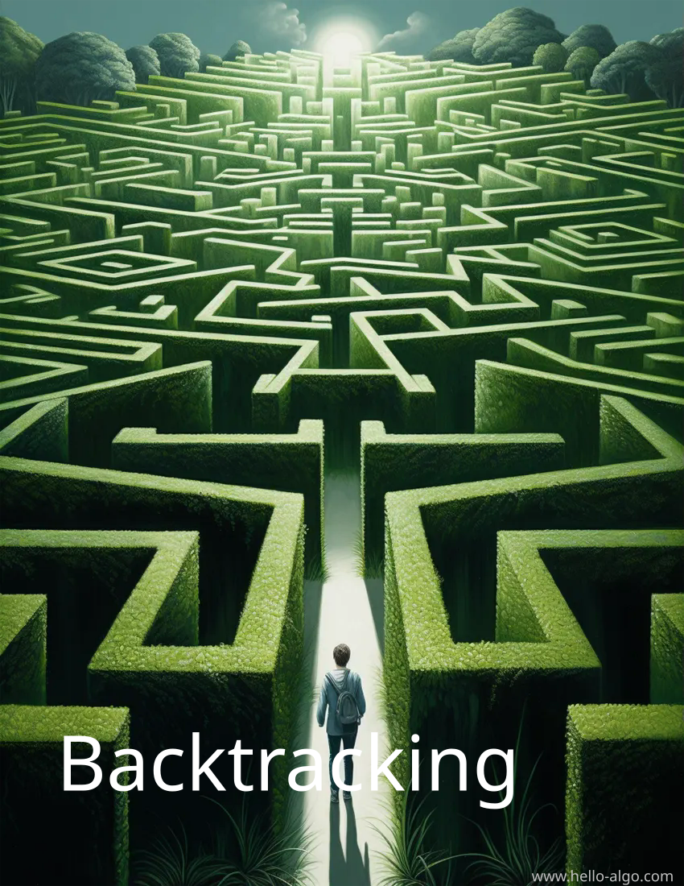

# Chapter 13. &nbsp; Backtracking

{ class="cover-image" }

!!! abstract

    Like explorers in a maze, we may meet obstacles along the way.
    
    Backtracking lets us retrace our steps and try again until we find the way out into the light.

## In this chapter

- [13.1 &nbsp; Backtracking](backtracking_algorithm.md)
- [13.2 &nbsp; The permutations problem](permutations_problem.md)
- [13.3 &nbsp; The subset sum problem](subset_sum_problem.md)
- [13.4 &nbsp; The N-queens problem](n_queens_problem.md)
- [13.5 &nbsp; Summary](summary.md)
- [13.6 &nbsp; Exercises](exercises.md)
