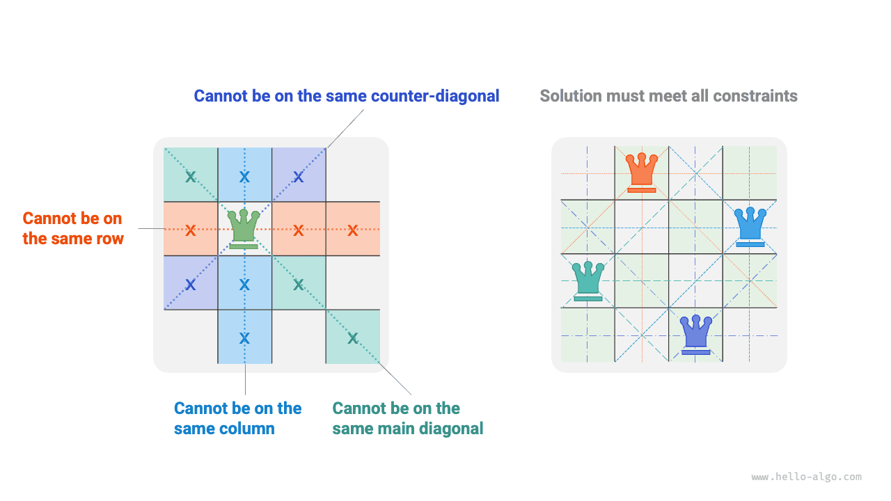
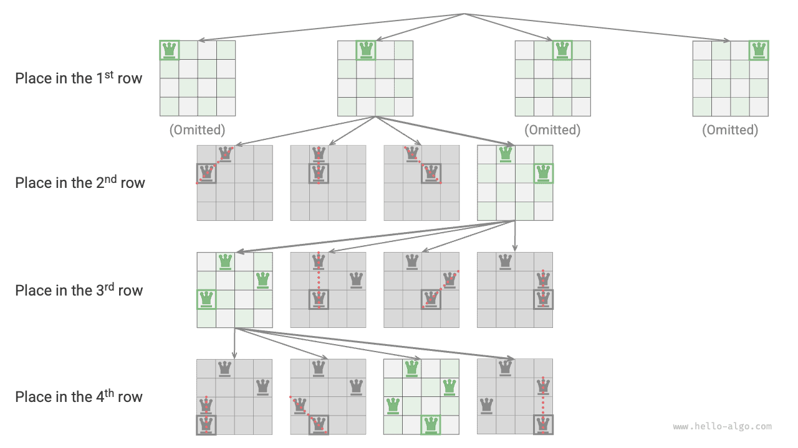

# N-queens problem

!!! question

    In chess, a queen can attack any piece in the same row, column, or diagonal. Given $n$ queens and an $n \times n$ chessboard, find all arrangements in which no two queens can attack each other.

As shown in the figure below, there are two solutions when $n = 4$. From a backtracking perspective, the $n \times n$ board has $n^2$ squares, which provide all possible `choices`. As we place queens one by one, the board changes; its arrangement at any moment is the current `state`.


The figure below shows the three constraints: **no two queens may share a row, column, or diagonal**. Diagonals run in two directions: the main-diagonal direction `\` and the antidiagonal direction `/`.



### Placing queens row by row

There are as many queens as rows, namely $n$, so we can immediately conclude that **each row must contain exactly one queen**.

We can therefore place queens row by row: start at the first row and place one queen in each row through the last.

The figure below illustrates this process for 4 queens. To fit the illustration, only one branch from the first row is expanded, and all arrangements violating the column or diagonal constraints are pruned.



In essence, **placing queens row by row is itself a form of pruning**: it eliminates every search branch that places multiple queens in the same row.

### Pruning by columns and diagonals

To enforce the column constraint, use a Boolean array `cols` of length $n$ to record whether each column contains a queen. Before placing a queen, consult `cols` to prune columns already occupied, and update `cols` as the search proceeds and backtracks.

!!! tip

    The matrix starts at its top-left corner. Row indices increase downward, and column indices increase to the right.

How do we enforce the diagonal constraints? Let $(row, col)$ be the row and column indices of a square. Along any diagonal in the main-diagonal direction, the row index minus the column index is the same: **$row - col$ is constant along that diagonal**.

Thus, if two squares satisfy $row_1 - col_1 = row_2 - col_2$, they lie on the same main-direction diagonal. Using this property, the array `diags1` in the figure below records whether each such diagonal contains a queen.

Similarly, **$row + col$ is constant along each antidiagonal**. We can use an array `diags2` to enforce the antidiagonal constraint.


### Code implementation

In a square matrix of order $n$, $row - col$ ranges over $[-n + 1, n - 1]$, and $row + col$ ranges over $[0, 2n - 2]$. There are therefore $2n - 1$ diagonals in each direction, so both `diags1` and `diags2` have length $2n - 1$.

```src
[file]{n_queens}-[class]{}-[func]{n_queens}
```

We place a queen in each of $n$ rows. Considering the column constraint, the successive rows have $n$, $n-1$, $\dots$, $2$, and $1$ choices, giving $O(n!)$ time. Recording a solution requires copying the matrix `state` and appending the copy to `res`, which takes $O(n^2)$ time. **The overall time complexity is therefore $O(n! \cdot n^2)$**. In practice, diagonal pruning greatly reduces the search space, so the search is often faster than this bound suggests.

The array `state` uses $O(n^2)$ space, while `cols`, `diags1`, and `diags2` each use $O(n)$ space. The maximum recursion depth is $n$, requiring $O(n)$ space for stack frames. **The space complexity is therefore $O(n^2)$**.
