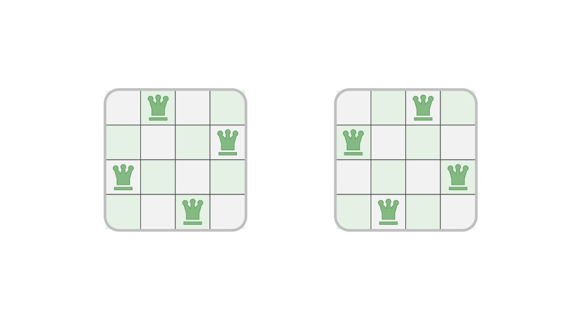
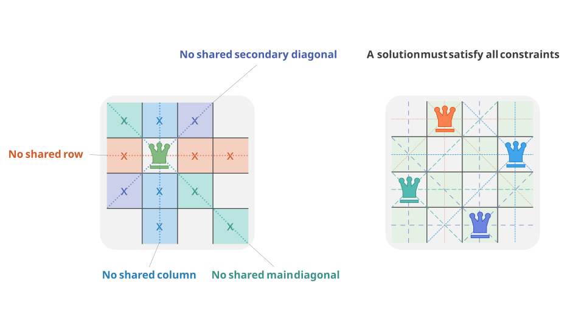
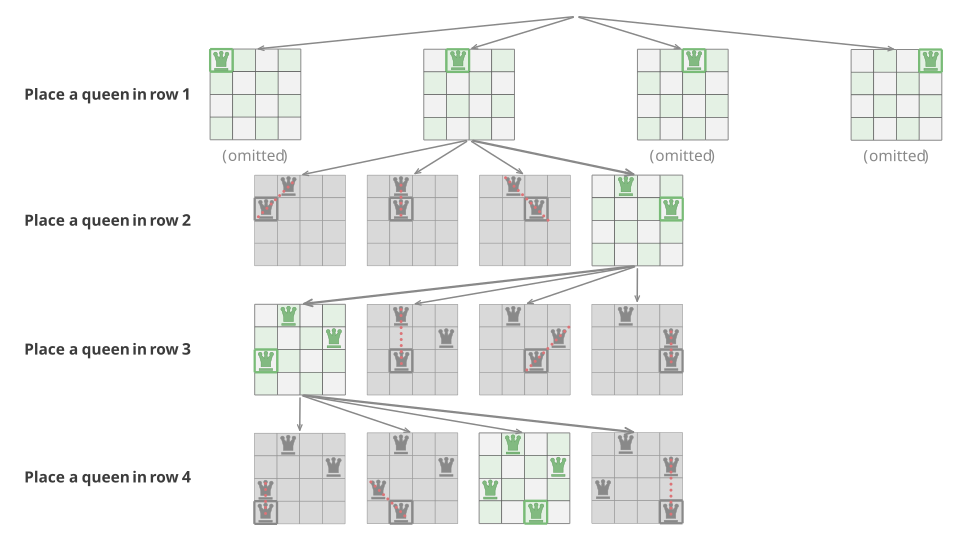
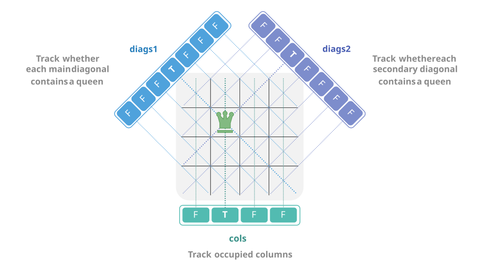

# The n-queens problem

!!! question

    In chess, a queen can attack a piece in the same row, column, or diagonal. Given $n$ queens and an $n \times n$ board, find the arrangements in which no two queens attack each other.

As the figure shows, there are two solutions when $n = 4$. In a backtracking search, the $n^2$ squares of the $n \times n$ board constitute the possible choices `choices`. As we place one queen after another, the board changes. Its arrangement at any point is the current state `state`.



The figure illustrates three constraints: **no two queens may share a row, a column, or a diagonal**. Diagonals run in two directions: main diagonals `\` and secondary diagonals `/`.



### Placing queens row by row

Both the number of queens and the number of rows equal $n$. It follows that **each row must contain exactly one queen**.

We can therefore place queens row by row, starting at the first row and placing one queen in each row through the last.

The figure shows row-by-row placement for four queens. To save space, it expands just one branch from the first row. Branches that violate a column or diagonal constraint have been pruned.



In effect, **placing queens row by row prunes the search** by excluding every branch that would place multiple queens in one row.

### Pruning by column and diagonal

To enforce the column constraint, use a Boolean array `cols` of length $n$ to track which columns already contain queens. Before placing a queen, consult `cols` to skip occupied columns. Update `cols` as the search proceeds and backtracks.

!!! tip

    The matrix starts in the upper-left corner. Row indices increase downward and column indices increase to the right.

How can we enforce the diagonal constraints? Let $(row, col)$ be the row and column indices of a square. Along any main diagonal, subtracting the column index from the row index always gives the same result: **the value of $row - col$ is constant along a main diagonal**.

Thus, if two squares satisfy $row_1 - col_1 = row_2 - col_2$, they lie on the same main diagonal. We can use this property to track which main diagonals contain queens in the array `diags1`, as shown below.

Similarly, **the value of $row + col$ is constant along a secondary diagonal**. The array `diags2` lets us enforce this constraint as well.



### Implementation

In a square matrix with $n$ rows, $row - col$ ranges over $[-n + 1, n - 1]$, and $row + col$ ranges over $[0, 2n - 2]$. There are therefore $2n - 1$ diagonals in each direction, so `diags1` and `diags2` each have length $2n - 1$.

```src
[file]{n_queens}-[class]{}-[func]{n_queens}
```

We make $n$ placements, one per row. The column constraint leaves $n$, $n-1$, $\dots$, $2$, and $1$ choices in successive rows, taking $O(n!)$ time. To record a solution, we copy the matrix `state` into `res`. Each copy takes $O(n^2)$ time, giving an **overall time complexity of $O(n! \cdot n^2)$**. In practice, diagonal pruning can shrink the search space considerably, so the search often runs faster than this bound suggests.

The array `state` takes $O(n^2)$ space, while `cols`, `diags1`, and `diags2` each take $O(n)$ space. The maximum recursion depth is $n$, requiring $O(n)$ space for stack frames. The **space complexity is therefore $O(n^2)$**.
