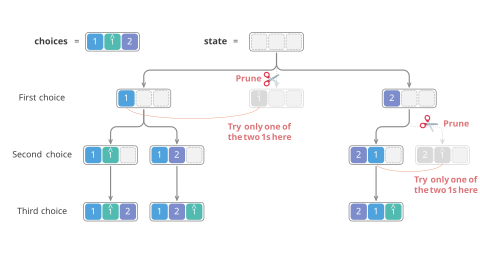
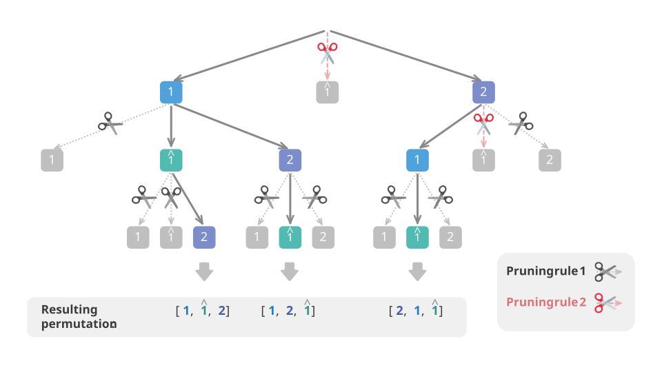

# The permutations problem

Generating permutations is a classic application of backtracking. Given a collection such as an array or a string, find all possible orderings of its elements.

The table shows several input arrays and all their permutations.

<p align="center"> Table <id> &nbsp; Examples of permutations </p>

| Input array    | All permutations                                                           |
| :---------- | :----------------------------------------------------------------- |
| $[1]$       | $[1]$                                                              |
| $[1, 2]$    | $[1, 2], [2, 1]$                                                   |
| $[1, 2, 3]$ | $[1, 2, 3], [1, 3, 2], [2, 1, 3], [2, 3, 1], [3, 1, 2], [3, 2, 1]$ |

## Distinct elements

!!! question

    Given an integer array with no duplicate elements, return all possible permutations.

In backtracking, **each permutation is the result of a sequence of choices**. For the input array $[1, 2, 3]$, choosing $1$ first, $3$ next, and $2$ last gives the permutation $[1, 3, 2]$. Backtracking undoes a choice so we can try another.

In the code, the candidates `choices` are all the elements of the input array, and the state `state` contains the elements chosen so far. Each element may be chosen only once, so **all elements in `state` must be distinct**.

We can unfold the search into a recursion tree, as shown below. Each node represents the current state `state`. Starting at the root, three rounds of choices take us to a leaf, and each leaf corresponds to one permutation.


### Pruning repeated choices

To choose each element only once, use a Boolean array `selected`. Its entry `selected[i]` indicates whether `choices[i]` has already been chosen. We can then prune as follows.

- After choosing `choices[i]`, set `selected[i]` to $\text{True}$ to mark it as used.
- While iterating through `choices`, skip any element already chosen, pruning its branch.

Suppose we choose 1 first, 3 second, and 2 third, as shown below. In the second round, prune the branch for 1. In the third round, prune the branches for both 1 and 3.


As the figure shows, pruning reduces the size of the search space from $O(n^n)$ to $O(n!)$.

### Implementation

We can now fill in the backtracking framework. To keep the code short, we put its operations directly in `backtrack()` instead of defining each as a separate function:

```src
[file]{permutations_i}-[class]{}-[func]{permutations_i}
```

## Repeated values

!!! question

    Given an integer array **that may contain duplicate values**, return all distinct permutations.

Suppose the input is $[1, 1, 2]$. To distinguish the two copies of $1$, we write the second $1$ as $\hat{1}$.

As the figure shows, half the permutations generated by our previous method are duplicates.


How can we eliminate duplicate permutations? One straightforward approach is to deduplicate the results with a hash set. But **branches that generate duplicate permutations do unnecessary work. We can identify and prune them early** to improve efficiency.

### Pruning equal values

In the figure below, choosing $1$ or $\hat{1}$ in the first round produces exactly the same permutations. We can therefore prune $\hat{1}$.

Similarly, after choosing $2$ in the first round, choosing $1$ or $\hat{1}$ in the second round produces duplicate branches, so prune $\hat{1}$ in that round as well.

Our goal is to **try only one of several equal elements in any given round**.



### Implementation

Extend the previous implementation with a fresh hash set `duplicated` in each round. Use it to track the values already tried in that round and prune duplicates:

```src
[file]{permutations_ii}-[class]{}-[func]{permutations_ii}
```

Assuming distinct values, $n$ elements have $n!$ permutations (factorial). Recording each result requires copying a list of length $n$, which takes $O(n)$ time. **The time complexity is therefore $O(n!n)$**.

The maximum recursion depth is $n$, so stack frames take $O(n)$ space. The array `selected` takes $O(n)$ space. At most $n$ instances of `duplicated` coexist, using $O(n^2)$ space. **The space complexity is therefore $O(n^2)$**.

### Comparing the two pruning rules

Both `selected` and `duplicated` help prune the search, but they serve different purposes.

- **Pruning repeated choices**: The entire search shares one `selected`. It tracks the elements in the current state and prevents the same element from appearing twice in `state`.
- **Pruning equal values**: Each round (each call to `backtrack`) has its own `duplicated`. It tracks values already tried in that round’s `for` loop, so equal elements are tried only once.

The figure shows where each pruning rule applies. Each node represents a choice, and the choices along a path from the root to a leaf form a permutation.


