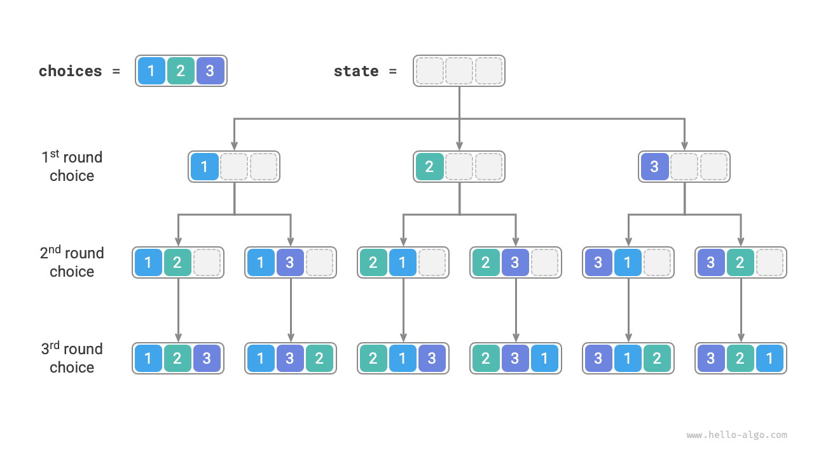
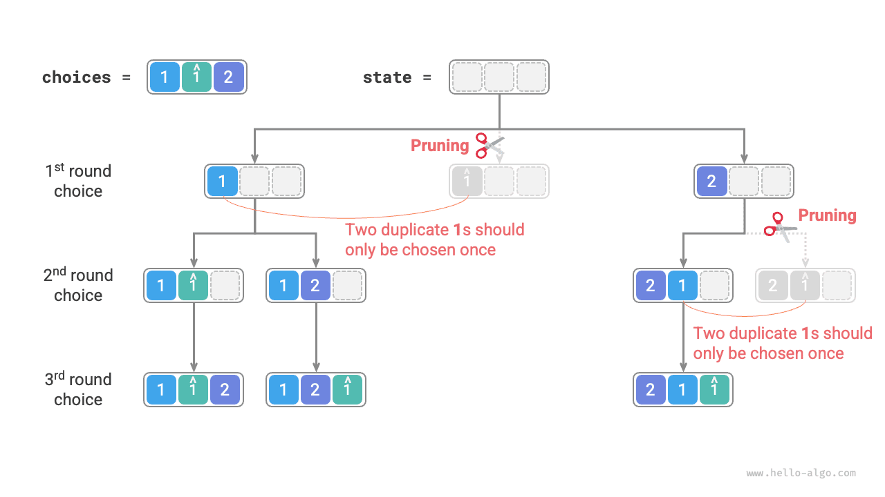

# 13.2 &nbsp; Permutations problem

Generating permutations is a classic application of backtracking. Given a collection, such as an array or a string, the task is to find every possible ordering of its elements.

Table 13-2 gives several input arrays and all their permutations.

<p align="center"> Table 13-2 &nbsp; Examples of permutations </p>

<div class="center-table" markdown>

| Input array    | All permutations                                                           |
| :---------- | :----------------------------------------------------------------- |
| $[1]$       | $[1]$                                                              |
| $[1, 2]$    | $[1, 2], [2, 1]$                                                   |
| $[1, 2, 3]$ | $[1, 2, 3], [1, 3, 2], [2, 1, 3], [2, 3, 1], [3, 1, 2], [3, 2, 1]$ |

</div>

## 13.2.1 &nbsp; Distinct elements

!!! question

    Given an integer array with no duplicate elements, return all possible permutations.

From a backtracking perspective, **we can view a permutation as the result of a sequence of choices**. For input $[1, 2, 3]$, choosing $1$, then $3$, then $2$ produces $[1, 3, 2]$. Backtracking undoes a choice so that other choices can be tried.

In the code, `choices` contains all the input elements, and `state` contains the elements chosen so far. Each element may be chosen only once, **so every element in `state` must be unique**.

As shown in Figure 13-5, we can expand the search into a recursion tree, where each node represents the current `state`. Starting from the root, three rounds of choices lead to a leaf, and each leaf corresponds to one permutation.

{ class="animation-figure" }

<p align="center"> Figure 13-5 &nbsp; Recursion tree for permutations </p>

### 1. &nbsp; Pruning repeated selections

To ensure that each element is chosen only once, introduce a Boolean array `selected`, where `selected[i]` indicates whether `choices[i]` has been chosen. Use it for the following pruning steps.

- After choosing `choices[i]`, set `selected[i]` to $\text{True}$ to mark it as selected.
- When iterating over `choices`, skip all selected elements, pruning their branches.

As shown in Figure 13-6, if we choose 1 first, 3 second, and 2 third, we must prune the branch for 1 in the second round and the branches for 1 and 3 in the third round.

{ class="animation-figure" }

<p align="center"> Figure 13-6 &nbsp; Example of pruning permutations </p>

This pruning reduces the search space from $O(n^n)$ to $O(n!)$.

### 2. &nbsp; Code implementation

With these details established, we can fill in the backtracking template. To keep the code short, we inline the template's helper functions into `backtrack()`:

=== "Python"

    ```python title="permutations_i.py"
    def backtrack(
        state: list[int], choices: list[int], selected: list[bool], res: list[list[int]]
    ):
        """Backtracking: permutations I"""
        # Record a solution when the state length equals the number of elements
        if len(state) == len(choices):
            res.append(list(state))
            return
        # Iterate over all choices
        for i, choice in enumerate(choices):
            # Prune: do not choose an element more than once
            if not selected[i]:
                # Try: make a choice and update the state
                selected[i] = True
                state.append(choice)
                # Proceed to the next choice
                backtrack(state, choices, selected, res)
                # Backtrack: undo the choice and restore the previous state
                selected[i] = False
                state.pop()

    def permutations_i(nums: list[int]) -> list[list[int]]:
        """Permutations I"""
        res = []
        backtrack(state=[], choices=nums, selected=[False] * len(nums), res=res)
        return res
    ```

=== "C++"

    ```cpp title="permutations_i.cpp"
    /* Backtracking: permutations I */
    void backtrack(vector<int> &state, const vector<int> &choices, vector<bool> &selected, vector<vector<int>> &res) {
        // Record a solution when the state length equals the number of elements
        if (state.size() == choices.size()) {
            res.push_back(state);
            return;
        }
        // Iterate over all choices
        for (int i = 0; i < choices.size(); i++) {
            int choice = choices[i];
            // Prune: do not choose an element more than once
            if (!selected[i]) {
                // Try: make a choice and update the state
                selected[i] = true;
                state.push_back(choice);
                // Proceed to the next choice
                backtrack(state, choices, selected, res);
                // Backtrack: undo the choice and restore the previous state
                selected[i] = false;
                state.pop_back();
            }
        }
    }

    /* Permutations I */
    vector<vector<int>> permutationsI(vector<int> nums) {
        vector<int> state;
        vector<bool> selected(nums.size(), false);
        vector<vector<int>> res;
        backtrack(state, nums, selected, res);
        return res;
    }
    ```

=== "Java"

    ```java title="permutations_i.java"
    /* Backtracking: permutations I */
    void backtrack(List<Integer> state, int[] choices, boolean[] selected, List<List<Integer>> res) {
        // Record a solution when the state length equals the number of elements
        if (state.size() == choices.length) {
            res.add(new ArrayList<Integer>(state));
            return;
        }
        // Iterate over all choices
        for (int i = 0; i < choices.length; i++) {
            int choice = choices[i];
            // Prune: do not choose an element more than once
            if (!selected[i]) {
                // Try: make a choice and update the state
                selected[i] = true;
                state.add(choice);
                // Proceed to the next choice
                backtrack(state, choices, selected, res);
                // Backtrack: undo the choice and restore the previous state
                selected[i] = false;
                state.remove(state.size() - 1);
            }
        }
    }

    /* Permutations I */
    List<List<Integer>> permutationsI(int[] nums) {
        List<List<Integer>> res = new ArrayList<List<Integer>>();
        backtrack(new ArrayList<Integer>(), nums, new boolean[nums.length], res);
        return res;
    }
    ```

=== "C#"

    ```csharp title="permutations_i.cs"
    /* Backtracking: permutations I */
    void Backtrack(List<int> state, int[] choices, bool[] selected, List<List<int>> res) {
        // Record a solution when the state length equals the number of elements
        if (state.Count == choices.Length) {
            res.Add(new List<int>(state));
            return;
        }
        // Iterate over all choices
        for (int i = 0; i < choices.Length; i++) {
            int choice = choices[i];
            // Prune: do not choose an element more than once
            if (!selected[i]) {
                // Try: make a choice and update the state
                selected[i] = true;
                state.Add(choice);
                // Proceed to the next choice
                Backtrack(state, choices, selected, res);
                // Backtrack: undo the choice and restore the previous state
                selected[i] = false;
                state.RemoveAt(state.Count - 1);
            }
        }
    }

    /* Permutations I */
    List<List<int>> PermutationsI(int[] nums) {
        List<List<int>> res = [];
        Backtrack([], nums, new bool[nums.Length], res);
        return res;
    }
    ```

=== "Go"

    ```go title="permutations_i.go"
    /* Backtracking: permutations I */
    func backtrackI(state *[]int, choices *[]int, selected *[]bool, res *[][]int) {
        // Record a solution when the state length equals the number of elements
        if len(*state) == len(*choices) {
            newState := append([]int{}, *state...)
            *res = append(*res, newState)
        }
        // Iterate over all choices
        for i := 0; i < len(*choices); i++ {
            choice := (*choices)[i]
            // Prune: do not choose an element more than once
            if !(*selected)[i] {
                // Try: make a choice and update the state
                (*selected)[i] = true
                *state = append(*state, choice)
                // Proceed to the next choice
                backtrackI(state, choices, selected, res)
                // Backtrack: undo the choice and restore the previous state
                (*selected)[i] = false
                *state = (*state)[:len(*state)-1]
            }
        }
    }

    /* Permutations I */
    func permutationsI(nums []int) [][]int {
        res := make([][]int, 0)
        state := make([]int, 0)
        selected := make([]bool, len(nums))
        backtrackI(&state, &nums, &selected, &res)
        return res
    }
    ```

=== "Swift"

    ```swift title="permutations_i.swift"
    /* Backtracking: permutations I */
    func backtrack(state: inout [Int], choices: [Int], selected: inout [Bool], res: inout [[Int]]) {
        // Record a solution when the state length equals the number of elements
        if state.count == choices.count {
            res.append(state)
            return
        }
        // Iterate over all choices
        for (i, choice) in choices.enumerated() {
            // Prune: do not choose an element more than once
            if !selected[i] {
                // Try: make a choice and update the state
                selected[i] = true
                state.append(choice)
                // Proceed to the next choice
                backtrack(state: &state, choices: choices, selected: &selected, res: &res)
                // Backtrack: undo the choice and restore the previous state
                selected[i] = false
                state.removeLast()
            }
        }
    }

    /* Permutations I */
    func permutationsI(nums: [Int]) -> [[Int]] {
        var state: [Int] = []
        var selected = Array(repeating: false, count: nums.count)
        var res: [[Int]] = []
        backtrack(state: &state, choices: nums, selected: &selected, res: &res)
        return res
    }
    ```

=== "JS"

    ```javascript title="permutations_i.js"
    /* Backtracking: permutations I */
    function backtrack(state, choices, selected, res) {
        // Record a solution when the state length equals the number of elements
        if (state.length === choices.length) {
            res.push([...state]);
            return;
        }
        // Iterate over all choices
        choices.forEach((choice, i) => {
            // Prune: do not choose an element more than once
            if (!selected[i]) {
                // Try: make a choice and update the state
                selected[i] = true;
                state.push(choice);
                // Proceed to the next choice
                backtrack(state, choices, selected, res);
                // Backtrack: undo the choice and restore the previous state
                selected[i] = false;
                state.pop();
            }
        });
    }

    /* Permutations I */
    function permutationsI(nums) {
        const res = [];
        backtrack([], nums, Array(nums.length).fill(false), res);
        return res;
    }
    ```

=== "TS"

    ```typescript title="permutations_i.ts"
    /* Backtracking: permutations I */
    function backtrack(
        state: number[],
        choices: number[],
        selected: boolean[],
        res: number[][]
    ): void {
        // Record a solution when the state length equals the number of elements
        if (state.length === choices.length) {
            res.push([...state]);
            return;
        }
        // Iterate over all choices
        choices.forEach((choice, i) => {
            // Prune: do not choose an element more than once
            if (!selected[i]) {
                // Try: make a choice and update the state
                selected[i] = true;
                state.push(choice);
                // Proceed to the next choice
                backtrack(state, choices, selected, res);
                // Backtrack: undo the choice and restore the previous state
                selected[i] = false;
                state.pop();
            }
        });
    }

    /* Permutations I */
    function permutationsI(nums: number[]): number[][] {
        const res: number[][] = [];
        backtrack([], nums, Array(nums.length).fill(false), res);
        return res;
    }
    ```

=== "Dart"

    ```dart title="permutations_i.dart"
    /* Backtracking: permutations I */
    void backtrack(
      List<int> state,
      List<int> choices,
      List<bool> selected,
      List<List<int>> res,
    ) {
      // Record a solution when the state length equals the number of elements
      if (state.length == choices.length) {
        res.add(List.from(state));
        return;
      }
      // Iterate over all choices
      for (int i = 0; i < choices.length; i++) {
        int choice = choices[i];
        // Prune: do not choose an element more than once
        if (!selected[i]) {
          // Try: make a choice and update the state
          selected[i] = true;
          state.add(choice);
          // Proceed to the next choice
          backtrack(state, choices, selected, res);
          // Backtrack: undo the choice and restore the previous state
          selected[i] = false;
          state.removeLast();
        }
      }
    }

    /* Permutations I */
    List<List<int>> permutationsI(List<int> nums) {
      List<List<int>> res = [];
      backtrack([], nums, List.filled(nums.length, false), res);
      return res;
    }
    ```

=== "Rust"

    ```rust title="permutations_i.rs"
    /* Backtracking: permutations I */
    fn backtrack(mut state: Vec<i32>, choices: &[i32], selected: &mut [bool], res: &mut Vec<Vec<i32>>) {
        // Record a solution when the state length equals the number of elements
        if state.len() == choices.len() {
            res.push(state);
            return;
        }
        // Iterate over all choices
        for i in 0..choices.len() {
            let choice = choices[i];
            // Prune: do not choose an element more than once
            if !selected[i] {
                // Try: make a choice and update the state
                selected[i] = true;
                state.push(choice);
                // Proceed to the next choice
                backtrack(state.clone(), choices, selected, res);
                // Backtrack: undo the choice and restore the previous state
                selected[i] = false;
                state.pop();
            }
        }
    }

    /* Permutations I */
    fn permutations_i(nums: &mut [i32]) -> Vec<Vec<i32>> {
        let mut res = Vec::new(); // Result list (permutations)
        backtrack(Vec::new(), nums, &mut vec![false; nums.len()], &mut res);
        res
    }
    ```

=== "C"

    ```c title="permutations_i.c"
    /* Backtracking: permutations I */
    void backtrack(int *state, int stateSize, int *choices, int choicesSize, bool *selected, int **res, int *resSize) {
        // Record a solution when the state length equals the number of elements
        if (stateSize == choicesSize) {
            res[*resSize] = (int *)malloc(choicesSize * sizeof(int));
            for (int i = 0; i < choicesSize; i++) {
                res[*resSize][i] = state[i];
            }
            (*resSize)++;
            return;
        }
        // Iterate over all choices
        for (int i = 0; i < choicesSize; i++) {
            int choice = choices[i];
            // Prune: do not choose an element more than once
            if (!selected[i]) {
                // Try: make a choice and update the state
                selected[i] = true;
                state[stateSize] = choice;
                // Proceed to the next choice
                backtrack(state, stateSize + 1, choices, choicesSize, selected, res, resSize);
                // Backtrack: undo the choice and restore the previous state
                selected[i] = false;
            }
        }
    }

    /* Permutations I */
    int **permutationsI(int *nums, int numsSize, int *returnSize) {
        int *state = (int *)malloc(numsSize * sizeof(int));
        bool *selected = (bool *)malloc(numsSize * sizeof(bool));
        for (int i = 0; i < numsSize; i++) {
            selected[i] = false;
        }
        int **res = (int **)malloc(MAX_SIZE * sizeof(int *));
        *returnSize = 0;

        backtrack(state, 0, nums, numsSize, selected, res, returnSize);

        free(state);
        free(selected);

        return res;
    }
    ```

=== "Kotlin"

    ```kotlin title="permutations_i.kt"
    /* Backtracking: permutations I */
    fun backtrack(
        state: MutableList<Int>,
        choices: IntArray,
        selected: BooleanArray,
        res: MutableList<MutableList<Int>?>
    ) {
        // Record a solution when the state length equals the number of elements
        if (state.size == choices.size) {
            res.add(state.toMutableList())
            return
        }
        // Iterate over all choices
        for (i in choices.indices) {
            val choice = choices[i]
            // Prune: do not choose an element more than once
            if (!selected[i]) {
                // Try: make a choice and update the state
                selected[i] = true
                state.add(choice)
                // Proceed to the next choice
                backtrack(state, choices, selected, res)
                // Backtrack: undo the choice and restore the previous state
                selected[i] = false
                state.removeAt(state.size - 1)
            }
        }
    }

    /* Permutations I */
    fun permutationsI(nums: IntArray): MutableList<MutableList<Int>?> {
        val res = mutableListOf<MutableList<Int>?>()
        backtrack(mutableListOf(), nums, BooleanArray(nums.size), res)
        return res
    }
    ```

=== "Ruby"

    ```ruby title="permutations_i.rb"
    ### Backtracking: permutations I ###
    def backtrack(state, choices, selected, res)
      # Record a solution when the state length equals the number of elements
      if state.length == choices.length
        res << state.dup
        return
      end

      # Iterate over all choices
      choices.each_with_index do |choice, i|
        # Prune: do not choose an element more than once
        unless selected[i]
          # Try: make a choice and update the state
          selected[i] = true
          state << choice
          # Proceed to the next choice
          backtrack(state, choices, selected, res)
          # Backtrack: undo the choice and restore the previous state
          selected[i] = false
          state.pop
        end
      end
    end

    ### Permutations I ###
    def permutations_i(nums)
      res = []
      backtrack([], nums, Array.new(nums.length, false), res)
      res
    end
    ```

??? pythontutor "Visualize execution"

    <div style="height: 549px; width: 100%;"><iframe class="pythontutor-iframe" title="Visualize execution" src="https://pythontutor.com/iframe-embed.html#code=def%20backtrack%28%0A%20%20%20%20state%3A%20list%5Bint%5D,%20choices%3A%20list%5Bint%5D,%20selected%3A%20list%5Bbool%5D,%20res%3A%20list%5Blist%5Bint%5D%5D%0A%29%3A%0A%20%20%20%20%22%22%22Backtracking%3A%20permutations%20I%22%22%22%0A%20%20%20%20%23%20Record%20a%20solution%20when%20the%20state%20length%20equals%20the%20number%20of%20elements%0A%20%20%20%20if%20len%28state%29%20%3D%3D%20len%28choices%29%3A%0A%20%20%20%20%20%20%20%20res.append%28list%28state%29%29%0A%20%20%20%20%20%20%20%20return%0A%20%20%20%20%23%20Iterate%20over%20all%20choices%0A%20%20%20%20for%20i,%20choice%20in%20enumerate%28choices%29%3A%0A%20%20%20%20%20%20%20%20%23%20Prune%3A%20do%20not%20choose%20an%20element%20more%20than%20once%0A%20%20%20%20%20%20%20%20if%20not%20selected%5Bi%5D%3A%0A%20%20%20%20%20%20%20%20%20%20%20%20%23%20Try%3A%20make%20a%20choice%20and%20update%20the%20state%0A%20%20%20%20%20%20%20%20%20%20%20%20selected%5Bi%5D%20%3D%20True%0A%20%20%20%20%20%20%20%20%20%20%20%20state.append%28choice%29%0A%20%20%20%20%20%20%20%20%20%20%20%20%23%20Proceed%20to%20the%20next%20choice%0A%20%20%20%20%20%20%20%20%20%20%20%20backtrack%28state,%20choices,%20selected,%20res%29%0A%20%20%20%20%20%20%20%20%20%20%20%20%23%20Backtrack%3A%20undo%20the%20choice%20and%20restore%20the%20previous%20state%0A%20%20%20%20%20%20%20%20%20%20%20%20selected%5Bi%5D%20%3D%20False%0A%20%20%20%20%20%20%20%20%20%20%20%20state.pop%28%29%0A%0A%0Adef%20permutations_i%28nums%3A%20list%5Bint%5D%29%20-%3E%20list%5Blist%5Bint%5D%5D%3A%0A%20%20%20%20%22%22%22Permutations%20I%22%22%22%0A%20%20%20%20res%20%3D%20%5B%5D%0A%20%20%20%20backtrack%28state%3D%5B%5D,%20choices%3Dnums,%20selected%3D%5BFalse%5D%20%2A%20len%28nums%29,%20res%3Dres%29%0A%20%20%20%20return%20res%0A%0A%0A%22%22%22Driver%20code%22%22%22%0Aif%20__name__%20%3D%3D%20%22__main__%22%3A%0A%20%20%20%20nums%20%3D%20%5B1,%202,%203%5D%0A%0A%20%20%20%20res%20%3D%20permutations_i%28nums%29%0A%0A%20%20%20%20print%28f%22Input%20array%20nums%20%3D%20%7Bnums%7D%22%29%0A%20%20%20%20print%28f%22All%20permutations%3A%20res%20%3D%20%7Bres%7D%22%29&codeDivHeight=472&codeDivWidth=350&cumulative=false&curInstr=13&heapPrimitives=nevernest&origin=opt-frontend.js&py=311&rawInputLstJSON=%5B%5D&textReferences=false"> </iframe></div>
    <div style="margin-top: 5px;"><a href="https://pythontutor.com/iframe-embed.html#code=def%20backtrack%28%0A%20%20%20%20state%3A%20list%5Bint%5D,%20choices%3A%20list%5Bint%5D,%20selected%3A%20list%5Bbool%5D,%20res%3A%20list%5Blist%5Bint%5D%5D%0A%29%3A%0A%20%20%20%20%22%22%22Backtracking%3A%20permutations%20I%22%22%22%0A%20%20%20%20%23%20Record%20a%20solution%20when%20the%20state%20length%20equals%20the%20number%20of%20elements%0A%20%20%20%20if%20len%28state%29%20%3D%3D%20len%28choices%29%3A%0A%20%20%20%20%20%20%20%20res.append%28list%28state%29%29%0A%20%20%20%20%20%20%20%20return%0A%20%20%20%20%23%20Iterate%20over%20all%20choices%0A%20%20%20%20for%20i,%20choice%20in%20enumerate%28choices%29%3A%0A%20%20%20%20%20%20%20%20%23%20Prune%3A%20do%20not%20choose%20an%20element%20more%20than%20once%0A%20%20%20%20%20%20%20%20if%20not%20selected%5Bi%5D%3A%0A%20%20%20%20%20%20%20%20%20%20%20%20%23%20Try%3A%20make%20a%20choice%20and%20update%20the%20state%0A%20%20%20%20%20%20%20%20%20%20%20%20selected%5Bi%5D%20%3D%20True%0A%20%20%20%20%20%20%20%20%20%20%20%20state.append%28choice%29%0A%20%20%20%20%20%20%20%20%20%20%20%20%23%20Proceed%20to%20the%20next%20choice%0A%20%20%20%20%20%20%20%20%20%20%20%20backtrack%28state,%20choices,%20selected,%20res%29%0A%20%20%20%20%20%20%20%20%20%20%20%20%23%20Backtrack%3A%20undo%20the%20choice%20and%20restore%20the%20previous%20state%0A%20%20%20%20%20%20%20%20%20%20%20%20selected%5Bi%5D%20%3D%20False%0A%20%20%20%20%20%20%20%20%20%20%20%20state.pop%28%29%0A%0A%0Adef%20permutations_i%28nums%3A%20list%5Bint%5D%29%20-%3E%20list%5Blist%5Bint%5D%5D%3A%0A%20%20%20%20%22%22%22Permutations%20I%22%22%22%0A%20%20%20%20res%20%3D%20%5B%5D%0A%20%20%20%20backtrack%28state%3D%5B%5D,%20choices%3Dnums,%20selected%3D%5BFalse%5D%20%2A%20len%28nums%29,%20res%3Dres%29%0A%20%20%20%20return%20res%0A%0A%0A%22%22%22Driver%20code%22%22%22%0Aif%20__name__%20%3D%3D%20%22__main__%22%3A%0A%20%20%20%20nums%20%3D%20%5B1,%202,%203%5D%0A%0A%20%20%20%20res%20%3D%20permutations_i%28nums%29%0A%0A%20%20%20%20print%28f%22Input%20array%20nums%20%3D%20%7Bnums%7D%22%29%0A%20%20%20%20print%28f%22All%20permutations%3A%20res%20%3D%20%7Bres%7D%22%29&codeDivHeight=800&codeDivWidth=600&cumulative=false&curInstr=13&heapPrimitives=nevernest&origin=opt-frontend.js&py=311&rawInputLstJSON=%5B%5D&textReferences=false" target="_blank" rel="noopener noreferrer">View full screen ></a></div>

## 13.2.2 &nbsp; Duplicate elements

!!! question

    Given an integer array that **may contain duplicate elements**, return all distinct permutations.

Suppose the input is $[1, 1, 2]$. To distinguish the two occurrences of $1$, denote the second $1$ by $\hat{1}$.

As shown in Figure 13-7, half the permutations generated by the previous method are duplicates.

{ class="animation-figure" }

<p align="center"> Figure 13-7 &nbsp; Duplicate permutations </p>

How can we remove these duplicates? A straightforward approach is to use a hash set to deduplicate the results. However, this is inelegant: **branches that generate duplicate permutations are unnecessary and should be identified and pruned in advance**, improving efficiency.

### 1. &nbsp; Pruning equal elements

In Figure 13-8, choosing $1$ or $\hat{1}$ in the first round is equivalent: every permutation produced under one choice is duplicated under the other. We should therefore prune $\hat{1}$.

Similarly, after choosing $2$ in the first round, choosing either $1$ or $\hat{1}$ in the second produces duplicate branches. Prune the second-round choice of $\hat{1}$ as well.

In essence, **within any one round of choices, we want to try only one of the elements with the same value**.

{ class="animation-figure" }

<p align="center"> Figure 13-8 &nbsp; Pruning duplicate permutations </p>

### 2. &nbsp; Code implementation

Building on the previous solution, create a hash set `duplicated` in each round to record the values already tried in that round and prune repeated values:

=== "Python"

    ```python title="permutations_ii.py"
    def backtrack(
        state: list[int], choices: list[int], selected: list[bool], res: list[list[int]]
    ):
        """Backtracking: permutations II"""
        # Record a solution when the state length equals the number of elements
        if len(state) == len(choices):
            res.append(list(state))
            return
        # Iterate over all choices
        duplicated = set[int]()
        for i, choice in enumerate(choices):
            # Prune: do not reuse an element or choose the same value again at this depth
            if not selected[i] and choice not in duplicated:
                # Try: make a choice and update the state
                duplicated.add(choice)  # Record the chosen value
                selected[i] = True
                state.append(choice)
                # Proceed to the next choice
                backtrack(state, choices, selected, res)
                # Backtrack: undo the choice and restore the previous state
                selected[i] = False
                state.pop()

    def permutations_ii(nums: list[int]) -> list[list[int]]:
        """Permutations II"""
        res = []
        backtrack(state=[], choices=nums, selected=[False] * len(nums), res=res)
        return res
    ```

=== "C++"

    ```cpp title="permutations_ii.cpp"
    /* Backtracking: permutations II */
    void backtrack(vector<int> &state, const vector<int> &choices, vector<bool> &selected, vector<vector<int>> &res) {
        // Record a solution when the state length equals the number of elements
        if (state.size() == choices.size()) {
            res.push_back(state);
            return;
        }
        // Iterate over all choices
        unordered_set<int> duplicated;
        for (int i = 0; i < choices.size(); i++) {
            int choice = choices[i];
            // Prune: do not reuse an element or choose the same value again at this depth
            if (!selected[i] && duplicated.find(choice) == duplicated.end()) {
                // Try: make a choice and update the state
                duplicated.emplace(choice); // Record the chosen value
                selected[i] = true;
                state.push_back(choice);
                // Proceed to the next choice
                backtrack(state, choices, selected, res);
                // Backtrack: undo the choice and restore the previous state
                selected[i] = false;
                state.pop_back();
            }
        }
    }

    /* Permutations II */
    vector<vector<int>> permutationsII(vector<int> nums) {
        vector<int> state;
        vector<bool> selected(nums.size(), false);
        vector<vector<int>> res;
        backtrack(state, nums, selected, res);
        return res;
    }
    ```

=== "Java"

    ```java title="permutations_ii.java"
    /* Backtracking: permutations II */
    void backtrack(List<Integer> state, int[] choices, boolean[] selected, List<List<Integer>> res) {
        // Record a solution when the state length equals the number of elements
        if (state.size() == choices.length) {
            res.add(new ArrayList<Integer>(state));
            return;
        }
        // Iterate over all choices
        Set<Integer> duplicated = new HashSet<Integer>();
        for (int i = 0; i < choices.length; i++) {
            int choice = choices[i];
            // Prune: do not reuse an element or choose the same value again at this depth
            if (!selected[i] && !duplicated.contains(choice)) {
                // Try: make a choice and update the state
                duplicated.add(choice); // Record the chosen value
                selected[i] = true;
                state.add(choice);
                // Proceed to the next choice
                backtrack(state, choices, selected, res);
                // Backtrack: undo the choice and restore the previous state
                selected[i] = false;
                state.remove(state.size() - 1);
            }
        }
    }

    /* Permutations II */
    List<List<Integer>> permutationsII(int[] nums) {
        List<List<Integer>> res = new ArrayList<List<Integer>>();
        backtrack(new ArrayList<Integer>(), nums, new boolean[nums.length], res);
        return res;
    }
    ```

=== "C#"

    ```csharp title="permutations_ii.cs"
    /* Backtracking: permutations II */
    void Backtrack(List<int> state, int[] choices, bool[] selected, List<List<int>> res) {
        // Record a solution when the state length equals the number of elements
        if (state.Count == choices.Length) {
            res.Add(new List<int>(state));
            return;
        }
        // Iterate over all choices
        HashSet<int> duplicated = [];
        for (int i = 0; i < choices.Length; i++) {
            int choice = choices[i];
            // Prune: do not reuse an element or choose the same value again at this depth
            if (!selected[i] && !duplicated.Contains(choice)) {
                // Try: make a choice and update the state
                duplicated.Add(choice); // Record the chosen value
                selected[i] = true;
                state.Add(choice);
                // Proceed to the next choice
                Backtrack(state, choices, selected, res);
                // Backtrack: undo the choice and restore the previous state
                selected[i] = false;
                state.RemoveAt(state.Count - 1);
            }
        }
    }

    /* Permutations II */
    List<List<int>> PermutationsII(int[] nums) {
        List<List<int>> res = [];
        Backtrack([], nums, new bool[nums.Length], res);
        return res;
    }
    ```

=== "Go"

    ```go title="permutations_ii.go"
    /* Backtracking: permutations II */
    func backtrackII(state *[]int, choices *[]int, selected *[]bool, res *[][]int) {
        // Record a solution when the state length equals the number of elements
        if len(*state) == len(*choices) {
            newState := append([]int{}, *state...)
            *res = append(*res, newState)
        }
        // Iterate over all choices
        duplicated := make(map[int]struct{}, 0)
        for i := 0; i < len(*choices); i++ {
            choice := (*choices)[i]
            // Prune: do not reuse an element or choose the same value again at this depth
            if _, ok := duplicated[choice]; !ok && !(*selected)[i] {
                // Try: make a choice and update the state
                // Record the chosen value
                duplicated[choice] = struct{}{}
                (*selected)[i] = true
                *state = append(*state, choice)
                // Proceed to the next choice
                backtrackII(state, choices, selected, res)
                // Backtrack: undo the choice and restore the previous state
                (*selected)[i] = false
                *state = (*state)[:len(*state)-1]
            }
        }
    }

    /* Permutations II */
    func permutationsII(nums []int) [][]int {
        res := make([][]int, 0)
        state := make([]int, 0)
        selected := make([]bool, len(nums))
        backtrackII(&state, &nums, &selected, &res)
        return res
    }
    ```

=== "Swift"

    ```swift title="permutations_ii.swift"
    /* Backtracking: permutations II */
    func backtrack(state: inout [Int], choices: [Int], selected: inout [Bool], res: inout [[Int]]) {
        // Record a solution when the state length equals the number of elements
        if state.count == choices.count {
            res.append(state)
            return
        }
        // Iterate over all choices
        var duplicated: Set<Int> = []
        for (i, choice) in choices.enumerated() {
            // Prune: do not reuse an element or choose the same value again at this depth
            if !selected[i], !duplicated.contains(choice) {
                // Try: make a choice and update the state
                duplicated.insert(choice) // Record the chosen value
                selected[i] = true
                state.append(choice)
                // Proceed to the next choice
                backtrack(state: &state, choices: choices, selected: &selected, res: &res)
                // Backtrack: undo the choice and restore the previous state
                selected[i] = false
                state.removeLast()
            }
        }
    }

    /* Permutations II */
    func permutationsII(nums: [Int]) -> [[Int]] {
        var state: [Int] = []
        var selected = Array(repeating: false, count: nums.count)
        var res: [[Int]] = []
        backtrack(state: &state, choices: nums, selected: &selected, res: &res)
        return res
    }
    ```

=== "JS"

    ```javascript title="permutations_ii.js"
    /* Backtracking: permutations II */
    function backtrack(state, choices, selected, res) {
        // Record a solution when the state length equals the number of elements
        if (state.length === choices.length) {
            res.push([...state]);
            return;
        }
        // Iterate over all choices
        const duplicated = new Set();
        choices.forEach((choice, i) => {
            // Prune: do not reuse an element or choose the same value again at this depth
            if (!selected[i] && !duplicated.has(choice)) {
                // Try: make a choice and update the state
                duplicated.add(choice); // Record the chosen value
                selected[i] = true;
                state.push(choice);
                // Proceed to the next choice
                backtrack(state, choices, selected, res);
                // Backtrack: undo the choice and restore the previous state
                selected[i] = false;
                state.pop();
            }
        });
    }

    /* Permutations II */
    function permutationsII(nums) {
        const res = [];
        backtrack([], nums, Array(nums.length).fill(false), res);
        return res;
    }
    ```

=== "TS"

    ```typescript title="permutations_ii.ts"
    /* Backtracking: permutations II */
    function backtrack(
        state: number[],
        choices: number[],
        selected: boolean[],
        res: number[][]
    ): void {
        // Record a solution when the state length equals the number of elements
        if (state.length === choices.length) {
            res.push([...state]);
            return;
        }
        // Iterate over all choices
        const duplicated = new Set();
        choices.forEach((choice, i) => {
            // Prune: do not reuse an element or choose the same value again at this depth
            if (!selected[i] && !duplicated.has(choice)) {
                // Try: make a choice and update the state
                duplicated.add(choice); // Record the chosen value
                selected[i] = true;
                state.push(choice);
                // Proceed to the next choice
                backtrack(state, choices, selected, res);
                // Backtrack: undo the choice and restore the previous state
                selected[i] = false;
                state.pop();
            }
        });
    }

    /* Permutations II */
    function permutationsII(nums: number[]): number[][] {
        const res: number[][] = [];
        backtrack([], nums, Array(nums.length).fill(false), res);
        return res;
    }
    ```

=== "Dart"

    ```dart title="permutations_ii.dart"
    /* Backtracking: permutations II */
    void backtrack(
      List<int> state,
      List<int> choices,
      List<bool> selected,
      List<List<int>> res,
    ) {
      // Record a solution when the state length equals the number of elements
      if (state.length == choices.length) {
        res.add(List.from(state));
        return;
      }
      // Iterate over all choices
      Set<int> duplicated = {};
      for (int i = 0; i < choices.length; i++) {
        int choice = choices[i];
        // Prune: do not reuse an element or choose the same value again at this depth
        if (!selected[i] && !duplicated.contains(choice)) {
          // Try: make a choice and update the state
          duplicated.add(choice); // Record the chosen value
          selected[i] = true;
          state.add(choice);
          // Proceed to the next choice
          backtrack(state, choices, selected, res);
          // Backtrack: undo the choice and restore the previous state
          selected[i] = false;
          state.removeLast();
        }
      }
    }

    /* Permutations II */
    List<List<int>> permutationsII(List<int> nums) {
      List<List<int>> res = [];
      backtrack([], nums, List.filled(nums.length, false), res);
      return res;
    }
    ```

=== "Rust"

    ```rust title="permutations_ii.rs"
    /* Backtracking: permutations II */
    fn backtrack(mut state: Vec<i32>, choices: &[i32], selected: &mut [bool], res: &mut Vec<Vec<i32>>) {
        // Record a solution when the state length equals the number of elements
        if state.len() == choices.len() {
            res.push(state);
            return;
        }
        // Iterate over all choices
        let mut duplicated = HashSet::<i32>::new();
        for i in 0..choices.len() {
            let choice = choices[i];
            // Prune: do not reuse an element or choose the same value again at this depth
            if !selected[i] && !duplicated.contains(&choice) {
                // Try: make a choice and update the state
                duplicated.insert(choice); // Record the chosen value
                selected[i] = true;
                state.push(choice);
                // Proceed to the next choice
                backtrack(state.clone(), choices, selected, res);
                // Backtrack: undo the choice and restore the previous state
                selected[i] = false;
                state.pop();
            }
        }
    }

    /* Permutations II */
    fn permutations_ii(nums: &mut [i32]) -> Vec<Vec<i32>> {
        let mut res = Vec::new();
        backtrack(Vec::new(), nums, &mut vec![false; nums.len()], &mut res);
        res
    }
    ```

=== "C"

    ```c title="permutations_ii.c"
    /* Backtracking: permutations II */
    void backtrack(int *state, int stateSize, int *choices, int choicesSize, bool *selected, int **res, int *resSize) {
        // Record a solution when the state length equals the number of elements
        if (stateSize == choicesSize) {
            res[*resSize] = (int *)malloc(choicesSize * sizeof(int));
            for (int i = 0; i < choicesSize; i++) {
                res[*resSize][i] = state[i];
            }
            (*resSize)++;
            return;
        }
        // Iterate over all choices
        bool duplicated[MAX_SIZE] = {false};
        for (int i = 0; i < choicesSize; i++) {
            int choice = choices[i];
            // Prune: do not reuse an element or choose the same value again at this depth
            if (!selected[i] && !duplicated[choice]) {
                // Try: make a choice and update the state
                duplicated[choice] = true; // Record the chosen value
                selected[i] = true;
                state[stateSize] = choice;
                // Proceed to the next choice
                backtrack(state, stateSize + 1, choices, choicesSize, selected, res, resSize);
                // Backtrack: undo the choice and restore the previous state
                selected[i] = false;
            }
        }
    }

    /* Permutations II */
    int **permutationsII(int *nums, int numsSize, int *returnSize) {
        int *state = (int *)malloc(numsSize * sizeof(int));
        bool *selected = (bool *)malloc(numsSize * sizeof(bool));
        for (int i = 0; i < numsSize; i++) {
            selected[i] = false;
        }
        int **res = (int **)malloc(MAX_SIZE * sizeof(int *));
        *returnSize = 0;

        backtrack(state, 0, nums, numsSize, selected, res, returnSize);

        free(state);
        free(selected);

        return res;
    }
    ```

=== "Kotlin"

    ```kotlin title="permutations_ii.kt"
    /* Backtracking: permutations II */
    fun backtrack(
        state: MutableList<Int>,
        choices: IntArray,
        selected: BooleanArray,
        res: MutableList<MutableList<Int>?>
    ) {
        // Record a solution when the state length equals the number of elements
        if (state.size == choices.size) {
            res.add(state.toMutableList())
            return
        }
        // Iterate over all choices
        val duplicated = HashSet<Int>()
        for (i in choices.indices) {
            val choice = choices[i]
            // Prune: do not reuse an element or choose the same value again at this depth
            if (!selected[i] && !duplicated.contains(choice)) {
                // Try: make a choice and update the state
                duplicated.add(choice) // Record the chosen value
                selected[i] = true
                state.add(choice)
                // Proceed to the next choice
                backtrack(state, choices, selected, res)
                // Backtrack: undo the choice and restore the previous state
                selected[i] = false
                state.removeAt(state.size - 1)
            }
        }
    }

    /* Permutations II */
    fun permutationsII(nums: IntArray): MutableList<MutableList<Int>?> {
        val res = mutableListOf<MutableList<Int>?>()
        backtrack(mutableListOf(), nums, BooleanArray(nums.size), res)
        return res
    }
    ```

=== "Ruby"

    ```ruby title="permutations_ii.rb"
    ### Backtracking: permutations II ###
    def backtrack(state, choices, selected, res)
      # Record a solution when the state length equals the number of elements
      if state.length == choices.length
        res << state.dup
        return
      end

      # Iterate over all choices
      duplicated = Set.new
      choices.each_with_index do |choice, i|
        # Prune: do not reuse an element or choose the same value again at this depth
        if !selected[i] && !duplicated.include?(choice)
          # Try: make a choice and update the state
          duplicated.add(choice)
          selected[i] = true
          state << choice
          # Proceed to the next choice
          backtrack(state, choices, selected, res)
          # Backtrack: undo the choice and restore the previous state
          selected[i] = false
          state.pop
        end
      end
    end

    ### Permutations II ###
    def permutations_ii(nums)
      res = []
      backtrack([], nums, Array.new(nums.length, false), res)
      res
    end
    ```

??? pythontutor "Visualize execution"

    <div style="height: 549px; width: 100%;"><iframe class="pythontutor-iframe" title="Visualize execution" src="https://pythontutor.com/iframe-embed.html#code=def%20backtrack%28%0A%20%20%20%20state%3A%20list%5Bint%5D,%20choices%3A%20list%5Bint%5D,%20selected%3A%20list%5Bbool%5D,%20res%3A%20list%5Blist%5Bint%5D%5D%0A%29%3A%0A%20%20%20%20%22%22%22Backtracking%3A%20permutations%20II%22%22%22%0A%20%20%20%20%23%20Record%20a%20solution%20when%20the%20state%20length%20equals%20the%20number%20of%20elements%0A%20%20%20%20if%20len%28state%29%20%3D%3D%20len%28choices%29%3A%0A%20%20%20%20%20%20%20%20res.append%28list%28state%29%29%0A%20%20%20%20%20%20%20%20return%0A%20%20%20%20%23%20Iterate%20over%20all%20choices%0A%20%20%20%20duplicated%20%3D%20set%5Bint%5D%28%29%0A%20%20%20%20for%20i,%20choice%20in%20enumerate%28choices%29%3A%0A%20%20%20%20%20%20%20%20%23%20Prune%3A%20do%20not%20reuse%20an%20element%20or%20choose%20the%20same%20value%20again%20at%20this%20depth%0A%20%20%20%20%20%20%20%20if%20not%20selected%5Bi%5D%20and%20choice%20not%20in%20duplicated%3A%0A%20%20%20%20%20%20%20%20%20%20%20%20%23%20Try%3A%20make%20a%20choice%20and%20update%20the%20state%0A%20%20%20%20%20%20%20%20%20%20%20%20duplicated.add%28choice%29%20%20%23%20Record%20the%20chosen%20value%0A%20%20%20%20%20%20%20%20%20%20%20%20selected%5Bi%5D%20%3D%20True%0A%20%20%20%20%20%20%20%20%20%20%20%20state.append%28choice%29%0A%20%20%20%20%20%20%20%20%20%20%20%20%23%20Proceed%20to%20the%20next%20choice%0A%20%20%20%20%20%20%20%20%20%20%20%20backtrack%28state,%20choices,%20selected,%20res%29%0A%20%20%20%20%20%20%20%20%20%20%20%20%23%20Backtrack%3A%20undo%20the%20choice%20and%20restore%20the%20previous%20state%0A%20%20%20%20%20%20%20%20%20%20%20%20selected%5Bi%5D%20%3D%20False%0A%20%20%20%20%20%20%20%20%20%20%20%20state.pop%28%29%0A%0A%0Adef%20permutations_ii%28nums%3A%20list%5Bint%5D%29%20-%3E%20list%5Blist%5Bint%5D%5D%3A%0A%20%20%20%20%22%22%22Permutations%20II%22%22%22%0A%20%20%20%20res%20%3D%20%5B%5D%0A%20%20%20%20backtrack%28state%3D%5B%5D,%20choices%3Dnums,%20selected%3D%5BFalse%5D%20%2A%20len%28nums%29,%20res%3Dres%29%0A%20%20%20%20return%20res%0A%0A%0A%22%22%22Driver%20code%22%22%22%0Aif%20__name__%20%3D%3D%20%22__main__%22%3A%0A%20%20%20%20nums%20%3D%20%5B1,%202,%202%5D%0A%0A%20%20%20%20res%20%3D%20permutations_ii%28nums%29%0A%0A%20%20%20%20print%28f%22Input%20array%20nums%20%3D%20%7Bnums%7D%22%29%0A%20%20%20%20print%28f%22All%20permutations%3A%20res%20%3D%20%7Bres%7D%22%29&codeDivHeight=472&codeDivWidth=350&cumulative=false&curInstr=13&heapPrimitives=nevernest&origin=opt-frontend.js&py=311&rawInputLstJSON=%5B%5D&textReferences=false"> </iframe></div>
    <div style="margin-top: 5px;"><a href="https://pythontutor.com/iframe-embed.html#code=def%20backtrack%28%0A%20%20%20%20state%3A%20list%5Bint%5D,%20choices%3A%20list%5Bint%5D,%20selected%3A%20list%5Bbool%5D,%20res%3A%20list%5Blist%5Bint%5D%5D%0A%29%3A%0A%20%20%20%20%22%22%22Backtracking%3A%20permutations%20II%22%22%22%0A%20%20%20%20%23%20Record%20a%20solution%20when%20the%20state%20length%20equals%20the%20number%20of%20elements%0A%20%20%20%20if%20len%28state%29%20%3D%3D%20len%28choices%29%3A%0A%20%20%20%20%20%20%20%20res.append%28list%28state%29%29%0A%20%20%20%20%20%20%20%20return%0A%20%20%20%20%23%20Iterate%20over%20all%20choices%0A%20%20%20%20duplicated%20%3D%20set%5Bint%5D%28%29%0A%20%20%20%20for%20i,%20choice%20in%20enumerate%28choices%29%3A%0A%20%20%20%20%20%20%20%20%23%20Prune%3A%20do%20not%20reuse%20an%20element%20or%20choose%20the%20same%20value%20again%20at%20this%20depth%0A%20%20%20%20%20%20%20%20if%20not%20selected%5Bi%5D%20and%20choice%20not%20in%20duplicated%3A%0A%20%20%20%20%20%20%20%20%20%20%20%20%23%20Try%3A%20make%20a%20choice%20and%20update%20the%20state%0A%20%20%20%20%20%20%20%20%20%20%20%20duplicated.add%28choice%29%20%20%23%20Record%20the%20chosen%20value%0A%20%20%20%20%20%20%20%20%20%20%20%20selected%5Bi%5D%20%3D%20True%0A%20%20%20%20%20%20%20%20%20%20%20%20state.append%28choice%29%0A%20%20%20%20%20%20%20%20%20%20%20%20%23%20Proceed%20to%20the%20next%20choice%0A%20%20%20%20%20%20%20%20%20%20%20%20backtrack%28state,%20choices,%20selected,%20res%29%0A%20%20%20%20%20%20%20%20%20%20%20%20%23%20Backtrack%3A%20undo%20the%20choice%20and%20restore%20the%20previous%20state%0A%20%20%20%20%20%20%20%20%20%20%20%20selected%5Bi%5D%20%3D%20False%0A%20%20%20%20%20%20%20%20%20%20%20%20state.pop%28%29%0A%0A%0Adef%20permutations_ii%28nums%3A%20list%5Bint%5D%29%20-%3E%20list%5Blist%5Bint%5D%5D%3A%0A%20%20%20%20%22%22%22Permutations%20II%22%22%22%0A%20%20%20%20res%20%3D%20%5B%5D%0A%20%20%20%20backtrack%28state%3D%5B%5D,%20choices%3Dnums,%20selected%3D%5BFalse%5D%20%2A%20len%28nums%29,%20res%3Dres%29%0A%20%20%20%20return%20res%0A%0A%0A%22%22%22Driver%20code%22%22%22%0Aif%20__name__%20%3D%3D%20%22__main__%22%3A%0A%20%20%20%20nums%20%3D%20%5B1,%202,%202%5D%0A%0A%20%20%20%20res%20%3D%20permutations_ii%28nums%29%0A%0A%20%20%20%20print%28f%22Input%20array%20nums%20%3D%20%7Bnums%7D%22%29%0A%20%20%20%20print%28f%22All%20permutations%3A%20res%20%3D%20%7Bres%7D%22%29&codeDivHeight=800&codeDivWidth=600&cumulative=false&curInstr=13&heapPrimitives=nevernest&origin=opt-frontend.js&py=311&rawInputLstJSON=%5B%5D&textReferences=false" target="_blank" rel="noopener noreferrer">View full screen ></a></div>

If all elements are distinct, $n$ elements have $n!$ permutations, where the exclamation mark denotes factorial. Recording each result requires copying a list of length $n$, taking $O(n)$ time. **The time complexity is therefore $O(n!n)$**.

The maximum recursion depth is $n$, requiring $O(n)$ space for stack frames. The array `selected` uses $O(n)$ space. At most $n$ `duplicated` sets exist at once, using $O(n^2)$ space. **The space complexity is therefore $O(n^2)$**.

### 3. &nbsp; Comparing the two pruning methods

Although both `selected` and `duplicated` are used for pruning, they serve different purposes.

- **Pruning repeated selections**: There is only one `selected` array throughout the search. It records which elements are in the current state, preventing the same element from appearing twice in `state`.
- **Pruning equal elements**: Each round of choices (each call to `backtrack`) has its own `duplicated` set. It records the values already chosen in that round's `for` loop, ensuring that equal elements are tried only once in that round.

Figure 13-9 shows the scope of each pruning condition. Each node represents a choice, and the nodes along a path from root to leaf form a permutation.

{ class="animation-figure" }

<p align="center"> Figure 13-9 &nbsp; Scope of the two pruning conditions </p>
