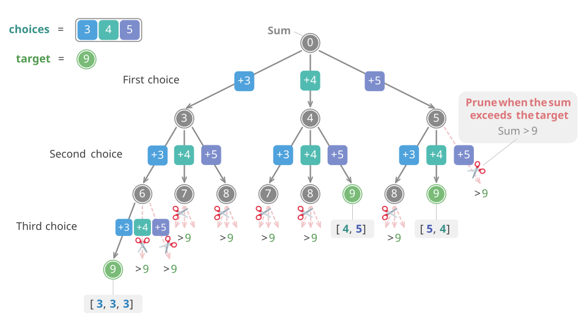
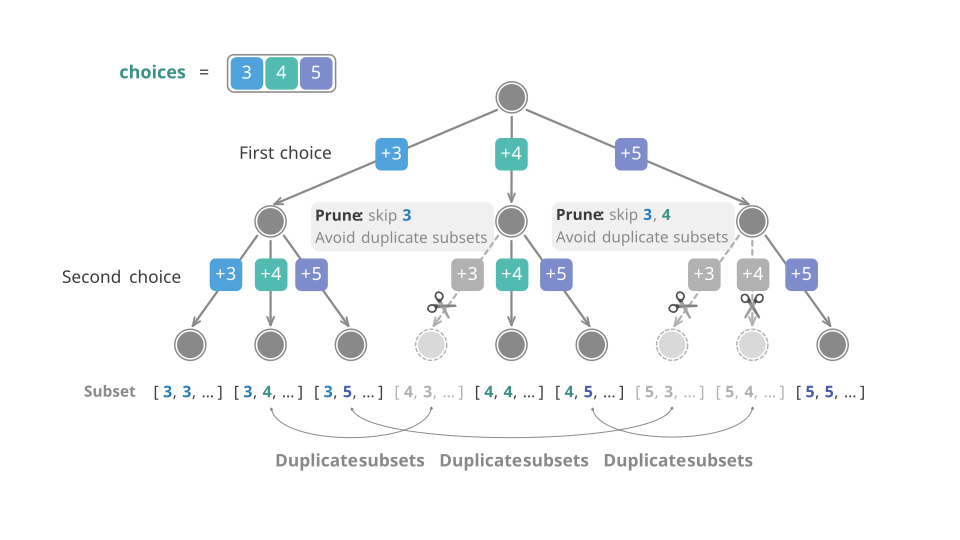
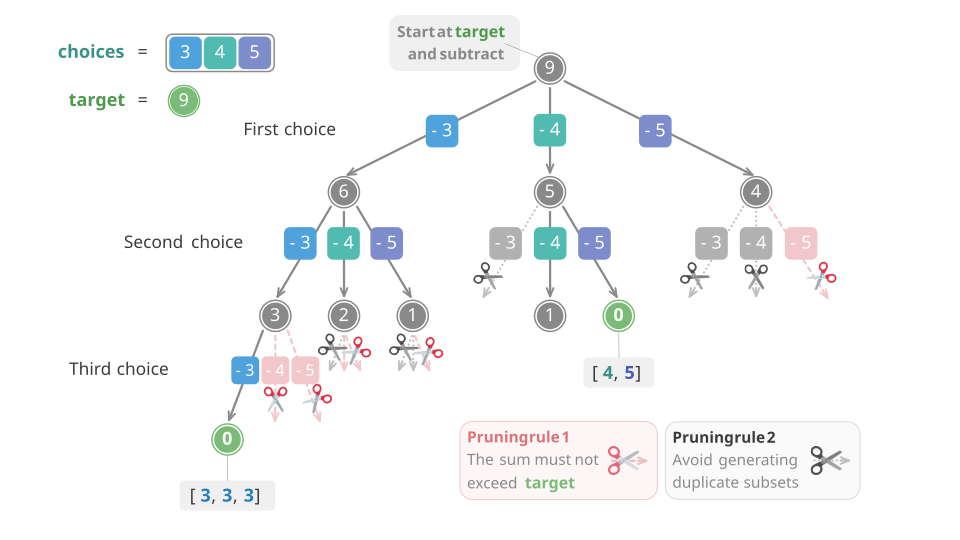

# 13.3 &nbsp; The subset sum problem

## 13.3.1 &nbsp; Distinct input values

!!! question

    Given an array of positive integers `nums` and a positive integer `target`, find all combinations whose elements sum to `target`. The array contains no duplicates, and each element may be chosen multiple times. Return a list of the combinations with no duplicates.

For example, given the set $\{3, 4, 5\}$ and target $9$, the solutions are $\{3, 3, 3\}, \{4, 5\}$. Two details matter here.

- Each element of the input set may be chosen any number of times.
- Order does not matter in a subset. For example, $\{4, 5\}$ and $\{5, 4\}$ represent the same subset.

### 1. &nbsp; Starting from the permutations solution

As with permutations, we can build a subset through a sequence of choices. Update the running sum with each choice. When it equals `target`, record the subset in the result list.

Here, however, **each element may be chosen any number of times**, so there is no need for the Boolean list `selected` to track which elements have been used. A small change to the permutations code gives us a first implementation:

=== "Python"

    ```python title="subset_sum_i_naive.py"
    def backtrack(
        state: list[int],
        target: int,
        total: int,
        choices: list[int],
        res: list[list[int]],
    ):
        """Backtracking: subset sum I"""
        # Record a solution when the subset sums to target
        if total == target:
            res.append(list(state))
            return
        # Try each choice
        for i in range(len(choices)):
            # Prune: skip choices that would take the subset sum over target
            if total + choices[i] > target:
                continue
            # Make a choice and update the running sum total
            state.append(choices[i])
            # Make the next choice
            backtrack(state, target, total + choices[i], choices, res)
            # Backtrack: undo the choice to restore the previous state
            state.pop()

    def subset_sum_i_naive(nums: list[int], target: int) -> list[list[int]]:
        """Solve subset sum I (including duplicate subsets)"""
        state = []  # State (current subset)
        total = 0  # Subset sum
        res = []  # Results (list of subsets)
        backtrack(state, target, total, nums, res)
        return res
    ```

=== "C++"

    ```cpp title="subset_sum_i_naive.cpp"
    /* Backtracking: subset sum I */
    void backtrack(vector<int> &state, int target, int total, vector<int> &choices, vector<vector<int>> &res) {
        // Record a solution when the subset sums to target
        if (total == target) {
            res.push_back(state);
            return;
        }
        // Try each choice
        for (size_t i = 0; i < choices.size(); i++) {
            // Prune: skip choices that would take the subset sum over target
            if (total + choices[i] > target) {
                continue;
            }
            // Make a choice and update the running sum total
            state.push_back(choices[i]);
            // Make the next choice
            backtrack(state, target, total + choices[i], choices, res);
            // Backtrack: undo the choice to restore the previous state
            state.pop_back();
        }
    }

    /* Solve subset sum I (including duplicate subsets) */
    vector<vector<int>> subsetSumINaive(vector<int> &nums, int target) {
        vector<int> state;       // State (current subset)
        int total = 0;           // Subset sum
        vector<vector<int>> res; // Results (list of subsets)
        backtrack(state, target, total, nums, res);
        return res;
    }
    ```

=== "Java"

    ```java title="subset_sum_i_naive.java"
    /* Backtracking: subset sum I */
    void backtrack(List<Integer> state, int target, int total, int[] choices, List<List<Integer>> res) {
        // Record a solution when the subset sums to target
        if (total == target) {
            res.add(new ArrayList<>(state));
            return;
        }
        // Try each choice
        for (int i = 0; i < choices.length; i++) {
            // Prune: skip choices that would take the subset sum over target
            if (total + choices[i] > target) {
                continue;
            }
            // Make a choice and update the running sum total
            state.add(choices[i]);
            // Make the next choice
            backtrack(state, target, total + choices[i], choices, res);
            // Backtrack: undo the choice to restore the previous state
            state.remove(state.size() - 1);
        }
    }

    /* Solve subset sum I (including duplicate subsets) */
    List<List<Integer>> subsetSumINaive(int[] nums, int target) {
        List<Integer> state = new ArrayList<>(); // State (current subset)
        int total = 0; // Subset sum
        List<List<Integer>> res = new ArrayList<>(); // Results (list of subsets)
        backtrack(state, target, total, nums, res);
        return res;
    }
    ```

=== "C#"

    ```csharp title="subset_sum_i_naive.cs"
    /* Backtracking: subset sum I */
    void Backtrack(List<int> state, int target, int total, int[] choices, List<List<int>> res) {
        // Record a solution when the subset sums to target
        if (total == target) {
            res.Add(new List<int>(state));
            return;
        }
        // Try each choice
        for (int i = 0; i < choices.Length; i++) {
            // Prune: skip choices that would take the subset sum over target
            if (total + choices[i] > target) {
                continue;
            }
            // Make a choice and update the running sum total
            state.Add(choices[i]);
            // Make the next choice
            Backtrack(state, target, total + choices[i], choices, res);
            // Backtrack: undo the choice to restore the previous state
            state.RemoveAt(state.Count - 1);
        }
    }

    /* Solve subset sum I (including duplicate subsets) */
    List<List<int>> SubsetSumINaive(int[] nums, int target) {
        List<int> state = []; // State (current subset)
        int total = 0; // Subset sum
        List<List<int>> res = []; // Results (list of subsets)
        Backtrack(state, target, total, nums, res);
        return res;
    }
    ```

=== "Go"

    ```go title="subset_sum_i_naive.go"
    /* Backtracking: subset sum I */
    func backtrackSubsetSumINaive(total, target int, state, choices *[]int, res *[][]int) {
        // Record a solution when the subset sums to target
        if target == total {
            newState := append([]int{}, *state...)
            *res = append(*res, newState)
            return
        }
        // Try each choice
        for i := 0; i < len(*choices); i++ {
            // Prune: skip choices that would take the subset sum over target
            if total+(*choices)[i] > target {
                continue
            }
            // Make a choice and update the running sum total
            *state = append(*state, (*choices)[i])
            // Make the next choice
            backtrackSubsetSumINaive(total+(*choices)[i], target, state, choices, res)
            // Backtrack: undo the choice to restore the previous state
            *state = (*state)[:len(*state)-1]
        }
    }

    /* Solve subset sum I (including duplicate subsets) */
    func subsetSumINaive(nums []int, target int) [][]int {
        state := make([]int, 0) // State (current subset)
        total := 0              // Subset sum
        res := make([][]int, 0) // Results (list of subsets)
        backtrackSubsetSumINaive(total, target, &state, &nums, &res)
        return res
    }
    ```

=== "Swift"

    ```swift title="subset_sum_i_naive.swift"
    /* Backtracking: subset sum I */
    func backtrack(state: inout [Int], target: Int, total: Int, choices: [Int], res: inout [[Int]]) {
        // Record a solution when the subset sums to target
        if total == target {
            res.append(state)
            return
        }
        // Try each choice
        for i in choices.indices {
            // Prune: skip choices that would take the subset sum over target
            if total + choices[i] > target {
                continue
            }
            // Make a choice and update the running sum total
            state.append(choices[i])
            // Make the next choice
            backtrack(state: &state, target: target, total: total + choices[i], choices: choices, res: &res)
            // Backtrack: undo the choice to restore the previous state
            state.removeLast()
        }
    }

    /* Solve subset sum I (including duplicate subsets) */
    func subsetSumINaive(nums: [Int], target: Int) -> [[Int]] {
        var state: [Int] = [] // State (current subset)
        let total = 0 // Subset sum
        var res: [[Int]] = [] // Results (list of subsets)
        backtrack(state: &state, target: target, total: total, choices: nums, res: &res)
        return res
    }
    ```

=== "JS"

    ```javascript title="subset_sum_i_naive.js"
    /* Backtracking: subset sum I */
    function backtrack(state, target, total, choices, res) {
        // Record a solution when the subset sums to target
        if (total === target) {
            res.push([...state]);
            return;
        }
        // Try each choice
        for (let i = 0; i < choices.length; i++) {
            // Prune: skip choices that would take the subset sum over target
            if (total + choices[i] > target) {
                continue;
            }
            // Make a choice and update the running sum total
            state.push(choices[i]);
            // Make the next choice
            backtrack(state, target, total + choices[i], choices, res);
            // Backtrack: undo the choice to restore the previous state
            state.pop();
        }
    }

    /* Solve subset sum I (including duplicate subsets) */
    function subsetSumINaive(nums, target) {
        const state = []; // State (current subset)
        const total = 0; // Subset sum
        const res = []; // Results (list of subsets)
        backtrack(state, target, total, nums, res);
        return res;
    }
    ```

=== "TS"

    ```typescript title="subset_sum_i_naive.ts"
    /* Backtracking: subset sum I */
    function backtrack(
        state: number[],
        target: number,
        total: number,
        choices: number[],
        res: number[][]
    ): void {
        // Record a solution when the subset sums to target
        if (total === target) {
            res.push([...state]);
            return;
        }
        // Try each choice
        for (let i = 0; i < choices.length; i++) {
            // Prune: skip choices that would take the subset sum over target
            if (total + choices[i] > target) {
                continue;
            }
            // Make a choice and update the running sum total
            state.push(choices[i]);
            // Make the next choice
            backtrack(state, target, total + choices[i], choices, res);
            // Backtrack: undo the choice to restore the previous state
            state.pop();
        }
    }

    /* Solve subset sum I (including duplicate subsets) */
    function subsetSumINaive(nums: number[], target: number): number[][] {
        const state = []; // State (current subset)
        const total = 0; // Subset sum
        const res = []; // Results (list of subsets)
        backtrack(state, target, total, nums, res);
        return res;
    }
    ```

=== "Dart"

    ```dart title="subset_sum_i_naive.dart"
    /* Backtracking: subset sum I */
    void backtrack(
      List<int> state,
      int target,
      int total,
      List<int> choices,
      List<List<int>> res,
    ) {
      // Record a solution when the subset sums to target
      if (total == target) {
        res.add(List.from(state));
        return;
      }
      // Try each choice
      for (int i = 0; i < choices.length; i++) {
        // Prune: skip choices that would take the subset sum over target
        if (total + choices[i] > target) {
          continue;
        }
        // Make a choice and update the running sum total
        state.add(choices[i]);
        // Make the next choice
        backtrack(state, target, total + choices[i], choices, res);
        // Backtrack: undo the choice to restore the previous state
        state.removeLast();
      }
    }

    /* Solve subset sum I (including duplicate subsets) */
    List<List<int>> subsetSumINaive(List<int> nums, int target) {
      List<int> state = []; // State (current subset)
      int total = 0; // Sum of elements
      List<List<int>> res = []; // Results (list of subsets)
      backtrack(state, target, total, nums, res);
      return res;
    }
    ```

=== "Rust"

    ```rust title="subset_sum_i_naive.rs"
    /* Backtracking: subset sum I */
    fn backtrack(
        state: &mut Vec<i32>,
        target: i32,
        total: i32,
        choices: &[i32],
        res: &mut Vec<Vec<i32>>,
    ) {
        // Record a solution when the subset sums to target
        if total == target {
            res.push(state.clone());
            return;
        }
        // Try each choice
        for i in 0..choices.len() {
            // Prune: skip choices that would take the subset sum over target
            if total + choices[i] > target {
                continue;
            }
            // Make a choice and update the running sum total
            state.push(choices[i]);
            // Make the next choice
            backtrack(state, target, total + choices[i], choices, res);
            // Backtrack: undo the choice to restore the previous state
            state.pop();
        }
    }

    /* Solve subset sum I (including duplicate subsets) */
    fn subset_sum_i_naive(nums: &[i32], target: i32) -> Vec<Vec<i32>> {
        let mut state = Vec::new(); // State (current subset)
        let total = 0; // Subset sum
        let mut res = Vec::new(); // Results (list of subsets)
        backtrack(&mut state, target, total, nums, &mut res);
        res
    }
    ```

=== "C"

    ```c title="subset_sum_i_naive.c"
    /* Backtracking: subset sum I */
    void backtrack(int target, int total, int *choices, int choicesSize) {
        // Record a solution when the subset sums to target
        if (total == target) {
            for (int i = 0; i < stateSize; i++) {
                res[resSize][i] = state[i];
            }
            resColSizes[resSize++] = stateSize;
            return;
        }
        // Try each choice
        for (int i = 0; i < choicesSize; i++) {
            // Prune: skip choices that would take the subset sum over target
            if (total + choices[i] > target) {
                continue;
            }
            // Make a choice and update the running sum total
            state[stateSize++] = choices[i];
            // Make the next choice
            backtrack(target, total + choices[i], choices, choicesSize);
            // Backtrack: undo the choice to restore the previous state
            stateSize--;
        }
    }

    /* Solve subset sum I (including duplicate subsets) */
    void subsetSumINaive(int *nums, int numsSize, int target) {
        resSize = 0; // Initialize the solution count to 0
        backtrack(target, 0, nums, numsSize);
    }
    ```

=== "Kotlin"

    ```kotlin title="subset_sum_i_naive.kt"
    /* Backtracking: subset sum I */
    fun backtrack(
        state: MutableList<Int>,
        target: Int,
        total: Int,
        choices: IntArray,
        res: MutableList<MutableList<Int>?>
    ) {
        // Record a solution when the subset sums to target
        if (total == target) {
            res.add(state.toMutableList())
            return
        }
        // Try each choice
        for (i in choices.indices) {
            // Prune: skip choices that would take the subset sum over target
            if (total + choices[i] > target) {
                continue
            }
            // Make a choice and update the running sum total
            state.add(choices[i])
            // Make the next choice
            backtrack(state, target, total + choices[i], choices, res)
            // Backtrack: undo the choice to restore the previous state
            state.removeAt(state.size - 1)
        }
    }

    /* Solve subset sum I (including duplicate subsets) */
    fun subsetSumINaive(nums: IntArray, target: Int): MutableList<MutableList<Int>?> {
        val state = mutableListOf<Int>() // State (current subset)
        val total = 0 // Subset sum
        val res = mutableListOf<MutableList<Int>?>() // Results (list of subsets)
        backtrack(state, target, total, nums, res)
        return res
    }
    ```

=== "Ruby"

    ```ruby title="subset_sum_i_naive.rb"
    ### Backtracking: subset sum I ###
    def backtrack(state, target, total, choices, res)
      # Record a solution when the subset sums to target
      if total == target
        res << state.dup
        return
      end

      # Try each choice
      for i in 0...choices.length
        # Prune: skip choices that would take the subset sum over target
        next if total + choices[i] > target
        # Make a choice and update the running sum total
        state << choices[i]
        # Make the next choice
        backtrack(state, target, total + choices[i], choices, res)
        # Backtrack: undo the choice to restore the previous state
        state.pop
      end
    end

    ### Solve subset sum I (including duplicate subsets)###
    def subset_sum_i_naive(nums, target)
      state = [] # State (current subset)
      total = 0 # Subset sum
      res = [] # Results (list of subsets)
      backtrack(state, target, total, nums, res)
      res
    end
    ```

??? pythontutor "Visualize execution"

    <div style="height: 549px; width: 100%;"><iframe class="pythontutor-iframe" title="Visualize execution" src="https://pythontutor.com/iframe-embed.html#code=def%20backtrack%28%0A%20%20%20%20state%3A%20list%5Bint%5D,%0A%20%20%20%20target%3A%20int,%0A%20%20%20%20total%3A%20int,%0A%20%20%20%20choices%3A%20list%5Bint%5D,%0A%20%20%20%20res%3A%20list%5Blist%5Bint%5D%5D,%0A%29%3A%0A%20%20%20%20%22%22%22Backtracking%3A%20subset%20sum%20I%22%22%22%0A%20%20%20%20%23%20Record%20a%20solution%20when%20the%20subset%20sums%20to%20target%0A%20%20%20%20if%20total%20%3D%3D%20target%3A%0A%20%20%20%20%20%20%20%20res.append%28list%28state%29%29%0A%20%20%20%20%20%20%20%20return%0A%20%20%20%20%23%20Try%20each%20choice%0A%20%20%20%20for%20i%20in%20range%28len%28choices%29%29%3A%0A%20%20%20%20%20%20%20%20%23%20Prune%3A%20skip%20choices%20that%20would%20take%20the%20subset%20sum%20over%20target%0A%20%20%20%20%20%20%20%20if%20total%20%2B%20choices%5Bi%5D%20%3E%20target%3A%0A%20%20%20%20%20%20%20%20%20%20%20%20continue%0A%20%20%20%20%20%20%20%20%23%20Make%20a%20choice%20and%20update%20the%20running%20sum%20total%0A%20%20%20%20%20%20%20%20state.append%28choices%5Bi%5D%29%0A%20%20%20%20%20%20%20%20%23%20Make%20the%20next%20choice%0A%20%20%20%20%20%20%20%20backtrack%28state,%20target,%20total%20%2B%20choices%5Bi%5D,%20choices,%20res%29%0A%20%20%20%20%20%20%20%20%23%20Backtrack%3A%20undo%20the%20choice%20to%20restore%20the%20previous%20state%0A%20%20%20%20%20%20%20%20state.pop%28%29%0A%0A%0Adef%20subset_sum_i_naive%28nums%3A%20list%5Bint%5D,%20target%3A%20int%29%20-%3E%20list%5Blist%5Bint%5D%5D%3A%0A%20%20%20%20%22%22%22Solve%20subset%20sum%20I%20%28including%20duplicate%20subsets%29%22%22%22%0A%20%20%20%20state%20%3D%20%5B%5D%20%20%23%20State%20%28current%20subset%29%0A%20%20%20%20total%20%3D%200%20%20%23%20Subset%20sum%0A%20%20%20%20res%20%3D%20%5B%5D%20%20%23%20Results%20%28list%20of%20subsets%29%0A%20%20%20%20backtrack%28state,%20target,%20total,%20nums,%20res%29%0A%20%20%20%20return%20res%0A%0A%0A%22%22%22Driver%20Code%22%22%22%0Aif%20__name__%20%3D%3D%20%22__main__%22%3A%0A%20%20%20%20nums%20%3D%20%5B3,%204,%205%5D%0A%20%20%20%20target%20%3D%209%0A%20%20%20%20res%20%3D%20subset_sum_i_naive%28nums,%20target%29%0A%0A%20%20%20%20print%28f%22Input%20array%20nums%20%3D%20%7Bnums%7D,%20target%20%3D%20%7Btarget%7D%22%29%0A%20%20%20%20print%28f%22Subsets%20that%20sum%20to%20%7Btarget%7D%3A%20res%20%3D%20%7Bres%7D%22%29%0A%20%20%20%20print%28f%22This%20method%20returns%20duplicate%20subsets%22%29&codeDivHeight=472&codeDivWidth=350&cumulative=false&curInstr=16&heapPrimitives=nevernest&origin=opt-frontend.js&py=311&rawInputLstJSON=%5B%5D&textReferences=false"> </iframe></div>
    <div style="margin-top: 5px;"><a href="https://pythontutor.com/iframe-embed.html#code=def%20backtrack%28%0A%20%20%20%20state%3A%20list%5Bint%5D,%0A%20%20%20%20target%3A%20int,%0A%20%20%20%20total%3A%20int,%0A%20%20%20%20choices%3A%20list%5Bint%5D,%0A%20%20%20%20res%3A%20list%5Blist%5Bint%5D%5D,%0A%29%3A%0A%20%20%20%20%22%22%22Backtracking%3A%20subset%20sum%20I%22%22%22%0A%20%20%20%20%23%20Record%20a%20solution%20when%20the%20subset%20sums%20to%20target%0A%20%20%20%20if%20total%20%3D%3D%20target%3A%0A%20%20%20%20%20%20%20%20res.append%28list%28state%29%29%0A%20%20%20%20%20%20%20%20return%0A%20%20%20%20%23%20Try%20each%20choice%0A%20%20%20%20for%20i%20in%20range%28len%28choices%29%29%3A%0A%20%20%20%20%20%20%20%20%23%20Prune%3A%20skip%20choices%20that%20would%20take%20the%20subset%20sum%20over%20target%0A%20%20%20%20%20%20%20%20if%20total%20%2B%20choices%5Bi%5D%20%3E%20target%3A%0A%20%20%20%20%20%20%20%20%20%20%20%20continue%0A%20%20%20%20%20%20%20%20%23%20Make%20a%20choice%20and%20update%20the%20running%20sum%20total%0A%20%20%20%20%20%20%20%20state.append%28choices%5Bi%5D%29%0A%20%20%20%20%20%20%20%20%23%20Make%20the%20next%20choice%0A%20%20%20%20%20%20%20%20backtrack%28state,%20target,%20total%20%2B%20choices%5Bi%5D,%20choices,%20res%29%0A%20%20%20%20%20%20%20%20%23%20Backtrack%3A%20undo%20the%20choice%20to%20restore%20the%20previous%20state%0A%20%20%20%20%20%20%20%20state.pop%28%29%0A%0A%0Adef%20subset_sum_i_naive%28nums%3A%20list%5Bint%5D,%20target%3A%20int%29%20-%3E%20list%5Blist%5Bint%5D%5D%3A%0A%20%20%20%20%22%22%22Solve%20subset%20sum%20I%20%28including%20duplicate%20subsets%29%22%22%22%0A%20%20%20%20state%20%3D%20%5B%5D%20%20%23%20State%20%28current%20subset%29%0A%20%20%20%20total%20%3D%200%20%20%23%20Subset%20sum%0A%20%20%20%20res%20%3D%20%5B%5D%20%20%23%20Results%20%28list%20of%20subsets%29%0A%20%20%20%20backtrack%28state,%20target,%20total,%20nums,%20res%29%0A%20%20%20%20return%20res%0A%0A%0A%22%22%22Driver%20Code%22%22%22%0Aif%20__name__%20%3D%3D%20%22__main__%22%3A%0A%20%20%20%20nums%20%3D%20%5B3,%204,%205%5D%0A%20%20%20%20target%20%3D%209%0A%20%20%20%20res%20%3D%20subset_sum_i_naive%28nums,%20target%29%0A%0A%20%20%20%20print%28f%22Input%20array%20nums%20%3D%20%7Bnums%7D,%20target%20%3D%20%7Btarget%7D%22%29%0A%20%20%20%20print%28f%22Subsets%20that%20sum%20to%20%7Btarget%7D%3A%20res%20%3D%20%7Bres%7D%22%29%0A%20%20%20%20print%28f%22This%20method%20returns%20duplicate%20subsets%22%29&codeDivHeight=800&codeDivWidth=600&cumulative=false&curInstr=16&heapPrimitives=nevernest&origin=opt-frontend.js&py=311&rawInputLstJSON=%5B%5D&textReferences=false" target="_blank" rel="noopener noreferrer">View full screen ></a></div>

With input array $[3, 4, 5]$ and target $9$, the code produces $[3, 3, 3], [4, 5], [5, 4]$. **It finds all subsets that sum to $9$, but $[4, 5]$ and $[5, 4]$ are duplicates**.

The search distinguishes different selection orders, while a subset has no order. As the figure shows, choosing $4$ and then $5$ follows a different branch from choosing $5$ and then $4$, but both yield the same subset.

{ class="animation-figure" }

<p align="center"> Figure 13-10 &nbsp; Subset search and pruning when the sum exceeds the target </p>

One straightforward option is to **remove duplicates from the result list**. This is inefficient for two reasons.

- When the array has many elements, especially when `target` is large, the search generates many duplicate subsets.
- Comparing subsets stored as arrays is expensive. First sort the arrays, then compare them element by element.

### 2. &nbsp; Pruning duplicate subsets

**We can prune duplicates during the search**. As the figure shows, choosing array elements in different orders produces duplicate subsets. Consider the following choices.

1. Choosing $3$ and then $4$ in the first two rounds generates all subsets containing those two elements, denoted by $[3, 4, \dots]$.
2. Later, if the first choice is $4$, **skip $3$ in the second round**. The subsets $[4, 3, \dots]$ would duplicate those generated in step `1.`.

At each level, the search tries the choices from left to right. The farther right a branch lies, the more choices are pruned.

1. Choose $3$ and $5$ in the first two rounds to generate subsets $[3, 5, \dots]$.
2. Choose $4$ and $5$ in the first two rounds to generate subsets $[4, 5, \dots]$.
3. If the first choice is $5$, **skip both $3$ and $4$ in the second round**. The subsets $[5, 3, \dots]$ and $[5, 4, \dots]$ would duplicate those described in steps `1.` and `2.`.

{ class="animation-figure" }

<p align="center"> Figure 13-11 &nbsp; Duplicate subsets from different selection orders </p>

In general, for an input array $[x_1, x_2, \dots, x_n]$ and a sequence of choices $[x_{i_1}, x_{i_2}, \dots, x_{i_m}]$, the indices must satisfy $i_1 \leq i_2 \leq \dots \leq i_m$. **Any sequence that violates this condition produces a duplicate and should be pruned**.

### 3. &nbsp; Implementation

To implement this rule, initialize a variable `start` to track where iteration begins. **After choosing $x_{i}$, begin the next round at index $i$**. This ensures that the indices satisfy $i_1 \leq i_2 \leq \dots \leq i_m$ and each subset is unique.

We also make two optimizations.

- Sort `nums` before starting the search. When iterating through the choices, **break out of the loop as soon as a choice takes the subset sum above `target`**. Later elements are larger, so choosing any of them would also take the sum above `target`.
- Drop the running sum variable `total`. Instead, **subtract each chosen value from `target` to track the sum still needed**. Record a solution when `target` reaches $0$.

=== "Python"

    ```python title="subset_sum_i.py"
    def backtrack(
        state: list[int], target: int, choices: list[int], start: int, res: list[list[int]]
    ):
        """Backtracking: subset sum I"""
        # Record a solution when the subset sums to target
        if target == 0:
            res.append(list(state))
            return
        # Try each choice
        # Pruning rule 2: start at start to avoid duplicate subsets
        for i in range(start, len(choices)):
            # Pruning rule 1: break if the subset sum would exceed target
            # The array is sorted, so later elements are at least as large and would also take the sum over target
            if target - choices[i] < 0:
                break
            # Make a choice and update target and start
            state.append(choices[i])
            # Make the next choice
            backtrack(state, target - choices[i], choices, i, res)
            # Backtrack: undo the choice to restore the previous state
            state.pop()

    def subset_sum_i(nums: list[int], target: int) -> list[list[int]]:
        """Solve subset sum I"""
        state = []  # State (current subset)
        nums.sort()  # Sort nums
        start = 0  # Starting index
        res = []  # Results (list of subsets)
        backtrack(state, target, nums, start, res)
        return res
    ```

=== "C++"

    ```cpp title="subset_sum_i.cpp"
    /* Backtracking: subset sum I */
    void backtrack(vector<int> &state, int target, vector<int> &choices, int start, vector<vector<int>> &res) {
        // Record a solution when the subset sums to target
        if (target == 0) {
            res.push_back(state);
            return;
        }
        // Try each choice
        // Pruning rule 2: start at start to avoid duplicate subsets
        for (int i = start; i < choices.size(); i++) {
            // Pruning rule 1: break if the subset sum would exceed target
            // The array is sorted, so later elements are at least as large and would also take the sum over target
            if (target - choices[i] < 0) {
                break;
            }
            // Make a choice and update target and start
            state.push_back(choices[i]);
            // Make the next choice
            backtrack(state, target - choices[i], choices, i, res);
            // Backtrack: undo the choice to restore the previous state
            state.pop_back();
        }
    }

    /* Solve subset sum I */
    vector<vector<int>> subsetSumI(vector<int> &nums, int target) {
        vector<int> state;              // State (current subset)
        sort(nums.begin(), nums.end()); // Sort nums
        int start = 0;                  // Starting index
        vector<vector<int>> res;        // Results (list of subsets)
        backtrack(state, target, nums, start, res);
        return res;
    }
    ```

=== "Java"

    ```java title="subset_sum_i.java"
    /* Backtracking: subset sum I */
    void backtrack(List<Integer> state, int target, int[] choices, int start, List<List<Integer>> res) {
        // Record a solution when the subset sums to target
        if (target == 0) {
            res.add(new ArrayList<>(state));
            return;
        }
        // Try each choice
        // Pruning rule 2: start at start to avoid duplicate subsets
        for (int i = start; i < choices.length; i++) {
            // Pruning rule 1: break if the subset sum would exceed target
            // The array is sorted, so later elements are at least as large and would also take the sum over target
            if (target - choices[i] < 0) {
                break;
            }
            // Make a choice and update target and start
            state.add(choices[i]);
            // Make the next choice
            backtrack(state, target - choices[i], choices, i, res);
            // Backtrack: undo the choice to restore the previous state
            state.remove(state.size() - 1);
        }
    }

    /* Solve subset sum I */
    List<List<Integer>> subsetSumI(int[] nums, int target) {
        List<Integer> state = new ArrayList<>(); // State (current subset)
        Arrays.sort(nums); // Sort nums
        int start = 0; // Starting index
        List<List<Integer>> res = new ArrayList<>(); // Results (list of subsets)
        backtrack(state, target, nums, start, res);
        return res;
    }
    ```

=== "C#"

    ```csharp title="subset_sum_i.cs"
    /* Backtracking: subset sum I */
    void Backtrack(List<int> state, int target, int[] choices, int start, List<List<int>> res) {
        // Record a solution when the subset sums to target
        if (target == 0) {
            res.Add(new List<int>(state));
            return;
        }
        // Try each choice
        // Pruning rule 2: start at start to avoid duplicate subsets
        for (int i = start; i < choices.Length; i++) {
            // Pruning rule 1: break if the subset sum would exceed target
            // The array is sorted, so later elements are at least as large and would also take the sum over target
            if (target - choices[i] < 0) {
                break;
            }
            // Make a choice and update target and start
            state.Add(choices[i]);
            // Make the next choice
            Backtrack(state, target - choices[i], choices, i, res);
            // Backtrack: undo the choice to restore the previous state
            state.RemoveAt(state.Count - 1);
        }
    }

    /* Solve subset sum I */
    List<List<int>> SubsetSumI(int[] nums, int target) {
        List<int> state = []; // State (current subset)
        Array.Sort(nums); // Sort nums
        int start = 0; // Starting index
        List<List<int>> res = []; // Results (list of subsets)
        Backtrack(state, target, nums, start, res);
        return res;
    }
    ```

=== "Go"

    ```go title="subset_sum_i.go"
    /* Backtracking: subset sum I */
    func backtrackSubsetSumI(start, target int, state, choices *[]int, res *[][]int) {
        // Record a solution when the subset sums to target
        if target == 0 {
            newState := append([]int{}, *state...)
            *res = append(*res, newState)
            return
        }
        // Try each choice
        // Pruning rule 2: start at start to avoid duplicate subsets
        for i := start; i < len(*choices); i++ {
            // Pruning rule 1: break if the subset sum would exceed target
            // The array is sorted, so later elements are at least as large and would also take the sum over target
            if target-(*choices)[i] < 0 {
                break
            }
            // Make a choice and update target and start
            *state = append(*state, (*choices)[i])
            // Make the next choice
            backtrackSubsetSumI(i, target-(*choices)[i], state, choices, res)
            // Backtrack: undo the choice to restore the previous state
            *state = (*state)[:len(*state)-1]
        }
    }

    /* Solve subset sum I */
    func subsetSumI(nums []int, target int) [][]int {
        state := make([]int, 0) // State (current subset)
        sort.Ints(nums)         // Sort nums
        start := 0              // Starting index
        res := make([][]int, 0) // Results (list of subsets)
        backtrackSubsetSumI(start, target, &state, &nums, &res)
        return res
    }
    ```

=== "Swift"

    ```swift title="subset_sum_i.swift"
    /* Backtracking: subset sum I */
    func backtrack(state: inout [Int], target: Int, choices: [Int], start: Int, res: inout [[Int]]) {
        // Record a solution when the subset sums to target
        if target == 0 {
            res.append(state)
            return
        }
        // Try each choice
        // Pruning rule 2: start at start to avoid duplicate subsets
        for i in choices.indices.dropFirst(start) {
            // Pruning rule 1: break if the subset sum would exceed target
            // The array is sorted, so later elements are at least as large and would also take the sum over target
            if target - choices[i] < 0 {
                break
            }
            // Make a choice and update target and start
            state.append(choices[i])
            // Make the next choice
            backtrack(state: &state, target: target - choices[i], choices: choices, start: i, res: &res)
            // Backtrack: undo the choice to restore the previous state
            state.removeLast()
        }
    }

    /* Solve subset sum I */
    func subsetSumI(nums: [Int], target: Int) -> [[Int]] {
        var state: [Int] = [] // State (current subset)
        let nums = nums.sorted() // Sort nums
        let start = 0 // Starting index
        var res: [[Int]] = [] // Results (list of subsets)
        backtrack(state: &state, target: target, choices: nums, start: start, res: &res)
        return res
    }
    ```

=== "JS"

    ```javascript title="subset_sum_i.js"
    /* Backtracking: subset sum I */
    function backtrack(state, target, choices, start, res) {
        // Record a solution when the subset sums to target
        if (target === 0) {
            res.push([...state]);
            return;
        }
        // Try each choice
        // Pruning rule 2: start at start to avoid duplicate subsets
        for (let i = start; i < choices.length; i++) {
            // Pruning rule 1: break if the subset sum would exceed target
            // The array is sorted, so later elements are at least as large and would also take the sum over target
            if (target - choices[i] < 0) {
                break;
            }
            // Make a choice and update target and start
            state.push(choices[i]);
            // Make the next choice
            backtrack(state, target - choices[i], choices, i, res);
            // Backtrack: undo the choice to restore the previous state
            state.pop();
        }
    }

    /* Solve subset sum I */
    function subsetSumI(nums, target) {
        const state = []; // State (current subset)
        nums.sort((a, b) => a - b); // Sort nums
        const start = 0; // Starting index
        const res = []; // Results (list of subsets)
        backtrack(state, target, nums, start, res);
        return res;
    }
    ```

=== "TS"

    ```typescript title="subset_sum_i.ts"
    /* Backtracking: subset sum I */
    function backtrack(
        state: number[],
        target: number,
        choices: number[],
        start: number,
        res: number[][]
    ): void {
        // Record a solution when the subset sums to target
        if (target === 0) {
            res.push([...state]);
            return;
        }
        // Try each choice
        // Pruning rule 2: start at start to avoid duplicate subsets
        for (let i = start; i < choices.length; i++) {
            // Pruning rule 1: break if the subset sum would exceed target
            // The array is sorted, so later elements are at least as large and would also take the sum over target
            if (target - choices[i] < 0) {
                break;
            }
            // Make a choice and update target and start
            state.push(choices[i]);
            // Make the next choice
            backtrack(state, target - choices[i], choices, i, res);
            // Backtrack: undo the choice to restore the previous state
            state.pop();
        }
    }

    /* Solve subset sum I */
    function subsetSumI(nums: number[], target: number): number[][] {
        const state = []; // State (current subset)
        nums.sort((a, b) => a - b); // Sort nums
        const start = 0; // Starting index
        const res = []; // Results (list of subsets)
        backtrack(state, target, nums, start, res);
        return res;
    }
    ```

=== "Dart"

    ```dart title="subset_sum_i.dart"
    /* Backtracking: subset sum I */
    void backtrack(
      List<int> state,
      int target,
      List<int> choices,
      int start,
      List<List<int>> res,
    ) {
      // Record a solution when the subset sums to target
      if (target == 0) {
        res.add(List.from(state));
        return;
      }
      // Try each choice
      // Pruning rule 2: start at start to avoid duplicate subsets
      for (int i = start; i < choices.length; i++) {
        // Pruning rule 1: break if the subset sum would exceed target
        // The array is sorted, so later elements are at least as large and would also take the sum over target
        if (target - choices[i] < 0) {
          break;
        }
        // Make a choice and update target and start
        state.add(choices[i]);
        // Make the next choice
        backtrack(state, target - choices[i], choices, i, res);
        // Backtrack: undo the choice to restore the previous state
        state.removeLast();
      }
    }

    /* Solve subset sum I */
    List<List<int>> subsetSumI(List<int> nums, int target) {
      List<int> state = []; // State (current subset)
      nums.sort(); // Sort nums
      int start = 0; // Starting index
      List<List<int>> res = []; // Results (list of subsets)
      backtrack(state, target, nums, start, res);
      return res;
    }
    ```

=== "Rust"

    ```rust title="subset_sum_i.rs"
    /* Backtracking: subset sum I */
    fn backtrack(
        state: &mut Vec<i32>,
        target: i32,
        choices: &[i32],
        start: usize,
        res: &mut Vec<Vec<i32>>,
    ) {
        // Record a solution when the subset sums to target
        if target == 0 {
            res.push(state.clone());
            return;
        }
        // Try each choice
        // Pruning rule 2: start at start to avoid duplicate subsets
        for i in start..choices.len() {
            // Pruning rule 1: break if the subset sum would exceed target
            // The array is sorted, so later elements are at least as large and would also take the sum over target
            if target - choices[i] < 0 {
                break;
            }
            // Make a choice and update target and start
            state.push(choices[i]);
            // Make the next choice
            backtrack(state, target - choices[i], choices, i, res);
            // Backtrack: undo the choice to restore the previous state
            state.pop();
        }
    }

    /* Solve subset sum I */
    fn subset_sum_i(nums: &mut [i32], target: i32) -> Vec<Vec<i32>> {
        let mut state = Vec::new(); // State (current subset)
        nums.sort(); // Sort nums
        let start = 0; // Starting index
        let mut res = Vec::new(); // Results (list of subsets)
        backtrack(&mut state, target, nums, start, &mut res);
        res
    }
    ```

=== "C"

    ```c title="subset_sum_i.c"
    /* Backtracking: subset sum I */
    void backtrack(int target, int *choices, int choicesSize, int start) {
        // Record a solution when the subset sums to target
        if (target == 0) {
            for (int i = 0; i < stateSize; ++i) {
                res[resSize][i] = state[i];
            }
            resColSizes[resSize++] = stateSize;
            return;
        }
        // Try each choice
        // Pruning rule 2: start at start to avoid duplicate subsets
        for (int i = start; i < choicesSize; i++) {
            // Pruning rule 1: break if the subset sum would exceed target
            // The array is sorted, so later elements are at least as large and would also take the sum over target
            if (target - choices[i] < 0) {
                break;
            }
            // Make a choice and update target and start
            state[stateSize] = choices[i];
            stateSize++;
            // Make the next choice
            backtrack(target - choices[i], choices, choicesSize, i);
            // Backtrack: undo the choice to restore the previous state
            stateSize--;
        }
    }

    /* Solve subset sum I */
    void subsetSumI(int *nums, int numsSize, int target) {
        qsort(nums, numsSize, sizeof(int), cmp); // Sort nums
        int start = 0;                           // Starting index
        backtrack(target, nums, numsSize, start);
    }
    ```

=== "Kotlin"

    ```kotlin title="subset_sum_i.kt"
    /* Backtracking: subset sum I */
    fun backtrack(
        state: MutableList<Int>,
        target: Int,
        choices: IntArray,
        start: Int,
        res: MutableList<MutableList<Int>?>
    ) {
        // Record a solution when the subset sums to target
        if (target == 0) {
            res.add(state.toMutableList())
            return
        }
        // Try each choice
        // Pruning rule 2: start at start to avoid duplicate subsets
        for (i in start..<choices.size) {
            // Pruning rule 1: break if the subset sum would exceed target
            // The array is sorted, so later elements are at least as large and would also take the sum over target
            if (target - choices[i] < 0) {
                break
            }
            // Make a choice and update target and start
            state.add(choices[i])
            // Make the next choice
            backtrack(state, target - choices[i], choices, i, res)
            // Backtrack: undo the choice to restore the previous state
            state.removeAt(state.size - 1)
        }
    }

    /* Solve subset sum I */
    fun subsetSumI(nums: IntArray, target: Int): MutableList<MutableList<Int>?> {
        val state = mutableListOf<Int>() // State (current subset)
        nums.sort() // Sort nums
        val start = 0 // Starting index
        val res = mutableListOf<MutableList<Int>?>() // Results (list of subsets)
        backtrack(state, target, nums, start, res)
        return res
    }
    ```

=== "Ruby"

    ```ruby title="subset_sum_i.rb"
    ### Backtracking: subset sum I ###
    def backtrack(state, target, choices, start, res)
      # Record a solution when the subset sums to target
      if target.zero?
        res << state.dup
        return
      end
      # Try each choice
      # Pruning rule 2: start at start to avoid duplicate subsets
      for i in start...choices.length
        # Pruning rule 1: break if the subset sum would exceed target
        # The array is sorted, so later elements are at least as large and would also take the sum over target
        break if target - choices[i] < 0
        # Make a choice and update target and start
        state << choices[i]
        # Make the next choice
        backtrack(state, target - choices[i], choices, i, res)
        # Backtrack: undo the choice to restore the previous state
        state.pop
      end
    end

    ### Solve subset sum I ###
    def subset_sum_i(nums, target)
      state = [] # State (current subset)
      nums.sort! # Sort nums
      start = 0 # Starting index
      res = [] # Results (list of subsets)
      backtrack(state, target, nums, start, res)
      res
    end
    ```

??? pythontutor "Visualize execution"

    <div style="height: 549px; width: 100%;"><iframe class="pythontutor-iframe" title="Visualize execution" src="https://pythontutor.com/iframe-embed.html#code=def%20backtrack%28%0A%20%20%20%20state%3A%20list%5Bint%5D,%20target%3A%20int,%20choices%3A%20list%5Bint%5D,%20start%3A%20int,%20res%3A%20list%5Blist%5Bint%5D%5D%0A%29%3A%0A%20%20%20%20%22%22%22Backtracking%3A%20subset%20sum%20I%22%22%22%0A%20%20%20%20%23%20Record%20a%20solution%20when%20the%20subset%20sums%20to%20target%0A%20%20%20%20if%20target%20%3D%3D%200%3A%0A%20%20%20%20%20%20%20%20res.append%28list%28state%29%29%0A%20%20%20%20%20%20%20%20return%0A%20%20%20%20%23%20Try%20each%20choice%0A%20%20%20%20%23%20Pruning%20rule%202%3A%20start%20at%20start%20to%20avoid%20duplicate%20subsets%0A%20%20%20%20for%20i%20in%20range%28start,%20len%28choices%29%29%3A%0A%20%20%20%20%20%20%20%20%23%20Pruning%20rule%201%3A%20break%20if%20the%20subset%20sum%20would%20exceed%20target%0A%20%20%20%20%20%20%20%20%23%20The%20array%20is%20sorted,%20so%20later%20elements%20are%20at%20least%20as%20large%20and%20would%20also%20take%20the%20sum%20over%20target%0A%20%20%20%20%20%20%20%20if%20target%20-%20choices%5Bi%5D%20%3C%200%3A%0A%20%20%20%20%20%20%20%20%20%20%20%20break%0A%20%20%20%20%20%20%20%20%23%20Make%20a%20choice%20and%20update%20target%20and%20start%0A%20%20%20%20%20%20%20%20state.append%28choices%5Bi%5D%29%0A%20%20%20%20%20%20%20%20%23%20Make%20the%20next%20choice%0A%20%20%20%20%20%20%20%20backtrack%28state,%20target%20-%20choices%5Bi%5D,%20choices,%20i,%20res%29%0A%20%20%20%20%20%20%20%20%23%20Backtrack%3A%20undo%20the%20choice%20to%20restore%20the%20previous%20state%0A%20%20%20%20%20%20%20%20state.pop%28%29%0A%0A%0Adef%20subset_sum_i%28nums%3A%20list%5Bint%5D,%20target%3A%20int%29%20-%3E%20list%5Blist%5Bint%5D%5D%3A%0A%20%20%20%20%22%22%22Solve%20subset%20sum%20I%22%22%22%0A%20%20%20%20state%20%3D%20%5B%5D%20%20%23%20State%20%28current%20subset%29%0A%20%20%20%20nums.sort%28%29%20%20%23%20Sort%20nums%0A%20%20%20%20start%20%3D%200%20%20%23%20Starting%20index%0A%20%20%20%20res%20%3D%20%5B%5D%20%20%23%20Results%20%28list%20of%20subsets%29%0A%20%20%20%20backtrack%28state,%20target,%20nums,%20start,%20res%29%0A%20%20%20%20return%20res%0A%0A%0A%22%22%22Driver%20Code%22%22%22%0Aif%20__name__%20%3D%3D%20%22__main__%22%3A%0A%20%20%20%20nums%20%3D%20%5B3,%204,%205%5D%0A%20%20%20%20target%20%3D%209%0A%20%20%20%20res%20%3D%20subset_sum_i%28nums,%20target%29%0A%0A%20%20%20%20print%28f%22Input%20array%20nums%20%3D%20%7Bnums%7D,%20target%20%3D%20%7Btarget%7D%22%29%0A%20%20%20%20print%28f%22Subsets%20that%20sum%20to%20%7Btarget%7D%3A%20res%20%3D%20%7Bres%7D%22%29&codeDivHeight=472&codeDivWidth=350&cumulative=false&curInstr=16&heapPrimitives=nevernest&origin=opt-frontend.js&py=311&rawInputLstJSON=%5B%5D&textReferences=false"> </iframe></div>
    <div style="margin-top: 5px;"><a href="https://pythontutor.com/iframe-embed.html#code=def%20backtrack%28%0A%20%20%20%20state%3A%20list%5Bint%5D,%20target%3A%20int,%20choices%3A%20list%5Bint%5D,%20start%3A%20int,%20res%3A%20list%5Blist%5Bint%5D%5D%0A%29%3A%0A%20%20%20%20%22%22%22Backtracking%3A%20subset%20sum%20I%22%22%22%0A%20%20%20%20%23%20Record%20a%20solution%20when%20the%20subset%20sums%20to%20target%0A%20%20%20%20if%20target%20%3D%3D%200%3A%0A%20%20%20%20%20%20%20%20res.append%28list%28state%29%29%0A%20%20%20%20%20%20%20%20return%0A%20%20%20%20%23%20Try%20each%20choice%0A%20%20%20%20%23%20Pruning%20rule%202%3A%20start%20at%20start%20to%20avoid%20duplicate%20subsets%0A%20%20%20%20for%20i%20in%20range%28start,%20len%28choices%29%29%3A%0A%20%20%20%20%20%20%20%20%23%20Pruning%20rule%201%3A%20break%20if%20the%20subset%20sum%20would%20exceed%20target%0A%20%20%20%20%20%20%20%20%23%20The%20array%20is%20sorted,%20so%20later%20elements%20are%20at%20least%20as%20large%20and%20would%20also%20take%20the%20sum%20over%20target%0A%20%20%20%20%20%20%20%20if%20target%20-%20choices%5Bi%5D%20%3C%200%3A%0A%20%20%20%20%20%20%20%20%20%20%20%20break%0A%20%20%20%20%20%20%20%20%23%20Make%20a%20choice%20and%20update%20target%20and%20start%0A%20%20%20%20%20%20%20%20state.append%28choices%5Bi%5D%29%0A%20%20%20%20%20%20%20%20%23%20Make%20the%20next%20choice%0A%20%20%20%20%20%20%20%20backtrack%28state,%20target%20-%20choices%5Bi%5D,%20choices,%20i,%20res%29%0A%20%20%20%20%20%20%20%20%23%20Backtrack%3A%20undo%20the%20choice%20to%20restore%20the%20previous%20state%0A%20%20%20%20%20%20%20%20state.pop%28%29%0A%0A%0Adef%20subset_sum_i%28nums%3A%20list%5Bint%5D,%20target%3A%20int%29%20-%3E%20list%5Blist%5Bint%5D%5D%3A%0A%20%20%20%20%22%22%22Solve%20subset%20sum%20I%22%22%22%0A%20%20%20%20state%20%3D%20%5B%5D%20%20%23%20State%20%28current%20subset%29%0A%20%20%20%20nums.sort%28%29%20%20%23%20Sort%20nums%0A%20%20%20%20start%20%3D%200%20%20%23%20Starting%20index%0A%20%20%20%20res%20%3D%20%5B%5D%20%20%23%20Results%20%28list%20of%20subsets%29%0A%20%20%20%20backtrack%28state,%20target,%20nums,%20start,%20res%29%0A%20%20%20%20return%20res%0A%0A%0A%22%22%22Driver%20Code%22%22%22%0Aif%20__name__%20%3D%3D%20%22__main__%22%3A%0A%20%20%20%20nums%20%3D%20%5B3,%204,%205%5D%0A%20%20%20%20target%20%3D%209%0A%20%20%20%20res%20%3D%20subset_sum_i%28nums,%20target%29%0A%0A%20%20%20%20print%28f%22Input%20array%20nums%20%3D%20%7Bnums%7D,%20target%20%3D%20%7Btarget%7D%22%29%0A%20%20%20%20print%28f%22Subsets%20that%20sum%20to%20%7Btarget%7D%3A%20res%20%3D%20%7Bres%7D%22%29&codeDivHeight=800&codeDivWidth=600&cumulative=false&curInstr=16&heapPrimitives=nevernest&origin=opt-frontend.js&py=311&rawInputLstJSON=%5B%5D&textReferences=false" target="_blank" rel="noopener noreferrer">View full screen ></a></div>

The figure shows the full backtracking process for input array $[3, 4, 5]$ and target $9$.

{ class="animation-figure" }

<p align="center"> Figure 13-12 &nbsp; Backtracking for subset sum I </p>

## 13.3.2 &nbsp; Repeated input values

!!! question

    Given an array of positive integers `nums` and a positive integer `target`, find all combinations whose elements sum to `target`. **The input may contain duplicate values, and each element may be chosen only once**. Return a list of the combinations with no duplicates.

This time, **the input array may contain duplicate values**, which introduces another problem. For example, with array $[4, \hat{4}, 5]$ and target $9$, the existing code produces $[4, 5], [\hat{4}, 5]$, a duplicate subset.

**Duplicates arise when we try equal values more than once in a round**. In Figure 13-13, two of the three choices in the first round have value $4$, producing identical branches and duplicate subsets. The two copies of $4$ in the second round likewise produce duplicates.

{ class="animation-figure" }

<p align="center"> Figure 13-13 &nbsp; Duplicate subsets from equal elements </p>

### 1. &nbsp; Pruning equal values

To solve this problem, **try each distinct value only once in a given round**. The sorted array makes this simple: equal values are adjacent. If the current element equals its left neighbor already tried in this round, skip it.

The problem also **allows each array element to be chosen only once**. We can use `start` to enforce this constraint too. After choosing $x_{i}$, start the next round at index $i + 1$ and move forward. This prevents both duplicate subsets and repeated use of an element.

### 2. &nbsp; Implementation

=== "Python"

    ```python title="subset_sum_ii.py"
    def backtrack(
        state: list[int], target: int, choices: list[int], start: int, res: list[list[int]]
    ):
        """Backtracking: subset sum II"""
        # Record a solution when the subset sums to target
        if target == 0:
            res.append(list(state))
            return
        # Try each choice
        # Pruning rule 2: start at start to avoid duplicate subsets
        # Pruning rule 3: start at start to avoid reusing the same element
        for i in range(start, len(choices)):
            # Pruning rule 1: break if the subset sum would exceed target
            # The array is sorted, so later elements are at least as large and would also take the sum over target
            if target - choices[i] < 0:
                break
            # Pruning rule 4: skip a value equal to its left neighbor, since its search branch is a duplicate
            if i > start and choices[i] == choices[i - 1]:
                continue
            # Make a choice and update target and start
            state.append(choices[i])
            # Make the next choice
            backtrack(state, target - choices[i], choices, i + 1, res)
            # Backtrack: undo the choice to restore the previous state
            state.pop()

    def subset_sum_ii(nums: list[int], target: int) -> list[list[int]]:
        """Solve subset sum II"""
        state = []  # State (current subset)
        nums.sort()  # Sort nums
        start = 0  # Starting index
        res = []  # Results (list of subsets)
        backtrack(state, target, nums, start, res)
        return res
    ```

=== "C++"

    ```cpp title="subset_sum_ii.cpp"
    /* Backtracking: subset sum II */
    void backtrack(vector<int> &state, int target, vector<int> &choices, int start, vector<vector<int>> &res) {
        // Record a solution when the subset sums to target
        if (target == 0) {
            res.push_back(state);
            return;
        }
        // Try each choice
        // Pruning rule 2: start at start to avoid duplicate subsets
        // Pruning rule 3: start at start to avoid reusing the same element
        for (int i = start; i < choices.size(); i++) {
            // Pruning rule 1: break if the subset sum would exceed target
            // The array is sorted, so later elements are at least as large and would also take the sum over target
            if (target - choices[i] < 0) {
                break;
            }
            // Pruning rule 4: skip a value equal to its left neighbor, since its search branch is a duplicate
            if (i > start && choices[i] == choices[i - 1]) {
                continue;
            }
            // Make a choice and update target and start
            state.push_back(choices[i]);
            // Make the next choice
            backtrack(state, target - choices[i], choices, i + 1, res);
            // Backtrack: undo the choice to restore the previous state
            state.pop_back();
        }
    }

    /* Solve subset sum II */
    vector<vector<int>> subsetSumII(vector<int> &nums, int target) {
        vector<int> state;              // State (current subset)
        sort(nums.begin(), nums.end()); // Sort nums
        int start = 0;                  // Starting index
        vector<vector<int>> res;        // Results (list of subsets)
        backtrack(state, target, nums, start, res);
        return res;
    }
    ```

=== "Java"

    ```java title="subset_sum_ii.java"
    /* Backtracking: subset sum II */
    void backtrack(List<Integer> state, int target, int[] choices, int start, List<List<Integer>> res) {
        // Record a solution when the subset sums to target
        if (target == 0) {
            res.add(new ArrayList<>(state));
            return;
        }
        // Try each choice
        // Pruning rule 2: start at start to avoid duplicate subsets
        // Pruning rule 3: start at start to avoid reusing the same element
        for (int i = start; i < choices.length; i++) {
            // Pruning rule 1: break if the subset sum would exceed target
            // The array is sorted, so later elements are at least as large and would also take the sum over target
            if (target - choices[i] < 0) {
                break;
            }
            // Pruning rule 4: skip a value equal to its left neighbor, since its search branch is a duplicate
            if (i > start && choices[i] == choices[i - 1]) {
                continue;
            }
            // Make a choice and update target and start
            state.add(choices[i]);
            // Make the next choice
            backtrack(state, target - choices[i], choices, i + 1, res);
            // Backtrack: undo the choice to restore the previous state
            state.remove(state.size() - 1);
        }
    }

    /* Solve subset sum II */
    List<List<Integer>> subsetSumII(int[] nums, int target) {
        List<Integer> state = new ArrayList<>(); // State (current subset)
        Arrays.sort(nums); // Sort nums
        int start = 0; // Starting index
        List<List<Integer>> res = new ArrayList<>(); // Results (list of subsets)
        backtrack(state, target, nums, start, res);
        return res;
    }
    ```

=== "C#"

    ```csharp title="subset_sum_ii.cs"
    /* Backtracking: subset sum II */
    void Backtrack(List<int> state, int target, int[] choices, int start, List<List<int>> res) {
        // Record a solution when the subset sums to target
        if (target == 0) {
            res.Add(new List<int>(state));
            return;
        }
        // Try each choice
        // Pruning rule 2: start at start to avoid duplicate subsets
        // Pruning rule 3: start at start to avoid reusing the same element
        for (int i = start; i < choices.Length; i++) {
            // Pruning rule 1: break if the subset sum would exceed target
            // The array is sorted, so later elements are at least as large and would also take the sum over target
            if (target - choices[i] < 0) {
                break;
            }
            // Pruning rule 4: skip a value equal to its left neighbor, since its search branch is a duplicate
            if (i > start && choices[i] == choices[i - 1]) {
                continue;
            }
            // Make a choice and update target and start
            state.Add(choices[i]);
            // Make the next choice
            Backtrack(state, target - choices[i], choices, i + 1, res);
            // Backtrack: undo the choice to restore the previous state
            state.RemoveAt(state.Count - 1);
        }
    }

    /* Solve subset sum II */
    List<List<int>> SubsetSumII(int[] nums, int target) {
        List<int> state = []; // State (current subset)
        Array.Sort(nums); // Sort nums
        int start = 0; // Starting index
        List<List<int>> res = []; // Results (list of subsets)
        Backtrack(state, target, nums, start, res);
        return res;
    }
    ```

=== "Go"

    ```go title="subset_sum_ii.go"
    /* Backtracking: subset sum II */
    func backtrackSubsetSumII(start, target int, state, choices *[]int, res *[][]int) {
        // Record a solution when the subset sums to target
        if target == 0 {
            newState := append([]int{}, *state...)
            *res = append(*res, newState)
            return
        }
        // Try each choice
        // Pruning rule 2: start at start to avoid duplicate subsets
        // Pruning rule 3: start at start to avoid reusing the same element
        for i := start; i < len(*choices); i++ {
            // Pruning rule 1: break if the subset sum would exceed target
            // The array is sorted, so later elements are at least as large and would also take the sum over target
            if target-(*choices)[i] < 0 {
                break
            }
            // Pruning rule 4: skip a value equal to its left neighbor, since its search branch is a duplicate
            if i > start && (*choices)[i] == (*choices)[i-1] {
                continue
            }
            // Make a choice and update target and start
            *state = append(*state, (*choices)[i])
            // Make the next choice
            backtrackSubsetSumII(i+1, target-(*choices)[i], state, choices, res)
            // Backtrack: undo the choice to restore the previous state
            *state = (*state)[:len(*state)-1]
        }
    }

    /* Solve subset sum II */
    func subsetSumII(nums []int, target int) [][]int {
        state := make([]int, 0) // State (current subset)
        sort.Ints(nums)         // Sort nums
        start := 0              // Starting index
        res := make([][]int, 0) // Results (list of subsets)
        backtrackSubsetSumII(start, target, &state, &nums, &res)
        return res
    }
    ```

=== "Swift"

    ```swift title="subset_sum_ii.swift"
    /* Backtracking: subset sum II */
    func backtrack(state: inout [Int], target: Int, choices: [Int], start: Int, res: inout [[Int]]) {
        // Record a solution when the subset sums to target
        if target == 0 {
            res.append(state)
            return
        }
        // Try each choice
        // Pruning rule 2: start at start to avoid duplicate subsets
        // Pruning rule 3: start at start to avoid reusing the same element
        for i in choices.indices.dropFirst(start) {
            // Pruning rule 1: break if the subset sum would exceed target
            // The array is sorted, so later elements are at least as large and would also take the sum over target
            if target - choices[i] < 0 {
                break
            }
            // Pruning rule 4: skip a value equal to its left neighbor, since its search branch is a duplicate
            if i > start, choices[i] == choices[i - 1] {
                continue
            }
            // Make a choice and update target and start
            state.append(choices[i])
            // Make the next choice
            backtrack(state: &state, target: target - choices[i], choices: choices, start: i + 1, res: &res)
            // Backtrack: undo the choice to restore the previous state
            state.removeLast()
        }
    }

    /* Solve subset sum II */
    func subsetSumII(nums: [Int], target: Int) -> [[Int]] {
        var state: [Int] = [] // State (current subset)
        let nums = nums.sorted() // Sort nums
        let start = 0 // Starting index
        var res: [[Int]] = [] // Results (list of subsets)
        backtrack(state: &state, target: target, choices: nums, start: start, res: &res)
        return res
    }
    ```

=== "JS"

    ```javascript title="subset_sum_ii.js"
    /* Backtracking: subset sum II */
    function backtrack(state, target, choices, start, res) {
        // Record a solution when the subset sums to target
        if (target === 0) {
            res.push([...state]);
            return;
        }
        // Try each choice
        // Pruning rule 2: start at start to avoid duplicate subsets
        // Pruning rule 3: start at start to avoid reusing the same element
        for (let i = start; i < choices.length; i++) {
            // Pruning rule 1: break if the subset sum would exceed target
            // The array is sorted, so later elements are at least as large and would also take the sum over target
            if (target - choices[i] < 0) {
                break;
            }
            // Pruning rule 4: skip a value equal to its left neighbor, since its search branch is a duplicate
            if (i > start && choices[i] === choices[i - 1]) {
                continue;
            }
            // Make a choice and update target and start
            state.push(choices[i]);
            // Make the next choice
            backtrack(state, target - choices[i], choices, i + 1, res);
            // Backtrack: undo the choice to restore the previous state
            state.pop();
        }
    }

    /* Solve subset sum II */
    function subsetSumII(nums, target) {
        const state = []; // State (current subset)
        nums.sort((a, b) => a - b); // Sort nums
        const start = 0; // Starting index
        const res = []; // Results (list of subsets)
        backtrack(state, target, nums, start, res);
        return res;
    }
    ```

=== "TS"

    ```typescript title="subset_sum_ii.ts"
    /* Backtracking: subset sum II */
    function backtrack(
        state: number[],
        target: number,
        choices: number[],
        start: number,
        res: number[][]
    ): void {
        // Record a solution when the subset sums to target
        if (target === 0) {
            res.push([...state]);
            return;
        }
        // Try each choice
        // Pruning rule 2: start at start to avoid duplicate subsets
        // Pruning rule 3: start at start to avoid reusing the same element
        for (let i = start; i < choices.length; i++) {
            // Pruning rule 1: break if the subset sum would exceed target
            // The array is sorted, so later elements are at least as large and would also take the sum over target
            if (target - choices[i] < 0) {
                break;
            }
            // Pruning rule 4: skip a value equal to its left neighbor, since its search branch is a duplicate
            if (i > start && choices[i] === choices[i - 1]) {
                continue;
            }
            // Make a choice and update target and start
            state.push(choices[i]);
            // Make the next choice
            backtrack(state, target - choices[i], choices, i + 1, res);
            // Backtrack: undo the choice to restore the previous state
            state.pop();
        }
    }

    /* Solve subset sum II */
    function subsetSumII(nums: number[], target: number): number[][] {
        const state = []; // State (current subset)
        nums.sort((a, b) => a - b); // Sort nums
        const start = 0; // Starting index
        const res = []; // Results (list of subsets)
        backtrack(state, target, nums, start, res);
        return res;
    }
    ```

=== "Dart"

    ```dart title="subset_sum_ii.dart"
    /* Backtracking: subset sum II */
    void backtrack(
      List<int> state,
      int target,
      List<int> choices,
      int start,
      List<List<int>> res,
    ) {
      // Record a solution when the subset sums to target
      if (target == 0) {
        res.add(List.from(state));
        return;
      }
      // Try each choice
      // Pruning rule 2: start at start to avoid duplicate subsets
      // Pruning rule 3: start at start to avoid reusing the same element
      for (int i = start; i < choices.length; i++) {
        // Pruning rule 1: break if the subset sum would exceed target
        // The array is sorted, so later elements are at least as large and would also take the sum over target
        if (target - choices[i] < 0) {
          break;
        }
        // Pruning rule 4: skip a value equal to its left neighbor, since its search branch is a duplicate
        if (i > start && choices[i] == choices[i - 1]) {
          continue;
        }
        // Make a choice and update target and start
        state.add(choices[i]);
        // Make the next choice
        backtrack(state, target - choices[i], choices, i + 1, res);
        // Backtrack: undo the choice to restore the previous state
        state.removeLast();
      }
    }

    /* Solve subset sum II */
    List<List<int>> subsetSumII(List<int> nums, int target) {
      List<int> state = []; // State (current subset)
      nums.sort(); // Sort nums
      int start = 0; // Starting index
      List<List<int>> res = []; // Results (list of subsets)
      backtrack(state, target, nums, start, res);
      return res;
    }
    ```

=== "Rust"

    ```rust title="subset_sum_ii.rs"
    /* Backtracking: subset sum II */
    fn backtrack(
        state: &mut Vec<i32>,
        target: i32,
        choices: &[i32],
        start: usize,
        res: &mut Vec<Vec<i32>>,
    ) {
        // Record a solution when the subset sums to target
        if target == 0 {
            res.push(state.clone());
            return;
        }
        // Try each choice
        // Pruning rule 2: start at start to avoid duplicate subsets
        // Pruning rule 3: start at start to avoid reusing the same element
        for i in start..choices.len() {
            // Pruning rule 1: break if the subset sum would exceed target
            // The array is sorted, so later elements are at least as large and would also take the sum over target
            if target - choices[i] < 0 {
                break;
            }
            // Pruning rule 4: skip a value equal to its left neighbor, since its search branch is a duplicate
            if i > start && choices[i] == choices[i - 1] {
                continue;
            }
            // Make a choice and update target and start
            state.push(choices[i]);
            // Make the next choice
            backtrack(state, target - choices[i], choices, i + 1, res);
            // Backtrack: undo the choice to restore the previous state
            state.pop();
        }
    }

    /* Solve subset sum II */
    fn subset_sum_ii(nums: &mut [i32], target: i32) -> Vec<Vec<i32>> {
        let mut state = Vec::new(); // State (current subset)
        nums.sort(); // Sort nums
        let start = 0; // Starting index
        let mut res = Vec::new(); // Results (list of subsets)
        backtrack(&mut state, target, nums, start, &mut res);
        res
    }
    ```

=== "C"

    ```c title="subset_sum_ii.c"
    /* Backtracking: subset sum II */
    void backtrack(int target, int *choices, int choicesSize, int start) {
        // Record a solution when the subset sums to target
        if (target == 0) {
            for (int i = 0; i < stateSize; i++) {
                res[resSize][i] = state[i];
            }
            resColSizes[resSize++] = stateSize;
            return;
        }
        // Try each choice
        // Pruning rule 2: start at start to avoid duplicate subsets
        // Pruning rule 3: start at start to avoid reusing the same element
        for (int i = start; i < choicesSize; i++) {
            // Pruning rule 1: skip choices that would take the sum over target
            if (target - choices[i] < 0) {
                continue;
            }
            // Pruning rule 4: skip a value equal to its left neighbor, since its search branch is a duplicate
            if (i > start && choices[i] == choices[i - 1]) {
                continue;
            }
            // Make a choice and update target and start
            state[stateSize] = choices[i];
            stateSize++;
            // Make the next choice
            backtrack(target - choices[i], choices, choicesSize, i + 1);
            // Backtrack: undo the choice to restore the previous state
            stateSize--;
        }
    }

    /* Solve subset sum II */
    void subsetSumII(int *nums, int numsSize, int target) {
        // Sort nums
        qsort(nums, numsSize, sizeof(int), cmp);
        // Start backtracking
        backtrack(target, nums, numsSize, 0);
    }
    ```

=== "Kotlin"

    ```kotlin title="subset_sum_ii.kt"
    /* Backtracking: subset sum II */
    fun backtrack(
        state: MutableList<Int>,
        target: Int,
        choices: IntArray,
        start: Int,
        res: MutableList<MutableList<Int>?>
    ) {
        // Record a solution when the subset sums to target
        if (target == 0) {
            res.add(state.toMutableList())
            return
        }
        // Try each choice
        // Pruning rule 2: start at start to avoid duplicate subsets
        // Pruning rule 3: start at start to avoid reusing the same element
        for (i in start..<choices.size) {
            // Pruning rule 1: break if the subset sum would exceed target
            // The array is sorted, so later elements are at least as large and would also take the sum over target
            if (target - choices[i] < 0) {
                break
            }
            // Pruning rule 4: skip a value equal to its left neighbor, since its search branch is a duplicate
            if (i > start && choices[i] == choices[i - 1]) {
                continue
            }
            // Make a choice and update target and start
            state.add(choices[i])
            // Make the next choice
            backtrack(state, target - choices[i], choices, i + 1, res)
            // Backtrack: undo the choice to restore the previous state
            state.removeAt(state.size - 1)
        }
    }

    /* Solve subset sum II */
    fun subsetSumII(nums: IntArray, target: Int): MutableList<MutableList<Int>?> {
        val state = mutableListOf<Int>() // State (current subset)
        nums.sort() // Sort nums
        val start = 0 // Starting index
        val res = mutableListOf<MutableList<Int>?>() // Results (list of subsets)
        backtrack(state, target, nums, start, res)
        return res
    }
    ```

=== "Ruby"

    ```ruby title="subset_sum_ii.rb"
    ### Backtracking: subset sum II ###
    def backtrack(state, target, choices, start, res)
      # Record a solution when the subset sums to target
      if target.zero?
        res << state.dup
        return
      end

      # Try each choice
      # Pruning rule 2: start at start to avoid duplicate subsets
      # Pruning rule 3: start at start to avoid reusing the same element
      for i in start...choices.length
        # Pruning rule 1: break if the subset sum would exceed target
        # The array is sorted, so later elements are at least as large and would also take the sum over target
        break if target - choices[i] < 0
        # Pruning rule 4: skip a value equal to its left neighbor, since its search branch is a duplicate
        next if i > start && choices[i] == choices[i - 1]
        # Make a choice and update target and start
        state << choices[i]
        # Make the next choice
        backtrack(state, target - choices[i], choices, i + 1, res)
        # Backtrack: undo the choice to restore the previous state
        state.pop
      end
    end

    ### Solve subset sum II ###
    def subset_sum_ii(nums, target)
      state = [] # State (current subset)
      nums.sort! # Sort nums
      start = 0 # Starting index
      res = [] # Results (list of subsets)
      backtrack(state, target, nums, start, res)
      res
    end
    ```

??? pythontutor "Visualize execution"

    <div style="height: 549px; width: 100%;"><iframe class="pythontutor-iframe" title="Visualize execution" src="https://pythontutor.com/iframe-embed.html#code=def%20backtrack%28%0A%20%20%20%20state%3A%20list%5Bint%5D,%20target%3A%20int,%20choices%3A%20list%5Bint%5D,%20start%3A%20int,%20res%3A%20list%5Blist%5Bint%5D%5D%0A%29%3A%0A%20%20%20%20%22%22%22Backtracking%3A%20subset%20sum%20II%22%22%22%0A%20%20%20%20%23%20Record%20a%20solution%20when%20the%20subset%20sums%20to%20target%0A%20%20%20%20if%20target%20%3D%3D%200%3A%0A%20%20%20%20%20%20%20%20res.append%28list%28state%29%29%0A%20%20%20%20%20%20%20%20return%0A%20%20%20%20%23%20Try%20each%20choice%0A%20%20%20%20%23%20Pruning%20rule%202%3A%20start%20at%20start%20to%20avoid%20duplicate%20subsets%0A%20%20%20%20%23%20Pruning%20rule%203%3A%20start%20at%20start%20to%20avoid%20reusing%20the%20same%20element%0A%20%20%20%20for%20i%20in%20range%28start,%20len%28choices%29%29%3A%0A%20%20%20%20%20%20%20%20%23%20Pruning%20rule%201%3A%20break%20if%20the%20subset%20sum%20would%20exceed%20target%0A%20%20%20%20%20%20%20%20%23%20The%20array%20is%20sorted,%20so%20later%20elements%20are%20at%20least%20as%20large%20and%20would%20also%20take%20the%20sum%20over%20target%0A%20%20%20%20%20%20%20%20if%20target%20-%20choices%5Bi%5D%20%3C%200%3A%0A%20%20%20%20%20%20%20%20%20%20%20%20break%0A%20%20%20%20%20%20%20%20%23%20Pruning%20rule%204%3A%20skip%20a%20value%20equal%20to%20its%20left%20neighbor,%20since%20its%20search%20branch%20is%20a%20duplicate%0A%20%20%20%20%20%20%20%20if%20i%20%3E%20start%20and%20choices%5Bi%5D%20%3D%3D%20choices%5Bi%20-%201%5D%3A%0A%20%20%20%20%20%20%20%20%20%20%20%20continue%0A%20%20%20%20%20%20%20%20%23%20Make%20a%20choice%20and%20update%20target%20and%20start%0A%20%20%20%20%20%20%20%20state.append%28choices%5Bi%5D%29%0A%20%20%20%20%20%20%20%20%23%20Make%20the%20next%20choice%0A%20%20%20%20%20%20%20%20backtrack%28state,%20target%20-%20choices%5Bi%5D,%20choices,%20i%20%2B%201,%20res%29%0A%20%20%20%20%20%20%20%20%23%20Backtrack%3A%20undo%20the%20choice%20to%20restore%20the%20previous%20state%0A%20%20%20%20%20%20%20%20state.pop%28%29%0A%0A%0Adef%20subset_sum_ii%28nums%3A%20list%5Bint%5D,%20target%3A%20int%29%20-%3E%20list%5Blist%5Bint%5D%5D%3A%0A%20%20%20%20%22%22%22Solve%20subset%20sum%20II%22%22%22%0A%20%20%20%20state%20%3D%20%5B%5D%20%20%23%20State%20%28current%20subset%29%0A%20%20%20%20nums.sort%28%29%20%20%23%20Sort%20nums%0A%20%20%20%20start%20%3D%200%20%20%23%20Starting%20index%0A%20%20%20%20res%20%3D%20%5B%5D%20%20%23%20Results%20%28list%20of%20subsets%29%0A%20%20%20%20backtrack%28state,%20target,%20nums,%20start,%20res%29%0A%20%20%20%20return%20res%0A%0A%0A%22%22%22Driver%20Code%22%22%22%0Aif%20__name__%20%3D%3D%20%22__main__%22%3A%0A%20%20%20%20nums%20%3D%20%5B4,%204,%205%5D%0A%20%20%20%20target%20%3D%209%0A%20%20%20%20res%20%3D%20subset_sum_ii%28nums,%20target%29%0A%0A%20%20%20%20print%28f%22Input%20array%20nums%20%3D%20%7Bnums%7D,%20target%20%3D%20%7Btarget%7D%22%29%0A%20%20%20%20print%28f%22Subsets%20that%20sum%20to%20%7Btarget%7D%3A%20res%20%3D%20%7Bres%7D%22%29&codeDivHeight=472&codeDivWidth=350&cumulative=false&curInstr=16&heapPrimitives=nevernest&origin=opt-frontend.js&py=311&rawInputLstJSON=%5B%5D&textReferences=false"> </iframe></div>
    <div style="margin-top: 5px;"><a href="https://pythontutor.com/iframe-embed.html#code=def%20backtrack%28%0A%20%20%20%20state%3A%20list%5Bint%5D,%20target%3A%20int,%20choices%3A%20list%5Bint%5D,%20start%3A%20int,%20res%3A%20list%5Blist%5Bint%5D%5D%0A%29%3A%0A%20%20%20%20%22%22%22Backtracking%3A%20subset%20sum%20II%22%22%22%0A%20%20%20%20%23%20Record%20a%20solution%20when%20the%20subset%20sums%20to%20target%0A%20%20%20%20if%20target%20%3D%3D%200%3A%0A%20%20%20%20%20%20%20%20res.append%28list%28state%29%29%0A%20%20%20%20%20%20%20%20return%0A%20%20%20%20%23%20Try%20each%20choice%0A%20%20%20%20%23%20Pruning%20rule%202%3A%20start%20at%20start%20to%20avoid%20duplicate%20subsets%0A%20%20%20%20%23%20Pruning%20rule%203%3A%20start%20at%20start%20to%20avoid%20reusing%20the%20same%20element%0A%20%20%20%20for%20i%20in%20range%28start,%20len%28choices%29%29%3A%0A%20%20%20%20%20%20%20%20%23%20Pruning%20rule%201%3A%20break%20if%20the%20subset%20sum%20would%20exceed%20target%0A%20%20%20%20%20%20%20%20%23%20The%20array%20is%20sorted,%20so%20later%20elements%20are%20at%20least%20as%20large%20and%20would%20also%20take%20the%20sum%20over%20target%0A%20%20%20%20%20%20%20%20if%20target%20-%20choices%5Bi%5D%20%3C%200%3A%0A%20%20%20%20%20%20%20%20%20%20%20%20break%0A%20%20%20%20%20%20%20%20%23%20Pruning%20rule%204%3A%20skip%20a%20value%20equal%20to%20its%20left%20neighbor,%20since%20its%20search%20branch%20is%20a%20duplicate%0A%20%20%20%20%20%20%20%20if%20i%20%3E%20start%20and%20choices%5Bi%5D%20%3D%3D%20choices%5Bi%20-%201%5D%3A%0A%20%20%20%20%20%20%20%20%20%20%20%20continue%0A%20%20%20%20%20%20%20%20%23%20Make%20a%20choice%20and%20update%20target%20and%20start%0A%20%20%20%20%20%20%20%20state.append%28choices%5Bi%5D%29%0A%20%20%20%20%20%20%20%20%23%20Make%20the%20next%20choice%0A%20%20%20%20%20%20%20%20backtrack%28state,%20target%20-%20choices%5Bi%5D,%20choices,%20i%20%2B%201,%20res%29%0A%20%20%20%20%20%20%20%20%23%20Backtrack%3A%20undo%20the%20choice%20to%20restore%20the%20previous%20state%0A%20%20%20%20%20%20%20%20state.pop%28%29%0A%0A%0Adef%20subset_sum_ii%28nums%3A%20list%5Bint%5D,%20target%3A%20int%29%20-%3E%20list%5Blist%5Bint%5D%5D%3A%0A%20%20%20%20%22%22%22Solve%20subset%20sum%20II%22%22%22%0A%20%20%20%20state%20%3D%20%5B%5D%20%20%23%20State%20%28current%20subset%29%0A%20%20%20%20nums.sort%28%29%20%20%23%20Sort%20nums%0A%20%20%20%20start%20%3D%200%20%20%23%20Starting%20index%0A%20%20%20%20res%20%3D%20%5B%5D%20%20%23%20Results%20%28list%20of%20subsets%29%0A%20%20%20%20backtrack%28state,%20target,%20nums,%20start,%20res%29%0A%20%20%20%20return%20res%0A%0A%0A%22%22%22Driver%20Code%22%22%22%0Aif%20__name__%20%3D%3D%20%22__main__%22%3A%0A%20%20%20%20nums%20%3D%20%5B4,%204,%205%5D%0A%20%20%20%20target%20%3D%209%0A%20%20%20%20res%20%3D%20subset_sum_ii%28nums,%20target%29%0A%0A%20%20%20%20print%28f%22Input%20array%20nums%20%3D%20%7Bnums%7D,%20target%20%3D%20%7Btarget%7D%22%29%0A%20%20%20%20print%28f%22Subsets%20that%20sum%20to%20%7Btarget%7D%3A%20res%20%3D%20%7Bres%7D%22%29&codeDivHeight=800&codeDivWidth=600&cumulative=false&curInstr=16&heapPrimitives=nevernest&origin=opt-frontend.js&py=311&rawInputLstJSON=%5B%5D&textReferences=false" target="_blank" rel="noopener noreferrer">View full screen ></a></div>

The figure traces the search for array $[4, 4, 5]$ and target $9$, with four pruning rules. Follow the figure alongside the code comments to see how the search proceeds and where each rule applies.

{ class="animation-figure" }

<p align="center"> Figure 13-14 &nbsp; Backtracking for subset sum II </p>
