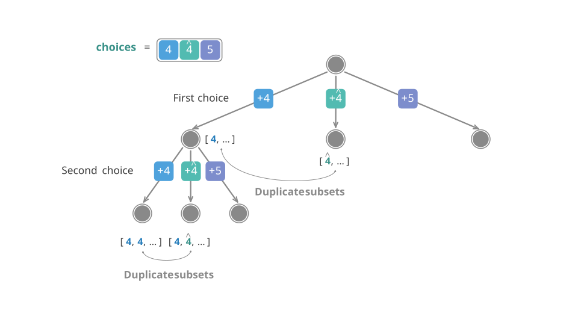
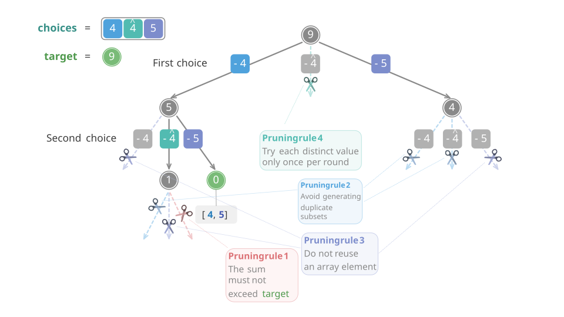

# The subset sum problem

## Distinct input values

!!! question

    Given an array of positive integers `nums` and a positive integer `target`, find all combinations whose elements sum to `target`. The array contains no duplicates, and each element may be chosen multiple times. Return a list of the combinations with no duplicates.

For example, given the set $\{3, 4, 5\}$ and target $9$, the solutions are $\{3, 3, 3\}, \{4, 5\}$. Two details matter here.

- Each element of the input set may be chosen any number of times.
- Order does not matter in a subset. For example, $\{4, 5\}$ and $\{5, 4\}$ represent the same subset.

### Starting from the permutations solution

As with permutations, we can build a subset through a sequence of choices. Update the running sum with each choice. When it equals `target`, record the subset in the result list.

Here, however, **each element may be chosen any number of times**, so there is no need for the Boolean list `selected` to track which elements have been used. A small change to the permutations code gives us a first implementation:

```src
[file]{subset_sum_i_naive}-[class]{}-[func]{subset_sum_i_naive}
```

With input array $[3, 4, 5]$ and target $9$, the code produces $[3, 3, 3], [4, 5], [5, 4]$. **It finds all subsets that sum to $9$, but $[4, 5]$ and $[5, 4]$ are duplicates**.

The search distinguishes different selection orders, while a subset has no order. As the figure shows, choosing $4$ and then $5$ follows a different branch from choosing $5$ and then $4$, but both yield the same subset.


One straightforward option is to **remove duplicates from the result list**. This is inefficient for two reasons.

- When the array has many elements, especially when `target` is large, the search generates many duplicate subsets.
- Comparing subsets stored as arrays is expensive. First sort the arrays, then compare them element by element.

### Pruning duplicate subsets

**We can prune duplicates during the search**. As the figure shows, choosing array elements in different orders produces duplicate subsets. Consider the following choices.

1. Choosing $3$ and then $4$ in the first two rounds generates all subsets containing those two elements, denoted by $[3, 4, \dots]$.
2. Later, if the first choice is $4$, **skip $3$ in the second round**. The subsets $[4, 3, \dots]$ would duplicate those generated in step `1.`.

At each level, the search tries the choices from left to right. The farther right a branch lies, the more choices are pruned.

1. Choose $3$ and $5$ in the first two rounds to generate subsets $[3, 5, \dots]$.
2. Choose $4$ and $5$ in the first two rounds to generate subsets $[4, 5, \dots]$.
3. If the first choice is $5$, **skip both $3$ and $4$ in the second round**. The subsets $[5, 3, \dots]$ and $[5, 4, \dots]$ would duplicate those described in steps `1.` and `2.`.


In general, for an input array $[x_1, x_2, \dots, x_n]$ and a sequence of choices $[x_{i_1}, x_{i_2}, \dots, x_{i_m}]$, the indices must satisfy $i_1 \leq i_2 \leq \dots \leq i_m$. **Any sequence that violates this condition produces a duplicate and should be pruned**.

### Implementation

To implement this rule, initialize a variable `start` to track where iteration begins. **After choosing $x_{i}$, begin the next round at index $i$**. This ensures that the indices satisfy $i_1 \leq i_2 \leq \dots \leq i_m$ and each subset is unique.

We also make two optimizations.

- Sort `nums` before starting the search. When iterating through the choices, **break out of the loop as soon as a choice takes the subset sum above `target`**. Later elements are larger, so choosing any of them would also take the sum above `target`.
- Drop the running sum variable `total`. Instead, **subtract each chosen value from `target` to track the sum still needed**. Record a solution when `target` reaches $0$.

```src
[file]{subset_sum_i}-[class]{}-[func]{subset_sum_i}
```

The figure shows the full backtracking process for input array $[3, 4, 5]$ and target $9$.


## Repeated input values

!!! question

    Given an array of positive integers `nums` and a positive integer `target`, find all combinations whose elements sum to `target`. **The input may contain duplicate values, and each element may be chosen only once**. Return a list of the combinations with no duplicates.

This time, **the input array may contain duplicate values**, which introduces another problem. For example, with array $[4, \hat{4}, 5]$ and target $9$, the existing code produces $[4, 5], [\hat{4}, 5]$, a duplicate subset.

**Duplicates arise when we try equal values more than once in a round**. In the figure below, two of the three choices in the first round have value $4$, producing identical branches and duplicate subsets. The two copies of $4$ in the second round likewise produce duplicates.



### Pruning equal values

To solve this problem, **try each distinct value only once in a given round**. The sorted array makes this simple: equal values are adjacent. If the current element equals its left neighbor already tried in this round, skip it.

The problem also **allows each array element to be chosen only once**. We can use `start` to enforce this constraint too. After choosing $x_{i}$, start the next round at index $i + 1$ and move forward. This prevents both duplicate subsets and repeated use of an element.

### Implementation

```src
[file]{subset_sum_ii}-[class]{}-[func]{subset_sum_ii}
```

The figure traces the search for array $[4, 4, 5]$ and target $9$, with four pruning rules. Follow the figure alongside the code comments to see how the search proceeds and where each rule applies.


