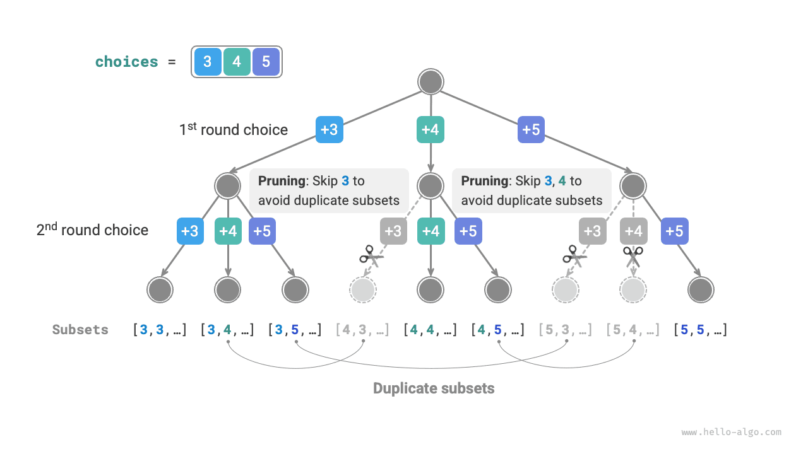

# Subset sum problem

## Distinct elements

!!! question

    Given an array of positive integers `nums` and a positive target integer `target`, find all combinations whose elements sum to `target`. The array has no duplicate elements, and each element may be chosen multiple times. Return the combinations as a list containing no duplicates.

For example, with input $\{3, 4, 5\}$ and target $9$, the solutions are $\{3, 3, 3\}, \{4, 5\}$. Keep two points in mind.

- Each input element may be chosen an unlimited number of times.
- Element order does not matter: $\{4, 5\}$ and $\{5, 4\}$ represent the same subset.

### Starting from the permutations solution

As with permutations, we can view generating a subset as a sequence of choices. Update the sum as we make choices, and record the subset when the sum equals `target`.

Unlike permutations, **each element may be chosen an unlimited number of times**, so we do not need a Boolean `selected` list. A small modification to the permutations code gives an initial solution:

```src
[file]{subset_sum_i_naive}-[class]{}-[func]{subset_sum_i_naive}
```

For input array $[3, 4, 5]$ and target $9$, this code returns $[3, 3, 3], [4, 5], [5, 4]$. **It finds all subsets summing to $9$, but includes the duplicate subsets $[4, 5]$ and $[5, 4]$**.

The search distinguishes the order of choices, whereas subsets do not. As shown in the figure below, choosing $4$ then $5$ and choosing $5$ then $4$ follow different branches but produce the same subset.


**One straightforward way to remove duplicate subsets is to deduplicate the result list**. However, this is inefficient for two reasons.

- With many array elements, especially when `target` is large, the search generates many duplicate subsets.
- Comparing subsets (arrays) is expensive: we must sort them first, then compare their elements one by one.

### Pruning duplicate subsets

**Instead, we can eliminate duplicates by pruning during the search**. As shown in the figure below, duplicates arise when array elements are chosen in different orders, as in the following example.

1. Choosing $3$ and then $4$ in the first two rounds generates all subsets beginning with these choices, denoted by $[3, 4, \dots]$.
2. Later, after choosing $4$ first, **we should skip $3$ in the second round**, because subsets $[4, 3, \dots]$ duplicate those generated in step `1.`.

At each level of the search, choices are tried from left to right, so branches farther to the right have more choices pruned.

1. Choosing $3$ and then $5$ generates subsets $[3, 5, \dots]$.
2. Choosing $4$ and then $5$ generates subsets $[4, 5, \dots]$.
3. If $5$ is chosen first, **skip both $3$ and $4$ in the second round**, because $[5, 3, \dots]$ and $[5, 4, \dots]$ duplicate the subsets described in steps `1.` and `2.`.



In general, for input $[x_1, x_2, \dots, x_n]$, a sequence of choices $[x_{i_1}, x_{i_2}, \dots, x_{i_m}]$ must satisfy $i_1 \leq i_2 \leq \dots \leq i_m$. **Any sequence violating this condition creates a duplicate and should be pruned**.

### Code implementation

To implement this pruning, introduce `start` to specify where iteration begins. **After choosing $x_{i}$, begin the next round at index $i$**. This enforces $i_1 \leq i_2 \leq \dots \leq i_m$ and ensures that each subset is unique.

We also make two further improvements.

- Sort `nums` before starting the search. While iterating over choices, **stop the loop as soon as the subset sum exceeds `target`**, because all later elements are larger and would also exceed it.
- Remove the sum variable `total` and **track the sum by subtracting from `target`**. Record a solution when `target` reaches $0$.

```src
[file]{subset_sum_i}-[class]{}-[func]{subset_sum_i}
```

The figure below shows the complete backtracking process for input $[3, 4, 5]$ and target $9$.


## Duplicate elements

!!! question

    Given an array of positive integers `nums` and a positive target integer `target`, find all combinations whose elements sum to `target`. **The array may contain duplicate elements, and each element may be chosen only once**. Return the combinations as a list containing no duplicates.

Unlike the previous problem, **the input may contain duplicate elements**, which introduces a new issue. For array $[4, \hat{4}, 5]$ and target $9$, for example, the existing code produces $[4, 5], [\hat{4}, 5]$: duplicate subsets.

**These duplicates occur because equal elements are tried more than once in a single round**. In the figure below, the first round has three choices, two of which are $4$. They generate duplicate branches and therefore duplicate subsets. The two occurrences of $4$ in the second round cause the same problem.


### Pruning equal elements

To solve this, **try each value only once in each round**. The implementation uses the fact that equal elements are adjacent in a sorted array. Within a round, if an element equals the preceding element, that value has already been tried, so skip the current element.

In addition, **each array element may be chosen only once**. Fortunately, `start` can enforce this constraint too: after choosing $x_{i}$, begin the next round at index $i + 1$. This both eliminates duplicate subsets and prevents reusing an element.

### Code implementation

```src
[file]{subset_sum_ii}-[class]{}-[func]{subset_sum_ii}
```

The figure below shows backtracking for array $[4, 4, 5]$ and target $9$, including four types of pruning. Follow the illustration alongside the code comments to understand the full search and how each pruning rule works.


