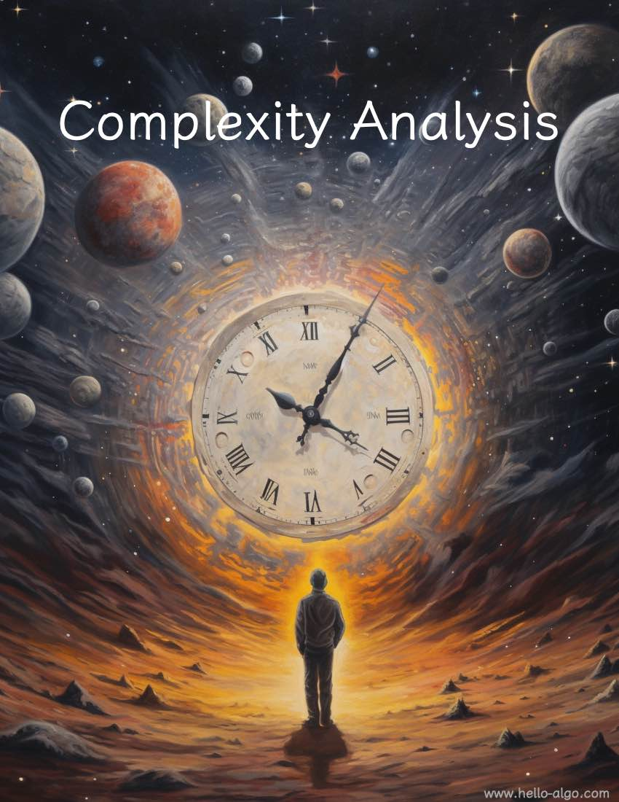

# Complexity analysis

!!! abstract

    Complexity analysis is our guide to time and space in the vast universe of algorithms.
    
    It helps us explore both dimensions in search of more elegant solutions.
