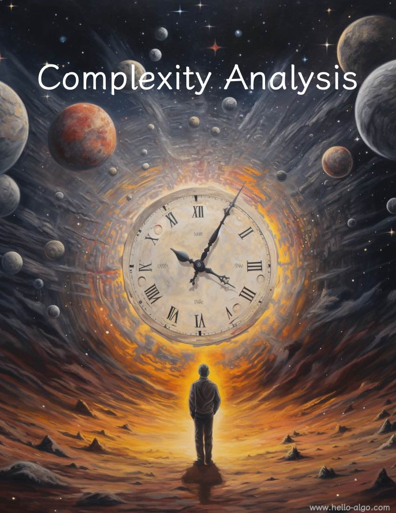

# Complexity analysis

!!! abstract

    Complexity analysis is our guide to time and space in the vast universe of algorithms.
    
    It leads us to explore these two dimensions in depth as we search for more elegant solutions.
