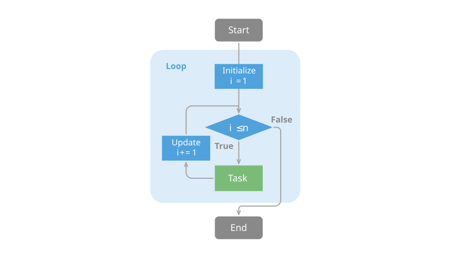
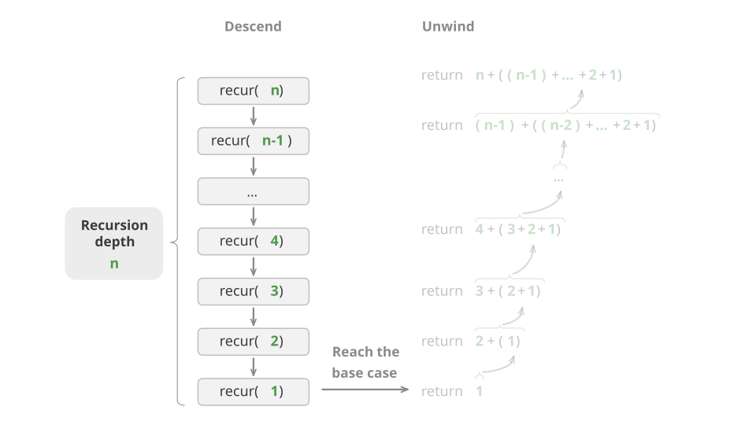
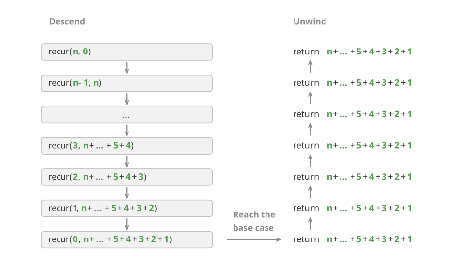

# 2.2 &nbsp; Iteration and recursion

Algorithms often perform a task repeatedly, and these repetitions matter when we analyze complexity. Before we look at time and space complexity, let's explore two basic control structures that let a program repeat a task: iteration and recursion.

## 2.2.1 &nbsp; Iteration

<u>Iteration</u> is a control structure for repeating a task. A program repeatedly executes a block of code while a condition holds and stops when the condition no longer holds.

### 1. &nbsp; The for loop

A `for` loop is one of the most common forms of iteration. It is **well suited to situations where you know the number of iterations in advance**.

The following function uses a `for` loop to compute $1 + 2 + \dots + n$ and stores the running sum in `res`. In Python, the interval for `range(a, b)` includes the left endpoint and excludes the right, so the loop visits $a, a + 1, \dots, b-1$:

=== "Python"

    ```python title="iteration.py"
    def for_loop(n: int) -> int:
        """for loop"""
        res = 0
        # Sum 1, 2, ..., n-1, n in a loop
        for i in range(1, n + 1):
            res += i
        return res
    ```

=== "C++"

    ```cpp title="iteration.cpp"
    /* for loop */
    int forLoop(int n) {
        int res = 0;
        // Sum 1, 2, ..., n-1, n in a loop
        for (int i = 1; i <= n; ++i) {
            res += i;
        }
        return res;
    }
    ```

=== "Java"

    ```java title="iteration.java"
    /* for loop */
    int forLoop(int n) {
        int res = 0;
        // Sum 1, 2, ..., n-1, n in a loop
        for (int i = 1; i <= n; i++) {
            res += i;
        }
        return res;
    }
    ```

=== "C#"

    ```csharp title="iteration.cs"
    /* for loop */
    int ForLoop(int n) {
        int res = 0;
        // Sum 1, 2, ..., n-1, n in a loop
        for (int i = 1; i <= n; i++) {
            res += i;
        }
        return res;
    }
    ```

=== "Go"

    ```go title="iteration.go"
    /* for loop */
    func forLoop(n int) int {
        res := 0
        // Sum 1, 2, ..., n-1, n in a loop
        for i := 1; i <= n; i++ {
            res += i
        }
        return res
    }
    ```

=== "Swift"

    ```swift title="iteration.swift"
    /* for loop */
    func forLoop(n: Int) -> Int {
        var res = 0
        // Sum 1, 2, ..., n-1, n in a loop
        for i in 1 ... n {
            res += i
        }
        return res
    }
    ```

=== "JS"

    ```javascript title="iteration.js"
    /* for loop */
    function forLoop(n) {
        let res = 0;
        // Sum 1, 2, ..., n-1, n in a loop
        for (let i = 1; i <= n; i++) {
            res += i;
        }
        return res;
    }
    ```

=== "TS"

    ```typescript title="iteration.ts"
    /* for loop */
    function forLoop(n: number): number {
        let res = 0;
        // Sum 1, 2, ..., n-1, n in a loop
        for (let i = 1; i <= n; i++) {
            res += i;
        }
        return res;
    }
    ```

=== "Dart"

    ```dart title="iteration.dart"
    /* for loop */
    int forLoop(int n) {
      int res = 0;
      // Sum 1, 2, ..., n-1, n in a loop
      for (int i = 1; i <= n; i++) {
        res += i;
      }
      return res;
    }
    ```

=== "Rust"

    ```rust title="iteration.rs"
    /* for loop */
    fn for_loop(n: i32) -> i32 {
        let mut res = 0;
        // Sum 1, 2, ..., n-1, n in a loop
        for i in 1..=n {
            res += i;
        }
        res
    }
    ```

=== "C"

    ```c title="iteration.c"
    /* for loop */
    int forLoop(int n) {
        int res = 0;
        // Sum 1, 2, ..., n-1, n in a loop
        for (int i = 1; i <= n; i++) {
            res += i;
        }
        return res;
    }
    ```

=== "Kotlin"

    ```kotlin title="iteration.kt"
    /* for loop */
    fun forLoop(n: Int): Int {
        var res = 0
        // Sum 1, 2, ..., n-1, n in a loop
        for (i in 1..n) {
            res += i
        }
        return res
    }
    ```

=== "Ruby"

    ```ruby title="iteration.rb"
    ### for loop ###
    def for_loop(n)
      res = 0

      # Sum 1, 2, ..., n-1, n in a loop
      for i in 1..n
        res += i
      end

      res
    end
    ```

??? pythontutor "Visualize execution"

    <div style="height: 423px; width: 100%;"><iframe class="pythontutor-iframe" title="Visualize execution" src="https://pythontutor.com/iframe-embed.html#code=def%20for_loop%28n%3A%20int%29%20-%3E%20int%3A%0A%20%20%20%20%22%22%22for%20loop%22%22%22%0A%20%20%20%20res%20%3D%200%0A%20%20%20%20%23%20Sum%201,%202,%20...,%20n-1,%20n%20in%20a%20loop%0A%20%20%20%20for%20i%20in%20range%281,%20n%20%2B%201%29%3A%0A%20%20%20%20%20%20%20%20res%20%2B%3D%20i%0A%20%20%20%20return%20res%0A%0A%22%22%22Driver%20Code%22%22%22%0Aif%20__name__%20%3D%3D%20%22__main__%22%3A%0A%20%20%20%20n%20%3D%205%0A%20%20%20%20res%20%3D%20for_loop%28n%29%0A%20%20%20%20print%28f%22%5Cnfor%20loop%20sum%3A%20res%20%3D%20%7Bres%7D%22%29&codeDivHeight=472&codeDivWidth=350&cumulative=false&curInstr=3&heapPrimitives=nevernest&origin=opt-frontend.js&py=311&rawInputLstJSON=%5B%5D&"> </iframe></div>
    <div style="margin-top: 5px;"><a href="https://pythontutor.com/iframe-embed.html#code=def%20for_loop%28n%3A%20int%29%20-%3E%20int%3A%0A%20%20%20%20%22%22%22for%20loop%22%22%22%0A%20%20%20%20res%20%3D%200%0A%20%20%20%20%23%20Sum%201,%202,%20...,%20n-1,%20n%20in%20a%20loop%0A%20%20%20%20for%20i%20in%20range%281,%20n%20%2B%201%29%3A%0A%20%20%20%20%20%20%20%20res%20%2B%3D%20i%0A%20%20%20%20return%20res%0A%0A%22%22%22Driver%20Code%22%22%22%0Aif%20__name__%20%3D%3D%20%22__main__%22%3A%0A%20%20%20%20n%20%3D%205%0A%20%20%20%20res%20%3D%20for_loop%28n%29%0A%20%20%20%20print%28f%22%5Cnfor%20loop%20sum%3A%20res%20%3D%20%7Bres%7D%22%29&codeDivHeight=800&codeDivWidth=600&cumulative=false&curInstr=3&heapPrimitives=nevernest&origin=opt-frontend.js&py=311&rawInputLstJSON=%5B%5D&" target="_blank" rel="noopener noreferrer">View full screen ></a></div>

The flowchart below shows how the summation function works.

{ class="animation-figure" }

<p align="center"> Figure 2-1 &nbsp; Flowchart for the summation function </p>

The number of operations in this function is proportional to the input size $n$. We call this a linear relationship. In this example, **time complexity describes that linear relationship**, as we'll see in detail in the next section.

### 2. &nbsp; The while loop

Like a `for` loop, a `while` loop implements iteration. At the start of each pass through a `while` loop, the program checks the condition. If it is true, the loop body runs. Otherwise, the loop ends.

Here is a `while` loop that computes $1 + 2 + \dots + n$:

=== "Python"

    ```python title="iteration.py"
    def while_loop(n: int) -> int:
        """while loop"""
        res = 0
        i = 1  # Initialize the loop control variable
        # Sum 1, 2, ..., n-1, n in a loop
        while i <= n:
            res += i
            i += 1  # Update the loop control variable
        return res
    ```

=== "C++"

    ```cpp title="iteration.cpp"
    /* while loop */
    int whileLoop(int n) {
        int res = 0;
        int i = 1; // Initialize the loop control variable
        // Sum 1, 2, ..., n-1, n in a loop
        while (i <= n) {
            res += i;
            i++; // Update the loop control variable
        }
        return res;
    }
    ```

=== "Java"

    ```java title="iteration.java"
    /* while loop */
    int whileLoop(int n) {
        int res = 0;
        int i = 1; // Initialize the loop control variable
        // Sum 1, 2, ..., n-1, n in a loop
        while (i <= n) {
            res += i;
            i++; // Update the loop control variable
        }
        return res;
    }
    ```

=== "C#"

    ```csharp title="iteration.cs"
    /* while loop */
    int WhileLoop(int n) {
        int res = 0;
        int i = 1; // Initialize the loop control variable
        // Sum 1, 2, ..., n-1, n in a loop
        while (i <= n) {
            res += i;
            i += 1; // Update the loop control variable
        }
        return res;
    }
    ```

=== "Go"

    ```go title="iteration.go"
    /* while loop */
    func whileLoop(n int) int {
        res := 0
        // Initialize the loop control variable
        i := 1
        // Sum 1, 2, ..., n-1, n in a loop
        for i <= n {
            res += i
            // Update the loop control variable
            i++
        }
        return res
    }
    ```

=== "Swift"

    ```swift title="iteration.swift"
    /* while loop */
    func whileLoop(n: Int) -> Int {
        var res = 0
        var i = 1 // Initialize the loop control variable
        // Sum 1, 2, ..., n-1, n in a loop
        while i <= n {
            res += i
            i += 1 // Update the loop control variable
        }
        return res
    }
    ```

=== "JS"

    ```javascript title="iteration.js"
    /* while loop */
    function whileLoop(n) {
        let res = 0;
        let i = 1; // Initialize the loop control variable
        // Sum 1, 2, ..., n-1, n in a loop
        while (i <= n) {
            res += i;
            i++; // Update the loop control variable
        }
        return res;
    }
    ```

=== "TS"

    ```typescript title="iteration.ts"
    /* while loop */
    function whileLoop(n: number): number {
        let res = 0;
        let i = 1; // Initialize the loop control variable
        // Sum 1, 2, ..., n-1, n in a loop
        while (i <= n) {
            res += i;
            i++; // Update the loop control variable
        }
        return res;
    }
    ```

=== "Dart"

    ```dart title="iteration.dart"
    /* while loop */
    int whileLoop(int n) {
      int res = 0;
      int i = 1; // Initialize the loop control variable
      // Sum 1, 2, ..., n-1, n in a loop
      while (i <= n) {
        res += i;
        i++; // Update the loop control variable
      }
      return res;
    }
    ```

=== "Rust"

    ```rust title="iteration.rs"
    /* while loop */
    fn while_loop(n: i32) -> i32 {
        let mut res = 0;
        let mut i = 1; // Initialize the loop control variable

        // Sum 1, 2, ..., n-1, n in a loop
        while i <= n {
            res += i;
            i += 1; // Update the loop control variable
        }
        res
    }
    ```

=== "C"

    ```c title="iteration.c"
    /* while loop */
    int whileLoop(int n) {
        int res = 0;
        int i = 1; // Initialize the loop control variable
        // Sum 1, 2, ..., n-1, n in a loop
        while (i <= n) {
            res += i;
            i++; // Update the loop control variable
        }
        return res;
    }
    ```

=== "Kotlin"

    ```kotlin title="iteration.kt"
    /* while loop */
    fun whileLoop(n: Int): Int {
        var res = 0
        var i = 1 // Initialize the loop control variable
        // Sum 1, 2, ..., n-1, n in a loop
        while (i <= n) {
            res += i
            i++ // Update the loop control variable
        }
        return res
    }
    ```

=== "Ruby"

    ```ruby title="iteration.rb"
    ### while loop ###
    def while_loop(n)
      res = 0
      i = 1 # Initialize the loop control variable

      # Sum 1, 2, ..., n-1, n in a loop
      while i <= n
        res += i
        i += 1 # Update the loop control variable
      end

      res
    end
    ```

??? pythontutor "Visualize execution"

    <div style="height: 459px; width: 100%;"><iframe class="pythontutor-iframe" title="Visualize execution" src="https://pythontutor.com/iframe-embed.html#code=def%20while_loop%28n%3A%20int%29%20-%3E%20int%3A%0A%20%20%20%20%22%22%22while%20loop%22%22%22%0A%20%20%20%20res%20%3D%200%0A%20%20%20%20i%20%3D%201%20%20%23%20Initialize%20the%20loop%20control%20variable%0A%20%20%20%20%23%20Sum%201,%202,%20...,%20n-1,%20n%20in%20a%20loop%0A%20%20%20%20while%20i%20%3C%3D%20n%3A%0A%20%20%20%20%20%20%20%20res%20%2B%3D%20i%0A%20%20%20%20%20%20%20%20i%20%2B%3D%201%20%20%23%20Update%20the%20loop%20control%20variable%0A%20%20%20%20return%20res%0A%0A%22%22%22Driver%20Code%22%22%22%0Aif%20__name__%20%3D%3D%20%22__main__%22%3A%0A%20%20%20%20n%20%3D%205%0A%20%20%20%20res%20%3D%20while_loop%28n%29%0A%20%20%20%20print%28f%22%5Cnwhile%20loop%20sum%3A%20res%20%3D%20%7Bres%7D%22%29&codeDivHeight=472&codeDivWidth=350&cumulative=false&curInstr=3&heapPrimitives=nevernest&origin=opt-frontend.js&py=311&rawInputLstJSON=%5B%5D&textReferences=false"> </iframe></div>
    <div style="margin-top: 5px;"><a href="https://pythontutor.com/iframe-embed.html#code=def%20while_loop%28n%3A%20int%29%20-%3E%20int%3A%0A%20%20%20%20%22%22%22while%20loop%22%22%22%0A%20%20%20%20res%20%3D%200%0A%20%20%20%20i%20%3D%201%20%20%23%20Initialize%20the%20loop%20control%20variable%0A%20%20%20%20%23%20Sum%201,%202,%20...,%20n-1,%20n%20in%20a%20loop%0A%20%20%20%20while%20i%20%3C%3D%20n%3A%0A%20%20%20%20%20%20%20%20res%20%2B%3D%20i%0A%20%20%20%20%20%20%20%20i%20%2B%3D%201%20%20%23%20Update%20the%20loop%20control%20variable%0A%20%20%20%20return%20res%0A%0A%22%22%22Driver%20Code%22%22%22%0Aif%20__name__%20%3D%3D%20%22__main__%22%3A%0A%20%20%20%20n%20%3D%205%0A%20%20%20%20res%20%3D%20while_loop%28n%29%0A%20%20%20%20print%28f%22%5Cnwhile%20loop%20sum%3A%20res%20%3D%20%7Bres%7D%22%29&codeDivHeight=800&codeDivWidth=600&cumulative=false&curInstr=3&heapPrimitives=nevernest&origin=opt-frontend.js&py=311&rawInputLstJSON=%5B%5D&textReferences=false" target="_blank" rel="noopener noreferrer">View full screen ></a></div>

**A `while` loop offers more flexibility than a `for` loop**. In a `while` loop, we can choose how to initialize and update the variable used in the condition.

For example, the following code updates $i$ twice per iteration. This pattern is less convenient to express with a `for` loop:

=== "Python"

    ```python title="iteration.py"
    def while_loop_ii(n: int) -> int:
        """while loop (two updates)"""
        res = 0
        i = 1  # Initialize the loop control variable
        # Sum 1, 4, 10, ... in a loop
        while i <= n:
            res += i
            # Update the loop control variable
            i += 1
            i *= 2
        return res
    ```

=== "C++"

    ```cpp title="iteration.cpp"
    /* while loop (two updates) */
    int whileLoopII(int n) {
        int res = 0;
        int i = 1; // Initialize the loop control variable
        // Sum 1, 4, 10, ... in a loop
        while (i <= n) {
            res += i;
            // Update the loop control variable
            i++;
            i *= 2;
        }
        return res;
    }
    ```

=== "Java"

    ```java title="iteration.java"
    /* while loop (two updates) */
    int whileLoopII(int n) {
        int res = 0;
        int i = 1; // Initialize the loop control variable
        // Sum 1, 4, 10, ... in a loop
        while (i <= n) {
            res += i;
            // Update the loop control variable
            i++;
            i *= 2;
        }
        return res;
    }
    ```

=== "C#"

    ```csharp title="iteration.cs"
    /* while loop (two updates) */
    int WhileLoopII(int n) {
        int res = 0;
        int i = 1; // Initialize the loop control variable
        // Sum 1, 4, 10, ... in a loop
        while (i <= n) {
            res += i;
            // Update the loop control variable
            i += 1; 
            i *= 2;
        }
        return res;
    }
    ```

=== "Go"

    ```go title="iteration.go"
    /* while loop (two updates) */
    func whileLoopII(n int) int {
        res := 0
        // Initialize the loop control variable
        i := 1
        // Sum 1, 4, 10, ... in a loop
        for i <= n {
            res += i
            // Update the loop control variable
            i++
            i *= 2
        }
        return res
    }
    ```

=== "Swift"

    ```swift title="iteration.swift"
    /* while loop (two updates) */
    func whileLoopII(n: Int) -> Int {
        var res = 0
        var i = 1 // Initialize the loop control variable
        // Sum 1, 4, 10, ... in a loop
        while i <= n {
            res += i
            // Update the loop control variable
            i += 1
            i *= 2
        }
        return res
    }
    ```

=== "JS"

    ```javascript title="iteration.js"
    /* while loop (two updates) */
    function whileLoopII(n) {
        let res = 0;
        let i = 1; // Initialize the loop control variable
        // Sum 1, 4, 10, ... in a loop
        while (i <= n) {
            res += i;
            // Update the loop control variable
            i++;
            i *= 2;
        }
        return res;
    }
    ```

=== "TS"

    ```typescript title="iteration.ts"
    /* while loop (two updates) */
    function whileLoopII(n: number): number {
        let res = 0;
        let i = 1; // Initialize the loop control variable
        // Sum 1, 4, 10, ... in a loop
        while (i <= n) {
            res += i;
            // Update the loop control variable
            i++;
            i *= 2;
        }
        return res;
    }
    ```

=== "Dart"

    ```dart title="iteration.dart"
    /* while loop (two updates) */
    int whileLoopII(int n) {
      int res = 0;
      int i = 1; // Initialize the loop control variable
      // Sum 1, 4, 10, ... in a loop
      while (i <= n) {
        res += i;
        // Update the loop control variable
        i++;
        i *= 2;
      }
      return res;
    }
    ```

=== "Rust"

    ```rust title="iteration.rs"
    /* while loop (two updates) */
    fn while_loop_ii(n: i32) -> i32 {
        let mut res = 0;
        let mut i = 1; // Initialize the loop control variable

        // Sum 1, 4, 10, ... in a loop
        while i <= n {
            res += i;
            // Update the loop control variable
            i += 1;
            i *= 2;
        }
        res
    }
    ```

=== "C"

    ```c title="iteration.c"
    /* while loop (two updates) */
    int whileLoopII(int n) {
        int res = 0;
        int i = 1; // Initialize the loop control variable
        // Sum 1, 4, 10, ... in a loop
        while (i <= n) {
            res += i;
            // Update the loop control variable
            i++;
            i *= 2;
        }
        return res;
    }
    ```

=== "Kotlin"

    ```kotlin title="iteration.kt"
    /* while loop (two updates) */
    fun whileLoopII(n: Int): Int {
        var res = 0
        var i = 1 // Initialize the loop control variable
        // Sum 1, 4, 10, ... in a loop
        while (i <= n) {
            res += i
            // Update the loop control variable
            i++
            i *= 2
        }
        return res
    }
    ```

=== "Ruby"

    ```ruby title="iteration.rb"
    ### while loop (two updates)###
    def while_loop_ii(n)
      res = 0
      i = 1 # Initialize the loop control variable

      # Sum 1, 4, 10, ... in a loop
      while i <= n
        res += i
        # Update the loop control variable
        i += 1
        i *= 2
      end

      res
    end
    ```

??? pythontutor "Visualize execution"

    <div style="height: 495px; width: 100%;"><iframe class="pythontutor-iframe" title="Visualize execution" src="https://pythontutor.com/iframe-embed.html#code=def%20while_loop_ii%28n%3A%20int%29%20-%3E%20int%3A%0A%20%20%20%20%22%22%22while%20loop%20%28two%20updates%29%22%22%22%0A%20%20%20%20res%20%3D%200%0A%20%20%20%20i%20%3D%201%20%20%23%20Initialize%20the%20loop%20control%20variable%0A%20%20%20%20%23%20Sum%201,%204,%2010,%20...%20in%20a%20loop%0A%20%20%20%20while%20i%20%3C%3D%20n%3A%0A%20%20%20%20%20%20%20%20res%20%2B%3D%20i%0A%20%20%20%20%20%20%20%20%23%20Update%20the%20loop%20control%20variable%0A%20%20%20%20%20%20%20%20i%20%2B%3D%201%0A%20%20%20%20%20%20%20%20i%20%2A%3D%202%0A%20%20%20%20return%20res%0A%0A%22%22%22Driver%20Code%22%22%22%0Aif%20__name__%20%3D%3D%20%22__main__%22%3A%0A%20%20%20%20n%20%3D%205%0A%20%20%20%20res%20%3D%20while_loop_ii%28n%29%0A%20%20%20%20print%28f%22%5Cnwhile%20loop%20sum%20%28two%20updates%29%3A%20res%20%3D%20%7Bres%7D%22%29&codeDivHeight=472&codeDivWidth=350&cumulative=false&curInstr=3&heapPrimitives=nevernest&origin=opt-frontend.js&py=311&rawInputLstJSON=%5B%5D&textReferences=false"> </iframe></div>
    <div style="margin-top: 5px;"><a href="https://pythontutor.com/iframe-embed.html#code=def%20while_loop_ii%28n%3A%20int%29%20-%3E%20int%3A%0A%20%20%20%20%22%22%22while%20loop%20%28two%20updates%29%22%22%22%0A%20%20%20%20res%20%3D%200%0A%20%20%20%20i%20%3D%201%20%20%23%20Initialize%20the%20loop%20control%20variable%0A%20%20%20%20%23%20Sum%201,%204,%2010,%20...%20in%20a%20loop%0A%20%20%20%20while%20i%20%3C%3D%20n%3A%0A%20%20%20%20%20%20%20%20res%20%2B%3D%20i%0A%20%20%20%20%20%20%20%20%23%20Update%20the%20loop%20control%20variable%0A%20%20%20%20%20%20%20%20i%20%2B%3D%201%0A%20%20%20%20%20%20%20%20i%20%2A%3D%202%0A%20%20%20%20return%20res%0A%0A%22%22%22Driver%20Code%22%22%22%0Aif%20__name__%20%3D%3D%20%22__main__%22%3A%0A%20%20%20%20n%20%3D%205%0A%20%20%20%20res%20%3D%20while_loop_ii%28n%29%0A%20%20%20%20print%28f%22%5Cnwhile%20loop%20sum%20%28two%20updates%29%3A%20res%20%3D%20%7Bres%7D%22%29&codeDivHeight=800&codeDivWidth=600&cumulative=false&curInstr=3&heapPrimitives=nevernest&origin=opt-frontend.js&py=311&rawInputLstJSON=%5B%5D&textReferences=false" target="_blank" rel="noopener noreferrer">View full screen ></a></div>

In general, **a `for` loop is more compact and a `while` loop is more flexible**. Both implement iteration. Choose the one that fits the problem.

### 3. &nbsp; Nested loops

We can put one loop inside another. Here is an example with `for` loops:

=== "Python"

    ```python title="iteration.py"
    def nested_for_loop(n: int) -> str:
        """Nested for loops"""
        res = ""
        # Loop over i = 1, 2, ..., n-1, n
        for i in range(1, n + 1):
            # Loop over j = 1, 2, ..., n-1, n
            for j in range(1, n + 1):
                res += f"({i}, {j}), "
        return res
    ```

=== "C++"

    ```cpp title="iteration.cpp"
    /* Nested for loops */
    string nestedForLoop(int n) {
        ostringstream res;
        // Loop over i = 1, 2, ..., n-1, n
        for (int i = 1; i <= n; ++i) {
            // Loop over j = 1, 2, ..., n-1, n
            for (int j = 1; j <= n; ++j) {
                res << "(" << i << ", " << j << "), ";
            }
        }
        return res.str();
    }
    ```

=== "Java"

    ```java title="iteration.java"
    /* Nested for loops */
    String nestedForLoop(int n) {
        StringBuilder res = new StringBuilder();
        // Loop over i = 1, 2, ..., n-1, n
        for (int i = 1; i <= n; i++) {
            // Loop over j = 1, 2, ..., n-1, n
            for (int j = 1; j <= n; j++) {
                res.append("(" + i + ", " + j + "), ");
            }
        }
        return res.toString();
    }
    ```

=== "C#"

    ```csharp title="iteration.cs"
    /* Nested for loops */
    string NestedForLoop(int n) {
        StringBuilder res = new();
        // Loop over i = 1, 2, ..., n-1, n
        for (int i = 1; i <= n; i++) {
            // Loop over j = 1, 2, ..., n-1, n
            for (int j = 1; j <= n; j++) {
                res.Append($"({i}, {j}), ");
            }
        }
        return res.ToString();
    }
    ```

=== "Go"

    ```go title="iteration.go"
    /* Nested for loops */
    func nestedForLoop(n int) string {
        res := ""
        // Loop over i = 1, 2, ..., n-1, n
        for i := 1; i <= n; i++ {
            for j := 1; j <= n; j++ {
                // Loop over j = 1, 2, ..., n-1, n
                res += fmt.Sprintf("(%d, %d), ", i, j)
            }
        }
        return res
    }
    ```

=== "Swift"

    ```swift title="iteration.swift"
    /* Nested for loops */
    func nestedForLoop(n: Int) -> String {
        var res = ""
        // Loop over i = 1, 2, ..., n-1, n
        for i in 1 ... n {
            // Loop over j = 1, 2, ..., n-1, n
            for j in 1 ... n {
                res.append("(\(i), \(j)), ")
            }
        }
        return res
    }
    ```

=== "JS"

    ```javascript title="iteration.js"
    /* Nested for loops */
    function nestedForLoop(n) {
        let res = '';
        // Loop over i = 1, 2, ..., n-1, n
        for (let i = 1; i <= n; i++) {
            // Loop over j = 1, 2, ..., n-1, n
            for (let j = 1; j <= n; j++) {
                res += `(${i}, ${j}), `;
            }
        }
        return res;
    }
    ```

=== "TS"

    ```typescript title="iteration.ts"
    /* Nested for loops */
    function nestedForLoop(n: number): string {
        let res = '';
        // Loop over i = 1, 2, ..., n-1, n
        for (let i = 1; i <= n; i++) {
            // Loop over j = 1, 2, ..., n-1, n
            for (let j = 1; j <= n; j++) {
                res += `(${i}, ${j}), `;
            }
        }
        return res;
    }
    ```

=== "Dart"

    ```dart title="iteration.dart"
    /* Nested for loops */
    String nestedForLoop(int n) {
      String res = "";
      // Loop over i = 1, 2, ..., n-1, n
      for (int i = 1; i <= n; i++) {
        // Loop over j = 1, 2, ..., n-1, n
        for (int j = 1; j <= n; j++) {
          res += "($i, $j), ";
        }
      }
      return res;
    }
    ```

=== "Rust"

    ```rust title="iteration.rs"
    /* Nested for loops */
    fn nested_for_loop(n: i32) -> String {
        let mut res = vec![];
        // Loop over i = 1, 2, ..., n-1, n
        for i in 1..=n {
            // Loop over j = 1, 2, ..., n-1, n
            for j in 1..=n {
                res.push(format!("({}, {}), ", i, j));
            }
        }
        res.join("")
    }
    ```

=== "C"

    ```c title="iteration.c"
    /* Nested for loops */
    char *nestedForLoop(int n) {
        // There are n * n points. Each "(i, j), " takes at most 6+10*2 characters. Allow one extra byte for the final null character \0.
        int size = n * n * 26 + 1;
        char *res = malloc(size * sizeof(char));
        // Loop over i = 1, 2, ..., n-1, n
        for (int i = 1; i <= n; i++) {
            // Loop over j = 1, 2, ..., n-1, n
            for (int j = 1; j <= n; j++) {
                char tmp[26];
                snprintf(tmp, sizeof(tmp), "(%d, %d), ", i, j);
                strncat(res, tmp, size - strlen(res) - 1);
            }
        }
        return res;
    }
    ```

=== "Kotlin"

    ```kotlin title="iteration.kt"
    /* Nested for loops */
    fun nestedForLoop(n: Int): String {
        val res = StringBuilder()
        // Loop over i = 1, 2, ..., n-1, n
        for (i in 1..n) {
            // Loop over j = 1, 2, ..., n-1, n
            for (j in 1..n) {
                res.append(" ($i, $j), ")
            }
        }
        return res.toString()
    }
    ```

=== "Ruby"

    ```ruby title="iteration.rb"
    ### Nested for loops ###
    def nested_for_loop(n)
      res = ""

      # Loop over i = 1, 2, ..., n-1, n
      for i in 1..n
        # Loop over j = 1, 2, ..., n-1, n
        for j in 1..n
          res += "(#{i}, #{j}), "
        end
      end

      res
    end
    ```

??? pythontutor "Visualize execution"

    <div style="height: 459px; width: 100%;"><iframe class="pythontutor-iframe" title="Visualize execution" src="https://pythontutor.com/iframe-embed.html#code=def%20nested_for_loop%28n%3A%20int%29%20-%3E%20str%3A%0A%20%20%20%20%22%22%22Nested%20for%20loops%22%22%22%0A%20%20%20%20res%20%3D%20%22%22%0A%20%20%20%20%23%20Loop%20over%20i%20%3D%201,%202,%20...,%20n-1,%20n%0A%20%20%20%20for%20i%20in%20range%281,%20n%20%2B%201%29%3A%0A%20%20%20%20%20%20%20%20%23%20Loop%20over%20j%20%3D%201,%202,%20...,%20n-1,%20n%0A%20%20%20%20%20%20%20%20for%20j%20in%20range%281,%20n%20%2B%201%29%3A%0A%20%20%20%20%20%20%20%20%20%20%20%20res%20%2B%3D%20f%22%28%7Bi%7D,%20%7Bj%7D%29,%20%22%0A%20%20%20%20return%20res%0A%0A%22%22%22Driver%20Code%22%22%22%0Aif%20__name__%20%3D%3D%20%22__main__%22%3A%0A%20%20%20%20n%20%3D%205%0A%20%20%20%20res%20%3D%20nested_for_loop%28n%29%0A%20%20%20%20print%28f%22%5CnNested%20for%20loop%20traversal%3A%20%7Bres%7D%22%29&codeDivHeight=472&codeDivWidth=350&cumulative=false&curInstr=3&heapPrimitives=nevernest&origin=opt-frontend.js&py=311&rawInputLstJSON=%5B%5D&textReferences=false"> </iframe></div>
    <div style="margin-top: 5px;"><a href="https://pythontutor.com/iframe-embed.html#code=def%20nested_for_loop%28n%3A%20int%29%20-%3E%20str%3A%0A%20%20%20%20%22%22%22Nested%20for%20loops%22%22%22%0A%20%20%20%20res%20%3D%20%22%22%0A%20%20%20%20%23%20Loop%20over%20i%20%3D%201,%202,%20...,%20n-1,%20n%0A%20%20%20%20for%20i%20in%20range%281,%20n%20%2B%201%29%3A%0A%20%20%20%20%20%20%20%20%23%20Loop%20over%20j%20%3D%201,%202,%20...,%20n-1,%20n%0A%20%20%20%20%20%20%20%20for%20j%20in%20range%281,%20n%20%2B%201%29%3A%0A%20%20%20%20%20%20%20%20%20%20%20%20res%20%2B%3D%20f%22%28%7Bi%7D,%20%7Bj%7D%29,%20%22%0A%20%20%20%20return%20res%0A%0A%22%22%22Driver%20Code%22%22%22%0Aif%20__name__%20%3D%3D%20%22__main__%22%3A%0A%20%20%20%20n%20%3D%205%0A%20%20%20%20res%20%3D%20nested_for_loop%28n%29%0A%20%20%20%20print%28f%22%5CnNested%20for%20loop%20traversal%3A%20%7Bres%7D%22%29&codeDivHeight=800&codeDivWidth=600&cumulative=false&curInstr=3&heapPrimitives=nevernest&origin=opt-frontend.js&py=311&rawInputLstJSON=%5B%5D&textReferences=false" target="_blank" rel="noopener noreferrer">View full screen ></a></div>

The flowchart below shows how these nested loops run.

{ class="animation-figure" }

<p align="center"> Figure 2-2 &nbsp; Flowchart for nested loops </p>

Here the number of operations is proportional to $n^2$. In other words, the algorithm's running time grows quadratically with the input size $n$.

We can keep nesting loops in the same way. Each additional level raises the power by one, giving cubic time, then fourth-power time, and so on.

## 2.2.2 &nbsp; Recursion

 <u>Recursion</u> is a strategy in which a function solves a problem by calling itself. The process has two main phases.

1. **Descent**: The function calls itself at successively deeper levels, usually with smaller or simpler arguments, until it reaches a base case.
2. **Unwinding**: Once execution reaches the base case, the calls return one level at a time, starting with the deepest call and combining the results along the way.

A recursive implementation has three main elements.

1. **Base case**: Determines when to stop descending and start returning.
2. **Recursive call**: To descend, the function calls itself, usually with smaller or simpler arguments.
3. **Return value**: As the calls unwind, each level sends its result back to the preceding level.

In the following code, calling `recur(n)` is all it takes to compute $1 + 2 + \dots + n$:

=== "Python"

    ```python title="recursion.py"
    def recur(n: int) -> int:
        """Recursion"""
        # Base case
        if n == 1:
            return 1
        # Descend: make a recursive call
        res = recur(n - 1)
        # Unwind: return the result
        return n + res
    ```

=== "C++"

    ```cpp title="recursion.cpp"
    /* Recursion */
    int recur(int n) {
        // Base case
        if (n == 1)
            return 1;
        // Descend: make a recursive call
        int res = recur(n - 1);
        // Unwind: return the result
        return n + res;
    }
    ```

=== "Java"

    ```java title="recursion.java"
    /* Recursion */
    int recur(int n) {
        // Base case
        if (n == 1)
            return 1;
        // Descend: make a recursive call
        int res = recur(n - 1);
        // Unwind: return the result
        return n + res;
    }
    ```

=== "C#"

    ```csharp title="recursion.cs"
    /* Recursion */
    int Recur(int n) {
        // Base case
        if (n == 1)
            return 1;
        // Descend: make a recursive call
        int res = Recur(n - 1);
        // Unwind: return the result
        return n + res;
    }
    ```

=== "Go"

    ```go title="recursion.go"
    /* Recursion */
    func recur(n int) int {
        // Base case
        if n == 1 {
            return 1
        }
        // Descend: make a recursive call
        res := recur(n - 1)
        // Unwind: return the result
        return n + res
    }
    ```

=== "Swift"

    ```swift title="recursion.swift"
    /* Recursion */
    func recur(n: Int) -> Int {
        // Base case
        if n == 1 {
            return 1
        }
        // Descend: make a recursive call
        let res = recur(n: n - 1)
        // Unwind: return the result
        return n + res
    }
    ```

=== "JS"

    ```javascript title="recursion.js"
    /* Recursion */
    function recur(n) {
        // Base case
        if (n === 1) return 1;
        // Descend: make a recursive call
        const res = recur(n - 1);
        // Unwind: return the result
        return n + res;
    }
    ```

=== "TS"

    ```typescript title="recursion.ts"
    /* Recursion */
    function recur(n: number): number {
        // Base case
        if (n === 1) return 1;
        // Descend: make a recursive call
        const res = recur(n - 1);
        // Unwind: return the result
        return n + res;
    }
    ```

=== "Dart"

    ```dart title="recursion.dart"
    /* Recursion */
    int recur(int n) {
      // Base case
      if (n == 1) return 1;
      // Descend: make a recursive call
      int res = recur(n - 1);
      // Unwind: return the result
      return n + res;
    }
    ```

=== "Rust"

    ```rust title="recursion.rs"
    /* Recursion */
    fn recur(n: i32) -> i32 {
        // Base case
        if n == 1 {
            return 1;
        }
        // Descend: make a recursive call
        let res = recur(n - 1);
        // Unwind: return the result
        n + res
    }
    ```

=== "C"

    ```c title="recursion.c"
    /* Recursion */
    int recur(int n) {
        // Base case
        if (n == 1)
            return 1;
        // Descend: make a recursive call
        int res = recur(n - 1);
        // Unwind: return the result
        return n + res;
    }
    ```

=== "Kotlin"

    ```kotlin title="recursion.kt"
    /* Recursion */
    fun recur(n: Int): Int {
        // Base case
        if (n == 1)
            return 1
        // Descend: make a recursive call
        val res = recur(n - 1)
        // Unwind: return the result
        return n + res
    }
    ```

=== "Ruby"

    ```ruby title="recursion.rb"
    ### Recursion ###
    def recur(n)
      # Base case
      return 1 if n == 1
      # Descend: make a recursive call
      res = recur(n - 1)
      # Unwind: return the result
      n + res
    end
    ```

??? pythontutor "Visualize execution"

    <div style="height: 459px; width: 100%;"><iframe class="pythontutor-iframe" title="Visualize execution" src="https://pythontutor.com/iframe-embed.html#code=def%20recur%28n%3A%20int%29%20-%3E%20int%3A%0A%20%20%20%20%22%22%22Recursion%22%22%22%0A%20%20%20%20%23%20Base%20case%0A%20%20%20%20if%20n%20%3D%3D%201%3A%0A%20%20%20%20%20%20%20%20return%201%0A%20%20%20%20%23%20Descend%3A%20make%20a%20recursive%20call%0A%20%20%20%20res%20%3D%20recur%28n%20-%201%29%0A%20%20%20%20%23%20Unwind%3A%20return%20the%20result%0A%20%20%20%20return%20n%20%2B%20res%0A%0A%22%22%22Driver%20Code%22%22%22%0Aif%20__name__%20%3D%3D%20%22__main__%22%3A%0A%20%20%20%20n%20%3D%205%0A%20%20%20%20res%20%3D%20recur%28n%29%0A%20%20%20%20print%28f%22%5CnRecursive%20sum%3A%20res%20%3D%20%7Bres%7D%22%29&codeDivHeight=472&codeDivWidth=350&cumulative=false&curInstr=3&heapPrimitives=nevernest&origin=opt-frontend.js&py=311&rawInputLstJSON=%5B%5D&textReferences=false"> </iframe></div>
    <div style="margin-top: 5px;"><a href="https://pythontutor.com/iframe-embed.html#code=def%20recur%28n%3A%20int%29%20-%3E%20int%3A%0A%20%20%20%20%22%22%22Recursion%22%22%22%0A%20%20%20%20%23%20Base%20case%0A%20%20%20%20if%20n%20%3D%3D%201%3A%0A%20%20%20%20%20%20%20%20return%201%0A%20%20%20%20%23%20Descend%3A%20make%20a%20recursive%20call%0A%20%20%20%20res%20%3D%20recur%28n%20-%201%29%0A%20%20%20%20%23%20Unwind%3A%20return%20the%20result%0A%20%20%20%20return%20n%20%2B%20res%0A%0A%22%22%22Driver%20Code%22%22%22%0Aif%20__name__%20%3D%3D%20%22__main__%22%3A%0A%20%20%20%20n%20%3D%205%0A%20%20%20%20res%20%3D%20recur%28n%29%0A%20%20%20%20print%28f%22%5CnRecursive%20sum%3A%20res%20%3D%20%7Bres%7D%22%29&codeDivHeight=800&codeDivWidth=600&cumulative=false&curInstr=3&heapPrimitives=nevernest&origin=opt-frontend.js&py=311&rawInputLstJSON=%5B%5D&textReferences=false" target="_blank" rel="noopener noreferrer">View full screen ></a></div>

Figure 2-3 traces the recursive calls.

{ class="animation-figure" }

<p align="center"> Figure 2-3 &nbsp; Recursive calls in the summation function </p>

Iteration and recursion can compute the same result, **but they represent two fundamentally different ways to approach and solve a problem**.

- **Iteration** works from the bottom up. Start with a basic step, then repeat it or accumulate its results until the task is complete.
- **Recursion** works from the top down. Break the original problem into smaller problems of the same form. Keep breaking them down until you reach a base case whose solution is known.

Take the summation function above and write the problem as $f(n) = 1 + 2 + \dots + n$.

- **Iteration**: Sum the terms in a loop. Visit each value from $1$ through $n$ and add it to the total to obtain $f(n)$.
- **Recursion**: Express the problem in terms of a smaller one, $f(n) = n + f(n-1)$. Repeat this decomposition recursively until you reach the base case $f(1) = 1$.

### 1. &nbsp; The call stack

Each time a recursive function calls itself, the system allocates memory for the new call's local variables, return address, and other information. This has two consequences.

- Each call's context is stored in a region of memory called a stack frame. The system releases that frame only when the call returns. As a result, **recursion usually uses more memory than iteration**.
- Each recursive call carries some overhead. **Recursion is therefore usually slower than a loop**.

In Figure 2-4, $n$ calls are active at once when execution reaches the base case. **The recursion depth is $n$**.

{ class="animation-figure" }

<p align="center"> Figure 2-4 &nbsp; Recursion depth </p>

In practice, programming languages usually allow only a limited recursion depth. Recursing too deeply can cause a stack overflow.

### 2. &nbsp; Tail recursion

**If the recursive call is the function's last step before it returns**, a compiler or interpreter can optimize the function to use space as efficiently as iteration. This form is called <u>tail recursion</u>.

- **Ordinary recursion**: When a child call returns, its caller still has code to execute, so the system must preserve the caller's context.
- **Tail recursion**: The recursive call is the final operation before return. The caller has no further work to do when the call returns, so the system has no need to retain its context.

To compute $1 + 2 + \dots + n$ with tail recursion, pass the running total `res` as a function parameter:

=== "Python"

    ```python title="recursion.py"
    def tail_recur(n, res):
        """Tail recursion"""
        # Base case
        if n == 0:
            return res
        # Tail call
        return tail_recur(n - 1, res + n)
    ```

=== "C++"

    ```cpp title="recursion.cpp"
    /* Tail recursion */
    int tailRecur(int n, int res) {
        // Base case
        if (n == 0)
            return res;
        // Tail call
        return tailRecur(n - 1, res + n);
    }
    ```

=== "Java"

    ```java title="recursion.java"
    /* Tail recursion */
    int tailRecur(int n, int res) {
        // Base case
        if (n == 0)
            return res;
        // Tail call
        return tailRecur(n - 1, res + n);
    }
    ```

=== "C#"

    ```csharp title="recursion.cs"
    /* Tail recursion */
    int TailRecur(int n, int res) {
        // Base case
        if (n == 0)
            return res;
        // Tail call
        return TailRecur(n - 1, res + n);
    }
    ```

=== "Go"

    ```go title="recursion.go"
    /* Tail recursion */
    func tailRecur(n int, res int) int {
        // Base case
        if n == 0 {
            return res
        }
        // Tail call
        return tailRecur(n-1, res+n)
    }
    ```

=== "Swift"

    ```swift title="recursion.swift"
    /* Tail recursion */
    func tailRecur(n: Int, res: Int) -> Int {
        // Base case
        if n == 0 {
            return res
        }
        // Tail call
        return tailRecur(n: n - 1, res: res + n)
    }
    ```

=== "JS"

    ```javascript title="recursion.js"
    /* Tail recursion */
    function tailRecur(n, res) {
        // Base case
        if (n === 0) return res;
        // Tail call
        return tailRecur(n - 1, res + n);
    }
    ```

=== "TS"

    ```typescript title="recursion.ts"
    /* Tail recursion */
    function tailRecur(n: number, res: number): number {
        // Base case
        if (n === 0) return res;
        // Tail call
        return tailRecur(n - 1, res + n);
    }
    ```

=== "Dart"

    ```dart title="recursion.dart"
    /* Tail recursion */
    int tailRecur(int n, int res) {
      // Base case
      if (n == 0) return res;
      // Tail call
      return tailRecur(n - 1, res + n);
    }
    ```

=== "Rust"

    ```rust title="recursion.rs"
    /* Tail recursion */
    fn tail_recur(n: i32, res: i32) -> i32 {
        // Base case
        if n == 0 {
            return res;
        }
        // Tail call
        tail_recur(n - 1, res + n)
    }
    ```

=== "C"

    ```c title="recursion.c"
    /* Tail recursion */
    int tailRecur(int n, int res) {
        // Base case
        if (n == 0)
            return res;
        // Tail call
        return tailRecur(n - 1, res + n);
    }
    ```

=== "Kotlin"

    ```kotlin title="recursion.kt"
    /* Tail recursion */
    tailrec fun tailRecur(n: Int, res: Int): Int {
        // Add the tailrec keyword to enable tail-call optimization
        // Base case
        if (n == 0)
            return res
        // Tail call
        return tailRecur(n - 1, res + n)
    }
    ```

=== "Ruby"

    ```ruby title="recursion.rb"
    ### Tail recursion ###
    def tail_recur(n, res)
      # Base case
      return res if n == 0
      # Tail call
      tail_recur(n - 1, res + n)
    end
    ```

??? pythontutor "Visualize execution"

    <div style="height: 423px; width: 100%;"><iframe class="pythontutor-iframe" title="Visualize execution" src="https://pythontutor.com/iframe-embed.html#code=def%20tail_recur%28n,%20res%29%3A%0A%20%20%20%20%22%22%22Tail%20recursion%22%22%22%0A%20%20%20%20%23%20Base%20case%0A%20%20%20%20if%20n%20%3D%3D%200%3A%0A%20%20%20%20%20%20%20%20return%20res%0A%20%20%20%20%23%20Tail%20call%0A%20%20%20%20return%20tail_recur%28n%20-%201,%20res%20%2B%20n%29%0A%0A%22%22%22Driver%20Code%22%22%22%0Aif%20__name__%20%3D%3D%20%22__main__%22%3A%0A%20%20%20%20n%20%3D%205%0A%20%20%20%20res%20%3D%20tail_recur%28n,%200%29%0A%20%20%20%20print%28f%22%5CnTail-recursive%20sum%3A%20res%20%3D%20%7Bres%7D%22%29&codeDivHeight=472&codeDivWidth=350&cumulative=false&curInstr=3&heapPrimitives=nevernest&origin=opt-frontend.js&py=311&rawInputLstJSON=%5B%5D&textReferences=false"> </iframe></div>
    <div style="margin-top: 5px;"><a href="https://pythontutor.com/iframe-embed.html#code=def%20tail_recur%28n,%20res%29%3A%0A%20%20%20%20%22%22%22Tail%20recursion%22%22%22%0A%20%20%20%20%23%20Base%20case%0A%20%20%20%20if%20n%20%3D%3D%200%3A%0A%20%20%20%20%20%20%20%20return%20res%0A%20%20%20%20%23%20Tail%20call%0A%20%20%20%20return%20tail_recur%28n%20-%201,%20res%20%2B%20n%29%0A%0A%22%22%22Driver%20Code%22%22%22%0Aif%20__name__%20%3D%3D%20%22__main__%22%3A%0A%20%20%20%20n%20%3D%205%0A%20%20%20%20res%20%3D%20tail_recur%28n,%200%29%0A%20%20%20%20print%28f%22%5CnTail-recursive%20sum%3A%20res%20%3D%20%7Bres%7D%22%29&codeDivHeight=800&codeDivWidth=600&cumulative=false&curInstr=3&heapPrimitives=nevernest&origin=opt-frontend.js&py=311&rawInputLstJSON=%5B%5D&textReferences=false" target="_blank" rel="noopener noreferrer">View full screen ></a></div>

Figure 2-5 traces the tail-recursive version. The two versions perform their additions at different points.

- **Ordinary recursion**: Addition happens as the calls unwind. After each child call returns, its caller performs an addition.
- **Tail recursion**: Addition happens on the way down. On the way back up, each level just returns the result.

{ class="animation-figure" }

<p align="center"> Figure 2-5 &nbsp; Tail recursion </p>

!!! tip

    Many compilers and interpreters do not support tail-call optimization. Python, for example, does not support it by default, so even a tail-recursive function can overflow the stack.

### 3. &nbsp; Recursion trees

For problems that involve divide and conquer, recursion often gives us a more intuitive approach and more readable code than iteration. Consider the Fibonacci sequence.

!!! question

    Given the Fibonacci sequence $0, 1, 1, 2, 3, 5, 8, 13, \dots$, find term number $n$.

Let $f(n)$ denote term number $n$ of the Fibonacci sequence. Two observations give us a way to compute it.

- The first two terms are $f(1) = 0$ and $f(2) = 1$.
- Each subsequent term is the sum of the previous two: $f(n) = f(n - 1) + f(n - 2)$.

Use the recurrence to make recursive calls, and use the first two terms as base cases. In the resulting code, calling `fib(n)` gives term number $n$ of the Fibonacci sequence:

=== "Python"

    ```python title="recursion.py"
    def fib(n: int) -> int:
        """Fibonacci sequence using recursion"""
        # Base cases: f(1) = 0, f(2) = 1
        if n == 1 or n == 2:
            return n - 1
        # Recursive calls: f(n) = f(n-1) + f(n-2)
        res = fib(n - 1) + fib(n - 2)
        # Return the result f(n)
        return res
    ```

=== "C++"

    ```cpp title="recursion.cpp"
    /* Fibonacci sequence using recursion */
    int fib(int n) {
        // Base cases: f(1) = 0, f(2) = 1
        if (n == 1 || n == 2)
            return n - 1;
        // Recursive calls: f(n) = f(n-1) + f(n-2)
        int res = fib(n - 1) + fib(n - 2);
        // Return the result f(n)
        return res;
    }
    ```

=== "Java"

    ```java title="recursion.java"
    /* Fibonacci sequence using recursion */
    int fib(int n) {
        // Base cases: f(1) = 0, f(2) = 1
        if (n == 1 || n == 2)
            return n - 1;
        // Recursive calls: f(n) = f(n-1) + f(n-2)
        int res = fib(n - 1) + fib(n - 2);
        // Return the result f(n)
        return res;
    }
    ```

=== "C#"

    ```csharp title="recursion.cs"
    /* Fibonacci sequence using recursion */
    int Fib(int n) {
        // Base cases: f(1) = 0, f(2) = 1
        if (n == 1 || n == 2)
            return n - 1;
        // Recursive calls: f(n) = f(n-1) + f(n-2)
        int res = Fib(n - 1) + Fib(n - 2);
        // Return the result f(n)
        return res;
    }
    ```

=== "Go"

    ```go title="recursion.go"
    /* Fibonacci sequence using recursion */
    func fib(n int) int {
        // Base cases: f(1) = 0, f(2) = 1
        if n == 1 || n == 2 {
            return n - 1
        }
        // Recursive calls: f(n) = f(n-1) + f(n-2)
        res := fib(n-1) + fib(n-2)
        // Return the result f(n)
        return res
    }
    ```

=== "Swift"

    ```swift title="recursion.swift"
    /* Fibonacci sequence using recursion */
    func fib(n: Int) -> Int {
        // Base cases: f(1) = 0, f(2) = 1
        if n == 1 || n == 2 {
            return n - 1
        }
        // Recursive calls: f(n) = f(n-1) + f(n-2)
        let res = fib(n: n - 1) + fib(n: n - 2)
        // Return the result f(n)
        return res
    }
    ```

=== "JS"

    ```javascript title="recursion.js"
    /* Fibonacci sequence using recursion */
    function fib(n) {
        // Base cases: f(1) = 0, f(2) = 1
        if (n === 1 || n === 2) return n - 1;
        // Recursive calls: f(n) = f(n-1) + f(n-2)
        const res = fib(n - 1) + fib(n - 2);
        // Return the result f(n)
        return res;
    }
    ```

=== "TS"

    ```typescript title="recursion.ts"
    /* Fibonacci sequence using recursion */
    function fib(n: number): number {
        // Base cases: f(1) = 0, f(2) = 1
        if (n === 1 || n === 2) return n - 1;
        // Recursive calls: f(n) = f(n-1) + f(n-2)
        const res = fib(n - 1) + fib(n - 2);
        // Return the result f(n)
        return res;
    }
    ```

=== "Dart"

    ```dart title="recursion.dart"
    /* Fibonacci sequence using recursion */
    int fib(int n) {
      // Base cases: f(1) = 0, f(2) = 1
      if (n == 1 || n == 2) return n - 1;
      // Recursive calls: f(n) = f(n-1) + f(n-2)
      int res = fib(n - 1) + fib(n - 2);
      // Return the result f(n)
      return res;
    }
    ```

=== "Rust"

    ```rust title="recursion.rs"
    /* Fibonacci sequence using recursion */
    fn fib(n: i32) -> i32 {
        // Base cases: f(1) = 0, f(2) = 1
        if n == 1 || n == 2 {
            return n - 1;
        }
        // Recursive calls: f(n) = f(n-1) + f(n-2)
        let res = fib(n - 1) + fib(n - 2);
        // Return the result
        res
    }
    ```

=== "C"

    ```c title="recursion.c"
    /* Fibonacci sequence using recursion */
    int fib(int n) {
        // Base cases: f(1) = 0, f(2) = 1
        if (n == 1 || n == 2)
            return n - 1;
        // Recursive calls: f(n) = f(n-1) + f(n-2)
        int res = fib(n - 1) + fib(n - 2);
        // Return the result f(n)
        return res;
    }
    ```

=== "Kotlin"

    ```kotlin title="recursion.kt"
    /* Fibonacci sequence using recursion */
    fun fib(n: Int): Int {
        // Base cases: f(1) = 0, f(2) = 1
        if (n == 1 || n == 2)
            return n - 1
        // Recursive calls: f(n) = f(n-1) + f(n-2)
        val res = fib(n - 1) + fib(n - 2)
        // Return the result f(n)
        return res
    }
    ```

=== "Ruby"

    ```ruby title="recursion.rb"
    ### Fibonacci sequence using recursion ###
    def fib(n)
      # Base cases: f(1) = 0, f(2) = 1
      return n - 1 if n == 1 || n == 2
      # Recursive calls: f(n) = f(n-1) + f(n-2)
      res = fib(n - 1) + fib(n - 2)
      # Return the result f(n)
      res
    end
    ```

??? pythontutor "Visualize execution"

    <div style="height: 459px; width: 100%;"><iframe class="pythontutor-iframe" title="Visualize execution" src="https://pythontutor.com/iframe-embed.html#code=def%20fib%28n%3A%20int%29%20-%3E%20int%3A%0A%20%20%20%20%22%22%22Fibonacci%20sequence%20using%20recursion%22%22%22%0A%20%20%20%20%23%20Base%20cases%3A%20f%281%29%20%3D%200,%20f%282%29%20%3D%201%0A%20%20%20%20if%20n%20%3D%3D%201%20or%20n%20%3D%3D%202%3A%0A%20%20%20%20%20%20%20%20return%20n%20-%201%0A%20%20%20%20%23%20Recursive%20calls%3A%20f%28n%29%20%3D%20f%28n-1%29%20%2B%20f%28n-2%29%0A%20%20%20%20res%20%3D%20fib%28n%20-%201%29%20%2B%20fib%28n%20-%202%29%0A%20%20%20%20%23%20Return%20the%20result%20f%28n%29%0A%20%20%20%20return%20res%0A%0A%22%22%22Driver%20Code%22%22%22%0Aif%20__name__%20%3D%3D%20%22__main__%22%3A%0A%20%20%20%20n%20%3D%205%0A%20%20%20%20res%20%3D%20fib%28n%29%0A%20%20%20%20print%28f%22%5CnFibonacci%20term%20%7Bn%7D%20is%20%7Bres%7D%22%29&codeDivHeight=472&codeDivWidth=350&cumulative=false&curInstr=3&heapPrimitives=nevernest&origin=opt-frontend.js&py=311&rawInputLstJSON=%5B%5D&textReferences=false"> </iframe></div>
    <div style="margin-top: 5px;"><a href="https://pythontutor.com/iframe-embed.html#code=def%20fib%28n%3A%20int%29%20-%3E%20int%3A%0A%20%20%20%20%22%22%22Fibonacci%20sequence%20using%20recursion%22%22%22%0A%20%20%20%20%23%20Base%20cases%3A%20f%281%29%20%3D%200,%20f%282%29%20%3D%201%0A%20%20%20%20if%20n%20%3D%3D%201%20or%20n%20%3D%3D%202%3A%0A%20%20%20%20%20%20%20%20return%20n%20-%201%0A%20%20%20%20%23%20Recursive%20calls%3A%20f%28n%29%20%3D%20f%28n-1%29%20%2B%20f%28n-2%29%0A%20%20%20%20res%20%3D%20fib%28n%20-%201%29%20%2B%20fib%28n%20-%202%29%0A%20%20%20%20%23%20Return%20the%20result%20f%28n%29%0A%20%20%20%20return%20res%0A%0A%22%22%22Driver%20Code%22%22%22%0Aif%20__name__%20%3D%3D%20%22__main__%22%3A%0A%20%20%20%20n%20%3D%205%0A%20%20%20%20res%20%3D%20fib%28n%29%0A%20%20%20%20print%28f%22%5CnFibonacci%20term%20%7Bn%7D%20is%20%7Bres%7D%22%29&codeDivHeight=800&codeDivWidth=600&cumulative=false&curInstr=3&heapPrimitives=nevernest&origin=opt-frontend.js&py=311&rawInputLstJSON=%5B%5D&textReferences=false" target="_blank" rel="noopener noreferrer">View full screen ></a></div>

The function makes two recursive calls, **so a single call branches into two**. As Figure 2-6 shows, continuing this process produces a <u>recursion tree</u> with $n$ levels.

{ class="animation-figure" }

<p align="center"> Figure 2-6 &nbsp; Recursion tree for the Fibonacci sequence </p>

At its heart, recursion expresses the idea of breaking a problem into smaller subproblems. This divide-and-conquer strategy is fundamental.

- Many important algorithmic techniques draw on this idea, directly or indirectly, including searching, sorting, backtracking, divide and conquer, and dynamic programming.
- Recursion is also a natural fit for problems involving linked lists, trees, and graphs because these structures lend themselves to divide-and-conquer reasoning.

## 2.2.3 &nbsp; Comparing iteration and recursion

The table summarizes how iteration and recursion differ in implementation, performance, and the problems they suit.

<p align="center"> Table 2-1 &nbsp; Comparison of iteration and recursion </p>

<div class="center-table" markdown>

|          | Iteration                                   | Recursion                                                         |
| -------- | -------------------------------------- | ------------------------------------------------------------ |
| Implementation | Loop structure                               | A function calls itself                                                 |
| Time efficiency | Usually efficient, with no function call overhead           | Each function call incurs overhead                                     |
| Memory use | Usually uses a fixed amount of memory             | Accumulated calls can take up considerable stack space                           |
| Suitable problems | Simple repetitive tasks, where a loop is straightforward and easy to read | Problems that break into subproblems, such as tree and graph problems, divide and conquer, and backtracking, where recursion gives the code a concise, clear structure |

</div>

!!! tip

    If the following material feels difficult, come back to it after reading the chapter on stacks.

How are iteration and recursion connected? In the recursive sum, the additions happen as the calls unwind. The first call is the last to finish its addition. **This is the same first-in, last-out behavior we see in a stack**.

Indeed, terms such as “call stack” and “stack frame” already hint at the close connection between recursion and stacks.

1. **Descent**: When a function is called, the system allocates a new frame on the call stack for the call's local variables, parameters, return address, and other data.
2. **Unwinding**: When the function finishes and returns, the system removes its frame from the call stack and restores the caller's execution context.

We can therefore **use an explicit stack to simulate the call stack** and turn recursion into iteration:

=== "Python"

    ```python title="recursion.py"
    def for_loop_recur(n: int) -> int:
        """Simulate recursion with iteration"""
        # Use an explicit stack to simulate the call stack
        stack = []
        res = 0
        # Descend: make a recursive call
        for i in range(n, 0, -1):
            # Push to simulate descending
            stack.append(i)
        # Unwind: return the result
        while stack:
            # Pop to simulate unwinding
            res += stack.pop()
        # res = 1+2+3+...+n
        return res
    ```

=== "C++"

    ```cpp title="recursion.cpp"
    /* Simulate recursion with iteration */
    int forLoopRecur(int n) {
        // Use an explicit stack to simulate the call stack
        stack<int> stack;
        int res = 0;
        // Descend: make a recursive call
        for (int i = n; i > 0; i--) {
            // Push to simulate descending
            stack.push(i);
        }
        // Unwind: return the result
        while (!stack.empty()) {
            // Pop to simulate unwinding
            res += stack.top();
            stack.pop();
        }
        // res = 1+2+3+...+n
        return res;
    }
    ```

=== "Java"

    ```java title="recursion.java"
    /* Simulate recursion with iteration */
    int forLoopRecur(int n) {
        // Use an explicit stack to simulate the call stack
        Stack<Integer> stack = new Stack<>();
        int res = 0;
        // Descend: make a recursive call
        for (int i = n; i > 0; i--) {
            // Push to simulate descending
            stack.push(i);
        }
        // Unwind: return the result
        while (!stack.isEmpty()) {
            // Pop to simulate unwinding
            res += stack.pop();
        }
        // res = 1+2+3+...+n
        return res;
    }
    ```

=== "C#"

    ```csharp title="recursion.cs"
    /* Simulate recursion with iteration */
    int ForLoopRecur(int n) {
        // Use an explicit stack to simulate the call stack
        Stack<int> stack = new();
        int res = 0;
        // Descend: make a recursive call
        for (int i = n; i > 0; i--) {
            // Push to simulate descending
            stack.Push(i);
        }
        // Unwind: return the result
        while (stack.Count > 0) {
            // Pop to simulate unwinding
            res += stack.Pop();
        }
        // res = 1+2+3+...+n
        return res;
    }
    ```

=== "Go"

    ```go title="recursion.go"
    /* Simulate recursion with iteration */
    func forLoopRecur(n int) int {
        // Use an explicit stack to simulate the call stack
        stack := list.New()
        res := 0
        // Descend: make a recursive call
        for i := n; i > 0; i-- {
            // Push to simulate descending
            stack.PushBack(i)
        }
        // Unwind: return the result
        for stack.Len() != 0 {
            // Pop to simulate unwinding
            res += stack.Back().Value.(int)
            stack.Remove(stack.Back())
        }
        // res = 1+2+3+...+n
        return res
    }
    ```

=== "Swift"

    ```swift title="recursion.swift"
    /* Simulate recursion with iteration */
    func forLoopRecur(n: Int) -> Int {
        // Use an explicit stack to simulate the call stack
        var stack: [Int] = []
        var res = 0
        // Descend: make a recursive call
        for i in (1 ... n).reversed() {
            // Push to simulate descending
            stack.append(i)
        }
        // Unwind: return the result
        while !stack.isEmpty {
            // Pop to simulate unwinding
            res += stack.removeLast()
        }
        // res = 1+2+3+...+n
        return res
    }
    ```

=== "JS"

    ```javascript title="recursion.js"
    /* Simulate recursion with iteration */
    function forLoopRecur(n) {
        // Use an explicit stack to simulate the call stack
        const stack = [];
        let res = 0;
        // Descend: make a recursive call
        for (let i = n; i > 0; i--) {
            // Push to simulate descending
            stack.push(i);
        }
        // Unwind: return the result
        while (stack.length) {
            // Pop to simulate unwinding
            res += stack.pop();
        }
        // res = 1+2+3+...+n
        return res;
    }
    ```

=== "TS"

    ```typescript title="recursion.ts"
    /* Simulate recursion with iteration */
    function forLoopRecur(n: number): number {
        // Use an explicit stack to simulate the call stack 
        const stack: number[] = [];
        let res: number = 0;
        // Descend: make a recursive call
        for (let i = n; i > 0; i--) {
            // Push to simulate descending
            stack.push(i);
        }
        // Unwind: return the result
        while (stack.length) {
            // Pop to simulate unwinding
            res += stack.pop();
        }
        // res = 1+2+3+...+n
        return res;
    }
    ```

=== "Dart"

    ```dart title="recursion.dart"
    /* Simulate recursion with iteration */
    int forLoopRecur(int n) {
      // Use an explicit stack to simulate the call stack
      List<int> stack = [];
      int res = 0;
      // Descend: make a recursive call
      for (int i = n; i > 0; i--) {
        // Push to simulate descending
        stack.add(i);
      }
      // Unwind: return the result
      while (!stack.isEmpty) {
        // Pop to simulate unwinding
        res += stack.removeLast();
      }
      // res = 1+2+3+...+n
      return res;
    }
    ```

=== "Rust"

    ```rust title="recursion.rs"
    /* Simulate recursion with iteration */
    fn for_loop_recur(n: i32) -> i32 {
        // Use an explicit stack to simulate the call stack
        let mut stack = Vec::new();
        let mut res = 0;
        // Descend: make a recursive call
        for i in (1..=n).rev() {
            // Push to simulate descending
            stack.push(i);
        }
        // Unwind: return the result
        while !stack.is_empty() {
            // Pop to simulate unwinding
            res += stack.pop().unwrap();
        }
        // res = 1+2+3+...+n
        res
    }
    ```

=== "C"

    ```c title="recursion.c"
    /* Simulate recursion with iteration */
    int forLoopRecur(int n) {
        int stack[1000]; // Use a large array as a stack
        int top = -1;    // Index of the top of the stack
        int res = 0;
        // Descend: make a recursive call
        for (int i = n; i > 0; i--) {
            // Push to simulate descending
            stack[1 + top++] = i;
        }
        // Unwind: return the result
        while (top >= 0) {
            // Pop to simulate unwinding
            res += stack[top--];
        }
        // res = 1+2+3+...+n
        return res;
    }
    ```

=== "Kotlin"

    ```kotlin title="recursion.kt"
    /* Simulate recursion with iteration */
    fun forLoopRecur(n: Int): Int {
        // Use an explicit stack to simulate the call stack
        val stack = Stack<Int>()
        var res = 0
        // Descend: make a recursive call
        for (i in n downTo 0) {
            // Push to simulate descending
            stack.push(i)
        }
        // Unwind: return the result
        while (stack.isNotEmpty()) {
            // Pop to simulate unwinding
            res += stack.pop()
        }
        // res = 1+2+3+...+n
        return res
    }
    ```

=== "Ruby"

    ```ruby title="recursion.rb"
    ### Simulate recursion with iteration ###
    def for_loop_recur(n)
      # Use an explicit stack to simulate the call stack
      stack = []
      res = 0

      # Descend: make a recursive call
      for i in n.downto(0)
        # Push to simulate descending
        stack << i
      end
      # Unwind: return the result
      while !stack.empty?
        res += stack.pop
      end

      # res = 1+2+3+...+n
      res
    end
    ```

??? pythontutor "Visualize execution"

    <div style="height: 549px; width: 100%;"><iframe class="pythontutor-iframe" title="Visualize execution" src="https://pythontutor.com/iframe-embed.html#code=def%20for_loop_recur%28n%3A%20int%29%20-%3E%20int%3A%0A%20%20%20%20%22%22%22Simulate%20recursion%20with%20iteration%22%22%22%0A%20%20%20%20%23%20Use%20an%20explicit%20stack%20to%20simulate%20the%20call%20stack%0A%20%20%20%20stack%20%3D%20%5B%5D%0A%20%20%20%20res%20%3D%200%0A%20%20%20%20%23%20Descend%3A%20make%20a%20recursive%20call%0A%20%20%20%20for%20i%20in%20range%28n,%200,%20-1%29%3A%0A%20%20%20%20%20%20%20%20%23%20Push%20to%20simulate%20descending%0A%20%20%20%20%20%20%20%20stack.append%28i%29%0A%20%20%20%20%23%20Unwind%3A%20return%20the%20result%0A%20%20%20%20while%20stack%3A%0A%20%20%20%20%20%20%20%20%23%20Pop%20to%20simulate%20unwinding%0A%20%20%20%20%20%20%20%20res%20%2B%3D%20stack.pop%28%29%0A%20%20%20%20%23%20res%20%3D%201%2B2%2B3%2B...%2Bn%0A%20%20%20%20return%20res%0A%0A%22%22%22Driver%20Code%22%22%22%0Aif%20__name__%20%3D%3D%20%22__main__%22%3A%0A%20%20%20%20n%20%3D%205%0A%20%20%20%20res%20%3D%20for_loop_recur%28n%29%0A%20%20%20%20print%28f%22%5CnSum%20using%20simulated%20recursion%3A%20res%20%3D%20%7Bres%7D%22%29&codeDivHeight=472&codeDivWidth=350&cumulative=false&curInstr=3&heapPrimitives=nevernest&origin=opt-frontend.js&py=311&rawInputLstJSON=%5B%5D&textReferences=false"> </iframe></div>
    <div style="margin-top: 5px;"><a href="https://pythontutor.com/iframe-embed.html#code=def%20for_loop_recur%28n%3A%20int%29%20-%3E%20int%3A%0A%20%20%20%20%22%22%22Simulate%20recursion%20with%20iteration%22%22%22%0A%20%20%20%20%23%20Use%20an%20explicit%20stack%20to%20simulate%20the%20call%20stack%0A%20%20%20%20stack%20%3D%20%5B%5D%0A%20%20%20%20res%20%3D%200%0A%20%20%20%20%23%20Descend%3A%20make%20a%20recursive%20call%0A%20%20%20%20for%20i%20in%20range%28n,%200,%20-1%29%3A%0A%20%20%20%20%20%20%20%20%23%20Push%20to%20simulate%20descending%0A%20%20%20%20%20%20%20%20stack.append%28i%29%0A%20%20%20%20%23%20Unwind%3A%20return%20the%20result%0A%20%20%20%20while%20stack%3A%0A%20%20%20%20%20%20%20%20%23%20Pop%20to%20simulate%20unwinding%0A%20%20%20%20%20%20%20%20res%20%2B%3D%20stack.pop%28%29%0A%20%20%20%20%23%20res%20%3D%201%2B2%2B3%2B...%2Bn%0A%20%20%20%20return%20res%0A%0A%22%22%22Driver%20Code%22%22%22%0Aif%20__name__%20%3D%3D%20%22__main__%22%3A%0A%20%20%20%20n%20%3D%205%0A%20%20%20%20res%20%3D%20for_loop_recur%28n%29%0A%20%20%20%20print%28f%22%5CnSum%20using%20simulated%20recursion%3A%20res%20%3D%20%7Bres%7D%22%29&codeDivHeight=800&codeDivWidth=600&cumulative=false&curInstr=3&heapPrimitives=nevernest&origin=opt-frontend.js&py=311&rawInputLstJSON=%5B%5D&textReferences=false" target="_blank" rel="noopener noreferrer">View full screen ></a></div>

Notice that the iterative version above is more complicated. Although we can often convert iteration to recursion or vice versa, there are two reasons why doing so may not be worthwhile.

- The converted code may be harder to understand and read.
- For some complex problems, simulating the system's call stack can be difficult.

Ultimately, **the choice between iteration and recursion depends on the problem**. In practice, weigh their respective strengths and weaknesses and choose the approach that fits the situation.
