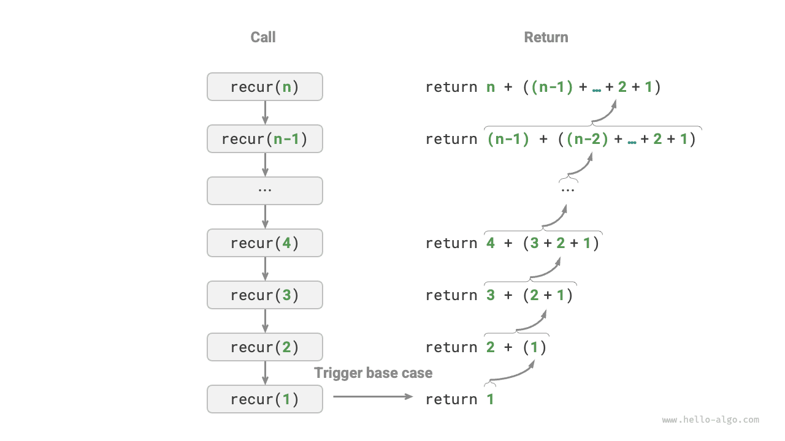
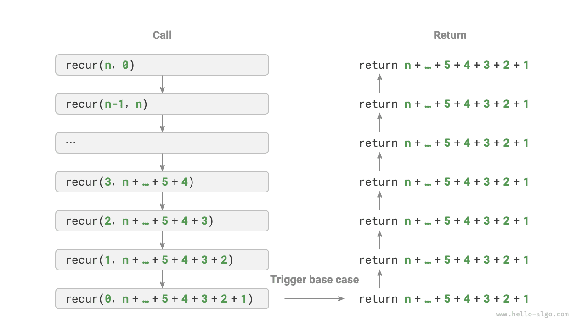

# 2.2 &nbsp; Iteration and recursion

Algorithms often repeat tasks, and repetition is closely tied to complexity analysis. Before introducing time and space complexity, let's examine two basic ways to repeat work in a program: iteration and recursion.

## 2.2.1 &nbsp; Iteration

<u>Iteration</u> is a control structure for repeating a task. A program repeatedly executes a block of code while a condition holds, stopping when it no longer does.

### 1. &nbsp; For loops

A `for` loop is one of the most common forms of iteration, **especially when the number of iterations is known in advance**.

The following function uses a `for` loop to compute $1 + 2 + \dots + n$, storing the result in `res`. In Python, `range(a, b)` includes the left endpoint but excludes the right, so it visits $a, a + 1, \dots, b-1$:

=== "Python"

    ```python title="iteration.py"
    def for_loop(n: int) -> int:
        """for loop"""
        res = 0
        # Sum 1, 2, ..., n-1, n in a loop
        for i in range(1, n + 1):
            res += i
        return res
    ```

=== "C++"

    ```cpp title="iteration.cpp"
    /* for loop */
    int forLoop(int n) {
        int res = 0;
        // Sum 1, 2, ..., n-1, n in a loop
        for (int i = 1; i <= n; ++i) {
            res += i;
        }
        return res;
    }
    ```

=== "Java"

    ```java title="iteration.java"
    /* for loop */
    int forLoop(int n) {
        int res = 0;
        // Sum 1, 2, ..., n-1, n in a loop
        for (int i = 1; i <= n; i++) {
            res += i;
        }
        return res;
    }
    ```

=== "C#"

    ```csharp title="iteration.cs"
    /* for loop */
    int ForLoop(int n) {
        int res = 0;
        // Sum 1, 2, ..., n-1, n in a loop
        for (int i = 1; i <= n; i++) {
            res += i;
        }
        return res;
    }
    ```

=== "Go"

    ```go title="iteration.go"
    /* for loop */
    func forLoop(n int) int {
        res := 0
        // Sum 1, 2, ..., n-1, n in a loop
        for i := 1; i <= n; i++ {
            res += i
        }
        return res
    }
    ```

=== "Swift"

    ```swift title="iteration.swift"
    /* for loop */
    func forLoop(n: Int) -> Int {
        var res = 0
        // Sum 1, 2, ..., n-1, n in a loop
        for i in 1 ... n {
            res += i
        }
        return res
    }
    ```

=== "JS"

    ```javascript title="iteration.js"
    /* for loop */
    function forLoop(n) {
        let res = 0;
        // Sum 1, 2, ..., n-1, n in a loop
        for (let i = 1; i <= n; i++) {
            res += i;
        }
        return res;
    }
    ```

=== "TS"

    ```typescript title="iteration.ts"
    /* for loop */
    function forLoop(n: number): number {
        let res = 0;
        // Sum 1, 2, ..., n-1, n in a loop
        for (let i = 1; i <= n; i++) {
            res += i;
        }
        return res;
    }
    ```

=== "Dart"

    ```dart title="iteration.dart"
    /* for loop */
    int forLoop(int n) {
      int res = 0;
      // Sum 1, 2, ..., n-1, n in a loop
      for (int i = 1; i <= n; i++) {
        res += i;
      }
      return res;
    }
    ```

=== "Rust"

    ```rust title="iteration.rs"
    /* for loop */
    fn for_loop(n: i32) -> i32 {
        let mut res = 0;
        // Sum 1, 2, ..., n-1, n in a loop
        for i in 1..=n {
            res += i;
        }
        res
    }
    ```

=== "C"

    ```c title="iteration.c"
    /* for loop */
    int forLoop(int n) {
        int res = 0;
        // Sum 1, 2, ..., n-1, n in a loop
        for (int i = 1; i <= n; i++) {
            res += i;
        }
        return res;
    }
    ```

=== "Kotlin"

    ```kotlin title="iteration.kt"
    /* for loop */
    fun forLoop(n: Int): Int {
        var res = 0
        // Sum 1, 2, ..., n-1, n in a loop
        for (i in 1..n) {
            res += i
        }
        return res
    }
    ```

=== "Ruby"

    ```ruby title="iteration.rb"
    ### for loop ###
    def for_loop(n)
      res = 0

      # Sum 1, 2, ..., n-1, n in a loop
      for i in 1..n
        res += i
      end

      res
    end
    ```

??? pythontutor "Visualize execution"

    <div style="height: 423px; width: 100%;"><iframe class="pythontutor-iframe" title="Visualize execution" src="https://pythontutor.com/iframe-embed.html#code=def%20for_loop%28n%3A%20int%29%20-%3E%20int%3A%0A%20%20%20%20%22%22%22for%20loop%22%22%22%0A%20%20%20%20res%20%3D%200%0A%20%20%20%20%23%20Sum%201,%202,%20...,%20n-1,%20n%20in%20a%20loop%0A%20%20%20%20for%20i%20in%20range%281,%20n%20%2B%201%29%3A%0A%20%20%20%20%20%20%20%20res%20%2B%3D%20i%0A%20%20%20%20return%20res%0A%0A%22%22%22Driver%20code%22%22%22%0Aif%20__name__%20%3D%3D%20%22__main__%22%3A%0A%20%20%20%20n%20%3D%205%0A%20%20%20%20res%20%3D%20for_loop%28n%29%0A%20%20%20%20print%28f%22%5CnSum%20from%20the%20for%20loop%3A%20res%20%3D%20%7Bres%7D%22%29&codeDivHeight=472&codeDivWidth=350&cumulative=false&curInstr=3&heapPrimitives=nevernest&origin=opt-frontend.js&py=311&rawInputLstJSON=%5B%5D&"> </iframe></div>
    <div style="margin-top: 5px;"><a href="https://pythontutor.com/iframe-embed.html#code=def%20for_loop%28n%3A%20int%29%20-%3E%20int%3A%0A%20%20%20%20%22%22%22for%20loop%22%22%22%0A%20%20%20%20res%20%3D%200%0A%20%20%20%20%23%20Sum%201,%202,%20...,%20n-1,%20n%20in%20a%20loop%0A%20%20%20%20for%20i%20in%20range%281,%20n%20%2B%201%29%3A%0A%20%20%20%20%20%20%20%20res%20%2B%3D%20i%0A%20%20%20%20return%20res%0A%0A%22%22%22Driver%20code%22%22%22%0Aif%20__name__%20%3D%3D%20%22__main__%22%3A%0A%20%20%20%20n%20%3D%205%0A%20%20%20%20res%20%3D%20for_loop%28n%29%0A%20%20%20%20print%28f%22%5CnSum%20from%20the%20for%20loop%3A%20res%20%3D%20%7Bres%7D%22%29&codeDivHeight=800&codeDivWidth=600&cumulative=false&curInstr=3&heapPrimitives=nevernest&origin=opt-frontend.js&py=311&rawInputLstJSON=%5B%5D&" target="_blank" rel="noopener noreferrer">View full screen ></a></div>

Figure 2-1 is a flowchart of this summation function.

{ class="animation-figure" }

<p align="center"> Figure 2-1 &nbsp; Flowchart of the summation function </p>

Its operation count is proportional to the input size $n$: the relationship is linear. **Time complexity describes this relationship**, as the next section will explain.

### 2. &nbsp; While loops

Like `for`, a `while` loop implements iteration. Before each iteration, it checks a condition: if true, execution continues; otherwise, the loop ends.

Here is a `while` loop computing $1 + 2 + \dots + n$:

=== "Python"

    ```python title="iteration.py"
    def while_loop(n: int) -> int:
        """while loop"""
        res = 0
        i = 1  # Initialize the loop control variable
        # Sum 1, 2, ..., n-1, n in a loop
        while i <= n:
            res += i
            i += 1  # Update the loop control variable
        return res
    ```

=== "C++"

    ```cpp title="iteration.cpp"
    /* while loop */
    int whileLoop(int n) {
        int res = 0;
        int i = 1; // Initialize the loop control variable
        // Sum 1, 2, ..., n-1, n in a loop
        while (i <= n) {
            res += i;
            i++; // Update the loop control variable
        }
        return res;
    }
    ```

=== "Java"

    ```java title="iteration.java"
    /* while loop */
    int whileLoop(int n) {
        int res = 0;
        int i = 1; // Initialize the loop control variable
        // Sum 1, 2, ..., n-1, n in a loop
        while (i <= n) {
            res += i;
            i++; // Update the loop control variable
        }
        return res;
    }
    ```

=== "C#"

    ```csharp title="iteration.cs"
    /* while loop */
    int WhileLoop(int n) {
        int res = 0;
        int i = 1; // Initialize the loop control variable
        // Sum 1, 2, ..., n-1, n in a loop
        while (i <= n) {
            res += i;
            i += 1; // Update the loop control variable
        }
        return res;
    }
    ```

=== "Go"

    ```go title="iteration.go"
    /* while loop */
    func whileLoop(n int) int {
        res := 0
        // Initialize the loop control variable
        i := 1
        // Sum 1, 2, ..., n-1, n in a loop
        for i <= n {
            res += i
            // Update the loop control variable
            i++
        }
        return res
    }
    ```

=== "Swift"

    ```swift title="iteration.swift"
    /* while loop */
    func whileLoop(n: Int) -> Int {
        var res = 0
        var i = 1 // Initialize the loop control variable
        // Sum 1, 2, ..., n-1, n in a loop
        while i <= n {
            res += i
            i += 1 // Update the loop control variable
        }
        return res
    }
    ```

=== "JS"

    ```javascript title="iteration.js"
    /* while loop */
    function whileLoop(n) {
        let res = 0;
        let i = 1; // Initialize the loop control variable
        // Sum 1, 2, ..., n-1, n in a loop
        while (i <= n) {
            res += i;
            i++; // Update the loop control variable
        }
        return res;
    }
    ```

=== "TS"

    ```typescript title="iteration.ts"
    /* while loop */
    function whileLoop(n: number): number {
        let res = 0;
        let i = 1; // Initialize the loop control variable
        // Sum 1, 2, ..., n-1, n in a loop
        while (i <= n) {
            res += i;
            i++; // Update the loop control variable
        }
        return res;
    }
    ```

=== "Dart"

    ```dart title="iteration.dart"
    /* while loop */
    int whileLoop(int n) {
      int res = 0;
      int i = 1; // Initialize the loop control variable
      // Sum 1, 2, ..., n-1, n in a loop
      while (i <= n) {
        res += i;
        i++; // Update the loop control variable
      }
      return res;
    }
    ```

=== "Rust"

    ```rust title="iteration.rs"
    /* while loop */
    fn while_loop(n: i32) -> i32 {
        let mut res = 0;
        let mut i = 1; // Initialize the loop control variable

        // Sum 1, 2, ..., n-1, n in a loop
        while i <= n {
            res += i;
            i += 1; // Update the loop control variable
        }
        res
    }
    ```

=== "C"

    ```c title="iteration.c"
    /* while loop */
    int whileLoop(int n) {
        int res = 0;
        int i = 1; // Initialize the loop control variable
        // Sum 1, 2, ..., n-1, n in a loop
        while (i <= n) {
            res += i;
            i++; // Update the loop control variable
        }
        return res;
    }
    ```

=== "Kotlin"

    ```kotlin title="iteration.kt"
    /* while loop */
    fun whileLoop(n: Int): Int {
        var res = 0
        var i = 1 // Initialize the loop control variable
        // Sum 1, 2, ..., n-1, n in a loop
        while (i <= n) {
            res += i
            i++ // Update the loop control variable
        }
        return res
    }
    ```

=== "Ruby"

    ```ruby title="iteration.rb"
    ### while loop ###
    def while_loop(n)
      res = 0
      i = 1 # Initialize the loop control variable

      # Sum 1, 2, ..., n-1, n in a loop
      while i <= n
        res += i
        i += 1 # Update the loop control variable
      end

      res
    end
    ```

??? pythontutor "Visualize execution"

    <div style="height: 459px; width: 100%;"><iframe class="pythontutor-iframe" title="Visualize execution" src="https://pythontutor.com/iframe-embed.html#code=def%20while_loop%28n%3A%20int%29%20-%3E%20int%3A%0A%20%20%20%20%22%22%22while%20loop%22%22%22%0A%20%20%20%20res%20%3D%200%0A%20%20%20%20i%20%3D%201%20%20%23%20Initialize%20the%20loop%20control%20variable%0A%20%20%20%20%23%20Sum%201,%202,%20...,%20n-1,%20n%20in%20a%20loop%0A%20%20%20%20while%20i%20%3C%3D%20n%3A%0A%20%20%20%20%20%20%20%20res%20%2B%3D%20i%0A%20%20%20%20%20%20%20%20i%20%2B%3D%201%20%20%23%20Update%20the%20loop%20control%20variable%0A%20%20%20%20return%20res%0A%0A%22%22%22Driver%20code%22%22%22%0Aif%20__name__%20%3D%3D%20%22__main__%22%3A%0A%20%20%20%20n%20%3D%205%0A%20%20%20%20res%20%3D%20while_loop%28n%29%0A%20%20%20%20print%28f%22%5CnSum%20from%20the%20while%20loop%3A%20res%20%3D%20%7Bres%7D%22%29&codeDivHeight=472&codeDivWidth=350&cumulative=false&curInstr=3&heapPrimitives=nevernest&origin=opt-frontend.js&py=311&rawInputLstJSON=%5B%5D&textReferences=false"> </iframe></div>
    <div style="margin-top: 5px;"><a href="https://pythontutor.com/iframe-embed.html#code=def%20while_loop%28n%3A%20int%29%20-%3E%20int%3A%0A%20%20%20%20%22%22%22while%20loop%22%22%22%0A%20%20%20%20res%20%3D%200%0A%20%20%20%20i%20%3D%201%20%20%23%20Initialize%20the%20loop%20control%20variable%0A%20%20%20%20%23%20Sum%201,%202,%20...,%20n-1,%20n%20in%20a%20loop%0A%20%20%20%20while%20i%20%3C%3D%20n%3A%0A%20%20%20%20%20%20%20%20res%20%2B%3D%20i%0A%20%20%20%20%20%20%20%20i%20%2B%3D%201%20%20%23%20Update%20the%20loop%20control%20variable%0A%20%20%20%20return%20res%0A%0A%22%22%22Driver%20code%22%22%22%0Aif%20__name__%20%3D%3D%20%22__main__%22%3A%0A%20%20%20%20n%20%3D%205%0A%20%20%20%20res%20%3D%20while_loop%28n%29%0A%20%20%20%20print%28f%22%5CnSum%20from%20the%20while%20loop%3A%20res%20%3D%20%7Bres%7D%22%29&codeDivHeight=800&codeDivWidth=600&cumulative=false&curInstr=3&heapPrimitives=nevernest&origin=opt-frontend.js&py=311&rawInputLstJSON=%5B%5D&textReferences=false" target="_blank" rel="noopener noreferrer">View full screen ></a></div>

**A `while` loop offers more flexibility than a `for` loop** in how its condition variables are initialized and updated.

For example, the following code updates the condition variable $i$ twice per iteration, which is less convenient to express with a `for` loop:

=== "Python"

    ```python title="iteration.py"
    def while_loop_ii(n: int) -> int:
        """while loop (two updates)"""
        res = 0
        i = 1  # Initialize the loop control variable
        # Sum 1, 4, 10, ... in a loop
        while i <= n:
            res += i
            # Update the loop control variable
            i += 1
            i *= 2
        return res
    ```

=== "C++"

    ```cpp title="iteration.cpp"
    /* while loop (two updates) */
    int whileLoopII(int n) {
        int res = 0;
        int i = 1; // Initialize the loop control variable
        // Sum 1, 4, 10, ... in a loop
        while (i <= n) {
            res += i;
            // Update the loop control variable
            i++;
            i *= 2;
        }
        return res;
    }
    ```

=== "Java"

    ```java title="iteration.java"
    /* while loop (two updates) */
    int whileLoopII(int n) {
        int res = 0;
        int i = 1; // Initialize the loop control variable
        // Sum 1, 4, 10, ... in a loop
        while (i <= n) {
            res += i;
            // Update the loop control variable
            i++;
            i *= 2;
        }
        return res;
    }
    ```

=== "C#"

    ```csharp title="iteration.cs"
    /* while loop (two updates) */
    int WhileLoopII(int n) {
        int res = 0;
        int i = 1; // Initialize the loop control variable
        // Sum 1, 4, 10, ... in a loop
        while (i <= n) {
            res += i;
            // Update the loop control variable
            i += 1; 
            i *= 2;
        }
        return res;
    }
    ```

=== "Go"

    ```go title="iteration.go"
    /* while loop (two updates) */
    func whileLoopII(n int) int {
        res := 0
        // Initialize the loop control variable
        i := 1
        // Sum 1, 4, 10, ... in a loop
        for i <= n {
            res += i
            // Update the loop control variable
            i++
            i *= 2
        }
        return res
    }
    ```

=== "Swift"

    ```swift title="iteration.swift"
    /* while loop (two updates) */
    func whileLoopII(n: Int) -> Int {
        var res = 0
        var i = 1 // Initialize the loop control variable
        // Sum 1, 4, 10, ... in a loop
        while i <= n {
            res += i
            // Update the loop control variable
            i += 1
            i *= 2
        }
        return res
    }
    ```

=== "JS"

    ```javascript title="iteration.js"
    /* while loop (two updates) */
    function whileLoopII(n) {
        let res = 0;
        let i = 1; // Initialize the loop control variable
        // Sum 1, 4, 10, ... in a loop
        while (i <= n) {
            res += i;
            // Update the loop control variable
            i++;
            i *= 2;
        }
        return res;
    }
    ```

=== "TS"

    ```typescript title="iteration.ts"
    /* while loop (two updates) */
    function whileLoopII(n: number): number {
        let res = 0;
        let i = 1; // Initialize the loop control variable
        // Sum 1, 4, 10, ... in a loop
        while (i <= n) {
            res += i;
            // Update the loop control variable
            i++;
            i *= 2;
        }
        return res;
    }
    ```

=== "Dart"

    ```dart title="iteration.dart"
    /* while loop (two updates) */
    int whileLoopII(int n) {
      int res = 0;
      int i = 1; // Initialize the loop control variable
      // Sum 1, 4, 10, ... in a loop
      while (i <= n) {
        res += i;
        // Update the loop control variable
        i++;
        i *= 2;
      }
      return res;
    }
    ```

=== "Rust"

    ```rust title="iteration.rs"
    /* while loop (two updates) */
    fn while_loop_ii(n: i32) -> i32 {
        let mut res = 0;
        let mut i = 1; // Initialize the loop control variable

        // Sum 1, 4, 10, ... in a loop
        while i <= n {
            res += i;
            // Update the loop control variable
            i += 1;
            i *= 2;
        }
        res
    }
    ```

=== "C"

    ```c title="iteration.c"
    /* while loop (two updates) */
    int whileLoopII(int n) {
        int res = 0;
        int i = 1; // Initialize the loop control variable
        // Sum 1, 4, 10, ... in a loop
        while (i <= n) {
            res += i;
            // Update the loop control variable
            i++;
            i *= 2;
        }
        return res;
    }
    ```

=== "Kotlin"

    ```kotlin title="iteration.kt"
    /* while loop (two updates) */
    fun whileLoopII(n: Int): Int {
        var res = 0
        var i = 1 // Initialize the loop control variable
        // Sum 1, 4, 10, ... in a loop
        while (i <= n) {
            res += i
            // Update the loop control variable
            i++
            i *= 2
        }
        return res
    }
    ```

=== "Ruby"

    ```ruby title="iteration.rb"
    ### while loop (two updates)###
    def while_loop_ii(n)
      res = 0
      i = 1 # Initialize the loop control variable

      # Sum 1, 4, 10, ... in a loop
      while i <= n
        res += i
        # Update the loop control variable
        i += 1
        i *= 2
      end

      res
    end
    ```

??? pythontutor "Visualize execution"

    <div style="height: 495px; width: 100%;"><iframe class="pythontutor-iframe" title="Visualize execution" src="https://pythontutor.com/iframe-embed.html#code=def%20while_loop_ii%28n%3A%20int%29%20-%3E%20int%3A%0A%20%20%20%20%22%22%22while%20loop%20%28two%20updates%29%22%22%22%0A%20%20%20%20res%20%3D%200%0A%20%20%20%20i%20%3D%201%20%20%23%20Initialize%20the%20loop%20control%20variable%0A%20%20%20%20%23%20Sum%201,%204,%2010,%20...%20in%20a%20loop%0A%20%20%20%20while%20i%20%3C%3D%20n%3A%0A%20%20%20%20%20%20%20%20res%20%2B%3D%20i%0A%20%20%20%20%20%20%20%20%23%20Update%20the%20loop%20control%20variable%0A%20%20%20%20%20%20%20%20i%20%2B%3D%201%0A%20%20%20%20%20%20%20%20i%20%2A%3D%202%0A%20%20%20%20return%20res%0A%0A%22%22%22Driver%20code%22%22%22%0Aif%20__name__%20%3D%3D%20%22__main__%22%3A%0A%20%20%20%20n%20%3D%205%0A%20%20%20%20res%20%3D%20while_loop_ii%28n%29%0A%20%20%20%20print%28f%22%5CnSum%20from%20the%20while%20loop%20%28two%20updates%29%3A%20res%20%3D%20%7Bres%7D%22%29&codeDivHeight=472&codeDivWidth=350&cumulative=false&curInstr=3&heapPrimitives=nevernest&origin=opt-frontend.js&py=311&rawInputLstJSON=%5B%5D&textReferences=false"> </iframe></div>
    <div style="margin-top: 5px;"><a href="https://pythontutor.com/iframe-embed.html#code=def%20while_loop_ii%28n%3A%20int%29%20-%3E%20int%3A%0A%20%20%20%20%22%22%22while%20loop%20%28two%20updates%29%22%22%22%0A%20%20%20%20res%20%3D%200%0A%20%20%20%20i%20%3D%201%20%20%23%20Initialize%20the%20loop%20control%20variable%0A%20%20%20%20%23%20Sum%201,%204,%2010,%20...%20in%20a%20loop%0A%20%20%20%20while%20i%20%3C%3D%20n%3A%0A%20%20%20%20%20%20%20%20res%20%2B%3D%20i%0A%20%20%20%20%20%20%20%20%23%20Update%20the%20loop%20control%20variable%0A%20%20%20%20%20%20%20%20i%20%2B%3D%201%0A%20%20%20%20%20%20%20%20i%20%2A%3D%202%0A%20%20%20%20return%20res%0A%0A%22%22%22Driver%20code%22%22%22%0Aif%20__name__%20%3D%3D%20%22__main__%22%3A%0A%20%20%20%20n%20%3D%205%0A%20%20%20%20res%20%3D%20while_loop_ii%28n%29%0A%20%20%20%20print%28f%22%5CnSum%20from%20the%20while%20loop%20%28two%20updates%29%3A%20res%20%3D%20%7Bres%7D%22%29&codeDivHeight=800&codeDivWidth=600&cumulative=false&curInstr=3&heapPrimitives=nevernest&origin=opt-frontend.js&py=311&rawInputLstJSON=%5B%5D&textReferences=false" target="_blank" rel="noopener noreferrer">View full screen ></a></div>

In general, **`for` loops are more compact, while `while` loops are more flexible**. Both implement iteration; choose according to the problem's needs.

### 3. &nbsp; Nested loops

We can place one loop inside another, as in the following `for`-loop example:

=== "Python"

    ```python title="iteration.py"
    def nested_for_loop(n: int) -> str:
        """Nested for loops"""
        res = ""
        # Loop over i = 1, 2, ..., n-1, n
        for i in range(1, n + 1):
            # Loop over j = 1, 2, ..., n-1, n
            for j in range(1, n + 1):
                res += f"({i}, {j}), "
        return res
    ```

=== "C++"

    ```cpp title="iteration.cpp"
    /* Nested for loops */
    string nestedForLoop(int n) {
        ostringstream res;
        // Loop over i = 1, 2, ..., n-1, n
        for (int i = 1; i <= n; ++i) {
            // Loop over j = 1, 2, ..., n-1, n
            for (int j = 1; j <= n; ++j) {
                res << "(" << i << ", " << j << "), ";
            }
        }
        return res.str();
    }
    ```

=== "Java"

    ```java title="iteration.java"
    /* Nested for loops */
    String nestedForLoop(int n) {
        StringBuilder res = new StringBuilder();
        // Loop over i = 1, 2, ..., n-1, n
        for (int i = 1; i <= n; i++) {
            // Loop over j = 1, 2, ..., n-1, n
            for (int j = 1; j <= n; j++) {
                res.append("(" + i + ", " + j + "), ");
            }
        }
        return res.toString();
    }
    ```

=== "C#"

    ```csharp title="iteration.cs"
    /* Nested for loops */
    string NestedForLoop(int n) {
        StringBuilder res = new();
        // Loop over i = 1, 2, ..., n-1, n
        for (int i = 1; i <= n; i++) {
            // Loop over j = 1, 2, ..., n-1, n
            for (int j = 1; j <= n; j++) {
                res.Append($"({i}, {j}), ");
            }
        }
        return res.ToString();
    }
    ```

=== "Go"

    ```go title="iteration.go"
    /* Nested for loops */
    func nestedForLoop(n int) string {
        res := ""
        // Loop over i = 1, 2, ..., n-1, n
        for i := 1; i <= n; i++ {
            for j := 1; j <= n; j++ {
                // Loop over j = 1, 2, ..., n-1, n
                res += fmt.Sprintf("(%d, %d), ", i, j)
            }
        }
        return res
    }
    ```

=== "Swift"

    ```swift title="iteration.swift"
    /* Nested for loops */
    func nestedForLoop(n: Int) -> String {
        var res = ""
        // Loop over i = 1, 2, ..., n-1, n
        for i in 1 ... n {
            // Loop over j = 1, 2, ..., n-1, n
            for j in 1 ... n {
                res.append("(\(i), \(j)), ")
            }
        }
        return res
    }
    ```

=== "JS"

    ```javascript title="iteration.js"
    /* Nested for loops */
    function nestedForLoop(n) {
        let res = '';
        // Loop over i = 1, 2, ..., n-1, n
        for (let i = 1; i <= n; i++) {
            // Loop over j = 1, 2, ..., n-1, n
            for (let j = 1; j <= n; j++) {
                res += `(${i}, ${j}), `;
            }
        }
        return res;
    }
    ```

=== "TS"

    ```typescript title="iteration.ts"
    /* Nested for loops */
    function nestedForLoop(n: number): string {
        let res = '';
        // Loop over i = 1, 2, ..., n-1, n
        for (let i = 1; i <= n; i++) {
            // Loop over j = 1, 2, ..., n-1, n
            for (let j = 1; j <= n; j++) {
                res += `(${i}, ${j}), `;
            }
        }
        return res;
    }
    ```

=== "Dart"

    ```dart title="iteration.dart"
    /* Nested for loops */
    String nestedForLoop(int n) {
      String res = "";
      // Loop over i = 1, 2, ..., n-1, n
      for (int i = 1; i <= n; i++) {
        // Loop over j = 1, 2, ..., n-1, n
        for (int j = 1; j <= n; j++) {
          res += "($i, $j), ";
        }
      }
      return res;
    }
    ```

=== "Rust"

    ```rust title="iteration.rs"
    /* Nested for loops */
    fn nested_for_loop(n: i32) -> String {
        let mut res = vec![];
        // Loop over i = 1, 2, ..., n-1, n
        for i in 1..=n {
            // Loop over j = 1, 2, ..., n-1, n
            for j in 1..=n {
                res.push(format!("({}, {}), ", i, j));
            }
        }
        res.join("")
    }
    ```

=== "C"

    ```c title="iteration.c"
    /* Nested for loops */
    char *nestedForLoop(int n) {
        // There are n * n points; each "(i, j), " takes at most 6+10*2 characters, plus space for the final null character \0
        int size = n * n * 26 + 1;
        char *res = malloc(size * sizeof(char));
        // Loop over i = 1, 2, ..., n-1, n
        for (int i = 1; i <= n; i++) {
            // Loop over j = 1, 2, ..., n-1, n
            for (int j = 1; j <= n; j++) {
                char tmp[26];
                snprintf(tmp, sizeof(tmp), "(%d, %d), ", i, j);
                strncat(res, tmp, size - strlen(res) - 1);
            }
        }
        return res;
    }
    ```

=== "Kotlin"

    ```kotlin title="iteration.kt"
    /* Nested for loops */
    fun nestedForLoop(n: Int): String {
        val res = StringBuilder()
        // Loop over i = 1, 2, ..., n-1, n
        for (i in 1..n) {
            // Loop over j = 1, 2, ..., n-1, n
            for (j in 1..n) {
                res.append(" ($i, $j), ")
            }
        }
        return res.toString()
    }
    ```

=== "Ruby"

    ```ruby title="iteration.rb"
    ### Nested for loops ###
    def nested_for_loop(n)
      res = ""

      # Loop over i = 1, 2, ..., n-1, n
      for i in 1..n
        # Loop over j = 1, 2, ..., n-1, n
        for j in 1..n
          res += "(#{i}, #{j}), "
        end
      end

      res
    end
    ```

??? pythontutor "Visualize execution"

    <div style="height: 459px; width: 100%;"><iframe class="pythontutor-iframe" title="Visualize execution" src="https://pythontutor.com/iframe-embed.html#code=def%20nested_for_loop%28n%3A%20int%29%20-%3E%20str%3A%0A%20%20%20%20%22%22%22Nested%20for%20loops%22%22%22%0A%20%20%20%20res%20%3D%20%22%22%0A%20%20%20%20%23%20Loop%20over%20i%20%3D%201,%202,%20...,%20n-1,%20n%0A%20%20%20%20for%20i%20in%20range%281,%20n%20%2B%201%29%3A%0A%20%20%20%20%20%20%20%20%23%20Loop%20over%20j%20%3D%201,%202,%20...,%20n-1,%20n%0A%20%20%20%20%20%20%20%20for%20j%20in%20range%281,%20n%20%2B%201%29%3A%0A%20%20%20%20%20%20%20%20%20%20%20%20res%20%2B%3D%20f%22%28%7Bi%7D,%20%7Bj%7D%29,%20%22%0A%20%20%20%20return%20res%0A%0A%22%22%22Driver%20code%22%22%22%0Aif%20__name__%20%3D%3D%20%22__main__%22%3A%0A%20%20%20%20n%20%3D%205%0A%20%20%20%20res%20%3D%20nested_for_loop%28n%29%0A%20%20%20%20print%28f%22%5CnTraversal%20from%20the%20nested%20for%20loops%3A%20%7Bres%7D%22%29&codeDivHeight=472&codeDivWidth=350&cumulative=false&curInstr=3&heapPrimitives=nevernest&origin=opt-frontend.js&py=311&rawInputLstJSON=%5B%5D&textReferences=false"> </iframe></div>
    <div style="margin-top: 5px;"><a href="https://pythontutor.com/iframe-embed.html#code=def%20nested_for_loop%28n%3A%20int%29%20-%3E%20str%3A%0A%20%20%20%20%22%22%22Nested%20for%20loops%22%22%22%0A%20%20%20%20res%20%3D%20%22%22%0A%20%20%20%20%23%20Loop%20over%20i%20%3D%201,%202,%20...,%20n-1,%20n%0A%20%20%20%20for%20i%20in%20range%281,%20n%20%2B%201%29%3A%0A%20%20%20%20%20%20%20%20%23%20Loop%20over%20j%20%3D%201,%202,%20...,%20n-1,%20n%0A%20%20%20%20%20%20%20%20for%20j%20in%20range%281,%20n%20%2B%201%29%3A%0A%20%20%20%20%20%20%20%20%20%20%20%20res%20%2B%3D%20f%22%28%7Bi%7D,%20%7Bj%7D%29,%20%22%0A%20%20%20%20return%20res%0A%0A%22%22%22Driver%20code%22%22%22%0Aif%20__name__%20%3D%3D%20%22__main__%22%3A%0A%20%20%20%20n%20%3D%205%0A%20%20%20%20res%20%3D%20nested_for_loop%28n%29%0A%20%20%20%20print%28f%22%5CnTraversal%20from%20the%20nested%20for%20loops%3A%20%7Bres%7D%22%29&codeDivHeight=800&codeDivWidth=600&cumulative=false&curInstr=3&heapPrimitives=nevernest&origin=opt-frontend.js&py=311&rawInputLstJSON=%5B%5D&textReferences=false" target="_blank" rel="noopener noreferrer">View full screen ></a></div>

Figure 2-2 shows the nested loop's flowchart.

{ class="animation-figure" }

<p align="center"> Figure 2-2 &nbsp; Flowchart of nested loops </p>

Here, the operation count is proportional to $n^2$: runtime has a quadratic relationship with input size $n$.

Adding further nesting increases the dimension each time, producing cubic, fourth-power, and higher-order time complexity.

## 2.2.2 &nbsp; Recursion

 <u>Recursion</u> is an algorithmic strategy in which a function calls itself to solve a problem. It has two main phases.

1. **Descent**: The function calls itself more deeply, usually with smaller or simpler arguments, until a base case is reached.
2. **Return**: Once the base case is reached, calls return from the deepest level upward, combining results along the way.

In implementation, recursive code has three main elements.

1. **Base case**: Determines when descent stops and returning begins.
2. **Recursive call**: The function calls itself, usually with smaller or simpler arguments.
3. **Returned result**: The current level returns its result to the previous level.

In the following code, calling `recur(n)` computes $1 + 2 + \dots + n$:

=== "Python"

    ```python title="recursion.py"
    def recur(n: int) -> int:
        """Recursion"""
        # Base case
        if n == 1:
            return 1
        # Recurse: make a recursive call
        res = recur(n - 1)
        # Unwind: return the result
        return n + res
    ```

=== "C++"

    ```cpp title="recursion.cpp"
    /* Recursion */
    int recur(int n) {
        // Base case
        if (n == 1)
            return 1;
        // Recurse: make a recursive call
        int res = recur(n - 1);
        // Unwind: return the result
        return n + res;
    }
    ```

=== "Java"

    ```java title="recursion.java"
    /* Recursion */
    int recur(int n) {
        // Base case
        if (n == 1)
            return 1;
        // Recurse: make a recursive call
        int res = recur(n - 1);
        // Unwind: return the result
        return n + res;
    }
    ```

=== "C#"

    ```csharp title="recursion.cs"
    /* Recursion */
    int Recur(int n) {
        // Base case
        if (n == 1)
            return 1;
        // Recurse: make a recursive call
        int res = Recur(n - 1);
        // Unwind: return the result
        return n + res;
    }
    ```

=== "Go"

    ```go title="recursion.go"
    /* Recursion */
    func recur(n int) int {
        // Base case
        if n == 1 {
            return 1
        }
        // Recurse: make a recursive call
        res := recur(n - 1)
        // Unwind: return the result
        return n + res
    }
    ```

=== "Swift"

    ```swift title="recursion.swift"
    /* Recursion */
    func recur(n: Int) -> Int {
        // Base case
        if n == 1 {
            return 1
        }
        // Recurse: make a recursive call
        let res = recur(n: n - 1)
        // Unwind: return the result
        return n + res
    }
    ```

=== "JS"

    ```javascript title="recursion.js"
    /* Recursion */
    function recur(n) {
        // Base case
        if (n === 1) return 1;
        // Recurse: make a recursive call
        const res = recur(n - 1);
        // Unwind: return the result
        return n + res;
    }
    ```

=== "TS"

    ```typescript title="recursion.ts"
    /* Recursion */
    function recur(n: number): number {
        // Base case
        if (n === 1) return 1;
        // Recurse: make a recursive call
        const res = recur(n - 1);
        // Unwind: return the result
        return n + res;
    }
    ```

=== "Dart"

    ```dart title="recursion.dart"
    /* Recursion */
    int recur(int n) {
      // Base case
      if (n == 1) return 1;
      // Recurse: make a recursive call
      int res = recur(n - 1);
      // Unwind: return the result
      return n + res;
    }
    ```

=== "Rust"

    ```rust title="recursion.rs"
    /* Recursion */
    fn recur(n: i32) -> i32 {
        // Base case
        if n == 1 {
            return 1;
        }
        // Recurse: make a recursive call
        let res = recur(n - 1);
        // Unwind: return the result
        n + res
    }
    ```

=== "C"

    ```c title="recursion.c"
    /* Recursion */
    int recur(int n) {
        // Base case
        if (n == 1)
            return 1;
        // Recurse: make a recursive call
        int res = recur(n - 1);
        // Unwind: return the result
        return n + res;
    }
    ```

=== "Kotlin"

    ```kotlin title="recursion.kt"
    /* Recursion */
    fun recur(n: Int): Int {
        // Base case
        if (n == 1)
            return 1
        // Descending: recursive calls
        val res = recur(n - 1)
        // Unwinding: return the result
        return n + res
    }
    ```

=== "Ruby"

    ```ruby title="recursion.rb"
    ### Recursion ###
    def recur(n)
      # Base case
      return 1 if n == 1
      # Recurse: make a recursive call
      res = recur(n - 1)
      # Unwind: return the result
      n + res
    end
    ```

??? pythontutor "Visualize execution"

    <div style="height: 459px; width: 100%;"><iframe class="pythontutor-iframe" title="Visualize execution" src="https://pythontutor.com/iframe-embed.html#code=def%20recur%28n%3A%20int%29%20-%3E%20int%3A%0A%20%20%20%20%22%22%22Recursion%22%22%22%0A%20%20%20%20%23%20Base%20case%0A%20%20%20%20if%20n%20%3D%3D%201%3A%0A%20%20%20%20%20%20%20%20return%201%0A%20%20%20%20%23%20Recursive-call%20phase%0A%20%20%20%20res%20%3D%20recur%28n%20-%201%29%0A%20%20%20%20%23%20Unwinding%20phase%3A%20compute%20the%20result%0A%20%20%20%20return%20n%20%2B%20res%0A%0A%22%22%22Driver%20code%22%22%22%0Aif%20__name__%20%3D%3D%20%22__main__%22%3A%0A%20%20%20%20n%20%3D%205%0A%20%20%20%20res%20%3D%20recur%28n%29%0A%20%20%20%20print%28f%22%5CnSum%20from%20the%20recursive%20function%3A%20res%20%3D%20%7Bres%7D%22%29&codeDivHeight=472&codeDivWidth=350&cumulative=false&curInstr=3&heapPrimitives=nevernest&origin=opt-frontend.js&py=311&rawInputLstJSON=%5B%5D&textReferences=false"> </iframe></div>
    <div style="margin-top: 5px;"><a href="https://pythontutor.com/iframe-embed.html#code=def%20recur%28n%3A%20int%29%20-%3E%20int%3A%0A%20%20%20%20%22%22%22Recursion%22%22%22%0A%20%20%20%20%23%20Base%20case%0A%20%20%20%20if%20n%20%3D%3D%201%3A%0A%20%20%20%20%20%20%20%20return%201%0A%20%20%20%20%23%20Recursive-call%20phase%0A%20%20%20%20res%20%3D%20recur%28n%20-%201%29%0A%20%20%20%20%23%20Unwinding%20phase%3A%20compute%20the%20result%0A%20%20%20%20return%20n%20%2B%20res%0A%0A%22%22%22Driver%20code%22%22%22%0Aif%20__name__%20%3D%3D%20%22__main__%22%3A%0A%20%20%20%20n%20%3D%205%0A%20%20%20%20res%20%3D%20recur%28n%29%0A%20%20%20%20print%28f%22%5CnSum%20from%20the%20recursive%20function%3A%20res%20%3D%20%7Bres%7D%22%29&codeDivHeight=800&codeDivWidth=600&cumulative=false&curInstr=3&heapPrimitives=nevernest&origin=opt-frontend.js&py=311&rawInputLstJSON=%5B%5D&textReferences=false" target="_blank" rel="noopener noreferrer">View full screen ></a></div>

Figure 2-3 illustrates the recursive process.

{ class="animation-figure" }

<p align="center"> Figure 2-3 &nbsp; Recursive process of the summation function </p>

Iteration and recursion can produce the same answer, **but represent two different ways of thinking about and solving a problem**.

- **Iteration** works bottom up, starting with basic steps and repeatedly performing or accumulating them until the task is complete.
- **Recursion** works top down, dividing the original problem into smaller subproblems of the same form, then repeating the division until reaching base cases with known solutions.

For the summation example, let $f(n) = 1 + 2 + \dots + n$.

- **Iteration**: Loop from $1$ to $n$, accumulating the sum at each step to obtain $f(n)$.
- **Recursion**: Decompose the problem as $f(n) = n + f(n-1)$ and keep doing so recursively until the base case $f(1) = 1$.

### 1. &nbsp; The call stack

Each time a recursive function calls itself, the system allocates memory for the new call's local variables, return address, and other information. This has two consequences.

- The call's context is stored in a stack frame until it returns. **Recursion therefore usually uses more memory than iteration**.
- Each recursive call adds overhead. **Recursion is therefore usually slower than a loop**.

As shown in Figure 2-4, before the base case is reached, $n$ recursive calls remain active at once: **the recursion depth is $n$**.

{ class="animation-figure" }

<p align="center"> Figure 2-4 &nbsp; Depth of recursive calls </p>

Programming languages usually limit recursion depth, and excessively deep recursion may cause a stack overflow.

### 2. &nbsp; Tail recursion

Interestingly, **if the recursive call is the last operation before a function returns**, a compiler or interpreter can optimize it to use as little space as iteration. This is called <u>tail recursion</u>.

- **Ordinary recursion**: After a call returns, its caller must continue executing code, so the caller's context must be preserved.
- **Tail recursion**: Nothing remains to be done after the recursive call returns, so the caller's context need not be retained.

For $1 + 2 + \dots + n$, passing the accumulated result `res` as a parameter gives a tail-recursive solution:

=== "Python"

    ```python title="recursion.py"
    def tail_recur(n, res):
        """Tail recursion"""
        # Base case
        if n == 0:
            return res
        # Tail-recursive call
        return tail_recur(n - 1, res + n)
    ```

=== "C++"

    ```cpp title="recursion.cpp"
    /* Tail recursion */
    int tailRecur(int n, int res) {
        // Base case
        if (n == 0)
            return res;
        // Tail-recursive call
        return tailRecur(n - 1, res + n);
    }
    ```

=== "Java"

    ```java title="recursion.java"
    /* Tail recursion */
    int tailRecur(int n, int res) {
        // Base case
        if (n == 0)
            return res;
        // Tail-recursive call
        return tailRecur(n - 1, res + n);
    }
    ```

=== "C#"

    ```csharp title="recursion.cs"
    /* Tail recursion */
    int TailRecur(int n, int res) {
        // Base case
        if (n == 0)
            return res;
        // Tail-recursive call
        return TailRecur(n - 1, res + n);
    }
    ```

=== "Go"

    ```go title="recursion.go"
    /* Tail recursion */
    func tailRecur(n int, res int) int {
        // Base case
        if n == 0 {
            return res
        }
        // Tail-recursive call
        return tailRecur(n-1, res+n)
    }
    ```

=== "Swift"

    ```swift title="recursion.swift"
    /* Tail recursion */
    func tailRecur(n: Int, res: Int) -> Int {
        // Base case
        if n == 0 {
            return res
        }
        // Tail-recursive call
        return tailRecur(n: n - 1, res: res + n)
    }
    ```

=== "JS"

    ```javascript title="recursion.js"
    /* Tail recursion */
    function tailRecur(n, res) {
        // Base case
        if (n === 0) return res;
        // Tail-recursive call
        return tailRecur(n - 1, res + n);
    }
    ```

=== "TS"

    ```typescript title="recursion.ts"
    /* Tail recursion */
    function tailRecur(n: number, res: number): number {
        // Base case
        if (n === 0) return res;
        // Tail-recursive call
        return tailRecur(n - 1, res + n);
    }
    ```

=== "Dart"

    ```dart title="recursion.dart"
    /* Tail recursion */
    int tailRecur(int n, int res) {
      // Base case
      if (n == 0) return res;
      // Tail-recursive call
      return tailRecur(n - 1, res + n);
    }
    ```

=== "Rust"

    ```rust title="recursion.rs"
    /* Tail recursion */
    fn tail_recur(n: i32, res: i32) -> i32 {
        // Base case
        if n == 0 {
            return res;
        }
        // Tail-recursive call
        tail_recur(n - 1, res + n)
    }
    ```

=== "C"

    ```c title="recursion.c"
    /* Tail recursion */
    int tailRecur(int n, int res) {
        // Base case
        if (n == 0)
            return res;
        // Tail-recursive call
        return tailRecur(n - 1, res + n);
    }
    ```

=== "Kotlin"

    ```kotlin title="recursion.kt"
    /* Tail recursion */
    tailrec fun tailRecur(n: Int, res: Int): Int {
        // Add the tailrec modifier to enable tail-call optimization
        // Base case
        if (n == 0)
            return res
        // Tail-recursive call
        return tailRecur(n - 1, res + n)
    }
    ```

=== "Ruby"

    ```ruby title="recursion.rb"
    ### Tail recursion ###
    def tail_recur(n, res)
      # Base case
      return res if n == 0
      # Tail-recursive call
      tail_recur(n - 1, res + n)
    end
    ```

??? pythontutor "Visualize execution"

    <div style="height: 423px; width: 100%;"><iframe class="pythontutor-iframe" title="Visualize execution" src="https://pythontutor.com/iframe-embed.html#code=def%20tail_recur%28n,%20res%29%3A%0A%20%20%20%20%22%22%22Tail%20recursion%22%22%22%0A%20%20%20%20%23%20Base%20case%0A%20%20%20%20if%20n%20%3D%3D%200%3A%0A%20%20%20%20%20%20%20%20return%20res%0A%20%20%20%20%23%20Tail-recursive%20call%0A%20%20%20%20return%20tail_recur%28n%20-%201,%20res%20%2B%20n%29%0A%0A%22%22%22Driver%20code%22%22%22%0Aif%20__name__%20%3D%3D%20%22__main__%22%3A%0A%20%20%20%20n%20%3D%205%0A%20%20%20%20res%20%3D%20tail_recur%28n,%200%29%0A%20%20%20%20print%28f%22%5CnSum%20from%20the%20tail-recursive%20function%3A%20res%20%3D%20%7Bres%7D%22%29&codeDivHeight=472&codeDivWidth=350&cumulative=false&curInstr=3&heapPrimitives=nevernest&origin=opt-frontend.js&py=311&rawInputLstJSON=%5B%5D&textReferences=false"> </iframe></div>
    <div style="margin-top: 5px;"><a href="https://pythontutor.com/iframe-embed.html#code=def%20tail_recur%28n,%20res%29%3A%0A%20%20%20%20%22%22%22Tail%20recursion%22%22%22%0A%20%20%20%20%23%20Base%20case%0A%20%20%20%20if%20n%20%3D%3D%200%3A%0A%20%20%20%20%20%20%20%20return%20res%0A%20%20%20%20%23%20Tail-recursive%20call%0A%20%20%20%20return%20tail_recur%28n%20-%201,%20res%20%2B%20n%29%0A%0A%22%22%22Driver%20code%22%22%22%0Aif%20__name__%20%3D%3D%20%22__main__%22%3A%0A%20%20%20%20n%20%3D%205%0A%20%20%20%20res%20%3D%20tail_recur%28n,%200%29%0A%20%20%20%20print%28f%22%5CnSum%20from%20the%20tail-recursive%20function%3A%20res%20%3D%20%7Bres%7D%22%29&codeDivHeight=800&codeDivWidth=600&cumulative=false&curInstr=3&heapPrimitives=nevernest&origin=opt-frontend.js&py=311&rawInputLstJSON=%5B%5D&textReferences=false" target="_blank" rel="noopener noreferrer">View full screen ></a></div>

Figure 2-5 illustrates tail recursion. Ordinary and tail recursion perform their additions at different points.

- **Ordinary recursion**: Addition occurs during the return phase, after each deeper call returns.
- **Tail recursion**: Addition occurs during descent; the return phase simply returns through the levels.

{ class="animation-figure" }

<p align="center"> Figure 2-5 &nbsp; Tail-recursive summation </p>

!!! tip

    Many compilers and interpreters do not support tail-recursion optimization. Python, for example, does not optimize it by default, so even a tail-recursive function can run into a stack overflow.

### 3. &nbsp; Recursion trees

For divide-and-conquer problems, recursion often provides a more intuitive approach and more readable code than iteration. Consider the Fibonacci sequence.

!!! question

    Given the Fibonacci sequence $0, 1, 1, 2, 3, 5, 8, 13, \dots$, find its $n$-th number.

Let $f(n)$ be its $n$-th number. Two facts follow.

- The first two numbers are $f(1) = 0$ and $f(2) = 1$.
- Every later number is the sum of the two preceding numbers: $f(n) = f(n - 1) + f(n - 2)$.

Use the recurrence for recursive calls and the first two numbers as base cases. Calling `fib(n)` then returns the $n$-th Fibonacci number:

=== "Python"

    ```python title="recursion.py"
    def fib(n: int) -> int:
        """Fibonacci sequence: recursion"""
        # Base cases: f(1) = 0, f(2) = 1
        if n == 1 or n == 2:
            return n - 1
        # Recursive calls: f(n) = f(n-1) + f(n-2)
        res = fib(n - 1) + fib(n - 2)
        # Return the result f(n)
        return res
    ```

=== "C++"

    ```cpp title="recursion.cpp"
    /* Fibonacci sequence: recursion */
    int fib(int n) {
        // Base cases: f(1) = 0, f(2) = 1
        if (n == 1 || n == 2)
            return n - 1;
        // Recursive calls: f(n) = f(n-1) + f(n-2)
        int res = fib(n - 1) + fib(n - 2);
        // Return the result f(n)
        return res;
    }
    ```

=== "Java"

    ```java title="recursion.java"
    /* Fibonacci sequence: recursion */
    int fib(int n) {
        // Base cases: f(1) = 0, f(2) = 1
        if (n == 1 || n == 2)
            return n - 1;
        // Recursive calls: f(n) = f(n-1) + f(n-2)
        int res = fib(n - 1) + fib(n - 2);
        // Return the result f(n)
        return res;
    }
    ```

=== "C#"

    ```csharp title="recursion.cs"
    /* Fibonacci sequence: recursion */
    int Fib(int n) {
        // Base cases: f(1) = 0, f(2) = 1
        if (n == 1 || n == 2)
            return n - 1;
        // Recursive calls: f(n) = f(n-1) + f(n-2)
        int res = Fib(n - 1) + Fib(n - 2);
        // Return the result f(n)
        return res;
    }
    ```

=== "Go"

    ```go title="recursion.go"
    /* Fibonacci sequence: recursion */
    func fib(n int) int {
        // Base cases: f(1) = 0, f(2) = 1
        if n == 1 || n == 2 {
            return n - 1
        }
        // Recursive calls: f(n) = f(n-1) + f(n-2)
        res := fib(n-1) + fib(n-2)
        // Return the result f(n)
        return res
    }
    ```

=== "Swift"

    ```swift title="recursion.swift"
    /* Fibonacci sequence: recursion */
    func fib(n: Int) -> Int {
        // Base cases: f(1) = 0, f(2) = 1
        if n == 1 || n == 2 {
            return n - 1
        }
        // Recursive calls: f(n) = f(n-1) + f(n-2)
        let res = fib(n: n - 1) + fib(n: n - 2)
        // Return the result f(n)
        return res
    }
    ```

=== "JS"

    ```javascript title="recursion.js"
    /* Fibonacci sequence: recursion */
    function fib(n) {
        // Base cases: f(1) = 0, f(2) = 1
        if (n === 1 || n === 2) return n - 1;
        // Recursive calls: f(n) = f(n-1) + f(n-2)
        const res = fib(n - 1) + fib(n - 2);
        // Return the result f(n)
        return res;
    }
    ```

=== "TS"

    ```typescript title="recursion.ts"
    /* Fibonacci sequence: recursion */
    function fib(n: number): number {
        // Base cases: f(1) = 0, f(2) = 1
        if (n === 1 || n === 2) return n - 1;
        // Recursive calls: f(n) = f(n-1) + f(n-2)
        const res = fib(n - 1) + fib(n - 2);
        // Return the result f(n)
        return res;
    }
    ```

=== "Dart"

    ```dart title="recursion.dart"
    /* Fibonacci sequence: recursion */
    int fib(int n) {
      // Base cases: f(1) = 0, f(2) = 1
      if (n == 1 || n == 2) return n - 1;
      // Recursive calls: f(n) = f(n-1) + f(n-2)
      int res = fib(n - 1) + fib(n - 2);
      // Return the result f(n)
      return res;
    }
    ```

=== "Rust"

    ```rust title="recursion.rs"
    /* Fibonacci sequence: recursion */
    fn fib(n: i32) -> i32 {
        // Base cases: f(1) = 0, f(2) = 1
        if n == 1 || n == 2 {
            return n - 1;
        }
        // Recursive calls: f(n) = f(n-1) + f(n-2)
        let res = fib(n - 1) + fib(n - 2);
        // Return the result
        res
    }
    ```

=== "C"

    ```c title="recursion.c"
    /* Fibonacci sequence: recursion */
    int fib(int n) {
        // Base cases: f(1) = 0, f(2) = 1
        if (n == 1 || n == 2)
            return n - 1;
        // Recursive calls: f(n) = f(n-1) + f(n-2)
        int res = fib(n - 1) + fib(n - 2);
        // Return the result f(n)
        return res;
    }
    ```

=== "Kotlin"

    ```kotlin title="recursion.kt"
    /* Fibonacci sequence: recursion */
    fun fib(n: Int): Int {
        // Base cases: f(1) = 0, f(2) = 1
        if (n == 1 || n == 2)
            return n - 1
        // Recursive calls: f(n) = f(n-1) + f(n-2)
        val res = fib(n - 1) + fib(n - 2)
        // Return the result f(n)
        return res
    }
    ```

=== "Ruby"

    ```ruby title="recursion.rb"
    ### Fibonacci sequence: recursion ###
    def fib(n)
      # Base cases: f(1) = 0, f(2) = 1
      return n - 1 if n == 1 || n == 2
      # Recursive calls: f(n) = f(n-1) + f(n-2)
      res = fib(n - 1) + fib(n - 2)
      # Return the result f(n)
      res
    end
    ```

??? pythontutor "Visualize execution"

    <div style="height: 459px; width: 100%;"><iframe class="pythontutor-iframe" title="Visualize execution" src="https://pythontutor.com/iframe-embed.html#code=def%20fib%28n%3A%20int%29%20-%3E%20int%3A%0A%20%20%20%20%22%22%22Fibonacci%20sequence%3A%20recursion%22%22%22%0A%20%20%20%20%23%20Base%20cases%3A%20f%281%29%20%3D%200,%20f%282%29%20%3D%201%0A%20%20%20%20if%20n%20%3D%3D%201%20or%20n%20%3D%3D%202%3A%0A%20%20%20%20%20%20%20%20return%20n%20-%201%0A%20%20%20%20%23%20Recursive%20calls%3A%20f%28n%29%20%3D%20f%28n-1%29%20%2B%20f%28n-2%29%0A%20%20%20%20res%20%3D%20fib%28n%20-%201%29%20%2B%20fib%28n%20-%202%29%0A%20%20%20%20%23%20Return%20the%20result%20f%28n%29%0A%20%20%20%20return%20res%0A%0A%22%22%22Driver%20code%22%22%22%0Aif%20__name__%20%3D%3D%20%22__main__%22%3A%0A%20%20%20%20n%20%3D%205%0A%20%20%20%20res%20%3D%20fib%28n%29%0A%20%20%20%20print%28f%22%5CnTerm%20%7Bn%7D%20of%20the%20Fibonacci%20sequence%20is%20%7Bres%7D%22%29&codeDivHeight=472&codeDivWidth=350&cumulative=false&curInstr=3&heapPrimitives=nevernest&origin=opt-frontend.js&py=311&rawInputLstJSON=%5B%5D&textReferences=false"> </iframe></div>
    <div style="margin-top: 5px;"><a href="https://pythontutor.com/iframe-embed.html#code=def%20fib%28n%3A%20int%29%20-%3E%20int%3A%0A%20%20%20%20%22%22%22Fibonacci%20sequence%3A%20recursion%22%22%22%0A%20%20%20%20%23%20Base%20cases%3A%20f%281%29%20%3D%200,%20f%282%29%20%3D%201%0A%20%20%20%20if%20n%20%3D%3D%201%20or%20n%20%3D%3D%202%3A%0A%20%20%20%20%20%20%20%20return%20n%20-%201%0A%20%20%20%20%23%20Recursive%20calls%3A%20f%28n%29%20%3D%20f%28n-1%29%20%2B%20f%28n-2%29%0A%20%20%20%20res%20%3D%20fib%28n%20-%201%29%20%2B%20fib%28n%20-%202%29%0A%20%20%20%20%23%20Return%20the%20result%20f%28n%29%0A%20%20%20%20return%20res%0A%0A%22%22%22Driver%20code%22%22%22%0Aif%20__name__%20%3D%3D%20%22__main__%22%3A%0A%20%20%20%20n%20%3D%205%0A%20%20%20%20res%20%3D%20fib%28n%29%0A%20%20%20%20print%28f%22%5CnTerm%20%7Bn%7D%20of%20the%20Fibonacci%20sequence%20is%20%7Bres%7D%22%29&codeDivHeight=800&codeDivWidth=600&cumulative=false&curInstr=3&heapPrimitives=nevernest&origin=opt-frontend.js&py=311&rawInputLstJSON=%5B%5D&textReferences=false" target="_blank" rel="noopener noreferrer">View full screen ></a></div>

The function makes two recursive calls, **so each call creates two branches**. Continuing this process produces a <u>recursion tree</u> with $n$ levels, as shown in Figure 2-6.

{ class="animation-figure" }

<p align="center"> Figure 2-6 &nbsp; Recursion tree for the Fibonacci sequence </p>

Recursion embodies the idea of breaking a problem into smaller subproblems, a crucial divide-and-conquer strategy.

- In algorithms, searching, sorting, backtracking, divide and conquer, dynamic programming, and many other techniques use this idea directly or indirectly.
- In data structures, recursion naturally handles linked lists, trees, and graphs because divide-and-conquer reasoning suits them well.

## 2.2.3 &nbsp; Comparing iteration and recursion

Table 2-1 summarizes their differences in implementation, performance, and suitability.

<p align="center"> Table 2-1 &nbsp; Comparing iteration and recursion </p>

<div class="center-table" markdown>

|          | Iteration                                   | Recursion                                                         |
| -------- | -------------------------------------- | ------------------------------------------------------------ |
| Implementation | Loops                               | A function calls itself                                                 |
| Time efficiency | Usually high, with no function-call overhead           | Each call adds overhead                                     |
| Memory use | Usually a fixed amount of memory             | Accumulated calls may require many stack frames                           |
| Suitable problems | Simple repetitive tasks, with straightforward, readable code | Subproblem decomposition, including trees, graphs, divide and conquer, and backtracking; concise, clear structure |

</div>

!!! tip

    If the following discussion feels difficult, return to it after reading the section on stacks.

How are iteration and recursion connected? In the summation example, additions occur during the return phase. The first function called is the last to finish its addition, **matching a stack's last-in, first-out behavior**.

The terms call stack and stack frame already suggest this close relationship.

1. **Descent**: A function call adds a new stack frame to the call stack, holding local variables, parameters, the return address, and other data.
2. **Return**: When the function finishes, its frame is removed, restoring the caller's execution context.

Thus, **an explicit stack can simulate the call stack**, converting recursion into iteration:

=== "Python"

    ```python title="recursion.py"
    def for_loop_recur(n: int) -> int:
        """Simulate recursion using iteration"""
        # Use an explicit stack to simulate the system call stack
        stack = []
        res = 0
        # Simulate the recursive-call phase
        for i in range(n, 0, -1):
            # Simulate recursive calls by pushing onto the stack
            stack.append(i)
        # Simulate unwinding and accumulating the result
        while stack:
            # Simulate unwinding by popping from the stack
            res += stack.pop()
        # res = 1+2+3+...+n
        return res
    ```

=== "C++"

    ```cpp title="recursion.cpp"
    /* Simulate recursion using iteration */
    int forLoopRecur(int n) {
        // Use an explicit stack to simulate the system call stack
        stack<int> stack;
        int res = 0;
        // Recurse: make a recursive call
        for (int i = n; i > 0; i--) {
            // Simulate recursive calls by pushing onto the stack
            stack.push(i);
        }
        // Unwind: return the result
        while (!stack.empty()) {
            // Simulate unwinding by popping from the stack
            res += stack.top();
            stack.pop();
        }
        // res = 1+2+3+...+n
        return res;
    }
    ```

=== "Java"

    ```java title="recursion.java"
    /* Simulate recursion using iteration */
    int forLoopRecur(int n) {
        // Use an explicit stack to simulate the system call stack
        Stack<Integer> stack = new Stack<>();
        int res = 0;
        // Recurse: make a recursive call
        for (int i = n; i > 0; i--) {
            // Simulate recursive calls by pushing onto the stack
            stack.push(i);
        }
        // Unwind: return the result
        while (!stack.isEmpty()) {
            // Simulate unwinding by popping from the stack
            res += stack.pop();
        }
        // res = 1+2+3+...+n
        return res;
    }
    ```

=== "C#"

    ```csharp title="recursion.cs"
    /* Simulate recursion using iteration */
    int ForLoopRecur(int n) {
        // Use an explicit stack to simulate the system call stack
        Stack<int> stack = new();
        int res = 0;
        // Recurse: make a recursive call
        for (int i = n; i > 0; i--) {
            // Simulate recursive calls by pushing onto the stack
            stack.Push(i);
        }
        // Unwind: return the result
        while (stack.Count > 0) {
            // Simulate unwinding by popping from the stack
            res += stack.Pop();
        }
        // res = 1+2+3+...+n
        return res;
    }
    ```

=== "Go"

    ```go title="recursion.go"
    /* Simulate recursion using iteration */
    func forLoopRecur(n int) int {
        // Use an explicit stack to simulate the system call stack
        stack := list.New()
        res := 0
        // Descending: simulate recursive calls
        for i := n; i > 0; i-- {
            // Simulate recursive calls by pushing onto the stack
            stack.PushBack(i)
        }
        // Unwinding: simulate returning results
        for stack.Len() != 0 {
            // Simulate unwinding by popping from the stack
            res += stack.Back().Value.(int)
            stack.Remove(stack.Back())
        }
        // res = 1+2+3+...+n
        return res
    }
    ```

=== "Swift"

    ```swift title="recursion.swift"
    /* Simulate recursion using iteration */
    func forLoopRecur(n: Int) -> Int {
        // Use an explicit stack to simulate the system call stack
        var stack: [Int] = []
        var res = 0
        // Descending: simulate recursive calls
        for i in (1 ... n).reversed() {
            // Simulate recursive calls by pushing onto the stack
            stack.append(i)
        }
        // Unwinding: simulate returning results
        while !stack.isEmpty {
            // Simulate unwinding by popping from the stack
            res += stack.removeLast()
        }
        // res = 1+2+3+...+n
        return res
    }
    ```

=== "JS"

    ```javascript title="recursion.js"
    /* Simulate recursion using iteration */
    function forLoopRecur(n) {
        // Use an explicit stack to simulate the system call stack
        const stack = [];
        let res = 0;
        // Recurse: make a recursive call
        for (let i = n; i > 0; i--) {
            // Simulate recursive calls by pushing onto the stack
            stack.push(i);
        }
        // Unwind: return the result
        while (stack.length) {
            // Simulate unwinding by popping from the stack
            res += stack.pop();
        }
        // res = 1+2+3+...+n
        return res;
    }
    ```

=== "TS"

    ```typescript title="recursion.ts"
    /* Simulate recursion using iteration */
    function forLoopRecur(n: number): number {
        // Use an explicit stack to simulate the system call stack 
        const stack: number[] = [];
        let res: number = 0;
        // Recurse: make a recursive call
        for (let i = n; i > 0; i--) {
            // Simulate recursive calls by pushing onto the stack
            stack.push(i);
        }
        // Unwind: return the result
        while (stack.length) {
            // Simulate unwinding by popping from the stack
            res += stack.pop();
        }
        // res = 1+2+3+...+n
        return res;
    }
    ```

=== "Dart"

    ```dart title="recursion.dart"
    /* Simulate recursion using iteration */
    int forLoopRecur(int n) {
      // Use an explicit stack to simulate the system call stack
      List<int> stack = [];
      int res = 0;
      // Recurse: make a recursive call
      for (int i = n; i > 0; i--) {
        // Simulate recursive calls by pushing onto the stack
        stack.add(i);
      }
      // Unwind: return the result
      while (!stack.isEmpty) {
        // Simulate unwinding by popping from the stack
        res += stack.removeLast();
      }
      // res = 1+2+3+...+n
      return res;
    }
    ```

=== "Rust"

    ```rust title="recursion.rs"
    /* Simulate recursion using iteration */
    fn for_loop_recur(n: i32) -> i32 {
        // Use an explicit stack to simulate the system call stack
        let mut stack = Vec::new();
        let mut res = 0;
        // Recurse: make a recursive call
        for i in (1..=n).rev() {
            // Simulate recursive calls by pushing onto the stack
            stack.push(i);
        }
        // Unwind: return the result
        while !stack.is_empty() {
            // Simulate unwinding by popping from the stack
            res += stack.pop().unwrap();
        }
        // res = 1+2+3+...+n
        res
    }
    ```

=== "C"

    ```c title="recursion.c"
    /* Simulate recursion using iteration */
    int forLoopRecur(int n) {
        int stack[1000]; // Use a large array to simulate a stack
        int top = -1;    // Top-of-stack index
        int res = 0;
        // Recurse: make a recursive call
        for (int i = n; i > 0; i--) {
            // Simulate recursive calls by pushing onto the stack
            stack[1 + top++] = i;
        }
        // Unwind: return the result
        while (top >= 0) {
            // Simulate unwinding by popping from the stack
            res += stack[top--];
        }
        // res = 1+2+3+...+n
        return res;
    }
    ```

=== "Kotlin"

    ```kotlin title="recursion.kt"
    /* Simulate recursion using iteration */
    fun forLoopRecur(n: Int): Int {
        // Use an explicit stack to simulate the system call stack
        val stack = Stack<Int>()
        var res = 0
        // Descending: recursive calls
        for (i in n downTo 0) {
            // Simulate recursive calls by pushing onto the stack
            stack.push(i)
        }
        // Unwinding: return the result
        while (stack.isNotEmpty()) {
            // Simulate unwinding by popping from the stack
            res += stack.pop()
        }
        // res = 1+2+3+...+n
        return res
    }
    ```

=== "Ruby"

    ```ruby title="recursion.rb"
    ### Simulate recursion using iteration ###
    def for_loop_recur(n)
      # Use an explicit stack to simulate the system call stack
      stack = []
      res = 0

      # Recurse: make a recursive call
      for i in n.downto(0)
        # Simulate recursive calls by pushing onto the stack
        stack << i
      end
      # Unwind: return the result
      while !stack.empty?
        res += stack.pop
      end

      # res = 1+2+3+...+n
      res
    end
    ```

??? pythontutor "Visualize execution"

    <div style="height: 549px; width: 100%;"><iframe class="pythontutor-iframe" title="Visualize execution" src="https://pythontutor.com/iframe-embed.html#code=def%20for_loop_recur%28n%3A%20int%29%20-%3E%20int%3A%0A%20%20%20%20%22%22%22Simulate%20recursion%20using%20iteration%22%22%22%0A%20%20%20%20%23%20Use%20an%20explicit%20stack%20to%20simulate%20the%20system%20call%20stack%0A%20%20%20%20stack%20%3D%20%5B%5D%0A%20%20%20%20res%20%3D%200%0A%20%20%20%20%23%20Recursive-call%20phase%0A%20%20%20%20for%20i%20in%20range%28n,%200,%20-1%29%3A%0A%20%20%20%20%20%20%20%20%23%20Simulate%20recursive%20calls%20by%20pushing%20onto%20the%20stack%0A%20%20%20%20%20%20%20%20stack.append%28i%29%0A%20%20%20%20%23%20Unwinding%20phase%3A%20compute%20the%20result%0A%20%20%20%20while%20stack%3A%0A%20%20%20%20%20%20%20%20%23%20Simulate%20unwinding%20by%20popping%20from%20the%20stack%0A%20%20%20%20%20%20%20%20res%20%2B%3D%20stack.pop%28%29%0A%20%20%20%20%23%20res%20%3D%201%2B2%2B3%2B...%2Bn%0A%20%20%20%20return%20res%0A%0A%22%22%22Driver%20code%22%22%22%0Aif%20__name__%20%3D%3D%20%22__main__%22%3A%0A%20%20%20%20n%20%3D%205%0A%20%20%20%20res%20%3D%20for_loop_recur%28n%29%0A%20%20%20%20print%28f%22%5CnSum%20from%20simulating%20recursion%20using%20iteration%3A%20res%20%3D%20%7Bres%7D%22%29&codeDivHeight=472&codeDivWidth=350&cumulative=false&curInstr=3&heapPrimitives=nevernest&origin=opt-frontend.js&py=311&rawInputLstJSON=%5B%5D&textReferences=false"> </iframe></div>
    <div style="margin-top: 5px;"><a href="https://pythontutor.com/iframe-embed.html#code=def%20for_loop_recur%28n%3A%20int%29%20-%3E%20int%3A%0A%20%20%20%20%22%22%22Simulate%20recursion%20using%20iteration%22%22%22%0A%20%20%20%20%23%20Use%20an%20explicit%20stack%20to%20simulate%20the%20system%20call%20stack%0A%20%20%20%20stack%20%3D%20%5B%5D%0A%20%20%20%20res%20%3D%200%0A%20%20%20%20%23%20Recursive-call%20phase%0A%20%20%20%20for%20i%20in%20range%28n,%200,%20-1%29%3A%0A%20%20%20%20%20%20%20%20%23%20Simulate%20recursive%20calls%20by%20pushing%20onto%20the%20stack%0A%20%20%20%20%20%20%20%20stack.append%28i%29%0A%20%20%20%20%23%20Unwinding%20phase%3A%20compute%20the%20result%0A%20%20%20%20while%20stack%3A%0A%20%20%20%20%20%20%20%20%23%20Simulate%20unwinding%20by%20popping%20from%20the%20stack%0A%20%20%20%20%20%20%20%20res%20%2B%3D%20stack.pop%28%29%0A%20%20%20%20%23%20res%20%3D%201%2B2%2B3%2B...%2Bn%0A%20%20%20%20return%20res%0A%0A%22%22%22Driver%20code%22%22%22%0Aif%20__name__%20%3D%3D%20%22__main__%22%3A%0A%20%20%20%20n%20%3D%205%0A%20%20%20%20res%20%3D%20for_loop_recur%28n%29%0A%20%20%20%20print%28f%22%5CnSum%20from%20simulating%20recursion%20using%20iteration%3A%20res%20%3D%20%7Bres%7D%22%29&codeDivHeight=800&codeDivWidth=600&cumulative=false&curInstr=3&heapPrimitives=nevernest&origin=opt-frontend.js&py=311&rawInputLstJSON=%5B%5D&textReferences=false" target="_blank" rel="noopener noreferrer">View full screen ></a></div>

The resulting iterative code is more complicated. Although iteration and recursion can often be converted into each other, doing so is not always worthwhile.

- The converted code may be harder to understand and less readable.
- Simulating the call stack can be very difficult for complex problems.

**The choice between iteration and recursion depends on the problem**. In practice, weigh their strengths and weaknesses and choose the approach that fits the situation.
