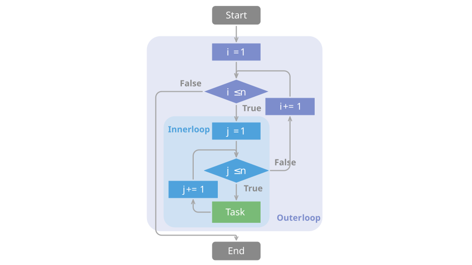
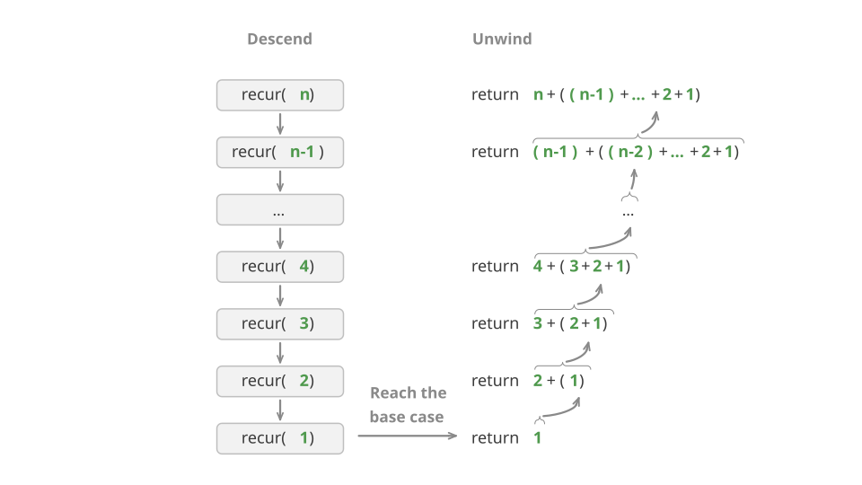
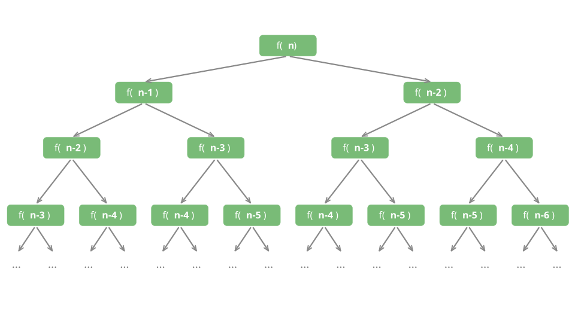

# Iteration and recursion

Algorithms often perform a task repeatedly, and these repetitions matter when we analyze complexity. Before we look at time and space complexity, let's explore two basic control structures that let a program repeat a task: iteration and recursion.

## Iteration

<u>Iteration</u> is a control structure for repeating a task. A program repeatedly executes a block of code while a condition holds and stops when the condition no longer holds.

### The for loop

A `for` loop is one of the most common forms of iteration. It is **well suited to situations where you know the number of iterations in advance**.

The following function uses a `for` loop to compute $1 + 2 + \dots + n$ and stores the running sum in `res`. In Python, the interval for `range(a, b)` includes the left endpoint and excludes the right, so the loop visits $a, a + 1, \dots, b-1$:

```src
[file]{iteration}-[class]{}-[func]{for_loop}
```

The flowchart below shows how the summation function works.


The number of operations in this function is proportional to the input size $n$. We call this a linear relationship. In this example, **time complexity describes that linear relationship**, as we'll see in detail in the next section.

### The while loop

Like a `for` loop, a `while` loop implements iteration. At the start of each pass through a `while` loop, the program checks the condition. If it is true, the loop body runs. Otherwise, the loop ends.

Here is a `while` loop that computes $1 + 2 + \dots + n$:

```src
[file]{iteration}-[class]{}-[func]{while_loop}
```

**A `while` loop offers more flexibility than a `for` loop**. In a `while` loop, we can choose how to initialize and update the variable used in the condition.

For example, the following code updates $i$ twice per iteration. This pattern is less convenient to express with a `for` loop:

```src
[file]{iteration}-[class]{}-[func]{while_loop_ii}
```

In general, **a `for` loop is more compact and a `while` loop is more flexible**. Both implement iteration. Choose the one that fits the problem.

### Nested loops

We can put one loop inside another. Here is an example with `for` loops:

```src
[file]{iteration}-[class]{}-[func]{nested_for_loop}
```

The flowchart below shows how these nested loops run.



Here the number of operations is proportional to $n^2$. In other words, the algorithm's running time grows quadratically with the input size $n$.

We can keep nesting loops in the same way. Each additional level raises the power by one, giving cubic time, then fourth-power time, and so on.

## Recursion

 <u>Recursion</u> is a strategy in which a function solves a problem by calling itself. The process has two main phases.

1. **Descent**: The function calls itself at successively deeper levels, usually with smaller or simpler arguments, until it reaches a base case.
2. **Unwinding**: Once execution reaches the base case, the calls return one level at a time, starting with the deepest call and combining the results along the way.

A recursive implementation has three main elements.

1. **Base case**: Determines when to stop descending and start returning.
2. **Recursive call**: To descend, the function calls itself, usually with smaller or simpler arguments.
3. **Return value**: As the calls unwind, each level sends its result back to the preceding level.

In the following code, calling `recur(n)` is all it takes to compute $1 + 2 + \dots + n$:

```src
[file]{recursion}-[class]{}-[func]{recur}
```

The figure below traces the recursive calls.



Iteration and recursion can compute the same result, **but they represent two fundamentally different ways to approach and solve a problem**.

- **Iteration** works from the bottom up. Start with a basic step, then repeat it or accumulate its results until the task is complete.
- **Recursion** works from the top down. Break the original problem into smaller problems of the same form. Keep breaking them down until you reach a base case whose solution is known.

Take the summation function above and write the problem as $f(n) = 1 + 2 + \dots + n$.

- **Iteration**: Sum the terms in a loop. Visit each value from $1$ through $n$ and add it to the total to obtain $f(n)$.
- **Recursion**: Express the problem in terms of a smaller one, $f(n) = n + f(n-1)$. Repeat this decomposition recursively until you reach the base case $f(1) = 1$.

### The call stack

Each time a recursive function calls itself, the system allocates memory for the new call's local variables, return address, and other information. This has two consequences.

- Each call's context is stored in a region of memory called a stack frame. The system releases that frame only when the call returns. As a result, **recursion usually uses more memory than iteration**.
- Each recursive call carries some overhead. **Recursion is therefore usually slower than a loop**.

In the figure below, $n$ calls are active at once when execution reaches the base case. **The recursion depth is $n$**.


In practice, programming languages usually allow only a limited recursion depth. Recursing too deeply can cause a stack overflow.

### Tail recursion

**If the recursive call is the function's last step before it returns**, a compiler or interpreter can optimize the function to use space as efficiently as iteration. This form is called <u>tail recursion</u>.

- **Ordinary recursion**: When a child call returns, its caller still has code to execute, so the system must preserve the caller's context.
- **Tail recursion**: The recursive call is the final operation before return. The caller has no further work to do when the call returns, so the system has no need to retain its context.

To compute $1 + 2 + \dots + n$ with tail recursion, pass the running total `res` as a function parameter:

```src
[file]{recursion}-[class]{}-[func]{tail_recur}
```

The figure below traces the tail-recursive version. The two versions perform their additions at different points.

- **Ordinary recursion**: Addition happens as the calls unwind. After each child call returns, its caller performs an addition.
- **Tail recursion**: Addition happens on the way down. On the way back up, each level just returns the result.


!!! tip

    Many compilers and interpreters do not support tail-call optimization. Python, for example, does not support it by default, so even a tail-recursive function can overflow the stack.

### Recursion trees

For problems that involve divide and conquer, recursion often gives us a more intuitive approach and more readable code than iteration. Consider the Fibonacci sequence.

!!! question

    Given the Fibonacci sequence $0, 1, 1, 2, 3, 5, 8, 13, \dots$, find term number $n$.

Let $f(n)$ denote term number $n$ of the Fibonacci sequence. Two observations give us a way to compute it.

- The first two terms are $f(1) = 0$ and $f(2) = 1$.
- Each subsequent term is the sum of the previous two: $f(n) = f(n - 1) + f(n - 2)$.

Use the recurrence to make recursive calls, and use the first two terms as base cases. In the resulting code, calling `fib(n)` gives term number $n$ of the Fibonacci sequence:

```src
[file]{recursion}-[class]{}-[func]{fib}
```

The function makes two recursive calls, **so a single call branches into two**. As the figure below shows, continuing this process produces a <u>recursion tree</u> with $n$ levels.



At its heart, recursion expresses the idea of breaking a problem into smaller subproblems. This divide-and-conquer strategy is fundamental.

- Many important algorithmic techniques draw on this idea, directly or indirectly, including searching, sorting, backtracking, divide and conquer, and dynamic programming.
- Recursion is also a natural fit for problems involving linked lists, trees, and graphs because these structures lend themselves to divide-and-conquer reasoning.

## Comparing iteration and recursion

The table summarizes how iteration and recursion differ in implementation, performance, and the problems they suit.

<p align="center"> Table <id> &nbsp; Comparison of iteration and recursion </p>

|          | Iteration                                   | Recursion                                                         |
| -------- | -------------------------------------- | ------------------------------------------------------------ |
| Implementation | Loop structure                               | A function calls itself                                                 |
| Time efficiency | Usually efficient, with no function call overhead           | Each function call incurs overhead                                     |
| Memory use | Usually uses a fixed amount of memory             | Accumulated calls can take up considerable stack space                           |
| Suitable problems | Simple repetitive tasks, where a loop is straightforward and easy to read | Problems that break into subproblems, such as tree and graph problems, divide and conquer, and backtracking, where recursion gives the code a concise, clear structure |

!!! tip

    If the following material feels difficult, come back to it after reading the chapter on stacks.

How are iteration and recursion connected? In the recursive sum, the additions happen as the calls unwind. The first call is the last to finish its addition. **This is the same first-in, last-out behavior we see in a stack**.

Indeed, terms such as “call stack” and “stack frame” already hint at the close connection between recursion and stacks.

1. **Descent**: When a function is called, the system allocates a new frame on the call stack for the call's local variables, parameters, return address, and other data.
2. **Unwinding**: When the function finishes and returns, the system removes its frame from the call stack and restores the caller's execution context.

We can therefore **use an explicit stack to simulate the call stack** and turn recursion into iteration:

```src
[file]{recursion}-[class]{}-[func]{for_loop_recur}
```

Notice that the iterative version above is more complicated. Although we can often convert iteration to recursion or vice versa, there are two reasons why doing so may not be worthwhile.

- The converted code may be harder to understand and read.
- For some complex problems, simulating the system's call stack can be difficult.

Ultimately, **the choice between iteration and recursion depends on the problem**. In practice, weigh their respective strengths and weaknesses and choose the approach that fits the situation.
