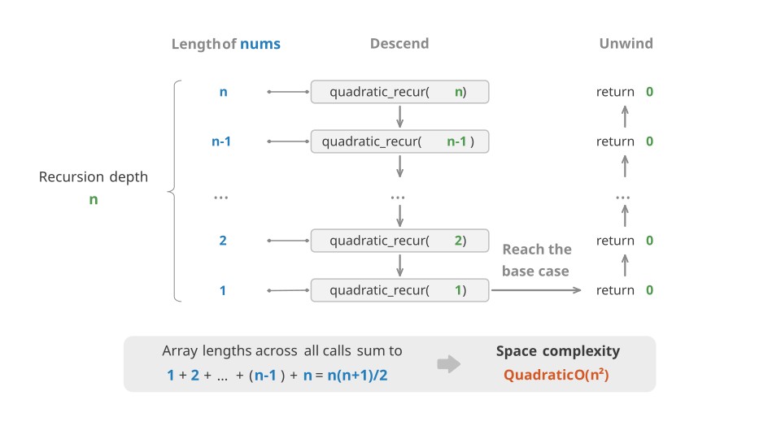
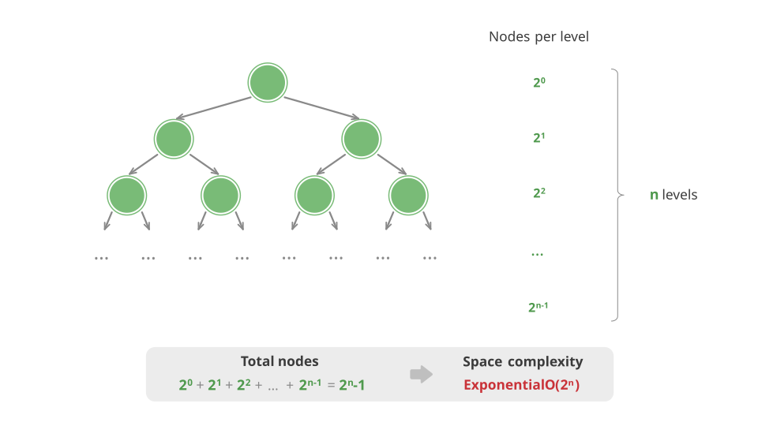

# Space complexity

<u>Space complexity</u> measures how an algorithm's memory use grows as the input gets larger. It is much like time complexity, with memory usage replacing runtime.

## Space used by an algorithm

The memory an algorithm uses during execution falls into these main categories.

- **Input space**: Stores the input data.
- **Temporary space**: Stores variables, objects, function contexts, and other working data.
- **Output space**: Stores the output data.

Space complexity generally counts temporary space plus output space.

Temporary space can be divided further into three parts.

- **Temporary data**: Constants, variables, objects, and other data used during execution.
- **Stack frames**: Context data for function calls. Each call creates a frame at the top of the stack, which is released when the function returns.
- **Instruction space**: Compiled program instructions, usually ignored in the analysis.

**We usually count temporary data, stack frames, and output data** when analyzing space complexity, as shown in the figure below.


The corresponding code is:

```snippet
space_categories
```

## Deriving space complexity

The approach is much like time complexity analysis, except that we count memory used rather than operations performed.

Unlike time complexity, **we usually focus only on worst-case space complexity**. Memory is a hard requirement: enough must be available for every valid input.

In the following code, "worst case" has two meanings.

1. **The worst input**: When $n < 10$, space complexity is $O(1)$. When $n > 10$, initializing `nums` requires $O(n)$ space, so worst-case space complexity is $O(n)$.
2. **Peak memory during execution**: Before the final line, the program uses $O(1)$ space. Initializing `nums` raises usage to $O(n)$, so worst-case space complexity is $O(n)$.

```snippet
worst_case_space
```

**For recursive functions, remember to count stack frames**. Consider the following code:

```snippet
loop_vs_recursion_space
```

Both `loop()` and `recur()` take $O(n)$ time, but their space complexities differ.

- `loop()` calls `function()` $n$ times. Each call returns and releases its stack frame before the next iteration, so space complexity remains $O(1)$.
- During `recur()`, $n$ calls can remain active at once, using $O(n)$ space for stack frames.

## Common complexity classes

For input size $n$, the figure below shows common space complexities in increasing order of growth.

$$
\begin{aligned}
& O(1) < O(\log n) < O(n) < O(n^2) < O(2^n) \newline
& \text{Constant} < \text{Logarithmic} < \text{Linear} < \text{Quadratic} < \text{Exponential}
\end{aligned}
$$


### Constant space $O(1)$

Constant space commonly occurs when the number of constants, variables, and objects is independent of input size $n$.

Memory for variables initialized or functions called within a loop is released by the next iteration, so it does not accumulate. Space complexity remains $O(1)$:

```src
[file]{space_complexity}-[class]{}-[func]{constant}
```

### Linear space $O(n)$

Linear space commonly occurs in arrays, linked lists, stacks, and queues whose element counts are proportional to $n$:

```src
[file]{space_complexity}-[class]{}-[func]{linear}
```

As shown in the figure below, this function has recursion depth $n$, with $n$ active calls to `linear_recur()` at once, using $O(n)$ space for stack frames:

```src
[file]{space_complexity}-[class]{}-[func]{linear_recur}
```


### Quadratic space $O(n^2)$

Quadratic space commonly occurs in matrices and graphs whose element counts grow with the square of $n$:

```src
[file]{space_complexity}-[class]{}-[func]{quadratic}
```

As shown in the figure below, the recursion depth is $n$, and each call initializes an array. Their lengths are $n$, $n-1$, $\dots$, $2$, and $1$, averaging $n / 2$, so total space is $O(n^2)$:

```src
[file]{space_complexity}-[class]{}-[func]{quadratic_recur}
```



### Exponential space $O(2^n)$

Exponential space commonly occurs in binary trees. In the figure below, a perfect binary tree with $n$ levels contains $2^n - 1$ nodes and uses $O(2^n)$ space:

```src
[file]{space_complexity}-[class]{}-[func]{build_tree}
```



### Logarithmic space $O(\log n)$

Logarithmic space often appears in divide-and-conquer algorithms. For example, merge sort splits an array of length $n$ in half at each recursive step, producing a recursion tree of height $\log n$ and using $O(\log n)$ space for stack frames.

Another example is converting a number to a string. A positive integer $n$ has $\lfloor \log_{10} n \rfloor + 1$ digits, giving a string of length $\lfloor \log_{10} n \rfloor + 1$. The space complexity is therefore $O(\log_{10} n + 1) = O(\log n)$.

## Balancing time and space

Ideally, we would minimize both time and space complexity. In practice, optimizing both simultaneously is usually difficult.

**Reducing time complexity often increases space complexity, and vice versa**. Using more memory to run faster is called trading space for time; accepting slower execution to use less memory is trading time for space.

The choice depends on which resource matters more. Time is usually more valuable than space, so trading space for time is common. For very large datasets, however, keeping space complexity under control is also crucial.
