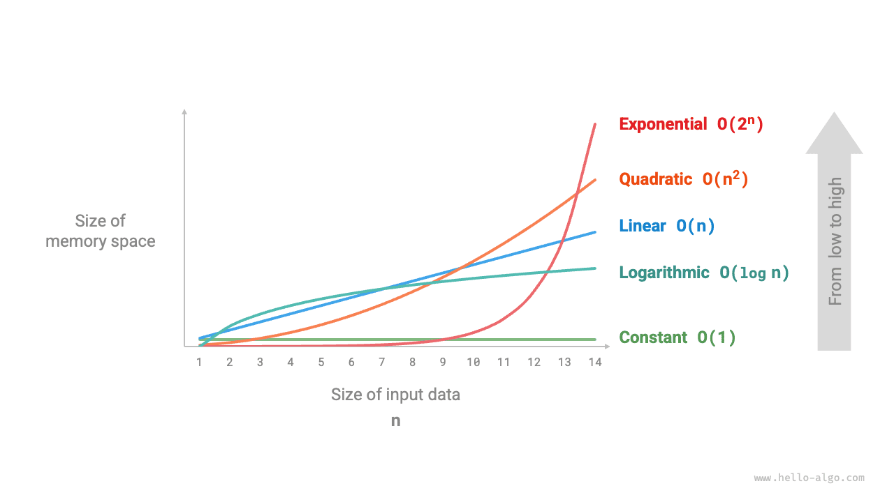

# 2.4 &nbsp; Space complexity

<u>Space complexity</u> measures how an algorithm's memory use grows as the input gets larger. It is much like time complexity, with memory usage replacing runtime.

## 2.4.1 &nbsp; Space used by an algorithm

The memory an algorithm uses during execution falls into these main categories.

- **Input space**: Stores the input data.
- **Temporary space**: Stores variables, objects, function contexts, and other working data.
- **Output space**: Stores the output data.

Space complexity generally counts temporary space plus output space.

Temporary space can be divided further into three parts.

- **Temporary data**: Constants, variables, objects, and other data used during execution.
- **Stack frames**: Context data for function calls. Each call creates a frame at the top of the stack, which is released when the function returns.
- **Instruction space**: Compiled program instructions, usually ignored in the analysis.

**We usually count temporary data, stack frames, and output data** when analyzing space complexity, as shown in Figure 2-15.

{ class="animation-figure" }

<p align="center"> Figure 2-15 &nbsp; Space used by an algorithm </p>

The corresponding code is:

=== "Python"

    ```python title=""
    class Node:
        """Class"""
        def __init__(self, x: int):
            self.val: int = x              # Node value
            self.next: Node | None = None  # Reference to the next node

    def function() -> int:
        """Function"""
        # Perform some operations...
        return 0

    def algorithm(n) -> int:  # Input data
        A = 0                 # Temporary data (constant, conventionally named in uppercase)
        b = 0                 # Temporary data (variable)
        node = Node(0)        # Temporary data (object)
        c = function()        # Stack frame (function call)
        return A + b + c      # Output data
    ```

=== "C++"

    ```cpp title=""
    /* Structure */
    struct Node {
        int val;
        Node *next;
        Node(int x) : val(x), next(nullptr) {}
    };

    /* Function */
    int func() {
        // Perform some operations...
        return 0;
    }

    int algorithm(int n) {        // Input data
        const int a = 0;          // Temporary data (constant)
        int b = 0;                // Temporary data (variable)
        Node* node = new Node(0); // Temporary data (object)
        int c = func();           // Stack frame (function call)
        return a + b + c;         // Output data
    }
    ```

=== "Java"

    ```java title=""
    /* Class */
    class Node {
        int val;
        Node next;
        Node(int x) { val = x; }
    }
    
    /* Function */
    int function() {
        // Perform some operations...
        return 0;
    }
    
    int algorithm(int n) {        // Input data
        final int a = 0;          // Temporary data (constant)
        int b = 0;                // Temporary data (variable)
        Node node = new Node(0);  // Temporary data (object)
        int c = function();       // Stack frame (function call)
        return a + b + c;         // Output data
    }
    ```

=== "C#"

    ```csharp title=""
    /* Class */
    class Node(int x) {
        int val = x;
        Node next;
    }

    /* Function */
    int Function() {
        // Perform some operations...
        return 0;
    }

    int Algorithm(int n) {        // Input data
        const int a = 0;          // Temporary data (constant)
        int b = 0;                // Temporary data (variable)
        Node node = new(0);       // Temporary data (object)
        int c = Function();       // Stack frame (function call)
        return a + b + c;         // Output data
    }
    ```

=== "Go"

    ```go title=""
    /* Structure */
    type node struct {
        val  int
        next *node
    }

    /* Create a node structure  */
    func newNode(val int) *node {
        return &node{val: val}
    }
    
    /* Function */
    func function() int {
        // Perform some operations...
        return 0
    }

    func algorithm(n int) int { // Input data
        const a = 0             // Temporary data (constant)
        b := 0                  // Temporary data (variable)
        newNode(0)              // Temporary data (object)
        c := function()         // Stack frame (function call)
        return a + b + c        // Output data
    }
    ```

=== "Swift"

    ```swift title=""
    /* Class */
    class Node {
        var val: Int
        var next: Node?

        init(x: Int) {
            val = x
        }
    }

    /* Function */
    func function() -> Int {
        // Perform some operations...
        return 0
    }

    func algorithm(n: Int) -> Int { // Input data
        let a = 0             // Temporary data (constant)
        var b = 0             // Temporary data (variable)
        let node = Node(x: 0) // Temporary data (object)
        let c = function()    // Stack frame (function call)
        return a + b + c      // Output data
    }
    ```

=== "JS"

    ```javascript title=""
    /* Class */
    class Node {
        val;
        next;
        constructor(val) {
            this.val = val === undefined ? 0 : val; // Node value
            this.next = null;                       // Reference to the next node
        }
    }

    /* Function */
    function constFunc() {
        // Perform some operations
        return 0;
    }

    function algorithm(n) {       // Input data
        const a = 0;              // Temporary data (constant)
        let b = 0;                // Temporary data (variable)
        const node = new Node(0); // Temporary data (object)
        const c = constFunc();    // Stack frame (function call)
        return a + b + c;         // Output data
    }
    ```

=== "TS"

    ```typescript title=""
    /* Class */
    class Node {
        val: number;
        next: Node | null;
        constructor(val?: number) {
            this.val = val === undefined ? 0 : val; // Node value
            this.next = null;                       // Reference to the next node
        }
    }

    /* Function */
    function constFunc(): number {
        // Perform some operations
        return 0;
    }

    function algorithm(n: number): number { // Input data
        const a = 0;                        // Temporary data (constant)
        let b = 0;                          // Temporary data (variable)
        const node = new Node(0);           // Temporary data (object)
        const c = constFunc();              // Stack frame (function call)
        return a + b + c;                   // Output data
    }
    ```

=== "Dart"

    ```dart title=""
    /* Class */
    class Node {
      int val;
      Node next;
      Node(this.val, [this.next]);
    }

    /* Function */
    int function() {
      // Perform some operations...
      return 0;
    }

    int algorithm(int n) {  // Input data
      const int a = 0;      // Temporary data (constant)
      int b = 0;            // Temporary data (variable)
      Node node = Node(0);  // Temporary data (object)
      int c = function();   // Stack frame (function call)
      return a + b + c;     // Output data
    }
    ```

=== "Rust"

    ```rust title=""
    use std::rc::Rc;
    use std::cell::RefCell;
    
    /* Structure */
    struct Node {
        val: i32,
        next: Option<Rc<RefCell<Node>>>,
    }

    /* Create a Node structure */
    impl Node {
        fn new(val: i32) -> Self {
            Self { val: val, next: None }
        }
    }

    /* Function */
    fn function() -> i32 {      
        // Perform some operations...
        return 0;
    }

    fn algorithm(n: i32) -> i32 {       // Input data
        const a: i32 = 0;               // Temporary data (constant)
        let mut b = 0;                  // Temporary data (variable)
        let node = Node::new(0);        // Temporary data (object)
        let c = function();             // Stack frame (function call)
        return a + b + c;               // Output data
    }
    ```

=== "C"

    ```c title=""
    /* Function */
    int func() {
        // Perform some operations...
        return 0;
    }

    int algorithm(int n) { // Input data
        const int a = 0;   // Temporary data (constant)
        int b = 0;         // Temporary data (variable)
        int c = func();    // Stack frame (function call)
        return a + b + c;  // Output data
    }
    ```

=== "Kotlin"

    ```kotlin title=""
    /* Class */
    class Node(var _val: Int) {
        var next: Node? = null
    }

    /* Function */
    fun function(): Int {
        // Perform some operations...
        return 0
    }

    fun algorithm(n: Int): Int { // Input data
        val a = 0                // Temporary data (constant)
        var b = 0                // Temporary data (variable)
        val node = Node(0)       // Temporary data (object)
        val c = function()       // Stack frame (function call)
        return a + b + c         // Output data
    }
    ```

=== "Ruby"

    ```ruby title=""
    ### Class ###
    class Node
        attr_accessor :val      # Node value
        attr_accessor :next     # Reference to the next node

        def initialize(x)
            @val = x
        end
    end

    ### Function ###
    def function
        # Perform some operations...
        0
    end

    ### Algorithm ###
    def algorithm(n)        # Input data
        a = 0               # Temporary data (constant)
        b = 0               # Temporary data (variable)
        node = Node.new(0)  # Temporary data (object)
        c = function        # Stack frame (function call)
        a + b + c           # Output data
    end
    ```

## 2.4.2 &nbsp; Deriving space complexity

The approach is much like time complexity analysis, except that we count memory used rather than operations performed.

Unlike time complexity, **we usually focus only on worst-case space complexity**. Memory is a hard requirement: enough must be available for every valid input.

In the following code, "worst case" has two meanings.

1. **The worst input**: When $n < 10$, space complexity is $O(1)$. When $n > 10$, initializing `nums` requires $O(n)$ space, so worst-case space complexity is $O(n)$.
2. **Peak memory during execution**: Before the final line, the program uses $O(1)$ space. Initializing `nums` raises usage to $O(n)$, so worst-case space complexity is $O(n)$.

=== "Python"

    ```python title=""
    def algorithm(n: int):
        a = 0               # O(1)
        b = [0] * 10000     # O(1)
        if n > 10:
            nums = [0] * n  # O(n)
    ```

=== "C++"

    ```cpp title=""
    void algorithm(int n) {
        int a = 0;               // O(1)
        vector<int> b(10000);    // O(1)
        if (n > 10)
            vector<int> nums(n); // O(n)
    }
    ```

=== "Java"

    ```java title=""
    void algorithm(int n) {
        int a = 0;                   // O(1)
        int[] b = new int[10000];    // O(1)
        if (n > 10)
            int[] nums = new int[n]; // O(n)
    }
    ```

=== "C#"

    ```csharp title=""
    void Algorithm(int n) {
        int a = 0;                   // O(1)
        int[] b = new int[10000];    // O(1)
        if (n > 10) {
            int[] nums = new int[n]; // O(n)
        }
    }
    ```

=== "Go"

    ```go title=""
    func algorithm(n int) {
        a := 0                      // O(1)
        b := make([]int, 10000)     // O(1)
        var nums []int
        if n > 10 {
            nums := make([]int, n)  // O(n)
        }
        fmt.Println(a, b, nums)
    }
    ```

=== "Swift"

    ```swift title=""
    func algorithm(n: Int) {
        let a = 0 // O(1)
        let b = Array(repeating: 0, count: 10000) // O(1)
        if n > 10 {
            let nums = Array(repeating: 0, count: n) // O(n)
        }
    }
    ```

=== "JS"

    ```javascript title=""
    function algorithm(n) {
        const a = 0;                   // O(1)
        const b = new Array(10000);    // O(1)
        if (n > 10) {
            const nums = new Array(n); // O(n)
        }
    }
    ```

=== "TS"

    ```typescript title=""
    function algorithm(n: number): void {
        const a = 0;                   // O(1)
        const b = new Array(10000);    // O(1)
        if (n > 10) {
            const nums = new Array(n); // O(n)
        }
    }
    ```

=== "Dart"

    ```dart title=""
    void algorithm(int n) {
      int a = 0;                            // O(1)
      List<int> b = List.filled(10000, 0);  // O(1)
      if (n > 10) {
        List<int> nums = List.filled(n, 0); // O(n)
      }
    }
    ```

=== "Rust"

    ```rust title=""
    fn algorithm(n: i32) {
        let a = 0;                              // O(1)
        let b = [0; 10000];                     // O(1)
        if n > 10 {
            let nums = vec![0; n as usize];     // O(n)
        }
    }
    ```

=== "C"

    ```c title=""
    void algorithm(int n) {
        int a = 0;               // O(1)
        int b[10000];            // O(1)
        if (n > 10)
            int nums[n] = {0};   // O(n)
    }
    ```

=== "Kotlin"

    ```kotlin title=""
    fun algorithm(n: Int) {
        val a = 0                    // O(1)
        val b = IntArray(10000)      // O(1)
        if (n > 10) {
            val nums = IntArray(n)   // O(n)
        }
    }
    ```

=== "Ruby"

    ```ruby title=""
    def algorithm(n)
        a = 0                           # O(1)
        b = Array.new(10000)            # O(1)
        nums = Array.new(n) if n > 10   # O(n)
    end
    ```

**For recursive functions, remember to count stack frames**. Consider the following code:

=== "Python"

    ```python title=""
    def function() -> int:
        # Perform some operations
        return 0

    def loop(n: int):
        """The loop uses O(1) space"""
        for _ in range(n):
            function()

    def recur(n: int):
        """The recursion uses O(n) space"""
        if n == 1:
            return
        return recur(n - 1)
    ```

=== "C++"

    ```cpp title=""
    int func() {
        // Perform some operations
        return 0;
    }
    /* The loop uses O(1) space */
    void loop(int n) {
        for (int i = 0; i < n; i++) {
            func();
        }
    }
    /* The recursion uses O(n) space */
    void recur(int n) {
        if (n == 1) return;
        recur(n - 1);
    }
    ```

=== "Java"

    ```java title=""
    int function() {
        // Perform some operations
        return 0;
    }
    /* The loop uses O(1) space */
    void loop(int n) {
        for (int i = 0; i < n; i++) {
            function();
        }
    }
    /* The recursion uses O(n) space */
    void recur(int n) {
        if (n == 1) return;
        recur(n - 1);
    }
    ```

=== "C#"

    ```csharp title=""
    int Function() {
        // Perform some operations
        return 0;
    }
    /* The loop uses O(1) space */
    void Loop(int n) {
        for (int i = 0; i < n; i++) {
            Function();
        }
    }
    /* The recursion uses O(n) space */
    int Recur(int n) {
        if (n == 1) return 1;
        return Recur(n - 1);
    }
    ```

=== "Go"

    ```go title=""
    func function() int {
        // Perform some operations
        return 0
    }
    
    /* The loop uses O(1) space */
    func loop(n int) {
        for i := 0; i < n; i++ {
            function()
        }
    }
    
    /* The recursion uses O(n) space */
    func recur(n int) {
        if n == 1 {
            return
        }
        recur(n - 1)
    }
    ```

=== "Swift"

    ```swift title=""
    @discardableResult
    func function() -> Int {
        // Perform some operations
        return 0
    }

    /* The loop uses O(1) space */
    func loop(n: Int) {
        for _ in 0 ..< n {
            function()
        }
    }

    /* The recursion uses O(n) space */
    func recur(n: Int) {
        if n == 1 {
            return
        }
        recur(n: n - 1)
    }
    ```

=== "JS"

    ```javascript title=""
    function constFunc() {
        // Perform some operations
        return 0;
    }
    /* The loop uses O(1) space */
    function loop(n) {
        for (let i = 0; i < n; i++) {
            constFunc();
        }
    }
    /* The recursion uses O(n) space */
    function recur(n) {
        if (n === 1) return;
        return recur(n - 1);
    }
    ```

=== "TS"

    ```typescript title=""
    function constFunc(): number {
        // Perform some operations
        return 0;
    }
    /* The loop uses O(1) space */
    function loop(n: number): void {
        for (let i = 0; i < n; i++) {
            constFunc();
        }
    }
    /* The recursion uses O(n) space */
    function recur(n: number): void {
        if (n === 1) return;
        return recur(n - 1);
    }
    ```

=== "Dart"

    ```dart title=""
    int function() {
      // Perform some operations
      return 0;
    }
    /* The loop uses O(1) space */
    void loop(int n) {
      for (int i = 0; i < n; i++) {
        function();
      }
    }
    /* The recursion uses O(n) space */
    void recur(int n) {
      if (n == 1) return;
      recur(n - 1);
    }
    ```

=== "Rust"

    ```rust title=""
    fn function() -> i32 {
        // Perform some operations
        return 0;
    }
    /* The loop uses O(1) space */
    fn loop(n: i32) {
        for i in 0..n {
            function();
        }
    }
    /* The recursion uses O(n) space */
    fn recur(n: i32) {
        if n == 1 {
            return;
        }
        recur(n - 1);
    }
    ```

=== "C"

    ```c title=""
    int func() {
        // Perform some operations
        return 0;
    }
    /* The loop uses O(1) space */
    void loop(int n) {
        for (int i = 0; i < n; i++) {
            func();
        }
    }
    /* The recursion uses O(n) space */
    void recur(int n) {
        if (n == 1) return;
        recur(n - 1);
    }
    ```

=== "Kotlin"

    ```kotlin title=""
    fun function(): Int {
        // Perform some operations
        return 0
    }
    /* The loop uses O(1) space */
    fun loop(n: Int) {
        for (i in 0..<n) {
            function()
        }
    }
    /* The recursion uses O(n) space */
    fun recur(n: Int) {
        if (n == 1) return
        return recur(n - 1)
    }
    ```

=== "Ruby"

    ```ruby title=""
    def function
        # Perform some operations
        0
    end

    ### The loop uses O(1) space ###
    def loop(n)
        (0...n).each { function }
    end

    ### The recursion uses O(n) space ###
    def recur(n)
        return if n == 1
        recur(n - 1)
    end
    ```

Both `loop()` and `recur()` take $O(n)$ time, but their space complexities differ.

- `loop()` calls `function()` $n$ times. Each call returns and releases its stack frame before the next iteration, so space complexity remains $O(1)$.
- During `recur()`, $n$ calls can remain active at once, using $O(n)$ space for stack frames.

## 2.4.3 &nbsp; Common complexity classes

For input size $n$, Figure 2-16 shows common space complexities in increasing order of growth.

$$
\begin{aligned}
& O(1) < O(\log n) < O(n) < O(n^2) < O(2^n) \newline
& \text{Constant} < \text{Logarithmic} < \text{Linear} < \text{Quadratic} < \text{Exponential}
\end{aligned}
$$

{ class="animation-figure" }

<p align="center"> Figure 2-16 &nbsp; Common space complexity classes </p>

### 1. &nbsp; Constant space $O(1)$ {data-toc-label="1. &nbsp; Constant space"}

Constant space commonly occurs when the number of constants, variables, and objects is independent of input size $n$.

Memory for variables initialized or functions called within a loop is released by the next iteration, so it does not accumulate. Space complexity remains $O(1)$:

=== "Python"

    ```python title="space_complexity.py"
    def function() -> int:
        """Function"""
        # Perform some operations
        return 0

    def constant(n: int):
        """Constant complexity"""
        # Constants, variables, and objects occupy O(1) space
        a = 0
        nums = [0] * 10000
        node = ListNode(0)
        # Variables in the loop occupy O(1) space
        for _ in range(n):
            c = 0
        # Function calls in the loop occupy O(1) space
        for _ in range(n):
            function()
    ```

=== "C++"

    ```cpp title="space_complexity.cpp"
    /* Function */
    int func() {
        // Perform some operations
        return 0;
    }

    /* Constant complexity */
    void constant(int n) {
        // Constants, variables, and objects occupy O(1) space
        const int a = 0;
        int b = 0;
        vector<int> nums(10000);
        ListNode node(0);
        // Variables in the loop occupy O(1) space
        for (int i = 0; i < n; i++) {
            int c = 0;
        }
        // Function calls in the loop occupy O(1) space
        for (int i = 0; i < n; i++) {
            func();
        }
    }
    ```

=== "Java"

    ```java title="space_complexity.java"
    /* Function */
    int function() {
        // Perform some operations
        return 0;
    }

    /* Constant complexity */
    void constant(int n) {
        // Constants, variables, and objects occupy O(1) space
        final int a = 0;
        int b = 0;
        int[] nums = new int[10000];
        ListNode node = new ListNode(0);
        // Variables in the loop occupy O(1) space
        for (int i = 0; i < n; i++) {
            int c = 0;
        }
        // Function calls in the loop occupy O(1) space
        for (int i = 0; i < n; i++) {
            function();
        }
    }
    ```

=== "C#"

    ```csharp title="space_complexity.cs"
    /* Function */
    int Function() {
        // Perform some operations
        return 0;
    }

    /* Constant complexity */
    void Constant(int n) {
        // Constants, variables, and objects occupy O(1) space
        int a = 0;
        int b = 0;
        int[] nums = new int[10000];
        ListNode node = new(0);
        // Variables in the loop occupy O(1) space
        for (int i = 0; i < n; i++) {
            int c = 0;
        }
        // Function calls in the loop occupy O(1) space
        for (int i = 0; i < n; i++) {
            Function();
        }
    }
    ```

=== "Go"

    ```go title="space_complexity.go"
    /* Function */
    func function() int {
        // Perform some operations...
        return 0
    }

    /* Constant complexity */
    func spaceConstant(n int) {
        // Constants, variables, and objects occupy O(1) space
        const a = 0
        b := 0
        nums := make([]int, 10000)
        node := newNode(0)
        // Variables in the loop occupy O(1) space
        var c int
        for i := 0; i < n; i++ {
            c = 0
        }
        // Function calls in the loop occupy O(1) space
        for i := 0; i < n; i++ {
            function()
        }
        b += 0
        c += 0
        nums[0] = 0
        node.val = 0
    }
    ```

=== "Swift"

    ```swift title="space_complexity.swift"
    /* Function */
    @discardableResult
    func function() -> Int {
        // Perform some operations
        return 0
    }

    /* Constant complexity */
    func constant(n: Int) {
        // Constants, variables, and objects occupy O(1) space
        let a = 0
        var b = 0
        let nums = Array(repeating: 0, count: 10000)
        let node = ListNode(x: 0)
        // Variables in the loop occupy O(1) space
        for _ in 0 ..< n {
            let c = 0
        }
        // Function calls in the loop occupy O(1) space
        for _ in 0 ..< n {
            function()
        }
    }
    ```

=== "JS"

    ```javascript title="space_complexity.js"
    /* Function */
    function constFunc() {
        // Perform some operations
        return 0;
    }

    /* Constant complexity */
    function constant(n) {
        // Constants, variables, and objects occupy O(1) space
        const a = 0;
        const b = 0;
        const nums = new Array(10000);
        const node = new ListNode(0);
        // Variables in the loop occupy O(1) space
        for (let i = 0; i < n; i++) {
            const c = 0;
        }
        // Function calls in the loop occupy O(1) space
        for (let i = 0; i < n; i++) {
            constFunc();
        }
    }
    ```

=== "TS"

    ```typescript title="space_complexity.ts"
    /* Function */
    function constFunc(): number {
        // Perform some operations
        return 0;
    }

    /* Constant complexity */
    function constant(n: number): void {
        // Constants, variables, and objects occupy O(1) space
        const a = 0;
        const b = 0;
        const nums = new Array(10000);
        const node = new ListNode(0);
        // Variables in the loop occupy O(1) space
        for (let i = 0; i < n; i++) {
            const c = 0;
        }
        // Function calls in the loop occupy O(1) space
        for (let i = 0; i < n; i++) {
            constFunc();
        }
    }
    ```

=== "Dart"

    ```dart title="space_complexity.dart"
    /* Function */
    int function() {
      // Perform some operations
      return 0;
    }

    /* Constant complexity */
    void constant(int n) {
      // Constants, variables, and objects occupy O(1) space
      final int a = 0;
      int b = 0;
      List<int> nums = List.filled(10000, 0);
      ListNode node = ListNode(0);
      // Variables in the loop occupy O(1) space
      for (var i = 0; i < n; i++) {
        int c = 0;
      }
      // Function calls in the loop occupy O(1) space
      for (var i = 0; i < n; i++) {
        function();
      }
    }
    ```

=== "Rust"

    ```rust title="space_complexity.rs"
    /* Function */
    fn function() -> i32 {
        // Perform some operations
        return 0;
    }

    /* Constant complexity */
    #[allow(unused)]
    fn constant(n: i32) {
        // Constants, variables, and objects occupy O(1) space
        const A: i32 = 0;
        let b = 0;
        let nums = vec![0; 10000];
        let node = ListNode::new(0);
        // Variables in the loop occupy O(1) space
        for i in 0..n {
            let c = 0;
        }
        // Function calls in the loop occupy O(1) space
        for i in 0..n {
            function();
        }
    }
    ```

=== "C"

    ```c title="space_complexity.c"
    /* Function */
    int func() {
        // Perform some operations
        return 0;
    }

    /* Constant complexity */
    void constant(int n) {
        // Constants, variables, and objects occupy O(1) space
        const int a = 0;
        int b = 0;
        int nums[1000];
        ListNode *node = newListNode(0);
        free(node);
        // Variables in the loop occupy O(1) space
        for (int i = 0; i < n; i++) {
            int c = 0;
        }
        // Function calls in the loop occupy O(1) space
        for (int i = 0; i < n; i++) {
            func();
        }
    }
    ```

=== "Kotlin"

    ```kotlin title="space_complexity.kt"
    /* Function */
    fun function(): Int {
        // Perform some operations
        return 0
    }

    /* Constant complexity */
    fun constant(n: Int) {
        // Constants, variables, and objects occupy O(1) space
        val a = 0
        var b = 0
        val nums = Array(10000) { 0 }
        val node = ListNode(0)
        // Variables in the loop occupy O(1) space
        for (i in 0..<n) {
            val c = 0
        }
        // Function calls in the loop occupy O(1) space
        for (i in 0..<n) {
            function()
        }
    }
    ```

=== "Ruby"

    ```ruby title="space_complexity.rb"
    ### Function ###
    def function
      # Perform some operations
      0
    end

    ### Constant complexity ###
    def constant(n)
      # Constants, variables, and objects occupy O(1) space
      a = 0
      nums = [0] * 10000
      node = ListNode.new

      # Variables in the loop occupy O(1) space
      (0...n).each { c = 0 }
      # Function calls in the loop occupy O(1) space
      (0...n).each { function }
    end
    ```

??? pythontutor "Visualize execution"

    <div style="height: 549px; width: 100%;"><iframe class="pythontutor-iframe" title="Visualize execution" src="https://pythontutor.com/iframe-embed.html#code=class%20ListNode%3A%0A%20%20%20%20%22%22%22Linked%20list%20node%20class%22%22%22%0A%20%20%20%20def%20__init__%28self,%20val%3A%20int%29%3A%0A%20%20%20%20%20%20%20%20self.val%3A%20int%20%3D%20val%20%20%23%20Node%20value%0A%20%20%20%20%20%20%20%20self.next%3A%20ListNode%20%7C%20None%20%3D%20None%20%20%23%20Reference%20to%20the%20next%20node%0A%0Adef%20function%28%29%20-%3E%20int%3A%0A%20%20%20%20%22%22%22Function%22%22%22%0A%20%20%20%20%23%20Perform%20some%20operations%0A%20%20%20%20return%200%0A%0Adef%20constant%28n%3A%20int%29%3A%0A%20%20%20%20%22%22%22Constant%20complexity%22%22%22%0A%20%20%20%20%23%20Constants,%20variables,%20and%20objects%20occupy%20O%281%29%20space%0A%20%20%20%20a%20%3D%200%0A%20%20%20%20nums%20%3D%20%5B0%5D%20%2A%2010%0A%20%20%20%20node%20%3D%20ListNode%280%29%0A%20%20%20%20%23%20Variables%20in%20the%20loop%20occupy%20O%281%29%20space%0A%20%20%20%20for%20_%20in%20range%28n%29%3A%0A%20%20%20%20%20%20%20%20c%20%3D%200%0A%20%20%20%20%23%20Function%20calls%20in%20the%20loop%20occupy%20O%281%29%20space%0A%20%20%20%20for%20_%20in%20range%28n%29%3A%0A%20%20%20%20%20%20%20%20function%28%29%0A%0A%22%22%22Driver%20code%22%22%22%0Aif%20__name__%20%3D%3D%20%22__main__%22%3A%0A%20%20%20%20n%20%3D%205%0A%20%20%20%20print%28%22Input%20size%20n%20%3D%22,%20n%29%0A%0A%20%20%20%20%23%20Constant%20complexity%0A%20%20%20%20constant%28n%29&codeDivHeight=472&codeDivWidth=350&cumulative=false&curInstr=6&heapPrimitives=nevernest&origin=opt-frontend.js&py=311&rawInputLstJSON=%5B%5D&textReferences=false"> </iframe></div>
    <div style="margin-top: 5px;"><a href="https://pythontutor.com/iframe-embed.html#code=class%20ListNode%3A%0A%20%20%20%20%22%22%22Linked%20list%20node%20class%22%22%22%0A%20%20%20%20def%20__init__%28self,%20val%3A%20int%29%3A%0A%20%20%20%20%20%20%20%20self.val%3A%20int%20%3D%20val%20%20%23%20Node%20value%0A%20%20%20%20%20%20%20%20self.next%3A%20ListNode%20%7C%20None%20%3D%20None%20%20%23%20Reference%20to%20the%20next%20node%0A%0Adef%20function%28%29%20-%3E%20int%3A%0A%20%20%20%20%22%22%22Function%22%22%22%0A%20%20%20%20%23%20Perform%20some%20operations%0A%20%20%20%20return%200%0A%0Adef%20constant%28n%3A%20int%29%3A%0A%20%20%20%20%22%22%22Constant%20complexity%22%22%22%0A%20%20%20%20%23%20Constants,%20variables,%20and%20objects%20occupy%20O%281%29%20space%0A%20%20%20%20a%20%3D%200%0A%20%20%20%20nums%20%3D%20%5B0%5D%20%2A%2010%0A%20%20%20%20node%20%3D%20ListNode%280%29%0A%20%20%20%20%23%20Variables%20in%20the%20loop%20occupy%20O%281%29%20space%0A%20%20%20%20for%20_%20in%20range%28n%29%3A%0A%20%20%20%20%20%20%20%20c%20%3D%200%0A%20%20%20%20%23%20Function%20calls%20in%20the%20loop%20occupy%20O%281%29%20space%0A%20%20%20%20for%20_%20in%20range%28n%29%3A%0A%20%20%20%20%20%20%20%20function%28%29%0A%0A%22%22%22Driver%20code%22%22%22%0Aif%20__name__%20%3D%3D%20%22__main__%22%3A%0A%20%20%20%20n%20%3D%205%0A%20%20%20%20print%28%22Input%20size%20n%20%3D%22,%20n%29%0A%0A%20%20%20%20%23%20Constant%20complexity%0A%20%20%20%20constant%28n%29&codeDivHeight=800&codeDivWidth=600&cumulative=false&curInstr=6&heapPrimitives=nevernest&origin=opt-frontend.js&py=311&rawInputLstJSON=%5B%5D&textReferences=false" target="_blank" rel="noopener noreferrer">View full screen ></a></div>

### 2. &nbsp; Linear space $O(n)$ {data-toc-label="2. &nbsp; Linear space"}

Linear space commonly occurs in arrays, linked lists, stacks, and queues whose element counts are proportional to $n$:

=== "Python"

    ```python title="space_complexity.py"
    def linear(n: int):
        """Linear complexity"""
        # A list of length n occupies O(n) space
        nums = [0] * n
        # A hash table with n entries occupies O(n) space
        hmap = dict[int, str]()
        for i in range(n):
            hmap[i] = str(i)
    ```

=== "C++"

    ```cpp title="space_complexity.cpp"
    /* Linear complexity */
    void linear(int n) {
        // An array of length n uses O(n) space
        vector<int> nums(n);
        // A list of length n occupies O(n) space
        vector<ListNode> nodes;
        for (int i = 0; i < n; i++) {
            nodes.push_back(ListNode(i));
        }
        // A hash table with n entries occupies O(n) space
        unordered_map<int, string> map;
        for (int i = 0; i < n; i++) {
            map[i] = to_string(i);
        }
    }
    ```

=== "Java"

    ```java title="space_complexity.java"
    /* Linear complexity */
    void linear(int n) {
        // An array of length n uses O(n) space
        int[] nums = new int[n];
        // A list of length n occupies O(n) space
        List<ListNode> nodes = new ArrayList<>();
        for (int i = 0; i < n; i++) {
            nodes.add(new ListNode(i));
        }
        // A hash table with n entries occupies O(n) space
        Map<Integer, String> map = new HashMap<>();
        for (int i = 0; i < n; i++) {
            map.put(i, String.valueOf(i));
        }
    }
    ```

=== "C#"

    ```csharp title="space_complexity.cs"
    /* Linear complexity */
    void Linear(int n) {
        // An array of length n uses O(n) space
        int[] nums = new int[n];
        // A list of length n occupies O(n) space
        List<ListNode> nodes = [];
        for (int i = 0; i < n; i++) {
            nodes.Add(new ListNode(i));
        }
        // A hash table with n entries occupies O(n) space
        Dictionary<int, string> map = [];
        for (int i = 0; i < n; i++) {
            map.Add(i, i.ToString());
        }
    }
    ```

=== "Go"

    ```go title="space_complexity.go"
    /* Linear complexity */
    func spaceLinear(n int) {
        // An array of length n uses O(n) space
        _ = make([]int, n)
        // A list of length n occupies O(n) space
        var nodes []*node
        for i := 0; i < n; i++ {
            nodes = append(nodes, newNode(i))
        }
        // A hash table with n entries occupies O(n) space
        m := make(map[int]string, n)
        for i := 0; i < n; i++ {
            m[i] = strconv.Itoa(i)
        }
    }
    ```

=== "Swift"

    ```swift title="space_complexity.swift"
    /* Linear complexity */
    func linear(n: Int) {
        // An array of length n uses O(n) space
        let nums = Array(repeating: 0, count: n)
        // A list of length n occupies O(n) space
        let nodes = (0 ..< n).map { ListNode(x: $0) }
        // A hash table with n entries occupies O(n) space
        let map = Dictionary(uniqueKeysWithValues: (0 ..< n).map { ($0, "\($0)") })
    }
    ```

=== "JS"

    ```javascript title="space_complexity.js"
    /* Linear complexity */
    function linear(n) {
        // An array of length n uses O(n) space
        const nums = new Array(n);
        // A list of length n occupies O(n) space
        const nodes = [];
        for (let i = 0; i < n; i++) {
            nodes.push(new ListNode(i));
        }
        // A hash table with n entries occupies O(n) space
        const map = new Map();
        for (let i = 0; i < n; i++) {
            map.set(i, i.toString());
        }
    }
    ```

=== "TS"

    ```typescript title="space_complexity.ts"
    /* Linear complexity */
    function linear(n: number): void {
        // An array of length n uses O(n) space
        const nums = new Array(n);
        // A list of length n occupies O(n) space
        const nodes: ListNode[] = [];
        for (let i = 0; i < n; i++) {
            nodes.push(new ListNode(i));
        }
        // A hash table with n entries occupies O(n) space
        const map = new Map();
        for (let i = 0; i < n; i++) {
            map.set(i, i.toString());
        }
    }
    ```

=== "Dart"

    ```dart title="space_complexity.dart"
    /* Linear complexity */
    void linear(int n) {
      // An array of length n uses O(n) space
      List<int> nums = List.filled(n, 0);
      // A list of length n occupies O(n) space
      List<ListNode> nodes = [];
      for (var i = 0; i < n; i++) {
        nodes.add(ListNode(i));
      }
      // A hash table with n entries occupies O(n) space
      Map<int, String> map = HashMap();
      for (var i = 0; i < n; i++) {
        map.putIfAbsent(i, () => i.toString());
      }
    }
    ```

=== "Rust"

    ```rust title="space_complexity.rs"
    /* Linear complexity */
    #[allow(unused)]
    fn linear(n: i32) {
        // An array of length n uses O(n) space
        let mut nums = vec![0; n as usize];
        // A list of length n occupies O(n) space
        let mut nodes = Vec::new();
        for i in 0..n {
            nodes.push(ListNode::new(i))
        }
        // A hash table with n entries occupies O(n) space
        let mut map = HashMap::new();
        for i in 0..n {
            map.insert(i, i.to_string());
        }
    }
    ```

=== "C"

    ```c title="space_complexity.c"
    /* Hash table */
    typedef struct {
        int key;
        int val;
        UT_hash_handle hh; // Implemented using uthash.h
    } HashTable;

    /* Linear complexity */
    void linear(int n) {
        // An array of length n uses O(n) space
        int *nums = malloc(sizeof(int) * n);
        free(nums);

        // A list of length n occupies O(n) space
        ListNode **nodes = malloc(sizeof(ListNode *) * n);
        for (int i = 0; i < n; i++) {
            nodes[i] = newListNode(i);
        }
        // Free memory
        for (int i = 0; i < n; i++) {
            free(nodes[i]);
        }
        free(nodes);

        // A hash table with n entries occupies O(n) space
        HashTable *h = NULL;
        for (int i = 0; i < n; i++) {
            HashTable *tmp = malloc(sizeof(HashTable));
            tmp->key = i;
            tmp->val = i;
            HASH_ADD_INT(h, key, tmp);
        }

        // Free memory
        HashTable *curr, *tmp;
        HASH_ITER(hh, h, curr, tmp) {
            HASH_DEL(h, curr);
            free(curr);
        }
    }
    ```

=== "Kotlin"

    ```kotlin title="space_complexity.kt"
    /* Linear complexity */
    fun linear(n: Int) {
        // An array of length n uses O(n) space
        val nums = Array(n) { 0 }
        // A list of length n occupies O(n) space
        val nodes = mutableListOf<ListNode>()
        for (i in 0..<n) {
            nodes.add(ListNode(i))
        }
        // A hash table with n entries occupies O(n) space
        val map = mutableMapOf<Int, String>()
        for (i in 0..<n) {
            map[i] = i.toString()
        }
    }
    ```

=== "Ruby"

    ```ruby title="space_complexity.rb"
    ### Linear complexity ###
    def linear(n)
      # A list of length n occupies O(n) space
      nums = Array.new(n, 0)

      # A hash table with n entries occupies O(n) space
      hmap = {}
      for i in 0...n
        hmap[i] = i.to_s
      end
    end
    ```

??? pythontutor "Visualize execution"

    <div style="height: 477px; width: 100%;"><iframe class="pythontutor-iframe" title="Visualize execution" src="https://pythontutor.com/iframe-embed.html#code=def%20linear%28n%3A%20int%29%3A%0A%20%20%20%20%22%22%22Linear%20complexity%22%22%22%0A%20%20%20%20%23%20A%20list%20of%20length%20n%20occupies%20O%28n%29%20space%0A%20%20%20%20nums%20%3D%20%5B0%5D%20%2A%20n%0A%20%20%20%20%23%20A%20hash%20table%20with%20n%20entries%20occupies%20O%28n%29%20space%0A%20%20%20%20hmap%20%3D%20dict%5Bint,%20str%5D%28%29%0A%20%20%20%20for%20i%20in%20range%28n%29%3A%0A%20%20%20%20%20%20%20%20hmap%5Bi%5D%20%3D%20str%28i%29%0A%0A%22%22%22Driver%20code%22%22%22%0Aif%20__name__%20%3D%3D%20%22__main__%22%3A%0A%20%20%20%20n%20%3D%205%0A%20%20%20%20print%28%22Input%20size%20n%20%3D%22,%20n%29%0A%0A%20%20%20%20%23%20Linear%20complexity%0A%20%20%20%20linear%28n%29&codeDivHeight=472&codeDivWidth=350&cumulative=false&curInstr=20&heapPrimitives=nevernest&origin=opt-frontend.js&py=311&rawInputLstJSON=%5B%5D&textReferences=false"> </iframe></div>
    <div style="margin-top: 5px;"><a href="https://pythontutor.com/iframe-embed.html#code=def%20linear%28n%3A%20int%29%3A%0A%20%20%20%20%22%22%22Linear%20complexity%22%22%22%0A%20%20%20%20%23%20A%20list%20of%20length%20n%20occupies%20O%28n%29%20space%0A%20%20%20%20nums%20%3D%20%5B0%5D%20%2A%20n%0A%20%20%20%20%23%20A%20hash%20table%20with%20n%20entries%20occupies%20O%28n%29%20space%0A%20%20%20%20hmap%20%3D%20dict%5Bint,%20str%5D%28%29%0A%20%20%20%20for%20i%20in%20range%28n%29%3A%0A%20%20%20%20%20%20%20%20hmap%5Bi%5D%20%3D%20str%28i%29%0A%0A%22%22%22Driver%20code%22%22%22%0Aif%20__name__%20%3D%3D%20%22__main__%22%3A%0A%20%20%20%20n%20%3D%205%0A%20%20%20%20print%28%22Input%20size%20n%20%3D%22,%20n%29%0A%0A%20%20%20%20%23%20Linear%20complexity%0A%20%20%20%20linear%28n%29&codeDivHeight=800&codeDivWidth=600&cumulative=false&curInstr=20&heapPrimitives=nevernest&origin=opt-frontend.js&py=311&rawInputLstJSON=%5B%5D&textReferences=false" target="_blank" rel="noopener noreferrer">View full screen ></a></div>

As shown in Figure 2-17, this function has recursion depth $n$, with $n$ active calls to `linear_recur()` at once, using $O(n)$ space for stack frames:

=== "Python"

    ```python title="space_complexity.py"
    def linear_recur(n: int):
        """Linear complexity (recursive implementation)"""
        print("Recursion: n =", n)
        if n == 1:
            return
        linear_recur(n - 1)
    ```

=== "C++"

    ```cpp title="space_complexity.cpp"
    /* Linear complexity (recursive implementation) */
    void linearRecur(int n) {
        cout << "Recursion: n = " << n << endl;
        if (n == 1)
            return;
        linearRecur(n - 1);
    }
    ```

=== "Java"

    ```java title="space_complexity.java"
    /* Linear complexity (recursive implementation) */
    void linearRecur(int n) {
        System.out.println("Recursive call: n = " + n);
        if (n == 1)
            return;
        linearRecur(n - 1);
    }
    ```

=== "C#"

    ```csharp title="space_complexity.cs"
    /* Linear complexity (recursive implementation) */
    void LinearRecur(int n) {
        Console.WriteLine("Recursive call: n = " + n);
        if (n == 1) return;
        LinearRecur(n - 1);
    }
    ```

=== "Go"

    ```go title="space_complexity.go"
    /* Linear complexity (recursive implementation) */
    func spaceLinearRecur(n int) {
        fmt.Println("Recursive call: n =", n)
        if n == 1 {
            return
        }
        spaceLinearRecur(n - 1)
    }
    ```

=== "Swift"

    ```swift title="space_complexity.swift"
    /* Linear complexity (recursive implementation) */
    func linearRecur(n: Int) {
        print("Recursion: n = \(n)")
        if n == 1 {
            return
        }
        linearRecur(n: n - 1)
    }
    ```

=== "JS"

    ```javascript title="space_complexity.js"
    /* Linear complexity (recursive implementation) */
    function linearRecur(n) {
        console.log(`Recursive call with n = ${n}`);
        if (n === 1) return;
        linearRecur(n - 1);
    }
    ```

=== "TS"

    ```typescript title="space_complexity.ts"
    /* Linear complexity (recursive implementation) */
    function linearRecur(n: number): void {
        console.log(`Recursive call with n = ${n}`);
        if (n === 1) return;
        linearRecur(n - 1);
    }
    ```

=== "Dart"

    ```dart title="space_complexity.dart"
    /* Linear complexity (recursive implementation) */
    void linearRecur(int n) {
      print('Recursive call: n = $n');
      if (n == 1) return;
      linearRecur(n - 1);
    }
    ```

=== "Rust"

    ```rust title="space_complexity.rs"
    /* Linear complexity (recursive implementation) */
    fn linear_recur(n: i32) {
        println!("Recursive call n = {}", n);
        if n == 1 {
            return;
        };
        linear_recur(n - 1);
    }
    ```

=== "C"

    ```c title="space_complexity.c"
    /* Linear complexity (recursive implementation) */
    void linearRecur(int n) {
        printf("Recursive call n = %d\r\n", n);
        if (n == 1)
            return;
        linearRecur(n - 1);
    }
    ```

=== "Kotlin"

    ```kotlin title="space_complexity.kt"
    /* Linear complexity (recursive implementation) */
    fun linearRecur(n: Int) {
        println("Recursive call: n = $n")
        if (n == 1)
            return
        linearRecur(n - 1)
    }
    ```

=== "Ruby"

    ```ruby title="space_complexity.rb"
    ### Linear complexity (recursive implementation)###
    def linear_recur(n)
      puts "Recursion: n = #{n}"
      return if n == 1
      linear_recur(n - 1)
    end
    ```

??? pythontutor "Visualize execution"

    <div style="height: 441px; width: 100%;"><iframe class="pythontutor-iframe" title="Visualize execution" src="https://pythontutor.com/iframe-embed.html#code=def%20linear_recur%28n%3A%20int%29%3A%0A%20%20%20%20%22%22%22Linear%20complexity%20%28recursive%20implementation%29%22%22%22%0A%20%20%20%20print%28%22Recursion%3A%20n%20%3D%22,%20n%29%0A%20%20%20%20if%20n%20%3D%3D%201%3A%0A%20%20%20%20%20%20%20%20return%0A%20%20%20%20linear_recur%28n%20-%201%29%0A%0A%22%22%22Driver%20code%22%22%22%0Aif%20__name__%20%3D%3D%20%22__main__%22%3A%0A%20%20%20%20n%20%3D%205%0A%20%20%20%20print%28%22Input%20size%20n%20%3D%22,%20n%29%0A%0A%20%20%20%20%23%20Linear%20complexity%0A%20%20%20%20linear_recur%28n%29&codeDivHeight=472&codeDivWidth=350&cumulative=false&curInstr=25&heapPrimitives=nevernest&origin=opt-frontend.js&py=311&rawInputLstJSON=%5B%5D&textReferences=false"> </iframe></div>
    <div style="margin-top: 5px;"><a href="https://pythontutor.com/iframe-embed.html#code=def%20linear_recur%28n%3A%20int%29%3A%0A%20%20%20%20%22%22%22Linear%20complexity%20%28recursive%20implementation%29%22%22%22%0A%20%20%20%20print%28%22Recursion%3A%20n%20%3D%22,%20n%29%0A%20%20%20%20if%20n%20%3D%3D%201%3A%0A%20%20%20%20%20%20%20%20return%0A%20%20%20%20linear_recur%28n%20-%201%29%0A%0A%22%22%22Driver%20code%22%22%22%0Aif%20__name__%20%3D%3D%20%22__main__%22%3A%0A%20%20%20%20n%20%3D%205%0A%20%20%20%20print%28%22Input%20size%20n%20%3D%22,%20n%29%0A%0A%20%20%20%20%23%20Linear%20complexity%0A%20%20%20%20linear_recur%28n%29&codeDivHeight=800&codeDivWidth=600&cumulative=false&curInstr=25&heapPrimitives=nevernest&origin=opt-frontend.js&py=311&rawInputLstJSON=%5B%5D&textReferences=false" target="_blank" rel="noopener noreferrer">View full screen ></a></div>

{ class="animation-figure" }

<p align="center"> Figure 2-17 &nbsp; Linear space complexity from recursion </p>

### 3. &nbsp; Quadratic space $O(n^2)$ {data-toc-label="3. &nbsp; Quadratic space"}

Quadratic space commonly occurs in matrices and graphs whose element counts grow with the square of $n$:

=== "Python"

    ```python title="space_complexity.py"
    def quadratic(n: int):
        """Quadratic complexity"""
        # The two-dimensional list occupies O(n^2) space
        num_matrix = [[0] * n for _ in range(n)]
    ```

=== "C++"

    ```cpp title="space_complexity.cpp"
    /* Quadratic complexity */
    void quadratic(int n) {
        // The two-dimensional list occupies O(n^2) space
        vector<vector<int>> numMatrix;
        for (int i = 0; i < n; i++) {
            vector<int> tmp;
            for (int j = 0; j < n; j++) {
                tmp.push_back(0);
            }
            numMatrix.push_back(tmp);
        }
    }
    ```

=== "Java"

    ```java title="space_complexity.java"
    /* Quadratic complexity */
    void quadratic(int n) {
        // The matrix uses O(n^2) space
        int[][] numMatrix = new int[n][n];
        // The two-dimensional list occupies O(n^2) space
        List<List<Integer>> numList = new ArrayList<>();
        for (int i = 0; i < n; i++) {
            List<Integer> tmp = new ArrayList<>();
            for (int j = 0; j < n; j++) {
                tmp.add(0);
            }
            numList.add(tmp);
        }
    }
    ```

=== "C#"

    ```csharp title="space_complexity.cs"
    /* Quadratic complexity */
    void Quadratic(int n) {
        // The matrix uses O(n^2) space
        int[,] numMatrix = new int[n, n];
        // The two-dimensional list occupies O(n^2) space
        List<List<int>> numList = [];
        for (int i = 0; i < n; i++) {
            List<int> tmp = [];
            for (int j = 0; j < n; j++) {
                tmp.Add(0);
            }
            numList.Add(tmp);
        }
    }
    ```

=== "Go"

    ```go title="space_complexity.go"
    /* Quadratic complexity */
    func spaceQuadratic(n int) {
        // The matrix uses O(n^2) space
        numMatrix := make([][]int, n)
        for i := 0; i < n; i++ {
            numMatrix[i] = make([]int, n)
        }
    }
    ```

=== "Swift"

    ```swift title="space_complexity.swift"
    /* Quadratic complexity */
    func quadratic(n: Int) {
        // A fully materialized two-dimensional list uses O(n^2) space; Swift may share repeated row storage
        let numList = Array(repeating: Array(repeating: 0, count: n), count: n)
    }
    ```

=== "JS"

    ```javascript title="space_complexity.js"
    /* Quadratic complexity */
    function quadratic(n) {
        // The matrix uses O(n^2) space
        const numMatrix = Array(n)
            .fill(null)
            .map(() => Array(n).fill(null));
        // The two-dimensional list occupies O(n^2) space
        const numList = [];
        for (let i = 0; i < n; i++) {
            const tmp = [];
            for (let j = 0; j < n; j++) {
                tmp.push(0);
            }
            numList.push(tmp);
        }
    }
    ```

=== "TS"

    ```typescript title="space_complexity.ts"
    /* Quadratic complexity */
    function quadratic(n: number): void {
        // The matrix uses O(n^2) space
        const numMatrix = Array(n)
            .fill(null)
            .map(() => Array(n).fill(null));
        // The two-dimensional list occupies O(n^2) space
        const numList = [];
        for (let i = 0; i < n; i++) {
            const tmp = [];
            for (let j = 0; j < n; j++) {
                tmp.push(0);
            }
            numList.push(tmp);
        }
    }
    ```

=== "Dart"

    ```dart title="space_complexity.dart"
    /* Quadratic complexity */
    void quadratic(int n) {
      // The matrix uses O(n^2) space
      List<List<int>> numMatrix = List.generate(n, (_) => List.filled(n, 0));
      // The two-dimensional list occupies O(n^2) space
      List<List<int>> numList = [];
      for (var i = 0; i < n; i++) {
        List<int> tmp = [];
        for (int j = 0; j < n; j++) {
          tmp.add(0);
        }
        numList.add(tmp);
      }
    }
    ```

=== "Rust"

    ```rust title="space_complexity.rs"
    /* Quadratic complexity */
    #[allow(unused)]
    fn quadratic(n: i32) {
        // The matrix uses O(n^2) space
        let num_matrix = vec![vec![0; n as usize]; n as usize];
        // The two-dimensional list occupies O(n^2) space
        let mut num_list = Vec::new();
        for i in 0..n {
            let mut tmp = Vec::new();
            for j in 0..n {
                tmp.push(0);
            }
            num_list.push(tmp);
        }
    }
    ```

=== "C"

    ```c title="space_complexity.c"
    /* Quadratic complexity */
    void quadratic(int n) {
        // The two-dimensional list occupies O(n^2) space
        int **numMatrix = malloc(sizeof(int *) * n);
        for (int i = 0; i < n; i++) {
            int *tmp = malloc(sizeof(int) * n);
            for (int j = 0; j < n; j++) {
                tmp[j] = 0;
            }
            numMatrix[i] = tmp;
        }

        // Free memory
        for (int i = 0; i < n; i++) {
            free(numMatrix[i]);
        }
        free(numMatrix);
    }
    ```

=== "Kotlin"

    ```kotlin title="space_complexity.kt"
    /* Quadratic complexity */
    fun quadratic(n: Int) {
        // A full n*n matrix uses O(n^2) space; only its outer array is allocated here
        val numMatrix = arrayOfNulls<Array<Int>?>(n)
        // The two-dimensional list occupies O(n^2) space
        val numList = mutableListOf<MutableList<Int>>()
        for (i in 0..<n) {
            val tmp = mutableListOf<Int>()
            for (j in 0..<n) {
                tmp.add(0)
            }
            numList.add(tmp)
        }
    }
    ```

=== "Ruby"

    ```ruby title="space_complexity.rb"
    ### Quadratic complexity ###
    def quadratic(n)
      # The two-dimensional list occupies O(n^2) space
      Array.new(n) { Array.new(n, 0) }
    end
    ```

??? pythontutor "Visualize execution"

    <div style="height: 405px; width: 100%;"><iframe class="pythontutor-iframe" title="Visualize execution" src="https://pythontutor.com/iframe-embed.html#code=def%20quadratic%28n%3A%20int%29%3A%0A%20%20%20%20%22%22%22Quadratic%20complexity%22%22%22%0A%20%20%20%20%23%20The%20two-dimensional%20list%20occupies%20O%28n%5E2%29%20space%0A%20%20%20%20num_matrix%20%3D%20%5B%5B0%5D%20%2A%20n%20for%20_%20in%20range%28n%29%5D%0A%0A%22%22%22Driver%20code%22%22%22%0Aif%20__name__%20%3D%3D%20%22__main__%22%3A%0A%20%20%20%20n%20%3D%205%0A%20%20%20%20print%28%22Input%20size%20n%20%3D%22,%20n%29%0A%0A%20%20%20%20%23%20Quadratic%20complexity%0A%20%20%20%20quadratic%28n%29&codeDivHeight=472&codeDivWidth=350&cumulative=false&curInstr=16&heapPrimitives=nevernest&origin=opt-frontend.js&py=311&rawInputLstJSON=%5B%5D&textReferences=false"> </iframe></div>
    <div style="margin-top: 5px;"><a href="https://pythontutor.com/iframe-embed.html#code=def%20quadratic%28n%3A%20int%29%3A%0A%20%20%20%20%22%22%22Quadratic%20complexity%22%22%22%0A%20%20%20%20%23%20The%20two-dimensional%20list%20occupies%20O%28n%5E2%29%20space%0A%20%20%20%20num_matrix%20%3D%20%5B%5B0%5D%20%2A%20n%20for%20_%20in%20range%28n%29%5D%0A%0A%22%22%22Driver%20code%22%22%22%0Aif%20__name__%20%3D%3D%20%22__main__%22%3A%0A%20%20%20%20n%20%3D%205%0A%20%20%20%20print%28%22Input%20size%20n%20%3D%22,%20n%29%0A%0A%20%20%20%20%23%20Quadratic%20complexity%0A%20%20%20%20quadratic%28n%29&codeDivHeight=800&codeDivWidth=600&cumulative=false&curInstr=16&heapPrimitives=nevernest&origin=opt-frontend.js&py=311&rawInputLstJSON=%5B%5D&textReferences=false" target="_blank" rel="noopener noreferrer">View full screen ></a></div>

As shown in Figure 2-18, the recursion depth is $n$, and each call initializes an array. Their lengths are $n$, $n-1$, $\dots$, $2$, and $1$, averaging $n / 2$, so total space is $O(n^2)$:

=== "Python"

    ```python title="space_complexity.py"
    def quadratic_recur(n: int) -> int:
        """Quadratic complexity (recursive implementation)"""
        if n <= 0:
            return 0
        # The lengths of array nums are n, n-1, ..., 2, 1
        nums = [0] * n
        return quadratic_recur(n - 1)
    ```

=== "C++"

    ```cpp title="space_complexity.cpp"
    /* Quadratic complexity (recursive implementation) */
    int quadraticRecur(int n) {
        if (n <= 0)
            return 0;
        vector<int> nums(n);
        cout << "Recursion: n = " << n << " , length of nums = " << nums.size() << endl;
        return quadraticRecur(n - 1);
    }
    ```

=== "Java"

    ```java title="space_complexity.java"
    /* Quadratic complexity (recursive implementation) */
    int quadraticRecur(int n) {
        if (n <= 0)
            return 0;
        // The lengths of array nums are n, n-1, ..., 2, 1
        int[] nums = new int[n];
        System.out.println("Recursive call: n = " + n + " with nums length = " + nums.length);
        return quadraticRecur(n - 1);
    }
    ```

=== "C#"

    ```csharp title="space_complexity.cs"
    /* Quadratic complexity (recursive implementation) */
    int QuadraticRecur(int n) {
        if (n <= 0) return 0;
        int[] nums = new int[n];
        Console.WriteLine("Recursive call: n = " + n + " with nums length = " + nums.Length);
        return QuadraticRecur(n - 1);
    }
    ```

=== "Go"

    ```go title="space_complexity.go"
    /* Quadratic complexity (recursive implementation) */
    func spaceQuadraticRecur(n int) int {
        if n <= 0 {
            return 0
        }
        nums := make([]int, n)
        fmt.Printf("Recursive call n = %d: length of nums = %d \n", n, len(nums))
        return spaceQuadraticRecur(n - 1)
    }
    ```

=== "Swift"

    ```swift title="space_complexity.swift"
    /* Quadratic complexity (recursive implementation) */
    @discardableResult
    func quadraticRecur(n: Int) -> Int {
        if n <= 0 {
            return 0
        }
        // The lengths of array nums are n, n-1, ..., 2, 1
        let nums = Array(repeating: 0, count: n)
        print("At recursion n = \(n), nums has length \(nums.count)")
        return quadraticRecur(n: n - 1)
    }
    ```

=== "JS"

    ```javascript title="space_complexity.js"
    /* Quadratic complexity (recursive implementation) */
    function quadraticRecur(n) {
        if (n <= 0) return 0;
        const nums = new Array(n);
        console.log(`In the recursive call with n = ${n}, nums has length ${nums.length}`);
        return quadraticRecur(n - 1);
    }
    ```

=== "TS"

    ```typescript title="space_complexity.ts"
    /* Quadratic complexity (recursive implementation) */
    function quadraticRecur(n: number): number {
        if (n <= 0) return 0;
        const nums = new Array(n);
        console.log(`In the recursive call with n = ${n}, nums has length ${nums.length}`);
        return quadraticRecur(n - 1);
    }
    ```

=== "Dart"

    ```dart title="space_complexity.dart"
    /* Quadratic complexity (recursive implementation) */
    int quadraticRecur(int n) {
      if (n <= 0) return 0;
      List<int> nums = List.filled(n, 0);
      print('In the recursive call with n = $n, length of nums = ${nums.length}');
      return quadraticRecur(n - 1);
    }
    ```

=== "Rust"

    ```rust title="space_complexity.rs"
    /* Quadratic complexity (recursive implementation) */
    fn quadratic_recur(n: i32) -> i32 {
        if n <= 0 {
            return 0;
        };
        // The lengths of array nums are n, n-1, ..., 2, 1
        let nums = vec![0; n as usize];
        println!("In recursive call n = {}, nums has length {}", n, nums.len());
        return quadratic_recur(n - 1);
    }
    ```

=== "C"

    ```c title="space_complexity.c"
    /* Quadratic complexity (recursive implementation) */
    int quadraticRecur(int n) {
        if (n <= 0)
            return 0;
        int *nums = malloc(sizeof(int) * n);
        printf("In recursive call n = %d, nums has length = %d\r\n", n, n);
        int res = quadraticRecur(n - 1);
        free(nums);
        return res;
    }
    ```

=== "Kotlin"

    ```kotlin title="space_complexity.kt"
    /* Quadratic allocation total (recursive example; tailrec removes recursive stack growth) */
    tailrec fun quadraticRecur(n: Int): Int {
        if (n <= 0)
            return 0
        // The lengths of array nums are n, n-1, ..., 2, 1
        val nums = Array(n) { 0 }
        println("In the recursive call with n = $n, nums has length ${nums.size}")
        return quadraticRecur(n - 1)
    }
    ```

=== "Ruby"

    ```ruby title="space_complexity.rb"
    ### Quadratic complexity (recursive implementation)###
    def quadratic_recur(n)
      return 0 unless n > 0

      # The lengths of array nums are n, n-1, ..., 2, 1
      nums = Array.new(n, 0)
      quadratic_recur(n - 1)
    end
    ```

??? pythontutor "Visualize execution"

    <div style="height: 459px; width: 100%;"><iframe class="pythontutor-iframe" title="Visualize execution" src="https://pythontutor.com/iframe-embed.html#code=def%20quadratic_recur%28n%3A%20int%29%20-%3E%20int%3A%0A%20%20%20%20%22%22%22Quadratic%20complexity%20%28recursive%20implementation%29%22%22%22%0A%20%20%20%20if%20n%20%3C%3D%200%3A%0A%20%20%20%20%20%20%20%20return%200%0A%20%20%20%20%23%20The%20lengths%20of%20array%20nums%20are%20n,%20n-1,%20...,%202,%201%0A%20%20%20%20nums%20%3D%20%5B0%5D%20%2A%20n%0A%20%20%20%20return%20quadratic_recur%28n%20-%201%29%0A%0A%22%22%22Driver%20code%22%22%22%0Aif%20__name__%20%3D%3D%20%22__main__%22%3A%0A%20%20%20%20n%20%3D%205%0A%20%20%20%20print%28%22Input%20size%20n%20%3D%22,%20n%29%0A%0A%20%20%20%20%23%20Quadratic%20complexity%0A%20%20%20%20quadratic_recur%28n%29&codeDivHeight=472&codeDivWidth=350&cumulative=false&curInstr=28&heapPrimitives=nevernest&origin=opt-frontend.js&py=311&rawInputLstJSON=%5B%5D&textReferences=false"> </iframe></div>
    <div style="margin-top: 5px;"><a href="https://pythontutor.com/iframe-embed.html#code=def%20quadratic_recur%28n%3A%20int%29%20-%3E%20int%3A%0A%20%20%20%20%22%22%22Quadratic%20complexity%20%28recursive%20implementation%29%22%22%22%0A%20%20%20%20if%20n%20%3C%3D%200%3A%0A%20%20%20%20%20%20%20%20return%200%0A%20%20%20%20%23%20The%20lengths%20of%20array%20nums%20are%20n,%20n-1,%20...,%202,%201%0A%20%20%20%20nums%20%3D%20%5B0%5D%20%2A%20n%0A%20%20%20%20return%20quadratic_recur%28n%20-%201%29%0A%0A%22%22%22Driver%20code%22%22%22%0Aif%20__name__%20%3D%3D%20%22__main__%22%3A%0A%20%20%20%20n%20%3D%205%0A%20%20%20%20print%28%22Input%20size%20n%20%3D%22,%20n%29%0A%0A%20%20%20%20%23%20Quadratic%20complexity%0A%20%20%20%20quadratic_recur%28n%29&codeDivHeight=800&codeDivWidth=600&cumulative=false&curInstr=28&heapPrimitives=nevernest&origin=opt-frontend.js&py=311&rawInputLstJSON=%5B%5D&textReferences=false" target="_blank" rel="noopener noreferrer">View full screen ></a></div>

{ class="animation-figure" }

<p align="center"> Figure 2-18 &nbsp; Quadratic space complexity from recursion </p>

### 4. &nbsp; Exponential space $O(2^n)$ {data-toc-label="4. &nbsp; Exponential space"}

Exponential space commonly occurs in binary trees. In Figure 2-19, a perfect binary tree with $n$ levels contains $2^n - 1$ nodes and uses $O(2^n)$ space:

=== "Python"

    ```python title="space_complexity.py"
    def build_tree(n: int) -> TreeNode | None:
        """Exponential complexity (building a perfect binary tree)"""
        if n == 0:
            return None
        root = TreeNode(0)
        root.left = build_tree(n - 1)
        root.right = build_tree(n - 1)
        return root
    ```

=== "C++"

    ```cpp title="space_complexity.cpp"
    /* Exponential complexity (building a perfect binary tree) */
    TreeNode *buildTree(int n) {
        if (n == 0)
            return nullptr;
        TreeNode *root = new TreeNode(0);
        root->left = buildTree(n - 1);
        root->right = buildTree(n - 1);
        return root;
    }
    ```

=== "Java"

    ```java title="space_complexity.java"
    /* Exponential complexity (building a perfect binary tree) */
    TreeNode buildTree(int n) {
        if (n == 0)
            return null;
        TreeNode root = new TreeNode(0);
        root.left = buildTree(n - 1);
        root.right = buildTree(n - 1);
        return root;
    }
    ```

=== "C#"

    ```csharp title="space_complexity.cs"
    /* Exponential complexity (building a perfect binary tree) */
    TreeNode? BuildTree(int n) {
        if (n == 0) return null;
        TreeNode root = new(0) {
            left = BuildTree(n - 1),
            right = BuildTree(n - 1)
        };
        return root;
    }
    ```

=== "Go"

    ```go title="space_complexity.go"
    /* Exponential complexity (building a perfect binary tree) */
    func buildTree(n int) *TreeNode {
        if n == 0 {
            return nil
        }
        root := NewTreeNode(0)
        root.Left = buildTree(n - 1)
        root.Right = buildTree(n - 1)
        return root
    }
    ```

=== "Swift"

    ```swift title="space_complexity.swift"
    /* Exponential complexity (building a perfect binary tree) */
    func buildTree(n: Int) -> TreeNode? {
        if n == 0 {
            return nil
        }
        let root = TreeNode(x: 0)
        root.left = buildTree(n: n - 1)
        root.right = buildTree(n: n - 1)
        return root
    }
    ```

=== "JS"

    ```javascript title="space_complexity.js"
    /* Exponential complexity (building a perfect binary tree) */
    function buildTree(n) {
        if (n === 0) return null;
        const root = new TreeNode(0);
        root.left = buildTree(n - 1);
        root.right = buildTree(n - 1);
        return root;
    }
    ```

=== "TS"

    ```typescript title="space_complexity.ts"
    /* Exponential complexity (building a perfect binary tree) */
    function buildTree(n: number): TreeNode | null {
        if (n === 0) return null;
        const root = new TreeNode(0);
        root.left = buildTree(n - 1);
        root.right = buildTree(n - 1);
        return root;
    }
    ```

=== "Dart"

    ```dart title="space_complexity.dart"
    /* Exponential complexity (building a perfect binary tree) */
    TreeNode? buildTree(int n) {
      if (n == 0) return null;
      TreeNode root = TreeNode(0);
      root.left = buildTree(n - 1);
      root.right = buildTree(n - 1);
      return root;
    }
    ```

=== "Rust"

    ```rust title="space_complexity.rs"
    /* Exponential complexity (building a perfect binary tree) */
    fn build_tree(n: i32) -> Option<Rc<RefCell<TreeNode>>> {
        if n == 0 {
            return None;
        };
        let root = TreeNode::new(0);
        root.borrow_mut().left = build_tree(n - 1);
        root.borrow_mut().right = build_tree(n - 1);
        return Some(root);
    }
    ```

=== "C"

    ```c title="space_complexity.c"
    /* Exponential complexity (building a perfect binary tree) */
    TreeNode *buildTree(int n) {
        if (n == 0)
            return NULL;
        TreeNode *root = newTreeNode(0);
        root->left = buildTree(n - 1);
        root->right = buildTree(n - 1);
        return root;
    }
    ```

=== "Kotlin"

    ```kotlin title="space_complexity.kt"
    /* Exponential complexity (building a perfect binary tree) */
    fun buildTree(n: Int): TreeNode? {
        if (n == 0)
            return null
        val root = TreeNode(0)
        root.left = buildTree(n - 1)
        root.right = buildTree(n - 1)
        return root
    }
    ```

=== "Ruby"

    ```ruby title="space_complexity.rb"
    ### Exponential complexity (building a perfect binary tree)###
    def build_tree(n)
      return if n == 0

      TreeNode.new.tap do |root|
        root.left = build_tree(n - 1)
        root.right = build_tree(n - 1)
      end
    end
    ```

??? pythontutor "Visualize execution"

    <div style="height: 549px; width: 100%;"><iframe class="pythontutor-iframe" title="Visualize execution" src="https://pythontutor.com/iframe-embed.html#code=class%20TreeNode%3A%0A%20%20%20%20%22%22%22Binary%20tree%20node%20class%22%22%22%0A%20%20%20%20def%20__init__%28self,%20val%3A%20int%20%3D%200%29%3A%0A%20%20%20%20%20%20%20%20self.val%3A%20int%20%3D%20val%20%20%23%20Node%20value%0A%20%20%20%20%20%20%20%20self.left%3A%20TreeNode%20%7C%20None%20%3D%20None%20%20%23%20Reference%20to%20the%20left%20child%0A%20%20%20%20%20%20%20%20self.right%3A%20TreeNode%20%7C%20None%20%3D%20None%20%20%23%20Reference%20to%20the%20right%20child%0A%0Adef%20build_tree%28n%3A%20int%29%20-%3E%20TreeNode%20%7C%20None%3A%0A%20%20%20%20%22%22%22Exponential%20complexity%20%28building%20a%20perfect%20binary%20tree%29%22%22%22%0A%20%20%20%20if%20n%20%3D%3D%200%3A%0A%20%20%20%20%20%20%20%20return%20None%0A%20%20%20%20root%20%3D%20TreeNode%280%29%0A%20%20%20%20root.left%20%3D%20build_tree%28n%20-%201%29%0A%20%20%20%20root.right%20%3D%20build_tree%28n%20-%201%29%0A%20%20%20%20return%20root%0A%0A%22%22%22Driver%20code%22%22%22%0Aif%20__name__%20%3D%3D%20%22__main__%22%3A%0A%20%20%20%20n%20%3D%205%0A%20%20%20%20print%28%22Input%20size%20n%20%3D%22,%20n%29%0A%0A%20%20%20%20%23%20Exponential%20complexity%0A%20%20%20%20root%20%3D%20build_tree%28n%29&codeDivHeight=472&codeDivWidth=350&cumulative=false&curInstr=507&heapPrimitives=nevernest&origin=opt-frontend.js&py=311&rawInputLstJSON=%5B%5D&textReferences=false"> </iframe></div>
    <div style="margin-top: 5px;"><a href="https://pythontutor.com/iframe-embed.html#code=class%20TreeNode%3A%0A%20%20%20%20%22%22%22Binary%20tree%20node%20class%22%22%22%0A%20%20%20%20def%20__init__%28self,%20val%3A%20int%20%3D%200%29%3A%0A%20%20%20%20%20%20%20%20self.val%3A%20int%20%3D%20val%20%20%23%20Node%20value%0A%20%20%20%20%20%20%20%20self.left%3A%20TreeNode%20%7C%20None%20%3D%20None%20%20%23%20Reference%20to%20the%20left%20child%0A%20%20%20%20%20%20%20%20self.right%3A%20TreeNode%20%7C%20None%20%3D%20None%20%20%23%20Reference%20to%20the%20right%20child%0A%0Adef%20build_tree%28n%3A%20int%29%20-%3E%20TreeNode%20%7C%20None%3A%0A%20%20%20%20%22%22%22Exponential%20complexity%20%28building%20a%20perfect%20binary%20tree%29%22%22%22%0A%20%20%20%20if%20n%20%3D%3D%200%3A%0A%20%20%20%20%20%20%20%20return%20None%0A%20%20%20%20root%20%3D%20TreeNode%280%29%0A%20%20%20%20root.left%20%3D%20build_tree%28n%20-%201%29%0A%20%20%20%20root.right%20%3D%20build_tree%28n%20-%201%29%0A%20%20%20%20return%20root%0A%0A%22%22%22Driver%20code%22%22%22%0Aif%20__name__%20%3D%3D%20%22__main__%22%3A%0A%20%20%20%20n%20%3D%205%0A%20%20%20%20print%28%22Input%20size%20n%20%3D%22,%20n%29%0A%0A%20%20%20%20%23%20Exponential%20complexity%0A%20%20%20%20root%20%3D%20build_tree%28n%29&codeDivHeight=800&codeDivWidth=600&cumulative=false&curInstr=507&heapPrimitives=nevernest&origin=opt-frontend.js&py=311&rawInputLstJSON=%5B%5D&textReferences=false" target="_blank" rel="noopener noreferrer">View full screen ></a></div>

{ class="animation-figure" }

<p align="center"> Figure 2-19 &nbsp; Exponential space used by a perfect binary tree </p>

### 5. &nbsp; Logarithmic space $O(\log n)$ {data-toc-label="5. &nbsp; Logarithmic space"}

Logarithmic space often appears in divide-and-conquer algorithms. For example, merge sort splits an array of length $n$ in half at each recursive step, producing a recursion tree of height $\log n$ and using $O(\log n)$ space for stack frames.

Another example is converting a number to a string. A positive integer $n$ has $\lfloor \log_{10} n \rfloor + 1$ digits, giving a string of length $\lfloor \log_{10} n \rfloor + 1$. The space complexity is therefore $O(\log_{10} n + 1) = O(\log n)$.

## 2.4.4 &nbsp; Balancing time and space

Ideally, we would minimize both time and space complexity. In practice, optimizing both simultaneously is usually difficult.

**Reducing time complexity often increases space complexity, and vice versa**. Using more memory to run faster is called trading space for time; accepting slower execution to use less memory is trading time for space.

The choice depends on which resource matters more. Time is usually more valuable than space, so trading space for time is common. For very large datasets, however, keeping space complexity under control is also crucial.
