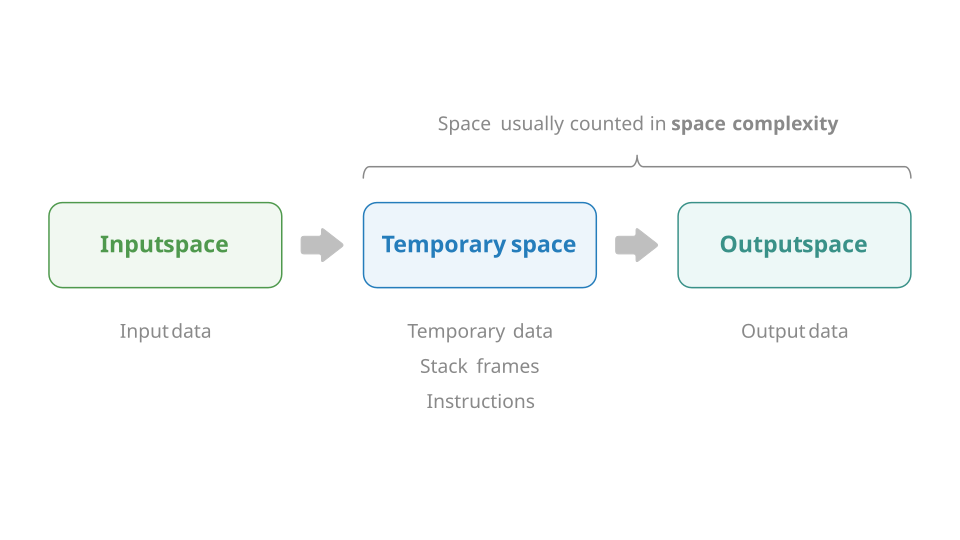
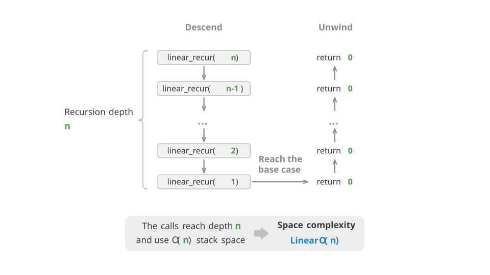

# Space complexity

<u>Space complexity</u> describes how an algorithm's memory requirements grow with the amount of data. The idea is much like time complexity: replace “running time” with “memory used.”

## Space used by an algorithm

The memory an algorithm uses as it runs falls into three main categories.

- **Input space** stores the algorithm's input data.
- **Temporary space** holds variables, objects, function call contexts, and other data the algorithm uses while running.
- **Output space** stores the algorithm's output data.

We generally count temporary space and output space when analyzing space complexity.

Temporary space can be broken down further into three parts.

- **Temporary data** includes the constants, variables, objects, and other values used during execution.
- **Stack frame space** holds the context of function calls. Each call creates a frame at the top of the stack. The frame is released when the call returns.
- **Instruction space** holds compiled program instructions. In practice, we usually ignore it in our analysis.

When analyzing a program's space complexity, **we usually count temporary data, stack frames, and output data**, as the figure shows.



Here is the corresponding code:

```snippet
space_categories
```

## Estimating space complexity

We estimate space complexity much as we estimate time complexity. We count the amount of space used in place of the number of operations.

One difference is that **we usually focus only on worst-case space complexity**. Memory is a hard requirement: we must reserve enough of it for every possible input.

In the code below, “worst case” has two meanings.

1. **Consider the most demanding input**. When $n < 10$, the space complexity is $O(1)$. When $n > 10$, however, initializing the array `nums` takes $O(n)$ space, so the worst-case space complexity is $O(n)$.
2. **Consider peak memory use during execution**. For example, before the last line, the program uses $O(1)$ space. When it initializes the array `nums`, it uses $O(n)$ space. Its worst-case space complexity is therefore $O(n)$.

```snippet
worst_case_space
```

**For recursive functions, remember to count stack frames**. Consider the following code:

```snippet
loop_vs_recursion_space
```

The functions `loop()` and `recur()` both take $O(n)$ time, but their space complexities differ.

- In its loop, `loop()` makes $n$ calls to `function()`. On each iteration, `function()` returns and releases its frame, so the space complexity remains $O(1)$.
- During execution of `recur()`, there are $n$ active calls to `recur()` at once, using $O(n)$ stack space.

## Common growth rates

For input size $n$, the following figure shows common space complexities in increasing order.

$$
\begin{aligned}
& O(1) < O(\log n) < O(n) < O(n^2) < O(2^n) \newline
& \text{constant} < \text{logarithmic} < \text{linear} < \text{quadratic} < \text{exponential}
\end{aligned}
$$


### Constant space $O(1)$

Constant space is common when the number of constants, variables, and objects is independent of input size $n$.

Memory used to initialize a variable or call a function within an iteration is released by the next iteration in this example. Space does not accumulate, so the space complexity remains $O(1)$:

```src
[file]{space_complexity}-[class]{}-[func]{constant}
```

### Linear space $O(n)$

Linear space is common for arrays, linked lists, stacks, and queues whose element counts are proportional to $n$:

```src
[file]{space_complexity}-[class]{}-[func]{linear}
```

The figure shows a recursion depth of $n$. There are $n$ active calls to `linear_recur()` at once, using $O(n)$ stack space:

```src
[file]{space_complexity}-[class]{}-[func]{linear_recur}
```



### Quadratic space $O(n^2)$

Quadratic space is common for matrices and graphs when the number of entries grows quadratically with $n$:

```src
[file]{space_complexity}-[class]{}-[func]{quadratic}
```

In the figure below, the recursion has depth $n$. Each call initializes an array, with lengths $n$, $n-1$, $\dots$, $2$, and $1$, respectively. Their average length is approximately $n / 2$, so the total space used is $O(n^2)$:

```src
[file]{space_complexity}-[class]{}-[func]{quadratic_recur}
```


### Exponential space $O(2^n)$

Exponential space arises in binary trees. The perfect binary tree in the following figure has $n$ levels and $2^n - 1$ nodes, so it uses $O(2^n)$ space:

```src
[file]{space_complexity}-[class]{}-[func]{build_tree}
```


### Logarithmic space $O(\log n)$

Logarithmic space is common in divide-and-conquer algorithms. For example, merge sort starts with an array of length $n$ and splits each array in half at its midpoint on each round of recursion. The resulting recursion tree has height $\log n$, so its call stack uses $O(\log n)$ space.

As another example, consider converting a number to a string. A positive integer $n$ has $\lfloor \log_{10} n \rfloor + 1$ digits. The corresponding string has length $\lfloor \log_{10} n \rfloor + 1$, so the space complexity is $O(\log_{10} n + 1) = O(\log n)$.

## Time–space trade-offs

Ideally, we would optimize both the time and space complexity of an algorithm. In practice, improving both at once is often difficult.

**Reducing time complexity often comes at the cost of higher space complexity, and vice versa**. Using more memory to make an algorithm faster is called trading space for time. The reverse is trading time for space.

The choice depends on which resource matters more. In most situations, time is more valuable, so trading space for time is more common. With very large data sets, however, keeping space complexity under control is also important.
