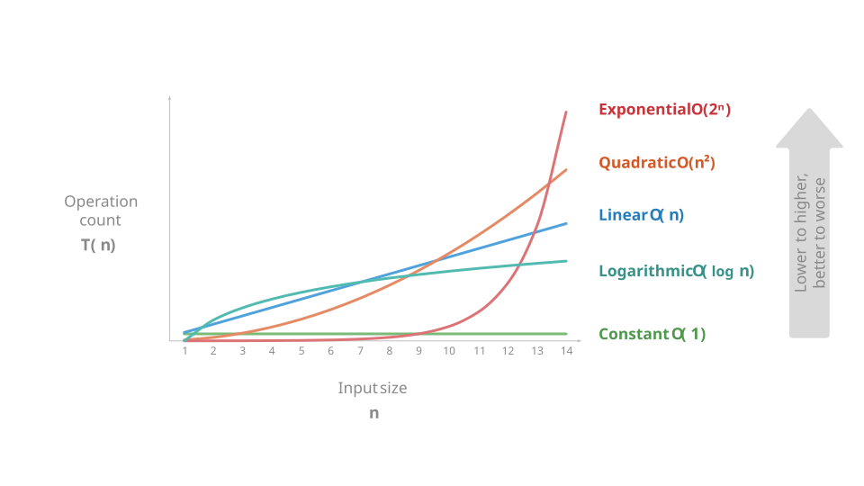
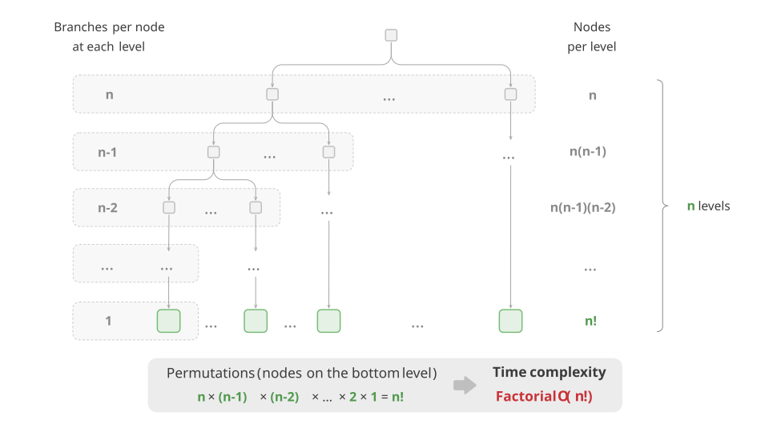

# 2.3 &nbsp; Time complexity

Running time gives us a direct, precise measure of an algorithm's efficiency. How might we predict exactly how long a piece of code will take?

1. **Specify the platform**, including the hardware, programming language, and system environment. All of these affect execution speed.
2. **Estimate the time for each kind of operation**. For example, suppose addition `+` takes 1 ns, multiplication `*` takes 10 ns, and a print operation `print()` takes 5 ns.
3. **Count all the operations in the code** and add up their execution times to get the running time.

For example, the following code has input size $n$:

=== "Python"

    ```python title=""
    # On a given platform
    def algorithm(n: int):
        a = 2      # 1 ns
        a = a + 1  # 1 ns
        a = a * 2  # 10 ns
        # Loop n times
        for _ in range(n):  # 1 ns
            print(0)        # 5 ns
    ```

=== "C++"

    ```cpp title=""
    // On a given platform
    void algorithm(int n) {
        int a = 2;  // 1 ns
        a = a + 1;  // 1 ns
        a = a * 2;  // 10 ns
        // Loop n times
        for (int i = 0; i < n; i++) {  // 1 ns
            cout << 0 << endl;         // 5 ns
        }
    }
    ```

=== "Java"

    ```java title=""
    // On a given platform
    void algorithm(int n) {
        int a = 2;  // 1 ns
        a = a + 1;  // 1 ns
        a = a * 2;  // 10 ns
        // Loop n times
        for (int i = 0; i < n; i++) {  // 1 ns
            System.out.println(0);     // 5 ns
        }
    }
    ```

=== "C#"

    ```csharp title=""
    // On a given platform
    void Algorithm(int n) {
        int a = 2;  // 1 ns
        a = a + 1;  // 1 ns
        a = a * 2;  // 10 ns
        // Loop n times
        for (int i = 0; i < n; i++) {  // 1 ns
            Console.WriteLine(0);      // 5 ns
        }
    }
    ```

=== "Go"

    ```go title=""
    // On a given platform
    func algorithm(n int) {
        a := 2     // 1 ns
        a = a + 1  // 1 ns
        a = a * 2  // 10 ns
        // Loop n times
        for i := 0; i < n; i++ {  // 1 ns
            fmt.Println(a)        // 5 ns
        }
    }
    ```

=== "Swift"

    ```swift title=""
    // On a given platform
    func algorithm(n: Int) {
        var a = 2 // 1 ns
        a = a + 1 // 1 ns
        a = a * 2 // 10 ns
        // Loop n times
        for _ in 0 ..< n { // 1 ns
            print(0) // 5 ns
        }
    }
    ```

=== "JS"

    ```javascript title=""
    // On a given platform
    function algorithm(n) {
        var a = 2; // 1 ns
        a = a + 1; // 1 ns
        a = a * 2; // 10 ns
        // Loop n times
        for(let i = 0; i < n; i++) { // 1 ns
            console.log(0); // 5 ns
        }
    }
    ```

=== "TS"

    ```typescript title=""
    // On a given platform
    function algorithm(n: number): void {
        var a: number = 2; // 1 ns
        a = a + 1; // 1 ns
        a = a * 2; // 10 ns
        // Loop n times
        for(let i = 0; i < n; i++) { // 1 ns
            console.log(0); // 5 ns
        }
    }
    ```

=== "Dart"

    ```dart title=""
    // On a given platform
    void algorithm(int n) {
      int a = 2; // 1 ns
      a = a + 1; // 1 ns
      a = a * 2; // 10 ns
      // Loop n times
      for (int i = 0; i < n; i++) { // 1 ns
        print(0); // 5 ns
      }
    }
    ```

=== "Rust"

    ```rust title=""
    // On a given platform
    fn algorithm(n: i32) {
        let mut a = 2;      // 1 ns
        a = a + 1;          // 1 ns
        a = a * 2;          // 10 ns
        // Loop n times
        for _ in 0..n {     // 1 ns
            println!("{}", 0);  // 5 ns
        }
    }
    ```

=== "C"

    ```c title=""
    // On a given platform
    void algorithm(int n) {
        int a = 2;  // 1 ns
        a = a + 1;  // 1 ns
        a = a * 2;  // 10 ns
        // Loop n times
        for (int i = 0; i < n; i++) {   // 1 ns
            printf("%d", 0);            // 5 ns
        }
    }
    ```

=== "Kotlin"

    ```kotlin title=""
    // On a given platform
    fun algorithm(n: Int) {
        var a = 2 // 1 ns
        a = a + 1 // 1 ns
        a = a * 2 // 10 ns
        // Loop n times
        for (i in 0..<n) {  // 1 ns
            println(0)      // 5 ns
        }
    }
    ```

=== "Ruby"

    ```ruby title=""
    # On a given platform
    def algorithm(n)
        a = 2       # 1 ns
        a = a + 1   # 1 ns
        a = a * 2   # 10 ns
        # Loop n times
        (0...n).each do # 1 ns
            puts 0      # 5 ns
        end
    end
    ```

Using the method above, we get a running time of $(6n + 12)$ ns:

$$
1 + 1 + 10 + (1 + 5) \times n = 6n + 12
$$

In practice, **working out running time this way is neither desirable nor realistic**. First, we want our estimate to apply across platforms, since an algorithm may run on many different machines. Second, finding the execution time of each operation is difficult, which makes the estimate hard to produce.

## 2.3.1 &nbsp; How running time grows

Time complexity analysis looks beyond an algorithm's elapsed time to **how that time grows as the input gets larger**.

To make this idea concrete, consider three algorithms, `A`, `B`, and `C`, each with input size $n$:

=== "Python"

    ```python title=""
    # Time complexity of algorithm A: constant
    def algorithm_A(n: int):
        print(0)
    # Time complexity of algorithm B: linear
    def algorithm_B(n: int):
        for _ in range(n):
            print(0)
    # Time complexity of algorithm C: constant
    def algorithm_C(n: int):
        for _ in range(1000000):
            print(0)
    ```

=== "C++"

    ```cpp title=""
    // Time complexity of algorithm A: constant
    void algorithm_A(int n) {
        cout << 0 << endl;
    }
    // Time complexity of algorithm B: linear
    void algorithm_B(int n) {
        for (int i = 0; i < n; i++) {
            cout << 0 << endl;
        }
    }
    // Time complexity of algorithm C: constant
    void algorithm_C(int n) {
        for (int i = 0; i < 1000000; i++) {
            cout << 0 << endl;
        }
    }
    ```

=== "Java"

    ```java title=""
    // Time complexity of algorithm A: constant
    void algorithm_A(int n) {
        System.out.println(0);
    }
    // Time complexity of algorithm B: linear
    void algorithm_B(int n) {
        for (int i = 0; i < n; i++) {
            System.out.println(0);
        }
    }
    // Time complexity of algorithm C: constant
    void algorithm_C(int n) {
        for (int i = 0; i < 1000000; i++) {
            System.out.println(0);
        }
    }
    ```

=== "C#"

    ```csharp title=""
    // Time complexity of algorithm A: constant
    void AlgorithmA(int n) {
        Console.WriteLine(0);
    }
    // Time complexity of algorithm B: linear
    void AlgorithmB(int n) {
        for (int i = 0; i < n; i++) {
            Console.WriteLine(0);
        }
    }
    // Time complexity of algorithm C: constant
    void AlgorithmC(int n) {
        for (int i = 0; i < 1000000; i++) {
            Console.WriteLine(0);
        }
    }
    ```

=== "Go"

    ```go title=""
    // Time complexity of algorithm A: constant
    func algorithm_A(n int) {
        fmt.Println(0)
    }
    // Time complexity of algorithm B: linear
    func algorithm_B(n int) {
        for i := 0; i < n; i++ {
            fmt.Println(0)
        }
    }
    // Time complexity of algorithm C: constant
    func algorithm_C(n int) {
        for i := 0; i < 1000000; i++ {
            fmt.Println(0)
        }
    }
    ```

=== "Swift"

    ```swift title=""
    // Time complexity of algorithm A: constant
    func algorithmA(n: Int) {
        print(0)
    }

    // Time complexity of algorithm B: linear
    func algorithmB(n: Int) {
        for _ in 0 ..< n {
            print(0)
        }
    }

    // Time complexity of algorithm C: constant
    func algorithmC(n: Int) {
        for _ in 0 ..< 1_000_000 {
            print(0)
        }
    }
    ```

=== "JS"

    ```javascript title=""
    // Time complexity of algorithm A: constant
    function algorithm_A(n) {
        console.log(0);
    }
    // Time complexity of algorithm B: linear
    function algorithm_B(n) {
        for (let i = 0; i < n; i++) {
            console.log(0);
        }
    }
    // Time complexity of algorithm C: constant
    function algorithm_C(n) {
        for (let i = 0; i < 1000000; i++) {
            console.log(0);
        }
    }

    ```

=== "TS"

    ```typescript title=""
    // Time complexity of algorithm A: constant
    function algorithm_A(n: number): void {
        console.log(0);
    }
    // Time complexity of algorithm B: linear
    function algorithm_B(n: number): void {
        for (let i = 0; i < n; i++) {
            console.log(0);
        }
    }
    // Time complexity of algorithm C: constant
    function algorithm_C(n: number): void {
        for (let i = 0; i < 1000000; i++) {
            console.log(0);
        }
    }
    ```

=== "Dart"

    ```dart title=""
    // Time complexity of algorithm A: constant
    void algorithmA(int n) {
      print(0);
    }
    // Time complexity of algorithm B: linear
    void algorithmB(int n) {
      for (int i = 0; i < n; i++) {
        print(0);
      }
    }
    // Time complexity of algorithm C: constant
    void algorithmC(int n) {
      for (int i = 0; i < 1000000; i++) {
        print(0);
      }
    }
    ```

=== "Rust"

    ```rust title=""
    // Time complexity of algorithm A: constant
    fn algorithm_A(n: i32) {
        println!("{}", 0);
    }
    // Time complexity of algorithm B: linear
    fn algorithm_B(n: i32) {
        for _ in 0..n {
            println!("{}", 0);
        }
    }
    // Time complexity of algorithm C: constant
    fn algorithm_C(n: i32) {
        for _ in 0..1000000 {
            println!("{}", 0);
        }
    }
    ```

=== "C"

    ```c title=""
    // Time complexity of algorithm A: constant
    void algorithm_A(int n) {
        printf("%d", 0);
    }
    // Time complexity of algorithm B: linear
    void algorithm_B(int n) {
        for (int i = 0; i < n; i++) {
            printf("%d", 0);
        }
    }
    // Time complexity of algorithm C: constant
    void algorithm_C(int n) {
        for (int i = 0; i < 1000000; i++) {
            printf("%d", 0);
        }
    }
    ```

=== "Kotlin"

    ```kotlin title=""
    // Time complexity of algorithm A: constant
    fun algorithm_A(n: Int) {
        println(0)
    }
    // Time complexity of algorithm B: linear
    fun algorithm_B(n: Int) {
        for (i in 0..<n){
            println(0)
        }
    }
    // Time complexity of algorithm C: constant
    fun algorithm_C(n: Int) {
        for (i in 0..<1000000) {
            println(0)
        }
    }
    ```

=== "Ruby"

    ```ruby title=""
    # Time complexity of algorithm A: constant
    def algorithm_A(n)
        puts 0
    end

    # Time complexity of algorithm B: linear
    def algorithm_B(n)
        (0...n).each { puts 0 }
    end

    # Time complexity of algorithm C: constant
    def algorithm_C(n)
        (0...1_000_000).each { puts 0 }
    end
    ```

Figure 2-7 illustrates the time complexity of these three functions.

- Algorithm `A` performs only $1$ print operation. Its running time stays the same as $n$ increases. We say it runs in constant time.
- Algorithm `B` repeats the print operation $n$ times. Its running time grows linearly with $n$, so we say it runs in linear time.
- Algorithm `C` repeats its print operation $1000000$ times. Although it takes a long time, that time is independent of input size $n$. Thus `C` has the same time complexity as `A`: constant time.

{ class="animation-figure" }

<p align="center"> Figure 2-7 &nbsp; Running time growth for algorithms A, B, and C </p>

How does time complexity analysis compare with calculating running time directly?

- **Time complexity is an effective measure of efficiency**. For example, the running time of algorithm `B` grows linearly. When $n > 1$ it is slower than `A`, and when $n > 1000000$ it is slower than `C`. For sufficiently large $n$, a constant-time algorithm will outperform a linear-time algorithm. This is what a growth trend tells us.
- **Time complexity is easier to estimate**. Neither the platform nor the type of elementary operation changes the growth trend here. We can assign each operation the same unit of time and simply count operations instead of timing them individually. This makes estimation much easier.
- **Time complexity has limitations**. Algorithms `A` and `C` have the same time complexity but very different running times. Similarly, although `B` has higher time complexity than `C`, for small $n$, algorithm `B` clearly outperforms `C`. Time complexity alone often cannot rank algorithms in cases like these. Even with these limitations, complexity analysis remains the most effective and widely used way to assess algorithm efficiency.

## 2.3.2 &nbsp; Asymptotic upper bound of a function

Consider the following function with input size $n$:

=== "Python"

    ```python title=""
    def algorithm(n: int):
        a = 1      # +1
        a = a + 1  # +1
        a = a * 2  # +1
        # Loop n times
        for i in range(n):  # +1
            print(0)        # +1
    ```

=== "C++"

    ```cpp title=""
    void algorithm(int n) {
        int a = 1;  // +1
        a = a + 1;  // +1
        a = a * 2;  // +1
        // Loop n times
        for (int i = 0; i < n; i++) { // +1 (execute i ++ on each iteration)
            cout << 0 << endl;    // +1
        }
    }
    ```

=== "Java"

    ```java title=""
    void algorithm(int n) {
        int a = 1;  // +1
        a = a + 1;  // +1
        a = a * 2;  // +1
        // Loop n times
        for (int i = 0; i < n; i++) { // +1 (execute i ++ on each iteration)
            System.out.println(0);    // +1
        }
    }
    ```

=== "C#"

    ```csharp title=""
    void Algorithm(int n) {
        int a = 1;  // +1
        a = a + 1;  // +1
        a = a * 2;  // +1
        // Loop n times
        for (int i = 0; i < n; i++) {   // +1 (execute i ++ on each iteration)
            Console.WriteLine(0);   // +1
        }
    }
    ```

=== "Go"

    ```go title=""
    func algorithm(n int) {
        a := 1      // +1
        a = a + 1   // +1
        a = a * 2   // +1
        // Loop n times
        for i := 0; i < n; i++ {   // +1
            fmt.Println(a)         // +1
        }
    }
    ```

=== "Swift"

    ```swift title=""
    func algorithm(n: Int) {
        var a = 1 // +1
        a = a + 1 // +1
        a = a * 2 // +1
        // Loop n times
        for _ in 0 ..< n { // +1
            print(0) // +1
        }
    }
    ```

=== "JS"

    ```javascript title=""
    function algorithm(n) {
        var a = 1; // +1
        a += 1; // +1
        a *= 2; // +1
        // Loop n times
        for(let i = 0; i < n; i++){ // +1 (execute i ++ on each iteration)
            console.log(0); // +1
        }
    }
    ```

=== "TS"

    ```typescript title=""
    function algorithm(n: number): void{
        var a: number = 1; // +1
        a += 1; // +1
        a *= 2; // +1
        // Loop n times
        for(let i = 0; i < n; i++){ // +1 (execute i ++ on each iteration)
            console.log(0); // +1
        }
    }
    ```

=== "Dart"

    ```dart title=""
    void algorithm(int n) {
      int a = 1; // +1
      a = a + 1; // +1
      a = a * 2; // +1
      // Loop n times
      for (int i = 0; i < n; i++) { // +1 (execute i ++ on each iteration)
        print(0); // +1
      }
    }
    ```

=== "Rust"

    ```rust title=""
    fn algorithm(n: i32) {
        let mut a = 1;   // +1
        a = a + 1;      // +1
        a = a * 2;      // +1

        // Loop n times
        for _ in 0..n { // +1 (execute i ++ on each iteration)
            println!("{}", 0); // +1
        }
    }
    ```

=== "C"

    ```c title=""
    void algorithm(int n) {
        int a = 1;  // +1
        a = a + 1;  // +1
        a = a * 2;  // +1
        // Loop n times
        for (int i = 0; i < n; i++) {   // +1 (execute i ++ on each iteration)
            printf("%d", 0);            // +1
        }
    }
    ```

=== "Kotlin"

    ```kotlin title=""
    fun algorithm(n: Int) {
        var a = 1 // +1
        a = a + 1 // +1
        a = a * 2 // +1
        // Loop n times
        for (i in 0..<n) { // +1 (execute i ++ on each iteration)
            println(0) // +1
        }
    }
    ```

=== "Ruby"

    ```ruby title=""
    def algorithm(n)
        a = 1       # +1
        a = a + 1   # +1
        a = a * 2   # +1
        # Loop n times
        (0...n).each do # +1
            puts 0      # +1
        end
    end
    ```

Let $T(n)$ denote the number of operations as a function of input size $n$. For the function above, the count is:

$$
T(n) = 3 + 2n
$$

The function $T(n)$ is linear, so running time grows linearly and the time complexity is linear.

Linear time complexity is written $O(n)$. This is an example of <u>big-$O$ notation</u>: the $O$ denotes an <u>asymptotic upper bound</u> on $T(n)$.

Analyzing time complexity amounts to finding an asymptotic upper bound on the operation count $T(n)$. This has a precise mathematical definition.

!!! note "Asymptotic upper bound of a function"

    If there exist a positive real number $c$ and a real number $n_0$ such that $T(n) \leq c \cdot f(n)$ for every $n > n_0$, then $f(n)$ is an asymptotic upper bound on $T(n)$. We write $T(n) = O(f(n))$.

As the figure shows, we look for a function $f(n)$ such that, as $n$ tends to infinity, $T(n)$ and $f(n)$ have the same order of growth, up to a constant factor $c$.

{ class="animation-figure" }

<p align="center"> Figure 2-8 &nbsp; Asymptotic upper bound of a function </p>

## 2.3.3 &nbsp; Estimating time complexity

An asymptotic upper bound may feel abstract at first. Start with the estimation procedure. Its mathematical meaning will become clearer with practice.

By definition, once we have identified $f(n)$, we can write the time complexity as $O(f(n))$. How do we find the upper bound $f(n)$? First count the operations, then determine their asymptotic upper bound.

### 1. &nbsp; Step 1: Count the operations

We can go through the code line by line, from top to bottom. Since the constant $c$ in $c \cdot f(n)$ can be arbitrarily large, **we can ignore constant factors and constant terms in the operation count $T(n)$**. This gives us a few shortcuts.

1. **Ignore the constant terms in $T(n)$**. They are independent of $n$, so they do not affect time complexity.
2. **Drop constant factors**. For example, for a loop running $2n$ or $5n + 1$ times, we can simplify the count to $n$. The coefficient of $n$ does not change the time complexity.
3. **Multiply counts for nested loops**. The total number of operations is the product of the outer and inner loop counts. Apply shortcuts `1.` and `2.` to each loop separately.

Let's use these shortcuts to count operations in a function:

=== "Python"

    ```python title=""
    def algorithm(n: int):
        a = 1      # +0 (shortcut 1)
        a = a + n  # +0 (shortcut 1)
        # +n (shortcut 2)
        for i in range(5 * n + 1):
            print(0)
        # +n*n (shortcut 3)
        for i in range(2 * n):
            for j in range(n + 1):
                print(0)
    ```

=== "C++"

    ```cpp title=""
    void algorithm(int n) {
        int a = 1;  // +0 (shortcut 1)
        a = a + n;  // +0 (shortcut 1)
        // +n (shortcut 2)
        for (int i = 0; i < 5 * n + 1; i++) {
            cout << 0 << endl;
        }
        // +n*n (shortcut 3)
        for (int i = 0; i < 2 * n; i++) {
            for (int j = 0; j < n + 1; j++) {
                cout << 0 << endl;
            }
        }
    }
    ```

=== "Java"

    ```java title=""
    void algorithm(int n) {
        int a = 1;  // +0 (shortcut 1)
        a = a + n;  // +0 (shortcut 1)
        // +n (shortcut 2)
        for (int i = 0; i < 5 * n + 1; i++) {
            System.out.println(0);
        }
        // +n*n (shortcut 3)
        for (int i = 0; i < 2 * n; i++) {
            for (int j = 0; j < n + 1; j++) {
                System.out.println(0);
            }
        }
    }
    ```

=== "C#"

    ```csharp title=""
    void Algorithm(int n) {
        int a = 1;  // +0 (shortcut 1)
        a = a + n;  // +0 (shortcut 1)
        // +n (shortcut 2)
        for (int i = 0; i < 5 * n + 1; i++) {
            Console.WriteLine(0);
        }
        // +n*n (shortcut 3)
        for (int i = 0; i < 2 * n; i++) {
            for (int j = 0; j < n + 1; j++) {
                Console.WriteLine(0);
            }
        }
    }
    ```

=== "Go"

    ```go title=""
    func algorithm(n int) {
        a := 1     // +0 (shortcut 1)
        a = a + n  // +0 (shortcut 1)
        // +n (shortcut 2)
        for i := 0; i < 5 * n + 1; i++ {
            fmt.Println(0)
        }
        // +n*n (shortcut 3)
        for i := 0; i < 2 * n; i++ {
            for j := 0; j < n + 1; j++ {
                fmt.Println(0)
            }
        }
    }
    ```

=== "Swift"

    ```swift title=""
    func algorithm(n: Int) {
        var a = 1 // +0 (shortcut 1)
        a = a + n // +0 (shortcut 1)
        // +n (shortcut 2)
        for _ in 0 ..< (5 * n + 1) {
            print(0)
        }
        // +n*n (shortcut 3)
        for _ in 0 ..< (2 * n) {
            for _ in 0 ..< (n + 1) {
                print(0)
            }
        }
    }
    ```

=== "JS"

    ```javascript title=""
    function algorithm(n) {
        let a = 1;  // +0 (shortcut 1)
        a = a + n;  // +0 (shortcut 1)
        // +n (shortcut 2)
        for (let i = 0; i < 5 * n + 1; i++) {
            console.log(0);
        }
        // +n*n (shortcut 3)
        for (let i = 0; i < 2 * n; i++) {
            for (let j = 0; j < n + 1; j++) {
                console.log(0);
            }
        }
    }
    ```

=== "TS"

    ```typescript title=""
    function algorithm(n: number): void {
        let a = 1;  // +0 (shortcut 1)
        a = a + n;  // +0 (shortcut 1)
        // +n (shortcut 2)
        for (let i = 0; i < 5 * n + 1; i++) {
            console.log(0);
        }
        // +n*n (shortcut 3)
        for (let i = 0; i < 2 * n; i++) {
            for (let j = 0; j < n + 1; j++) {
                console.log(0);
            }
        }
    }
    ```

=== "Dart"

    ```dart title=""
    void algorithm(int n) {
      int a = 1; // +0 (shortcut 1)
      a = a + n; // +0 (shortcut 1)
      // +n (shortcut 2)
      for (int i = 0; i < 5 * n + 1; i++) {
        print(0);
      }
      // +n*n (shortcut 3)
      for (int i = 0; i < 2 * n; i++) {
        for (int j = 0; j < n + 1; j++) {
          print(0);
        }
      }
    }
    ```

=== "Rust"

    ```rust title=""
    fn algorithm(n: i32) {
        let mut a = 1;     // +0 (shortcut 1)
        a = a + n;        // +0 (shortcut 1)

        // +n (shortcut 2)
        for i in 0..(5 * n + 1) {
            println!("{}", 0);
        }

        // +n*n (shortcut 3)
        for i in 0..(2 * n) {
            for j in 0..(n + 1) {
                println!("{}", 0);
            }
        }
    }
    ```

=== "C"

    ```c title=""
    void algorithm(int n) {
        int a = 1;  // +0 (shortcut 1)
        a = a + n;  // +0 (shortcut 1)
        // +n (shortcut 2)
        for (int i = 0; i < 5 * n + 1; i++) {
            printf("%d", 0);
        }
        // +n*n (shortcut 3)
        for (int i = 0; i < 2 * n; i++) {
            for (int j = 0; j < n + 1; j++) {
                printf("%d", 0);
            }
        }
    }
    ```

=== "Kotlin"

    ```kotlin title=""
    fun algorithm(n: Int) {
        var a = 1   // +0 (shortcut 1)
        a = a + n   // +0 (shortcut 1)
        // +n (shortcut 2)
        for (i in 0..<5 * n + 1) {
            println(0)
        }
        // +n*n (shortcut 3)
        for (i in 0..<2 * n) {
            for (j in 0..<n + 1) {
                println(0)
            }
        }
    }
    ```

=== "Ruby"

    ```ruby title=""
    def algorithm(n)
        a = 1       # +0 (shortcut 1)
        a = a + n   # +0 (shortcut 1)
        # +n (shortcut 2)
        (0...(5 * n + 1)).each { puts 0 }
        # +n*n (shortcut 3)
        (0...(2 * n)).each do
            (0...(n + 1)).each { puts 0 }
        end
    end
    ```

The formulas below give the full count and the simplified count. Both yield the same time complexity, $O(n^2)$.

$$
\begin{aligned}
T(n) & = 2n(n + 1) + (5n + 1) + 2 & \text{Full count (-.-|||)} \newline
& = 2n^2 + 7n + 3 \newline
T(n) & = n^2 + n & \text{Shortcut count (o.O)}
\end{aligned}
$$

### 2. &nbsp; Step 2: Determine the asymptotic upper bound

**The highest-order term in $T(n)$ determines the time complexity**. As $n$ tends to infinity, this term dominates and we can disregard the others.

The table gives some examples. A few coefficients are deliberately exaggerated to show that even a huge coefficient cannot change the order of growth. As $n$ tends to infinity, those constants cease to matter.

<p align="center"> Table 2-2 &nbsp; Operation counts and their time complexities </p>

<div class="center-table" markdown>

| Operation count $T(n)$        | Time complexity $O(f(n))$ |
| ---------------------- | -------------------- |
| $100000$               | $O(1)$               |
| $3n + 2$               | $O(n)$               |
| $2n^2 + 3n + 2$        | $O(n^2)$             |
| $n^3 + 10000n^2$       | $O(n^3)$             |
| $2^n + 10000n^{10000}$ | $O(2^n)$             |

</div>

## 2.3.4 &nbsp; Common growth rates

For input size $n$, Figure 2-9 shows common time complexities in increasing order.

$$
\begin{aligned}
& O(1) < O(\log n) < O(n) < O(n \log n) < O(n^2) < O(2^n) < O(n!) \newline
& \text{constant} < \text{logarithmic} < \text{linear} < \text{linearithmic} < \text{quadratic} < \text{exponential} < \text{factorial}
\end{aligned}
$$

{ class="animation-figure" }

<p align="center"> Figure 2-9 &nbsp; Common time complexities </p>

### 1. &nbsp; Constant time $O(1)$ {data-toc-label="1. &nbsp; Constant time"}

In constant time, the operation count is independent of input size $n$. It stays the same as $n$ changes.

In the following function, the operation count `size` may be large, but it is independent of the input size $n$. The time complexity is therefore still $O(1)$:

=== "Python"

    ```python title="time_complexity.py"
    def constant(n: int) -> int:
        """Constant time"""
        count = 0
        size = 100000
        for _ in range(size):
            count += 1
        return count
    ```

=== "C++"

    ```cpp title="time_complexity.cpp"
    /* Constant time */
    int constant(int n) {
        int count = 0;
        int size = 100000;
        for (int i = 0; i < size; i++)
            count++;
        return count;
    }
    ```

=== "Java"

    ```java title="time_complexity.java"
    /* Constant time */
    int constant(int n) {
        int count = 0;
        int size = 100000;
        for (int i = 0; i < size; i++)
            count++;
        return count;
    }
    ```

=== "C#"

    ```csharp title="time_complexity.cs"
    /* Constant time */
    int Constant(int n) {
        int count = 0;
        int size = 100000;
        for (int i = 0; i < size; i++)
            count++;
        return count;
    }
    ```

=== "Go"

    ```go title="time_complexity.go"
    /* Constant time */
    func constant(n int) int {
        count := 0
        size := 100000
        for i := 0; i < size; i++ {
            count++
        }
        return count
    }
    ```

=== "Swift"

    ```swift title="time_complexity.swift"
    /* Constant time */
    func constant(n: Int) -> Int {
        var count = 0
        let size = 100_000
        for _ in 0 ..< size {
            count += 1
        }
        return count
    }
    ```

=== "JS"

    ```javascript title="time_complexity.js"
    /* Constant time */
    function constant(n) {
        let count = 0;
        const size = 100000;
        for (let i = 0; i < size; i++) count++;
        return count;
    }
    ```

=== "TS"

    ```typescript title="time_complexity.ts"
    /* Constant time */
    function constant(n: number): number {
        let count = 0;
        const size = 100000;
        for (let i = 0; i < size; i++) count++;
        return count;
    }
    ```

=== "Dart"

    ```dart title="time_complexity.dart"
    /* Constant time */
    int constant(int n) {
      int count = 0;
      int size = 100000;
      for (var i = 0; i < size; i++) {
        count++;
      }
      return count;
    }
    ```

=== "Rust"

    ```rust title="time_complexity.rs"
    /* Constant time */
    fn constant(n: i32) -> i32 {
        _ = n;
        let mut count = 0;
        let size = 100_000;
        for _ in 0..size {
            count += 1;
        }
        count
    }
    ```

=== "C"

    ```c title="time_complexity.c"
    /* Constant time */
    int constant(int n) {
        int count = 0;
        int size = 100000;
        for (int i = 0; i < size; i++) {
            count++;
        }
        return count;
    }
    ```

=== "Kotlin"

    ```kotlin title="time_complexity.kt"
    /* Constant time */
    fun constant(n: Int): Int {
        var count = 0
        val size = 100000
        for (i in 0..<size)
            count++
        return count
    }
    ```

=== "Ruby"

    ```ruby title="time_complexity.rb"
    ### Constant time ###
    def constant(n)
      count = 0
      size = 100000

      (0...size).each { count += 1 }

      count
    end
    ```

??? pythontutor "Visualize execution"

    <div style="height: 459px; width: 100%;"><iframe class="pythontutor-iframe" title="Visualize execution" src="https://pythontutor.com/iframe-embed.html#code=def%20constant%28n%3A%20int%29%20-%3E%20int%3A%0A%20%20%20%20%22%22%22Constant%20time%22%22%22%0A%20%20%20%20count%20%3D%200%0A%20%20%20%20size%20%3D%2010%0A%20%20%20%20for%20_%20in%20range%28size%29%3A%0A%20%20%20%20%20%20%20%20count%20%2B%3D%201%0A%20%20%20%20return%20count%0A%0A%22%22%22Driver%20Code%22%22%22%0Aif%20__name__%20%3D%3D%20%22__main__%22%3A%0A%20%20%20%20n%20%3D%208%0A%20%20%20%20print%28%22Input%20size%20n%20%3D%22,%20n%29%0A%0A%20%20%20%20count%20%3D%20constant%28n%29%0A%20%20%20%20print%28%22Constant%20operation%20count%20%3D%22,%20count%29&codeDivHeight=472&codeDivWidth=350&cumulative=false&curInstr=3&heapPrimitives=nevernest&origin=opt-frontend.js&py=311&rawInputLstJSON=%5B%5D&textReferences=false"> </iframe></div>
    <div style="margin-top: 5px;"><a href="https://pythontutor.com/iframe-embed.html#code=def%20constant%28n%3A%20int%29%20-%3E%20int%3A%0A%20%20%20%20%22%22%22Constant%20time%22%22%22%0A%20%20%20%20count%20%3D%200%0A%20%20%20%20size%20%3D%2010%0A%20%20%20%20for%20_%20in%20range%28size%29%3A%0A%20%20%20%20%20%20%20%20count%20%2B%3D%201%0A%20%20%20%20return%20count%0A%0A%22%22%22Driver%20Code%22%22%22%0Aif%20__name__%20%3D%3D%20%22__main__%22%3A%0A%20%20%20%20n%20%3D%208%0A%20%20%20%20print%28%22Input%20size%20n%20%3D%22,%20n%29%0A%0A%20%20%20%20count%20%3D%20constant%28n%29%0A%20%20%20%20print%28%22Constant%20operation%20count%20%3D%22,%20count%29&codeDivHeight=800&codeDivWidth=600&cumulative=false&curInstr=3&heapPrimitives=nevernest&origin=opt-frontend.js&py=311&rawInputLstJSON=%5B%5D&textReferences=false" target="_blank" rel="noopener noreferrer">View full screen ></a></div>

### 2. &nbsp; Linear time $O(n)$ {data-toc-label="2. &nbsp; Linear time"}

In linear time, the operation count grows linearly with input size $n$. This often happens in a single loop:

=== "Python"

    ```python title="time_complexity.py"
    def linear(n: int) -> int:
        """Linear time"""
        count = 0
        for _ in range(n):
            count += 1
        return count
    ```

=== "C++"

    ```cpp title="time_complexity.cpp"
    /* Linear time */
    int linear(int n) {
        int count = 0;
        for (int i = 0; i < n; i++)
            count++;
        return count;
    }
    ```

=== "Java"

    ```java title="time_complexity.java"
    /* Linear time */
    int linear(int n) {
        int count = 0;
        for (int i = 0; i < n; i++)
            count++;
        return count;
    }
    ```

=== "C#"

    ```csharp title="time_complexity.cs"
    /* Linear time */
    int Linear(int n) {
        int count = 0;
        for (int i = 0; i < n; i++)
            count++;
        return count;
    }
    ```

=== "Go"

    ```go title="time_complexity.go"
    /* Linear time */
    func linear(n int) int {
        count := 0
        for i := 0; i < n; i++ {
            count++
        }
        return count
    }
    ```

=== "Swift"

    ```swift title="time_complexity.swift"
    /* Linear time */
    func linear(n: Int) -> Int {
        var count = 0
        for _ in 0 ..< n {
            count += 1
        }
        return count
    }
    ```

=== "JS"

    ```javascript title="time_complexity.js"
    /* Linear time */
    function linear(n) {
        let count = 0;
        for (let i = 0; i < n; i++) count++;
        return count;
    }
    ```

=== "TS"

    ```typescript title="time_complexity.ts"
    /* Linear time */
    function linear(n: number): number {
        let count = 0;
        for (let i = 0; i < n; i++) count++;
        return count;
    }
    ```

=== "Dart"

    ```dart title="time_complexity.dart"
    /* Linear time */
    int linear(int n) {
      int count = 0;
      for (var i = 0; i < n; i++) {
        count++;
      }
      return count;
    }
    ```

=== "Rust"

    ```rust title="time_complexity.rs"
    /* Linear time */
    fn linear(n: i32) -> i32 {
        let mut count = 0;
        for _ in 0..n {
            count += 1;
        }
        count
    }
    ```

=== "C"

    ```c title="time_complexity.c"
    /* Linear time */
    int linear(int n) {
        int count = 0;
        for (int i = 0; i < n; i++) {
            count++;
        }
        return count;
    }
    ```

=== "Kotlin"

    ```kotlin title="time_complexity.kt"
    /* Linear time */
    fun linear(n: Int): Int {
        var count = 0
        for (i in 0..<n)
            count++
        return count
    }
    ```

=== "Ruby"

    ```ruby title="time_complexity.rb"
    ### Linear time ###
    def linear(n)
      count = 0
      (0...n).each { count += 1 }
      count
    end
    ```

??? pythontutor "Visualize execution"

    <div style="height: 441px; width: 100%;"><iframe class="pythontutor-iframe" title="Visualize execution" src="https://pythontutor.com/iframe-embed.html#code=def%20linear%28n%29%20-%3E%20int%3A%0A%20%20%20%20%22%22%22Linear%20time%22%22%22%0A%20%20%20%20count%20%3D%200%0A%20%20%20%20for%20_%20in%20range%28n%29%3A%0A%20%20%20%20%20%20%20%20count%20%2B%3D%201%0A%20%20%20%20return%20count%0A%0A%22%22%22Driver%20Code%22%22%22%0Aif%20__name__%20%3D%3D%20%22__main__%22%3A%0A%20%20%20%20n%20%3D%208%0A%20%20%20%20print%28%22Input%20size%20n%20%3D%22,%20n%29%0A%0A%20%20%20%20count%20%3D%20linear%28n%29%0A%20%20%20%20print%28%22Linear%20operation%20count%20%3D%22,%20count%29&codeDivHeight=472&codeDivWidth=350&cumulative=false&curInstr=3&heapPrimitives=nevernest&origin=opt-frontend.js&py=311&rawInputLstJSON=%5B%5D&textReferences=false"> </iframe></div>
    <div style="margin-top: 5px;"><a href="https://pythontutor.com/iframe-embed.html#code=def%20linear%28n%29%20-%3E%20int%3A%0A%20%20%20%20%22%22%22Linear%20time%22%22%22%0A%20%20%20%20count%20%3D%200%0A%20%20%20%20for%20_%20in%20range%28n%29%3A%0A%20%20%20%20%20%20%20%20count%20%2B%3D%201%0A%20%20%20%20return%20count%0A%0A%22%22%22Driver%20Code%22%22%22%0Aif%20__name__%20%3D%3D%20%22__main__%22%3A%0A%20%20%20%20n%20%3D%208%0A%20%20%20%20print%28%22Input%20size%20n%20%3D%22,%20n%29%0A%0A%20%20%20%20count%20%3D%20linear%28n%29%0A%20%20%20%20print%28%22Linear%20operation%20count%20%3D%22,%20count%29&codeDivHeight=800&codeDivWidth=600&cumulative=false&curInstr=3&heapPrimitives=nevernest&origin=opt-frontend.js&py=311&rawInputLstJSON=%5B%5D&textReferences=false" target="_blank" rel="noopener noreferrer">View full screen ></a></div>

Traversing an array or a linked list takes $O(n)$ time, where $n$ is the length of the array or list:

=== "Python"

    ```python title="time_complexity.py"
    def array_traversal(nums: list[int]) -> int:
        """Linear time (array traversal)"""
        count = 0
        # The iteration count is proportional to the array length
        for num in nums:
            count += 1
        return count
    ```

=== "C++"

    ```cpp title="time_complexity.cpp"
    /* Linear time (array traversal) */
    int arrayTraversal(vector<int> &nums) {
        int count = 0;
        // The iteration count is proportional to the array length
        for (int num : nums) {
            count++;
        }
        return count;
    }
    ```

=== "Java"

    ```java title="time_complexity.java"
    /* Linear time (array traversal) */
    int arrayTraversal(int[] nums) {
        int count = 0;
        // The iteration count is proportional to the array length
        for (int num : nums) {
            count++;
        }
        return count;
    }
    ```

=== "C#"

    ```csharp title="time_complexity.cs"
    /* Linear time (array traversal) */
    int ArrayTraversal(int[] nums) {
        int count = 0;
        // The iteration count is proportional to the array length
        foreach (int num in nums) {
            count++;
        }
        return count;
    }
    ```

=== "Go"

    ```go title="time_complexity.go"
    /* Linear time (array traversal) */
    func arrayTraversal(nums []int) int {
        count := 0
        // The iteration count is proportional to the array length
        for range nums {
            count++
        }
        return count
    }
    ```

=== "Swift"

    ```swift title="time_complexity.swift"
    /* Linear time (array traversal) */
    func arrayTraversal(nums: [Int]) -> Int {
        var count = 0
        // The iteration count is proportional to the array length
        for _ in nums {
            count += 1
        }
        return count
    }
    ```

=== "JS"

    ```javascript title="time_complexity.js"
    /* Linear time (array traversal) */
    function arrayTraversal(nums) {
        let count = 0;
        // The iteration count is proportional to the array length
        for (let i = 0; i < nums.length; i++) {
            count++;
        }
        return count;
    }
    ```

=== "TS"

    ```typescript title="time_complexity.ts"
    /* Linear time (array traversal) */
    function arrayTraversal(nums: number[]): number {
        let count = 0;
        // The iteration count is proportional to the array length
        for (let i = 0; i < nums.length; i++) {
            count++;
        }
        return count;
    }
    ```

=== "Dart"

    ```dart title="time_complexity.dart"
    /* Linear time (array traversal) */
    int arrayTraversal(List<int> nums) {
      int count = 0;
      // The iteration count is proportional to the array length
      for (var _num in nums) {
        count++;
      }
      return count;
    }
    ```

=== "Rust"

    ```rust title="time_complexity.rs"
    /* Linear time (array traversal) */
    fn array_traversal(nums: &[i32]) -> i32 {
        let mut count = 0;
        // The iteration count is proportional to the array length
        for _ in nums {
            count += 1;
        }
        count
    }
    ```

=== "C"

    ```c title="time_complexity.c"
    /* Linear time (array traversal) */
    int arrayTraversal(int *nums, int n) {
        int count = 0;
        // The iteration count is proportional to the array length
        for (int i = 0; i < n; i++) {
            count++;
        }
        return count;
    }
    ```

=== "Kotlin"

    ```kotlin title="time_complexity.kt"
    /* Linear time (array traversal) */
    fun arrayTraversal(nums: IntArray): Int {
        var count = 0
        // The iteration count is proportional to the array length
        for (num in nums) {
            count++
        }
        return count
    }
    ```

=== "Ruby"

    ```ruby title="time_complexity.rb"
    ### Linear time (array traversal)###
    def array_traversal(nums)
      count = 0

      # The iteration count is proportional to the array length
      for num in nums
        count += 1
      end

      count
    end
    ```

??? pythontutor "Visualize execution"

    <div style="height: 459px; width: 100%;"><iframe class="pythontutor-iframe" title="Visualize execution" src="https://pythontutor.com/iframe-embed.html#code=def%20array_traversal%28nums%3A%20list%5Bint%5D%29%20-%3E%20int%3A%0A%20%20%20%20%22%22%22Linear%20time%20%28array%20traversal%29%22%22%22%0A%20%20%20%20count%20%3D%200%0A%20%20%20%20%23%20The%20iteration%20count%20is%20proportional%20to%20the%20array%20length%0A%20%20%20%20for%20num%20in%20nums%3A%0A%20%20%20%20%20%20%20%20count%20%2B%3D%201%0A%20%20%20%20return%20count%0A%0A%22%22%22Driver%20Code%22%22%22%0Aif%20__name__%20%3D%3D%20%22__main__%22%3A%0A%20%20%20%20n%20%3D%208%0A%20%20%20%20print%28%22Input%20size%20n%20%3D%22,%20n%29%0A%0A%20%20%20%20count%20%3D%20array_traversal%28%5B0%5D%20%2A%20n%29%0A%20%20%20%20print%28%22Linear%20operation%20count%20%28array%20traversal%29%20%3D%22,%20count%29&codeDivHeight=472&codeDivWidth=350&cumulative=false&curInstr=3&heapPrimitives=nevernest&origin=opt-frontend.js&py=311&rawInputLstJSON=%5B%5D&textReferences=false"> </iframe></div>
    <div style="margin-top: 5px;"><a href="https://pythontutor.com/iframe-embed.html#code=def%20array_traversal%28nums%3A%20list%5Bint%5D%29%20-%3E%20int%3A%0A%20%20%20%20%22%22%22Linear%20time%20%28array%20traversal%29%22%22%22%0A%20%20%20%20count%20%3D%200%0A%20%20%20%20%23%20The%20iteration%20count%20is%20proportional%20to%20the%20array%20length%0A%20%20%20%20for%20num%20in%20nums%3A%0A%20%20%20%20%20%20%20%20count%20%2B%3D%201%0A%20%20%20%20return%20count%0A%0A%22%22%22Driver%20Code%22%22%22%0Aif%20__name__%20%3D%3D%20%22__main__%22%3A%0A%20%20%20%20n%20%3D%208%0A%20%20%20%20print%28%22Input%20size%20n%20%3D%22,%20n%29%0A%0A%20%20%20%20count%20%3D%20array_traversal%28%5B0%5D%20%2A%20n%29%0A%20%20%20%20print%28%22Linear%20operation%20count%20%28array%20traversal%29%20%3D%22,%20count%29&codeDivHeight=800&codeDivWidth=600&cumulative=false&curInstr=3&heapPrimitives=nevernest&origin=opt-frontend.js&py=311&rawInputLstJSON=%5B%5D&textReferences=false" target="_blank" rel="noopener noreferrer">View full screen ></a></div>

Notice that **the meaning of input size $n$ depends on the type of input**. In the first example, the variable $n$ itself gives the size. In the second, the size is the array length $n$.

### 3. &nbsp; Quadratic time $O(n^2)$ {data-toc-label="3. &nbsp; Quadratic time"}

In quadratic time, the operation count grows with the square of the input size $n$. This often happens in nested loops. Here the outer loop runs $O(n)$ times, as does the inner loop on each pass, giving an overall time complexity of $O(n^2)$:

=== "Python"

    ```python title="time_complexity.py"
    def quadratic(n: int) -> int:
        """Quadratic time"""
        count = 0
        # The iteration count grows quadratically with input size n
        for i in range(n):
            for j in range(n):
                count += 1
        return count
    ```

=== "C++"

    ```cpp title="time_complexity.cpp"
    /* Quadratic time */
    int quadratic(int n) {
        int count = 0;
        // The iteration count grows quadratically with input size n
        for (int i = 0; i < n; i++) {
            for (int j = 0; j < n; j++) {
                count++;
            }
        }
        return count;
    }
    ```

=== "Java"

    ```java title="time_complexity.java"
    /* Quadratic time */
    int quadratic(int n) {
        int count = 0;
        // The iteration count grows quadratically with input size n
        for (int i = 0; i < n; i++) {
            for (int j = 0; j < n; j++) {
                count++;
            }
        }
        return count;
    }
    ```

=== "C#"

    ```csharp title="time_complexity.cs"
    /* Quadratic time */
    int Quadratic(int n) {
        int count = 0;
        // The iteration count grows quadratically with input size n
        for (int i = 0; i < n; i++) {
            for (int j = 0; j < n; j++) {
                count++;
            }
        }
        return count;
    }
    ```

=== "Go"

    ```go title="time_complexity.go"
    /* Quadratic time */
    func quadratic(n int) int {
        count := 0
        // The iteration count grows quadratically with input size n
        for i := 0; i < n; i++ {
            for j := 0; j < n; j++ {
                count++
            }
        }
        return count
    }
    ```

=== "Swift"

    ```swift title="time_complexity.swift"
    /* Quadratic time */
    func quadratic(n: Int) -> Int {
        var count = 0
        // The iteration count grows quadratically with input size n
        for _ in 0 ..< n {
            for _ in 0 ..< n {
                count += 1
            }
        }
        return count
    }
    ```

=== "JS"

    ```javascript title="time_complexity.js"
    /* Quadratic time */
    function quadratic(n) {
        let count = 0;
        // The iteration count grows quadratically with input size n
        for (let i = 0; i < n; i++) {
            for (let j = 0; j < n; j++) {
                count++;
            }
        }
        return count;
    }
    ```

=== "TS"

    ```typescript title="time_complexity.ts"
    /* Quadratic time */
    function quadratic(n: number): number {
        let count = 0;
        // The iteration count grows quadratically with input size n
        for (let i = 0; i < n; i++) {
            for (let j = 0; j < n; j++) {
                count++;
            }
        }
        return count;
    }
    ```

=== "Dart"

    ```dart title="time_complexity.dart"
    /* Quadratic time */
    int quadratic(int n) {
      int count = 0;
      // The iteration count grows quadratically with input size n
      for (int i = 0; i < n; i++) {
        for (int j = 0; j < n; j++) {
          count++;
        }
      }
      return count;
    }
    ```

=== "Rust"

    ```rust title="time_complexity.rs"
    /* Quadratic time */
    fn quadratic(n: i32) -> i32 {
        let mut count = 0;
        // The iteration count grows quadratically with input size n
        for _ in 0..n {
            for _ in 0..n {
                count += 1;
            }
        }
        count
    }
    ```

=== "C"

    ```c title="time_complexity.c"
    /* Quadratic time */
    int quadratic(int n) {
        int count = 0;
        // The iteration count grows quadratically with input size n
        for (int i = 0; i < n; i++) {
            for (int j = 0; j < n; j++) {
                count++;
            }
        }
        return count;
    }
    ```

=== "Kotlin"

    ```kotlin title="time_complexity.kt"
    /* Quadratic time */
    fun quadratic(n: Int): Int {
        var count = 0
        // The iteration count grows quadratically with input size n
        for (i in 0..<n) {
            for (j in 0..<n) {
                count++
            }
        }
        return count
    }
    ```

=== "Ruby"

    ```ruby title="time_complexity.rb"
    ### Quadratic time ###
    def quadratic(n)
      count = 0

      # The iteration count grows quadratically with input size n
      for i in 0...n
        for j in 0...n
          count += 1
        end
      end

      count
    end
    ```

??? pythontutor "Visualize execution"

    <div style="height: 477px; width: 100%;"><iframe class="pythontutor-iframe" title="Visualize execution" src="https://pythontutor.com/iframe-embed.html#code=def%20quadratic%28n%29%20-%3E%20int%3A%0A%20%20%20%20%22%22%22Quadratic%20time%22%22%22%0A%20%20%20%20count%20%3D%200%0A%20%20%20%20%23%20The%20iteration%20count%20grows%20quadratically%20with%20input%20size%20n%0A%20%20%20%20for%20i%20in%20range%28n%29%3A%0A%20%20%20%20%20%20%20%20for%20j%20in%20range%28n%29%3A%0A%20%20%20%20%20%20%20%20%20%20%20%20count%20%2B%3D%201%0A%20%20%20%20return%20count%0A%0A%22%22%22Driver%20Code%22%22%22%0Aif%20__name__%20%3D%3D%20%22__main__%22%3A%0A%20%20%20%20n%20%3D%208%0A%20%20%20%20print%28%22Input%20size%20n%20%3D%22,%20n%29%0A%0A%20%20%20%20count%20%3D%20quadratic%28n%29%0A%20%20%20%20print%28%22Quadratic%20operation%20count%20%3D%22,%20count%29&codeDivHeight=472&codeDivWidth=350&cumulative=false&curInstr=3&heapPrimitives=nevernest&origin=opt-frontend.js&py=311&rawInputLstJSON=%5B%5D&textReferences=false"> </iframe></div>
    <div style="margin-top: 5px;"><a href="https://pythontutor.com/iframe-embed.html#code=def%20quadratic%28n%29%20-%3E%20int%3A%0A%20%20%20%20%22%22%22Quadratic%20time%22%22%22%0A%20%20%20%20count%20%3D%200%0A%20%20%20%20%23%20The%20iteration%20count%20grows%20quadratically%20with%20input%20size%20n%0A%20%20%20%20for%20i%20in%20range%28n%29%3A%0A%20%20%20%20%20%20%20%20for%20j%20in%20range%28n%29%3A%0A%20%20%20%20%20%20%20%20%20%20%20%20count%20%2B%3D%201%0A%20%20%20%20return%20count%0A%0A%22%22%22Driver%20Code%22%22%22%0Aif%20__name__%20%3D%3D%20%22__main__%22%3A%0A%20%20%20%20n%20%3D%208%0A%20%20%20%20print%28%22Input%20size%20n%20%3D%22,%20n%29%0A%0A%20%20%20%20count%20%3D%20quadratic%28n%29%0A%20%20%20%20print%28%22Quadratic%20operation%20count%20%3D%22,%20count%29&codeDivHeight=800&codeDivWidth=600&cumulative=false&curInstr=3&heapPrimitives=nevernest&origin=opt-frontend.js&py=311&rawInputLstJSON=%5B%5D&textReferences=false" target="_blank" rel="noopener noreferrer">View full screen ></a></div>

The figure compares constant, linear, and quadratic time.

{ class="animation-figure" }

<p align="center"> Figure 2-10 &nbsp; Constant, linear, and quadratic time complexity </p>

In bubble sort, for example, the outer loop runs $n - 1$ times. The inner loop runs $n-1$, $n-2$, $\dots$, $2$, and $1$ times on successive passes, averaging $n / 2$ iterations. The time complexity is therefore $O((n - 1) n / 2) = O(n^2)$:

=== "Python"

    ```python title="time_complexity.py"
    def bubble_sort(nums: list[int]) -> int:
        """Quadratic time (bubble sort)"""
        count = 0  # Counter
        # Outer loop: the unsorted range is the closed interval [0, i]
        for i in range(len(nums) - 1, 0, -1):
            # Inner loop: swap adjacent elements to move the largest in [0, i] to index i
            for j in range(i):
                if nums[j] > nums[j + 1]:
                    # Swap nums[j] and nums[j + 1]
                    tmp: int = nums[j]
                    nums[j] = nums[j + 1]
                    nums[j + 1] = tmp
                    count += 3  # Swapping two elements takes 3 elementary operations
        return count
    ```

=== "C++"

    ```cpp title="time_complexity.cpp"
    /* Quadratic time (bubble sort) */
    int bubbleSort(vector<int> &nums) {
        int count = 0; // Counter
        // Outer loop: the unsorted range is the closed interval [0, i]
        for (int i = nums.size() - 1; i > 0; i--) {
            // Inner loop: swap adjacent elements to move the largest in [0, i] to index i
            for (int j = 0; j < i; j++) {
                if (nums[j] > nums[j + 1]) {
                    // Swap nums[j] and nums[j + 1]
                    int tmp = nums[j];
                    nums[j] = nums[j + 1];
                    nums[j + 1] = tmp;
                    count += 3; // Swapping two elements takes 3 elementary operations
                }
            }
        }
        return count;
    }
    ```

=== "Java"

    ```java title="time_complexity.java"
    /* Quadratic time (bubble sort) */
    int bubbleSort(int[] nums) {
        int count = 0; // Counter
        // Outer loop: the unsorted range is the closed interval [0, i]
        for (int i = nums.length - 1; i > 0; i--) {
            // Inner loop: swap adjacent elements to move the largest in [0, i] to index i
            for (int j = 0; j < i; j++) {
                if (nums[j] > nums[j + 1]) {
                    // Swap nums[j] and nums[j + 1]
                    int tmp = nums[j];
                    nums[j] = nums[j + 1];
                    nums[j + 1] = tmp;
                    count += 3; // Swapping two elements takes 3 elementary operations
                }
            }
        }
        return count;
    }
    ```

=== "C#"

    ```csharp title="time_complexity.cs"
    /* Quadratic time (bubble sort) */
    int BubbleSort(int[] nums) {
        int count = 0;  // Counter
        // Outer loop: the unsorted range is the closed interval [0, i]
        for (int i = nums.Length - 1; i > 0; i--) {
            // Inner loop: swap adjacent elements to move the largest in [0, i] to index i
            for (int j = 0; j < i; j++) {
                if (nums[j] > nums[j + 1]) {
                    // Swap nums[j] and nums[j + 1]
                    (nums[j + 1], nums[j]) = (nums[j], nums[j + 1]);
                    count += 3;  // Swapping two elements takes 3 elementary operations
                }
            }
        }
        return count;
    }
    ```

=== "Go"

    ```go title="time_complexity.go"
    /* Quadratic time (bubble sort) */
    func bubbleSort(nums []int) int {
        count := 0 // Counter
        // Outer loop: the unsorted range is the closed interval [0, i]
        for i := len(nums) - 1; i > 0; i-- {
            // Inner loop: swap adjacent elements to move the largest in [0, i] to index i
            for j := 0; j < i; j++ {
                if nums[j] > nums[j+1] {
                    // Swap nums[j] and nums[j + 1]
                    tmp := nums[j]
                    nums[j] = nums[j+1]
                    nums[j+1] = tmp
                    count += 3 // Swapping two elements takes 3 elementary operations
                }
            }
        }
        return count
    }
    ```

=== "Swift"

    ```swift title="time_complexity.swift"
    /* Quadratic time (bubble sort) */
    func bubbleSort(nums: inout [Int]) -> Int {
        var count = 0 // Counter
        // Outer loop: the unsorted range is the closed interval [0, i]
        for i in nums.indices.dropFirst().reversed() {
            // Inner loop: swap adjacent elements to move the largest in [0, i] to index i
            for j in 0 ..< i {
                if nums[j] > nums[j + 1] {
                    // Swap nums[j] and nums[j + 1]
                    let tmp = nums[j]
                    nums[j] = nums[j + 1]
                    nums[j + 1] = tmp
                    count += 3 // Swapping two elements takes 3 elementary operations
                }
            }
        }
        return count
    }
    ```

=== "JS"

    ```javascript title="time_complexity.js"
    /* Quadratic time (bubble sort) */
    function bubbleSort(nums) {
        let count = 0; // Counter
        // Outer loop: the unsorted range is the closed interval [0, i]
        for (let i = nums.length - 1; i > 0; i--) {
            // Inner loop: swap adjacent elements to move the largest in [0, i] to index i
            for (let j = 0; j < i; j++) {
                if (nums[j] > nums[j + 1]) {
                    // Swap nums[j] and nums[j + 1]
                    let tmp = nums[j];
                    nums[j] = nums[j + 1];
                    nums[j + 1] = tmp;
                    count += 3; // Swapping two elements takes 3 elementary operations
                }
            }
        }
        return count;
    }
    ```

=== "TS"

    ```typescript title="time_complexity.ts"
    /* Quadratic time (bubble sort) */
    function bubbleSort(nums: number[]): number {
        let count = 0; // Counter
        // Outer loop: the unsorted range is the closed interval [0, i]
        for (let i = nums.length - 1; i > 0; i--) {
            // Inner loop: swap adjacent elements to move the largest in [0, i] to index i
            for (let j = 0; j < i; j++) {
                if (nums[j] > nums[j + 1]) {
                    // Swap nums[j] and nums[j + 1]
                    let tmp = nums[j];
                    nums[j] = nums[j + 1];
                    nums[j + 1] = tmp;
                    count += 3; // Swapping two elements takes 3 elementary operations
                }
            }
        }
        return count;
    }
    ```

=== "Dart"

    ```dart title="time_complexity.dart"
    /* Quadratic time (bubble sort) */
    int bubbleSort(List<int> nums) {
      int count = 0; // Counter
      // Outer loop: the unsorted range is the closed interval [0, i]
      for (var i = nums.length - 1; i > 0; i--) {
        // Inner loop: swap adjacent elements to move the largest in [0, i] to index i
        for (var j = 0; j < i; j++) {
          if (nums[j] > nums[j + 1]) {
            // Swap nums[j] and nums[j + 1]
            int tmp = nums[j];
            nums[j] = nums[j + 1];
            nums[j + 1] = tmp;
            count += 3; // Swapping two elements takes 3 elementary operations
          }
        }
      }
      return count;
    }
    ```

=== "Rust"

    ```rust title="time_complexity.rs"
    /* Quadratic time (bubble sort) */
    fn bubble_sort(nums: &mut [i32]) -> i32 {
        let mut count = 0; // Counter

        // Outer loop: the unsorted range is the closed interval [0, i]
        for i in (1..nums.len()).rev() {
            // Inner loop: swap adjacent elements to move the largest in [0, i] to index i
            for j in 0..i {
                if nums[j] > nums[j + 1] {
                    // Swap nums[j] and nums[j + 1]
                    let tmp = nums[j];
                    nums[j] = nums[j + 1];
                    nums[j + 1] = tmp;
                    count += 3; // Swapping two elements takes 3 elementary operations
                }
            }
        }
        count
    }
    ```

=== "C"

    ```c title="time_complexity.c"
    /* Quadratic time (bubble sort) */
    int bubbleSort(int *nums, int n) {
        int count = 0; // Counter
        // Outer loop: the unsorted range is the closed interval [0, i]
        for (int i = n - 1; i > 0; i--) {
            // Inner loop: swap adjacent elements to move the largest in [0, i] to index i
            for (int j = 0; j < i; j++) {
                if (nums[j] > nums[j + 1]) {
                    // Swap nums[j] and nums[j + 1]
                    int tmp = nums[j];
                    nums[j] = nums[j + 1];
                    nums[j + 1] = tmp;
                    count += 3; // Swapping two elements takes 3 elementary operations
                }
            }
        }
        return count;
    }
    ```

=== "Kotlin"

    ```kotlin title="time_complexity.kt"
    /* Quadratic time (bubble sort) */
    fun bubbleSort(nums: IntArray): Int {
        var count = 0 // Counter
        // Outer loop: the unsorted range is the closed interval [0, i]
        for (i in nums.size - 1 downTo 1) {
            // Inner loop: swap adjacent elements to move the largest in [0, i] to index i
            for (j in 0..<i) {
                if (nums[j] > nums[j + 1]) {
                    // Swap nums[j] and nums[j + 1]
                    val temp = nums[j]
                    nums[j] = nums[j + 1]
                    nums[j + 1] = temp
                    count += 3 // Swapping two elements takes 3 elementary operations
                }
            }
        }
        return count
    }
    ```

=== "Ruby"

    ```ruby title="time_complexity.rb"
    ### Quadratic time (bubble sort)###
    def bubble_sort(nums)
      count = 0  # Counter

      # Outer loop: the unsorted range is the closed interval [0, i]
      for i in (nums.length - 1).downto(0)
        # Inner loop: swap adjacent elements to move the largest in [0, i] to index i
        for j in 0...i
          if nums[j] > nums[j + 1]
            # Swap nums[j] and nums[j + 1]
            tmp = nums[j]
            nums[j] = nums[j + 1]
            nums[j + 1] = tmp
            count += 3 # Swapping two elements takes 3 elementary operations
          end
        end
      end

      count
    end
    ```

??? pythontutor "Visualize execution"

    <div style="height: 549px; width: 100%;"><iframe class="pythontutor-iframe" title="Visualize execution" src="https://pythontutor.com/iframe-embed.html#code=def%20bubble_sort%28nums%3A%20list%5Bint%5D%29%20-%3E%20int%3A%0A%20%20%20%20%22%22%22Quadratic%20time%20%28bubble%20sort%29%22%22%22%0A%20%20%20%20count%20%3D%200%20%20%23%20Counter%0A%20%20%20%20%23%20Outer%20loop%3A%20the%20unsorted%20range%20is%20the%20closed%20interval%20%5B0,%20i%5D%0A%20%20%20%20for%20i%20in%20range%28len%28nums%29%20-%201,%200,%20-1%29%3A%0A%20%20%20%20%20%20%20%20%23%20Inner%20loop%3A%20swap%20adjacent%20elements%20to%20move%20the%20largest%20in%20%5B0,%20i%5D%20to%20index%20i%0A%20%20%20%20%20%20%20%20for%20j%20in%20range%28i%29%3A%0A%20%20%20%20%20%20%20%20%20%20%20%20if%20nums%5Bj%5D%20%3E%20nums%5Bj%20%2B%201%5D%3A%0A%20%20%20%20%20%20%20%20%20%20%20%20%20%20%20%20%23%20Swap%20nums%5Bj%5D%20and%20nums%5Bj%20%2B%201%5D%0A%20%20%20%20%20%20%20%20%20%20%20%20%20%20%20%20tmp%20%3D%20nums%5Bj%5D%0A%20%20%20%20%20%20%20%20%20%20%20%20%20%20%20%20nums%5Bj%5D%20%3D%20nums%5Bj%20%2B%201%5D%0A%20%20%20%20%20%20%20%20%20%20%20%20%20%20%20%20nums%5Bj%20%2B%201%5D%20%3D%20tmp%0A%20%20%20%20%20%20%20%20%20%20%20%20%20%20%20%20count%20%2B%3D%203%20%20%23%20Swapping%20two%20elements%20takes%203%20elementary%20operations%0A%20%20%20%20return%20count%0A%0A%22%22%22Driver%20Code%22%22%22%0Aif%20__name__%20%3D%3D%20%22__main__%22%3A%0A%20%20%20%20n%20%3D%208%0A%20%20%20%20print%28%22Input%20size%20n%20%3D%22,%20n%29%0A%0A%20%20%20%20nums%20%3D%20%5Bi%20for%20i%20in%20range%28n,%200,%20-1%29%5D%20%20%23%20%5Bn,%20n-1,%20...,%202,%201%5D%0A%20%20%20%20count%20%3D%20bubble_sort%28nums%29%0A%20%20%20%20print%28%22Quadratic%20operation%20count%20%28bubble%20sort%29%20%3D%22,%20count%29&codeDivHeight=472&codeDivWidth=350&cumulative=false&curInstr=3&heapPrimitives=nevernest&origin=opt-frontend.js&py=311&rawInputLstJSON=%5B%5D&textReferences=false"> </iframe></div>
    <div style="margin-top: 5px;"><a href="https://pythontutor.com/iframe-embed.html#code=def%20bubble_sort%28nums%3A%20list%5Bint%5D%29%20-%3E%20int%3A%0A%20%20%20%20%22%22%22Quadratic%20time%20%28bubble%20sort%29%22%22%22%0A%20%20%20%20count%20%3D%200%20%20%23%20Counter%0A%20%20%20%20%23%20Outer%20loop%3A%20the%20unsorted%20range%20is%20the%20closed%20interval%20%5B0,%20i%5D%0A%20%20%20%20for%20i%20in%20range%28len%28nums%29%20-%201,%200,%20-1%29%3A%0A%20%20%20%20%20%20%20%20%23%20Inner%20loop%3A%20swap%20adjacent%20elements%20to%20move%20the%20largest%20in%20%5B0,%20i%5D%20to%20index%20i%0A%20%20%20%20%20%20%20%20for%20j%20in%20range%28i%29%3A%0A%20%20%20%20%20%20%20%20%20%20%20%20if%20nums%5Bj%5D%20%3E%20nums%5Bj%20%2B%201%5D%3A%0A%20%20%20%20%20%20%20%20%20%20%20%20%20%20%20%20%23%20Swap%20nums%5Bj%5D%20and%20nums%5Bj%20%2B%201%5D%0A%20%20%20%20%20%20%20%20%20%20%20%20%20%20%20%20tmp%20%3D%20nums%5Bj%5D%0A%20%20%20%20%20%20%20%20%20%20%20%20%20%20%20%20nums%5Bj%5D%20%3D%20nums%5Bj%20%2B%201%5D%0A%20%20%20%20%20%20%20%20%20%20%20%20%20%20%20%20nums%5Bj%20%2B%201%5D%20%3D%20tmp%0A%20%20%20%20%20%20%20%20%20%20%20%20%20%20%20%20count%20%2B%3D%203%20%20%23%20Swapping%20two%20elements%20takes%203%20elementary%20operations%0A%20%20%20%20return%20count%0A%0A%22%22%22Driver%20Code%22%22%22%0Aif%20__name__%20%3D%3D%20%22__main__%22%3A%0A%20%20%20%20n%20%3D%208%0A%20%20%20%20print%28%22Input%20size%20n%20%3D%22,%20n%29%0A%0A%20%20%20%20nums%20%3D%20%5Bi%20for%20i%20in%20range%28n,%200,%20-1%29%5D%20%20%23%20%5Bn,%20n-1,%20...,%202,%201%5D%0A%20%20%20%20count%20%3D%20bubble_sort%28nums%29%0A%20%20%20%20print%28%22Quadratic%20operation%20count%20%28bubble%20sort%29%20%3D%22,%20count%29&codeDivHeight=800&codeDivWidth=600&cumulative=false&curInstr=3&heapPrimitives=nevernest&origin=opt-frontend.js&py=311&rawInputLstJSON=%5B%5D&textReferences=false" target="_blank" rel="noopener noreferrer">View full screen ></a></div>

### 4. &nbsp; Exponential time $O(2^n)$ {data-toc-label="4. &nbsp; Exponential time"}

Cell division is a familiar example of exponential growth. Start with $1$ cell. After one round of division there are $2$ cells, after two rounds there are $4$, and after $n$ rounds there are $2^n$.

The figure and code below simulate cell division in $O(2^n)$ time. The input $n$ is the number of rounds of division. The return value `count` is the total number of individual divisions.

=== "Python"

    ```python title="time_complexity.py"
    def exponential(n: int) -> int:
        """Exponential time (iterative)"""
        count = 0
        base = 1
        # Each cell divides in two per round, giving 1, 2, 4, 8, ..., 2^(n-1)
        for _ in range(n):
            for _ in range(base):
                count += 1
            base *= 2
        # count = 1 + 2 + 4 + 8 + .. + 2^(n-1) = 2^n - 1
        return count
    ```

=== "C++"

    ```cpp title="time_complexity.cpp"
    /* Exponential time (iterative) */
    int exponential(int n) {
        int count = 0, base = 1;
        // Each cell divides in two per round, giving 1, 2, 4, 8, ..., 2^(n-1)
        for (int i = 0; i < n; i++) {
            for (int j = 0; j < base; j++) {
                count++;
            }
            base *= 2;
        }
        // count = 1 + 2 + 4 + 8 + .. + 2^(n-1) = 2^n - 1
        return count;
    }
    ```

=== "Java"

    ```java title="time_complexity.java"
    /* Exponential time (iterative) */
    int exponential(int n) {
        int count = 0, base = 1;
        // Each cell divides in two per round, giving 1, 2, 4, 8, ..., 2^(n-1)
        for (int i = 0; i < n; i++) {
            for (int j = 0; j < base; j++) {
                count++;
            }
            base *= 2;
        }
        // count = 1 + 2 + 4 + 8 + .. + 2^(n-1) = 2^n - 1
        return count;
    }
    ```

=== "C#"

    ```csharp title="time_complexity.cs"
    /* Exponential time (iterative) */
    int Exponential(int n) {
        int count = 0, bas = 1;
        // Each cell divides in two per round, giving 1, 2, 4, 8, ..., 2^(n-1)
        for (int i = 0; i < n; i++) {
            for (int j = 0; j < bas; j++) {
                count++;
            }
            bas *= 2;
        }
        // count = 1 + 2 + 4 + 8 + .. + 2^(n-1) = 2^n - 1
        return count;
    }
    ```

=== "Go"

    ```go title="time_complexity.go"
    /* Exponential time (iterative)*/
    func exponential(n int) int {
        count, base := 0, 1
        // Each cell divides in two per round, giving 1, 2, 4, 8, ..., 2^(n-1)
        for i := 0; i < n; i++ {
            for j := 0; j < base; j++ {
                count++
            }
            base *= 2
        }
        // count = 1 + 2 + 4 + 8 + .. + 2^(n-1) = 2^n - 1
        return count
    }
    ```

=== "Swift"

    ```swift title="time_complexity.swift"
    /* Exponential time (iterative) */
    func exponential(n: Int) -> Int {
        var count = 0
        var base = 1
        // Each cell divides in two per round, giving 1, 2, 4, 8, ..., 2^(n-1)
        for _ in 0 ..< n {
            for _ in 0 ..< base {
                count += 1
            }
            base *= 2
        }
        // count = 1 + 2 + 4 + 8 + .. + 2^(n-1) = 2^n - 1
        return count
    }
    ```

=== "JS"

    ```javascript title="time_complexity.js"
    /* Exponential time (iterative) */
    function exponential(n) {
        let count = 0,
            base = 1;
        // Each cell divides in two per round, giving 1, 2, 4, 8, ..., 2^(n-1)
        for (let i = 0; i < n; i++) {
            for (let j = 0; j < base; j++) {
                count++;
            }
            base *= 2;
        }
        // count = 1 + 2 + 4 + 8 + .. + 2^(n-1) = 2^n - 1
        return count;
    }
    ```

=== "TS"

    ```typescript title="time_complexity.ts"
    /* Exponential time (iterative) */
    function exponential(n: number): number {
        let count = 0,
            base = 1;
        // Each cell divides in two per round, giving 1, 2, 4, 8, ..., 2^(n-1)
        for (let i = 0; i < n; i++) {
            for (let j = 0; j < base; j++) {
                count++;
            }
            base *= 2;
        }
        // count = 1 + 2 + 4 + 8 + .. + 2^(n-1) = 2^n - 1
        return count;
    }
    ```

=== "Dart"

    ```dart title="time_complexity.dart"
    /* Exponential time (iterative) */
    int exponential(int n) {
      int count = 0, base = 1;
      // Each cell divides in two per round, giving 1, 2, 4, 8, ..., 2^(n-1)
      for (var i = 0; i < n; i++) {
        for (var j = 0; j < base; j++) {
          count++;
        }
        base *= 2;
      }
      // count = 1 + 2 + 4 + 8 + .. + 2^(n-1) = 2^n - 1
      return count;
    }
    ```

=== "Rust"

    ```rust title="time_complexity.rs"
    /* Exponential time (iterative) */
    fn exponential(n: i32) -> i32 {
        let mut count = 0;
        let mut base = 1;
        // Each cell divides in two per round, giving 1, 2, 4, 8, ..., 2^(n-1)
        for _ in 0..n {
            for _ in 0..base {
                count += 1
            }
            base *= 2;
        }
        // count = 1 + 2 + 4 + 8 + .. + 2^(n-1) = 2^n - 1
        count
    }
    ```

=== "C"

    ```c title="time_complexity.c"
    /* Exponential time (iterative) */
    int exponential(int n) {
        int count = 0;
        int bas = 1;
        // Each cell divides in two per round, giving 1, 2, 4, 8, ..., 2^(n-1)
        for (int i = 0; i < n; i++) {
            for (int j = 0; j < bas; j++) {
                count++;
            }
            bas *= 2;
        }
        // count = 1 + 2 + 4 + 8 + .. + 2^(n-1) = 2^n - 1
        return count;
    }
    ```

=== "Kotlin"

    ```kotlin title="time_complexity.kt"
    /* Exponential time (iterative) */
    fun exponential(n: Int): Int {
        var count = 0
        var base = 1
        // Each cell divides in two per round, giving 1, 2, 4, 8, ..., 2^(n-1)
        for (i in 0..<n) {
            for (j in 0..<base) {
                count++
            }
            base *= 2
        }
        // count = 1 + 2 + 4 + 8 + .. + 2^(n-1) = 2^n - 1
        return count
    }
    ```

=== "Ruby"

    ```ruby title="time_complexity.rb"
    ### Exponential time (iterative)###
    def exponential(n)
      count, base = 0, 1

      # Each cell divides in two per round, giving 1, 2, 4, 8, ..., 2^(n-1)
      (0...n).each do
        (0...base).each { count += 1 }
        base *= 2
      end

      # count = 1 + 2 + 4 + 8 + .. + 2^(n-1) = 2^n - 1
      count
    end
    ```

??? pythontutor "Visualize execution"

    <div style="height: 531px; width: 100%;"><iframe class="pythontutor-iframe" title="Visualize execution" src="https://pythontutor.com/iframe-embed.html#code=def%20exponential%28n%29%20-%3E%20int%3A%0A%20%20%20%20%22%22%22Exponential%20time%20%28iterative%29%22%22%22%0A%20%20%20%20count%20%3D%200%0A%20%20%20%20base%20%3D%201%0A%20%20%20%20%23%20Each%20cell%20divides%20in%20two%20per%20round,%20giving%201,%202,%204,%208,%20...,%202%5E%28n-1%29%0A%20%20%20%20for%20_%20in%20range%28n%29%3A%0A%20%20%20%20%20%20%20%20for%20_%20in%20range%28base%29%3A%0A%20%20%20%20%20%20%20%20%20%20%20%20count%20%2B%3D%201%0A%20%20%20%20%20%20%20%20base%20%2A%3D%202%0A%20%20%20%20%23%20count%20%3D%201%20%2B%202%20%2B%204%20%2B%208%20%2B%20..%20%2B%202%5E%28n-1%29%20%3D%202%5En%20-%201%0A%20%20%20%20return%20count%0A%0A%22%22%22Driver%20Code%22%22%22%0Aif%20__name__%20%3D%3D%20%22__main__%22%3A%0A%20%20%20%20n%20%3D%208%0A%20%20%20%20print%28%22Input%20size%20n%20%3D%22,%20n%29%0A%0A%20%20%20%20count%20%3D%20exponential%28n%29%0A%20%20%20%20print%28%22Exponential%20operation%20count%20%28iterative%29%20%3D%22,%20count%29&codeDivHeight=472&codeDivWidth=350&cumulative=false&curInstr=3&heapPrimitives=nevernest&origin=opt-frontend.js&py=311&rawInputLstJSON=%5B%5D&textReferences=false"> </iframe></div>
    <div style="margin-top: 5px;"><a href="https://pythontutor.com/iframe-embed.html#code=def%20exponential%28n%29%20-%3E%20int%3A%0A%20%20%20%20%22%22%22Exponential%20time%20%28iterative%29%22%22%22%0A%20%20%20%20count%20%3D%200%0A%20%20%20%20base%20%3D%201%0A%20%20%20%20%23%20Each%20cell%20divides%20in%20two%20per%20round,%20giving%201,%202,%204,%208,%20...,%202%5E%28n-1%29%0A%20%20%20%20for%20_%20in%20range%28n%29%3A%0A%20%20%20%20%20%20%20%20for%20_%20in%20range%28base%29%3A%0A%20%20%20%20%20%20%20%20%20%20%20%20count%20%2B%3D%201%0A%20%20%20%20%20%20%20%20base%20%2A%3D%202%0A%20%20%20%20%23%20count%20%3D%201%20%2B%202%20%2B%204%20%2B%208%20%2B%20..%20%2B%202%5E%28n-1%29%20%3D%202%5En%20-%201%0A%20%20%20%20return%20count%0A%0A%22%22%22Driver%20Code%22%22%22%0Aif%20__name__%20%3D%3D%20%22__main__%22%3A%0A%20%20%20%20n%20%3D%208%0A%20%20%20%20print%28%22Input%20size%20n%20%3D%22,%20n%29%0A%0A%20%20%20%20count%20%3D%20exponential%28n%29%0A%20%20%20%20print%28%22Exponential%20operation%20count%20%28iterative%29%20%3D%22,%20count%29&codeDivHeight=800&codeDivWidth=600&cumulative=false&curInstr=3&heapPrimitives=nevernest&origin=opt-frontend.js&py=311&rawInputLstJSON=%5B%5D&textReferences=false" target="_blank" rel="noopener noreferrer">View full screen ></a></div>

{ class="animation-figure" }

<p align="center"> Figure 2-11 &nbsp; Exponential time complexity </p>

Exponential time often arises in recursive algorithms. For example, the following function branches in two at each recursive step, stopping after $n$ levels:

=== "Python"

    ```python title="time_complexity.py"
    def exp_recur(n: int) -> int:
        """Exponential time (recursive)"""
        if n == 1:
            return 1
        return exp_recur(n - 1) + exp_recur(n - 1) + 1
    ```

=== "C++"

    ```cpp title="time_complexity.cpp"
    /* Exponential time (recursive) */
    int expRecur(int n) {
        if (n == 1)
            return 1;
        return expRecur(n - 1) + expRecur(n - 1) + 1;
    }
    ```

=== "Java"

    ```java title="time_complexity.java"
    /* Exponential time (recursive) */
    int expRecur(int n) {
        if (n == 1)
            return 1;
        return expRecur(n - 1) + expRecur(n - 1) + 1;
    }
    ```

=== "C#"

    ```csharp title="time_complexity.cs"
    /* Exponential time (recursive) */
    int ExpRecur(int n) {
        if (n == 1) return 1;
        return ExpRecur(n - 1) + ExpRecur(n - 1) + 1;
    }
    ```

=== "Go"

    ```go title="time_complexity.go"
    /* Exponential time (recursive)*/
    func expRecur(n int) int {
        if n == 1 {
            return 1
        }
        return expRecur(n-1) + expRecur(n-1) + 1
    }
    ```

=== "Swift"

    ```swift title="time_complexity.swift"
    /* Exponential time (recursive) */
    func expRecur(n: Int) -> Int {
        if n == 1 {
            return 1
        }
        return expRecur(n: n - 1) + expRecur(n: n - 1) + 1
    }
    ```

=== "JS"

    ```javascript title="time_complexity.js"
    /* Exponential time (recursive) */
    function expRecur(n) {
        if (n === 1) return 1;
        return expRecur(n - 1) + expRecur(n - 1) + 1;
    }
    ```

=== "TS"

    ```typescript title="time_complexity.ts"
    /* Exponential time (recursive) */
    function expRecur(n: number): number {
        if (n === 1) return 1;
        return expRecur(n - 1) + expRecur(n - 1) + 1;
    }
    ```

=== "Dart"

    ```dart title="time_complexity.dart"
    /* Exponential time (recursive) */
    int expRecur(int n) {
      if (n == 1) return 1;
      return expRecur(n - 1) + expRecur(n - 1) + 1;
    }
    ```

=== "Rust"

    ```rust title="time_complexity.rs"
    /* Exponential time (recursive) */
    fn exp_recur(n: i32) -> i32 {
        if n == 1 {
            return 1;
        }
        exp_recur(n - 1) + exp_recur(n - 1) + 1
    }
    ```

=== "C"

    ```c title="time_complexity.c"
    /* Exponential time (recursive) */
    int expRecur(int n) {
        if (n == 1)
            return 1;
        return expRecur(n - 1) + expRecur(n - 1) + 1;
    }
    ```

=== "Kotlin"

    ```kotlin title="time_complexity.kt"
    /* Exponential time (recursive) */
    fun expRecur(n: Int): Int {
        if (n == 1) {
            return 1
        }
        return expRecur(n - 1) + expRecur(n - 1) + 1
    }
    ```

=== "Ruby"

    ```ruby title="time_complexity.rb"
    ### Exponential time (recursive)###
    def exp_recur(n)
      return 1 if n == 1
      exp_recur(n - 1) + exp_recur(n - 1) + 1
    end
    ```

??? pythontutor "Visualize execution"

    <div style="height: 423px; width: 100%;"><iframe class="pythontutor-iframe" title="Visualize execution" src="https://pythontutor.com/iframe-embed.html#code=def%20exp_recur%28n%29%20-%3E%20int%3A%0A%20%20%20%20%22%22%22Exponential%20time%20%28recursive%29%22%22%22%0A%20%20%20%20if%20n%20%3D%3D%201%3A%0A%20%20%20%20%20%20%20%20return%201%0A%20%20%20%20return%20exp_recur%28n%20-%201%29%20%2B%20exp_recur%28n%20-%201%29%20%2B%201%0A%0A%22%22%22Driver%20Code%22%22%22%0Aif%20__name__%20%3D%3D%20%22__main__%22%3A%0A%20%20%20%20n%20%3D%207%0A%20%20%20%20print%28%22Input%20size%20n%20%3D%22,%20n%29%0A%0A%20%20%20%20count%20%3D%20exp_recur%28n%29%0A%20%20%20%20print%28%22Exponential%20operation%20count%20%28recursive%29%20%3D%22,%20count%29&codeDivHeight=472&codeDivWidth=350&cumulative=false&curInstr=3&heapPrimitives=nevernest&origin=opt-frontend.js&py=311&rawInputLstJSON=%5B%5D&textReferences=false"> </iframe></div>
    <div style="margin-top: 5px;"><a href="https://pythontutor.com/iframe-embed.html#code=def%20exp_recur%28n%29%20-%3E%20int%3A%0A%20%20%20%20%22%22%22Exponential%20time%20%28recursive%29%22%22%22%0A%20%20%20%20if%20n%20%3D%3D%201%3A%0A%20%20%20%20%20%20%20%20return%201%0A%20%20%20%20return%20exp_recur%28n%20-%201%29%20%2B%20exp_recur%28n%20-%201%29%20%2B%201%0A%0A%22%22%22Driver%20Code%22%22%22%0Aif%20__name__%20%3D%3D%20%22__main__%22%3A%0A%20%20%20%20n%20%3D%207%0A%20%20%20%20print%28%22Input%20size%20n%20%3D%22,%20n%29%0A%0A%20%20%20%20count%20%3D%20exp_recur%28n%29%0A%20%20%20%20print%28%22Exponential%20operation%20count%20%28recursive%29%20%3D%22,%20count%29&codeDivHeight=800&codeDivWidth=600&cumulative=false&curInstr=3&heapPrimitives=nevernest&origin=opt-frontend.js&py=311&rawInputLstJSON=%5B%5D&textReferences=false" target="_blank" rel="noopener noreferrer">View full screen ></a></div>

Exponential growth is very fast. It is common in exhaustive methods such as brute-force search and backtracking. For large inputs, exponential time is prohibitive. Such problems usually call for an approach such as dynamic programming or a greedy algorithm.

### 5. &nbsp; Logarithmic time $O(\log n)$ {data-toc-label="5. &nbsp; Logarithmic time"}

Logarithmic growth is the reverse side of exponential growth. Suppose the input size is $n$ and each iteration halves what remains. The number of iterations is $\log_2 n$, the inverse function of $2^n$.

The figure and code below illustrate repeated halving. The time complexity is $O(\log_2 n)$, usually written $O(\log n)$:

=== "Python"

    ```python title="time_complexity.py"
    def logarithmic(n: int) -> int:
        """Logarithmic time (iterative)"""
        count = 0
        while n > 1:
            n = n / 2
            count += 1
        return count
    ```

=== "C++"

    ```cpp title="time_complexity.cpp"
    /* Logarithmic time (iterative) */
    int logarithmic(int n) {
        int count = 0;
        while (n > 1) {
            n = n / 2;
            count++;
        }
        return count;
    }
    ```

=== "Java"

    ```java title="time_complexity.java"
    /* Logarithmic time (iterative) */
    int logarithmic(int n) {
        int count = 0;
        while (n > 1) {
            n = n / 2;
            count++;
        }
        return count;
    }
    ```

=== "C#"

    ```csharp title="time_complexity.cs"
    /* Logarithmic time (iterative) */
    int Logarithmic(int n) {
        int count = 0;
        while (n > 1) {
            n /= 2;
            count++;
        }
        return count;
    }
    ```

=== "Go"

    ```go title="time_complexity.go"
    /* Logarithmic time (iterative)*/
    func logarithmic(n int) int {
        count := 0
        for n > 1 {
            n = n / 2
            count++
        }
        return count
    }
    ```

=== "Swift"

    ```swift title="time_complexity.swift"
    /* Logarithmic time (iterative) */
    func logarithmic(n: Int) -> Int {
        var count = 0
        var n = n
        while n > 1 {
            n = n / 2
            count += 1
        }
        return count
    }
    ```

=== "JS"

    ```javascript title="time_complexity.js"
    /* Logarithmic time (iterative) */
    function logarithmic(n) {
        let count = 0;
        while (n > 1) {
            n = n / 2;
            count++;
        }
        return count;
    }
    ```

=== "TS"

    ```typescript title="time_complexity.ts"
    /* Logarithmic time (iterative) */
    function logarithmic(n: number): number {
        let count = 0;
        while (n > 1) {
            n = n / 2;
            count++;
        }
        return count;
    }
    ```

=== "Dart"

    ```dart title="time_complexity.dart"
    /* Logarithmic time (iterative) */
    int logarithmic(int n) {
      int count = 0;
      while (n > 1) {
        n = n ~/ 2;
        count++;
      }
      return count;
    }
    ```

=== "Rust"

    ```rust title="time_complexity.rs"
    /* Logarithmic time (iterative) */
    fn logarithmic(mut n: i32) -> i32 {
        let mut count = 0;
        while n > 1 {
            n = n / 2;
            count += 1;
        }
        count
    }
    ```

=== "C"

    ```c title="time_complexity.c"
    /* Logarithmic time (iterative) */
    int logarithmic(int n) {
        int count = 0;
        while (n > 1) {
            n = n / 2;
            count++;
        }
        return count;
    }
    ```

=== "Kotlin"

    ```kotlin title="time_complexity.kt"
    /* Logarithmic time (iterative) */
    fun logarithmic(n: Int): Int {
        var n1 = n
        var count = 0
        while (n1 > 1) {
            n1 /= 2
            count++
        }
        return count
    }
    ```

=== "Ruby"

    ```ruby title="time_complexity.rb"
    ### Logarithmic time (iterative)###
    def logarithmic(n)
      count = 0

      while n > 1
        n /= 2
        count += 1
      end

      count
    end
    ```

??? pythontutor "Visualize execution"

    <div style="height: 459px; width: 100%;"><iframe class="pythontutor-iframe" title="Visualize execution" src="https://pythontutor.com/iframe-embed.html#code=def%20logarithmic%28n%3A%20int%29%20-%3E%20int%3A%0A%20%20%20%20%22%22%22Logarithmic%20time%20%28iterative%29%22%22%22%0A%20%20%20%20count%20%3D%200%0A%20%20%20%20while%20n%20%3E%201%3A%0A%20%20%20%20%20%20%20%20n%20%3D%20n%20/%202%0A%20%20%20%20%20%20%20%20count%20%2B%3D%201%0A%20%20%20%20return%20count%0A%0A%22%22%22Driver%20Code%22%22%22%0Aif%20__name__%20%3D%3D%20%22__main__%22%3A%0A%20%20%20%20n%20%3D%208%0A%20%20%20%20print%28%22Input%20size%20n%20%3D%22,%20n%29%0A%0A%20%20%20%20count%20%3D%20logarithmic%28n%29%0A%20%20%20%20print%28%22Logarithmic%20operation%20count%20%28iterative%29%20%3D%22,%20count%29&codeDivHeight=472&codeDivWidth=350&cumulative=false&curInstr=3&heapPrimitives=nevernest&origin=opt-frontend.js&py=311&rawInputLstJSON=%5B%5D&textReferences=false"> </iframe></div>
    <div style="margin-top: 5px;"><a href="https://pythontutor.com/iframe-embed.html#code=def%20logarithmic%28n%3A%20int%29%20-%3E%20int%3A%0A%20%20%20%20%22%22%22Logarithmic%20time%20%28iterative%29%22%22%22%0A%20%20%20%20count%20%3D%200%0A%20%20%20%20while%20n%20%3E%201%3A%0A%20%20%20%20%20%20%20%20n%20%3D%20n%20/%202%0A%20%20%20%20%20%20%20%20count%20%2B%3D%201%0A%20%20%20%20return%20count%0A%0A%22%22%22Driver%20Code%22%22%22%0Aif%20__name__%20%3D%3D%20%22__main__%22%3A%0A%20%20%20%20n%20%3D%208%0A%20%20%20%20print%28%22Input%20size%20n%20%3D%22,%20n%29%0A%0A%20%20%20%20count%20%3D%20logarithmic%28n%29%0A%20%20%20%20print%28%22Logarithmic%20operation%20count%20%28iterative%29%20%3D%22,%20count%29&codeDivHeight=800&codeDivWidth=600&cumulative=false&curInstr=3&heapPrimitives=nevernest&origin=opt-frontend.js&py=311&rawInputLstJSON=%5B%5D&textReferences=false" target="_blank" rel="noopener noreferrer">View full screen ></a></div>

{ class="animation-figure" }

<p align="center"> Figure 2-12 &nbsp; Logarithmic time complexity </p>

Like exponential time, logarithmic time often occurs in recursive functions. The following code produces a recursion tree of height $\log_2 n$:

=== "Python"

    ```python title="time_complexity.py"
    def log_recur(n: int) -> int:
        """Logarithmic time (recursive)"""
        if n <= 1:
            return 0
        return log_recur(n / 2) + 1
    ```

=== "C++"

    ```cpp title="time_complexity.cpp"
    /* Logarithmic time (recursive) */
    int logRecur(int n) {
        if (n <= 1)
            return 0;
        return logRecur(n / 2) + 1;
    }
    ```

=== "Java"

    ```java title="time_complexity.java"
    /* Logarithmic time (recursive) */
    int logRecur(int n) {
        if (n <= 1)
            return 0;
        return logRecur(n / 2) + 1;
    }
    ```

=== "C#"

    ```csharp title="time_complexity.cs"
    /* Logarithmic time (recursive) */
    int LogRecur(int n) {
        if (n <= 1) return 0;
        return LogRecur(n / 2) + 1;
    }
    ```

=== "Go"

    ```go title="time_complexity.go"
    /* Logarithmic time (recursive)*/
    func logRecur(n int) int {
        if n <= 1 {
            return 0
        }
        return logRecur(n/2) + 1
    }
    ```

=== "Swift"

    ```swift title="time_complexity.swift"
    /* Logarithmic time (recursive) */
    func logRecur(n: Int) -> Int {
        if n <= 1 {
            return 0
        }
        return logRecur(n: n / 2) + 1
    }
    ```

=== "JS"

    ```javascript title="time_complexity.js"
    /* Logarithmic time (recursive) */
    function logRecur(n) {
        if (n <= 1) return 0;
        return logRecur(n / 2) + 1;
    }
    ```

=== "TS"

    ```typescript title="time_complexity.ts"
    /* Logarithmic time (recursive) */
    function logRecur(n: number): number {
        if (n <= 1) return 0;
        return logRecur(n / 2) + 1;
    }
    ```

=== "Dart"

    ```dart title="time_complexity.dart"
    /* Logarithmic time (recursive) */
    int logRecur(int n) {
      if (n <= 1) return 0;
      return logRecur(n ~/ 2) + 1;
    }
    ```

=== "Rust"

    ```rust title="time_complexity.rs"
    /* Logarithmic time (recursive) */
    fn log_recur(n: i32) -> i32 {
        if n <= 1 {
            return 0;
        }
        log_recur(n / 2) + 1
    }
    ```

=== "C"

    ```c title="time_complexity.c"
    /* Logarithmic time (recursive) */
    int logRecur(int n) {
        if (n <= 1)
            return 0;
        return logRecur(n / 2) + 1;
    }
    ```

=== "Kotlin"

    ```kotlin title="time_complexity.kt"
    /* Logarithmic time (recursive) */
    fun logRecur(n: Int): Int {
        if (n <= 1)
            return 0
        return logRecur(n / 2) + 1
    }
    ```

=== "Ruby"

    ```ruby title="time_complexity.rb"
    ### Logarithmic time (recursive)###
    def log_recur(n)
      return 0 unless n > 1
      log_recur(n / 2) + 1
    end
    ```

??? pythontutor "Visualize execution"

    <div style="height: 423px; width: 100%;"><iframe class="pythontutor-iframe" title="Visualize execution" src="https://pythontutor.com/iframe-embed.html#code=def%20log_recur%28n%3A%20int%29%20-%3E%20int%3A%0A%20%20%20%20%22%22%22Logarithmic%20time%20%28recursive%29%22%22%22%0A%20%20%20%20if%20n%20%3C%3D%201%3A%0A%20%20%20%20%20%20%20%20return%200%0A%20%20%20%20return%20log_recur%28n%20/%202%29%20%2B%201%0A%0A%22%22%22Driver%20Code%22%22%22%0Aif%20__name__%20%3D%3D%20%22__main__%22%3A%0A%20%20%20%20n%20%3D%208%0A%20%20%20%20print%28%22Input%20size%20n%20%3D%22,%20n%29%0A%0A%20%20%20%20count%20%3D%20log_recur%28n%29%0A%20%20%20%20print%28%22Logarithmic%20operation%20count%20%28recursive%29%20%3D%22,%20count%29&codeDivHeight=472&codeDivWidth=350&cumulative=false&curInstr=4&heapPrimitives=nevernest&origin=opt-frontend.js&py=311&rawInputLstJSON=%5B%5D&textReferences=false"> </iframe></div>
    <div style="margin-top: 5px;"><a href="https://pythontutor.com/iframe-embed.html#code=def%20log_recur%28n%3A%20int%29%20-%3E%20int%3A%0A%20%20%20%20%22%22%22Logarithmic%20time%20%28recursive%29%22%22%22%0A%20%20%20%20if%20n%20%3C%3D%201%3A%0A%20%20%20%20%20%20%20%20return%200%0A%20%20%20%20return%20log_recur%28n%20/%202%29%20%2B%201%0A%0A%22%22%22Driver%20Code%22%22%22%0Aif%20__name__%20%3D%3D%20%22__main__%22%3A%0A%20%20%20%20n%20%3D%208%0A%20%20%20%20print%28%22Input%20size%20n%20%3D%22,%20n%29%0A%0A%20%20%20%20count%20%3D%20log_recur%28n%29%0A%20%20%20%20print%28%22Logarithmic%20operation%20count%20%28recursive%29%20%3D%22,%20count%29&codeDivHeight=800&codeDivWidth=600&cumulative=false&curInstr=4&heapPrimitives=nevernest&origin=opt-frontend.js&py=311&rawInputLstJSON=%5B%5D&textReferences=false" target="_blank" rel="noopener noreferrer">View full screen ></a></div>

Logarithmic time is common in divide-and-conquer algorithms that split problems into smaller, simpler pieces. It grows slowly and is an attractive time complexity, second only to constant time among the common growth rates.

!!! tip "What is the base of the logarithm in $O(\log n)$?"

    More precisely, dividing the size by $m$ at each step gives time complexity $O(\log_m n)$. The change-of-base formula shows why using a different base gives the same time complexity:

    $$
    O(\log_m n) = O(\log_k n / \log_k m) = O(\log_k n)
    $$

    In other words, we can change the base $m$ without affecting complexity. We usually omit the base $m$ and write logarithmic time as $O(\log n)$.

### 6. &nbsp; Linearithmic time $O(n \log n)$ {data-toc-label="6. &nbsp; Linearithmic time"}

Linearithmic time often arises in nested loops where the two loop counts have orders $O(\log n)$ and $O(n)$. Here is the corresponding code:

=== "Python"

    ```python title="time_complexity.py"
    def linear_log_recur(n: int) -> int:
        """Linearithmic time"""
        if n <= 1:
            return 1
        # Split in two, halving the subproblem size
        count = linear_log_recur(n // 2) + linear_log_recur(n // 2)
        # The current subproblem takes n operations
        for _ in range(n):
            count += 1
        return count
    ```

=== "C++"

    ```cpp title="time_complexity.cpp"
    /* Linearithmic time */
    int linearLogRecur(int n) {
        if (n <= 1)
            return 1;
        int count = linearLogRecur(n / 2) + linearLogRecur(n / 2);
        for (int i = 0; i < n; i++) {
            count++;
        }
        return count;
    }
    ```

=== "Java"

    ```java title="time_complexity.java"
    /* Linearithmic time */
    int linearLogRecur(int n) {
        if (n <= 1)
            return 1;
        int count = linearLogRecur(n / 2) + linearLogRecur(n / 2);
        for (int i = 0; i < n; i++) {
            count++;
        }
        return count;
    }
    ```

=== "C#"

    ```csharp title="time_complexity.cs"
    /* Linearithmic time */
    int LinearLogRecur(int n) {
        if (n <= 1) return 1;
        int count = LinearLogRecur(n / 2) + LinearLogRecur(n / 2);
        for (int i = 0; i < n; i++) {
            count++;
        }
        return count;
    }
    ```

=== "Go"

    ```go title="time_complexity.go"
    /* Linearithmic time */
    func linearLogRecur(n int) int {
        if n <= 1 {
            return 1
        }
        count := linearLogRecur(n/2) + linearLogRecur(n/2)
        for i := 0; i < n; i++ {
            count++
        }
        return count
    }
    ```

=== "Swift"

    ```swift title="time_complexity.swift"
    /* Linearithmic time */
    func linearLogRecur(n: Int) -> Int {
        if n <= 1 {
            return 1
        }
        var count = linearLogRecur(n: n / 2) + linearLogRecur(n: n / 2)
        for _ in stride(from: 0, to: n, by: 1) {
            count += 1
        }
        return count
    }
    ```

=== "JS"

    ```javascript title="time_complexity.js"
    /* Linearithmic time */
    function linearLogRecur(n) {
        if (n <= 1) return 1;
        const half = Math.floor(n / 2);
        let count = linearLogRecur(half) + linearLogRecur(half);
        for (let i = 0; i < n; i++) {
            count++;
        }
        return count;
    }
    ```

=== "TS"

    ```typescript title="time_complexity.ts"
    /* Linearithmic time */
    function linearLogRecur(n: number): number {
        if (n <= 1) return 1;
        const half = Math.floor(n / 2);
        let count = linearLogRecur(half) + linearLogRecur(half);
        for (let i = 0; i < n; i++) {
            count++;
        }
        return count;
    }
    ```

=== "Dart"

    ```dart title="time_complexity.dart"
    /* Linearithmic time */
    int linearLogRecur(int n) {
      if (n <= 1) return 1;
      int count = linearLogRecur(n ~/ 2) + linearLogRecur(n ~/ 2);
      for (var i = 0; i < n; i++) {
        count++;
      }
      return count;
    }
    ```

=== "Rust"

    ```rust title="time_complexity.rs"
    /* Linearithmic time */
    fn linear_log_recur(n: i32) -> i32 {
        if n <= 1 {
            return 1;
        }
        let mut count = linear_log_recur(n / 2) + linear_log_recur(n / 2);
        for _ in 0..n {
            count += 1;
        }
        return count;
    }
    ```

=== "C"

    ```c title="time_complexity.c"
    /* Linearithmic time */
    int linearLogRecur(int n) {
        if (n <= 1)
            return 1;
        int count = linearLogRecur(n / 2) + linearLogRecur(n / 2);
        for (int i = 0; i < n; i++) {
            count++;
        }
        return count;
    }
    ```

=== "Kotlin"

    ```kotlin title="time_complexity.kt"
    /* Linearithmic time */
    fun linearLogRecur(n: Int): Int {
        if (n <= 1)
            return 1
        var count = linearLogRecur(n / 2) + linearLogRecur(n / 2)
        for (i in 0..<n) {
            count++
        }
        return count
    }
    ```

=== "Ruby"

    ```ruby title="time_complexity.rb"
    ### Linearithmic time ###
    def linear_log_recur(n)
      return 1 unless n > 1

      count = linear_log_recur(n / 2) + linear_log_recur(n / 2)
      (0...n).each { count += 1 }

      count
    end
    ```

??? pythontutor "Visualize execution"

    <div style="height: 477px; width: 100%;"><iframe class="pythontutor-iframe" title="Visualize execution" src="https://pythontutor.com/iframe-embed.html#code=def%20linear_log_recur%28n%3A%20int%29%20-%3E%20int%3A%0A%20%20%20%20%22%22%22Linearithmic%20time%22%22%22%0A%20%20%20%20if%20n%20%3C%3D%201%3A%0A%20%20%20%20%20%20%20%20return%201%0A%20%20%20%20count%20%3D%20linear_log_recur%28n%20//%202%29%20%2B%20linear_log_recur%28n%20//%202%29%0A%20%20%20%20for%20_%20in%20range%28n%29%3A%0A%20%20%20%20%20%20%20%20count%20%2B%3D%201%0A%20%20%20%20return%20count%0A%0A%22%22%22Driver%20Code%22%22%22%0Aif%20__name__%20%3D%3D%20%22__main__%22%3A%0A%20%20%20%20n%20%3D%208%0A%20%20%20%20print%28%22Input%20size%20n%20%3D%22,%20n%29%0A%0A%20%20%20%20count%20%3D%20linear_log_recur%28n%29%0A%20%20%20%20print%28%22Linearithmic%20operation%20count%20%28recursive%29%20%3D%22,%20count%29&codeDivHeight=472&codeDivWidth=350&cumulative=false&curInstr=4&heapPrimitives=nevernest&origin=opt-frontend.js&py=311&rawInputLstJSON=%5B%5D&textReferences=false"> </iframe></div>
    <div style="margin-top: 5px;"><a href="https://pythontutor.com/iframe-embed.html#code=def%20linear_log_recur%28n%3A%20int%29%20-%3E%20int%3A%0A%20%20%20%20%22%22%22Linearithmic%20time%22%22%22%0A%20%20%20%20if%20n%20%3C%3D%201%3A%0A%20%20%20%20%20%20%20%20return%201%0A%20%20%20%20count%20%3D%20linear_log_recur%28n%20//%202%29%20%2B%20linear_log_recur%28n%20//%202%29%0A%20%20%20%20for%20_%20in%20range%28n%29%3A%0A%20%20%20%20%20%20%20%20count%20%2B%3D%201%0A%20%20%20%20return%20count%0A%0A%22%22%22Driver%20Code%22%22%22%0Aif%20__name__%20%3D%3D%20%22__main__%22%3A%0A%20%20%20%20n%20%3D%208%0A%20%20%20%20print%28%22Input%20size%20n%20%3D%22,%20n%29%0A%0A%20%20%20%20count%20%3D%20linear_log_recur%28n%29%0A%20%20%20%20print%28%22Linearithmic%20operation%20count%20%28recursive%29%20%3D%22,%20count%29&codeDivHeight=800&codeDivWidth=600&cumulative=false&curInstr=4&heapPrimitives=nevernest&origin=opt-frontend.js&py=311&rawInputLstJSON=%5B%5D&textReferences=false" target="_blank" rel="noopener noreferrer">View full screen ></a></div>

The figure shows another way linearithmic time arises. Each level of the binary tree accounts for $n$ operations, and the tree has $\log_2 n + 1$ levels. This gives a time complexity of $O(n \log n)$.

{ class="animation-figure" }

<p align="center"> Figure 2-13 &nbsp; Linearithmic time complexity </p>

Widely used sorting algorithms such as quicksort, merge sort, and heapsort typically take $O(n \log n)$ time.

### 7. &nbsp; Factorial time $O(n!)$ {data-toc-label="7. &nbsp; Factorial time"}

Factorial growth arises when we enumerate permutations. Given $n$ distinct elements, the number of possible orderings is:

$$
n! = n \times (n - 1) \times (n - 2) \times \dots \times 2 \times 1
$$

This count is usually computed recursively. In the figure and code below, there are $n$ choices at the first level, then $n - 1$ branches from each choice at the second, and so on. Branching stops at level $n$:

=== "Python"

    ```python title="time_complexity.py"
    def factorial_recur(n: int) -> int:
        """Factorial time (recursive)"""
        if n == 0:
            return 1
        count = 0
        # Split one problem into n subproblems
        for _ in range(n):
            count += factorial_recur(n - 1)
        return count
    ```

=== "C++"

    ```cpp title="time_complexity.cpp"
    /* Factorial time (recursive) */
    int factorialRecur(int n) {
        if (n == 0)
            return 1;
        int count = 0;
        // Split one problem into n subproblems
        for (int i = 0; i < n; i++) {
            count += factorialRecur(n - 1);
        }
        return count;
    }
    ```

=== "Java"

    ```java title="time_complexity.java"
    /* Factorial time (recursive) */
    int factorialRecur(int n) {
        if (n == 0)
            return 1;
        int count = 0;
        // Split one problem into n subproblems
        for (int i = 0; i < n; i++) {
            count += factorialRecur(n - 1);
        }
        return count;
    }
    ```

=== "C#"

    ```csharp title="time_complexity.cs"
    /* Factorial time (recursive) */
    int FactorialRecur(int n) {
        if (n == 0) return 1;
        int count = 0;
        // Split one problem into n subproblems
        for (int i = 0; i < n; i++) {
            count += FactorialRecur(n - 1);
        }
        return count;
    }
    ```

=== "Go"

    ```go title="time_complexity.go"
    /* Factorial time (recursive) */
    func factorialRecur(n int) int {
        if n == 0 {
            return 1
        }
        count := 0
        // Split one problem into n subproblems
        for i := 0; i < n; i++ {
            count += factorialRecur(n - 1)
        }
        return count
    }
    ```

=== "Swift"

    ```swift title="time_complexity.swift"
    /* Factorial time (recursive) */
    func factorialRecur(n: Int) -> Int {
        if n == 0 {
            return 1
        }
        var count = 0
        // Split one problem into n subproblems
        for _ in 0 ..< n {
            count += factorialRecur(n: n - 1)
        }
        return count
    }
    ```

=== "JS"

    ```javascript title="time_complexity.js"
    /* Factorial time (recursive) */
    function factorialRecur(n) {
        if (n === 0) return 1;
        let count = 0;
        // Split one problem into n subproblems
        for (let i = 0; i < n; i++) {
            count += factorialRecur(n - 1);
        }
        return count;
    }
    ```

=== "TS"

    ```typescript title="time_complexity.ts"
    /* Factorial time (recursive) */
    function factorialRecur(n: number): number {
        if (n === 0) return 1;
        let count = 0;
        // Split one problem into n subproblems
        for (let i = 0; i < n; i++) {
            count += factorialRecur(n - 1);
        }
        return count;
    }
    ```

=== "Dart"

    ```dart title="time_complexity.dart"
    /* Factorial time (recursive) */
    int factorialRecur(int n) {
      if (n == 0) return 1;
      int count = 0;
      // Split one problem into n subproblems
      for (var i = 0; i < n; i++) {
        count += factorialRecur(n - 1);
      }
      return count;
    }
    ```

=== "Rust"

    ```rust title="time_complexity.rs"
    /* Factorial time (recursive) */
    fn factorial_recur(n: i32) -> i32 {
        if n == 0 {
            return 1;
        }
        let mut count = 0;
        // Split one problem into n subproblems
        for _ in 0..n {
            count += factorial_recur(n - 1);
        }
        count
    }
    ```

=== "C"

    ```c title="time_complexity.c"
    /* Factorial time (recursive) */
    int factorialRecur(int n) {
        if (n == 0)
            return 1;
        int count = 0;
        for (int i = 0; i < n; i++) {
            count += factorialRecur(n - 1);
        }
        return count;
    }
    ```

=== "Kotlin"

    ```kotlin title="time_complexity.kt"
    /* Factorial time (recursive) */
    fun factorialRecur(n: Int): Int {
        if (n == 0)
            return 1
        var count = 0
        // Split one problem into n subproblems
        for (i in 0..<n) {
            count += factorialRecur(n - 1)
        }
        return count
    }
    ```

=== "Ruby"

    ```ruby title="time_complexity.rb"
    ### Factorial time (recursive)###
    def factorial_recur(n)
      return 1 if n == 0

      count = 0
      # Split one problem into n subproblems
      (0...n).each { count += factorial_recur(n - 1) }

      count
    end
    ```

??? pythontutor "Visualize execution"

    <div style="height: 495px; width: 100%;"><iframe class="pythontutor-iframe" title="Visualize execution" src="https://pythontutor.com/iframe-embed.html#code=def%20factorial_recur%28n%29%20-%3E%20int%3A%0A%20%20%20%20%22%22%22Factorial%20time%20%28recursive%29%22%22%22%0A%20%20%20%20if%20n%20%3D%3D%200%3A%0A%20%20%20%20%20%20%20%20return%201%0A%20%20%20%20count%20%3D%200%0A%20%20%20%20%23%20Split%20one%20problem%20into%20n%20subproblems%0A%20%20%20%20for%20_%20in%20range%28n%29%3A%0A%20%20%20%20%20%20%20%20count%20%2B%3D%20factorial_recur%28n%20-%201%29%0A%20%20%20%20return%20count%0A%0A%22%22%22Driver%20Code%22%22%22%0Aif%20__name__%20%3D%3D%20%22__main__%22%3A%0A%20%20%20%20n%20%3D%204%0A%20%20%20%20print%28%22Input%20size%20n%20%3D%22,%20n%29%0A%0A%20%20%20%20count%20%3D%20factorial_recur%28n%29%0A%20%20%20%20print%28%22Factorial%20operation%20count%20%28recursive%29%20%3D%22,%20count%29&codeDivHeight=472&codeDivWidth=350&cumulative=false&curInstr=3&heapPrimitives=nevernest&origin=opt-frontend.js&py=311&rawInputLstJSON=%5B%5D&textReferences=false"> </iframe></div>
    <div style="margin-top: 5px;"><a href="https://pythontutor.com/iframe-embed.html#code=def%20factorial_recur%28n%29%20-%3E%20int%3A%0A%20%20%20%20%22%22%22Factorial%20time%20%28recursive%29%22%22%22%0A%20%20%20%20if%20n%20%3D%3D%200%3A%0A%20%20%20%20%20%20%20%20return%201%0A%20%20%20%20count%20%3D%200%0A%20%20%20%20%23%20Split%20one%20problem%20into%20n%20subproblems%0A%20%20%20%20for%20_%20in%20range%28n%29%3A%0A%20%20%20%20%20%20%20%20count%20%2B%3D%20factorial_recur%28n%20-%201%29%0A%20%20%20%20return%20count%0A%0A%22%22%22Driver%20Code%22%22%22%0Aif%20__name__%20%3D%3D%20%22__main__%22%3A%0A%20%20%20%20n%20%3D%204%0A%20%20%20%20print%28%22Input%20size%20n%20%3D%22,%20n%29%0A%0A%20%20%20%20count%20%3D%20factorial_recur%28n%29%0A%20%20%20%20print%28%22Factorial%20operation%20count%20%28recursive%29%20%3D%22,%20count%29&codeDivHeight=800&codeDivWidth=600&cumulative=false&curInstr=3&heapPrimitives=nevernest&origin=opt-frontend.js&py=311&rawInputLstJSON=%5B%5D&textReferences=false" target="_blank" rel="noopener noreferrer">View full screen ></a></div>

{ class="animation-figure" }

<p align="center"> Figure 2-14 &nbsp; Factorial time complexity </p>

Since $n! > 2^n$ for every $n \geq 4$, factorial growth is even faster than exponential growth and is also prohibitive for large $n$.

## 2.3.5 &nbsp; Worst-case, best-case, and average-case time complexity

**An algorithm's time efficiency often depends on the distribution of its inputs**. Suppose we are given an array `nums` of length $n$. The array `nums` contains each number from $1$ through $n$ exactly once, in random order. Our task is to return the index of $1$. Consider these cases.

- When `nums = [?, ?, ..., 1]`, the last element is $1$ and we must traverse the whole array. **The worst-case time complexity is $O(n)$**.
- When `nums = [1, ?, ?, ...]`, the first element is $1$. We can stop immediately, regardless of the array length. **The best-case time complexity is $\Omega(1)$**.

Worst-case time complexity corresponds here to an asymptotic upper bound, expressed in big-$O$ notation. Correspondingly, the best case gives an asymptotic lower bound, expressed in $\Omega$ notation:

=== "Python"

    ```python title="worst_best_time_complexity.py"
    def random_numbers(n: int) -> list[int]:
        """Generate a shuffled array containing 1, 2, ..., n"""
        # Generate nums with elements 1, 2, 3, ..., n
        nums = [i for i in range(1, n + 1)]
        # Shuffle the array elements at random
        random.shuffle(nums)
        return nums

    def find_one(nums: list[int]) -> int:
        """Find the index of 1 in the array nums"""
        for i in range(len(nums)):
            # Best case: 1 is the first element, so the search takes O(1) time
            # Worst case: 1 is the last element, so the search takes O(n) time
            if nums[i] == 1:
                return i
        return -1
    ```

=== "C++"

    ```cpp title="worst_best_time_complexity.cpp"
    /* Generate a shuffled array containing { 1, 2, ..., n } */
    vector<int> randomNumbers(int n) {
        vector<int> nums(n);
        // Generate the array nums = { 1, 2, 3, ..., n }
        for (int i = 0; i < n; i++) {
            nums[i] = i + 1;
        }
        // Use the system time as the random seed
        unsigned seed = chrono::system_clock::now().time_since_epoch().count();
        // Shuffle the array elements at random
        shuffle(nums.begin(), nums.end(), default_random_engine(seed));
        return nums;
    }

    /* Find the index of 1 in the array nums */
    int findOne(vector<int> &nums) {
        for (int i = 0; i < nums.size(); i++) {
            // Best case: 1 is the first element, so the search takes O(1) time
            // Worst case: 1 is the last element, so the search takes O(n) time
            if (nums[i] == 1)
                return i;
        }
        return -1;
    }
    ```

=== "Java"

    ```java title="worst_best_time_complexity.java"
    /* Generate a shuffled array containing { 1, 2, ..., n } */
    int[] randomNumbers(int n) {
        Integer[] nums = new Integer[n];
        // Generate the array nums = { 1, 2, 3, ..., n }
        for (int i = 0; i < n; i++) {
            nums[i] = i + 1;
        }
        // Shuffle the array elements at random
        Collections.shuffle(Arrays.asList(nums));
        // Integer[] -> int[]
        int[] res = new int[n];
        for (int i = 0; i < n; i++) {
            res[i] = nums[i];
        }
        return res;
    }

    /* Find the index of 1 in the array nums */
    int findOne(int[] nums) {
        for (int i = 0; i < nums.length; i++) {
            // Best case: 1 is the first element, so the search takes O(1) time
            // Worst case: 1 is the last element, so the search takes O(n) time
            if (nums[i] == 1)
                return i;
        }
        return -1;
    }
    ```

=== "C#"

    ```csharp title="worst_best_time_complexity.cs"
    /* Generate a shuffled array containing { 1, 2, ..., n } */
    int[] RandomNumbers(int n) {
        int[] nums = new int[n];
        // Generate the array nums = { 1, 2, 3, ..., n }
        for (int i = 0; i < n; i++) {
            nums[i] = i + 1;
        }

        // Shuffle the array elements at random
        for (int i = 0; i < nums.Length; i++) {
            int index = new Random().Next(i, nums.Length);
            (nums[i], nums[index]) = (nums[index], nums[i]);
        }
        return nums;
    }

    /* Find the index of 1 in the array nums */
    int FindOne(int[] nums) {
        for (int i = 0; i < nums.Length; i++) {
            // Best case: 1 is the first element, so the search takes O(1) time
            // Worst case: 1 is the last element, so the search takes O(n) time
            if (nums[i] == 1)
                return i;
        }
        return -1;
    }
    ```

=== "Go"

    ```go title="worst_best_time_complexity.go"
    /* Generate a shuffled array containing { 1, 2, ..., n } */
    func randomNumbers(n int) []int {
        nums := make([]int, n)
        // Generate the array nums = { 1, 2, 3, ..., n }
        for i := 0; i < n; i++ {
            nums[i] = i + 1
        }
        // Shuffle the array elements at random
        rand.Shuffle(len(nums), func(i, j int) {
            nums[i], nums[j] = nums[j], nums[i]
        })
        return nums
    }

    /* Find the index of 1 in the array nums */
    func findOne(nums []int) int {
        for i := 0; i < len(nums); i++ {
            // Best case: 1 is the first element, so the search takes O(1) time
            // Worst case: 1 is the last element, so the search takes O(n) time
            if nums[i] == 1 {
                return i
            }
        }
        return -1
    }
    ```

=== "Swift"

    ```swift title="worst_best_time_complexity.swift"
    /* Generate a shuffled array containing { 1, 2, ..., n } */
    func randomNumbers(n: Int) -> [Int] {
        // Generate the array nums = { 1, 2, 3, ..., n }
        var nums = Array(1 ... n)
        // Shuffle the array elements at random
        nums.shuffle()
        return nums
    }

    /* Find the index of 1 in the array nums */
    func findOne(nums: [Int]) -> Int {
        for i in nums.indices {
            // Best case: 1 is the first element, so the search takes O(1) time
            // Worst case: 1 is the last element, so the search takes O(n) time
            if nums[i] == 1 {
                return i
            }
        }
        return -1
    }
    ```

=== "JS"

    ```javascript title="worst_best_time_complexity.js"
    /* Generate a shuffled array containing { 1, 2, ..., n } */
    function randomNumbers(n) {
        const nums = Array(n);
        // Generate the array nums = { 1, 2, 3, ..., n }
        for (let i = 0; i < n; i++) {
            nums[i] = i + 1;
        }
        // Shuffle the array elements at random
        for (let i = 0; i < n; i++) {
            const r = Math.floor(Math.random() * (i + 1));
            const temp = nums[i];
            nums[i] = nums[r];
            nums[r] = temp;
        }
        return nums;
    }

    /* Find the index of 1 in the array nums */
    function findOne(nums) {
        for (let i = 0; i < nums.length; i++) {
            // Best case: 1 is the first element, so the search takes O(1) time
            // Worst case: 1 is the last element, so the search takes O(n) time
            if (nums[i] === 1) {
                return i;
            }
        }
        return -1;
    }
    ```

=== "TS"

    ```typescript title="worst_best_time_complexity.ts"
    /* Generate a shuffled array containing { 1, 2, ..., n } */
    function randomNumbers(n: number): number[] {
        const nums = Array(n);
        // Generate the array nums = { 1, 2, 3, ..., n }
        for (let i = 0; i < n; i++) {
            nums[i] = i + 1;
        }
        // Shuffle the array elements at random
        for (let i = 0; i < n; i++) {
            const r = Math.floor(Math.random() * (i + 1));
            const temp = nums[i];
            nums[i] = nums[r];
            nums[r] = temp;
        }
        return nums;
    }

    /* Find the index of 1 in the array nums */
    function findOne(nums: number[]): number {
        for (let i = 0; i < nums.length; i++) {
            // Best case: 1 is the first element, so the search takes O(1) time
            // Worst case: 1 is the last element, so the search takes O(n) time
            if (nums[i] === 1) {
                return i;
            }
        }
        return -1;
    }
    ```

=== "Dart"

    ```dart title="worst_best_time_complexity.dart"
    /* Generate a shuffled array containing { 1, 2, ..., n } */
    List<int> randomNumbers(int n) {
      final nums = List.filled(n, 0);
      // Generate the array nums = { 1, 2, 3, ..., n }
      for (var i = 0; i < n; i++) {
        nums[i] = i + 1;
      }
      // Shuffle the array elements at random
      nums.shuffle();

      return nums;
    }

    /* Find the index of 1 in the array nums */
    int findOne(List<int> nums) {
      for (var i = 0; i < nums.length; i++) {
        // Best case: 1 is the first element, so the search takes O(1) time
        // Worst case: 1 is the last element, so the search takes O(n) time
        if (nums[i] == 1) return i;
      }

      return -1;
    }
    ```

=== "Rust"

    ```rust title="worst_best_time_complexity.rs"
    /* Generate a shuffled array containing { 1, 2, ..., n } */
    fn random_numbers(n: i32) -> Vec<i32> {
        // Generate the array nums = { 1, 2, 3, ..., n }
        let mut nums = (1..=n).collect::<Vec<i32>>();
        // Shuffle the array elements at random
        nums.shuffle(&mut thread_rng());
        nums
    }

    /* Find the index of 1 in the array nums */
    fn find_one(nums: &[i32]) -> Option<usize> {
        for i in 0..nums.len() {
            // Best case: 1 is the first element, so the search takes O(1) time
            // Worst case: 1 is the last element, so the search takes O(n) time
            if nums[i] == 1 {
                return Some(i);
            }
        }
        None
    }
    ```

=== "C"

    ```c title="worst_best_time_complexity.c"
    /* Generate a shuffled array containing { 1, 2, ..., n } */
    int *randomNumbers(int n) {
        // Allocate heap memory for a one-dimensional array of n elements of type int
        int *nums = (int *)malloc(n * sizeof(int));
        // Generate the array nums = { 1, 2, 3, ..., n }
        for (int i = 0; i < n; i++) {
            nums[i] = i + 1;
        }
        // Shuffle the array elements at random
        for (int i = n - 1; i > 0; i--) {
            int j = rand() % (i + 1);
            int temp = nums[i];
            nums[i] = nums[j];
            nums[j] = temp;
        }
        return nums;
    }

    /* Find the index of 1 in the array nums */
    int findOne(int *nums, int n) {
        for (int i = 0; i < n; i++) {
            // Best case: 1 is the first element, so the search takes O(1) time
            // Worst case: 1 is the last element, so the search takes O(n) time
            if (nums[i] == 1)
                return i;
        }
        return -1;
    }
    ```

=== "Kotlin"

    ```kotlin title="worst_best_time_complexity.kt"
    /* Generate a shuffled array containing { 1, 2, ..., n } */
    fun randomNumbers(n: Int): Array<Int?> {
        val nums = IntArray(n)
        // Generate the array nums = { 1, 2, 3, ..., n }
        for (i in 0..<n) {
            nums[i] = i + 1
        }
        // Shuffle the array elements at random
        nums.shuffle()
        val res = arrayOfNulls<Int>(n)
        for (i in 0..<n) {
            res[i] = nums[i]
        }
        return res
    }

    /* Find the index of 1 in the array nums */
    fun findOne(nums: Array<Int?>): Int {
        for (i in nums.indices) {
            // Best case: 1 is the first element, so the search takes O(1) time
            // Worst case: 1 is the last element, so the search takes O(n) time
            if (nums[i] == 1)
                return i
        }
        return -1
    }
    ```

=== "Ruby"

    ```ruby title="worst_best_time_complexity.rb"
    ### Generate a shuffled array containing 1, 2, ..., n ###
    def random_numbers(n)
      # Generate nums with elements 1, 2, 3, ..., n
      nums = Array.new(n) { |i| i + 1 }
      # Shuffle the array elements at random
      nums.shuffle!
    end

    ### Find the index of 1 in the array nums ###
    def find_one(nums)
      for i in 0...nums.length
        # Best case: 1 is the first element, so the search takes O(1) time
        # Worst case: 1 is the last element, so the search takes O(n) time
        return i if nums[i] == 1
      end

      -1
    end
    ```

??? pythontutor "Visualize execution"

    <div style="height: 549px; width: 100%;"><iframe class="pythontutor-iframe" title="Visualize execution" src="https://pythontutor.com/iframe-embed.html#code=import%20random%0A%0Adef%20random_numbers%28n%3A%20int%29%20-%3E%20list%5Bint%5D%3A%0A%20%20%20%20%22%22%22Generate%20a%20shuffled%20array%20containing%201,%202,%20...,%20n%22%22%22%0A%20%20%20%20%23%20Generate%20nums%20with%20elements%201,%202,%203,%20...,%20n%0A%20%20%20%20nums%20%3D%20%5Bi%20for%20i%20in%20range%281,%20n%20%2B%201%29%5D%0A%20%20%20%20%23%20Shuffle%20the%20array%20elements%20at%20random%0A%20%20%20%20random.shuffle%28nums%29%0A%20%20%20%20return%20nums%0A%0Adef%20find_one%28nums%3A%20list%5Bint%5D%29%20-%3E%20int%3A%0A%20%20%20%20%22%22%22Find%20the%20index%20of%201%20in%20the%20array%20nums%22%22%22%0A%20%20%20%20for%20i%20in%20range%28len%28nums%29%29%3A%0A%20%20%20%20%20%20%20%20%23%20Best%20case%3A%201%20is%20the%20first%20element,%20so%20the%20search%20takes%20O%281%29%20time%0A%20%20%20%20%20%20%20%20%23%20Worst%20case%3A%201%20is%20the%20last%20element,%20so%20the%20search%20takes%20O%28n%29%20time%0A%20%20%20%20%20%20%20%20if%20nums%5Bi%5D%20%3D%3D%201%3A%0A%20%20%20%20%20%20%20%20%20%20%20%20return%20i%0A%20%20%20%20return%20-1%0A%0A%22%22%22Driver%20Code%22%22%22%0Aif%20__name__%20%3D%3D%20%22__main__%22%3A%0A%20%20%20%20n%20%3D%2010%0A%20%20%20%20nums%20%3D%20random_numbers%28n%29%0A%20%20%20%20index%20%3D%20find_one%28nums%29%0A%20%20%20%20print%28%22%5CnShuffled%20array%20%5B%201,%202,%20...,%20n%20%5D%20%3D%22,%20nums%29%0A%20%20%20%20print%28%22Index%20of%201%20%3D%22,%20index%29&codeDivHeight=472&codeDivWidth=350&cumulative=false&curInstr=25&heapPrimitives=nevernest&origin=opt-frontend.js&py=311&rawInputLstJSON=%5B%5D&textReferences=false"> </iframe></div>
    <div style="margin-top: 5px;"><a href="https://pythontutor.com/iframe-embed.html#code=import%20random%0A%0Adef%20random_numbers%28n%3A%20int%29%20-%3E%20list%5Bint%5D%3A%0A%20%20%20%20%22%22%22Generate%20a%20shuffled%20array%20containing%201,%202,%20...,%20n%22%22%22%0A%20%20%20%20%23%20Generate%20nums%20with%20elements%201,%202,%203,%20...,%20n%0A%20%20%20%20nums%20%3D%20%5Bi%20for%20i%20in%20range%281,%20n%20%2B%201%29%5D%0A%20%20%20%20%23%20Shuffle%20the%20array%20elements%20at%20random%0A%20%20%20%20random.shuffle%28nums%29%0A%20%20%20%20return%20nums%0A%0Adef%20find_one%28nums%3A%20list%5Bint%5D%29%20-%3E%20int%3A%0A%20%20%20%20%22%22%22Find%20the%20index%20of%201%20in%20the%20array%20nums%22%22%22%0A%20%20%20%20for%20i%20in%20range%28len%28nums%29%29%3A%0A%20%20%20%20%20%20%20%20%23%20Best%20case%3A%201%20is%20the%20first%20element,%20so%20the%20search%20takes%20O%281%29%20time%0A%20%20%20%20%20%20%20%20%23%20Worst%20case%3A%201%20is%20the%20last%20element,%20so%20the%20search%20takes%20O%28n%29%20time%0A%20%20%20%20%20%20%20%20if%20nums%5Bi%5D%20%3D%3D%201%3A%0A%20%20%20%20%20%20%20%20%20%20%20%20return%20i%0A%20%20%20%20return%20-1%0A%0A%22%22%22Driver%20Code%22%22%22%0Aif%20__name__%20%3D%3D%20%22__main__%22%3A%0A%20%20%20%20n%20%3D%2010%0A%20%20%20%20nums%20%3D%20random_numbers%28n%29%0A%20%20%20%20index%20%3D%20find_one%28nums%29%0A%20%20%20%20print%28%22%5CnShuffled%20array%20%5B%201,%202,%20...,%20n%20%5D%20%3D%22,%20nums%29%0A%20%20%20%20print%28%22Index%20of%201%20%3D%22,%20index%29&codeDivHeight=800&codeDivWidth=600&cumulative=false&curInstr=25&heapPrimitives=nevernest&origin=opt-frontend.js&py=311&rawInputLstJSON=%5B%5D&textReferences=false" target="_blank" rel="noopener noreferrer">View full screen ></a></div>

We rarely use best-case time complexity in practice. The best case usually has a very low probability, so it can give a misleading impression. **Worst-case time complexity is more useful because it gives us a bound we can count on** when choosing an algorithm.

In the example above, only particular input arrangements yield the best and worst cases. These arrangements may be unlikely, so neither case necessarily represents the algorithm's usual efficiency. **Average-case time complexity describes efficiency on random inputs**. Here we express it in $\Theta$ notation.

For some algorithms, the average case under a random input distribution is easy to estimate. In the shuffled array above, $1$ is equally likely to appear at any index. The loop therefore runs about half the array length, $n / 2$, on average, giving an average-case time complexity of $\Theta(n / 2) = \Theta(n)$.

For more complex algorithms, finding the average time complexity is often difficult because the overall mathematical expectation under the input distribution is hard to calculate. In such cases we usually evaluate the algorithm by its worst-case time complexity.

!!! question "Why do we so rarely see $\Theta$ notation?"

    Perhaps because big-$O$ is so easy to say, we often use it when discussing average-case time complexity. Strictly speaking, this usage lacks precision. In this book and other material, read a statement such as “average time complexity $O(n)$” as $\Theta(n)$ in this context.
