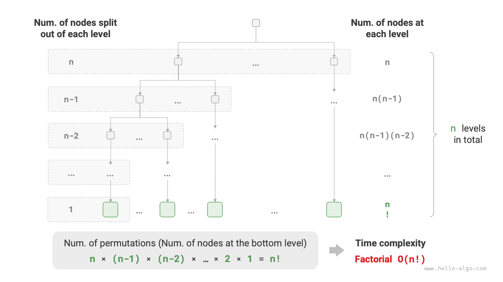

# Time complexity

Runtime gives a direct, accurate picture of an algorithm's efficiency. How might we predict the runtime of a piece of code precisely?

1. **Specify the execution platform**, including hardware, programming language, and system environment, all of which affect performance.
2. **Determine the time required by each operation**: for example, addition `+` might take 1 ns, multiplication `*` 10 ns, and `print()` 5 ns.
3. **Count every operation in the code** and sum their execution times to obtain the total runtime.

For example, consider the following code with input size $n$:

=== "Python"

    ```python title=""
    # On a particular execution platform
    def algorithm(n: int):
        a = 2      # 1 ns
        a = a + 1  # 1 ns
        a = a * 2  # 10 ns
        # Repeat n times
        for _ in range(n):  # 1 ns
            print(0)        # 5 ns
    ```

=== "C++"

    ```cpp title=""
    // On a particular execution platform
    void algorithm(int n) {
        int a = 2;  // 1 ns
        a = a + 1;  // 1 ns
        a = a * 2;  // 10 ns
        // Repeat n times
        for (int i = 0; i < n; i++) {  // 1 ns
            cout << 0 << endl;         // 5 ns
        }
    }
    ```

=== "Java"

    ```java title=""
    // On a particular execution platform
    void algorithm(int n) {
        int a = 2;  // 1 ns
        a = a + 1;  // 1 ns
        a = a * 2;  // 10 ns
        // Repeat n times
        for (int i = 0; i < n; i++) {  // 1 ns
            System.out.println(0);     // 5 ns
        }
    }
    ```

=== "C#"

    ```csharp title=""
    // On a particular execution platform
    void Algorithm(int n) {
        int a = 2;  // 1 ns
        a = a + 1;  // 1 ns
        a = a * 2;  // 10 ns
        // Repeat n times
        for (int i = 0; i < n; i++) {  // 1 ns
            Console.WriteLine(0);      // 5 ns
        }
    }
    ```

=== "Go"

    ```go title=""
    // On a particular execution platform
    func algorithm(n int) {
        a := 2     // 1 ns
        a = a + 1  // 1 ns
        a = a * 2  // 10 ns
        // Repeat n times
        for i := 0; i < n; i++ {  // 1 ns
            fmt.Println(a)        // 5 ns
        }
    }
    ```

=== "Swift"

    ```swift title=""
    // On a particular execution platform
    func algorithm(n: Int) {
        var a = 2 // 1 ns
        a = a + 1 // 1 ns
        a = a * 2 // 10 ns
        // Repeat n times
        for _ in 0 ..< n { // 1 ns
            print(0) // 5 ns
        }
    }
    ```

=== "JS"

    ```javascript title=""
    // On a particular execution platform
    function algorithm(n) {
        var a = 2; // 1 ns
        a = a + 1; // 1 ns
        a = a * 2; // 10 ns
        // Repeat n times
        for(let i = 0; i < n; i++) { // 1 ns
            console.log(0); // 5 ns
        }
    }
    ```

=== "TS"

    ```typescript title=""
    // On a particular execution platform
    function algorithm(n: number): void {
        var a: number = 2; // 1 ns
        a = a + 1; // 1 ns
        a = a * 2; // 10 ns
        // Repeat n times
        for(let i = 0; i < n; i++) { // 1 ns
            console.log(0); // 5 ns
        }
    }
    ```

=== "Dart"

    ```dart title=""
    // On a particular execution platform
    void algorithm(int n) {
      int a = 2; // 1 ns
      a = a + 1; // 1 ns
      a = a * 2; // 10 ns
      // Repeat n times
      for (int i = 0; i < n; i++) { // 1 ns
        print(0); // 5 ns
      }
    }
    ```

=== "Rust"

    ```rust title=""
    // On a particular execution platform
    fn algorithm(n: i32) {
        let mut a = 2;      // 1 ns
        a = a + 1;          // 1 ns
        a = a * 2;          // 10 ns
        // Repeat n times
        for _ in 0..n {     // 1 ns
            println!("{}", 0);  // 5 ns
        }
    }
    ```

=== "C"

    ```c title=""
    // On a particular execution platform
    void algorithm(int n) {
        int a = 2;  // 1 ns
        a = a + 1;  // 1 ns
        a = a * 2;  // 10 ns
        // Repeat n times
        for (int i = 0; i < n; i++) {   // 1 ns
            printf("%d", 0);            // 5 ns
        }
    }
    ```

=== "Kotlin"

    ```kotlin title=""
    // On a particular execution platform
    fun algorithm(n: Int) {
        var a = 2 // 1 ns
        a = a + 1 // 1 ns
        a = a * 2 // 10 ns
        // Repeat n times
        for (i in 0..<n) {  // 1 ns
            println(0)      // 5 ns
        }
    }
    ```

=== "Ruby"

    ```ruby title=""
    # On a particular execution platform
    def algorithm(n)
        a = 2       # 1 ns
        a = a + 1   # 1 ns
        a = a * 2   # 10 ns
        # Repeat n times
        (0...n).each do # 1 ns
            puts 0      # 5 ns
        end
    end
    ```

This gives a runtime of $(6n + 12)$ ns:

$$
1 + 1 + 10 + (1 + 5) \times n = 6n + 12
$$

In practice, **calculating runtime this way is neither suitable nor realistic**. We do not want estimates tied to one platform, since algorithms run on many platforms. Also, the time taken by each operation is difficult to determine, making accurate prediction very hard.

## Measuring growth in runtime

Time complexity analysis measures **how runtime grows as the input gets larger**, rather than the runtime itself.

To make this abstract idea concrete, consider three algorithms, `A`, `B`, and `C`, with input size $n$:

=== "Python"

    ```python title=""
    # Algorithm A: constant time complexity
    def algorithm_A(n: int):
        print(0)
    # Algorithm B: linear time complexity
    def algorithm_B(n: int):
        for _ in range(n):
            print(0)
    # Algorithm C: constant time complexity
    def algorithm_C(n: int):
        for _ in range(1000000):
            print(0)
    ```

=== "C++"

    ```cpp title=""
    // Algorithm A: constant time complexity
    void algorithm_A(int n) {
        cout << 0 << endl;
    }
    // Algorithm B: linear time complexity
    void algorithm_B(int n) {
        for (int i = 0; i < n; i++) {
            cout << 0 << endl;
        }
    }
    // Algorithm C: constant time complexity
    void algorithm_C(int n) {
        for (int i = 0; i < 1000000; i++) {
            cout << 0 << endl;
        }
    }
    ```

=== "Java"

    ```java title=""
    // Algorithm A: constant time complexity
    void algorithm_A(int n) {
        System.out.println(0);
    }
    // Algorithm B: linear time complexity
    void algorithm_B(int n) {
        for (int i = 0; i < n; i++) {
            System.out.println(0);
        }
    }
    // Algorithm C: constant time complexity
    void algorithm_C(int n) {
        for (int i = 0; i < 1000000; i++) {
            System.out.println(0);
        }
    }
    ```

=== "C#"

    ```csharp title=""
    // Algorithm A: constant time complexity
    void AlgorithmA(int n) {
        Console.WriteLine(0);
    }
    // Algorithm B: linear time complexity
    void AlgorithmB(int n) {
        for (int i = 0; i < n; i++) {
            Console.WriteLine(0);
        }
    }
    // Algorithm C: constant time complexity
    void AlgorithmC(int n) {
        for (int i = 0; i < 1000000; i++) {
            Console.WriteLine(0);
        }
    }
    ```

=== "Go"

    ```go title=""
    // Algorithm A: constant time complexity
    func algorithm_A(n int) {
        fmt.Println(0)
    }
    // Algorithm B: linear time complexity
    func algorithm_B(n int) {
        for i := 0; i < n; i++ {
            fmt.Println(0)
        }
    }
    // Algorithm C: constant time complexity
    func algorithm_C(n int) {
        for i := 0; i < 1000000; i++ {
            fmt.Println(0)
        }
    }
    ```

=== "Swift"

    ```swift title=""
    // Algorithm A: constant time complexity
    func algorithmA(n: Int) {
        print(0)
    }

    // Algorithm B: linear time complexity
    func algorithmB(n: Int) {
        for _ in 0 ..< n {
            print(0)
        }
    }

    // Algorithm C: constant time complexity
    func algorithmC(n: Int) {
        for _ in 0 ..< 1_000_000 {
            print(0)
        }
    }
    ```

=== "JS"

    ```javascript title=""
    // Algorithm A: constant time complexity
    function algorithm_A(n) {
        console.log(0);
    }
    // Algorithm B: linear time complexity
    function algorithm_B(n) {
        for (let i = 0; i < n; i++) {
            console.log(0);
        }
    }
    // Algorithm C: constant time complexity
    function algorithm_C(n) {
        for (let i = 0; i < 1000000; i++) {
            console.log(0);
        }
    }

    ```

=== "TS"

    ```typescript title=""
    // Algorithm A: constant time complexity
    function algorithm_A(n: number): void {
        console.log(0);
    }
    // Algorithm B: linear time complexity
    function algorithm_B(n: number): void {
        for (let i = 0; i < n; i++) {
            console.log(0);
        }
    }
    // Algorithm C: constant time complexity
    function algorithm_C(n: number): void {
        for (let i = 0; i < 1000000; i++) {
            console.log(0);
        }
    }
    ```

=== "Dart"

    ```dart title=""
    // Algorithm A: constant time complexity
    void algorithmA(int n) {
      print(0);
    }
    // Algorithm B: linear time complexity
    void algorithmB(int n) {
      for (int i = 0; i < n; i++) {
        print(0);
      }
    }
    // Algorithm C: constant time complexity
    void algorithmC(int n) {
      for (int i = 0; i < 1000000; i++) {
        print(0);
      }
    }
    ```

=== "Rust"

    ```rust title=""
    // Algorithm A: constant time complexity
    fn algorithm_A(n: i32) {
        println!("{}", 0);
    }
    // Algorithm B: linear time complexity
    fn algorithm_B(n: i32) {
        for _ in 0..n {
            println!("{}", 0);
        }
    }
    // Algorithm C: constant time complexity
    fn algorithm_C(n: i32) {
        for _ in 0..1000000 {
            println!("{}", 0);
        }
    }
    ```

=== "C"

    ```c title=""
    // Algorithm A: constant time complexity
    void algorithm_A(int n) {
        printf("%d", 0);
    }
    // Algorithm B: linear time complexity
    void algorithm_B(int n) {
        for (int i = 0; i < n; i++) {
            printf("%d", 0);
        }
    }
    // Algorithm C: constant time complexity
    void algorithm_C(int n) {
        for (int i = 0; i < 1000000; i++) {
            printf("%d", 0);
        }
    }
    ```

=== "Kotlin"

    ```kotlin title=""
    // Algorithm A: constant time complexity
    fun algoritm_A(n: Int) {
        println(0)
    }
    // Algorithm B: linear time complexity
    fun algorithm_B(n: Int) {
        for (i in 0..<n){
            println(0)
        }
    }
    // Algorithm C: constant time complexity
    fun algorithm_C(n: Int) {
        for (i in 0..<1000000) {
            println(0)
        }
    }
    ```

=== "Ruby"

    ```ruby title=""
    # Algorithm A: constant time complexity
    def algorithm_A(n)
        puts 0
    end

    # Algorithm B: linear time complexity
    def algorithm_B(n)
        (0...n).each { puts 0 }
    end

    # Algorithm C: constant time complexity
    def algorithm_C(n)
        (0...1_000_000).each { puts 0 }
    end
    ```

The figure below shows their time complexities.

- Algorithm `A` performs $1$ print operation. Its runtime does not grow with $n$, so it has constant time complexity.
- Algorithm `B` prints $n$ times. Its runtime grows linearly with $n$, so it has linear time complexity.
- Algorithm `C` prints $1000000$ times. It may take a long time, but that time is independent of input size $n$. Its complexity is therefore constant, like `A`.


How does time complexity analysis differ from calculating runtime directly?

- **Time complexity evaluates efficiency effectively**. Algorithm `B` grows linearly, becoming slower than `A` when $n > 1$ and slower than `C` when $n > 1000000$. With sufficiently large input size $n$, a constant-time algorithm will outperform a linear-time one. This is what a growth trend tells us.
- **Time complexity is easier to derive**. The execution platform and kinds of elementary operations do not determine the growth trend. We can treat each elementary operation as taking the same unit of time, reducing runtime estimation to operation counting and greatly simplifying analysis.
- **Time complexity has limitations**. Algorithms `A` and `C` have the same complexity but very different runtimes. Although `B` has higher complexity than `C`, it is much faster for small $n$. Complexity alone may not settle such comparisons. Even so, it remains the most effective and widely used way to evaluate algorithm efficiency.

## Asymptotic upper bounds

Consider this function with input size $n$:

=== "Python"

    ```python title=""
    def algorithm(n: int):
        a = 1      # +1
        a = a + 1  # +1
        a = a * 2  # +1
        # Repeat n times
        for i in range(n):  # +1
            print(0)        # +1
    ```

=== "C++"

    ```cpp title=""
    void algorithm(int n) {
        int a = 1;  // +1
        a = a + 1;  // +1
        a = a * 2;  // +1
        // Repeat n times
        for (int i = 0; i < n; i++) { // +1 (i ++ executes each iteration)
            cout << 0 << endl;    // +1
        }
    }
    ```

=== "Java"

    ```java title=""
    void algorithm(int n) {
        int a = 1;  // +1
        a = a + 1;  // +1
        a = a * 2;  // +1
        // Repeat n times
        for (int i = 0; i < n; i++) { // +1 (i ++ executes each iteration)
            System.out.println(0);    // +1
        }
    }
    ```

=== "C#"

    ```csharp title=""
    void Algorithm(int n) {
        int a = 1;  // +1
        a = a + 1;  // +1
        a = a * 2;  // +1
        // Repeat n times
        for (int i = 0; i < n; i++) {   // +1 (i ++ executes each iteration)
            Console.WriteLine(0);   // +1
        }
    }
    ```

=== "Go"

    ```go title=""
    func algorithm(n int) {
        a := 1      // +1
        a = a + 1   // +1
        a = a * 2   // +1
        // Repeat n times
        for i := 0; i < n; i++ {   // +1
            fmt.Println(a)         // +1
        }
    }
    ```

=== "Swift"

    ```swift title=""
    func algorithm(n: Int) {
        var a = 1 // +1
        a = a + 1 // +1
        a = a * 2 // +1
        // Repeat n times
        for _ in 0 ..< n { // +1
            print(0) // +1
        }
    }
    ```

=== "JS"

    ```javascript title=""
    function algorithm(n) {
        var a = 1; // +1
        a += 1; // +1
        a *= 2; // +1
        // Repeat n times
        for(let i = 0; i < n; i++){ // +1 (i ++ executes each iteration)
            console.log(0); // +1
        }
    }
    ```

=== "TS"

    ```typescript title=""
    function algorithm(n: number): void{
        var a: number = 1; // +1
        a += 1; // +1
        a *= 2; // +1
        // Repeat n times
        for(let i = 0; i < n; i++){ // +1 (i ++ executes each iteration)
            console.log(0); // +1
        }
    }
    ```

=== "Dart"

    ```dart title=""
    void algorithm(int n) {
      int a = 1; // +1
      a = a + 1; // +1
      a = a * 2; // +1
      // Repeat n times
      for (int i = 0; i < n; i++) { // +1 (i ++ executes each iteration)
        print(0); // +1
      }
    }
    ```

=== "Rust"

    ```rust title=""
    fn algorithm(n: i32) {
        let mut a = 1;   // +1
        a = a + 1;      // +1
        a = a * 2;      // +1

        // Repeat n times
        for _ in 0..n { // +1 (i ++ executes each iteration)
            println!("{}", 0); // +1
        }
    }
    ```

=== "C"

    ```c title=""
    void algorithm(int n) {
        int a = 1;  // +1
        a = a + 1;  // +1
        a = a * 2;  // +1
        // Repeat n times
        for (int i = 0; i < n; i++) {   // +1 (i ++ executes each iteration)
            printf("%d", 0);            // +1
        }
    }
    ```

=== "Kotlin"

    ```kotlin title=""
    fun algorithm(n: Int) {
        var a = 1 // +1
        a = a + 1 // +1
        a = a * 2 // +1
        // Repeat n times
        for (i in 0..<n) { // +1 (i ++ executes each iteration)
            println(0) // +1
        }
    }
    ```

=== "Ruby"

    ```ruby title=""
    def algorithm(n)
        a = 1       # +1
        a = a + 1   # +1
        a = a * 2   # +1
        # Repeat n times
        (0...n).each do # +1
            puts 0      # +1
        end
    end
    ```

Let $T(n)$ be the operation count as a function of input size $n$. For the function above:

$$
T(n) = 3 + 2n
$$

Since $T(n)$ is a first-degree function, runtime grows linearly, giving linear time complexity.

We write linear time complexity as $O(n)$. This is called <u>big-$O$ notation</u>, and it gives an <u>asymptotic upper bound</u> on $T(n)$.

Time complexity analysis essentially finds an asymptotic upper bound on the operation count $T(n)$. It has a precise mathematical definition.

!!! note "Asymptotic upper bound"

    If a positive real constant $c$ and a real number $n_0$ exist such that $T(n) \leq c \cdot f(n)$ for all $n > n_0$, then $f(n)$ is an asymptotic upper bound on $T(n)$, written $T(n) = O(f(n))$.

As shown in the figure below, we seek a function $f(n)$ such that, as $n$ tends to infinity, $T(n)$ and $f(n)$ have the same order of growth, differing only by a constant factor $c$.


## How to derive time complexity

The mathematics of asymptotic bounds may feel unfamiliar. Do not worry if it is not fully clear yet: learn the practical method first, and its meaning will become clearer with practice.

Once we identify $f(n)$, the time complexity is $O(f(n))$. Finding the asymptotic upper bound $f(n)$ takes two steps: count operations, then determine the bound.

### Step 1: Count operations

We can count code operations line by line. Since the constant factor $c$ in $c \cdot f(n)$ may be arbitrarily large, **coefficients and constant terms in $T(n)$ can be ignored**. This gives three useful shortcuts.

1. **Ignore constant terms in $T(n)$**. They are independent of $n$ and do not affect complexity.
2. **Drop coefficients**. For example, $2n$ or $5n + 1$ iterations can be counted simply as $n$, because the coefficient of $n$ does not affect complexity.
3. **Multiply for nested loops**. Multiply the outer and inner iteration counts, applying shortcuts `1.` and `2.` to each level.

We can apply these shortcuts to the following function:

=== "Python"

    ```python title=""
    def algorithm(n: int):
        a = 1      # +0 (shortcut 1)
        a = a + n  # +0 (shortcut 1)
        # +n (shortcut 2)
        for i in range(5 * n + 1):
            print(0)
        # +n*n (shortcut 3)
        for i in range(2 * n):
            for j in range(n + 1):
                print(0)
    ```

=== "C++"

    ```cpp title=""
    void algorithm(int n) {
        int a = 1;  // +0 (shortcut 1)
        a = a + n;  // +0 (shortcut 1)
        // +n (shortcut 2)
        for (int i = 0; i < 5 * n + 1; i++) {
            cout << 0 << endl;
        }
        // +n*n (shortcut 3)
        for (int i = 0; i < 2 * n; i++) {
            for (int j = 0; j < n + 1; j++) {
                cout << 0 << endl;
            }
        }
    }
    ```

=== "Java"

    ```java title=""
    void algorithm(int n) {
        int a = 1;  // +0 (shortcut 1)
        a = a + n;  // +0 (shortcut 1)
        // +n (shortcut 2)
        for (int i = 0; i < 5 * n + 1; i++) {
            System.out.println(0);
        }
        // +n*n (shortcut 3)
        for (int i = 0; i < 2 * n; i++) {
            for (int j = 0; j < n + 1; j++) {
                System.out.println(0);
            }
        }
    }
    ```

=== "C#"

    ```csharp title=""
    void Algorithm(int n) {
        int a = 1;  // +0 (shortcut 1)
        a = a + n;  // +0 (shortcut 1)
        // +n (shortcut 2)
        for (int i = 0; i < 5 * n + 1; i++) {
            Console.WriteLine(0);
        }
        // +n*n (shortcut 3)
        for (int i = 0; i < 2 * n; i++) {
            for (int j = 0; j < n + 1; j++) {
                Console.WriteLine(0);
            }
        }
    }
    ```

=== "Go"

    ```go title=""
    func algorithm(n int) {
        a := 1     // +0 (shortcut 1)
        a = a + n  // +0 (shortcut 1)
        // +n (shortcut 2)
        for i := 0; i < 5 * n + 1; i++ {
            fmt.Println(0)
        }
        // +n*n (shortcut 3)
        for i := 0; i < 2 * n; i++ {
            for j := 0; j < n + 1; j++ {
                fmt.Println(0)
            }
        }
    }
    ```

=== "Swift"

    ```swift title=""
    func algorithm(n: Int) {
        var a = 1 // +0 (shortcut 1)
        a = a + n // +0 (shortcut 1)
        // +n (shortcut 2)
        for _ in 0 ..< (5 * n + 1) {
            print(0)
        }
        // +n*n (shortcut 3)
        for _ in 0 ..< (2 * n) {
            for _ in 0 ..< (n + 1) {
                print(0)
            }
        }
    }
    ```

=== "JS"

    ```javascript title=""
    function algorithm(n) {
        let a = 1;  // +0 (shortcut 1)
        a = a + n;  // +0 (shortcut 1)
        // +n (shortcut 2)
        for (let i = 0; i < 5 * n + 1; i++) {
            console.log(0);
        }
        // +n*n (shortcut 3)
        for (let i = 0; i < 2 * n; i++) {
            for (let j = 0; j < n + 1; j++) {
                console.log(0);
            }
        }
    }
    ```

=== "TS"

    ```typescript title=""
    function algorithm(n: number): void {
        let a = 1;  // +0 (shortcut 1)
        a = a + n;  // +0 (shortcut 1)
        // +n (shortcut 2)
        for (let i = 0; i < 5 * n + 1; i++) {
            console.log(0);
        }
        // +n*n (shortcut 3)
        for (let i = 0; i < 2 * n; i++) {
            for (let j = 0; j < n + 1; j++) {
                console.log(0);
            }
        }
    }
    ```

=== "Dart"

    ```dart title=""
    void algorithm(int n) {
      int a = 1; // +0 (shortcut 1)
      a = a + n; // +0 (shortcut 1)
      // +n (shortcut 2)
      for (int i = 0; i < 5 * n + 1; i++) {
        print(0);
      }
      // +n*n (shortcut 3)
      for (int i = 0; i < 2 * n; i++) {
        for (int j = 0; j < n + 1; j++) {
          print(0);
        }
      }
    }
    ```

=== "Rust"

    ```rust title=""
    fn algorithm(n: i32) {
        let mut a = 1;     // +0 (shortcut 1)
        a = a + n;        // +0 (shortcut 1)

        // +n (shortcut 2)
        for i in 0..(5 * n + 1) {
            println!("{}", 0);
        }

        // +n*n (shortcut 3)
        for i in 0..(2 * n) {
            for j in 0..(n + 1) {
                println!("{}", 0);
            }
        }
    }
    ```

=== "C"

    ```c title=""
    void algorithm(int n) {
        int a = 1;  // +0 (shortcut 1)
        a = a + n;  // +0 (shortcut 1)
        // +n (shortcut 2)
        for (int i = 0; i < 5 * n + 1; i++) {
            printf("%d", 0);
        }
        // +n*n (shortcut 3)
        for (int i = 0; i < 2 * n; i++) {
            for (int j = 0; j < n + 1; j++) {
                printf("%d", 0);
            }
        }
    }
    ```

=== "Kotlin"

    ```kotlin title=""
    fun algorithm(n: Int) {
        var a = 1   // +0 (shortcut 1)
        a = a + n   // +0 (shortcut 1)
        // +n (shortcut 2)
        for (i in 0..<5 * n + 1) {
            println(0)
        }
        // +n*n (shortcut 3)
        for (i in 0..<2 * n) {
            for (j in 0..<n + 1) {
                println(0)
            }
        }
    }
    ```

=== "Ruby"

    ```ruby title=""
    def algorithm(n)
        a = 1       # +0 (shortcut 1)
        a = a + n   # +0 (shortcut 1)
        # +n (shortcut 2)
        (0...(5 * n + 1)).each do { puts 0 }
        # +n*n (shortcut 3)
        (0...(2 * n)).each do
            (0...(n + 1)).each do { puts 0 }
        end
    end
    ```

The formulas below compare full and simplified counts. Both give time complexity $O(n^2)$.

$$
\begin{aligned}
T(n) & = 2n(n + 1) + (5n + 1) + 2 & \text{Full count (-.-|||)} \newline
& = 2n^2 + 7n + 3 \newline
T(n) & = n^2 + n & \text{Shortcut count (o.O)}
\end{aligned}
$$

### Step 2: Determine the asymptotic upper bound

**The highest-order term in $T(n)$ determines time complexity**. As $n$ tends to infinity, that term dominates, and the others become negligible.

The table below includes deliberately extreme coefficients to emphasize that coefficients cannot overcome growth order. As $n$ tends to infinity, those constants become insignificant.

<p align="center"> Table <id> &nbsp; Operation counts and their time complexities </p>

| Operation count $T(n)$        | Time complexity $O(f(n))$ |
| ---------------------- | -------------------- |
| $100000$               | $O(1)$               |
| $3n + 2$               | $O(n)$               |
| $2n^2 + 3n + 2$        | $O(n^2)$             |
| $n^3 + 10000n^2$       | $O(n^3)$             |
| $2^n + 10000n^{10000}$ | $O(2^n)$             |

## Common complexity classes

For input size $n$, common time complexities are shown below in increasing order of growth.

$$
\begin{aligned}
& O(1) < O(\log n) < O(n) < O(n \log n) < O(n^2) < O(2^n) < O(n!) \newline
& \text{Constant} < \text{Logarithmic} < \text{Linear} < \text{Linearithmic} < \text{Quadratic} < \text{Exponential} < \text{Factorial}
\end{aligned}
$$


### Constant time $O(1)$

A constant operation count is independent of input size $n$: changing $n$ does not change the count.

In the following function, `size` may be large, but it is independent of input size $n$, so the time complexity remains $O(1)$:

```src
[file]{time_complexity}-[class]{}-[func]{constant}
```

### Linear time $O(n)$

A linear operation count grows proportionally to input size $n$. It commonly appears in a single loop:

```src
[file]{time_complexity}-[class]{}-[func]{linear}
```

Traversing an array or linked list takes $O(n)$ time, where $n$ is its length:

```src
[file]{time_complexity}-[class]{}-[func]{array_traversal}
```

**The meaning of input size $n$ depends on the input type**. In the first example, it is the variable $n$; in the second, it is the array length $n$.

### Quadratic time $O(n^2)$

A quadratic operation count grows with the square of input size $n$. It commonly appears in nested loops where both levels take $O(n)$ time, giving $O(n^2)$ overall:

```src
[file]{time_complexity}-[class]{}-[func]{quadratic}
```

The figure below compares constant, linear, and quadratic time complexity.


In bubble sort, for example, the outer loop runs $n - 1$ times, while the inner loop runs $n-1$, $n-2$, $\dots$, $2$, and $1$ times, averaging $n / 2$. The resulting complexity is $O((n - 1) n / 2) = O(n^2)$:

```src
[file]{time_complexity}-[class]{}-[func]{bubble_sort}
```

### Exponential time $O(2^n)$

Cell division is a classic example of exponential growth. Starting with $1$ cell, one round produces $2$, two rounds produce $4$, and after $n$ rounds there are $2^n$ cells.

The figure and code below simulate cell division in $O(2^n)$ time. The input $n$ is the number of rounds, while the returned `count` is the total number of individual divisions.

```src
[file]{time_complexity}-[class]{}-[func]{exponential}
```


Exponential time often appears in recursive algorithms. The following function branches into two calls at each level, stopping after $n$ levels:

```src
[file]{time_complexity}-[class]{}-[func]{exp_recur}
```

Exponential growth is very rapid and common in exhaustive approaches such as brute-force search and backtracking. It is unacceptable for large inputs, which usually require approaches such as dynamic programming or greedy algorithms.

### Logarithmic time $O(\log n)$

Logarithmic growth corresponds to repeatedly halving a quantity, the reverse of exponential growth. Starting with input size $n$, halving each round gives $\log_2 n$ iterations, the inverse of $2^n$.

The figure and code below simulate repeated halving, taking $O(\log_2 n)$ time, usually written $O(\log n)$:

```src
[file]{time_complexity}-[class]{}-[func]{logarithmic}
```


Like exponential growth, logarithmic growth often occurs in recursion. The following code produces a recursion tree of height $\log_2 n$:

```src
[file]{time_complexity}-[class]{}-[func]{log_recur}
```

Logarithmic time often arises in divide-and-conquer algorithms, reflecting the idea of dividing a problem into smaller, simpler parts. It grows slowly and is highly desirable, second only to constant time among these classes.

!!! tip "What is the base of $O(\log n)$?"

    More precisely, reducing the size by a factor of $m$ gives $O(\log_m n)$. The change-of-base formula shows that different fixed bases yield the same complexity:

    $$
    O(\log_m n) = O(\log_k n / \log_k m) = O(\log_k n)
    $$

    Thus, changing the base $m$ does not affect the complexity. We usually omit $m$ and simply write $O(\log n)$.

### Linearithmic time $O(n \log n)$

Linearithmic time often appears when one level of a nested process takes $O(\log n)$ and another takes $O(n)$. An example follows:

```src
[file]{time_complexity}-[class]{}-[func]{linear_log_recur}
```

The figure below shows how linearithmic growth arises. Each level of the binary tree performs $n$ operations, and there are $\log_2 n + 1$ levels, giving $O(n \log n)$ time.


Common sorting algorithms, including quick sort, merge sort, and heap sort, typically take $O(n \log n)$ time.

### Factorial time $O(n!)$

Factorial growth arises when generating every permutation of $n$ distinct elements. The number of permutations is:

$$
n! = n \times (n - 1) \times (n - 2) \times \dots \times 2 \times 1
$$

Algorithms with factorial time complexity are usually implemented recursively. As the figure and code below show, each call creates $n$ branches at the first level, $n - 1$ at the second, and so on until level $n$:

```src
[file]{time_complexity}-[class]{}-[func]{factorial_recur}
```



Since $n! > 2^n$ whenever $n \geq 4$, factorial growth is faster than exponential growth and is also unacceptable for large $n$.

## Worst-case, best-case, and average-case time complexity

**An algorithm's efficiency often depends on how its input data is arranged**. Suppose `nums` is an array of length $n$ containing every integer from $1$ through $n$ exactly once in a random order. The task is to return the index of $1$. We can conclude the following.

- If `nums = [?, ?, ..., 1]`, with $1$ last, we must traverse the whole array, **giving worst-case time complexity $O(n)$**.
- If `nums = [1, ?, ?, ...]`, with $1$ first, no further traversal is needed regardless of array length, **giving best-case time complexity $\Omega(1)$**.

Worst-case time complexity corresponds to an asymptotic upper bound, expressed with big-$O$ notation. Best-case time complexity corresponds to an asymptotic lower bound, expressed with $\Omega$:

```src
[file]{worst_best_time_complexity}-[class]{}-[func]{find_one}
```

Best-case complexity is rarely used in practice because it may occur only with low probability and can be misleading. **Worst-case complexity is more useful because it gives a safe performance bound**, allowing us to use the algorithm with confidence.

In this example, both the worst and best cases occur only for particular arrangements, perhaps with low probability, and may not reflect ordinary performance. **Average-case complexity describes performance on random inputs** and is expressed with $\Theta$.

For some algorithms, the average case is easy to derive. In the example above, $1$ is equally likely to occur at any index in the shuffled array. The average number of iterations is half the array length, $n / 2$, giving $\Theta(n / 2) = \Theta(n)$.

For more complex algorithms, average-case complexity can be difficult to calculate because the overall expectation under the input distribution is hard to derive. In such cases, we usually judge efficiency by worst-case complexity.

!!! question "Why is $\Theta$ rarely seen?"

    Perhaps because $O$ is so familiar, it is often used for average-case complexity too. Strictly speaking, this usage is not standard. In this book and other resources, read a statement such as "average-case time complexity $O(n)$" as $\Theta(n)$.
