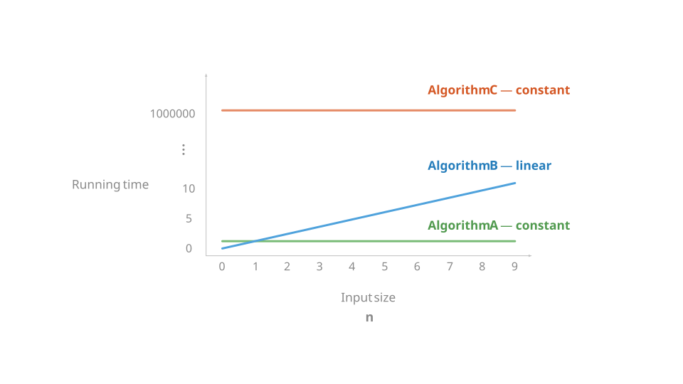
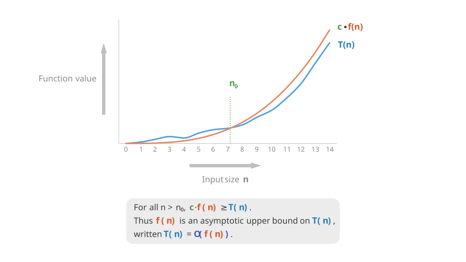
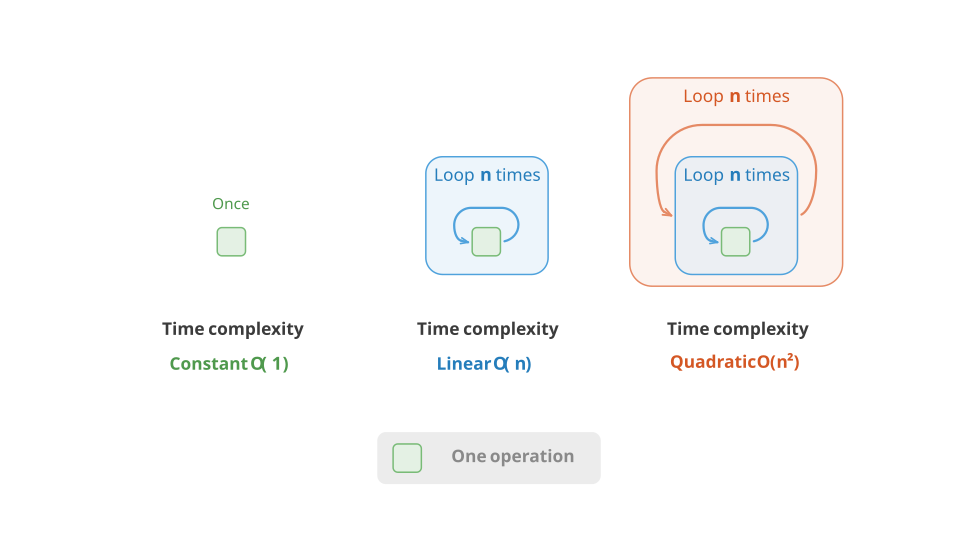
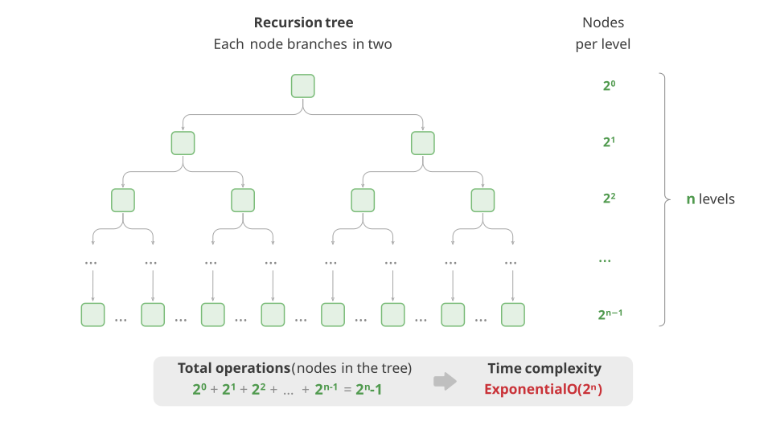
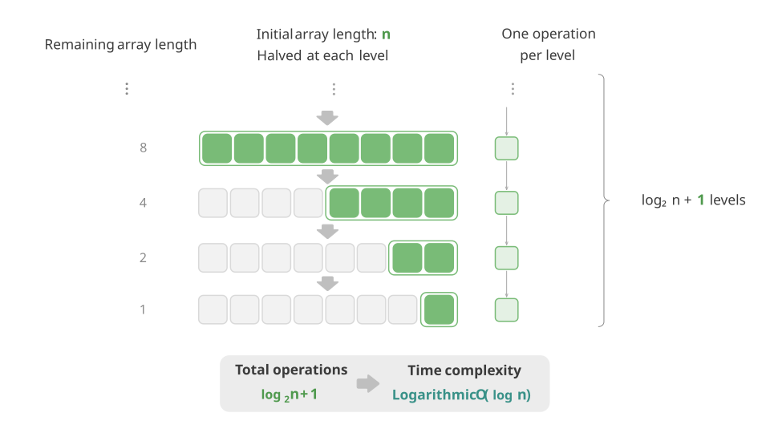
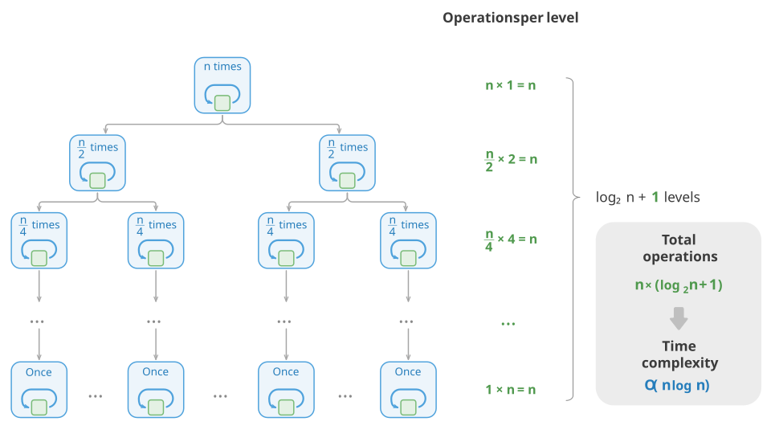

# Time complexity

Running time gives us a direct, precise measure of an algorithm's efficiency. How might we predict exactly how long a piece of code will take?

1. **Specify the platform**, including the hardware, programming language, and system environment. All of these affect execution speed.
2. **Estimate the time for each kind of operation**. For example, suppose addition `+` takes 1 ns, multiplication `*` takes 10 ns, and a print operation `print()` takes 5 ns.
3. **Count all the operations in the code** and add up their execution times to get the running time.

For example, the following code has input size $n$:

```snippet
run_time_estimate
```

Using the method above, we get a running time of $(6n + 12)$ ns:

$$
1 + 1 + 10 + (1 + 5) \times n = 6n + 12
$$

In practice, **working out running time this way is neither desirable nor realistic**. First, we want our estimate to apply across platforms, since an algorithm may run on many different machines. Second, finding the execution time of each operation is difficult, which makes the estimate hard to produce.

## How running time grows

Time complexity analysis looks beyond an algorithm's elapsed time to **how that time grows as the input gets larger**.

To make this idea concrete, consider three algorithms, `A`, `B`, and `C`, each with input size $n$:

```snippet
growth_trend
```

The figure below illustrates the time complexity of these three functions.

- Algorithm `A` performs only $1$ print operation. Its running time stays the same as $n$ increases. We say it runs in constant time.
- Algorithm `B` repeats the print operation $n$ times. Its running time grows linearly with $n$, so we say it runs in linear time.
- Algorithm `C` repeats its print operation $1000000$ times. Although it takes a long time, that time is independent of input size $n$. Thus `C` has the same time complexity as `A`: constant time.



How does time complexity analysis compare with calculating running time directly?

- **Time complexity is an effective measure of efficiency**. For example, the running time of algorithm `B` grows linearly. When $n > 1$ it is slower than `A`, and when $n > 1000000$ it is slower than `C`. For sufficiently large $n$, a constant-time algorithm will outperform a linear-time algorithm. This is what a growth trend tells us.
- **Time complexity is easier to estimate**. Neither the platform nor the type of elementary operation changes the growth trend here. We can assign each operation the same unit of time and simply count operations instead of timing them individually. This makes estimation much easier.
- **Time complexity has limitations**. Algorithms `A` and `C` have the same time complexity but very different running times. Similarly, although `B` has higher time complexity than `C`, for small $n$, algorithm `B` clearly outperforms `C`. Time complexity alone often cannot rank algorithms in cases like these. Even with these limitations, complexity analysis remains the most effective and widely used way to assess algorithm efficiency.

## Asymptotic upper bound of a function

Consider the following function with input size $n$:

```snippet
asymptotic_upper_bound
```

Let $T(n)$ denote the number of operations as a function of input size $n$. For the function above, the count is:

$$
T(n) = 3 + 2n
$$

The function $T(n)$ is linear, so running time grows linearly and the time complexity is linear.

Linear time complexity is written $O(n)$. This is an example of <u>big-$O$ notation</u>: the $O$ denotes an <u>asymptotic upper bound</u> on $T(n)$.

Analyzing time complexity amounts to finding an asymptotic upper bound on the operation count $T(n)$. This has a precise mathematical definition.

!!! note "Asymptotic upper bound of a function"

    If there exist a positive real number $c$ and a real number $n_0$ such that $T(n) \leq c \cdot f(n)$ for every $n > n_0$, then $f(n)$ is an asymptotic upper bound on $T(n)$. We write $T(n) = O(f(n))$.

As the figure shows, we look for a function $f(n)$ such that, as $n$ tends to infinity, $T(n)$ and $f(n)$ have the same order of growth, up to a constant factor $c$.



## Estimating time complexity

An asymptotic upper bound may feel abstract at first. Start with the estimation procedure. Its mathematical meaning will become clearer with practice.

By definition, once we have identified $f(n)$, we can write the time complexity as $O(f(n))$. How do we find the upper bound $f(n)$? First count the operations, then determine their asymptotic upper bound.

### Step 1: Count the operations

We can go through the code line by line, from top to bottom. Since the constant $c$ in $c \cdot f(n)$ can be arbitrarily large, **we can ignore constant factors and constant terms in the operation count $T(n)$**. This gives us a few shortcuts.

1. **Ignore the constant terms in $T(n)$**. They are independent of $n$, so they do not affect time complexity.
2. **Drop constant factors**. For example, for a loop running $2n$ or $5n + 1$ times, we can simplify the count to $n$. The coefficient of $n$ does not change the time complexity.
3. **Multiply counts for nested loops**. The total number of operations is the product of the outer and inner loop counts. Apply shortcuts `1.` and `2.` to each loop separately.

Let's use these shortcuts to count operations in a function:

```snippet
count_operations
```

The formulas below give the full count and the simplified count. Both yield the same time complexity, $O(n^2)$.

$$
\begin{aligned}
T(n) & = 2n(n + 1) + (5n + 1) + 2 & \text{Full count (-.-|||)} \newline
& = 2n^2 + 7n + 3 \newline
T(n) & = n^2 + n & \text{Shortcut count (o.O)}
\end{aligned}
$$

### Step 2: Determine the asymptotic upper bound

**The highest-order term in $T(n)$ determines the time complexity**. As $n$ tends to infinity, this term dominates and we can disregard the others.

The table gives some examples. A few coefficients are deliberately exaggerated to show that even a huge coefficient cannot change the order of growth. As $n$ tends to infinity, those constants cease to matter.

<p align="center"> Table <id> &nbsp; Operation counts and their time complexities </p>

| Operation count $T(n)$        | Time complexity $O(f(n))$ |
| ---------------------- | -------------------- |
| $100000$               | $O(1)$               |
| $3n + 2$               | $O(n)$               |
| $2n^2 + 3n + 2$        | $O(n^2)$             |
| $n^3 + 10000n^2$       | $O(n^3)$             |
| $2^n + 10000n^{10000}$ | $O(2^n)$             |

## Common growth rates

For input size $n$, the figure below shows common time complexities in increasing order.

$$
\begin{aligned}
& O(1) < O(\log n) < O(n) < O(n \log n) < O(n^2) < O(2^n) < O(n!) \newline
& \text{constant} < \text{logarithmic} < \text{linear} < \text{linearithmic} < \text{quadratic} < \text{exponential} < \text{factorial}
\end{aligned}
$$


### Constant time $O(1)$

In constant time, the operation count is independent of input size $n$. It stays the same as $n$ changes.

In the following function, the operation count `size` may be large, but it is independent of the input size $n$. The time complexity is therefore still $O(1)$:

```src
[file]{time_complexity}-[class]{}-[func]{constant}
```

### Linear time $O(n)$

In linear time, the operation count grows linearly with input size $n$. This often happens in a single loop:

```src
[file]{time_complexity}-[class]{}-[func]{linear}
```

Traversing an array or a linked list takes $O(n)$ time, where $n$ is the length of the array or list:

```src
[file]{time_complexity}-[class]{}-[func]{array_traversal}
```

Notice that **the meaning of input size $n$ depends on the type of input**. In the first example, the variable $n$ itself gives the size. In the second, the size is the array length $n$.

### Quadratic time $O(n^2)$

In quadratic time, the operation count grows with the square of the input size $n$. This often happens in nested loops. Here the outer loop runs $O(n)$ times, as does the inner loop on each pass, giving an overall time complexity of $O(n^2)$:

```src
[file]{time_complexity}-[class]{}-[func]{quadratic}
```

The figure compares constant, linear, and quadratic time.



In bubble sort, for example, the outer loop runs $n - 1$ times. The inner loop runs $n-1$, $n-2$, $\dots$, $2$, and $1$ times on successive passes, averaging $n / 2$ iterations. The time complexity is therefore $O((n - 1) n / 2) = O(n^2)$:

```src
[file]{time_complexity}-[class]{}-[func]{bubble_sort}
```

### Exponential time $O(2^n)$

Cell division is a familiar example of exponential growth. Start with $1$ cell. After one round of division there are $2$ cells, after two rounds there are $4$, and after $n$ rounds there are $2^n$.

The figure and code below simulate cell division in $O(2^n)$ time. The input $n$ is the number of rounds of division. The return value `count` is the total number of individual divisions.

```src
[file]{time_complexity}-[class]{}-[func]{exponential}
```



Exponential time often arises in recursive algorithms. For example, the following function branches in two at each recursive step, stopping after $n$ levels:

```src
[file]{time_complexity}-[class]{}-[func]{exp_recur}
```

Exponential growth is very fast. It is common in exhaustive methods such as brute-force search and backtracking. For large inputs, exponential time is prohibitive. Such problems usually call for an approach such as dynamic programming or a greedy algorithm.

### Logarithmic time $O(\log n)$

Logarithmic growth is the reverse side of exponential growth. Suppose the input size is $n$ and each iteration halves what remains. The number of iterations is $\log_2 n$, the inverse function of $2^n$.

The figure and code below illustrate repeated halving. The time complexity is $O(\log_2 n)$, usually written $O(\log n)$:

```src
[file]{time_complexity}-[class]{}-[func]{logarithmic}
```



Like exponential time, logarithmic time often occurs in recursive functions. The following code produces a recursion tree of height $\log_2 n$:

```src
[file]{time_complexity}-[class]{}-[func]{log_recur}
```

Logarithmic time is common in divide-and-conquer algorithms that split problems into smaller, simpler pieces. It grows slowly and is an attractive time complexity, second only to constant time among the common growth rates.

!!! tip "What is the base of the logarithm in $O(\log n)$?"

    More precisely, dividing the size by $m$ at each step gives time complexity $O(\log_m n)$. The change-of-base formula shows why using a different base gives the same time complexity:

    $$
    O(\log_m n) = O(\log_k n / \log_k m) = O(\log_k n)
    $$

    In other words, we can change the base $m$ without affecting complexity. We usually omit the base $m$ and write logarithmic time as $O(\log n)$.

### Linearithmic time $O(n \log n)$

Linearithmic time often arises in nested loops where the two loop counts have orders $O(\log n)$ and $O(n)$. Here is the corresponding code:

```src
[file]{time_complexity}-[class]{}-[func]{linear_log_recur}
```

The figure shows another way linearithmic time arises. Each level of the binary tree accounts for $n$ operations, and the tree has $\log_2 n + 1$ levels. This gives a time complexity of $O(n \log n)$.



Widely used sorting algorithms such as quicksort, merge sort, and heapsort typically take $O(n \log n)$ time.

### Factorial time $O(n!)$

Factorial growth arises when we enumerate permutations. Given $n$ distinct elements, the number of possible orderings is:

$$
n! = n \times (n - 1) \times (n - 2) \times \dots \times 2 \times 1
$$

This count is usually computed recursively. In the figure and code below, there are $n$ choices at the first level, then $n - 1$ branches from each choice at the second, and so on. Branching stops at level $n$:

```src
[file]{time_complexity}-[class]{}-[func]{factorial_recur}
```


Since $n! > 2^n$ for every $n \geq 4$, factorial growth is even faster than exponential growth and is also prohibitive for large $n$.

## Worst-case, best-case, and average-case time complexity

**An algorithm's time efficiency often depends on the distribution of its inputs**. Suppose we are given an array `nums` of length $n$. The array `nums` contains each number from $1$ through $n$ exactly once, in random order. Our task is to return the index of $1$. Consider these cases.

- When `nums = [?, ?, ..., 1]`, the last element is $1$ and we must traverse the whole array. **The worst-case time complexity is $O(n)$**.
- When `nums = [1, ?, ?, ...]`, the first element is $1$. We can stop immediately, regardless of the array length. **The best-case time complexity is $\Omega(1)$**.

Worst-case time complexity corresponds here to an asymptotic upper bound, expressed in big-$O$ notation. Correspondingly, the best case gives an asymptotic lower bound, expressed in $\Omega$ notation:

```src
[file]{worst_best_time_complexity}-[class]{}-[func]{find_one}
```

We rarely use best-case time complexity in practice. The best case usually has a very low probability, so it can give a misleading impression. **Worst-case time complexity is more useful because it gives us a bound we can count on** when choosing an algorithm.

In the example above, only particular input arrangements yield the best and worst cases. These arrangements may be unlikely, so neither case necessarily represents the algorithm's usual efficiency. **Average-case time complexity describes efficiency on random inputs**. Here we express it in $\Theta$ notation.

For some algorithms, the average case under a random input distribution is easy to estimate. In the shuffled array above, $1$ is equally likely to appear at any index. The loop therefore runs about half the array length, $n / 2$, on average, giving an average-case time complexity of $\Theta(n / 2) = \Theta(n)$.

For more complex algorithms, finding the average time complexity is often difficult because the overall mathematical expectation under the input distribution is hard to calculate. In such cases we usually evaluate the algorithm by its worst-case time complexity.

!!! question "Why do we so rarely see $\Theta$ notation?"

    Perhaps because big-$O$ is so easy to say, we often use it when discussing average-case time complexity. Strictly speaking, this usage lacks precision. In this book and other material, read a statement such as “average time complexity $O(n)$” as $\Theta(n)$ in this context.
