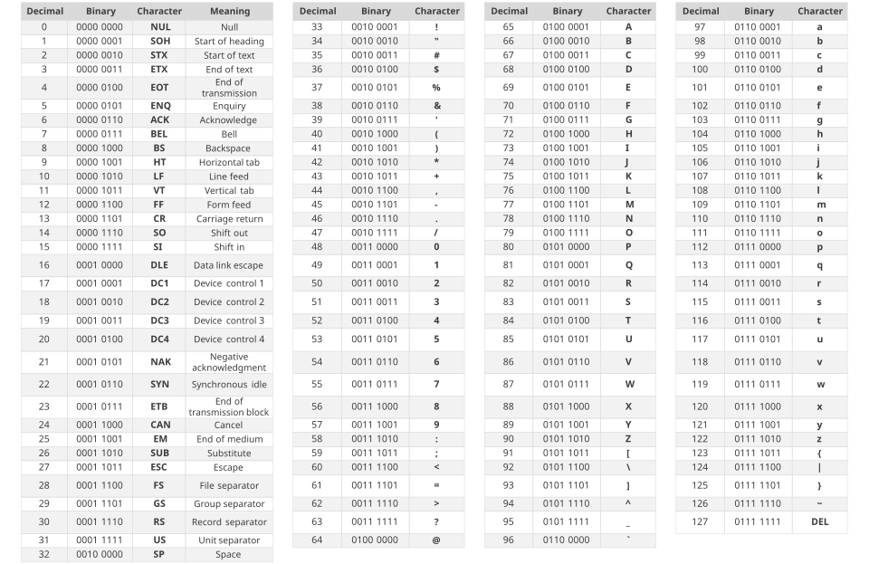
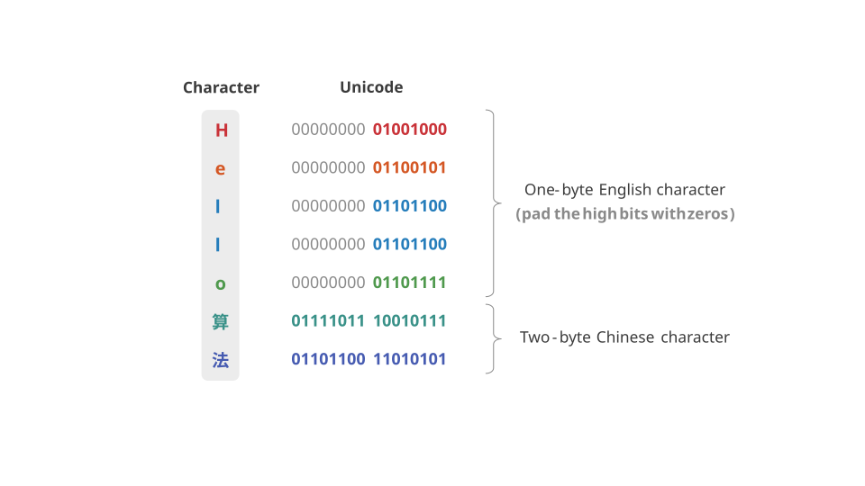
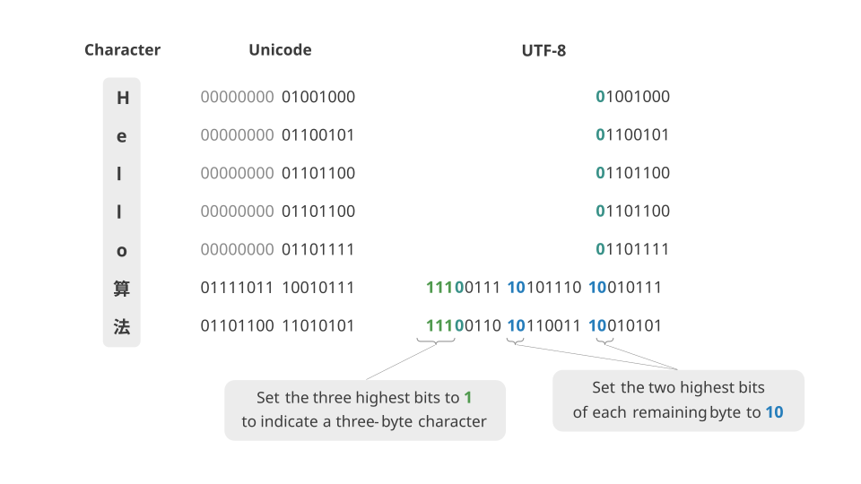

# Character encoding *

Computers store all data as binary numbers, including characters of type `char`. To represent characters, we need a character set that assigns each character a distinct number. With that mapping, a computer can look up a binary number to recover the character it represents.

## The ASCII character set

<u>ASCII</u>, the American Standard Code for Information Interchange, was the earliest character set. It uses 7 bits (the low seven bits of a byte) for each character, allowing up to 128 distinct characters. As the figure shows, these include uppercase and lowercase English letters, the digits 0–9, punctuation marks, and control characters such as line feed and tab.

However, **ASCII supports only English**. As computers spread around the world, <u>extended ASCII (EASCII)</u> character sets emerged to support additional languages. They extend ASCII from 7 to 8 bits and can represent 256 distinct characters.

Different regions developed their own extended ASCII character sets. All use ASCII for the first 128 characters, but the remaining 128 differ to meet the needs of different languages.

## The GBK character set

It soon became clear that **even extended ASCII had too few codes for many languages**. For instance, there are nearly 100,000 Chinese characters, with thousands in everyday use. In 1980, China's national standards authority released the <u>GB2312</u> character set. It included 6,763 Chinese characters and met most needs for processing Chinese text on computers.

GB2312 still could not handle some rare and traditional characters. The <u>GBK</u> character set extended GB2312 to include a total of 21,886 Chinese characters. GBK encodes ASCII characters in one byte and Chinese characters in two.

## The Unicode character set

As computing developed rapidly, many character sets and encoding standards emerged, creating two problems. Most character sets defined characters for specific languages and could not handle multilingual text properly. Even a single language could have several standards: if two computers used different encodings, text sent between them could appear garbled.

Researchers asked: **Could a character set comprehensive enough to include the world's languages and symbols solve both the multilingual text problem and the problem of garbled text**? This idea led to a single, comprehensive character set: Unicode.

<u>Unicode</u>, whose Chinese name means “unified code,” has room for more than a million characters in principle. It aims to bring the world's characters into a common set for processing and displaying text across languages, reducing garbled text caused by incompatible standards. Unicode has added languages and characters steadily since its release in 1991. By September 2022, it contained 149,186 characters, including characters from many languages, symbols, and emoji.

As a universal character set, Unicode assigns each character a unique number called a code point. Its code space runs from U+0000 to U+10FFFF. However, **assigning code points does not specify how those values are stored in a computer**. If a text contains code points of different lengths, how can the system identify each character? Given two bytes, for example, how can it tell one two-byte character from two one-byte characters?

**One straightforward solution is to store every character in an encoding of the same width**. In the figure below, each character in “Hello” fits in 1 byte, and each character in “算法” fits in 2 bytes. Padding the high bits with zeros lets us encode every character of “Hello 算法” in 2 bytes. The system can then recover the phrase by reading one character every 2 bytes.

ASCII has already shown us that English letters need only 1 byte. With the scheme above, English text takes up twice as much space as in ASCII, wasting memory. We need a more space-efficient way to encode Unicode.

## UTF-8 encoding

UTF-8 is now the most widely used Unicode encoding worldwide. **It is a variable-length encoding** that uses 1 to 4 bytes per character, depending on the character. ASCII characters take 1 byte, Latin letters outside ASCII and Greek letters can take 2, common Chinese characters take 3, and some rarer characters take 4.

UTF-8 has two straightforward encoding rules.

- For a one-byte character, set the highest bit to $0$ and put the Unicode code point in the remaining seven bits. ASCII characters occupy the first 128 Unicode code points, so **UTF-8 is backward compatible with ASCII**. Even old ASCII text can be read as UTF-8.
- For a character encoded in $n$ bytes, where $n > 1$, set the first byte's high $n$ bits to $1$ and its next bit (bit $n + 1$ counting from the left) to $0$. Starting with the second byte, set the high two bits of each byte to $10$. Fill the remaining bits with the character's Unicode code point.

The figure shows the UTF-8 encoding of “Hello算法.” Since the leading $n$ bits of a multibyte character are all $1$, the system can count the leading $1$ bits to determine the character's length, $n$ bytes.

Why set the high two bits of every remaining byte to $10$? The $10$ prefix serves as a check. If the system starts decoding at the wrong byte, the leading $10$ helps it detect the problem quickly.

We can use $10$ as a check because under UTF-8, no character can begin with $10$. To see why, suppose a character began with $10$. The single leading one would imply a length of $1$ byte, corresponding to ASCII. But the high bit of an ASCII character must be $0$, a contradiction.

Two other common Unicode encodings are:

- **UTF-16.** Each character takes 2 or 4 bytes. All ASCII characters and commonly used non-English characters take 2 bytes, while a smaller set of characters requires 4. For a two-byte character, the UTF-16 code unit equals the Unicode code point.
- **UTF-32.** Every character takes 4 bytes, so UTF-32 uses more space than UTF-8 and UTF-16, particularly for text with a large proportion of ASCII characters.

In terms of storage, UTF-8 is efficient for English letters, using only 1 byte each. UTF-16 can be more efficient for certain non-English characters, such as Chinese characters, which take only 2 bytes in UTF-16 but may need 3 in UTF-8.

In terms of compatibility, UTF-8 is the most widely supported, and many tools and libraries support it first.

## Character encodings in programming languages

Historically, most programming languages used encodings such as UTF-16 or UTF-32 for strings at runtime, relying on fixed-width units. With a fixed-width encoding, we can treat a string as an array. This offers the following advantages.

- **Random access.** UTF-16 makes random access to code units straightforward. With variable-width UTF-8, reaching character $i$ requires traversing from the beginning of the string to character $i$, which takes $O(n)$ time.
- **Character counting.** As with random access, obtaining a UTF-16 string’s length in code units is an $O(1)$ operation. Counting the characters in a UTF-8 string, however, requires traversing the entire string.
- **String operations.** Many operations, such as splitting, concatenating, inserting, and deleting, are easier on UTF-16 strings. With UTF-8, they usually require additional computation to ensure the resulting encoding is valid.

The choice of a string encoding for a programming language is an interesting design problem with many factors to consider.

- Java's `String` type uses UTF-16, with 2 bytes per code unit. When Java was designed, 16 bits were thought sufficient for every possible character. That assumption proved wrong: Unicode later grew beyond 16 bits, so a character in Java may now be represented by two 16-bit values called a surrogate pair.
- JavaScript and TypeScript use UTF-16 for strings for reasons similar to Java's. In 1995, when Netscape introduced JavaScript, Unicode was still young and 16 bits were enough to represent every Unicode character at the time.
- C# uses UTF-16 primarily because Microsoft designed the .NET platform, and many Microsoft technologies, including Windows, use UTF-16 extensively.

Having underestimated the number of characters, these languages had to adopt surrogate pairs to represent Unicode characters beyond the 16-bit range. This was a compromise. In a string with surrogate pairs, a character can occupy 2 or 4 bytes, losing the advantage of fixed-width encoding. Handling surrogate pairs also takes extra code, making programs more complex and harder to debug.

For these reasons, some languages have adopted other representations.

- Python's `str` represents Unicode text using a flexible layout whose character width depends on the largest code point in the string. If the string contains only ASCII, each character takes 1 byte. If some characters fall outside ASCII but all are in the Basic Multilingual Plane (BMP), each takes 2 bytes. If any character lies outside the BMP, each takes 4 bytes.
- Go's `string` type uses UTF-8 internally. Go also provides the `rune` type for a single Unicode code point.
- Rust's `str` and `String` types use UTF-8 internally. Rust also provides `char` to represent a single Unicode code point.

This discussion concerns how programming languages store strings internally. **Storing text in files or transmitting it over a network is a separate question**. For files and network transmission, we usually encode strings as UTF-8 for compatibility and space efficiency.
