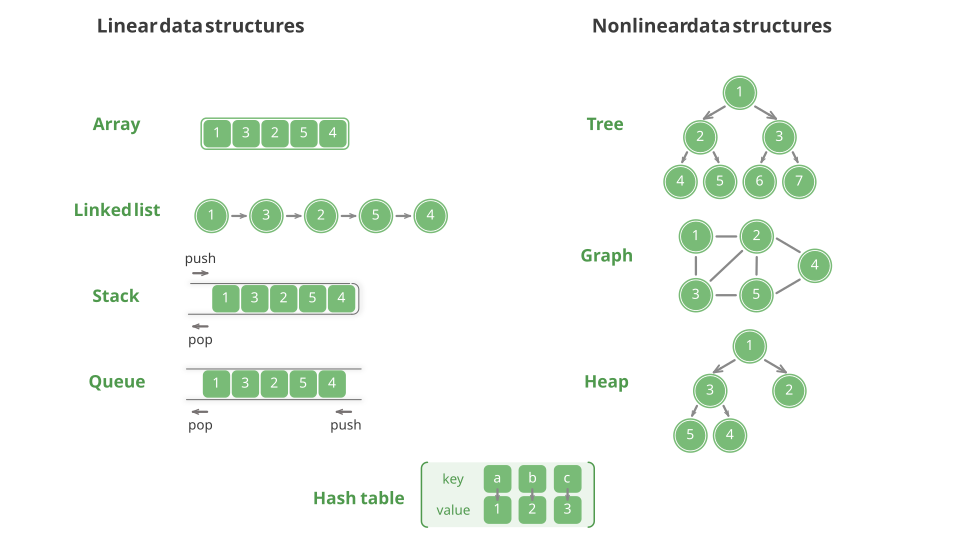
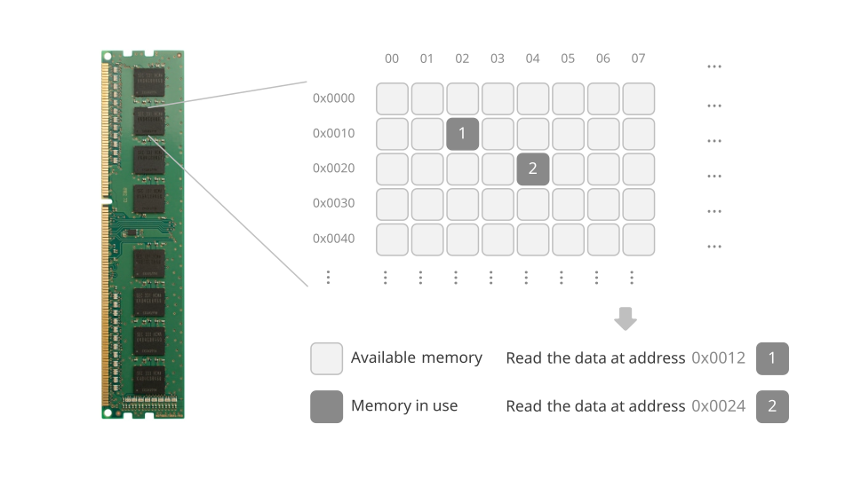
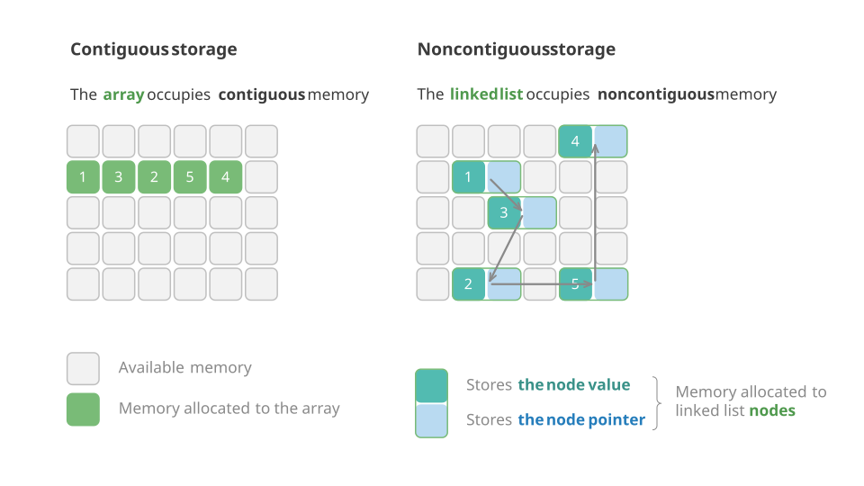

# Classifying data structures

Common data structures include arrays, linked lists, stacks, queues, hash tables, trees, heaps, and graphs. We can classify them from two perspectives: logical structure and physical structure.

## Logical structure: linear and nonlinear

**Logical structure describes the relationships between data elements**. In arrays and linked lists, elements follow a sequence, a linear relationship. A tree arranges elements in levels from top to bottom, forming ancestor-descendant relationships. A graph consists of nodes and edges that can express complex networks of relationships.

As the figure shows, logical structures fall into two broad categories: linear and nonlinear. A linear structure arranges elements logically along a single sequence. A nonlinear structure arranges them in some other way.

- **Linear data structures** include arrays, linked lists, stacks, and queues. Successive elements have a one-to-one relationship.
- **Nonlinear data structures** include trees, heaps, and graphs.

Trees and networks are two common forms of nonlinear structure.

- **Tree structures**, including trees and heaps, express one-to-many relationships between elements.
- **Network structures**, such as graphs, express many-to-many relationships between elements.

A hash table looks up values by key. The figure shows this mapping separately.

## Physical structure: contiguous and noncontiguous

**When an algorithm runs, the data it is processing is stored mainly in memory**. Each black chip on the memory module below contains a region of memory. Imagine memory as a huge Excel spreadsheet, with each cell able to hold a fixed amount of data.

**The system uses a memory address to access the data at a particular location**. As shown below, the computer assigns numbers to the cells according to a set of rules so that each location has a unique address. A program uses these addresses to access the data in memory.

!!! tip

    The spreadsheet is a simplified analogy. Actual memory systems are more complex, involving address spaces, memory management, caching, and both virtual and physical memory.

Memory is a resource shared by all programs. A block in use by one program is usually unavailable to other programs at the same time. **Memory is therefore an important consideration when designing data structures and algorithms**. For example, an algorithm's peak memory use should not exceed the system's remaining free memory. If no large contiguous block is available, the chosen structure must be able to use scattered memory.

As shown below, **physical structure describes how data is stored in computer memory**. Storage may be contiguous, as in an array, or noncontiguous, as in a linked list. The underlying layout determines how data is accessed, updated, inserted, and removed. The two layouts have complementary strengths in time and space efficiency.

**All data structures are implemented using arrays, linked lists, or a combination of the two**. For example, either an array or a linked list can implement a stack or queue, while a hash table may combine both.

- **Arrays can implement** stacks, queues, hash tables, trees, heaps, graphs, matrices, tensors (arrays of dimension $\geq 3$), and more.
- **Linked lists can implement** stacks, queues, hash tables, trees, heaps, graphs, and more.

A linked list can still change length at runtime after initialization, so it is called a dynamic data structure. An array has a fixed length after initialization, so it is called a static data structure. Reallocating memory can nevertheless give an array some flexibility in length.

!!! tip

    If you find physical structure difficult to visualize, try reading the next chapter and then returning to this section.
