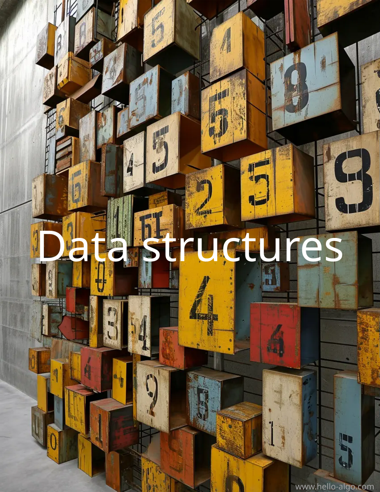

# Chapter 3. &nbsp; Data structures

{ class="cover-image" }

!!! abstract

    Think of data structures as sturdy frameworks that come in many shapes.
    
    They provide a blueprint for organizing data, giving algorithms a foundation on which to come to life.

## In this chapter

- [3.1 &nbsp; Classifying data structures](classification_of_data_structure.md)
- [3.2 &nbsp; Basic data types](basic_data_types.md)
- [3.3 &nbsp; Number representations *](number_encoding.md)
- [3.4 &nbsp; Character encoding *](character_encoding.md)
- [3.5 &nbsp; Summary](summary.md)
- [3.6 &nbsp; Exercises](exercises.md)
