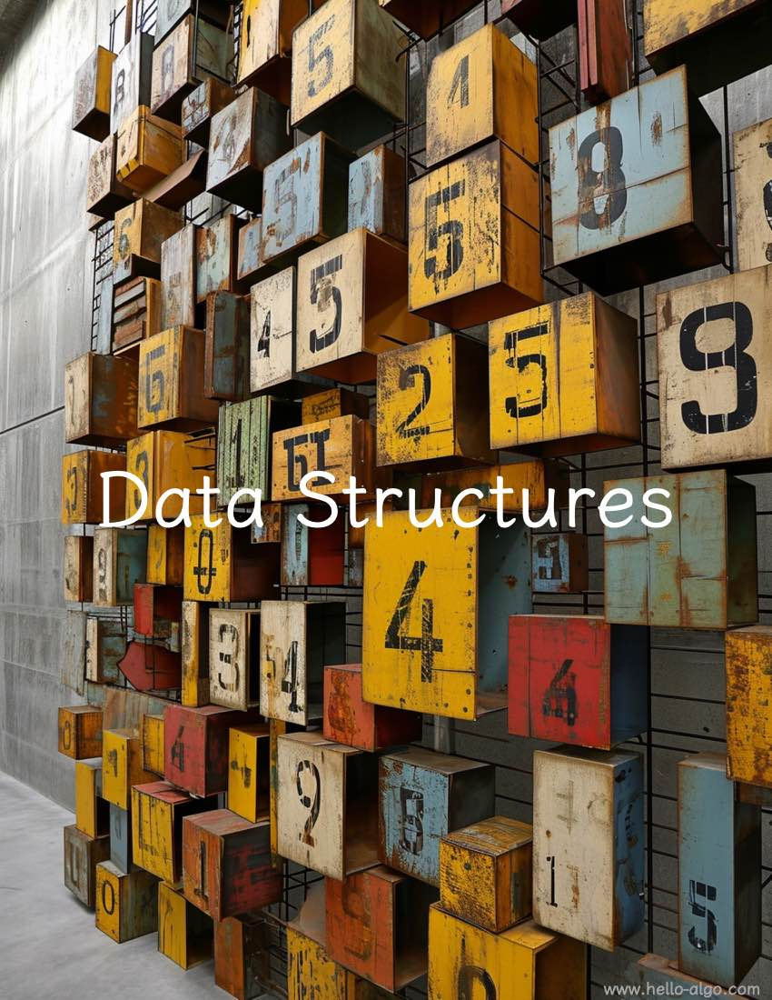

# Data structures

!!! abstract

    Think of data structures as sturdy frameworks that come in many shapes.
    
    They provide a blueprint for organizing data, giving algorithms a foundation on which to come to life.
