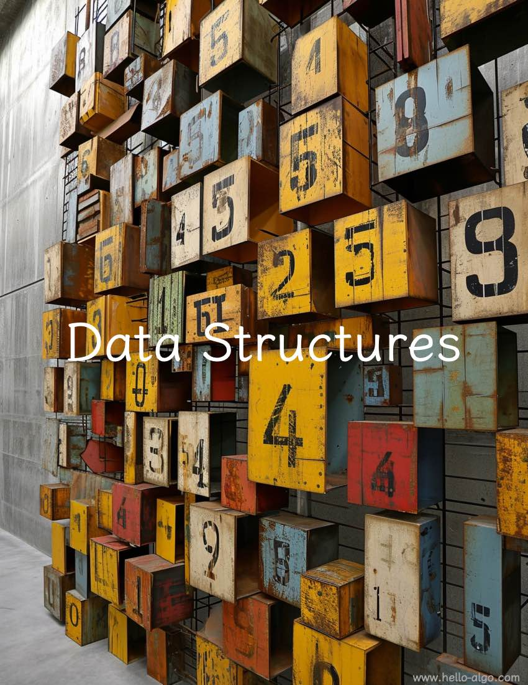

# Data structures

!!! abstract

    Data structures provide a framework that is both sturdy and versatile.
    
    They offer a blueprint for organizing data, a foundation on which algorithms come to life.
