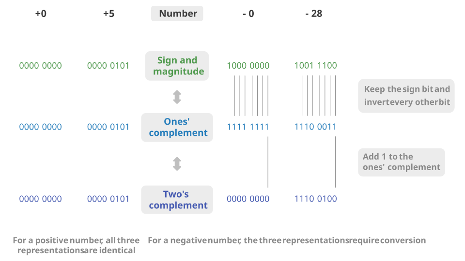
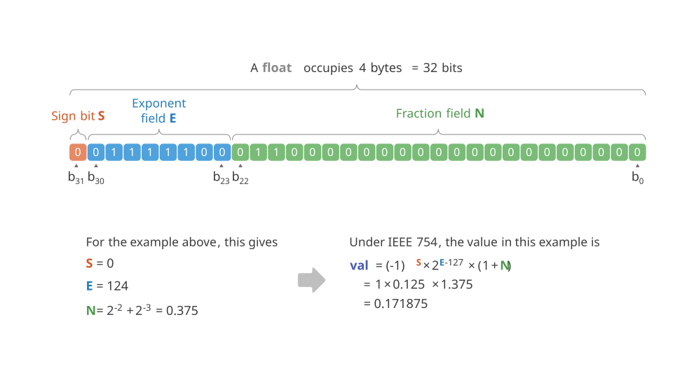

# 3.3 &nbsp; Number representations *

!!! tip

    In this book, an asterisk (*) marks an optional section. If you have limited time or find one difficult, you can skip it for now and return after finishing the required sections.

## 3.3.1 &nbsp; Sign and magnitude, ones' complement, and two's complement

The table in the previous section shows that each signed integer type represents one more negative number than positive numbers. For example, the range of `byte` is $[-128, 127]$. To understand this surprising asymmetry, we need to look at sign and magnitude, ones' complement, and two's complement.

First, **computers store signed integers in two's complement form**. Before exploring why, let's define the three representations.

- **Sign and magnitude.** The highest bit is the sign bit: $0$ indicates a positive sign and $1$ a negative sign. The remaining bits give the magnitude.
- **Ones' complement.** For a positive number, this is the same as sign and magnitude. For a negative number, start with sign and magnitude and invert all bits except the sign bit.
- **Two's complement.** For a positive number, this is again the same as sign and magnitude. For a negative number, add $1$ to its ones' complement representation.

The figure shows how to convert between sign and magnitude, ones' complement, and two's complement.

{ class="animation-figure" }

 Figure 3-4 &nbsp; Converting between sign and magnitude, ones' complement, and two's complement 

<u>Sign and magnitude</u> is the most intuitive representation, but it has limitations. For one, **the sign-and-magnitude bit pattern of a negative number cannot be used directly in ordinary binary arithmetic**. For example, adding the sign-and-magnitude bit patterns for $1 + (-2)$ gives $-3$, which is clearly incorrect.

$$
\begin{aligned}
& 1 + (-2) \newline
& \rightarrow 0000 \; 0001 + 1000 \; 0010 \newline
& = 1000 \; 0011 \newline
& \rightarrow -3
\end{aligned}
$$

To address this, computers introduced <u>ones' complement</u>. Convert the operands from sign and magnitude to ones' complement, compute $1 + (-2)$ in ones' complement, and convert the result back to sign and magnitude. This gives the correct result, $-1$.

$$
\begin{aligned}
& 1 + (-2) \newline
& \rightarrow 0000 \; 0001 \; \text{(sign and magnitude)} + 1000 \; 0010 \; \text{(sign and magnitude)} \newline
& = 0000 \; 0001 \; \text{(ones' complement)} + 1111  \; 1101 \; \text{(ones' complement)} \newline
& = 1111 \; 1110 \; \text{(ones' complement)} \newline
& = 1000 \; 0001 \; \text{(sign and magnitude)} \newline
& \rightarrow -1
\end{aligned}
$$

Another limitation is that **sign and magnitude has two representations of zero, $+0$ and $-0$**. Two different bit patterns for zero can introduce ambiguity. For example, a conditional test may give the wrong result if it does not account for positive and negative zero. Adding special checks to handle both representations can reduce computational efficiency.

$$
\begin{aligned}
+0 & \rightarrow 0000 \; 0000 \newline
-0 & \rightarrow 1000 \; 0000
\end{aligned}
$$

Ones' complement shares this ambiguity, which is why computers went on to adopt <u>two's complement</u>. Consider the conversion of negative zero from sign and magnitude to ones' complement and then to two's complement:

$$
\begin{aligned}
-0 \rightarrow \; & 1000 \; 0000 \; \text{(sign and magnitude)} \newline
= \; & 1111 \; 1111 \; \text{(ones' complement)} \newline
= 1 \; & 0000 \; 0000 \; \text{(two's complement)} \newline
\end{aligned}
$$

Adding $1$ to negative zero in ones' complement produces a carry. Since a `byte` is only 8 bits wide, the $1$ that spills into the ninth bit is discarded. Thus **the two's complement representation of negative zero is $0000 \; 0000$, the same as for positive zero**. Two's complement has only one zero, resolving the ambiguity.

One question remains. The range of `byte` is $[-128, 127]$, so where does the extra negative number $-128$ come from? Every integer in the closed interval $[-127, +127]$ has a sign-and-magnitude, ones' complement, and two's complement representation, and we can convert between sign and magnitude and two's complement.

However, **the two's complement bit pattern $1000 \; 0000$ has no sign-and-magnitude counterpart**. Applying the conversion procedure would give the sign-and-magnitude pattern $0000 \; 0000$. This is a contradiction: that pattern represents $0$, whose two's complement representation should be identical to itself. Computers assign the special two's complement pattern $1000 \; 0000$ to $-128$. In fact, adding $(-1) + (-127)$ in two's complement gives exactly $-128$.

$$
\begin{aligned}
& (-127) + (-1) \newline
& \rightarrow 1111 \; 1111 \; \text{(sign and magnitude)} + 1000 \; 0001 \; \text{(sign and magnitude)} \newline
& = 1000 \; 0000 \; \text{(ones' complement)} + 1111  \; 1110 \; \text{(ones' complement)} \newline
& = 1000 \; 0001 \; \text{(two's complement)} + 1111  \; 1111 \; \text{(two's complement)} \newline
& = 1000 \; 0000 \; \text{(two's complement)} \newline
& \rightarrow -128
\end{aligned}
$$

Notice that every calculation above is an addition. This points to an important fact: **addition is central to the design of computer arithmetic circuits**. Compared with multiplication, division, or subtraction, addition is simpler to implement in hardware, easier to parallelize, and faster to execute.

Computers can, of course, do more than add. **Combining addition with basic logical operations lets them perform many other mathematical operations**. For example, subtraction $a - b$ can be rewritten as addition $a + (-b)$, and multiplication and division can be expressed as repeated addition or subtraction.

We can now see why computers use two's complement. The same circuitry and operations can add positive and negative numbers, with no need for special subtraction circuitry or special handling of positive and negative zero. This greatly simplifies hardware design and improves computational efficiency.

There is more to the design of two's complement than we have room to explore here. Interested readers can investigate it further.

## 3.3.2 &nbsp; Floating-point representation

Both `int` and `float` occupy 4 bytes, so why is the range of `float` so much larger than that of `int`? At first glance, having to represent fractions as well might seem to give `float` a smaller range.

**The difference lies in how a `float` represents numbers**. Write a 32-bit binary number as follows:

$$
b_{31} b_{30} b_{29} \ldots b_2 b_1 b_0
$$

Under IEEE 754, a 32-bit `float` consists of three fields.

- Sign $\mathrm{S}$: 1 bit, $b_{31}$.
- Exponent $\mathrm{E}$: 8 bits, $b_{30} b_{29} \ldots b_{23}$.
- Fraction $\mathrm{N}$: 23 bits, $b_{22} b_{21} \ldots b_0$.

The binary representation of a `float` gives its value as follows:

$$
\text {val} = (-1)^{b_{31}} \times 2^{\left(b_{30} b_{29} \ldots b_{23}\right)_2-127} \times\left(1 . b_{22} b_{21} \ldots b_0\right)_2
$$

Expressed in decimal terms, the formula becomes:

$$
\text {val}=(-1)^{\mathrm{S}} \times 2^{\mathrm{E} -127} \times (1 + \mathrm{N})
$$

The terms have the following ranges:

$$
\begin{aligned}
\mathrm{S} \in & \{ 0, 1\}, \quad \mathrm{E} \in \{ 1, 2, \dots, 254 \} \newline
(1 + \mathrm{N}) = & (1 + \sum_{i=1}^{23} b_{23-i} 2^{-i}) \subset [1, 2 - 2^{-23}]
\end{aligned}
$$

{ class="animation-figure" }

 Figure 3-5 &nbsp; Calculating the value of an IEEE 754 float 

In the example shown above, $\mathrm{S} = 0$, $\mathrm{E} = 124$, and $\mathrm{N} = 2^{-2} + 2^{-3} = 0.375$. Substituting gives:

$$
\text { val } = (-1)^0 \times 2^{124 - 127} \times (1 + 0.375) = 0.171875
$$

We can now answer the original question: **the exponent field gives `float` a far greater range than `int`**. From the calculation above, the largest positive value of `float` is $2^{254 - 127} \times (2 - 2^{-23}) \approx 3.4 \times 10^{38}$. Flipping the sign bit gives the most negative value.

**The greater range of `float` comes at the cost of precision**. The integer type `int` uses all 32 bits to represent evenly spaced numbers. With `float`, the exponent means that as the magnitude grows, the spacing between adjacent representable numbers generally increases.

As the table shows, exponent values $\mathrm{E} = 0$ and $\mathrm{E} = 255$ have special meanings, **allowing representations of zero, infinity, $\mathrm{NaN}$, and other cases**.

Table <id> &nbsp; Meanings of exponent field values

| Exponent field E           | Fraction field $\mathrm{N} = 0$ | Fraction field $\mathrm{N} \ne 0$ | Formula                                                               |
| ------------------ | ----------------------- | ------------------------- | ---------------------------------------------------------------------- |
| $0$                | $\pm 0$                 | Subnormal number                  | $(-1)^{\mathrm{S}} \times 2^{-126} \times (0.\mathrm{N})$              |
| $1, 2, \dots, 254$ | Normal number                  | Normal number                    | $(-1)^{\mathrm{S}} \times 2^{(\mathrm{E} -127)} \times (1.\mathrm{N})$ |
| $255$              | $\pm \infty$            | $\mathrm{NaN}$            |                                                                        |

Subnormal numbers provide much finer resolution near zero. The smallest positive normal number is $2^{-126}$, while the smallest positive subnormal number is $2^{-126} \times 2^{-23}$.

Double precision (`double`) uses a representation similar to `float`, so we will omit the details.
