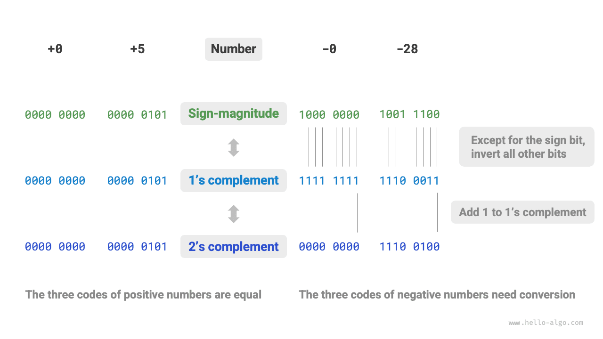

# 3.3 &nbsp; Number encoding *

!!! tip

    Sections marked with * in their titles are optional. If you are short on time or find them difficult, you can skip them initially and return after completing the required sections.

## 3.3.1 &nbsp; Sign-magnitude, one's complement, and two's complement

The previous table showed that every integer type represents one more negative value than positive value. For example, `byte` ranges over $[-128, 127]$. Understanding this counterintuitive fact requires sign-magnitude, one's complement, and two's complement.

First, **integers are stored in two's complement form**. Before explaining why, let's define the three representations.

- **Sign-magnitude**: The highest bit is the sign: $0$ for positive and $1$ for negative. The remaining bits represent the magnitude.
- **One's complement**: A positive number has the same representation as sign-magnitude. For a negative number, invert every bit except the sign bit of its sign-magnitude representation.
- **Two's complement**: A positive number again has the same representation as sign-magnitude. For a negative number, add $1$ to its one's complement.

Figure 3-4 shows how to convert among these representations.

{ class="animation-figure" }

 Figure 3-4 &nbsp; Converting between sign-magnitude, one's complement, and two's complement 

Although <u>sign-magnitude</u> is intuitive, it has limitations. First, **negative sign-magnitude values cannot be used directly in ordinary binary arithmetic**. For example, directly adding $1 + (-2)$ in this representation gives $-3$, which is clearly wrong.

$$
\begin{aligned}
& 1 + (-2) \newline
& \rightarrow 0000 \; 0001 + 1000 \; 0010 \newline
& = 1000 \; 0011 \newline
& \rightarrow -3
\end{aligned}
$$

To address this, computers introduced <u>one's complement</u>. Convert the operands to one's complement, calculate $1 + (-2)$, and convert the result back to sign-magnitude to obtain the correct answer, $-1$.

$$
\begin{aligned}
& 1 + (-2) \newline
& \rightarrow 0000 \; 0001 \; \text{(sign-magnitude)} + 1000 \; 0010 \; \text{(sign-magnitude)} \newline
& = 0000 \; 0001 \; \text{(one's complement)} + 1111  \; 1101 \; \text{(one's complement)} \newline
& = 1111 \; 1110 \; \text{(one's complement)} \newline
& = 1000 \; 0001 \; \text{(sign-magnitude)} \newline
& \rightarrow -1
\end{aligned}
$$

Second, **sign-magnitude has two representations of zero, $+0$ and $-0$**. Two binary encodings for zero can create ambiguity. Conditional checks may be wrong if they do not handle both forms, while special handling requires extra checks that can reduce efficiency.

$$
\begin{aligned}
+0 & \rightarrow 0000 \; 0000 \newline
-0 & \rightarrow 1000 \; 0000
\end{aligned}
$$

One's complement also has positive and negative zero, so computers introduced <u>two's complement</u>. Consider converting negative zero through all three representations:

$$
\begin{aligned}
-0 \rightarrow \; & 1000 \; 0000 \; \text{(sign-magnitude)} \newline
= \; & 1111 \; 1111 \; \text{(one's complement)} \newline
= 1 \; & 0000 \; 0000 \; \text{(two's complement)} \newline
\end{aligned}
$$

Adding $1$ to the one's complement of negative zero produces a carry. A `byte` has only 8 bits, so the $1$ carried into the ninth bit is discarded. **Negative zero's two's complement is therefore $0000 \; 0000$, the same as positive zero**. Two's complement has only one zero, eliminating the ambiguity.

One question remains: if `byte` ranges over $[-128, 127]$, where does the extra negative value $-128$ come from? Every integer in $[-127, +127]$ has sign-magnitude, one's complement, and two's complement representations, and its sign-magnitude and two's complement forms can be converted into each other.

However, **the two's complement value $1000 \; 0000$ is an exception with no corresponding sign-magnitude form**. Applying the conversion gives $0000 \; 0000$, but that represents $0$, whose two's complement should be itself. The special pattern $1000 \; 0000$ is defined to represent $-128$. Indeed, two's complement addition of $(-1) + (-127)$ gives $-128$.

$$
\begin{aligned}
& (-127) + (-1) \newline
& \rightarrow 1111 \; 1111 \; \text{(sign-magnitude)} + 1000 \; 0001 \; \text{(sign-magnitude)} \newline
& = 1000 \; 0000 \; \text{(one's complement)} + 1111  \; 1110 \; \text{(one's complement)} \newline
& = 1000 \; 0001 \; \text{(two's complement)} + 1111  \; 1111 \; \text{(two's complement)} \newline
& = 1000 \; 0000 \; \text{(two's complement)} \newline
& \rightarrow -128
\end{aligned}
$$

All the calculations above use addition. This points to an important fact: **computer arithmetic circuits are largely built around addition**. Compared with operations such as multiplication, division, and subtraction, addition is simpler to implement in hardware, easier to parallelize, and faster.

This does not mean computers can only add. **Combining addition with basic logical operations makes other arithmetic possible**. For example, subtraction $a - b$ becomes addition $a + (-b)$, while multiplication and division can be expressed as repeated additions or subtractions.

We can now summarize why computers use two's complement. It lets the same circuitry and operations handle both positive and negative addition, without dedicated subtraction circuitry or special handling for positive and negative zero. This simplifies hardware and improves efficiency.

Two's complement is an elegant design. Space limits our discussion here, but interested readers are encouraged to explore it further.

## 3.3.2 &nbsp; Floating-point encoding

Both `int` and `float` occupy 4 bytes, yet `float` has a much wider range. This seems surprising: since `float` also represents fractions, should its range not be smaller?

**The reason is that `float` uses a different representation**. Write a 32-bit binary number as:

$$
b_{31} b_{30} b_{29} \ldots b_2 b_1 b_0
$$

Under IEEE 754, a 32-bit `float` has three parts.

- Sign $\mathrm{S}$: 1 bit, corresponding to $b_{31}$.
- Exponent $\mathrm{E}$: 8 bits, corresponding to $b_{30} b_{29} \ldots b_{23}$.
- Fraction $\mathrm{N}$: 23 bits, corresponding to $b_{22} b_{21} \ldots b_0$.

The value represented by the binary `float` is:

$$
\text {val} = (-1)^{b_{31}} \times 2^{\left(b_{30} b_{29} \ldots b_{23}\right)_2-127} \times\left(1 . b_{22} b_{21} \ldots b_0\right)_2
$$

In decimal notation, this becomes:

$$
\text {val}=(-1)^{\mathrm{S}} \times 2^{\mathrm{E} -127} \times (1 + \mathrm{N})
$$

The components have these ranges:

$$
\begin{aligned}
\mathrm{S} \in & \{ 0, 1\}, \quad \mathrm{E} \in \{ 1, 2, \dots, 254 \} \newline
(1 + \mathrm{N}) = & (1 + \sum_{i=1}^{23} b_{23-i} 2^{-i}) \subset [1, 2 - 2^{-23}]
\end{aligned}
$$

{ class="animation-figure" }

 Figure 3-5 &nbsp; Example of an IEEE 754 float calculation 

In Figure 3-5, $\mathrm{S} = 0$, $\mathrm{E} = 124$, and $\mathrm{N} = 2^{-2} + 2^{-3} = 0.375$, giving:

$$
\text { val } = (-1)^0 \times 2^{124 - 127} \times (1 + 0.375) = 0.171875
$$

We can now answer the original question: **the exponent gives `float` a much wider range than `int`**. The largest positive `float` is $2^{254 - 127} \times (2 - 2^{-23}) \approx 3.4 \times 10^{38}$; changing the sign bit gives the most negative value.

**The wider range of `float` comes at the cost of precision**. An `int` uses all 32 bits to represent evenly spaced integer values. Because `float` includes an exponent, the gap between adjacent representable values tends to grow as their magnitude increases.

As shown in Table 3-2, exponent values $\mathrm{E} = 0$ and $\mathrm{E} = 255$ have special meanings, **representing zero, infinity, and $\mathrm{NaN}$, among other values**.

 Table 3-2 &nbsp; Meanings of exponent values 

| Exponent E           | Fraction $\mathrm{N} = 0$ | Fraction $\mathrm{N} \ne 0$ | Formula                                                               |
| ------------------ | ----------------------- | ------------------------- | ---------------------------------------------------------------------- |
| $0$                | $\pm 0$                 | Subnormal number                  | $(-1)^{\mathrm{S}} \times 2^{-126} \times (0.\mathrm{N})$              |
| $1, 2, \dots, 254$ | Normal number                  | Normal number                    | $(-1)^{\mathrm{S}} \times 2^{(\mathrm{E} -127)} \times (1.\mathrm{N})$ |
| $255$              | $\pm \infty$            | $\mathrm{NaN}$            |                                                                        |

Subnormal numbers substantially improve precision near zero. The smallest positive normal number is $2^{-126}$, and the smallest positive subnormal number is $2^{-126} \times 2^{-23}$.

Double-precision `double` uses a similar representation, which we will not detail here.
