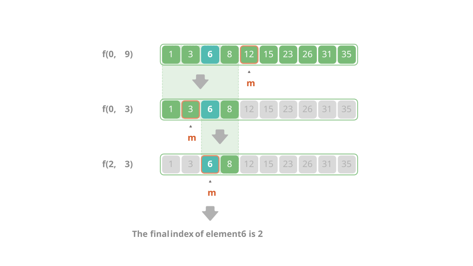

# 12.2 &nbsp; Divide-and-conquer search

As we have seen, search algorithms fall into two broad categories.

- **Brute-force search** traverses the data structure and takes $O(n)$ time.
- **Adaptive search** exploits the way the data is organized or uses prior information. It can take as little as $O(\log n)$ or even $O(1)$ time.

In fact, **search algorithms that run in $O(\log n)$ time commonly use divide and conquer**. Examples include binary search and searches in trees.

- At each step, binary search reduces the problem of searching an array to that of searching one half of it. This continues until the search interval is empty or the target is found.
- Trees illustrate divide and conquer. In data structures such as binary search trees, AVL trees, and heaps, the various operations all take $O(\log n)$ time.

Here is how binary search uses divide and conquer.

- **The problem can be divided**. Comparing the middle element with the target recursively reduces a search of the whole array to a search of one half.
- **The subproblems are independent**. Each round of binary search handles just one subproblem, independently of the others.
- **There are no subproblem results to combine**. Binary search looks for a single element. Solving the remaining subproblem also solves the original problem.

Divide and conquer speeds up search because a brute-force scan rules out only one candidate per step, **whereas divide-and-conquer search can rule out half the candidates at once**.

### 1. &nbsp; Implementing binary search with divide and conquer

In an earlier chapter, we implemented binary search iteratively. Now we will implement it recursively using divide and conquer.

!!! question

    Given a sorted array `nums` of length $n$ with distinct elements, find `target`.

Let $f(i, j)$ denote the subproblem of searching the closed interval $[i, j]$.

Start with the original problem $f(0, n-1)$ and perform binary search as follows.

1. Compute the midpoint $m$ of the search interval $[i, j]$ and use it to rule out half the interval.
2. Recursively solve the subproblem on the remaining half, either $f(i, m-1)$ or $f(m+1, j)$.
3. Repeat steps `1.` and `2.` until you find `target` or the interval is empty, then return.

The figure traces this divide-and-conquer search for $6$ in an array.

{ class="animation-figure" }

<p align="center"> Figure 12-4 &nbsp; Divide and conquer in binary search </p>

The implementation defines a recursive function `dfs()` to solve $f(i, j)$:

=== "Python"

    ```python title="binary_search_recur.py"
    def dfs(nums: list[int], target: int, i: int, j: int) -> int:
        """Binary search: problem f(i, j)"""
        # An empty interval contains no target, so return -1
        if i > j:
            return -1
        # Compute the middle index m
        m = (i + j) // 2
        if nums[m] < target:
            # Recursively solve f(m+1, j)
            return dfs(nums, target, m + 1, j)
        elif nums[m] > target:
            # Recursively solve f(i, m-1)
            return dfs(nums, target, i, m - 1)
        else:
            # Target found: return its index
            return m

    def binary_search(nums: list[int], target: int) -> int:
        """Binary search"""
        n = len(nums)
        # Solve f(0, n-1)
        return dfs(nums, target, 0, n - 1)
    ```

=== "C++"

    ```cpp title="binary_search_recur.cpp"
    /* Binary search: problem f(i, j) */
    int dfs(vector<int> &nums, int target, int i, int j) {
        // An empty interval contains no target, so return -1
        if (i > j) {
            return -1;
        }
        // Compute the middle index m
        int m = (i + j) / 2;
        if (nums[m] < target) {
            // Recursively solve f(m+1, j)
            return dfs(nums, target, m + 1, j);
        } else if (nums[m] > target) {
            // Recursively solve f(i, m-1)
            return dfs(nums, target, i, m - 1);
        } else {
            // Target found: return its index
            return m;
        }
    }

    /* Binary search */
    int binarySearch(vector<int> &nums, int target) {
        int n = nums.size();
        // Solve f(0, n-1)
        return dfs(nums, target, 0, n - 1);
    }
    ```

=== "Java"

    ```java title="binary_search_recur.java"
    /* Binary search: problem f(i, j) */
    int dfs(int[] nums, int target, int i, int j) {
        // An empty interval contains no target, so return -1
        if (i > j) {
            return -1;
        }
        // Compute the middle index m
        int m = (i + j) / 2;
        if (nums[m] < target) {
            // Recursively solve f(m+1, j)
            return dfs(nums, target, m + 1, j);
        } else if (nums[m] > target) {
            // Recursively solve f(i, m-1)
            return dfs(nums, target, i, m - 1);
        } else {
            // Target found: return its index
            return m;
        }
    }

    /* Binary search */
    int binarySearch(int[] nums, int target) {
        int n = nums.length;
        // Solve f(0, n-1)
        return dfs(nums, target, 0, n - 1);
    }
    ```

=== "C#"

    ```csharp title="binary_search_recur.cs"
    /* Binary search: problem f(i, j) */
    int DFS(int[] nums, int target, int i, int j) {
        // An empty interval contains no target, so return -1
        if (i > j) {
            return -1;
        }
        // Compute the middle index m
        int m = (i + j) / 2;
        if (nums[m] < target) {
            // Recursively solve f(m+1, j)
            return DFS(nums, target, m + 1, j);
        } else if (nums[m] > target) {
            // Recursively solve f(i, m-1)
            return DFS(nums, target, i, m - 1);
        } else {
            // Target found: return its index
            return m;
        }
    }

    /* Binary search */
    int BinarySearch(int[] nums, int target) {
        int n = nums.Length;
        // Solve f(0, n-1)
        return DFS(nums, target, 0, n - 1);
    }
    ```

=== "Go"

    ```go title="binary_search_recur.go"
    /* Binary search: problem f(i, j) */
    func dfs(nums []int, target, i, j int) int {
        // An empty interval contains no target, so return -1
        if i > j {
            return -1
        }
        //    Compute the middle index
        m := i + ((j - i) >> 1)
        //Compare the middle element with the target
        if nums[m] < target {
            // If smaller, search the right half recursively
            // Recursively solve f(m+1, j)
            return dfs(nums, target, m+1, j)
        } else if nums[m] > target {
            // If larger, search the left half recursively
            // Recursively solve f(i, m-1)
            return dfs(nums, target, i, m-1)
        } else {
            // Target found: return its index
            return m
        }
    }

    /* Binary search */
    func binarySearch(nums []int, target int) int {
        n := len(nums)
        return dfs(nums, target, 0, n-1)
    }
    ```

=== "Swift"

    ```swift title="binary_search_recur.swift"
    /* Binary search: problem f(i, j) */
    func dfs(nums: [Int], target: Int, i: Int, j: Int) -> Int {
        // An empty interval contains no target, so return -1
        if i > j {
            return -1
        }
        // Compute the middle index m
        let m = (i + j) / 2
        if nums[m] < target {
            // Recursively solve f(m+1, j)
            return dfs(nums: nums, target: target, i: m + 1, j: j)
        } else if nums[m] > target {
            // Recursively solve f(i, m-1)
            return dfs(nums: nums, target: target, i: i, j: m - 1)
        } else {
            // Target found: return its index
            return m
        }
    }

    /* Binary search */
    func binarySearch(nums: [Int], target: Int) -> Int {
        // Solve f(0, n-1)
        dfs(nums: nums, target: target, i: nums.startIndex, j: nums.endIndex - 1)
    }
    ```

=== "JS"

    ```javascript title="binary_search_recur.js"
    /* Binary search: problem f(i, j) */
    function dfs(nums, target, i, j) {
        // An empty interval contains no target, so return -1
        if (i > j) {
            return -1;
        }
        // Compute the middle index m
        const m = i + ((j - i) >> 1);
        if (nums[m] < target) {
            // Recursively solve f(m+1, j)
            return dfs(nums, target, m + 1, j);
        } else if (nums[m] > target) {
            // Recursively solve f(i, m-1)
            return dfs(nums, target, i, m - 1);
        } else {
            // Target found: return its index
            return m;
        }
    }

    /* Binary search */
    function binarySearch(nums, target) {
        const n = nums.length;
        // Solve f(0, n-1)
        return dfs(nums, target, 0, n - 1);
    }
    ```

=== "TS"

    ```typescript title="binary_search_recur.ts"
    /* Binary search: problem f(i, j) */
    function dfs(nums: number[], target: number, i: number, j: number): number {
        // An empty interval contains no target, so return -1
        if (i > j) {
            return -1;
        }
        // Compute the middle index m
        const m = i + ((j - i) >> 1);
        if (nums[m] < target) {
            // Recursively solve f(m+1, j)
            return dfs(nums, target, m + 1, j);
        } else if (nums[m] > target) {
            // Recursively solve f(i, m-1)
            return dfs(nums, target, i, m - 1);
        } else {
            // Target found: return its index
            return m;
        }
    }

    /* Binary search */
    function binarySearch(nums: number[], target: number): number {
        const n = nums.length;
        // Solve f(0, n-1)
        return dfs(nums, target, 0, n - 1);
    }
    ```

=== "Dart"

    ```dart title="binary_search_recur.dart"
    /* Binary search: problem f(i, j) */
    int dfs(List<int> nums, int target, int i, int j) {
      // An empty interval contains no target, so return -1
      if (i > j) {
        return -1;
      }
      // Compute the middle index m
      int m = (i + j) ~/ 2;
      if (nums[m] < target) {
        // Recursively solve f(m+1, j)
        return dfs(nums, target, m + 1, j);
      } else if (nums[m] > target) {
        // Recursively solve f(i, m-1)
        return dfs(nums, target, i, m - 1);
      } else {
        // Target found: return its index
        return m;
      }
    }

    /* Binary search */
    int binarySearch(List<int> nums, int target) {
      int n = nums.length;
      // Solve f(0, n-1)
      return dfs(nums, target, 0, n - 1);
    }
    ```

=== "Rust"

    ```rust title="binary_search_recur.rs"
    /* Binary search: problem f(i, j) */
    fn dfs(nums: &[i32], target: i32, i: i32, j: i32) -> i32 {
        // An empty interval contains no target, so return -1
        if i > j {
            return -1;
        }
        let m: i32 = i + (j - i) / 2;
        if nums[m as usize] < target {
            // Recursively solve f(m+1, j)
            return dfs(nums, target, m + 1, j);
        } else if nums[m as usize] > target {
            // Recursively solve f(i, m-1)
            return dfs(nums, target, i, m - 1);
        } else {
            // Target found: return its index
            return m;
        }
    }

    /* Binary search */
    fn binary_search(nums: &[i32], target: i32) -> i32 {
        let n = nums.len() as i32;
        // Solve f(0, n-1)
        dfs(nums, target, 0, n - 1)
    }
    ```

=== "C"

    ```c title="binary_search_recur.c"
    /* Binary search: problem f(i, j) */
    int dfs(int nums[], int target, int i, int j) {
        // An empty interval contains no target, so return -1
        if (i > j) {
            return -1;
        }
        // Compute the middle index m
        int m = (i + j) / 2;
        if (nums[m] < target) {
            // Recursively solve f(m+1, j)
            return dfs(nums, target, m + 1, j);
        } else if (nums[m] > target) {
            // Recursively solve f(i, m-1)
            return dfs(nums, target, i, m - 1);
        } else {
            // Target found: return its index
            return m;
        }
    }

    /* Binary search */
    int binarySearch(int nums[], int target, int numsSize) {
        int n = numsSize;
        // Solve f(0, n-1)
        return dfs(nums, target, 0, n - 1);
    }
    ```

=== "Kotlin"

    ```kotlin title="binary_search_recur.kt"
    /* Binary search: problem f(i, j) */
    fun dfs(
        nums: IntArray,
        target: Int,
        i: Int,
        j: Int
    ): Int {
        // An empty interval contains no target, so return -1
        if (i > j) {
            return -1
        }
        // Compute the middle index m
        val m = (i + j) / 2
        return if (nums[m] < target) {
            // Recursively solve f(m+1, j)
            dfs(nums, target, m + 1, j)
        } else if (nums[m] > target) {
            // Recursively solve f(i, m-1)
            dfs(nums, target, i, m - 1)
        } else {
            // Target found: return its index
            m
        }
    }

    /* Binary search */
    fun binarySearch(nums: IntArray, target: Int): Int {
        val n = nums.size
        // Solve f(0, n-1)
        return dfs(nums, target, 0, n - 1)
    }
    ```

=== "Ruby"

    ```ruby title="binary_search_recur.rb"
    ### Binary search: problem f(i, j) ###
    def dfs(nums, target, i, j)
      # An empty interval contains no target, so return -1
      return -1 if i > j
      
      # Compute the middle index m
      m = (i + j) / 2

      if nums[m] < target
        # Recursively solve f(m+1, j)
        return dfs(nums, target, m + 1, j)
      elsif nums[m] > target
        # Recursively solve f(i, m-1)
        return dfs(nums, target, i, m - 1)
      else
        # Target found: return its index
        return m
      end
    end

    ### Binary search ###
    def binary_search(nums, target)
      n = nums.length
      # Solve f(0, n-1)
      dfs(nums, target, 0, n - 1)
    end
    ```

??? pythontutor "Visualize execution"

    <div style="height: 549px; width: 100%;"><iframe class="pythontutor-iframe" title="Visualize execution" src="https://pythontutor.com/iframe-embed.html#code=def%20dfs%28nums%3A%20list%5Bint%5D,%20target%3A%20int,%20i%3A%20int,%20j%3A%20int%29%20-%3E%20int%3A%0A%20%20%20%20%22%22%22Binary%20search%3A%20problem%20f%28i,%20j%29%22%22%22%0A%20%20%20%20%23%20An%20empty%20interval%20contains%20no%20target,%20so%20return%20-1%0A%20%20%20%20if%20i%20%3E%20j%3A%0A%20%20%20%20%20%20%20%20return%20-1%0A%20%20%20%20%23%20Compute%20the%20middle%20index%20m%0A%20%20%20%20m%20%3D%20%28i%20%2B%20j%29%20//%202%0A%20%20%20%20if%20nums%5Bm%5D%20%3C%20target%3A%0A%20%20%20%20%20%20%20%20%23%20Recursively%20solve%20f%28m%2B1,%20j%29%0A%20%20%20%20%20%20%20%20return%20dfs%28nums,%20target,%20m%20%2B%201,%20j%29%0A%20%20%20%20elif%20nums%5Bm%5D%20%3E%20target%3A%0A%20%20%20%20%20%20%20%20%23%20Recursively%20solve%20f%28i,%20m-1%29%0A%20%20%20%20%20%20%20%20return%20dfs%28nums,%20target,%20i,%20m%20-%201%29%0A%20%20%20%20else%3A%0A%20%20%20%20%20%20%20%20%23%20Target%20found%3A%20return%20its%20index%0A%20%20%20%20%20%20%20%20return%20m%0A%0Adef%20binary_search%28nums%3A%20list%5Bint%5D,%20target%3A%20int%29%20-%3E%20int%3A%0A%20%20%20%20%22%22%22Binary%20search%22%22%22%0A%20%20%20%20n%20%3D%20len%28nums%29%0A%20%20%20%20%23%20Solve%20f%280,%20n-1%29%0A%20%20%20%20return%20dfs%28nums,%20target,%200,%20n%20-%201%29%0A%0A%22%22%22Driver%20Code%22%22%22%0Aif%20__name__%20%3D%3D%20%22__main__%22%3A%0A%20%20%20%20target%20%3D%206%0A%20%20%20%20nums%20%3D%20%5B1,%203,%206,%208,%2012,%2015,%2023,%2026,%2031,%2035%5D%0A%0A%20%20%20%20%23%20Binary%20search%20%28closed%20interval%29%0A%20%20%20%20index%20%3D%20binary_search%28nums,%20target%29%0A%20%20%20%20print%28%22Index%20of%20target%206%20%3D%20%22,%20index%29&codeDivHeight=472&codeDivWidth=350&cumulative=false&curInstr=6&heapPrimitives=nevernest&origin=opt-frontend.js&py=311&rawInputLstJSON=%5B%5D&textReferences=false"> </iframe></div>
    <div style="margin-top: 5px;"><a href="https://pythontutor.com/iframe-embed.html#code=def%20dfs%28nums%3A%20list%5Bint%5D,%20target%3A%20int,%20i%3A%20int,%20j%3A%20int%29%20-%3E%20int%3A%0A%20%20%20%20%22%22%22Binary%20search%3A%20problem%20f%28i,%20j%29%22%22%22%0A%20%20%20%20%23%20An%20empty%20interval%20contains%20no%20target,%20so%20return%20-1%0A%20%20%20%20if%20i%20%3E%20j%3A%0A%20%20%20%20%20%20%20%20return%20-1%0A%20%20%20%20%23%20Compute%20the%20middle%20index%20m%0A%20%20%20%20m%20%3D%20%28i%20%2B%20j%29%20//%202%0A%20%20%20%20if%20nums%5Bm%5D%20%3C%20target%3A%0A%20%20%20%20%20%20%20%20%23%20Recursively%20solve%20f%28m%2B1,%20j%29%0A%20%20%20%20%20%20%20%20return%20dfs%28nums,%20target,%20m%20%2B%201,%20j%29%0A%20%20%20%20elif%20nums%5Bm%5D%20%3E%20target%3A%0A%20%20%20%20%20%20%20%20%23%20Recursively%20solve%20f%28i,%20m-1%29%0A%20%20%20%20%20%20%20%20return%20dfs%28nums,%20target,%20i,%20m%20-%201%29%0A%20%20%20%20else%3A%0A%20%20%20%20%20%20%20%20%23%20Target%20found%3A%20return%20its%20index%0A%20%20%20%20%20%20%20%20return%20m%0A%0Adef%20binary_search%28nums%3A%20list%5Bint%5D,%20target%3A%20int%29%20-%3E%20int%3A%0A%20%20%20%20%22%22%22Binary%20search%22%22%22%0A%20%20%20%20n%20%3D%20len%28nums%29%0A%20%20%20%20%23%20Solve%20f%280,%20n-1%29%0A%20%20%20%20return%20dfs%28nums,%20target,%200,%20n%20-%201%29%0A%0A%22%22%22Driver%20Code%22%22%22%0Aif%20__name__%20%3D%3D%20%22__main__%22%3A%0A%20%20%20%20target%20%3D%206%0A%20%20%20%20nums%20%3D%20%5B1,%203,%206,%208,%2012,%2015,%2023,%2026,%2031,%2035%5D%0A%0A%20%20%20%20%23%20Binary%20search%20%28closed%20interval%29%0A%20%20%20%20index%20%3D%20binary_search%28nums,%20target%29%0A%20%20%20%20print%28%22Index%20of%20target%206%20%3D%20%22,%20index%29&codeDivHeight=800&codeDivWidth=600&cumulative=false&curInstr=6&heapPrimitives=nevernest&origin=opt-frontend.js&py=311&rawInputLstJSON=%5B%5D&textReferences=false" target="_blank" rel="noopener noreferrer">View full screen ></a></div>
