# Reconstructing a binary tree

!!! question

    Given a binary tree’s preorder traversal `preorder` and inorder traversal `inorder`, reconstruct the tree and return its root. Assume all nodes have distinct values, as in the figure below.

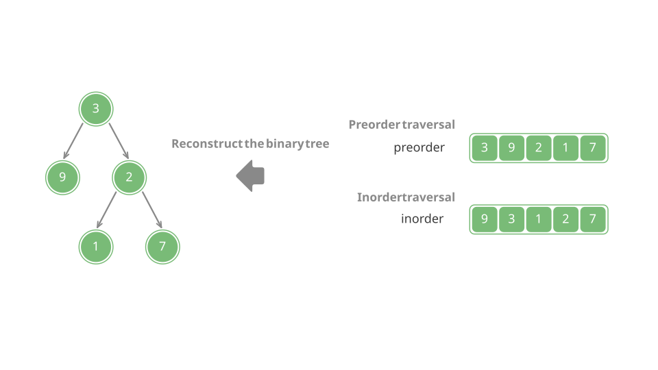

### Does the problem suit divide and conquer?

Reconstructing a binary tree from `preorder` and `inorder` is a classic divide-and-conquer problem.

- **The problem can be divided**. Initialize the root and split the remaining work into two subproblems: building the left and right subtrees. Apply the same split recursively to each subtree until the subproblem is an empty subtree.
- **The subproblems are independent**. The left and right subtrees share no nodes. Building the left subtree requires only its segments of the inorder and preorder traversals. The same holds for the right subtree.
- **The subproblem solutions can be combined**. Once we have built the left and right subtrees, attach them to the root to obtain the solution to the original problem.

### Separating the subtrees

We know that divide and conquer applies, but **how can we identify the left and right subtrees in the preorder traversal `preorder` and inorder traversal `inorder`**?

By definition, both `preorder` and `inorder` consist of three parts.

- Preorder: `[ root | left subtree | right subtree ]`. For the tree above, this gives `[ 3 | 9 | 2 1 7 ]`.
- Inorder: `[ left subtree | root | right subtree ]`. For the tree above, this gives `[ 9 | 3 | 1 2 7 ]`.

Using the data above, follow the steps in the next figure to split the traversals.

1. The first element of the preorder traversal, 3, is the root value.
2. Find the index of root 3 in `inorder`. Use this index to split `inorder` into `[ 9 | 3 | 1 2 7 ]`.
3. The split in `inorder` tells us that the left subtree has one node and the right subtree has three. We can therefore split `preorder` into `[ 3 | 9 | 2 1 7 ]`.

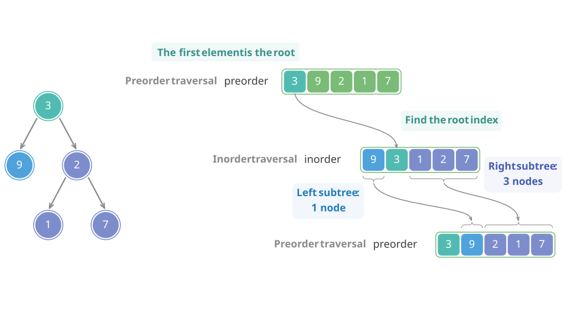

### Representing subtree ranges with variables

The split gives us **the index ranges for the root and both subtrees in `preorder` and `inorder`**. A few index variables are enough to describe those ranges.

- Let $i$ be the index of the current tree’s root in `preorder`.
- Let $m$ be the index of the current tree’s root in `inorder`.
- Let $[l, r]$ be the index range of the current tree in `inorder`.

As the table shows, these variables identify the root’s index in `preorder` and each subtree’s index range in `inorder`.

<p align="center"> Table <id> &nbsp; Root and subtree indices in preorder and inorder traversals </p>

|        | Root index in `preorder` | Subtree index range in `inorder` |
| ------ | ---------------------------- | ----------------------------- |
| Current tree | $i$                          | $[l, r]$                      |
| Left subtree | $i + 1$                      | $[l, m-1]$                    |
| Right subtree | $i + 1 + (m - l)$            | $[m+1, r]$                    |

In the index for the root of the right subtree, $(m-l)$ is the number of nodes in the left subtree. The figure illustrates this offset.

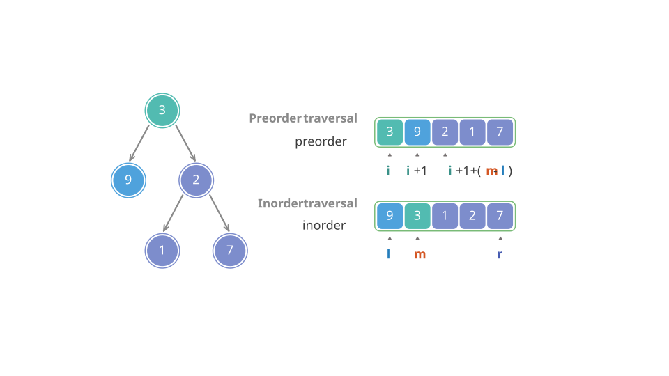

### Implementation

To look up $m$ efficiently, use a hash table `hmap` that maps each element of `inorder` to its index:

```src
[file]{build_tree}-[class]{}-[func]{build_tree}
```

The figure shows how recursion builds the binary tree. Each node is created as its call descends, and each edge (reference) is established as a call returns.

=== "<1>"
    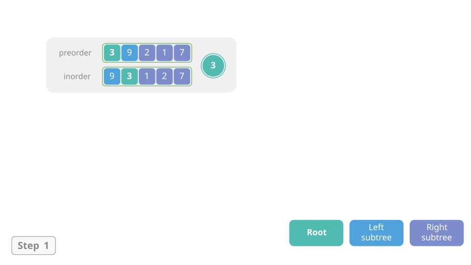

=== "<2>"
    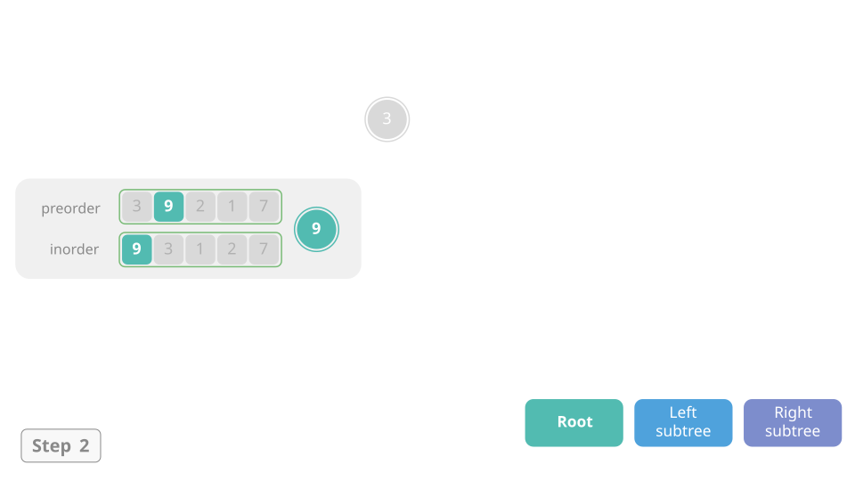

=== "<3>"
    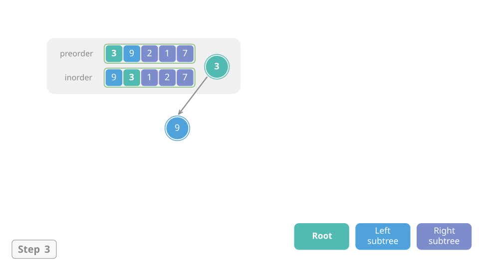

=== "<4>"
    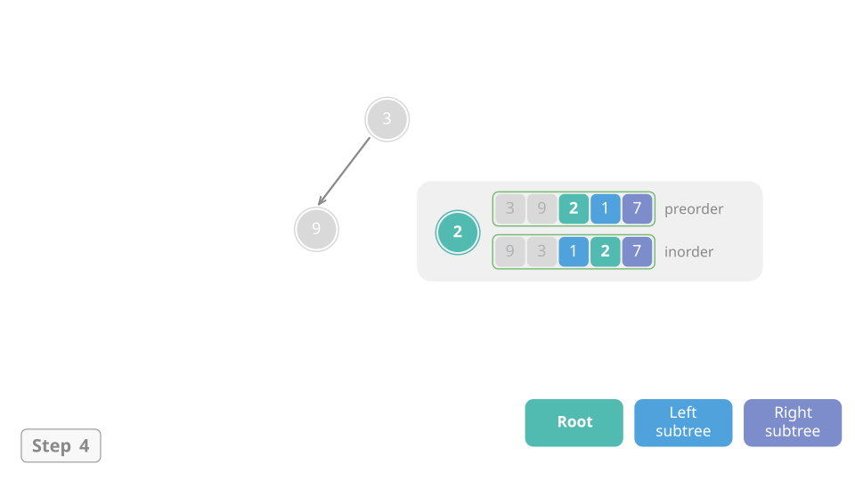

=== "<5>"
    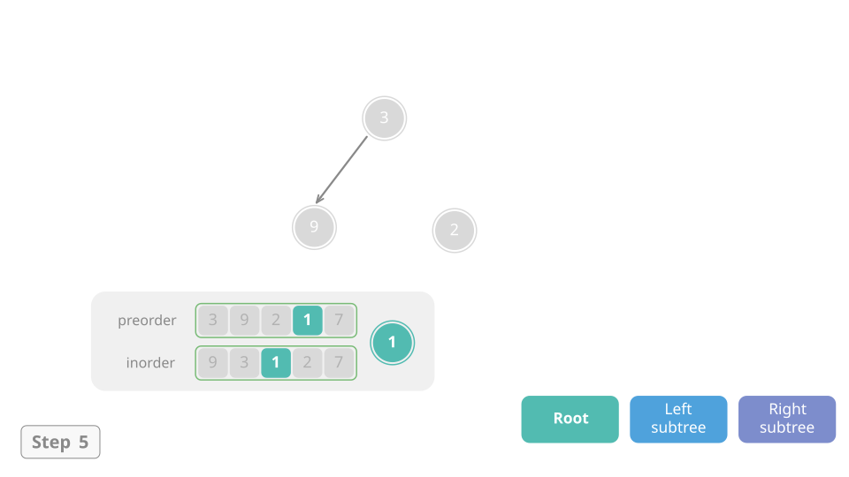

=== "<6>"
    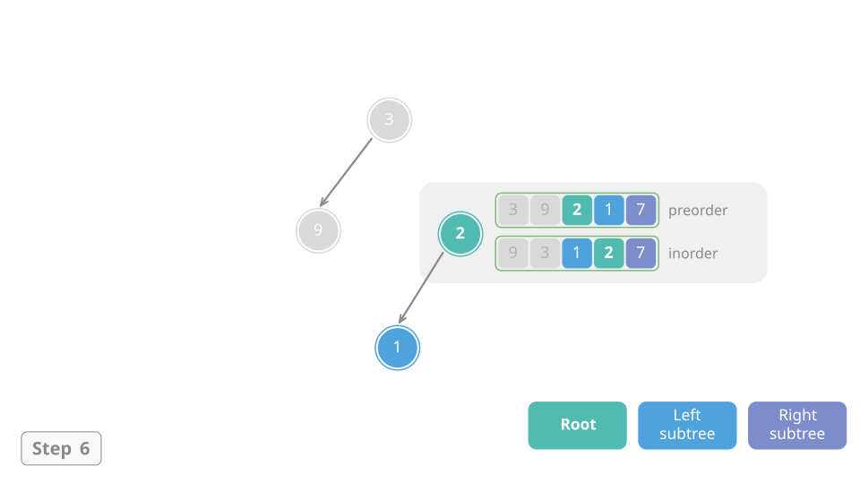

=== "<7>"
    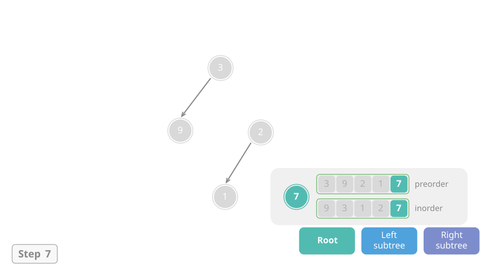

=== "<8>"
    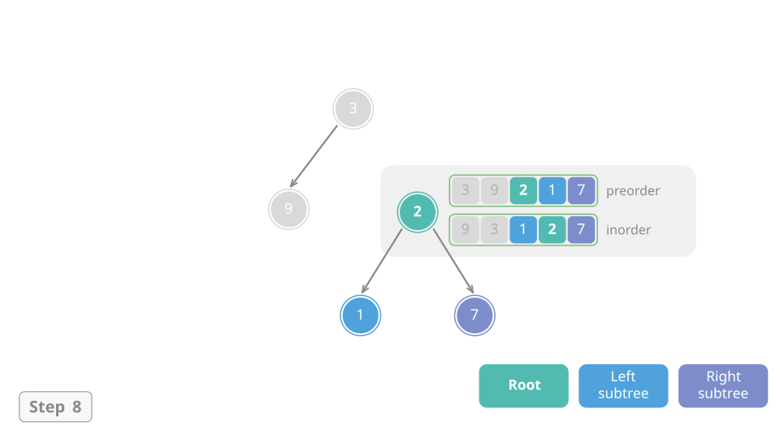

=== "<9>"
    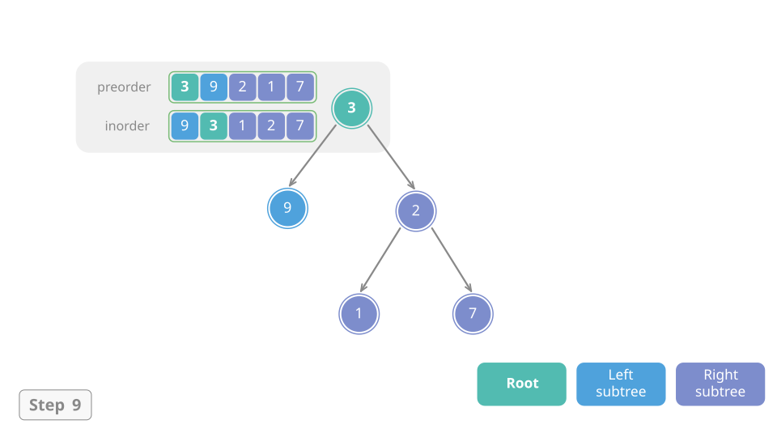

The figure below shows how each recursive call splits the preorder traversal `preorder` and the inorder traversal `inorder`.

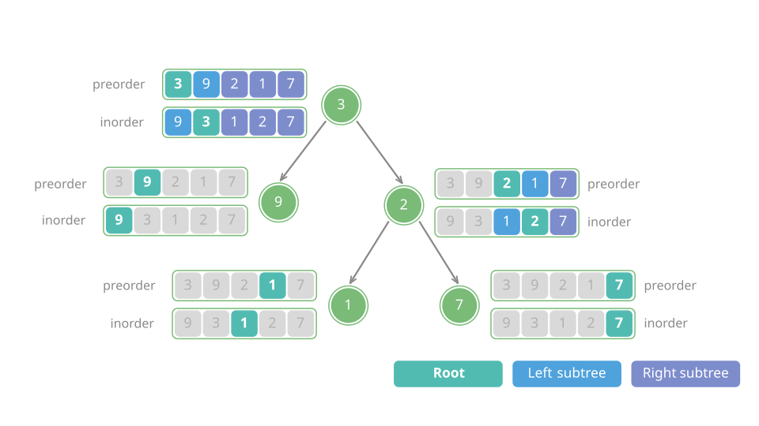

Let $n$ be the number of nodes. Initializing one node in a call to `dfs()` takes $O(1)$ time. **The overall time complexity is therefore $O(n)$**.

The hash table maps values in `inorder` to indices and takes $O(n)$ space. In the worst case, the binary tree degenerates into a linked list. The recursion depth reaches $n$, requiring $O(n)$ space for stack frames. **The overall space complexity is therefore $O(n)$**.
