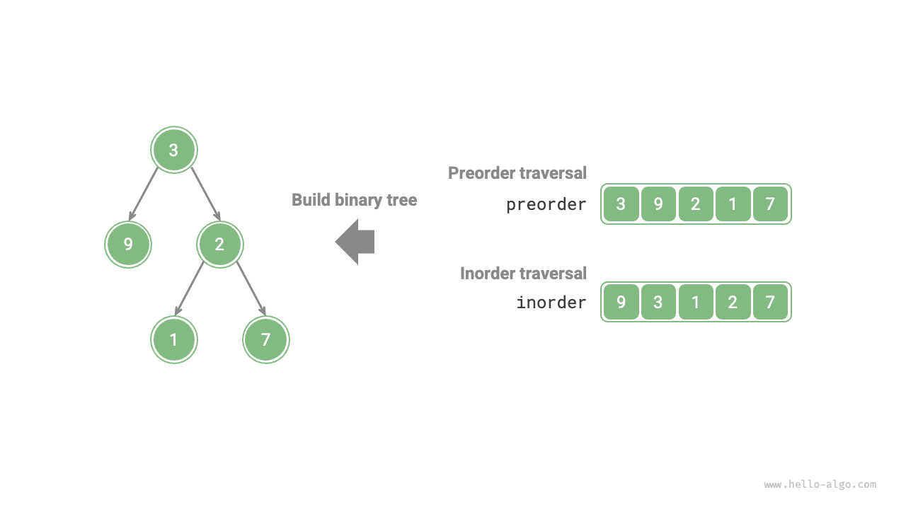
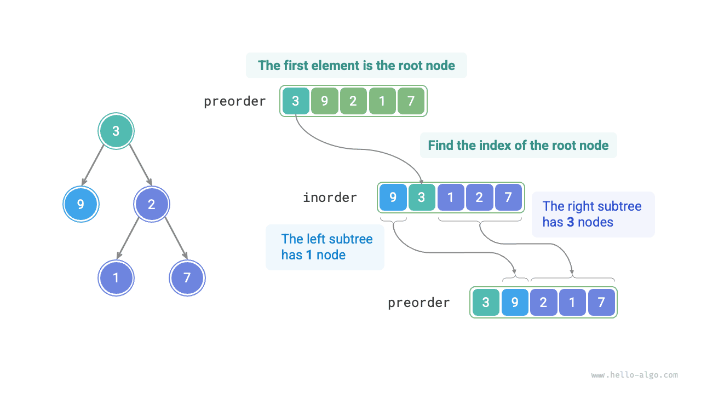
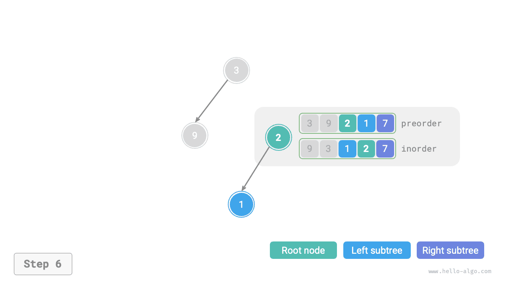

# Building a binary tree

!!! question

    Given a binary tree's preorder traversal `preorder` and inorder traversal `inorder`, reconstruct the tree and return its root node. Assume that all node values are distinct, as shown in the figure below.



### Identifying a divide-and-conquer problem

Reconstructing a binary tree from `preorder` and `inorder` is a typical divide-and-conquer problem.

- **The problem can be divided**: We can split the original problem into two subproblems, building the left subtree and building the right subtree, plus one operation: initializing the root node. Each subtree can be divided in the same way into smaller subtrees, until we reach the smallest subproblem, an empty subtree.
- **The subproblems are independent**: The left and right subtrees are independent and do not overlap. To build the left subtree, we need only the portions of the preorder and inorder traversals corresponding to it. The same applies to the right subtree.
- **The subproblem solutions can be combined**: Once we have built the left and right subtrees, we can attach them to the root to obtain the solution to the original problem.

### Dividing the subtrees

The analysis above shows that divide and conquer applies, **but how do we use `preorder` and `inorder` to separate the left and right subtrees**?

By definition, both `preorder` and `inorder` consist of three parts.

- Preorder: `[ root | left subtree | right subtree ]`. For the tree above, this is `[ 3 | 9 | 2 1 7 ]`.
- Inorder: `[ left subtree | root | right subtree ]`. For the tree above, this is `[ 9 | 3 | 1 2 7 ]`.

Using the example above, we can divide the traversals with the steps shown in the figure below.

1. The first element in the preorder traversal, 3, is the root value.
2. Find the index of root value 3 in `inorder`, then use it to divide `inorder` into `[ 9 | 3 | 1 2 7 ]`.
3. This division of `inorder` tells us that the left and right subtrees have 1 and 3 nodes, respectively, allowing us to divide `preorder` into `[ 3 | 9 | 2 1 7 ]`.



### Describing subtree intervals with variables

Using this method, **we have identified the index intervals for the root, left subtree, and right subtree in `preorder` and `inorder`**. We need a few pointer variables to describe these intervals.

- Let $i$ be the index of the current tree's root in `preorder`.
- Let $m$ be the index of the current tree's root in `inorder`.
- Let $[l, r]$ be the interval occupied by the current tree in `inorder`.

As shown in the table below, these variables describe the root index in `preorder` and each subtree's interval in `inorder`.

<p align="center"> Table <id> &nbsp; Root and subtree indices in preorder and inorder traversals </p>

|        | Root index in `preorder` | Subtree interval in `inorder` |
| ------ | ---------------------------- | ----------------------------- |
| Current tree | $i$                          | $[l, r]$                      |
| Left subtree | $i + 1$                      | $[l, m-1]$                    |
| Right subtree | $i + 1 + (m - l)$            | $[m+1, r]$                    |

The term $(m-l)$ in the right subtree's root index is the number of nodes in the left subtree. The figure below helps illustrate this.


### Code implementation

To find $m$ efficiently, we use a hash table `hmap` mapping each element of `inorder` to its index:

```src
[file]{build_tree}-[class]{}-[func]{build_tree}
```

The figure below shows the recursive reconstruction process. Nodes are created during recursive descent, while edges (references) are established as the recursive calls return.

=== "<1>"
    

=== "<2>"
    

=== "<3>"
    

=== "<4>"
    

=== "<5>"
    

=== "<6>"
    

=== "<7>"
    

=== "<8>"
    

=== "<9>"
    

The figure below shows how `preorder` and `inorder` are divided in each recursive call.


For a tree with $n$ nodes, initializing each node (executing one call to `dfs()`) takes $O(1)$ time. **The overall time complexity is therefore $O(n)$**.

The hash table maps `inorder` elements to indices, requiring $O(n)$ space. In the worst case, the binary tree degenerates into a linked list, and the recursion depth reaches $n$, using $O(n)$ space for stack frames. **The overall space complexity is therefore $O(n)$**.
