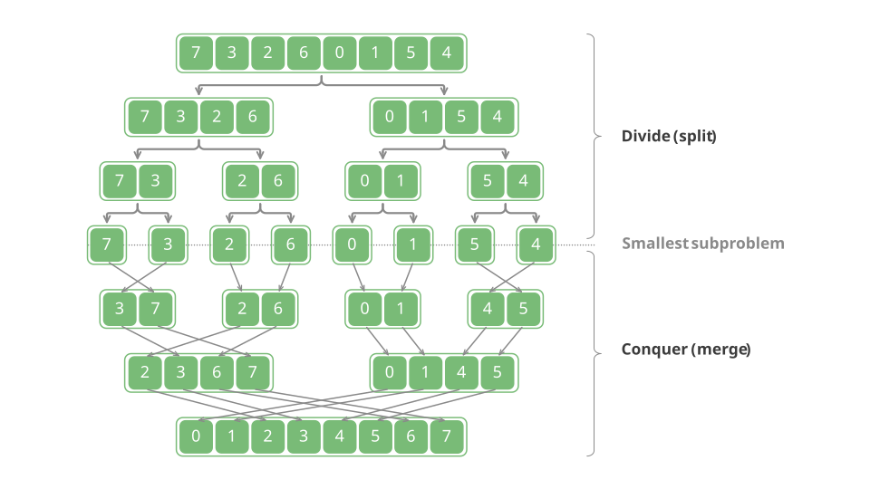
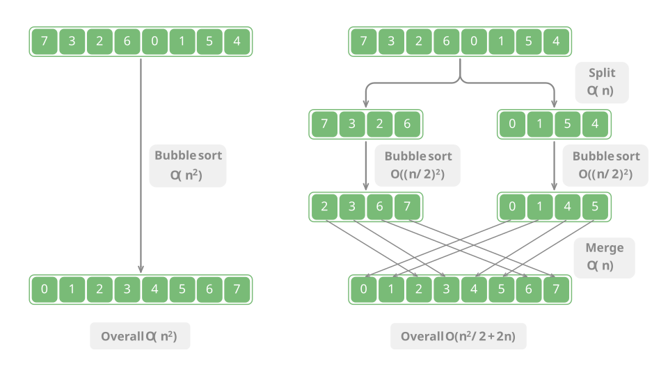
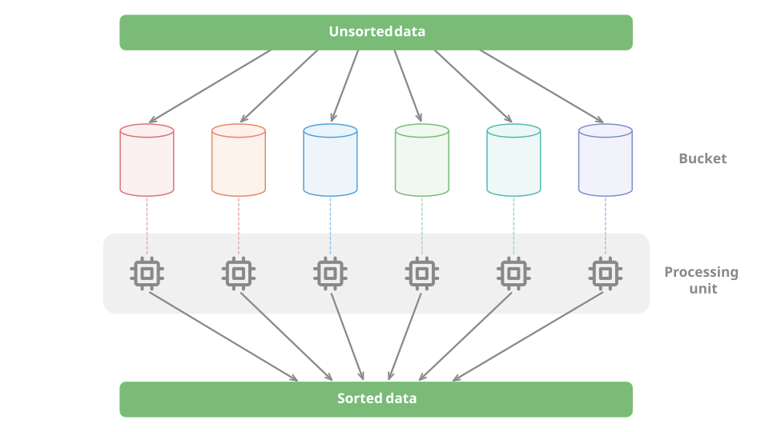

# 12.1 &nbsp; Divide-and-conquer algorithms

<u>Divide and conquer</u> is an important and widely used algorithmic strategy. It is usually implemented recursively and has two stages: divide and conquer.

1. **Divide (split)**: Recursively break the problem into two or more subproblems until you reach the smallest subproblems.
2. **Conquer (combine)**: Start with the known solutions of the smallest subproblems and combine them from the bottom up to solve the original problem.

Merge sort is a classic example of divide and conquer, as the figure shows.

1. **Divide**: Recursively split the original array (the problem) into two subarrays (subproblems) until each subarray has just one element (the smallest subproblem).
2. **Conquer**: Merge the sorted subarrays (subproblem solutions) from the bottom up to obtain the sorted version of the original array (the solution).

{ class="animation-figure" }

 Figure 12-1 &nbsp; Divide and conquer in merge sort 

## 12.1.1 &nbsp; Recognizing a divide-and-conquer problem

The following criteria can help you decide whether divide and conquer suits a problem.

1. **The problem can be divided**. The original problem splits into smaller problems of the same kind, which can be divided recursively in the same way.
2. **The subproblems are independent**. They do not overlap or depend on each other, so they can be solved separately.
3. **The subproblem solutions can be combined**. Combining them gives a solution to the original problem.

Merge sort meets all three criteria.

1. **The problem can be divided**. Recursively split the array (the original problem) into two subarrays (subproblems).
2. **The subproblems are independent**. Each subarray can be sorted on its own, so each subproblem can be solved independently.
3. **The subproblem solutions can be combined**. Merge the two sorted subarrays (the subproblem solutions) into one sorted array (the solution to the original problem).

## 12.1.2 &nbsp; Improving efficiency with divide and conquer

**Divide and conquer can both solve a problem and make the algorithm more efficient**. Quicksort, merge sort, and heapsort use divide and conquer, which helps explain why they are faster than selection sort, bubble sort, and insertion sort.

**Why can divide and conquer improve efficiency**? Why should splitting a problem, solving the pieces, and combining their results take less work than solving it directly? We can look at this from two angles: operation counts and parallel computation.

### 1. &nbsp; Reducing the number of operations

Bubble sort takes $O(n^2)$ time on an array of length $n$. Suppose we split the array at its midpoint, as shown below. Splitting takes $O(n)$ time, sorting each half takes $O((n / 2)^2)$ time, and merging the two halves takes $O(n)$ time. The overall time complexity is:

$$
O(n + (\frac{n}{2})^2 \times 2 + n) = O(\frac{n^2}{2} + 2n)
$$

{ class="animation-figure" }

 Figure 12-2 &nbsp; Bubble sort before and after splitting the array 

Now solve the following inequality. The left side counts operations before the split, and the right side counts them after the split:

$$
\begin{aligned}
n^2 & > \frac{n^2}{2} + 2n \newline
n^2 - \frac{n^2}{2} - 2n & > 0 \newline
n(n - 4) & > 0
\end{aligned}
$$

**When $n > 4$, splitting reduces the operation count and should make the sort faster**. Its time complexity is still quadratic, $O(n^2)$, but the constant factor is smaller.

What if **we keep splitting each subarray in half** until every subarray contains just one element? This gives us merge sort, with time complexity $O(n \log n)$.

What if **we use more split points** and divide the array evenly into $k$ subarrays? This resembles bucket sort, which is well suited to large datasets and can achieve $O(n + k)$ time in theory.

### 2. &nbsp; Speeding up computation with parallelism

Divide and conquer produces independent subproblems, **so we can usually solve them in parallel**. Besides reducing time complexity, divide and conquer **gives the operating system opportunities to parallelize the work**.

Parallelism is especially effective on multicore or multiprocessor systems. Processing several subproblems at once makes fuller use of computing resources and can substantially reduce total running time.

For example, the bucket sort below distributes a large dataset evenly among buckets. We can assign different buckets to different processing units for sorting and merge the results afterward.

{ class="animation-figure" }

 Figure 12-3 &nbsp; Parallel computation in bucket sort 

## 12.1.3 &nbsp; Common applications of divide and conquer

Divide and conquer solves many classic algorithmic problems.

- **Closest pair of points**: Split the points into two sets, find the closest pair within each, and then find the closest pair that spans the split.
- **Large integer multiplication**: The Karatsuba algorithm, for example, breaks multiplication of large integers into multiplications and additions of smaller integers.
- **Matrix multiplication**: Strassen’s algorithm, for example, breaks multiplication of large matrices into multiplications and additions of smaller matrices.
- **Tower of Hanoi**: The puzzle has a recursive solution that illustrates divide and conquer.
- **Finding inversions**: Two values form an inversion if the earlier value in a sequence is greater than the later one. Merge sort gives us a divide-and-conquer approach to finding inversions.

Divide and conquer also appears throughout the design of algorithms and data structures.

- **Binary search**: Split a sorted array at the middle index. Compare the target with the middle element to decide which half to discard, then repeat the operation on the remaining interval.
- **Merge sort**: We saw how this works at the beginning of the section.
- **Quicksort**: Choose a pivot and partition the array into two subarrays, one containing values smaller than the pivot and the other values larger than the pivot. Repeat the partitioning until only one element remains in each subarray.
- **Bucket sort**: Distribute the data among several buckets, sort each bucket, and take the elements out in bucket order to obtain a sorted array.
- **Trees**: Search, insertion, and deletion in binary search trees, AVL trees, red-black trees, B-trees, and B+ trees can all be viewed as applications of divide and conquer.
- **Heaps**: A heap is a special kind of complete binary tree. Operations such as insertion, deletion, and heapification also implicitly use divide and conquer.
- **Hash tables**: Some collision-resolution schemes use divide and conquer indirectly. For example, a hash table that uses chaining may turn a long chain into a red-black tree to speed up lookups.

As these examples show, **divide and conquer often works quietly in the background** of algorithms and data structures.
