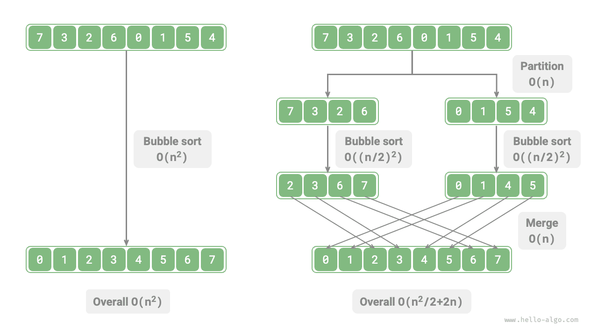
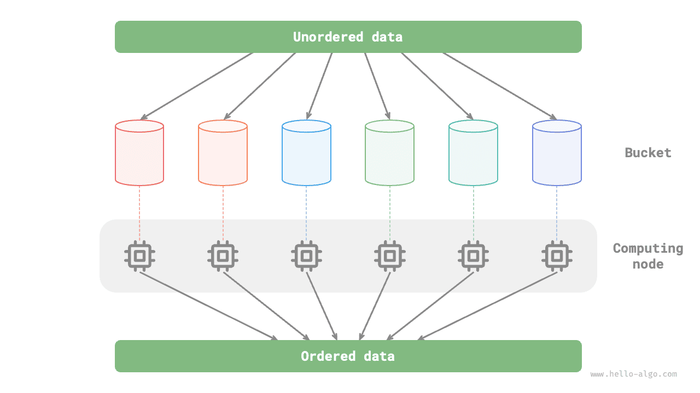

# 12.1 &nbsp; Divide and conquer

<u>Divide and conquer</u> is a fundamental and widely used algorithmic strategy. Usually implemented recursively, it has two stages: dividing the problem and combining its solutions.

1. **Divide (the partitioning stage)**: Recursively split the original problem into two or more subproblems until the smallest subproblems are reached.
2. **Conquer (the combining stage)**: Starting with the known solutions to the smallest subproblems, combine solutions from the bottom up to construct the solution to the original problem.

As shown in Figure 12-1, merge sort is a classic application of divide and conquer.

1. **Divide**: Recursively split the original array (the original problem) into two subarrays (subproblems) until each subarray contains just one element (the smallest subproblem).
2. **Conquer**: Merge the sorted subarrays (subproblem solutions) from the bottom up to obtain the sorted original array (the solution to the original problem).

{ class="animation-figure" }

 Figure 12-1 &nbsp; Divide-and-conquer strategy in merge sort 

## 12.1.1 &nbsp; Recognizing divide-and-conquer problems

The following criteria usually help determine whether divide and conquer is suitable for a problem.

1. **The problem can be divided**: The original problem can be split into smaller, similar subproblems, which can in turn be divided recursively in the same way.
2. **The subproblems are independent**: They neither overlap nor depend on one another, so they can be solved independently.
3. **The subproblem solutions can be combined**: Combining them yields the solution to the original problem.

Merge sort clearly satisfies all three criteria.

1. **The problem can be divided**: Recursively split an array (the original problem) into two subarrays (subproblems).
2. **The subproblems are independent**: Each subarray can be sorted independently.
3. **The subproblem solutions can be combined**: Merge the two sorted subarrays (subproblem solutions) into a single sorted array (the solution to the original problem).

## 12.1.2 &nbsp; Improving efficiency with divide and conquer

**Divide and conquer not only solves algorithmic problems effectively, but often improves efficiency as well**. Quick sort, merge sort, and heap sort outperform selection sort, bubble sort, and insertion sort because they use this strategy.

This raises a question: **why does divide and conquer improve efficiency, and what is the underlying reason**? Why is dividing a large problem, solving its subproblems, and combining their solutions faster than solving it directly? We can examine this from two perspectives: the number of operations and parallel computation.

### 1. &nbsp; Reducing the number of operations

Consider bubble sort, which takes $O(n^2)$ time to sort an array of length $n$. Suppose we split the array at its midpoint, as shown in Figure 12-2. Splitting takes $O(n)$ time, sorting each half takes $O((n / 2)^2)$ time, and merging the halves takes $O(n)$ time. The total time complexity is:

$$
O(n + (\frac{n}{2})^2 \times 2 + n) = O(\frac{n^2}{2} + 2n)
$$

{ class="animation-figure" }

 Figure 12-2 &nbsp; Bubble sort before and after dividing the array 

Now consider the following inequality, whose left and right sides represent the total operation counts before and after division:

$$
\begin{aligned}
n^2 & > \frac{n^2}{2} + 2n \newline
n^2 - \frac{n^2}{2} - 2n & > 0 \newline
n(n - 4) & > 0
\end{aligned}
$$

**When $n > 4$, dividing the array reduces the number of operations and should make sorting faster**. The time complexity is still quadratic, $O(n^2)$; only the constant factor has decreased.

What if **we keep splitting each subarray into two at its midpoint** until every subarray contains just one element? This is precisely the idea behind merge sort, which takes $O(n \log n)$ time.

What if **we introduce more split points**, dividing the original array evenly into $k$ subarrays? This resembles bucket sort, which is well suited to sorting large amounts of data and can theoretically achieve $O(n + k)$ time.

### 2. &nbsp; Using parallel computation

The subproblems produced by divide and conquer are independent, **so they can usually be solved in parallel**. Thus, divide and conquer can both reduce time complexity and **help the operating system parallelize the work**.

Parallelization is especially effective on multicore or multiprocessor systems. Multiple subproblems can be processed simultaneously, making fuller use of computing resources and substantially reducing total runtime.

For example, in the bucket sort shown in Figure 12-3, a large dataset is evenly distributed among buckets. The sorting tasks for different buckets can then be assigned to different computing units, and their results combined afterward.

{ class="animation-figure" }

 Figure 12-3 &nbsp; Parallel computation in bucket sort 

## 12.1.3 &nbsp; Common applications of divide and conquer

Divide and conquer solves many classic algorithmic problems.

- **Closest pair of points**: Divide a set of points into two parts, find the closest pair within each part, then find the closest pair spanning the two parts.
- **Large integer multiplication**: Karatsuba's algorithm, for example, breaks multiplication of large integers into several smaller integer multiplications and additions.
- **Matrix multiplication**: Strassen's algorithm, for example, breaks multiplication of large matrices into multiple smaller matrix multiplications and additions.
- **Tower of Hanoi**: This problem can be solved recursively and is a classic application of divide and conquer.
- **Counting inversions**: In a sequence, an earlier number and a later number form an inversion if the earlier one is larger. Inversions can be counted using divide and conquer with merge sort.

Divide and conquer is also widely used in designing algorithms and data structures.

- **Binary search**: Split a sorted array at its middle index, compare the middle element with the target to decide which half to discard, then repeat the same operation on the remaining interval.
- **Merge sort**: This was described at the start of the section.
- **Quick sort**: Choose a pivot and divide the array into two subarrays, one containing elements smaller than the pivot and the other containing larger elements. Repeat the division on both parts until each subarray contains just one element.
- **Bucket sort**: Distribute data among multiple buckets, sort the elements in each bucket, and then take the elements from the buckets in order to obtain a sorted array.
- **Trees**: Operations such as search, insertion, and deletion in binary search trees, AVL trees, red-black trees, B-trees, and B+ trees can be viewed as applications of divide and conquer.
- **Heaps**: A heap is a special kind of complete binary tree. Its operations, such as insertion, deletion, and heapification, implicitly use divide and conquer.
- **Hash tables**: Although hash tables do not directly use divide and conquer, some collision-handling strategies use it indirectly. For example, long linked lists in separate chaining may be converted into red-black trees to speed up lookups.

As we can see, **divide and conquer quietly underlies many algorithms and data structures**, often without being explicitly named.
