# The Tower of Hanoi

In merge sort and binary tree construction, we divided the original problem into two subproblems half its size. The Tower of Hanoi uses a different way to divide the problem.

!!! question

    Consider three pegs labeled `A`, `B`, and `C`. Initially, peg `A` holds $n$ disks, arranged from smallest on top to largest on the bottom. Move all $n$ disks to peg `C` in their original order, as shown below. Each move must follow these rules.
    
    1. Take a disk only from the top of one peg and place it on top of another.
    2. Move only one disk at a time.
    3. A smaller disk must always sit above a larger one on the same peg.

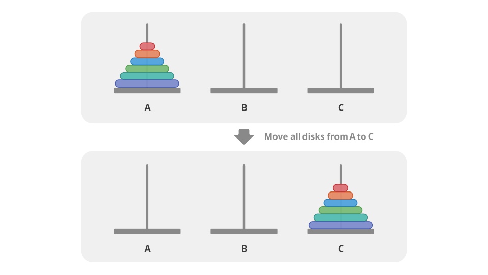

**Let $f(i)$ denote the Tower of Hanoi problem of size $i$**. For example, $f(3)$ denotes the problem of moving $3$ disks from `A` to `C`.

### The base cases

For $f(1)$, there is just one disk. Move it directly from `A` to `C`, as shown below.

=== "<1>"
    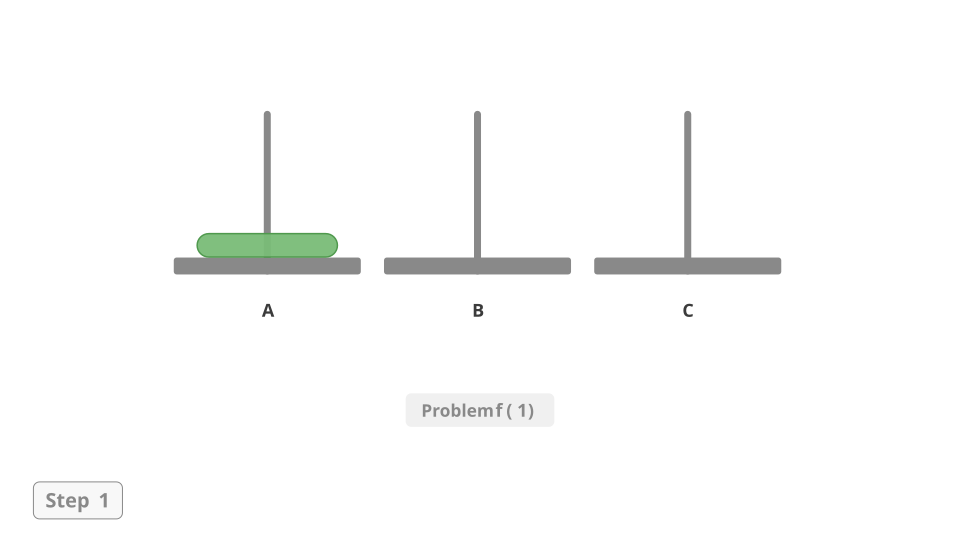

=== "<2>"
    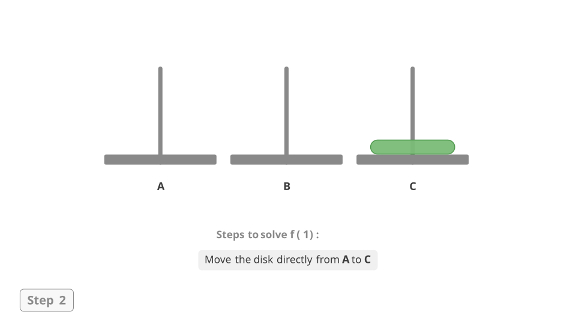

For $f(2)$, there are two disks, as shown below. **Because the smaller disk must stay above the larger one, we need peg `B` to complete the transfer**.

1. First, move the smaller disk on top from `A` to `B`.
2. Next, move the larger disk from `A` to `C`.
3. Finally, move the smaller disk from `B` to `C`.

=== "<1>"
    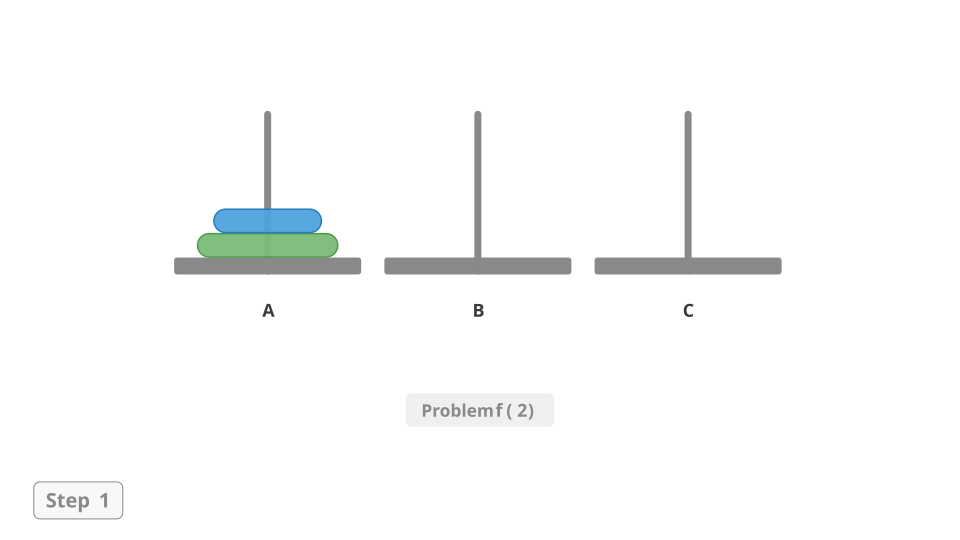

=== "<2>"
    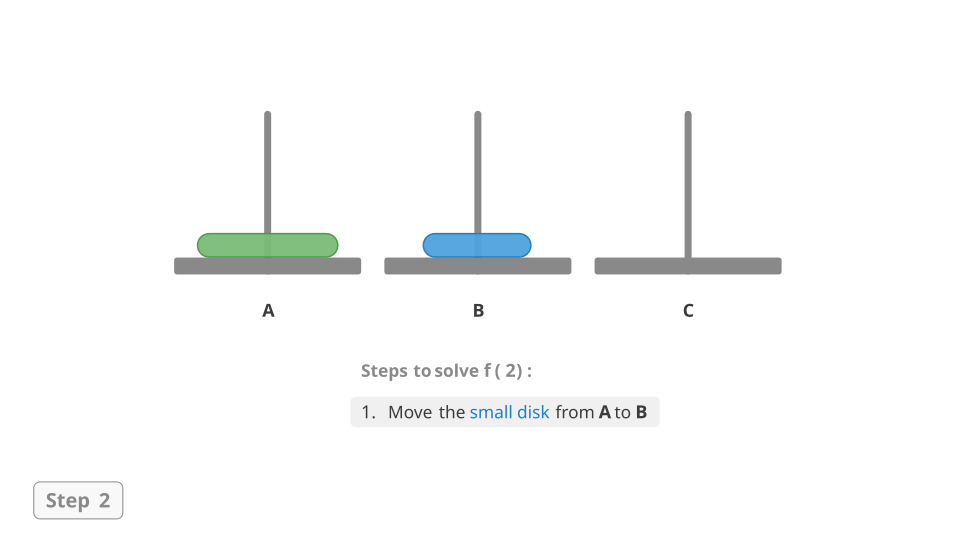

=== "<3>"
    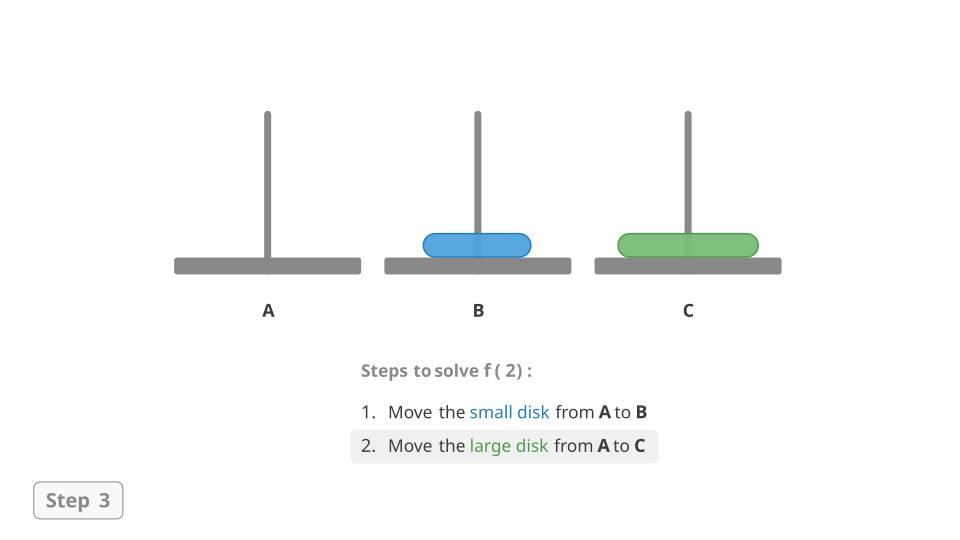

=== "<4>"
    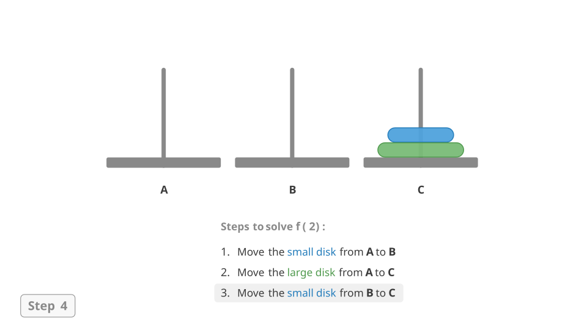

We can summarize $f(2)$ as follows: **move two disks from `A` to `C` using `B`**. Peg `C` is the destination, and peg `B` is the auxiliary peg.

### Dividing the problem

For $f(3)$, with three disks, the situation is a little more involved.

We already know how to solve $f(1)$ and $f(2)$. Using divide and conquer, **treat the two disks on top of `A` as a unit** and follow the steps below. This moves all three disks from `A` to `C`.

1. Use `B` as the destination and `C` as the auxiliary peg to move two disks from `A` to `B`.
2. One disk remains on `A`. Move it directly from `A` to `C`.
3. Use `C` as the destination and `A` as the auxiliary peg to move two disks from `B` to `C`.

=== "<1>"
    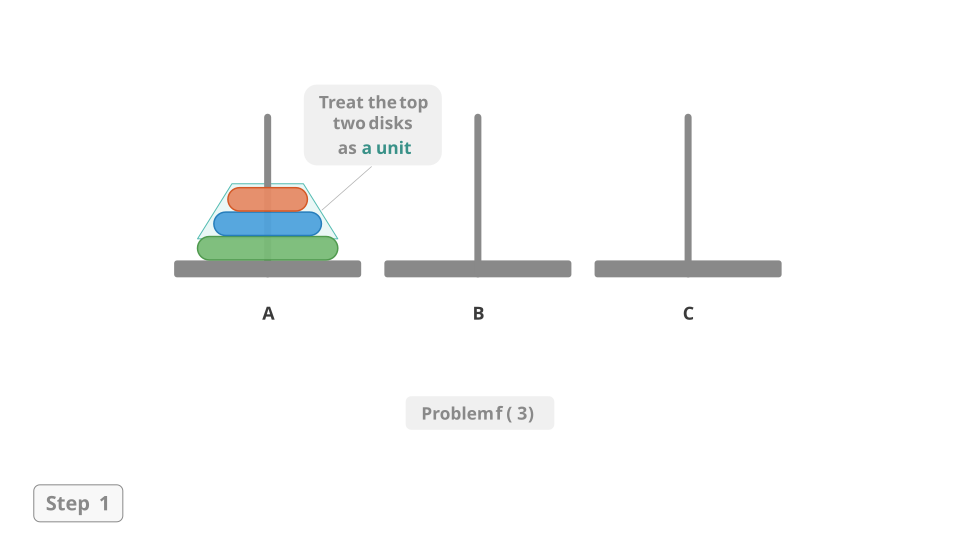

=== "<2>"
    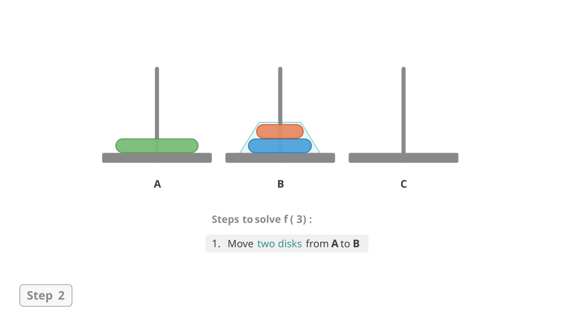

=== "<3>"
    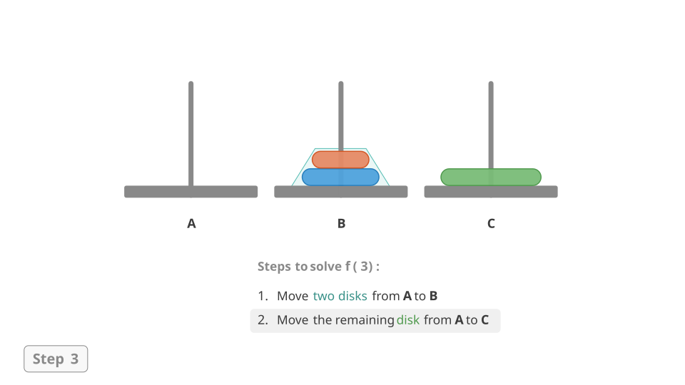

=== "<4>"
    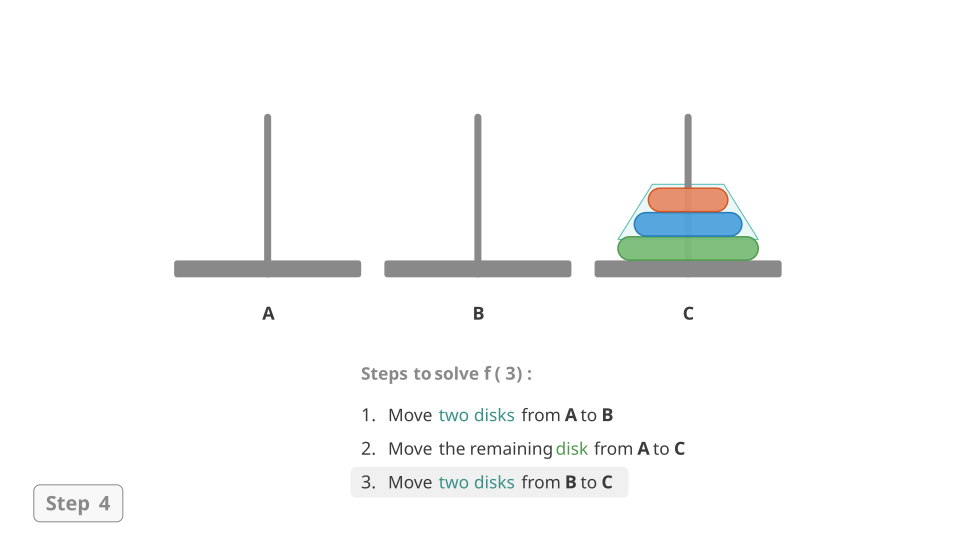

In effect, **we have split $f(3)$ into two instances of $f(2)$ and one instance of $f(1)$**. Solving the three subproblems in order solves the original problem. Thus, the subproblems can be solved independently and their solutions combined.

This gives us the divide-and-conquer strategy shown below: split $f(n)$ into two instances of $f(n-1)$ and one instance of $f(1)$, then solve the three subproblems in this order.

1. Move $n-1$ disks from `A` to `B` using `C`.
2. Move the remaining $1$ disk directly from `A` to `C`.
3. Move $n-1$ disks from `B` to `C` using `A`.

Both instances of $f(n-1)$ **can be divided recursively in the same way** until we reach the smallest subproblem, $f(1)$. We already know how to solve $f(1)$: it takes just one move.

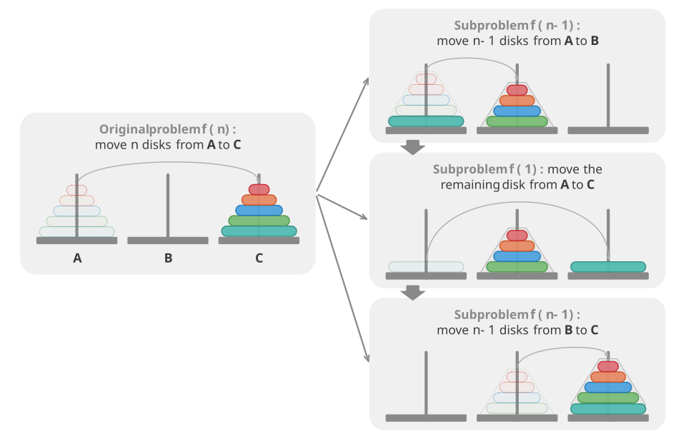

### Implementation

The recursive function `dfs(i, src, buf, tar)` moves the top $i$ disks from peg `src` to the destination `tar` using auxiliary peg `buf`:

```src
[file]{hanota}-[class]{}-[func]{solve_hanota}
```

The figure shows the Tower of Hanoi recursion tree, which has height $n$. Each node represents a subproblem and corresponds to a call to `dfs()`. **The time complexity is therefore $O(2^n)$ and the space complexity is $O(n)$**.

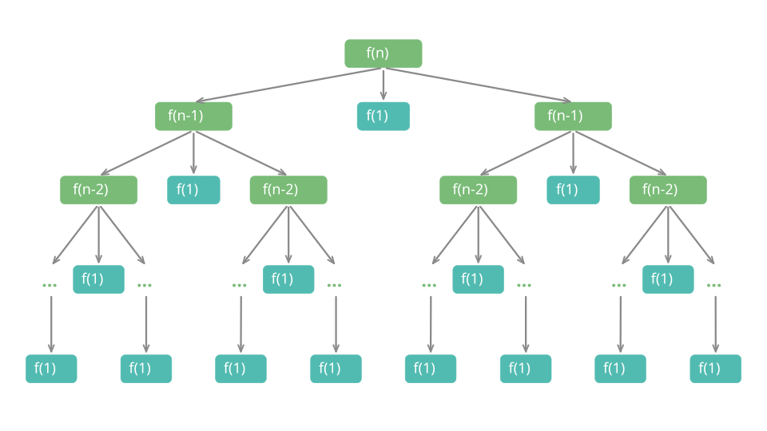

!!! quote

    The Tower of Hanoi comes from an old legend. In a temple in ancient India, monks had three tall diamond pegs and $64$ gold disks of different sizes. They kept moving the disks, believing the world would end the moment they placed the last disk correctly.

    Even at one move per second, the monks would need about $2^{64} \approx 1.84×10^{19}$ seconds to finish. That works out to roughly 585 billion years ($5850$ × 10⁸ years), far longer than the estimated age of the universe. Even if the legend is true, we need hardly worry about the end of the world.
