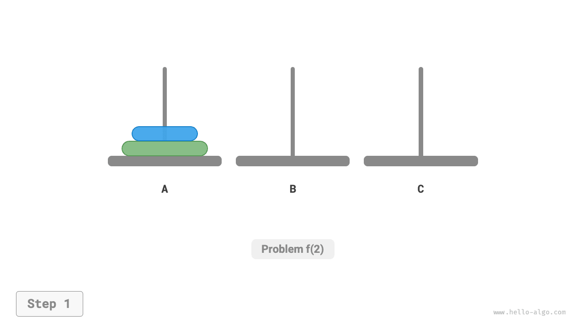
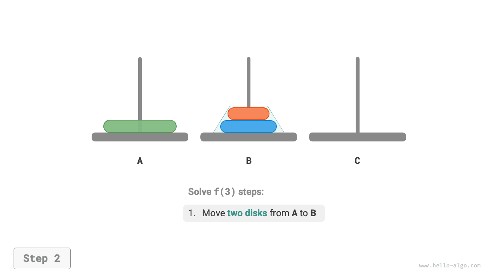
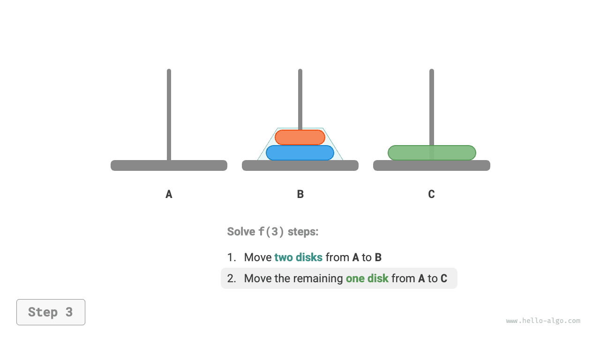

# Tower of Hanoi

In merge sort and binary tree reconstruction, we divided the original problem into two subproblems, each half its size. The Tower of Hanoi uses a different division strategy.

!!! question

    Given three rods called `A`, `B`, and `C`, initially rod `A` holds $n$ disks arranged from smallest at the top to largest at the bottom. Move all $n$ disks to rod `C` while preserving their order, as shown in the figure below. The following rules apply.
    
    1. A disk can only be removed from the top of one rod and placed on top of another.
    2. Only one disk may be moved at a time.
    3. A smaller disk must always be above a larger disk.


**Let $f(i)$ denote a Tower of Hanoi problem of size $i$**. For example, $f(3)$ means moving $3$ disks from `A` to `C`.

### Considering the base cases

For $f(1)$, with just one disk, simply move it directly from `A` to `C`, as shown in the figure below.

=== "<1>"
    

=== "<2>"
    

For $f(2)$, with two disks, **we need to use `B` because the smaller disk must remain above the larger one**, as shown in the figure below.

1. Move the smaller top disk from `A` to `B`.
2. Move the larger disk from `A` to `C`.
3. Move the smaller disk from `B` to `C`.

=== "<1>"
    

=== "<2>"
    

=== "<3>"
    

=== "<4>"
    

We can summarize the solution to $f(2)$ as **moving two disks from `A` to `C` using `B`**. Here, `C` is the destination rod and `B` is the auxiliary rod.

### Dividing the problem

For $f(3)$, with three disks, the situation is a little more complicated.

Since we know how to solve $f(1)$ and $f(2)$, we can use divide and conquer: **treat the top two disks on `A` as a group** and follow the steps in the figure below. This moves all three disks from `A` to `C`.

1. Use `B` as the destination and `C` as the auxiliary rod to move two disks from `A` to `B`.
2. Move the remaining disk directly from `A` to `C`.
3. Use `C` as the destination and `A` as the auxiliary rod to move two disks from `B` to `C`.

=== "<1>"
    

=== "<2>"
    

=== "<3>"
    

=== "<4>"
    

In essence, **we have divided $f(3)$ into two $f(2)$ subproblems and one $f(1)$ subproblem**. Solving these three subproblems in order solves the original problem. This shows that the subproblems are independent and their solutions can be combined.

We can now state the divide-and-conquer strategy for the Tower of Hanoi, illustrated in the figure below: divide $f(n)$ into two subproblems $f(n-1)$ and one subproblem $f(1)$, then solve them in this order.

1. Move $n-1$ disks from `A` to `B` using `C`.
2. Move the remaining $1$ disk directly from `A` to `C`.
3. Move $n-1$ disks from `B` to `C` using `A`.

Each of the two $f(n-1)$ subproblems **can be divided recursively in the same way** until we reach the smallest subproblem, $f(1)$. The solution to $f(1)$ is a single move.


### Code implementation

We define a recursive function `dfs(i, src, buf, tar)` that moves the top $i$ disks from rod `src` to destination rod `tar` using auxiliary rod `buf`:

```src
[file]{hanota}-[class]{}-[func]{solve_hanota}
```

As shown in the figure below, the Tower of Hanoi forms a recursion tree of height $n$. Each node represents a subproblem and corresponds to a call to `dfs()`. **The time complexity is therefore $O(2^n)$, and the space complexity is $O(n)$**.


!!! quote

    The Tower of Hanoi comes from an ancient legend. In a temple in ancient India, monks had three tall diamond rods and $64$ gold disks of different sizes. They continually moved the disks, believing that the world would end when the last disk was placed in its correct position.

    Even at one move per second, however, this would take about $2^{64} \approx 1.84×10^{19}$ seconds, or roughly $585$ billion years, far longer than current estimates of the age of the universe. If the legend is true, we should have little reason to worry about the end of the world.
