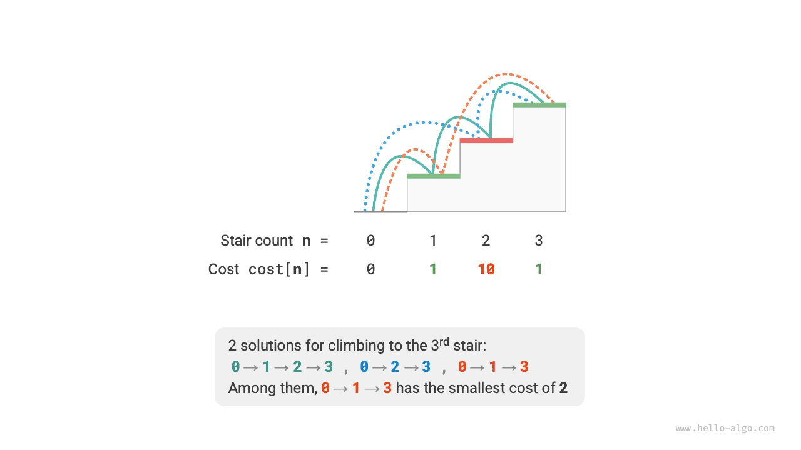

# 14.2 &nbsp; Properties of dynamic programming problems

The previous section showed how dynamic programming solves a problem by decomposing it into subproblems. Decomposition is a general algorithmic idea, but divide and conquer, dynamic programming, and backtracking use it differently.

- Divide and conquer recursively splits a problem into independent subproblems until the smallest ones are reached, then combines their solutions as the recursion returns to solve the original problem.
- Dynamic programming also decomposes problems recursively. Its main difference from divide and conquer is that its subproblems depend on one another, and many overlapping subproblems appear during decomposition.
- Backtracking enumerates possible solutions by trying choices and undoing them, using pruning to avoid unnecessary branches. A solution consists of a sequence of decisions, and the prefix before each decision can be viewed as a subproblem.

Dynamic programming is often used for optimization problems. Besides overlapping subproblems, these problems have two key properties: optimal substructure and the no-aftereffect property.

## 14.2.1 &nbsp; Optimal substructure

Let's modify the climbing stairs problem slightly to illustrate optimal substructure more clearly.

!!! question "Minimum cost to climb stairs"

    Given a staircase, you can climb $1$ or $2$ steps at a time. Each step has a nonnegative integer indicating the cost paid on that step. A nonnegative integer array $cost$ gives the costs: $cost[i]$ is the cost of step $i$, and $cost[0]$ refers to the ground (the starting point). What is the minimum cost of reaching the top?

As shown in Figure 14-6, if steps $1$, $2$, and $3$ cost $1$, $10$, and $1$, respectively, the minimum cost of reaching step $3$ from the ground is $2$.

{ class="animation-figure" }

<p align="center"> Figure 14-6 &nbsp; Minimum cost of reaching step 3 </p>

Let $dp[i]$ be the total cost of reaching step $i$. Since step $i$ can only be reached from step $i - 1$ or $i - 2$, $dp[i]$ must be either $dp[i - 1] + cost[i]$ or $dp[i - 2] + cost[i]$. To minimize the cost, choose the smaller of the two:

$$
dp[i] = \min(dp[i-1], dp[i-2]) + cost[i]
$$

This introduces the meaning of optimal substructure: **an optimal solution to the original problem is constructed from optimal solutions to its subproblems**.

This problem clearly has optimal substructure: choose the better of $dp[i-1]$ and $dp[i-2]$ and use it to construct the optimal solution $dp[i]$.

Does the climbing stairs problem from the previous section also have optimal substructure? Its goal is to count solutions, so it seems to be a counting problem. But rephrase the goal as finding the maximum number of solutions, and **although the problem remains equivalent, optimal substructure becomes apparent**: the maximum number of ways to reach step $n$ is the sum of the maximum numbers for steps $n-1$ and $n-2$. The interpretation of optimal substructure is therefore flexible and can vary by problem.

The state transition equation, together with the initial states $dp[1] = cost[1]$ and $dp[2] = cost[2]$, gives the following dynamic programming code:

=== "Python"

    ```python title="min_cost_climbing_stairs_dp.py"
    def min_cost_climbing_stairs_dp(cost: list[int]) -> int:
        """Minimum cost to climb stairs: dynamic programming"""
        n = len(cost) - 1
        if n == 1 or n == 2:
            return cost[n]
        # Initialize the dp table to store subproblem solutions
        dp = [0] * (n + 1)
        # Initial states: set the solutions to the smallest subproblems
        dp[1], dp[2] = cost[1], cost[2]
        # State transitions: solve progressively larger subproblems using smaller ones
        for i in range(3, n + 1):
            dp[i] = min(dp[i - 1], dp[i - 2]) + cost[i]
        return dp[n]
    ```

=== "C++"

    ```cpp title="min_cost_climbing_stairs_dp.cpp"
    /* Minimum cost to climb stairs: dynamic programming */
    int minCostClimbingStairsDP(vector<int> &cost) {
        int n = cost.size() - 1;
        if (n == 1 || n == 2)
            return cost[n];
        // Initialize the dp table to store subproblem solutions
        vector<int> dp(n + 1);
        // Initial states: set the solutions to the smallest subproblems
        dp[1] = cost[1];
        dp[2] = cost[2];
        // State transitions: solve progressively larger subproblems using smaller ones
        for (int i = 3; i <= n; i++) {
            dp[i] = min(dp[i - 1], dp[i - 2]) + cost[i];
        }
        return dp[n];
    }
    ```

=== "Java"

    ```java title="min_cost_climbing_stairs_dp.java"
    /* Minimum cost to climb stairs: dynamic programming */
    int minCostClimbingStairsDP(int[] cost) {
        int n = cost.length - 1;
        if (n == 1 || n == 2)
            return cost[n];
        // Initialize the dp table to store subproblem solutions
        int[] dp = new int[n + 1];
        // Initial states: set the solutions to the smallest subproblems
        dp[1] = cost[1];
        dp[2] = cost[2];
        // State transitions: solve progressively larger subproblems using smaller ones
        for (int i = 3; i <= n; i++) {
            dp[i] = Math.min(dp[i - 1], dp[i - 2]) + cost[i];
        }
        return dp[n];
    }
    ```

=== "C#"

    ```csharp title="min_cost_climbing_stairs_dp.cs"
    /* Minimum cost to climb stairs: dynamic programming */
    int MinCostClimbingStairsDP(int[] cost) {
        int n = cost.Length - 1;
        if (n == 1 || n == 2)
            return cost[n];
        // Initialize the dp table to store subproblem solutions
        int[] dp = new int[n + 1];
        // Initial states: set the solutions to the smallest subproblems
        dp[1] = cost[1];
        dp[2] = cost[2];
        // State transitions: solve progressively larger subproblems using smaller ones
        for (int i = 3; i <= n; i++) {
            dp[i] = Math.Min(dp[i - 1], dp[i - 2]) + cost[i];
        }
        return dp[n];
    }
    ```

=== "Go"

    ```go title="min_cost_climbing_stairs_dp.go"
    /* Minimum cost to climb stairs: dynamic programming */
    func minCostClimbingStairsDP(cost []int) int {
        n := len(cost) - 1
        if n == 1 || n == 2 {
            return cost[n]
        }
        min := func(a, b int) int {
            if a < b {
                return a
            }
            return b
        }
        // Initialize the dp table to store subproblem solutions
        dp := make([]int, n+1)
        // Initial states: set the solutions to the smallest subproblems
        dp[1] = cost[1]
        dp[2] = cost[2]
        // State transitions: solve progressively larger subproblems using smaller ones
        for i := 3; i <= n; i++ {
            dp[i] = min(dp[i-1], dp[i-2]) + cost[i]
        }
        return dp[n]
    }
    ```

=== "Swift"

    ```swift title="min_cost_climbing_stairs_dp.swift"
    /* Minimum cost to climb stairs: dynamic programming */
    func minCostClimbingStairsDP(cost: [Int]) -> Int {
        let n = cost.count - 1
        if n == 1 || n == 2 {
            return cost[n]
        }
        // Initialize the dp table to store subproblem solutions
        var dp = Array(repeating: 0, count: n + 1)
        // Initial states: set the solutions to the smallest subproblems
        dp[1] = cost[1]
        dp[2] = cost[2]
        // State transitions: solve progressively larger subproblems using smaller ones
        for i in 3 ... n {
            dp[i] = min(dp[i - 1], dp[i - 2]) + cost[i]
        }
        return dp[n]
    }
    ```

=== "JS"

    ```javascript title="min_cost_climbing_stairs_dp.js"
    /* Minimum cost to climb stairs: dynamic programming */
    function minCostClimbingStairsDP(cost) {
        const n = cost.length - 1;
        if (n === 1 || n === 2) {
            return cost[n];
        }
        // Initialize the dp table to store subproblem solutions
        const dp = new Array(n + 1);
        // Initial states: set the solutions to the smallest subproblems
        dp[1] = cost[1];
        dp[2] = cost[2];
        // State transitions: solve progressively larger subproblems using smaller ones
        for (let i = 3; i <= n; i++) {
            dp[i] = Math.min(dp[i - 1], dp[i - 2]) + cost[i];
        }
        return dp[n];
    }
    ```

=== "TS"

    ```typescript title="min_cost_climbing_stairs_dp.ts"
    /* Minimum cost to climb stairs: dynamic programming */
    function minCostClimbingStairsDP(cost: Array<number>): number {
        const n = cost.length - 1;
        if (n === 1 || n === 2) {
            return cost[n];
        }
        // Initialize the dp table to store subproblem solutions
        const dp = new Array(n + 1);
        // Initial states: set the solutions to the smallest subproblems
        dp[1] = cost[1];
        dp[2] = cost[2];
        // State transitions: solve progressively larger subproblems using smaller ones
        for (let i = 3; i <= n; i++) {
            dp[i] = Math.min(dp[i - 1], dp[i - 2]) + cost[i];
        }
        return dp[n];
    }
    ```

=== "Dart"

    ```dart title="min_cost_climbing_stairs_dp.dart"
    /* Minimum cost to climb stairs: dynamic programming */
    int minCostClimbingStairsDP(List<int> cost) {
      int n = cost.length - 1;
      if (n == 1 || n == 2) return cost[n];
      // Initialize the dp table to store subproblem solutions
      List<int> dp = List.filled(n + 1, 0);
      // Initial states: set the solutions to the smallest subproblems
      dp[1] = cost[1];
      dp[2] = cost[2];
      // State transitions: solve progressively larger subproblems using smaller ones
      for (int i = 3; i <= n; i++) {
        dp[i] = min(dp[i - 1], dp[i - 2]) + cost[i];
      }
      return dp[n];
    }
    ```

=== "Rust"

    ```rust title="min_cost_climbing_stairs_dp.rs"
    /* Minimum cost to climb stairs: dynamic programming */
    fn min_cost_climbing_stairs_dp(cost: &[i32]) -> i32 {
        let n = cost.len() - 1;
        if n == 1 || n == 2 {
            return cost[n];
        }
        // Initialize the dp table to store subproblem solutions
        let mut dp = vec![-1; n + 1];
        // Initial states: set the solutions to the smallest subproblems
        dp[1] = cost[1];
        dp[2] = cost[2];
        // State transitions: solve progressively larger subproblems using smaller ones
        for i in 3..=n {
            dp[i] = cmp::min(dp[i - 1], dp[i - 2]) + cost[i];
        }
        dp[n]
    }
    ```

=== "C"

    ```c title="min_cost_climbing_stairs_dp.c"
    /* Minimum cost to climb stairs: dynamic programming */
    int minCostClimbingStairsDP(int cost[], int costSize) {
        int n = costSize - 1;
        if (n == 1 || n == 2)
            return cost[n];
        // Initialize the dp table to store subproblem solutions
        int *dp = calloc(n + 1, sizeof(int));
        // Initial states: set the solutions to the smallest subproblems
        dp[1] = cost[1];
        dp[2] = cost[2];
        // State transitions: solve progressively larger subproblems using smaller ones
        for (int i = 3; i <= n; i++) {
            dp[i] = myMin(dp[i - 1], dp[i - 2]) + cost[i];
        }
        int res = dp[n];
        // Free memory
        free(dp);
        return res;
    }
    ```

=== "Kotlin"

    ```kotlin title="min_cost_climbing_stairs_dp.kt"
    /* Minimum cost to climb stairs: dynamic programming */
    fun minCostClimbingStairsDP(cost: IntArray): Int {
        val n = cost.size - 1
        if (n == 1 || n == 2) return cost[n]
        // Initialize the dp table to store subproblem solutions
        val dp = IntArray(n + 1)
        // Initial states: set the solutions to the smallest subproblems
        dp[1] = cost[1]
        dp[2] = cost[2]
        // State transitions: solve progressively larger subproblems using smaller ones
        for (i in 3..n) {
            dp[i] = min(dp[i - 1], dp[i - 2]) + cost[i]
        }
        return dp[n]
    }
    ```

=== "Ruby"

    ```ruby title="min_cost_climbing_stairs_dp.rb"
    ### Minimum cost to climb stairs: dynamic programming ###
    def min_cost_climbing_stairs_dp(cost)
      n = cost.length - 1
      return cost[n] if n == 1 || n == 2
      # Initialize the dp table to store subproblem solutions
      dp = Array.new(n + 1, 0)
      # Initial states: set the solutions to the smallest subproblems
      dp[1], dp[2] = cost[1], cost[2]
      # State transitions: solve progressively larger subproblems using smaller ones
      (3...(n + 1)).each { |i| dp[i] = [dp[i - 1], dp[i - 2]].min + cost[i] }
      dp[n]
    end
    ```

??? pythontutor "Visualize execution"

    <div style="height: 549px; width: 100%;"><iframe class="pythontutor-iframe" title="Visualize execution" src="https://pythontutor.com/iframe-embed.html#code=def%20min_cost_climbing_stairs_dp%28cost%3A%20list%5Bint%5D%29%20-%3E%20int%3A%0A%20%20%20%20%22%22%22Minimum%20cost%20to%20climb%20stairs%3A%20dynamic%20programming%22%22%22%0A%20%20%20%20n%20%3D%20len%28cost%29%20-%201%0A%20%20%20%20if%20n%20%3D%3D%201%20or%20n%20%3D%3D%202%3A%0A%20%20%20%20%20%20%20%20return%20cost%5Bn%5D%0A%20%20%20%20%23%20Initialize%20the%20dp%20table%20to%20store%20subproblem%20solutions%0A%20%20%20%20dp%20%3D%20%5B0%5D%20%2A%20%28n%20%2B%201%29%0A%20%20%20%20%23%20Initial%20states%3A%20set%20the%20solutions%20to%20the%20smallest%20subproblems%0A%20%20%20%20dp%5B1%5D,%20dp%5B2%5D%20%3D%20cost%5B1%5D,%20cost%5B2%5D%0A%20%20%20%20%23%20State%20transitions%3A%20solve%20progressively%20larger%20subproblems%20using%20smaller%20ones%0A%20%20%20%20for%20i%20in%20range%283,%20n%20%2B%201%29%3A%0A%20%20%20%20%20%20%20%20dp%5Bi%5D%20%3D%20min%28dp%5Bi%20-%201%5D,%20dp%5Bi%20-%202%5D%29%20%2B%20cost%5Bi%5D%0A%20%20%20%20return%20dp%5Bn%5D%0A%0A%0A%22%22%22Driver%20code%22%22%22%0Aif%20__name__%20%3D%3D%20%22__main__%22%3A%0A%20%20%20%20cost%20%3D%20%5B0,%201,%2010,%201,%201,%201,%2010,%201,%201,%2010,%201%5D%0A%20%20%20%20print%28f%22Input%20list%20of%20stair%20costs%3A%20%7Bcost%7D%22%29%0A%0A%20%20%20%20res%20%3D%20min_cost_climbing_stairs_dp%28cost%29%0A%20%20%20%20print%28f%22Minimum%20cost%20to%20finish%20climbing%20the%20stairs%3A%20%7Bres%7D%22%29&codeDivHeight=472&codeDivWidth=350&cumulative=false&curInstr=4&heapPrimitives=nevernest&origin=opt-frontend.js&py=311&rawInputLstJSON=%5B%5D&textReferences=false"> </iframe></div>
    <div style="margin-top: 5px;"><a href="https://pythontutor.com/iframe-embed.html#code=def%20min_cost_climbing_stairs_dp%28cost%3A%20list%5Bint%5D%29%20-%3E%20int%3A%0A%20%20%20%20%22%22%22Minimum%20cost%20to%20climb%20stairs%3A%20dynamic%20programming%22%22%22%0A%20%20%20%20n%20%3D%20len%28cost%29%20-%201%0A%20%20%20%20if%20n%20%3D%3D%201%20or%20n%20%3D%3D%202%3A%0A%20%20%20%20%20%20%20%20return%20cost%5Bn%5D%0A%20%20%20%20%23%20Initialize%20the%20dp%20table%20to%20store%20subproblem%20solutions%0A%20%20%20%20dp%20%3D%20%5B0%5D%20%2A%20%28n%20%2B%201%29%0A%20%20%20%20%23%20Initial%20states%3A%20set%20the%20solutions%20to%20the%20smallest%20subproblems%0A%20%20%20%20dp%5B1%5D,%20dp%5B2%5D%20%3D%20cost%5B1%5D,%20cost%5B2%5D%0A%20%20%20%20%23%20State%20transitions%3A%20solve%20progressively%20larger%20subproblems%20using%20smaller%20ones%0A%20%20%20%20for%20i%20in%20range%283,%20n%20%2B%201%29%3A%0A%20%20%20%20%20%20%20%20dp%5Bi%5D%20%3D%20min%28dp%5Bi%20-%201%5D,%20dp%5Bi%20-%202%5D%29%20%2B%20cost%5Bi%5D%0A%20%20%20%20return%20dp%5Bn%5D%0A%0A%0A%22%22%22Driver%20code%22%22%22%0Aif%20__name__%20%3D%3D%20%22__main__%22%3A%0A%20%20%20%20cost%20%3D%20%5B0,%201,%2010,%201,%201,%201,%2010,%201,%201,%2010,%201%5D%0A%20%20%20%20print%28f%22Input%20list%20of%20stair%20costs%3A%20%7Bcost%7D%22%29%0A%0A%20%20%20%20res%20%3D%20min_cost_climbing_stairs_dp%28cost%29%0A%20%20%20%20print%28f%22Minimum%20cost%20to%20finish%20climbing%20the%20stairs%3A%20%7Bres%7D%22%29&codeDivHeight=800&codeDivWidth=600&cumulative=false&curInstr=4&heapPrimitives=nevernest&origin=opt-frontend.js&py=311&rawInputLstJSON=%5B%5D&textReferences=false" target="_blank" rel="noopener noreferrer">View full screen ></a></div>

Figure 14-7 illustrates this dynamic programming process.

{ class="animation-figure" }

<p align="center"> Figure 14-7 &nbsp; Dynamic programming for the minimum climbing cost </p>

We can also reduce the state storage from a one-dimensional array to scalar variables, lowering the space complexity from $O(n)$ to $O(1)$:

=== "Python"

    ```python title="min_cost_climbing_stairs_dp.py"
    def min_cost_climbing_stairs_dp_comp(cost: list[int]) -> int:
        """Minimum cost to climb stairs: space-optimized dynamic programming"""
        n = len(cost) - 1
        if n == 1 or n == 2:
            return cost[n]
        a, b = cost[1], cost[2]
        for i in range(3, n + 1):
            a, b = b, min(a, b) + cost[i]
        return b
    ```

=== "C++"

    ```cpp title="min_cost_climbing_stairs_dp.cpp"
    /* Minimum cost to climb stairs: space-optimized dynamic programming */
    int minCostClimbingStairsDPComp(vector<int> &cost) {
        int n = cost.size() - 1;
        if (n == 1 || n == 2)
            return cost[n];
        int a = cost[1], b = cost[2];
        for (int i = 3; i <= n; i++) {
            int tmp = b;
            b = min(a, tmp) + cost[i];
            a = tmp;
        }
        return b;
    }
    ```

=== "Java"

    ```java title="min_cost_climbing_stairs_dp.java"
    /* Minimum cost to climb stairs: space-optimized dynamic programming */
    int minCostClimbingStairsDPComp(int[] cost) {
        int n = cost.length - 1;
        if (n == 1 || n == 2)
            return cost[n];
        int a = cost[1], b = cost[2];
        for (int i = 3; i <= n; i++) {
            int tmp = b;
            b = Math.min(a, tmp) + cost[i];
            a = tmp;
        }
        return b;
    }
    ```

=== "C#"

    ```csharp title="min_cost_climbing_stairs_dp.cs"
    /* Minimum cost to climb stairs: space-optimized dynamic programming */
    int MinCostClimbingStairsDPComp(int[] cost) {
        int n = cost.Length - 1;
        if (n == 1 || n == 2)
            return cost[n];
        int a = cost[1], b = cost[2];
        for (int i = 3; i <= n; i++) {
            int tmp = b;
            b = Math.Min(a, tmp) + cost[i];
            a = tmp;
        }
        return b;
    }
    ```

=== "Go"

    ```go title="min_cost_climbing_stairs_dp.go"
    /* Minimum cost to climb stairs: space-optimized dynamic programming */
    func minCostClimbingStairsDPComp(cost []int) int {
        n := len(cost) - 1
        if n == 1 || n == 2 {
            return cost[n]
        }
        min := func(a, b int) int {
            if a < b {
                return a
            }
            return b
        }
        // Initial states: set the solutions to the smallest subproblems
        a, b := cost[1], cost[2]
        // State transitions: solve progressively larger subproblems using smaller ones
        for i := 3; i <= n; i++ {
            tmp := b
            b = min(a, tmp) + cost[i]
            a = tmp
        }
        return b
    }
    ```

=== "Swift"

    ```swift title="min_cost_climbing_stairs_dp.swift"
    /* Minimum cost to climb stairs: space-optimized dynamic programming */
    func minCostClimbingStairsDPComp(cost: [Int]) -> Int {
        let n = cost.count - 1
        if n == 1 || n == 2 {
            return cost[n]
        }
        var (a, b) = (cost[1], cost[2])
        for i in 3 ... n {
            (a, b) = (b, min(a, b) + cost[i])
        }
        return b
    }
    ```

=== "JS"

    ```javascript title="min_cost_climbing_stairs_dp.js"
    /* Minimum cost to climb stairs: space-optimized dynamic programming */
    function minCostClimbingStairsDPComp(cost) {
        const n = cost.length - 1;
        if (n === 1 || n === 2) {
            return cost[n];
        }
        let a = cost[1],
            b = cost[2];
        for (let i = 3; i <= n; i++) {
            const tmp = b;
            b = Math.min(a, tmp) + cost[i];
            a = tmp;
        }
        return b;
    }
    ```

=== "TS"

    ```typescript title="min_cost_climbing_stairs_dp.ts"
    /* Minimum cost to climb stairs: space-optimized dynamic programming */
    function minCostClimbingStairsDPComp(cost: Array<number>): number {
        const n = cost.length - 1;
        if (n === 1 || n === 2) {
            return cost[n];
        }
        let a = cost[1],
            b = cost[2];
        for (let i = 3; i <= n; i++) {
            const tmp = b;
            b = Math.min(a, tmp) + cost[i];
            a = tmp;
        }
        return b;
    }
    ```

=== "Dart"

    ```dart title="min_cost_climbing_stairs_dp.dart"
    /* Minimum cost to climb stairs: space-optimized dynamic programming */
    int minCostClimbingStairsDPComp(List<int> cost) {
      int n = cost.length - 1;
      if (n == 1 || n == 2) return cost[n];
      int a = cost[1], b = cost[2];
      for (int i = 3; i <= n; i++) {
        int tmp = b;
        b = min(a, tmp) + cost[i];
        a = tmp;
      }
      return b;
    }
    ```

=== "Rust"

    ```rust title="min_cost_climbing_stairs_dp.rs"
    /* Minimum cost to climb stairs: space-optimized dynamic programming */
    fn min_cost_climbing_stairs_dp_comp(cost: &[i32]) -> i32 {
        let n = cost.len() - 1;
        if n == 1 || n == 2 {
            return cost[n];
        };
        let (mut a, mut b) = (cost[1], cost[2]);
        for i in 3..=n {
            let tmp = b;
            b = cmp::min(a, tmp) + cost[i];
            a = tmp;
        }
        b
    }
    ```

=== "C"

    ```c title="min_cost_climbing_stairs_dp.c"
    /* Minimum cost to climb stairs: space-optimized dynamic programming */
    int minCostClimbingStairsDPComp(int cost[], int costSize) {
        int n = costSize - 1;
        if (n == 1 || n == 2)
            return cost[n];
        int a = cost[1], b = cost[2];
        for (int i = 3; i <= n; i++) {
            int tmp = b;
            b = myMin(a, tmp) + cost[i];
            a = tmp;
        }
        return b;
    }
    ```

=== "Kotlin"

    ```kotlin title="min_cost_climbing_stairs_dp.kt"
    /* Minimum cost to climb stairs: space-optimized dynamic programming */
    fun minCostClimbingStairsDPComp(cost: IntArray): Int {
        val n = cost.size - 1
        if (n == 1 || n == 2) return cost[n]
        var a = cost[1]
        var b = cost[2]
        for (i in 3..n) {
            val tmp = b
            b = min(a, tmp) + cost[i]
            a = tmp
        }
        return b
    }
    ```

=== "Ruby"

    ```ruby title="min_cost_climbing_stairs_dp.rb"
    ### Minimum cost to climb stairs: dynamic programming ###
    def min_cost_climbing_stairs_dp(cost)
      n = cost.length - 1
      return cost[n] if n == 1 || n == 2
      # Initialize the dp table to store subproblem solutions
      dp = Array.new(n + 1, 0)
      # Initial states: set the solutions to the smallest subproblems
      dp[1], dp[2] = cost[1], cost[2]
      # State transitions: solve progressively larger subproblems using smaller ones
      (3...(n + 1)).each { |i| dp[i] = [dp[i - 1], dp[i - 2]].min + cost[i] }
      dp[n]
    end

    # Minimum cost to climb stairs: space-optimized dynamic programming
    def min_cost_climbing_stairs_dp_comp(cost)
      n = cost.length - 1
      return cost[n] if n == 1 || n == 2
      a, b = cost[1], cost[2]
      (3...(n + 1)).each { |i| a, b = b, [a, b].min + cost[i] }
      b
    end
    ```

??? pythontutor "Visualize execution"

    <div style="height: 513px; width: 100%;"><iframe class="pythontutor-iframe" title="Visualize execution" src="https://pythontutor.com/iframe-embed.html#code=def%20min_cost_climbing_stairs_dp_comp%28cost%3A%20list%5Bint%5D%29%20-%3E%20int%3A%0A%20%20%20%20%22%22%22Minimum%20cost%20to%20climb%20stairs%3A%20space-optimized%20dynamic%20programming%22%22%22%0A%20%20%20%20n%20%3D%20len%28cost%29%20-%201%0A%20%20%20%20if%20n%20%3D%3D%201%20or%20n%20%3D%3D%202%3A%0A%20%20%20%20%20%20%20%20return%20cost%5Bn%5D%0A%20%20%20%20a,%20b%20%3D%20cost%5B1%5D,%20cost%5B2%5D%0A%20%20%20%20for%20i%20in%20range%283,%20n%20%2B%201%29%3A%0A%20%20%20%20%20%20%20%20a,%20b%20%3D%20b,%20min%28a,%20b%29%20%2B%20cost%5Bi%5D%0A%20%20%20%20return%20b%0A%0A%0A%22%22%22Driver%20code%22%22%22%0Aif%20__name__%20%3D%3D%20%22__main__%22%3A%0A%20%20%20%20cost%20%3D%20%5B0,%201,%2010,%201,%201,%201,%2010,%201,%201,%2010,%201%5D%0A%20%20%20%20print%28f%22Input%20list%20of%20stair%20costs%3A%20%7Bcost%7D%22%29%0A%0A%20%20%20%20res%20%3D%20min_cost_climbing_stairs_dp_comp%28cost%29%0A%20%20%20%20print%28f%22Minimum%20cost%20to%20finish%20climbing%20the%20stairs%3A%20%7Bres%7D%22%29&codeDivHeight=472&codeDivWidth=350&cumulative=false&curInstr=5&heapPrimitives=nevernest&origin=opt-frontend.js&py=311&rawInputLstJSON=%5B%5D&textReferences=false"> </iframe></div>
    <div style="margin-top: 5px;"><a href="https://pythontutor.com/iframe-embed.html#code=def%20min_cost_climbing_stairs_dp_comp%28cost%3A%20list%5Bint%5D%29%20-%3E%20int%3A%0A%20%20%20%20%22%22%22Minimum%20cost%20to%20climb%20stairs%3A%20space-optimized%20dynamic%20programming%22%22%22%0A%20%20%20%20n%20%3D%20len%28cost%29%20-%201%0A%20%20%20%20if%20n%20%3D%3D%201%20or%20n%20%3D%3D%202%3A%0A%20%20%20%20%20%20%20%20return%20cost%5Bn%5D%0A%20%20%20%20a,%20b%20%3D%20cost%5B1%5D,%20cost%5B2%5D%0A%20%20%20%20for%20i%20in%20range%283,%20n%20%2B%201%29%3A%0A%20%20%20%20%20%20%20%20a,%20b%20%3D%20b,%20min%28a,%20b%29%20%2B%20cost%5Bi%5D%0A%20%20%20%20return%20b%0A%0A%0A%22%22%22Driver%20code%22%22%22%0Aif%20__name__%20%3D%3D%20%22__main__%22%3A%0A%20%20%20%20cost%20%3D%20%5B0,%201,%2010,%201,%201,%201,%2010,%201,%201,%2010,%201%5D%0A%20%20%20%20print%28f%22Input%20list%20of%20stair%20costs%3A%20%7Bcost%7D%22%29%0A%0A%20%20%20%20res%20%3D%20min_cost_climbing_stairs_dp_comp%28cost%29%0A%20%20%20%20print%28f%22Minimum%20cost%20to%20finish%20climbing%20the%20stairs%3A%20%7Bres%7D%22%29&codeDivHeight=800&codeDivWidth=600&cumulative=false&curInstr=5&heapPrimitives=nevernest&origin=opt-frontend.js&py=311&rawInputLstJSON=%5B%5D&textReferences=false" target="_blank" rel="noopener noreferrer">View full screen ></a></div>

## 14.2.2 &nbsp; No-aftereffect property

The no-aftereffect property is central to effective dynamic programming: **given a fully specified state, its future depends only on that state, not on the sequence of states that led to it**.

In the climbing stairs problem, state $i$ can lead to $i+1$ or $i+2$, corresponding to moves of $1$ or $2$ steps. Neither choice requires us to consider states before $i$: they do not affect the future of state $i$.

Adding a constraint changes the situation.

!!! question "Climbing stairs with a constraint"

    Given a staircase with $n$ steps, you may climb $1$ or $2$ steps at a time, **but may not make two consecutive moves of $1$ step**. How many ways are there to reach the top?

As shown in Figure 14-8, only $2$ ways remain to reach step $3$: taking $1$ step three times in a row violates the constraint and is discarded.

{ class="animation-figure" }

<p align="center"> Figure 14-8 &nbsp; Number of ways to reach step 3 with the constraint </p>

If the previous move climbed $1$ step, the next must climb $2$ steps. Thus, **the next choice cannot be determined by the current state (the current step number) alone; it also depends on the preceding state (the previous step number)**.

The no-aftereffect property no longer holds with this state definition, and $dp[i] = dp[i-1] + dp[i-2]$ is no longer valid. Using $dp[i-1]$ means taking $1$ step now, but it includes many ways in which the preceding move also took $1$ step. We cannot simply add all of $dp[i-1]$ to $dp[i]$ without violating the constraint.

We therefore expand the state definition: **state $[i, j]$ means we are on step $i$ and the previous move climbed $j$ steps**, where $j \in \{1, 2\}$. This distinguishes whether the preceding move climbed $1$ or $2$ steps, allowing us to determine how the current state could have been reached.

- If the previous move climbed $1$ step, the move before it must have climbed $2$ steps. Thus, $dp[i, 1]$ can only come from $dp[i-1, 2]$.
- If the previous move climbed $2$ steps, the move before it could have climbed $1$ or $2$ steps. Thus, $dp[i, 2]$ can come from $dp[i-2, 1]$ or $dp[i-2, 2]$.

As shown in Figure 14-9, $dp[i, j]$ now counts the ways to reach state $[i, j]$. The state transition equations are:

$$
\begin{cases}
dp[i, 1] = dp[i-1, 2] \\
dp[i, 2] = dp[i-2, 1] + dp[i-2, 2]
\end{cases}
$$

{ class="animation-figure" }

<p align="center"> Figure 14-9 &nbsp; Recurrence with the constraint </p>

Finally, return $dp[n, 1] + dp[n, 2]$, the total number of ways to reach step $n$:

=== "Python"

    ```python title="climbing_stairs_constraint_dp.py"
    def climbing_stairs_constraint_dp(n: int) -> int:
        """Climbing stairs with constraints: dynamic programming"""
        if n == 1 or n == 2:
            return 1
        # Initialize the dp table to store subproblem solutions
        dp = [[0] * 3 for _ in range(n + 1)]
        # Initial states: set the solutions to the smallest subproblems
        dp[1][1], dp[1][2] = 1, 0
        dp[2][1], dp[2][2] = 0, 1
        # State transitions: solve progressively larger subproblems using smaller ones
        for i in range(3, n + 1):
            dp[i][1] = dp[i - 1][2]
            dp[i][2] = dp[i - 2][1] + dp[i - 2][2]
        return dp[n][1] + dp[n][2]
    ```

=== "C++"

    ```cpp title="climbing_stairs_constraint_dp.cpp"
    /* Climbing stairs with constraints: dynamic programming */
    int climbingStairsConstraintDP(int n) {
        if (n == 1 || n == 2) {
            return 1;
        }
        // Initialize the dp table to store subproblem solutions
        vector<vector<int>> dp(n + 1, vector<int>(3, 0));
        // Initial states: set the solutions to the smallest subproblems
        dp[1][1] = 1;
        dp[1][2] = 0;
        dp[2][1] = 0;
        dp[2][2] = 1;
        // State transitions: solve progressively larger subproblems using smaller ones
        for (int i = 3; i <= n; i++) {
            dp[i][1] = dp[i - 1][2];
            dp[i][2] = dp[i - 2][1] + dp[i - 2][2];
        }
        return dp[n][1] + dp[n][2];
    }
    ```

=== "Java"

    ```java title="climbing_stairs_constraint_dp.java"
    /* Climbing stairs with constraints: dynamic programming */
    int climbingStairsConstraintDP(int n) {
        if (n == 1 || n == 2) {
            return 1;
        }
        // Initialize the dp table to store subproblem solutions
        int[][] dp = new int[n + 1][3];
        // Initial states: set the solutions to the smallest subproblems
        dp[1][1] = 1;
        dp[1][2] = 0;
        dp[2][1] = 0;
        dp[2][2] = 1;
        // State transitions: solve progressively larger subproblems using smaller ones
        for (int i = 3; i <= n; i++) {
            dp[i][1] = dp[i - 1][2];
            dp[i][2] = dp[i - 2][1] + dp[i - 2][2];
        }
        return dp[n][1] + dp[n][2];
    }
    ```

=== "C#"

    ```csharp title="climbing_stairs_constraint_dp.cs"
    /* Climbing stairs with constraints: dynamic programming */
    int ClimbingStairsConstraintDP(int n) {
        if (n == 1 || n == 2) {
            return 1;
        }
        // Initialize the dp table to store subproblem solutions
        int[,] dp = new int[n + 1, 3];
        // Initial states: set the solutions to the smallest subproblems
        dp[1, 1] = 1;
        dp[1, 2] = 0;
        dp[2, 1] = 0;
        dp[2, 2] = 1;
        // State transitions: solve progressively larger subproblems using smaller ones
        for (int i = 3; i <= n; i++) {
            dp[i, 1] = dp[i - 1, 2];
            dp[i, 2] = dp[i - 2, 1] + dp[i - 2, 2];
        }
        return dp[n, 1] + dp[n, 2];
    }
    ```

=== "Go"

    ```go title="climbing_stairs_constraint_dp.go"
    /* Climbing stairs with constraints: dynamic programming */
    func climbingStairsConstraintDP(n int) int {
        if n == 1 || n == 2 {
            return 1
        }
        // Initialize the dp table to store subproblem solutions
        dp := make([][3]int, n+1)
        // Initial states: set the solutions to the smallest subproblems
        dp[1][1] = 1
        dp[1][2] = 0
        dp[2][1] = 0
        dp[2][2] = 1
        // State transitions: solve progressively larger subproblems using smaller ones
        for i := 3; i <= n; i++ {
            dp[i][1] = dp[i-1][2]
            dp[i][2] = dp[i-2][1] + dp[i-2][2]
        }
        return dp[n][1] + dp[n][2]
    }
    ```

=== "Swift"

    ```swift title="climbing_stairs_constraint_dp.swift"
    /* Climbing stairs with constraints: dynamic programming */
    func climbingStairsConstraintDP(n: Int) -> Int {
        if n == 1 || n == 2 {
            return 1
        }
        // Initialize the dp table to store subproblem solutions
        var dp = Array(repeating: Array(repeating: 0, count: 3), count: n + 1)
        // Initial states: set the solutions to the smallest subproblems
        dp[1][1] = 1
        dp[1][2] = 0
        dp[2][1] = 0
        dp[2][2] = 1
        // State transitions: solve progressively larger subproblems using smaller ones
        for i in 3 ... n {
            dp[i][1] = dp[i - 1][2]
            dp[i][2] = dp[i - 2][1] + dp[i - 2][2]
        }
        return dp[n][1] + dp[n][2]
    }
    ```

=== "JS"

    ```javascript title="climbing_stairs_constraint_dp.js"
    /* Climbing stairs with constraints: dynamic programming */
    function climbingStairsConstraintDP(n) {
        if (n === 1 || n === 2) {
            return 1;
        }
        // Initialize the dp table to store subproblem solutions
        const dp = Array.from(new Array(n + 1), () => new Array(3));
        // Initial states: set the solutions to the smallest subproblems
        dp[1][1] = 1;
        dp[1][2] = 0;
        dp[2][1] = 0;
        dp[2][2] = 1;
        // State transitions: solve progressively larger subproblems using smaller ones
        for (let i = 3; i <= n; i++) {
            dp[i][1] = dp[i - 1][2];
            dp[i][2] = dp[i - 2][1] + dp[i - 2][2];
        }
        return dp[n][1] + dp[n][2];
    }
    ```

=== "TS"

    ```typescript title="climbing_stairs_constraint_dp.ts"
    /* Climbing stairs with constraints: dynamic programming */
    function climbingStairsConstraintDP(n: number): number {
        if (n === 1 || n === 2) {
            return 1;
        }
        // Initialize the dp table to store subproblem solutions
        const dp = Array.from({ length: n + 1 }, () => new Array(3));
        // Initial states: set the solutions to the smallest subproblems
        dp[1][1] = 1;
        dp[1][2] = 0;
        dp[2][1] = 0;
        dp[2][2] = 1;
        // State transitions: solve progressively larger subproblems using smaller ones
        for (let i = 3; i <= n; i++) {
            dp[i][1] = dp[i - 1][2];
            dp[i][2] = dp[i - 2][1] + dp[i - 2][2];
        }
        return dp[n][1] + dp[n][2];
    }
    ```

=== "Dart"

    ```dart title="climbing_stairs_constraint_dp.dart"
    /* Climbing stairs with constraints: dynamic programming */
    int climbingStairsConstraintDP(int n) {
      if (n == 1 || n == 2) {
        return 1;
      }
      // Initialize the dp table to store subproblem solutions
      List<List<int>> dp = List.generate(n + 1, (index) => List.filled(3, 0));
      // Initial states: set the solutions to the smallest subproblems
      dp[1][1] = 1;
      dp[1][2] = 0;
      dp[2][1] = 0;
      dp[2][2] = 1;
      // State transitions: solve progressively larger subproblems using smaller ones
      for (int i = 3; i <= n; i++) {
        dp[i][1] = dp[i - 1][2];
        dp[i][2] = dp[i - 2][1] + dp[i - 2][2];
      }
      return dp[n][1] + dp[n][2];
    }
    ```

=== "Rust"

    ```rust title="climbing_stairs_constraint_dp.rs"
    /* Climbing stairs with constraints: dynamic programming */
    fn climbing_stairs_constraint_dp(n: usize) -> i32 {
        if n == 1 || n == 2 {
            return 1;
        };
        // Initialize the dp table to store subproblem solutions
        let mut dp = vec![vec![-1; 3]; n + 1];
        // Initial states: set the solutions to the smallest subproblems
        dp[1][1] = 1;
        dp[1][2] = 0;
        dp[2][1] = 0;
        dp[2][2] = 1;
        // State transitions: solve progressively larger subproblems using smaller ones
        for i in 3..=n {
            dp[i][1] = dp[i - 1][2];
            dp[i][2] = dp[i - 2][1] + dp[i - 2][2];
        }
        dp[n][1] + dp[n][2]
    }
    ```

=== "C"

    ```c title="climbing_stairs_constraint_dp.c"
    /* Climbing stairs with constraints: dynamic programming */
    int climbingStairsConstraintDP(int n) {
        if (n == 1 || n == 2) {
            return 1;
        }
        // Initialize the dp table to store subproblem solutions
        int **dp = malloc((n + 1) * sizeof(int *));
        for (int i = 0; i <= n; i++) {
            dp[i] = calloc(3, sizeof(int));
        }
        // Initial states: set the solutions to the smallest subproblems
        dp[1][1] = 1;
        dp[1][2] = 0;
        dp[2][1] = 0;
        dp[2][2] = 1;
        // State transitions: solve progressively larger subproblems using smaller ones
        for (int i = 3; i <= n; i++) {
            dp[i][1] = dp[i - 1][2];
            dp[i][2] = dp[i - 2][1] + dp[i - 2][2];
        }
        int res = dp[n][1] + dp[n][2];
        // Free memory
        for (int i = 0; i <= n; i++) {
            free(dp[i]);
        }
        free(dp);
        return res;
    }
    ```

=== "Kotlin"

    ```kotlin title="climbing_stairs_constraint_dp.kt"
    /* Climbing stairs with constraints: dynamic programming */
    fun climbingStairsConstraintDP(n: Int): Int {
        if (n == 1 || n == 2) {
            return 1
        }
        // Initialize the dp table to store subproblem solutions
        val dp = Array(n + 1) { IntArray(3) }
        // Initial states: set the solutions to the smallest subproblems
        dp[1][1] = 1
        dp[1][2] = 0
        dp[2][1] = 0
        dp[2][2] = 1
        // State transitions: solve progressively larger subproblems using smaller ones
        for (i in 3..n) {
            dp[i][1] = dp[i - 1][2]
            dp[i][2] = dp[i - 2][1] + dp[i - 2][2]
        }
        return dp[n][1] + dp[n][2]
    }
    ```

=== "Ruby"

    ```ruby title="climbing_stairs_constraint_dp.rb"
    ### Climbing stairs with constraints: dynamic programming ###
    def climbing_stairs_constraint_dp(n)
      return 1 if n == 1 || n == 2

      # Initialize the dp table to store subproblem solutions
      dp = Array.new(n + 1) { Array.new(3, 0) }
      # Initial states: set the solutions to the smallest subproblems
      dp[1][1], dp[1][2] = 1, 0
      dp[2][1], dp[2][2] = 0, 1
      # State transitions: solve progressively larger subproblems using smaller ones
      for i in 3...(n + 1)
        dp[i][1] = dp[i - 1][2]
        dp[i][2] = dp[i - 2][1] + dp[i - 2][2]
      end

      dp[n][1] + dp[n][2]
    end
    ```

??? pythontutor "Visualize execution"

    <div style="height: 549px; width: 100%;"><iframe class="pythontutor-iframe" title="Visualize execution" src="https://pythontutor.com/iframe-embed.html#code=def%20climbing_stairs_constraint_dp%28n%3A%20int%29%20-%3E%20int%3A%0A%20%20%20%20%22%22%22Climbing%20stairs%20with%20constraints%3A%20dynamic%20programming%22%22%22%0A%20%20%20%20if%20n%20%3D%3D%201%20or%20n%20%3D%3D%202%3A%0A%20%20%20%20%20%20%20%20return%201%0A%20%20%20%20%23%20Initialize%20the%20dp%20table%20to%20store%20subproblem%20solutions%0A%20%20%20%20dp%20%3D%20%5B%5B0%5D%20%2A%203%20for%20_%20in%20range%28n%20%2B%201%29%5D%0A%20%20%20%20%23%20Initial%20states%3A%20set%20the%20solutions%20to%20the%20smallest%20subproblems%0A%20%20%20%20dp%5B1%5D%5B1%5D,%20dp%5B1%5D%5B2%5D%20%3D%201,%200%0A%20%20%20%20dp%5B2%5D%5B1%5D,%20dp%5B2%5D%5B2%5D%20%3D%200,%201%0A%20%20%20%20%23%20State%20transitions%3A%20solve%20progressively%20larger%20subproblems%20using%20smaller%20ones%0A%20%20%20%20for%20i%20in%20range%283,%20n%20%2B%201%29%3A%0A%20%20%20%20%20%20%20%20dp%5Bi%5D%5B1%5D%20%3D%20dp%5Bi%20-%201%5D%5B2%5D%0A%20%20%20%20%20%20%20%20dp%5Bi%5D%5B2%5D%20%3D%20dp%5Bi%20-%202%5D%5B1%5D%20%2B%20dp%5Bi%20-%202%5D%5B2%5D%0A%20%20%20%20return%20dp%5Bn%5D%5B1%5D%20%2B%20dp%5Bn%5D%5B2%5D%0A%0A%0A%22%22%22Driver%20code%22%22%22%0Aif%20__name__%20%3D%3D%20%22__main__%22%3A%0A%20%20%20%20n%20%3D%209%0A%0A%20%20%20%20res%20%3D%20climbing_stairs_constraint_dp%28n%29%0A%20%20%20%20print%28f%22Number%20of%20ways%20to%20climb%20%7Bn%7D%20stairs%3A%20%7Bres%7D%22%29&codeDivHeight=472&codeDivWidth=350&cumulative=false&curInstr=4&heapPrimitives=nevernest&origin=opt-frontend.js&py=311&rawInputLstJSON=%5B%5D&textReferences=false"> </iframe></div>
    <div style="margin-top: 5px;"><a href="https://pythontutor.com/iframe-embed.html#code=def%20climbing_stairs_constraint_dp%28n%3A%20int%29%20-%3E%20int%3A%0A%20%20%20%20%22%22%22Climbing%20stairs%20with%20constraints%3A%20dynamic%20programming%22%22%22%0A%20%20%20%20if%20n%20%3D%3D%201%20or%20n%20%3D%3D%202%3A%0A%20%20%20%20%20%20%20%20return%201%0A%20%20%20%20%23%20Initialize%20the%20dp%20table%20to%20store%20subproblem%20solutions%0A%20%20%20%20dp%20%3D%20%5B%5B0%5D%20%2A%203%20for%20_%20in%20range%28n%20%2B%201%29%5D%0A%20%20%20%20%23%20Initial%20states%3A%20set%20the%20solutions%20to%20the%20smallest%20subproblems%0A%20%20%20%20dp%5B1%5D%5B1%5D,%20dp%5B1%5D%5B2%5D%20%3D%201,%200%0A%20%20%20%20dp%5B2%5D%5B1%5D,%20dp%5B2%5D%5B2%5D%20%3D%200,%201%0A%20%20%20%20%23%20State%20transitions%3A%20solve%20progressively%20larger%20subproblems%20using%20smaller%20ones%0A%20%20%20%20for%20i%20in%20range%283,%20n%20%2B%201%29%3A%0A%20%20%20%20%20%20%20%20dp%5Bi%5D%5B1%5D%20%3D%20dp%5Bi%20-%201%5D%5B2%5D%0A%20%20%20%20%20%20%20%20dp%5Bi%5D%5B2%5D%20%3D%20dp%5Bi%20-%202%5D%5B1%5D%20%2B%20dp%5Bi%20-%202%5D%5B2%5D%0A%20%20%20%20return%20dp%5Bn%5D%5B1%5D%20%2B%20dp%5Bn%5D%5B2%5D%0A%0A%0A%22%22%22Driver%20code%22%22%22%0Aif%20__name__%20%3D%3D%20%22__main__%22%3A%0A%20%20%20%20n%20%3D%209%0A%0A%20%20%20%20res%20%3D%20climbing_stairs_constraint_dp%28n%29%0A%20%20%20%20print%28f%22Number%20of%20ways%20to%20climb%20%7Bn%7D%20stairs%3A%20%7Bres%7D%22%29&codeDivHeight=800&codeDivWidth=600&cumulative=false&curInstr=4&heapPrimitives=nevernest&origin=opt-frontend.js&py=311&rawInputLstJSON=%5B%5D&textReferences=false" target="_blank" rel="noopener noreferrer">View full screen ></a></div>

In this example, only one preceding state mattered, so expanding the state definition restored the no-aftereffect property. Some problems, however, depend much more strongly on their history.

!!! question "Climbing stairs that generate obstacles"

    Given a staircase with $n$ steps, you may climb $1$ or $2$ steps at a time. **Whenever you reach step $i$, the system places an obstacle on step $2i$, and you may never land on step $2i$ afterward**. For example, if your first two moves land on steps $2$ and $3$, then steps $4$ and $6$ are blocked for all later moves. How many ways are there to reach the top?

Here, each next move depends on all previous states, because every move places an obstacle higher up and affects future moves. Such problems are often difficult to solve with dynamic programming.

Many complex combinatorial optimization problems, such as the traveling salesperson problem, do not satisfy the no-aftereffect property. For such problems, we often choose other methods, such as heuristic search, genetic algorithms, or reinforcement learning, to obtain useful locally optimal solutions within a limited time.
