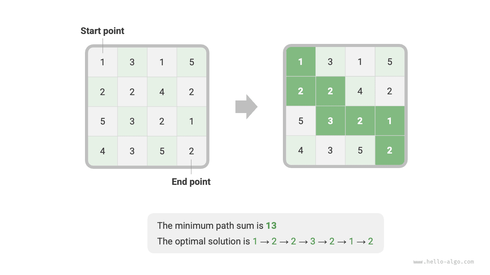
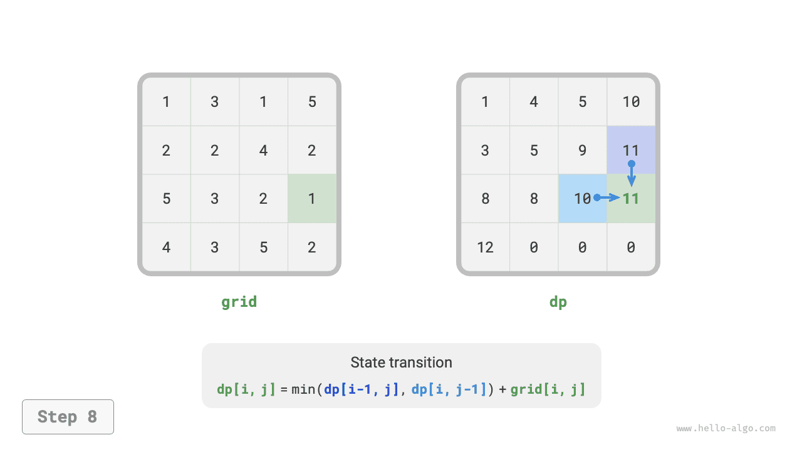

# 14.3 &nbsp; Solving dynamic programming problems

The previous two sections introduced the main properties of dynamic programming problems. We will now explore two practical questions.

1. How can we recognize a dynamic programming problem?
2. Where should we start, and what are the steps for solving one?

## 14.3.1 &nbsp; Recognizing the problem

In general, a problem is suitable for dynamic programming if it has overlapping subproblems, optimal substructure, and the no-aftereffect property. These can be difficult to identify directly from a problem statement, so we usually start with a broader test: **could backtracking (exhaustive search) solve it**?

**Problems suited to backtracking usually fit a decision tree model**. They can be represented as a tree in which each node is a decision and each path is a sequence of decisions.

In other words, if a problem has clear choices and a solution is produced through a sequence of them, it fits the decision tree model and can usually be solved by backtracking.

Beyond this, some signs make dynamic programming more promising.

- The problem asks for an optimum, such as a maximum, minimum, greatest number, or smallest number.
- States can be represented by a list, a multidimensional matrix, or a tree, and a recurrence relates each state to nearby states.

Other signs make it less promising.

- The goal is to find all possible solutions rather than an optimal one.
- The problem explicitly involves permutations or combinations and asks for multiple concrete arrangements.

If a problem fits the decision tree model and has clear positive signs, we can tentatively treat it as a dynamic programming problem and verify that assumption while solving it.

## 14.3.2 &nbsp; Steps for solving the problem

The process varies with the problem's nature and difficulty, but usually includes describing the decisions, defining states, creating a $dp$ table, deriving a state transition equation, and identifying boundary conditions.

To make these steps concrete, we will use the classic minimum path sum problem.

!!! question

    Given an $n \times m$ grid `grid`, each cell contains a nonnegative integer representing its cost. A robot starts at the top-left cell and can move one cell down or right at a time until it reaches the bottom-right cell. Return the minimum path sum from the top-left to the bottom-right.

In the example shown in Figure 14-10, the minimum path sum is $13$.

{ class="animation-figure" }

<p align="center"> Figure 14-10 &nbsp; Example input for minimum path sum </p>

**Step 1: Identify each decision, define the state, and establish the $dp$ table**

Each decision moves one cell down or right. If the current cell has indices $[i, j]$, the next indices are $[i+1, j]$ or $[i, j+1]$. The state therefore contains two variables, the row and column indices, and is denoted by $[i, j]$.

State $[i, j]$ corresponds to the subproblem of finding the minimum path sum from the starting point $[0, 0]$ to $[i, j]$. Its solution is $dp[i, j]$.

This gives the two-dimensional $dp$ matrix shown in Figure 14-11, with the same dimensions as the input $grid$.

{ class="animation-figure" }

<p align="center"> Figure 14-11 &nbsp; State definition and dp table </p>

!!! note

    Dynamic programming and backtracking can be described as sequences of decisions. A state consists of the decision variables and should contain every variable needed to describe progress, with enough information to derive the next state.
    
    Each state corresponds to a subproblem. A $dp$ table stores the solutions to all subproblems, with one dimension of the $dp$ table for each independent state variable. In essence, the $dp$ table maps states to subproblem solutions.

**Step 2: Identify optimal substructure and derive the state transition equation**

State $[i, j]$ can only be reached from the cell above, $[i-1, j]$, or the cell to the left, $[i, j-1]$. The optimal substructure is therefore that the minimum path sum to $[i, j]$ is determined by the smaller of the minimum path sums to $[i, j-1]$ and $[i-1, j]$.

This gives the state transition equation illustrated in Figure 14-12:

$$
dp[i, j] = \min(dp[i-1, j], dp[i, j-1]) + grid[i, j]
$$

{ class="animation-figure" }

<p align="center"> Figure 14-12 &nbsp; Optimal substructure and state transition equation </p>

!!! note

    Using the defined $dp$ table, examine the relationship between the original problem and its subproblems. Find how to construct an optimal solution from optimal subproblem solutions: this is the optimal substructure.

    Once we identify optimal substructure, we can use it to build the state transition equation.

**Step 3: Determine the boundary conditions and evaluation order**

A state in the first row can only come from its left, and a state in the first column can only come from above. Thus, the first row $i = 0$ and first column $j = 0$ define the boundary conditions.

As shown in Figure 14-13, each cell depends on the cells to its left and above. We therefore traverse the matrix with an outer loop over rows and an inner loop over columns.

{ class="animation-figure" }

<p align="center"> Figure 14-13 &nbsp; Boundary conditions and evaluation order </p>

!!! note

    Boundary conditions initialize the $dp$ table in dynamic programming and support pruning in search.
    
    The key to choosing an evaluation order is ensuring that all smaller subproblems needed by the current state have already been solved correctly.

We could now write the dynamic programming solution directly. However, decomposing a problem is a top-down way of thinking, so implementing "brute-force search $\rightarrow$ memoized search $\rightarrow$ dynamic programming" often follows our reasoning more naturally.

### 1. &nbsp; Method 1: Brute-force search

Starting from $[i, j]$, recursively decompose the problem into smaller states $[i-1, j]$ and $[i, j-1]$. The recursive function has the following elements.

- **Parameters**: The state $[i, j]$.
- **Return value**: The minimum path sum $dp[i, j]$ from $[0, 0]$ to $[i, j]$.
- **Base case**: When $i = 0$ and $j = 0$, return $grid[0, 0]$.
- **Pruning**: If $i < 0$ or $j < 0$, the indices are out of bounds. Return cost $+\infty$ to mark the path as infeasible.

The implementation is as follows:

=== "Python"

    ```python title="min_path_sum.py"
    def min_path_sum_dfs(grid: list[list[int]], i: int, j: int) -> int:
        """Minimum path sum: brute-force search"""
        # Stop searching at the top-left cell
        if i == 0 and j == 0:
            return grid[0][0]
        # If a row or column index is out of bounds, return a cost of +∞
        if i < 0 or j < 0:
            return inf
        # Calculate the minimum path costs from the top-left corner to (i-1, j) and (i, j-1)
        up = min_path_sum_dfs(grid, i - 1, j)
        left = min_path_sum_dfs(grid, i, j - 1)
        # Return the minimum path cost from the top-left corner to (i, j)
        return min(left, up) + grid[i][j]
    ```

=== "C++"

    ```cpp title="min_path_sum.cpp"
    /* Minimum path sum: brute-force search */
    int minPathSumDFS(vector<vector<int>> &grid, int i, int j) {
        // Stop searching at the top-left cell
        if (i == 0 && j == 0) {
            return grid[0][0];
        }
        // If a row or column index is out of bounds, return a cost of +∞
        if (i < 0 || j < 0) {
            return INT_MAX;
        }
        // Calculate the minimum path costs from the top-left corner to (i-1, j) and (i, j-1)
        int up = minPathSumDFS(grid, i - 1, j);
        int left = minPathSumDFS(grid, i, j - 1);
        // Return the minimum path cost from the top-left corner to (i, j)
        return min(left, up) != INT_MAX ? min(left, up) + grid[i][j] : INT_MAX;
    }
    ```

=== "Java"

    ```java title="min_path_sum.java"
    /* Minimum path sum: brute-force search */
    int minPathSumDFS(int[][] grid, int i, int j) {
        // Stop searching at the top-left cell
        if (i == 0 && j == 0) {
            return grid[0][0];
        }
        // If a row or column index is out of bounds, return a cost of +∞
        if (i < 0 || j < 0) {
            return Integer.MAX_VALUE;
        }
        // Calculate the minimum path costs from the top-left corner to (i-1, j) and (i, j-1)
        int up = minPathSumDFS(grid, i - 1, j);
        int left = minPathSumDFS(grid, i, j - 1);
        // Return the minimum path cost from the top-left corner to (i, j)
        return Math.min(left, up) + grid[i][j];
    }
    ```

=== "C#"

    ```csharp title="min_path_sum.cs"
    /* Minimum path sum: brute-force search */
    int MinPathSumDFS(int[][] grid, int i, int j) {
        // Stop searching at the top-left cell
        if (i == 0 && j == 0) {
            return grid[0][0];
        }
        // If a row or column index is out of bounds, return a cost of +∞
        if (i < 0 || j < 0) {
            return int.MaxValue;
        }
        // Calculate the minimum path costs from the top-left corner to (i-1, j) and (i, j-1)
        int up = MinPathSumDFS(grid, i - 1, j);
        int left = MinPathSumDFS(grid, i, j - 1);
        // Return the minimum path cost from the top-left corner to (i, j)
        return Math.Min(left, up) + grid[i][j];
    }
    ```

=== "Go"

    ```go title="min_path_sum.go"
    /* Minimum path sum: brute-force search */
    func minPathSumDFS(grid [][]int, i, j int) int {
        // Stop searching at the top-left cell
        if i == 0 && j == 0 {
            return grid[0][0]
        }
        // If a row or column index is out of bounds, return math.MaxInt to represent an infinite cost
        if i < 0 || j < 0 {
            return math.MaxInt
        }
        // Calculate the minimum path costs from the top-left corner to (i-1, j) and (i, j-1)
        up := minPathSumDFS(grid, i-1, j)
        left := minPathSumDFS(grid, i, j-1)
        // Return the minimum path cost from the top-left corner to (i, j)
        return int(math.Min(float64(left), float64(up))) + grid[i][j]
    }
    ```

=== "Swift"

    ```swift title="min_path_sum.swift"
    /* Minimum path sum: brute-force search */
    func minPathSumDFS(grid: [[Int]], i: Int, j: Int) -> Int {
        // Stop searching at the top-left cell
        if i == 0, j == 0 {
            return grid[0][0]
        }
        // If a row or column index is out of bounds, return Int.max to represent an infinite cost
        if i < 0 || j < 0 {
            return .max
        }
        // Calculate the minimum path costs from the top-left corner to (i-1, j) and (i, j-1)
        let up = minPathSumDFS(grid: grid, i: i - 1, j: j)
        let left = minPathSumDFS(grid: grid, i: i, j: j - 1)
        // Return the minimum path cost from the top-left corner to (i, j)
        return min(left, up) + grid[i][j]
    }
    ```

=== "JS"

    ```javascript title="min_path_sum.js"
    /* Minimum path sum: brute-force search */
    function minPathSumDFS(grid, i, j) {
        // Stop searching at the top-left cell
        if (i === 0 && j === 0) {
            return grid[0][0];
        }
        // If a row or column index is out of bounds, return a cost of +∞
        if (i < 0 || j < 0) {
            return Infinity;
        }
        // Calculate the minimum path costs from the top-left corner to (i-1, j) and (i, j-1)
        const up = minPathSumDFS(grid, i - 1, j);
        const left = minPathSumDFS(grid, i, j - 1);
        // Return the minimum path cost from the top-left corner to (i, j)
        return Math.min(left, up) + grid[i][j];
    }
    ```

=== "TS"

    ```typescript title="min_path_sum.ts"
    /* Minimum path sum: brute-force search */
    function minPathSumDFS(
        grid: Array<Array<number>>,
        i: number,
        j: number
    ): number {
        // Stop searching at the top-left cell
        if (i === 0 && j == 0) {
            return grid[0][0];
        }
        // If a row or column index is out of bounds, return a cost of +∞
        if (i < 0 || j < 0) {
            return Infinity;
        }
        // Calculate the minimum path costs from the top-left corner to (i-1, j) and (i, j-1)
        const up = minPathSumDFS(grid, i - 1, j);
        const left = minPathSumDFS(grid, i, j - 1);
        // Return the minimum path cost from the top-left corner to (i, j)
        return Math.min(left, up) + grid[i][j];
    }
    ```

=== "Dart"

    ```dart title="min_path_sum.dart"
    /* Minimum path sum: brute-force search */
    int minPathSumDFS(List<List<int>> grid, int i, int j) {
      // Stop searching at the top-left cell
      if (i == 0 && j == 0) {
        return grid[0][0];
      }
      // If a row or column index is out of bounds, return a large cost representing +∞
      if (i < 0 || j < 0) {
        // Dart int has no infinity value; use 2^31 as a sentinel for this example
        return BigInt.from(2).pow(31).toInt();
      }
      // Calculate the minimum path costs from the top-left corner to (i-1, j) and (i, j-1)
      int up = minPathSumDFS(grid, i - 1, j);
      int left = minPathSumDFS(grid, i, j - 1);
      // Return the minimum path cost from the top-left corner to (i, j)
      return min(left, up) + grid[i][j];
    }
    ```

=== "Rust"

    ```rust title="min_path_sum.rs"
    /* Minimum path sum: brute-force search */
    fn min_path_sum_dfs(grid: &Vec<Vec<i32>>, i: i32, j: i32) -> i32 {
        // Stop searching at the top-left cell
        if i == 0 && j == 0 {
            return grid[0][0];
        }
        // If a row or column index is out of bounds, return i32::MAX to represent infinite cost
        if i < 0 || j < 0 {
            return i32::MAX;
        }
        // Calculate the minimum path costs from the top-left corner to (i-1, j) and (i, j-1)
        let up = min_path_sum_dfs(grid, i - 1, j);
        let left = min_path_sum_dfs(grid, i, j - 1);
        // Return the minimum path cost from the top-left corner to (i, j)
        std::cmp::min(left, up) + grid[i as usize][j as usize]
    }
    ```

=== "C"

    ```c title="min_path_sum.c"
    /* Minimum path sum: brute-force search */
    int minPathSumDFS(int grid[MAX_SIZE][MAX_SIZE], int i, int j) {
        // Stop searching at the top-left cell
        if (i == 0 && j == 0) {
            return grid[0][0];
        }
        // If a row or column index is out of bounds, return a cost of +∞
        if (i < 0 || j < 0) {
            return INT_MAX;
        }
        // Calculate the minimum path costs from the top-left corner to (i-1, j) and (i, j-1)
        int up = minPathSumDFS(grid, i - 1, j);
        int left = minPathSumDFS(grid, i, j - 1);
        // Return the minimum path cost from the top-left corner to (i, j)
        return myMin(left, up) != INT_MAX ? myMin(left, up) + grid[i][j] : INT_MAX;
    }
    ```

=== "Kotlin"

    ```kotlin title="min_path_sum.kt"
    /* Minimum path sum: brute-force search */
    fun minPathSumDFS(grid: Array<IntArray>, i: Int, j: Int): Int {
        // Stop searching at the top-left cell
        if (i == 0 && j == 0) {
            return grid[0][0]
        }
        // If a row or column index is out of bounds, return Int.MAX_VALUE as an infinite-cost sentinel
        if (i < 0 || j < 0) {
            return Int.MAX_VALUE
        }
        // Calculate the minimum path costs from the top-left corner to (i-1, j) and (i, j-1)
        val up = minPathSumDFS(grid, i - 1, j)
        val left = minPathSumDFS(grid, i, j - 1)
        // Return the minimum path cost from the top-left corner to (i, j)
        return min(left, up) + grid[i][j]
    }
    ```

=== "Ruby"

    ```ruby title="min_path_sum.rb"
    ### Minimum path sum: brute-force search ###
    def min_path_sum_dfs(grid, i, j)
      # Stop searching at the top-left cell
      return grid[i][j] if i == 0 && j == 0
      # If a row or column index is out of bounds, return a cost of +∞
      return Float::INFINITY if i < 0 || j < 0
      # Calculate the minimum path costs from the top-left corner to (i-1, j) and (i, j-1)
      up = min_path_sum_dfs(grid, i - 1, j)
      left = min_path_sum_dfs(grid, i, j - 1)
      # Return the minimum path cost from the top-left corner to (i, j)
      [left, up].min + grid[i][j]
    end
    ```

??? pythontutor "Visualize execution"

    <div style="height: 549px; width: 100%;"><iframe class="pythontutor-iframe" title="Visualize execution" src="https://pythontutor.com/iframe-embed.html#code=from%20math%20import%20inf%0A%0Adef%20min_path_sum_dfs%28grid%3A%20list%5Blist%5Bint%5D%5D,%20i%3A%20int,%20j%3A%20int%29%20-%3E%20int%3A%0A%20%20%20%20%22%22%22Minimum%20path%20sum%3A%20brute-force%20search%22%22%22%0A%20%20%20%20%23%20Stop%20searching%20at%20the%20top-left%20cell%0A%20%20%20%20if%20i%20%3D%3D%200%20and%20j%20%3D%3D%200%3A%0A%20%20%20%20%20%20%20%20return%20grid%5B0%5D%5B0%5D%0A%20%20%20%20%23%20If%20a%20row%20or%20column%20index%20is%20out%20of%20bounds,%20return%20a%20cost%20of%20%2B%E2%88%9E%0A%20%20%20%20if%20i%20%3C%200%20or%20j%20%3C%200%3A%0A%20%20%20%20%20%20%20%20return%20inf%0A%20%20%20%20%23%20Calculate%20the%20minimum%20path%20costs%20from%20the%20top-left%20corner%20to%20%28i-1,%20j%29%20and%20%28i,%20j-1%29%0A%20%20%20%20up%20%3D%20min_path_sum_dfs%28grid,%20i%20-%201,%20j%29%0A%20%20%20%20left%20%3D%20min_path_sum_dfs%28grid,%20i,%20j%20-%201%29%0A%20%20%20%20%23%20Return%20the%20minimum%20path%20cost%20from%20the%20top-left%20corner%20to%20%28i,%20j%29%0A%20%20%20%20return%20min%28left,%20up%29%20%2B%20grid%5Bi%5D%5Bj%5D%0A%0A%0A%22%22%22Driver%20code%22%22%22%0Aif%20__name__%20%3D%3D%20%22__main__%22%3A%0A%20%20%20%20grid%20%3D%20%5B%5B1,%203,%201,%205%5D,%20%5B2,%202,%204,%202%5D,%20%5B5,%203,%202,%201%5D,%20%5B4,%203,%205,%202%5D%5D%0A%20%20%20%20n,%20m%20%3D%20len%28grid%29,%20len%28grid%5B0%5D%29%0A%0A%20%20%20%20%23%20Brute-force%20search%0A%20%20%20%20res%20%3D%20min_path_sum_dfs%28grid,%20n%20-%201,%20m%20-%201%29%0A%20%20%20%20print%28f%22Minimum%20path%20sum%20from%20the%20top-left%20to%20the%20bottom-right%20corner%3A%20%7Bres%7D%22%29&codeDivHeight=472&codeDivWidth=350&cumulative=false&curInstr=6&heapPrimitives=nevernest&origin=opt-frontend.js&py=311&rawInputLstJSON=%5B%5D&textReferences=false"> </iframe></div>
    <div style="margin-top: 5px;"><a href="https://pythontutor.com/iframe-embed.html#code=from%20math%20import%20inf%0A%0Adef%20min_path_sum_dfs%28grid%3A%20list%5Blist%5Bint%5D%5D,%20i%3A%20int,%20j%3A%20int%29%20-%3E%20int%3A%0A%20%20%20%20%22%22%22Minimum%20path%20sum%3A%20brute-force%20search%22%22%22%0A%20%20%20%20%23%20Stop%20searching%20at%20the%20top-left%20cell%0A%20%20%20%20if%20i%20%3D%3D%200%20and%20j%20%3D%3D%200%3A%0A%20%20%20%20%20%20%20%20return%20grid%5B0%5D%5B0%5D%0A%20%20%20%20%23%20If%20a%20row%20or%20column%20index%20is%20out%20of%20bounds,%20return%20a%20cost%20of%20%2B%E2%88%9E%0A%20%20%20%20if%20i%20%3C%200%20or%20j%20%3C%200%3A%0A%20%20%20%20%20%20%20%20return%20inf%0A%20%20%20%20%23%20Calculate%20the%20minimum%20path%20costs%20from%20the%20top-left%20corner%20to%20%28i-1,%20j%29%20and%20%28i,%20j-1%29%0A%20%20%20%20up%20%3D%20min_path_sum_dfs%28grid,%20i%20-%201,%20j%29%0A%20%20%20%20left%20%3D%20min_path_sum_dfs%28grid,%20i,%20j%20-%201%29%0A%20%20%20%20%23%20Return%20the%20minimum%20path%20cost%20from%20the%20top-left%20corner%20to%20%28i,%20j%29%0A%20%20%20%20return%20min%28left,%20up%29%20%2B%20grid%5Bi%5D%5Bj%5D%0A%0A%0A%22%22%22Driver%20code%22%22%22%0Aif%20__name__%20%3D%3D%20%22__main__%22%3A%0A%20%20%20%20grid%20%3D%20%5B%5B1,%203,%201,%205%5D,%20%5B2,%202,%204,%202%5D,%20%5B5,%203,%202,%201%5D,%20%5B4,%203,%205,%202%5D%5D%0A%20%20%20%20n,%20m%20%3D%20len%28grid%29,%20len%28grid%5B0%5D%29%0A%0A%20%20%20%20%23%20Brute-force%20search%0A%20%20%20%20res%20%3D%20min_path_sum_dfs%28grid,%20n%20-%201,%20m%20-%201%29%0A%20%20%20%20print%28f%22Minimum%20path%20sum%20from%20the%20top-left%20to%20the%20bottom-right%20corner%3A%20%7Bres%7D%22%29&codeDivHeight=800&codeDivWidth=600&cumulative=false&curInstr=6&heapPrimitives=nevernest&origin=opt-frontend.js&py=311&rawInputLstJSON=%5B%5D&textReferences=false" target="_blank" rel="noopener noreferrer">View full screen ></a></div>

Figure 14-14 shows the recursion tree rooted at $dp[2, 1]$. It includes overlapping subproblems, whose number grows rapidly with the size of `grid`.

The underlying reason for overlapping subproblems is that **multiple paths can reach the same cell from the top-left corner**.

{ class="animation-figure" }

<p align="center"> Figure 14-14 &nbsp; Recursion tree for brute-force search </p>

Each state offers two choices, down and right, and reaching the bottom-right corner takes $m + n - 2$ moves. The worst-case time complexity is therefore $O(2^{m + n})$, where $n$ and $m$ are the numbers of rows and columns. This estimate ignores the grid boundaries, where only one choice remains, so the actual number of paths is smaller.

### 2. &nbsp; Method 2: Memoized search

Introduce a memoization table `mem` with the same dimensions as `grid` to store subproblem solutions and prune repeated subproblems:

=== "Python"

    ```python title="min_path_sum.py"
    def min_path_sum_dfs_mem(
        grid: list[list[int]], mem: list[list[int]], i: int, j: int
    ) -> int:
        """Minimum path sum: memoized search"""
        # Stop searching at the top-left cell
        if i == 0 and j == 0:
            return grid[0][0]
        # If a row or column index is out of bounds, return a cost of +∞
        if i < 0 or j < 0:
            return inf
        # If a result has already been recorded, return it directly
        if mem[i][j] != -1:
            return mem[i][j]
        # Minimum path costs to the cells on the left and above
        up = min_path_sum_dfs_mem(grid, mem, i - 1, j)
        left = min_path_sum_dfs_mem(grid, mem, i, j - 1)
        # Record and return the minimum path cost from the top-left corner to (i, j)
        mem[i][j] = min(left, up) + grid[i][j]
        return mem[i][j]
    ```

=== "C++"

    ```cpp title="min_path_sum.cpp"
    /* Minimum path sum: memoized search */
    int minPathSumDFSMem(vector<vector<int>> &grid, vector<vector<int>> &mem, int i, int j) {
        // Stop searching at the top-left cell
        if (i == 0 && j == 0) {
            return grid[0][0];
        }
        // If a row or column index is out of bounds, return a cost of +∞
        if (i < 0 || j < 0) {
            return INT_MAX;
        }
        // If a result has already been recorded, return it directly
        if (mem[i][j] != -1) {
            return mem[i][j];
        }
        // Minimum path costs to the cells on the left and above
        int up = minPathSumDFSMem(grid, mem, i - 1, j);
        int left = minPathSumDFSMem(grid, mem, i, j - 1);
        // Record and return the minimum path cost from the top-left corner to (i, j)
        mem[i][j] = min(left, up) != INT_MAX ? min(left, up) + grid[i][j] : INT_MAX;
        return mem[i][j];
    }
    ```

=== "Java"

    ```java title="min_path_sum.java"
    /* Minimum path sum: memoized search */
    int minPathSumDFSMem(int[][] grid, int[][] mem, int i, int j) {
        // Stop searching at the top-left cell
        if (i == 0 && j == 0) {
            return grid[0][0];
        }
        // If a row or column index is out of bounds, return a cost of +∞
        if (i < 0 || j < 0) {
            return Integer.MAX_VALUE;
        }
        // If a result has already been recorded, return it directly
        if (mem[i][j] != -1) {
            return mem[i][j];
        }
        // Minimum path costs to the cells on the left and above
        int up = minPathSumDFSMem(grid, mem, i - 1, j);
        int left = minPathSumDFSMem(grid, mem, i, j - 1);
        // Record and return the minimum path cost from the top-left corner to (i, j)
        mem[i][j] = Math.min(left, up) + grid[i][j];
        return mem[i][j];
    }
    ```

=== "C#"

    ```csharp title="min_path_sum.cs"
    /* Minimum path sum: memoized search */
    int MinPathSumDFSMem(int[][] grid, int[][] mem, int i, int j) {
        // Stop searching at the top-left cell
        if (i == 0 && j == 0) {
            return grid[0][0];
        }
        // If a row or column index is out of bounds, return a cost of +∞
        if (i < 0 || j < 0) {
            return int.MaxValue;
        }
        // If a result has already been recorded, return it directly
        if (mem[i][j] != -1) {
            return mem[i][j];
        }
        // Minimum path costs to the cells on the left and above
        int up = MinPathSumDFSMem(grid, mem, i - 1, j);
        int left = MinPathSumDFSMem(grid, mem, i, j - 1);
        // Record and return the minimum path cost from the top-left corner to (i, j)
        mem[i][j] = Math.Min(left, up) + grid[i][j];
        return mem[i][j];
    }
    ```

=== "Go"

    ```go title="min_path_sum.go"
    /* Minimum path sum: memoized search */
    func minPathSumDFSMem(grid, mem [][]int, i, j int) int {
        // Stop searching at the top-left cell
        if i == 0 && j == 0 {
            return grid[0][0]
        }
        // If a row or column index is out of bounds, return math.MaxInt to represent an infinite cost
        if i < 0 || j < 0 {
            return math.MaxInt
        }
        // If a result has already been recorded, return it directly
        if mem[i][j] != -1 {
            return mem[i][j]
        }
        // Minimum path costs to the cells on the left and above
        up := minPathSumDFSMem(grid, mem, i-1, j)
        left := minPathSumDFSMem(grid, mem, i, j-1)
        // Record and return the minimum path cost from the top-left corner to (i, j)
        mem[i][j] = int(math.Min(float64(left), float64(up))) + grid[i][j]
        return mem[i][j]
    }
    ```

=== "Swift"

    ```swift title="min_path_sum.swift"
    /* Minimum path sum: memoized search */
    func minPathSumDFSMem(grid: [[Int]], mem: inout [[Int]], i: Int, j: Int) -> Int {
        // Stop searching at the top-left cell
        if i == 0, j == 0 {
            return grid[0][0]
        }
        // If a row or column index is out of bounds, return Int.max to represent an infinite cost
        if i < 0 || j < 0 {
            return .max
        }
        // If a result has already been recorded, return it directly
        if mem[i][j] != -1 {
            return mem[i][j]
        }
        // Minimum path costs to the cells on the left and above
        let up = minPathSumDFSMem(grid: grid, mem: &mem, i: i - 1, j: j)
        let left = minPathSumDFSMem(grid: grid, mem: &mem, i: i, j: j - 1)
        // Record and return the minimum path cost from the top-left corner to (i, j)
        mem[i][j] = min(left, up) + grid[i][j]
        return mem[i][j]
    }
    ```

=== "JS"

    ```javascript title="min_path_sum.js"
    /* Minimum path sum: memoized search */
    function minPathSumDFSMem(grid, mem, i, j) {
        // Stop searching at the top-left cell
        if (i === 0 && j === 0) {
            return grid[0][0];
        }
        // If a row or column index is out of bounds, return a cost of +∞
        if (i < 0 || j < 0) {
            return Infinity;
        }
        // If a result has already been recorded, return it directly
        if (mem[i][j] !== -1) {
            return mem[i][j];
        }
        // Minimum path costs to the cells on the left and above
        const up = minPathSumDFSMem(grid, mem, i - 1, j);
        const left = minPathSumDFSMem(grid, mem, i, j - 1);
        // Record and return the minimum path cost from the top-left corner to (i, j)
        mem[i][j] = Math.min(left, up) + grid[i][j];
        return mem[i][j];
    }
    ```

=== "TS"

    ```typescript title="min_path_sum.ts"
    /* Minimum path sum: memoized search */
    function minPathSumDFSMem(
        grid: Array<Array<number>>,
        mem: Array<Array<number>>,
        i: number,
        j: number
    ): number {
        // Stop searching at the top-left cell
        if (i === 0 && j === 0) {
            return grid[0][0];
        }
        // If a row or column index is out of bounds, return a cost of +∞
        if (i < 0 || j < 0) {
            return Infinity;
        }
        // If a result has already been recorded, return it directly
        if (mem[i][j] != -1) {
            return mem[i][j];
        }
        // Minimum path costs to the cells on the left and above
        const up = minPathSumDFSMem(grid, mem, i - 1, j);
        const left = minPathSumDFSMem(grid, mem, i, j - 1);
        // Record and return the minimum path cost from the top-left corner to (i, j)
        mem[i][j] = Math.min(left, up) + grid[i][j];
        return mem[i][j];
    }
    ```

=== "Dart"

    ```dart title="min_path_sum.dart"
    /* Minimum path sum: memoized search */
    int minPathSumDFSMem(List<List<int>> grid, List<List<int>> mem, int i, int j) {
      // Stop searching at the top-left cell
      if (i == 0 && j == 0) {
        return grid[0][0];
      }
      // If a row or column index is out of bounds, return a large cost representing +∞
      if (i < 0 || j < 0) {
        // Dart int has no infinity value; use 2^31 as a sentinel for this example
        return BigInt.from(2).pow(31).toInt();
      }
      // If a result has already been recorded, return it directly
      if (mem[i][j] != -1) {
        return mem[i][j];
      }
      // Minimum path costs to the cells on the left and above
      int up = minPathSumDFSMem(grid, mem, i - 1, j);
      int left = minPathSumDFSMem(grid, mem, i, j - 1);
      // Record and return the minimum path cost from the top-left corner to (i, j)
      mem[i][j] = min(left, up) + grid[i][j];
      return mem[i][j];
    }
    ```

=== "Rust"

    ```rust title="min_path_sum.rs"
    /* Minimum path sum: memoized search */
    fn min_path_sum_dfs_mem(grid: &Vec<Vec<i32>>, mem: &mut Vec<Vec<i32>>, i: i32, j: i32) -> i32 {
        // Stop searching at the top-left cell
        if i == 0 && j == 0 {
            return grid[0][0];
        }
        // If a row or column index is out of bounds, return i32::MAX to represent infinite cost
        if i < 0 || j < 0 {
            return i32::MAX;
        }
        // If a result has already been recorded, return it directly
        if mem[i as usize][j as usize] != -1 {
            return mem[i as usize][j as usize];
        }
        // Minimum path costs to the cells on the left and above
        let up = min_path_sum_dfs_mem(grid, mem, i - 1, j);
        let left = min_path_sum_dfs_mem(grid, mem, i, j - 1);
        // Record and return the minimum path cost from the top-left corner to (i, j)
        mem[i as usize][j as usize] = std::cmp::min(left, up) + grid[i as usize][j as usize];
        mem[i as usize][j as usize]
    }
    ```

=== "C"

    ```c title="min_path_sum.c"
    /* Minimum path sum: memoized search */
    int minPathSumDFSMem(int grid[MAX_SIZE][MAX_SIZE], int mem[MAX_SIZE][MAX_SIZE], int i, int j) {
        // Stop searching at the top-left cell
        if (i == 0 && j == 0) {
            return grid[0][0];
        }
        // If a row or column index is out of bounds, return a cost of +∞
        if (i < 0 || j < 0) {
            return INT_MAX;
        }
        // If a result has already been recorded, return it directly
        if (mem[i][j] != -1) {
            return mem[i][j];
        }
        // Minimum path costs to the cells on the left and above
        int up = minPathSumDFSMem(grid, mem, i - 1, j);
        int left = minPathSumDFSMem(grid, mem, i, j - 1);
        // Record and return the minimum path cost from the top-left corner to (i, j)
        mem[i][j] = myMin(left, up) != INT_MAX ? myMin(left, up) + grid[i][j] : INT_MAX;
        return mem[i][j];
    }
    ```

=== "Kotlin"

    ```kotlin title="min_path_sum.kt"
    /* Minimum path sum: memoized search */
    fun minPathSumDFSMem(
        grid: Array<IntArray>,
        mem: Array<IntArray>,
        i: Int,
        j: Int
    ): Int {
        // Stop searching at the top-left cell
        if (i == 0 && j == 0) {
            return grid[0][0]
        }
        // If a row or column index is out of bounds, return Int.MAX_VALUE as an infinite-cost sentinel
        if (i < 0 || j < 0) {
            return Int.MAX_VALUE
        }
        // If a result has already been recorded, return it directly
        if (mem[i][j] != -1) {
            return mem[i][j]
        }
        // Minimum path costs to the cells on the left and above
        val up = minPathSumDFSMem(grid, mem, i - 1, j)
        val left = minPathSumDFSMem(grid, mem, i, j - 1)
        // Record and return the minimum path cost from the top-left corner to (i, j)
        mem[i][j] = min(left, up) + grid[i][j]
        return mem[i][j]
    }
    ```

=== "Ruby"

    ```ruby title="min_path_sum.rb"
    ### Minimum path sum: memoized search ###
    def min_path_sum_dfs_mem(grid, mem, i, j)
      # Stop searching at the top-left cell
      return grid[0][0] if i == 0 && j == 0
      # If a row or column index is out of bounds, return a cost of +∞
      return Float::INFINITY if i < 0 || j < 0
      # If a result has already been recorded, return it directly
      return mem[i][j] if mem[i][j] != -1
      # Minimum path costs to the cells on the left and above
      up = min_path_sum_dfs_mem(grid, mem, i - 1, j)
      left = min_path_sum_dfs_mem(grid, mem, i, j - 1)
      # Record and return the minimum path cost from the top-left corner to (i, j)
      mem[i][j] = [left, up].min + grid[i][j]
    end
    ```

??? pythontutor "Visualize execution"

    <div style="height: 549px; width: 100%;"><iframe class="pythontutor-iframe" title="Visualize execution" src="https://pythontutor.com/iframe-embed.html#code=from%20math%20import%20inf%0A%0Adef%20min_path_sum_dfs_mem%28%0A%20%20%20%20grid%3A%20list%5Blist%5Bint%5D%5D,%20mem%3A%20list%5Blist%5Bint%5D%5D,%20i%3A%20int,%20j%3A%20int%0A%29%20-%3E%20int%3A%0A%20%20%20%20%22%22%22Minimum%20path%20sum%3A%20memoized%20search%22%22%22%0A%20%20%20%20%23%20Stop%20searching%20at%20the%20top-left%20cell%0A%20%20%20%20if%20i%20%3D%3D%200%20and%20j%20%3D%3D%200%3A%0A%20%20%20%20%20%20%20%20return%20grid%5B0%5D%5B0%5D%0A%20%20%20%20%23%20If%20a%20row%20or%20column%20index%20is%20out%20of%20bounds,%20return%20a%20cost%20of%20%2B%E2%88%9E%0A%20%20%20%20if%20i%20%3C%200%20or%20j%20%3C%200%3A%0A%20%20%20%20%20%20%20%20return%20inf%0A%20%20%20%20%23%20If%20a%20result%20has%20already%20been%20recorded,%20return%20it%20directly%0A%20%20%20%20if%20mem%5Bi%5D%5Bj%5D%20%21%3D%20-1%3A%0A%20%20%20%20%20%20%20%20return%20mem%5Bi%5D%5Bj%5D%0A%20%20%20%20%23%20Minimum%20path%20costs%20to%20the%20cells%20on%20the%20left%20and%20above%0A%20%20%20%20up%20%3D%20min_path_sum_dfs_mem%28grid,%20mem,%20i%20-%201,%20j%29%0A%20%20%20%20left%20%3D%20min_path_sum_dfs_mem%28grid,%20mem,%20i,%20j%20-%201%29%0A%20%20%20%20%23%20Record%20and%20return%20the%20minimum%20path%20cost%20from%20the%20top-left%20corner%20to%20%28i,%20j%29%0A%20%20%20%20mem%5Bi%5D%5Bj%5D%20%3D%20min%28left,%20up%29%20%2B%20grid%5Bi%5D%5Bj%5D%0A%20%20%20%20return%20mem%5Bi%5D%5Bj%5D%0A%0A%0A%22%22%22Driver%20code%22%22%22%0Aif%20__name__%20%3D%3D%20%22__main__%22%3A%0A%20%20%20%20grid%20%3D%20%5B%5B1,%203,%201,%205%5D,%20%5B2,%202,%204,%202%5D,%20%5B5,%203,%202,%201%5D,%20%5B4,%203,%205,%202%5D%5D%0A%20%20%20%20n,%20m%20%3D%20len%28grid%29,%20len%28grid%5B0%5D%29%0A%0A%20%20%20%23%20Memoized%20search%0A%20%20%20%20mem%20%3D%20%5B%5B-1%5D%20%2A%20m%20for%20_%20in%20range%28n%29%5D%0A%20%20%20%20res%20%3D%20min_path_sum_dfs_mem%28grid,%20mem,%20n%20-%201,%20m%20-%201%29%0A%20%20%20%20print%28f%22Minimum%20path%20sum%20from%20the%20top-left%20to%20the%20bottom-right%20corner%3A%20%7Bres%7D%22%29&codeDivHeight=472&codeDivWidth=350&cumulative=false&curInstr=16&heapPrimitives=nevernest&origin=opt-frontend.js&py=311&rawInputLstJSON=%5B%5D&textReferences=false"> </iframe></div>
    <div style="margin-top: 5px;"><a href="https://pythontutor.com/iframe-embed.html#code=from%20math%20import%20inf%0A%0Adef%20min_path_sum_dfs_mem%28%0A%20%20%20%20grid%3A%20list%5Blist%5Bint%5D%5D,%20mem%3A%20list%5Blist%5Bint%5D%5D,%20i%3A%20int,%20j%3A%20int%0A%29%20-%3E%20int%3A%0A%20%20%20%20%22%22%22Minimum%20path%20sum%3A%20memoized%20search%22%22%22%0A%20%20%20%20%23%20Stop%20searching%20at%20the%20top-left%20cell%0A%20%20%20%20if%20i%20%3D%3D%200%20and%20j%20%3D%3D%200%3A%0A%20%20%20%20%20%20%20%20return%20grid%5B0%5D%5B0%5D%0A%20%20%20%20%23%20If%20a%20row%20or%20column%20index%20is%20out%20of%20bounds,%20return%20a%20cost%20of%20%2B%E2%88%9E%0A%20%20%20%20if%20i%20%3C%200%20or%20j%20%3C%200%3A%0A%20%20%20%20%20%20%20%20return%20inf%0A%20%20%20%20%23%20If%20a%20result%20has%20already%20been%20recorded,%20return%20it%20directly%0A%20%20%20%20if%20mem%5Bi%5D%5Bj%5D%20%21%3D%20-1%3A%0A%20%20%20%20%20%20%20%20return%20mem%5Bi%5D%5Bj%5D%0A%20%20%20%20%23%20Minimum%20path%20costs%20to%20the%20cells%20on%20the%20left%20and%20above%0A%20%20%20%20up%20%3D%20min_path_sum_dfs_mem%28grid,%20mem,%20i%20-%201,%20j%29%0A%20%20%20%20left%20%3D%20min_path_sum_dfs_mem%28grid,%20mem,%20i,%20j%20-%201%29%0A%20%20%20%20%23%20Record%20and%20return%20the%20minimum%20path%20cost%20from%20the%20top-left%20corner%20to%20%28i,%20j%29%0A%20%20%20%20mem%5Bi%5D%5Bj%5D%20%3D%20min%28left,%20up%29%20%2B%20grid%5Bi%5D%5Bj%5D%0A%20%20%20%20return%20mem%5Bi%5D%5Bj%5D%0A%0A%0A%22%22%22Driver%20code%22%22%22%0Aif%20__name__%20%3D%3D%20%22__main__%22%3A%0A%20%20%20%20grid%20%3D%20%5B%5B1,%203,%201,%205%5D,%20%5B2,%202,%204,%202%5D,%20%5B5,%203,%202,%201%5D,%20%5B4,%203,%205,%202%5D%5D%0A%20%20%20%20n,%20m%20%3D%20len%28grid%29,%20len%28grid%5B0%5D%29%0A%0A%20%20%20%23%20Memoized%20search%0A%20%20%20%20mem%20%3D%20%5B%5B-1%5D%20%2A%20m%20for%20_%20in%20range%28n%29%5D%0A%20%20%20%20res%20%3D%20min_path_sum_dfs_mem%28grid,%20mem,%20n%20-%201,%20m%20-%201%29%0A%20%20%20%20print%28f%22Minimum%20path%20sum%20from%20the%20top-left%20to%20the%20bottom-right%20corner%3A%20%7Bres%7D%22%29&codeDivHeight=800&codeDivWidth=600&cumulative=false&curInstr=16&heapPrimitives=nevernest&origin=opt-frontend.js&py=311&rawInputLstJSON=%5B%5D&textReferences=false" target="_blank" rel="noopener noreferrer">View full screen ></a></div>

As shown in Figure 14-15, memoization ensures that every subproblem is solved only once. The time complexity is therefore determined by the number of states, the grid size $O(nm)$.

{ class="animation-figure" }

<p align="center"> Figure 14-15 &nbsp; Recursion tree for memoized search </p>

### 3. &nbsp; Method 3: Dynamic programming

The following code implements dynamic programming iteratively:

=== "Python"

    ```python title="min_path_sum.py"
    def min_path_sum_dp(grid: list[list[int]]) -> int:
        """Minimum path sum: dynamic programming"""
        n, m = len(grid), len(grid[0])
        # Initialize the dp table
        dp = [[0] * m for _ in range(n)]
        dp[0][0] = grid[0][0]
        # State transitions: first row
        for j in range(1, m):
            dp[0][j] = dp[0][j - 1] + grid[0][j]
        # State transitions: first column
        for i in range(1, n):
            dp[i][0] = dp[i - 1][0] + grid[i][0]
        # State transitions: remaining rows and columns
        for i in range(1, n):
            for j in range(1, m):
                dp[i][j] = min(dp[i][j - 1], dp[i - 1][j]) + grid[i][j]
        return dp[n - 1][m - 1]
    ```

=== "C++"

    ```cpp title="min_path_sum.cpp"
    /* Minimum path sum: dynamic programming */
    int minPathSumDP(vector<vector<int>> &grid) {
        int n = grid.size(), m = grid[0].size();
        // Initialize the dp table
        vector<vector<int>> dp(n, vector<int>(m));
        dp[0][0] = grid[0][0];
        // State transitions: first row
        for (int j = 1; j < m; j++) {
            dp[0][j] = dp[0][j - 1] + grid[0][j];
        }
        // State transitions: first column
        for (int i = 1; i < n; i++) {
            dp[i][0] = dp[i - 1][0] + grid[i][0];
        }
        // State transitions: remaining rows and columns
        for (int i = 1; i < n; i++) {
            for (int j = 1; j < m; j++) {
                dp[i][j] = min(dp[i][j - 1], dp[i - 1][j]) + grid[i][j];
            }
        }
        return dp[n - 1][m - 1];
    }
    ```

=== "Java"

    ```java title="min_path_sum.java"
    /* Minimum path sum: dynamic programming */
    int minPathSumDP(int[][] grid) {
        int n = grid.length, m = grid[0].length;
        // Initialize the dp table
        int[][] dp = new int[n][m];
        dp[0][0] = grid[0][0];
        // State transitions: first row
        for (int j = 1; j < m; j++) {
            dp[0][j] = dp[0][j - 1] + grid[0][j];
        }
        // State transitions: first column
        for (int i = 1; i < n; i++) {
            dp[i][0] = dp[i - 1][0] + grid[i][0];
        }
        // State transitions: remaining rows and columns
        for (int i = 1; i < n; i++) {
            for (int j = 1; j < m; j++) {
                dp[i][j] = Math.min(dp[i][j - 1], dp[i - 1][j]) + grid[i][j];
            }
        }
        return dp[n - 1][m - 1];
    }
    ```

=== "C#"

    ```csharp title="min_path_sum.cs"
    /* Minimum path sum: dynamic programming */
    int MinPathSumDP(int[][] grid) {
        int n = grid.Length, m = grid[0].Length;
        // Initialize the dp table
        int[,] dp = new int[n, m];
        dp[0, 0] = grid[0][0];
        // State transitions: first row
        for (int j = 1; j < m; j++) {
            dp[0, j] = dp[0, j - 1] + grid[0][j];
        }
        // State transitions: first column
        for (int i = 1; i < n; i++) {
            dp[i, 0] = dp[i - 1, 0] + grid[i][0];
        }
        // State transitions: remaining rows and columns
        for (int i = 1; i < n; i++) {
            for (int j = 1; j < m; j++) {
                dp[i, j] = Math.Min(dp[i, j - 1], dp[i - 1, j]) + grid[i][j];
            }
        }
        return dp[n - 1, m - 1];
    }
    ```

=== "Go"

    ```go title="min_path_sum.go"
    /* Minimum path sum: dynamic programming */
    func minPathSumDP(grid [][]int) int {
        n, m := len(grid), len(grid[0])
        // Initialize the dp table
        dp := make([][]int, n)
        for i := 0; i < n; i++ {
            dp[i] = make([]int, m)
        }
        dp[0][0] = grid[0][0]
        // State transitions: first row
        for j := 1; j < m; j++ {
            dp[0][j] = dp[0][j-1] + grid[0][j]
        }
        // State transitions: first column
        for i := 1; i < n; i++ {
            dp[i][0] = dp[i-1][0] + grid[i][0]
        }
        // State transitions: remaining rows and columns
        for i := 1; i < n; i++ {
            for j := 1; j < m; j++ {
                dp[i][j] = int(math.Min(float64(dp[i][j-1]), float64(dp[i-1][j]))) + grid[i][j]
            }
        }
        return dp[n-1][m-1]
    }
    ```

=== "Swift"

    ```swift title="min_path_sum.swift"
    /* Minimum path sum: dynamic programming */
    func minPathSumDP(grid: [[Int]]) -> Int {
        let n = grid.count
        let m = grid[0].count
        // Initialize the dp table
        var dp = Array(repeating: Array(repeating: 0, count: m), count: n)
        dp[0][0] = grid[0][0]
        // State transitions: first row
        for j in 1 ..< m {
            dp[0][j] = dp[0][j - 1] + grid[0][j]
        }
        // State transitions: first column
        for i in 1 ..< n {
            dp[i][0] = dp[i - 1][0] + grid[i][0]
        }
        // State transitions: remaining rows and columns
        for i in 1 ..< n {
            for j in 1 ..< m {
                dp[i][j] = min(dp[i][j - 1], dp[i - 1][j]) + grid[i][j]
            }
        }
        return dp[n - 1][m - 1]
    }
    ```

=== "JS"

    ```javascript title="min_path_sum.js"
    /* Minimum path sum: dynamic programming */
    function minPathSumDP(grid) {
        const n = grid.length,
            m = grid[0].length;
        // Initialize the dp table
        const dp = Array.from({ length: n }, () =>
            Array.from({ length: m }, () => 0)
        );
        dp[0][0] = grid[0][0];
        // State transitions: first row
        for (let j = 1; j < m; j++) {
            dp[0][j] = dp[0][j - 1] + grid[0][j];
        }
        // State transitions: first column
        for (let i = 1; i < n; i++) {
            dp[i][0] = dp[i - 1][0] + grid[i][0];
        }
        // State transitions: remaining rows and columns
        for (let i = 1; i < n; i++) {
            for (let j = 1; j < m; j++) {
                dp[i][j] = Math.min(dp[i][j - 1], dp[i - 1][j]) + grid[i][j];
            }
        }
        return dp[n - 1][m - 1];
    }
    ```

=== "TS"

    ```typescript title="min_path_sum.ts"
    /* Minimum path sum: dynamic programming */
    function minPathSumDP(grid: Array<Array<number>>): number {
        const n = grid.length,
            m = grid[0].length;
        // Initialize the dp table
        const dp = Array.from({ length: n }, () =>
            Array.from({ length: m }, () => 0)
        );
        dp[0][0] = grid[0][0];
        // State transitions: first row
        for (let j = 1; j < m; j++) {
            dp[0][j] = dp[0][j - 1] + grid[0][j];
        }
        // State transitions: first column
        for (let i = 1; i < n; i++) {
            dp[i][0] = dp[i - 1][0] + grid[i][0];
        }
        // State transitions: remaining rows and columns
        for (let i = 1; i < n; i++) {
            for (let j: number = 1; j < m; j++) {
                dp[i][j] = Math.min(dp[i][j - 1], dp[i - 1][j]) + grid[i][j];
            }
        }
        return dp[n - 1][m - 1];
    }
    ```

=== "Dart"

    ```dart title="min_path_sum.dart"
    /* Minimum path sum: dynamic programming */
    int minPathSumDP(List<List<int>> grid) {
      int n = grid.length, m = grid[0].length;
      // Initialize the dp table
      List<List<int>> dp = List.generate(n, (i) => List.filled(m, 0));
      dp[0][0] = grid[0][0];
      // State transitions: first row
      for (int j = 1; j < m; j++) {
        dp[0][j] = dp[0][j - 1] + grid[0][j];
      }
      // State transitions: first column
      for (int i = 1; i < n; i++) {
        dp[i][0] = dp[i - 1][0] + grid[i][0];
      }
      // State transitions: remaining rows and columns
      for (int i = 1; i < n; i++) {
        for (int j = 1; j < m; j++) {
          dp[i][j] = min(dp[i][j - 1], dp[i - 1][j]) + grid[i][j];
        }
      }
      return dp[n - 1][m - 1];
    }
    ```

=== "Rust"

    ```rust title="min_path_sum.rs"
    /* Minimum path sum: dynamic programming */
    fn min_path_sum_dp(grid: &Vec<Vec<i32>>) -> i32 {
        let (n, m) = (grid.len(), grid[0].len());
        // Initialize the dp table
        let mut dp = vec![vec![0; m]; n];
        dp[0][0] = grid[0][0];
        // State transitions: first row
        for j in 1..m {
            dp[0][j] = dp[0][j - 1] + grid[0][j];
        }
        // State transitions: first column
        for i in 1..n {
            dp[i][0] = dp[i - 1][0] + grid[i][0];
        }
        // State transitions: remaining rows and columns
        for i in 1..n {
            for j in 1..m {
                dp[i][j] = std::cmp::min(dp[i][j - 1], dp[i - 1][j]) + grid[i][j];
            }
        }
        dp[n - 1][m - 1]
    }
    ```

=== "C"

    ```c title="min_path_sum.c"
    /* Minimum path sum: dynamic programming */
    int minPathSumDP(int grid[MAX_SIZE][MAX_SIZE], int n, int m) {
        // Initialize the dp table
        int **dp = malloc(n * sizeof(int *));
        for (int i = 0; i < n; i++) {
            dp[i] = calloc(m, sizeof(int));
        }
        dp[0][0] = grid[0][0];
        // State transitions: first row
        for (int j = 1; j < m; j++) {
            dp[0][j] = dp[0][j - 1] + grid[0][j];
        }
        // State transitions: first column
        for (int i = 1; i < n; i++) {
            dp[i][0] = dp[i - 1][0] + grid[i][0];
        }
        // State transitions: remaining rows and columns
        for (int i = 1; i < n; i++) {
            for (int j = 1; j < m; j++) {
                dp[i][j] = myMin(dp[i][j - 1], dp[i - 1][j]) + grid[i][j];
            }
        }
        int res = dp[n - 1][m - 1];
        // Free memory
        for (int i = 0; i < n; i++) {
            free(dp[i]);
        }
        return res;
    }
    ```

=== "Kotlin"

    ```kotlin title="min_path_sum.kt"
    /* Minimum path sum: dynamic programming */
    fun minPathSumDP(grid: Array<IntArray>): Int {
        val n = grid.size
        val m = grid[0].size
        // Initialize the dp table
        val dp = Array(n) { IntArray(m) }
        dp[0][0] = grid[0][0]
        // State transitions: first row
        for (j in 1..<m) {
            dp[0][j] = dp[0][j - 1] + grid[0][j]
        }
        // State transitions: first column
        for (i in 1..<n) {
            dp[i][0] = dp[i - 1][0] + grid[i][0]
        }
        // State transitions: remaining rows and columns
        for (i in 1..<n) {
            for (j in 1..<m) {
                dp[i][j] = min(dp[i][j - 1], dp[i - 1][j]) + grid[i][j]
            }
        }
        return dp[n - 1][m - 1]
    }
    ```

=== "Ruby"

    ```ruby title="min_path_sum.rb"
    ### Minimum path sum: dynamic programming ###
    def min_path_sum_dp(grid)
      n, m = grid.length, grid.first.length
      # Initialize the dp table
      dp = Array.new(n) { Array.new(m, 0) }
      dp[0][0] = grid[0][0]
      # State transitions: first row
      (1...m).each { |j| dp[0][j] = dp[0][j - 1] + grid[0][j] }
      # State transitions: first column
      (1...n).each { |i| dp[i][0] = dp[i - 1][0] + grid[i][0] }
      # State transitions: remaining rows and columns
      for i in 1...n
        for j in 1...m
          dp[i][j] = [dp[i][j - 1], dp[i - 1][j]].min + grid[i][j]
        end
      end
      dp[n -1][m -1]
    end
    ```

??? pythontutor "Visualize execution"

    <div style="height: 549px; width: 100%;"><iframe class="pythontutor-iframe" title="Visualize execution" src="https://pythontutor.com/iframe-embed.html#code=from%20math%20import%20inf%0A%0Adef%20min_path_sum_dp%28grid%3A%20list%5Blist%5Bint%5D%5D%29%20-%3E%20int%3A%0A%20%20%20%20%22%22%22Minimum%20path%20sum%3A%20dynamic%20programming%22%22%22%0A%20%20%20%20n,%20m%20%3D%20len%28grid%29,%20len%28grid%5B0%5D%29%0A%20%20%20%20%23%20Initialize%20the%20dp%20table%0A%20%20%20%20dp%20%3D%20%5B%5B0%5D%20%2A%20m%20for%20_%20in%20range%28n%29%5D%0A%20%20%20%20dp%5B0%5D%5B0%5D%20%3D%20grid%5B0%5D%5B0%5D%0A%20%20%20%20%23%20State%20transitions%3A%20first%20row%0A%20%20%20%20for%20j%20in%20range%281,%20m%29%3A%0A%20%20%20%20%20%20%20%20dp%5B0%5D%5Bj%5D%20%3D%20dp%5B0%5D%5Bj%20-%201%5D%20%2B%20grid%5B0%5D%5Bj%5D%0A%20%20%20%20%23%20State%20transitions%3A%20first%20column%0A%20%20%20%20for%20i%20in%20range%281,%20n%29%3A%0A%20%20%20%20%20%20%20%20dp%5Bi%5D%5B0%5D%20%3D%20dp%5Bi%20-%201%5D%5B0%5D%20%2B%20grid%5Bi%5D%5B0%5D%0A%20%20%20%20%23%20State%20transitions%3A%20remaining%20rows%20and%20columns%0A%20%20%20%20for%20i%20in%20range%281,%20n%29%3A%0A%20%20%20%20%20%20%20%20for%20j%20in%20range%281,%20m%29%3A%0A%20%20%20%20%20%20%20%20%20%20%20%20dp%5Bi%5D%5Bj%5D%20%3D%20min%28dp%5Bi%5D%5Bj%20-%201%5D,%20dp%5Bi%20-%201%5D%5Bj%5D%29%20%2B%20grid%5Bi%5D%5Bj%5D%0A%20%20%20%20return%20dp%5Bn%20-%201%5D%5Bm%20-%201%5D%0A%0A%0A%22%22%22Driver%20code%22%22%22%0Aif%20__name__%20%3D%3D%20%22__main__%22%3A%0A%20%20%20%20grid%20%3D%20%5B%5B1,%203,%201,%205%5D,%20%5B2,%202,%204,%202%5D,%20%5B5,%203,%202,%201%5D,%20%5B4,%203,%205,%202%5D%5D%0A%20%20%20%20n,%20m%20%3D%20len%28grid%29,%20len%28grid%5B0%5D%29%0A%0A%20%20%20%20%23%20Dynamic%20programming%0A%20%20%20%20res%20%3D%20min_path_sum_dp%28grid%29%0A%20%20%20%20print%28f%22Minimum%20path%20sum%20from%20the%20top-left%20to%20the%20bottom-right%20corner%3A%20%7Bres%7D%22%29&codeDivHeight=472&codeDivWidth=350&cumulative=false&curInstr=6&heapPrimitives=nevernest&origin=opt-frontend.js&py=311&rawInputLstJSON=%5B%5D&textReferences=false"> </iframe></div>
    <div style="margin-top: 5px;"><a href="https://pythontutor.com/iframe-embed.html#code=from%20math%20import%20inf%0A%0Adef%20min_path_sum_dp%28grid%3A%20list%5Blist%5Bint%5D%5D%29%20-%3E%20int%3A%0A%20%20%20%20%22%22%22Minimum%20path%20sum%3A%20dynamic%20programming%22%22%22%0A%20%20%20%20n,%20m%20%3D%20len%28grid%29,%20len%28grid%5B0%5D%29%0A%20%20%20%20%23%20Initialize%20the%20dp%20table%0A%20%20%20%20dp%20%3D%20%5B%5B0%5D%20%2A%20m%20for%20_%20in%20range%28n%29%5D%0A%20%20%20%20dp%5B0%5D%5B0%5D%20%3D%20grid%5B0%5D%5B0%5D%0A%20%20%20%20%23%20State%20transitions%3A%20first%20row%0A%20%20%20%20for%20j%20in%20range%281,%20m%29%3A%0A%20%20%20%20%20%20%20%20dp%5B0%5D%5Bj%5D%20%3D%20dp%5B0%5D%5Bj%20-%201%5D%20%2B%20grid%5B0%5D%5Bj%5D%0A%20%20%20%20%23%20State%20transitions%3A%20first%20column%0A%20%20%20%20for%20i%20in%20range%281,%20n%29%3A%0A%20%20%20%20%20%20%20%20dp%5Bi%5D%5B0%5D%20%3D%20dp%5Bi%20-%201%5D%5B0%5D%20%2B%20grid%5Bi%5D%5B0%5D%0A%20%20%20%20%23%20State%20transitions%3A%20remaining%20rows%20and%20columns%0A%20%20%20%20for%20i%20in%20range%281,%20n%29%3A%0A%20%20%20%20%20%20%20%20for%20j%20in%20range%281,%20m%29%3A%0A%20%20%20%20%20%20%20%20%20%20%20%20dp%5Bi%5D%5Bj%5D%20%3D%20min%28dp%5Bi%5D%5Bj%20-%201%5D,%20dp%5Bi%20-%201%5D%5Bj%5D%29%20%2B%20grid%5Bi%5D%5Bj%5D%0A%20%20%20%20return%20dp%5Bn%20-%201%5D%5Bm%20-%201%5D%0A%0A%0A%22%22%22Driver%20code%22%22%22%0Aif%20__name__%20%3D%3D%20%22__main__%22%3A%0A%20%20%20%20grid%20%3D%20%5B%5B1,%203,%201,%205%5D,%20%5B2,%202,%204,%202%5D,%20%5B5,%203,%202,%201%5D,%20%5B4,%203,%205,%202%5D%5D%0A%20%20%20%20n,%20m%20%3D%20len%28grid%29,%20len%28grid%5B0%5D%29%0A%0A%20%20%20%20%23%20Dynamic%20programming%0A%20%20%20%20res%20%3D%20min_path_sum_dp%28grid%29%0A%20%20%20%20print%28f%22Minimum%20path%20sum%20from%20the%20top-left%20to%20the%20bottom-right%20corner%3A%20%7Bres%7D%22%29&codeDivHeight=800&codeDivWidth=600&cumulative=false&curInstr=6&heapPrimitives=nevernest&origin=opt-frontend.js&py=311&rawInputLstJSON=%5B%5D&textReferences=false" target="_blank" rel="noopener noreferrer">View full screen ></a></div>

Figure 14-16 shows the state transitions for minimum path sum. They visit the entire grid, **so the time complexity is $O(nm)$**.

The array `dp` has dimensions $n \times m$, **so the space complexity is $O(nm)$**.

=== "<1>"
    { class="animation-figure" }

=== "<2>"
    { class="animation-figure" }

=== "<3>"
    { class="animation-figure" }

=== "<4>"
    { class="animation-figure" }

=== "<5>"
    { class="animation-figure" }

=== "<6>"
    { class="animation-figure" }

=== "<7>"
    { class="animation-figure" }

=== "<8>"
    { class="animation-figure" }

=== "<9>"
    { class="animation-figure" }

=== "<10>"
    { class="animation-figure" }

=== "<11>"
    { class="animation-figure" }

=== "<12>"
    { class="animation-figure" }

<p align="center"> Figure 14-16 &nbsp; Dynamic programming for minimum path sum </p>

### 4. &nbsp; Space optimization

Each cell depends only on the cells to its left and above, so a single-row array is enough to represent the $dp$ table.

Because `dp` stores only one row of states, we cannot initialize the entire first column in advance. Instead, update its entry when processing each row:

=== "Python"

    ```python title="min_path_sum.py"
    def min_path_sum_dp_comp(grid: list[list[int]]) -> int:
        """Minimum path sum: space-optimized dynamic programming"""
        n, m = len(grid), len(grid[0])
        # Initialize the dp table
        dp = [0] * m
        # State transitions: first row
        dp[0] = grid[0][0]
        for j in range(1, m):
            dp[j] = dp[j - 1] + grid[0][j]
        # State transitions: remaining rows
        for i in range(1, n):
            # State transitions: first column
            dp[0] = dp[0] + grid[i][0]
            # State transitions: remaining columns
            for j in range(1, m):
                dp[j] = min(dp[j - 1], dp[j]) + grid[i][j]
        return dp[m - 1]
    ```

=== "C++"

    ```cpp title="min_path_sum.cpp"
    /* Minimum path sum: space-optimized dynamic programming */
    int minPathSumDPComp(vector<vector<int>> &grid) {
        int n = grid.size(), m = grid[0].size();
        // Initialize the dp table
        vector<int> dp(m);
        // State transitions: first row
        dp[0] = grid[0][0];
        for (int j = 1; j < m; j++) {
            dp[j] = dp[j - 1] + grid[0][j];
        }
        // State transitions: remaining rows
        for (int i = 1; i < n; i++) {
            // State transitions: first column
            dp[0] = dp[0] + grid[i][0];
            // State transitions: remaining columns
            for (int j = 1; j < m; j++) {
                dp[j] = min(dp[j - 1], dp[j]) + grid[i][j];
            }
        }
        return dp[m - 1];
    }
    ```

=== "Java"

    ```java title="min_path_sum.java"
    /* Minimum path sum: space-optimized dynamic programming */
    int minPathSumDPComp(int[][] grid) {
        int n = grid.length, m = grid[0].length;
        // Initialize the dp table
        int[] dp = new int[m];
        // State transitions: first row
        dp[0] = grid[0][0];
        for (int j = 1; j < m; j++) {
            dp[j] = dp[j - 1] + grid[0][j];
        }
        // State transitions: remaining rows
        for (int i = 1; i < n; i++) {
            // State transitions: first column
            dp[0] = dp[0] + grid[i][0];
            // State transitions: remaining columns
            for (int j = 1; j < m; j++) {
                dp[j] = Math.min(dp[j - 1], dp[j]) + grid[i][j];
            }
        }
        return dp[m - 1];
    }
    ```

=== "C#"

    ```csharp title="min_path_sum.cs"
    /* Minimum path sum: space-optimized dynamic programming */
    int MinPathSumDPComp(int[][] grid) {
        int n = grid.Length, m = grid[0].Length;
        // Initialize the dp table
        int[] dp = new int[m];
        dp[0] = grid[0][0];
        // State transitions: first row
        for (int j = 1; j < m; j++) {
            dp[j] = dp[j - 1] + grid[0][j];
        }
        // State transitions: remaining rows
        for (int i = 1; i < n; i++) {
            // State transitions: first column
            dp[0] = dp[0] + grid[i][0];
            // State transitions: remaining columns
            for (int j = 1; j < m; j++) {
                dp[j] = Math.Min(dp[j - 1], dp[j]) + grid[i][j];
            }
        }
        return dp[m - 1];
    }
    ```

=== "Go"

    ```go title="min_path_sum.go"
    /* Minimum path sum: space-optimized dynamic programming */
    func minPathSumDPComp(grid [][]int) int {
        n, m := len(grid), len(grid[0])
        // Initialize the dp table
        dp := make([]int, m)
        // State transitions: first row
        dp[0] = grid[0][0]
        for j := 1; j < m; j++ {
            dp[j] = dp[j-1] + grid[0][j]
        }
        // State transitions: remaining rows and columns
        for i := 1; i < n; i++ {
            // State transitions: first column
            dp[0] = dp[0] + grid[i][0]
            // State transitions: remaining columns
            for j := 1; j < m; j++ {
                dp[j] = int(math.Min(float64(dp[j-1]), float64(dp[j]))) + grid[i][j]
            }
        }
        return dp[m-1]
    }
    ```

=== "Swift"

    ```swift title="min_path_sum.swift"
    /* Minimum path sum: space-optimized dynamic programming */
    func minPathSumDPComp(grid: [[Int]]) -> Int {
        let n = grid.count
        let m = grid[0].count
        // Initialize the dp table
        var dp = Array(repeating: 0, count: m)
        // State transitions: first row
        dp[0] = grid[0][0]
        for j in 1 ..< m {
            dp[j] = dp[j - 1] + grid[0][j]
        }
        // State transitions: remaining rows
        for i in 1 ..< n {
            // State transitions: first column
            dp[0] = dp[0] + grid[i][0]
            // State transitions: remaining columns
            for j in 1 ..< m {
                dp[j] = min(dp[j - 1], dp[j]) + grid[i][j]
            }
        }
        return dp[m - 1]
    }
    ```

=== "JS"

    ```javascript title="min_path_sum.js"
    /* Minimum path sum: space-optimized dynamic programming */
    function minPathSumDPComp(grid) {
        const n = grid.length,
            m = grid[0].length;
        // Initialize the dp table
        const dp = new Array(m);
        // State transitions: first row
        dp[0] = grid[0][0];
        for (let j = 1; j < m; j++) {
            dp[j] = dp[j - 1] + grid[0][j];
        }
        // State transitions: remaining rows
        for (let i = 1; i < n; i++) {
            // State transitions: first column
            dp[0] = dp[0] + grid[i][0];
            // State transitions: remaining columns
            for (let j = 1; j < m; j++) {
                dp[j] = Math.min(dp[j - 1], dp[j]) + grid[i][j];
            }
        }
        return dp[m - 1];
    }
    ```

=== "TS"

    ```typescript title="min_path_sum.ts"
    /* Minimum path sum: space-optimized dynamic programming */
    function minPathSumDPComp(grid: Array<Array<number>>): number {
        const n = grid.length,
            m = grid[0].length;
        // Initialize the dp table
        const dp = new Array(m);
        // State transitions: first row
        dp[0] = grid[0][0];
        for (let j = 1; j < m; j++) {
            dp[j] = dp[j - 1] + grid[0][j];
        }
        // State transitions: remaining rows
        for (let i = 1; i < n; i++) {
            // State transitions: first column
            dp[0] = dp[0] + grid[i][0];
            // State transitions: remaining columns
            for (let j = 1; j < m; j++) {
                dp[j] = Math.min(dp[j - 1], dp[j]) + grid[i][j];
            }
        }
        return dp[m - 1];
    }
    ```

=== "Dart"

    ```dart title="min_path_sum.dart"
    /* Minimum path sum: space-optimized dynamic programming */
    int minPathSumDPComp(List<List<int>> grid) {
      int n = grid.length, m = grid[0].length;
      // Initialize the dp table
      List<int> dp = List.filled(m, 0);
      dp[0] = grid[0][0];
      for (int j = 1; j < m; j++) {
        dp[j] = dp[j - 1] + grid[0][j];
      }
      // State transitions: remaining rows
      for (int i = 1; i < n; i++) {
        // State transitions: first column
        dp[0] = dp[0] + grid[i][0];
        // State transitions: remaining columns
        for (int j = 1; j < m; j++) {
          dp[j] = min(dp[j - 1], dp[j]) + grid[i][j];
        }
      }
      return dp[m - 1];
    }
    ```

=== "Rust"

    ```rust title="min_path_sum.rs"
    /* Minimum path sum: space-optimized dynamic programming */
    fn min_path_sum_dp_comp(grid: &Vec<Vec<i32>>) -> i32 {
        let (n, m) = (grid.len(), grid[0].len());
        // Initialize the dp table
        let mut dp = vec![0; m];
        // State transitions: first row
        dp[0] = grid[0][0];
        for j in 1..m {
            dp[j] = dp[j - 1] + grid[0][j];
        }
        // State transitions: remaining rows
        for i in 1..n {
            // State transitions: first column
            dp[0] = dp[0] + grid[i][0];
            // State transitions: remaining columns
            for j in 1..m {
                dp[j] = std::cmp::min(dp[j - 1], dp[j]) + grid[i][j];
            }
        }
        dp[m - 1]
    }
    ```

=== "C"

    ```c title="min_path_sum.c"
    /* Minimum path sum: space-optimized dynamic programming */
    int minPathSumDPComp(int grid[MAX_SIZE][MAX_SIZE], int n, int m) {
        // Initialize the dp table
        int *dp = calloc(m, sizeof(int));
        // State transitions: first row
        dp[0] = grid[0][0];
        for (int j = 1; j < m; j++) {
            dp[j] = dp[j - 1] + grid[0][j];
        }
        // State transitions: remaining rows
        for (int i = 1; i < n; i++) {
            // State transitions: first column
            dp[0] = dp[0] + grid[i][0];
            // State transitions: remaining columns
            for (int j = 1; j < m; j++) {
                dp[j] = myMin(dp[j - 1], dp[j]) + grid[i][j];
            }
        }
        int res = dp[m - 1];
        // Free memory
        free(dp);
        return res;
    }
    ```

=== "Kotlin"

    ```kotlin title="min_path_sum.kt"
    /* Minimum path sum: space-optimized dynamic programming */
    fun minPathSumDPComp(grid: Array<IntArray>): Int {
        val n = grid.size
        val m = grid[0].size
        // Initialize the dp table
        val dp = IntArray(m)
        // State transitions: first row
        dp[0] = grid[0][0]
        for (j in 1..<m) {
            dp[j] = dp[j - 1] + grid[0][j]
        }
        // State transitions: remaining rows
        for (i in 1..<n) {
            // State transitions: first column
            dp[0] = dp[0] + grid[i][0]
            // State transitions: remaining columns
            for (j in 1..<m) {
                dp[j] = min(dp[j - 1], dp[j]) + grid[i][j]
            }
        }
        return dp[m - 1]
    }
    ```

=== "Ruby"

    ```ruby title="min_path_sum.rb"
    ### Minimum path sum: space-optimized dynamic programming ###
    def min_path_sum_dp_comp(grid)
      n, m = grid.length, grid.first.length
      # Initialize the dp table
      dp = Array.new(m, 0)
      # State transitions: first row
      dp[0] = grid[0][0]
      (1...m).each { |j| dp[j] = dp[j - 1] + grid[0][j] }
      # State transitions: remaining rows
      for i in 1...n
        # State transitions: first column
        dp[0] = dp[0] + grid[i][0]
        # State transitions: remaining columns
        (1...m).each { |j| dp[j] = [dp[j - 1], dp[j]].min + grid[i][j] }
      end
      dp[m - 1]
    end
    ```

??? pythontutor "Visualize execution"

    <div style="height: 549px; width: 100%;"><iframe class="pythontutor-iframe" title="Visualize execution" src="https://pythontutor.com/iframe-embed.html#code=from%20math%20import%20inf%0A%0Adef%20min_path_sum_dp_comp%28grid%3A%20list%5Blist%5Bint%5D%5D%29%20-%3E%20int%3A%0A%20%20%20%20%22%22%22Minimum%20path%20sum%3A%20space-optimized%20dynamic%20programming%22%22%22%0A%20%20%20%20n,%20m%20%3D%20len%28grid%29,%20len%28grid%5B0%5D%29%0A%20%20%20%20%23%20Initialize%20the%20dp%20table%0A%20%20%20%20dp%20%3D%20%5B0%5D%20%2A%20m%0A%20%20%20%20%23%20State%20transitions%3A%20first%20row%0A%20%20%20%20dp%5B0%5D%20%3D%20grid%5B0%5D%5B0%5D%0A%20%20%20%20for%20j%20in%20range%281,%20m%29%3A%0A%20%20%20%20%20%20%20%20dp%5Bj%5D%20%3D%20dp%5Bj%20-%201%5D%20%2B%20grid%5B0%5D%5Bj%5D%0A%20%20%20%20%23%20State%20transitions%3A%20remaining%20rows%0A%20%20%20%20for%20i%20in%20range%281,%20n%29%3A%0A%20%20%20%20%20%20%20%20%23%20State%20transitions%3A%20first%20column%0A%20%20%20%20%20%20%20%20dp%5B0%5D%20%3D%20dp%5B0%5D%20%2B%20grid%5Bi%5D%5B0%5D%0A%20%20%20%20%20%20%20%20%23%20State%20transitions%3A%20remaining%20columns%0A%20%20%20%20%20%20%20%20for%20j%20in%20range%281,%20m%29%3A%0A%20%20%20%20%20%20%20%20%20%20%20%20dp%5Bj%5D%20%3D%20min%28dp%5Bj%20-%201%5D,%20dp%5Bj%5D%29%20%2B%20grid%5Bi%5D%5Bj%5D%0A%20%20%20%20return%20dp%5Bm%20-%201%5D%0A%0A%0A%22%22%22Driver%20code%22%22%22%0Aif%20__name__%20%3D%3D%20%22__main__%22%3A%0A%20%20%20%20grid%20%3D%20%5B%5B1,%203,%201,%205%5D,%20%5B2,%202,%204,%202%5D,%20%5B5,%203,%202,%201%5D,%20%5B4,%203,%205,%202%5D%5D%0A%20%20%20%20n,%20m%20%3D%20len%28grid%29,%20len%28grid%5B0%5D%29%0A%0A%20%20%20%20%23%20Space-optimized%20dynamic%20programming%0A%20%20%20%20res%20%3D%20min_path_sum_dp_comp%28grid%29%0A%20%20%20%20print%28f%22Minimum%20path%20sum%20from%20the%20top-left%20to%20the%20bottom-right%20corner%3A%20%7Bres%7D%22%29&codeDivHeight=472&codeDivWidth=350&cumulative=false&curInstr=6&heapPrimitives=nevernest&origin=opt-frontend.js&py=311&rawInputLstJSON=%5B%5D&textReferences=false"> </iframe></div>
    <div style="margin-top: 5px;"><a href="https://pythontutor.com/iframe-embed.html#code=from%20math%20import%20inf%0A%0Adef%20min_path_sum_dp_comp%28grid%3A%20list%5Blist%5Bint%5D%5D%29%20-%3E%20int%3A%0A%20%20%20%20%22%22%22Minimum%20path%20sum%3A%20space-optimized%20dynamic%20programming%22%22%22%0A%20%20%20%20n,%20m%20%3D%20len%28grid%29,%20len%28grid%5B0%5D%29%0A%20%20%20%20%23%20Initialize%20the%20dp%20table%0A%20%20%20%20dp%20%3D%20%5B0%5D%20%2A%20m%0A%20%20%20%20%23%20State%20transitions%3A%20first%20row%0A%20%20%20%20dp%5B0%5D%20%3D%20grid%5B0%5D%5B0%5D%0A%20%20%20%20for%20j%20in%20range%281,%20m%29%3A%0A%20%20%20%20%20%20%20%20dp%5Bj%5D%20%3D%20dp%5Bj%20-%201%5D%20%2B%20grid%5B0%5D%5Bj%5D%0A%20%20%20%20%23%20State%20transitions%3A%20remaining%20rows%0A%20%20%20%20for%20i%20in%20range%281,%20n%29%3A%0A%20%20%20%20%20%20%20%20%23%20State%20transitions%3A%20first%20column%0A%20%20%20%20%20%20%20%20dp%5B0%5D%20%3D%20dp%5B0%5D%20%2B%20grid%5Bi%5D%5B0%5D%0A%20%20%20%20%20%20%20%20%23%20State%20transitions%3A%20remaining%20columns%0A%20%20%20%20%20%20%20%20for%20j%20in%20range%281,%20m%29%3A%0A%20%20%20%20%20%20%20%20%20%20%20%20dp%5Bj%5D%20%3D%20min%28dp%5Bj%20-%201%5D,%20dp%5Bj%5D%29%20%2B%20grid%5Bi%5D%5Bj%5D%0A%20%20%20%20return%20dp%5Bm%20-%201%5D%0A%0A%0A%22%22%22Driver%20code%22%22%22%0Aif%20__name__%20%3D%3D%20%22__main__%22%3A%0A%20%20%20%20grid%20%3D%20%5B%5B1,%203,%201,%205%5D,%20%5B2,%202,%204,%202%5D,%20%5B5,%203,%202,%201%5D,%20%5B4,%203,%205,%202%5D%5D%0A%20%20%20%20n,%20m%20%3D%20len%28grid%29,%20len%28grid%5B0%5D%29%0A%0A%20%20%20%20%23%20Space-optimized%20dynamic%20programming%0A%20%20%20%20res%20%3D%20min_path_sum_dp_comp%28grid%29%0A%20%20%20%20print%28f%22Minimum%20path%20sum%20from%20the%20top-left%20to%20the%20bottom-right%20corner%3A%20%7Bres%7D%22%29&codeDivHeight=800&codeDivWidth=600&cumulative=false&curInstr=6&heapPrimitives=nevernest&origin=opt-frontend.js&py=311&rawInputLstJSON=%5B%5D&textReferences=false" target="_blank" rel="noopener noreferrer">View full screen ></a></div>
